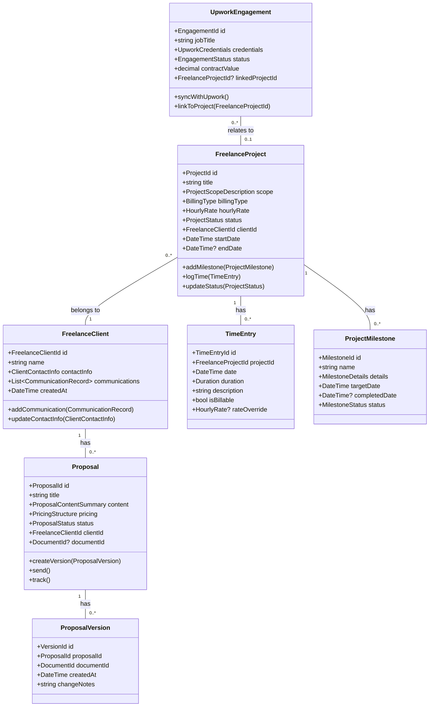
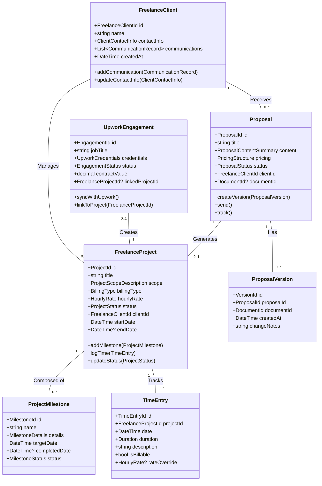
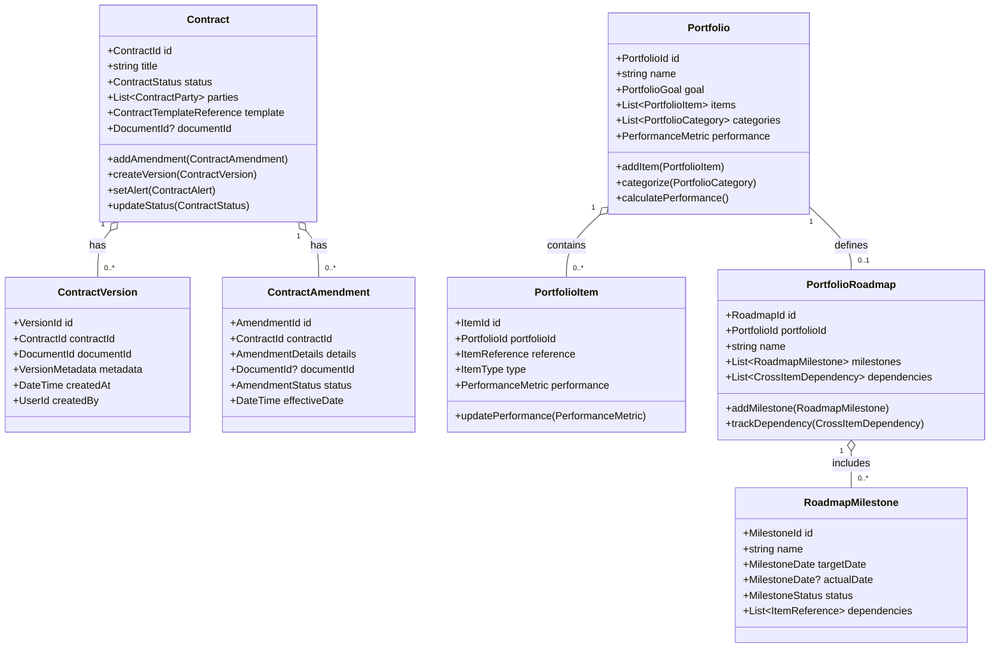
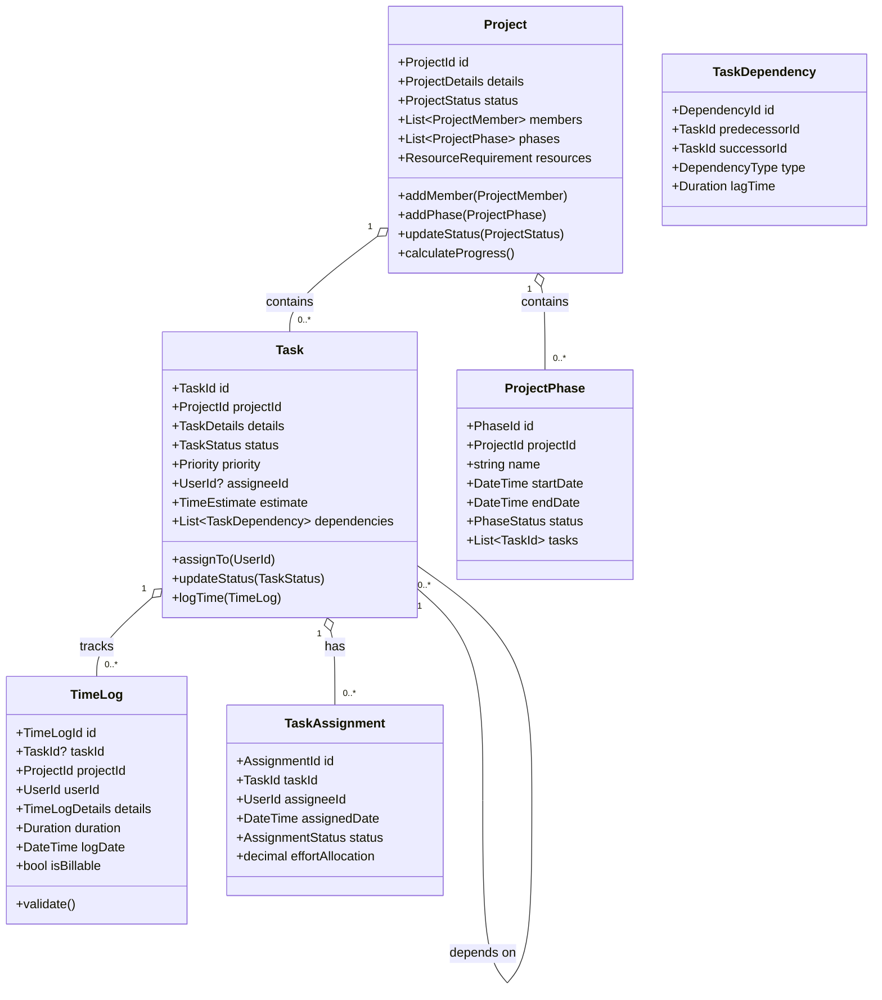
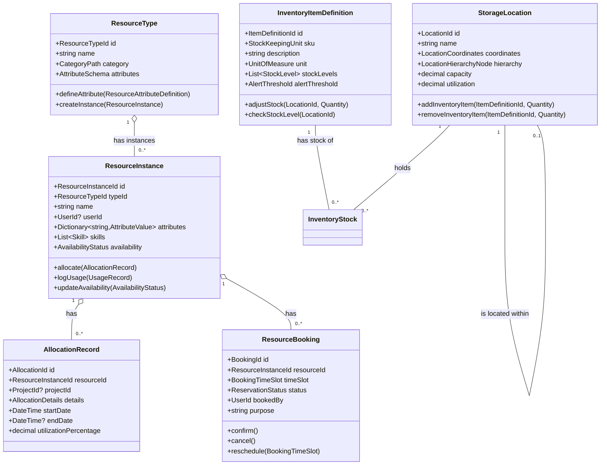
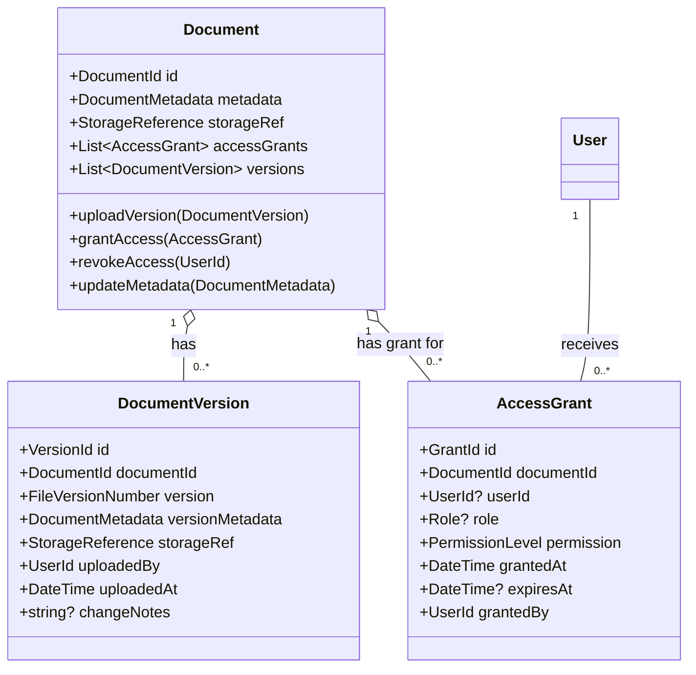
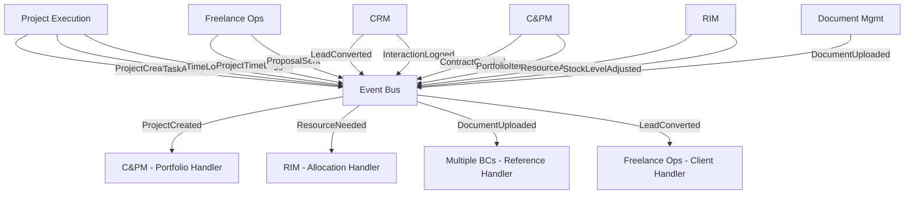

# Business Operations Platform Domain-Driven Design Architecture Specification
## Business Operations Platform

---

## Table of Contents

1. [Executive Summary](#1-executive-summary)
2. [Domain Architecture Overview](#2-domain-architecture-overview)
3. [Bounded Context Catalog](#3-bounded-context-catalog)
4. [Bounded Context Specifications](#4-bounded-context-specifications)
5. [Integration Patterns](#5-integration-patterns)
6. [Implementation Guidelines](#6-implementation-guidelines)
7. [Cross-Cutting Concerns](#7-cross-cutting-concerns)
8. [Dependency Matrix](#8-dependency-matrix)

---

## 1. Executive Summary

### 1.1 System Purpose
A comprehensive business operations platform integrating freelance workflow management, customer relationship management, contract administration, resource allocation, project execution, and document management to optimize business operations and client relationships.

### 1.2 Architecture Approach
- **Pattern**: Domain-Driven Design with CQRS and Event Sourcing
- **Framework**: ABP Framework (.NET)
- **Integration**: Event-driven architecture with eventual consistency
- **Scalability**: Microservices-ready bounded contexts

### 1.3 Core Domain Classification
- **Core Domains**: Freelance Operations, Customer Relationship Management, Contract & Portfolio Management, Project Execution
- **Supporting Domains**: Resource & Inventory Management
- **Generic Domains**: Document Management

---

## 2. Domain Architecture Overview

### 2.1 Context Map

```
┌─────────────────┐    ┌─────────────────┐    ┌─────────────────┐
│ Freelance Ops   │────│      CRM        │────│   C&PM         │
│   (Core)        │    │    (Core)       │    │   (Core)       │
└─────────────────┘    └─────────────────┘    └─────────────────┘
         │                       │                       │
         │                       │                       │
┌─────────────────┐    ┌─────────────────┐    ┌─────────────────┐
│Project Execution│    │      RIM        │    │Document Mgmt    │
│    (Core)       │    │  (Supporting)   │    │   (Generic)     │
└─────────────────┘    └─────────────────┘    └─────────────────┘
         │                       │                       │
         └───────────────────────┼───────────────────────┘
                                 │
        ┌────────────────────────┼────────────────────────┐
        │                       │                        │
        │                       │                        │
        │              All BCs use Document Management   │
        │              for file storage and retrieval    │
        └─────────────────────────────────────────────────┘
```

### 2.2 Strategic Design Principles

1. **Client-Centric Design**: Focus on customer and client lifecycle management
2. **Resource Optimization**: Efficient allocation and tracking of business resources
3. **Document Centralization**: Single source of truth for all business documents
4. **Workflow Automation**: Streamlined business processes with minimal manual intervention
5. **Portfolio Oversight**: High-level view of all business activities and performance

---

## 3. Bounded Context Catalog

| Context | Type | Priority | Complexity | Team Size |
|---------|------|----------|------------|-----------|
| Freelance Operations | Core | Critical | High | 3-4 |
| Customer Relationship Management | Core | Critical | High | 3-4 |
| Contract & Portfolio Management | Core | High | High | 3-4 |
| Project Execution | Core | High | Medium | 2-3 |
| Resource & Inventory Management | Supporting | Medium | Medium | 2-3 |
| Document Management | Generic | Medium | Low | 1-2 |

---

## 4. Bounded Context Specifications

### 4.1 Freelance Operations Bounded Context

#### 4.1.1 Context Overview
**Responsibility**: Manages the complete freelance workflow including project management, client relationships, proposal creation, Upwork integration, and client portal functionality.

**Strategic Classification**: Core Domain - Strategic

**Subdomains**:
- Freelance Project Management: Project creation and tracking specific to freelance work
- Client Management: Client relationship and communication tracking
- Proposal Management: Proposal creation, versioning, and tracking
- Upwork Integration: API integration with Upwork platform
- Client Portal: Client-facing interface for project collaboration

#### 4.1.2 Core Domain Model



#### 4.1.3 Aggregates Specification

##### FreelanceProject Aggregate Root
**Purpose**: Central entity managing freelance project lifecycle and billing

**Entities**:
- `TimeEntry`: Time tracking for billing and project monitoring
- `ProjectMilestone`: Key deliverables and checkpoints

**Value Objects**:
- `ProjectId`: Unique identifier
- `ProjectScopeDescription`: Detailed work description
- `BillingType`: Hourly, Fixed, Milestone-based
- `HourlyRate`: Rate structure with currency
- `ProjectStatus`: Freelance-specific statuses (Proposal, Active, Invoiced, Completed)

**Business Invariants**:
- Project must have valid billing type and associated rate structure
- Time entries must be within project date range
- Only active projects can accept new time entries
- Milestone dates must be chronologically ordered

##### FreelanceClient Aggregate Root
**Purpose**: Manages client information and communication history

**Entities**:
- `CommunicationRecord`: Interaction logs with timestamps and context

**Value Objects**:
- `FreelanceClientId`: Unique identifier
- `ClientContactInfo`: Contact details and preferences
- `CommunicationLog`: Structured communication data

**Business Invariants**:
- Client must have valid contact information
- Communication records are immutable once created
- Client deletion requires completion of all associated projects

##### Proposal Aggregate Root
**Purpose**: Manages proposal lifecycle from creation to acceptance

**Entities**:
- `ProposalVersion`: Version control for proposal iterations

**Value Objects**:
- `ProposalId`: Unique identifier
- `ProposalContentSummary`: Key proposal elements
- `PricingStructure`: Detailed pricing breakdown
- `ProposalStatus`: Sent, Viewed, Accepted, Rejected
- `DocumentId`: Reference to document in Document Management BC

**Business Invariants**:
- Proposals can only be sent to existing clients
- Accepted proposals cannot be modified
- Version history must be maintained for all changes

##### UpworkEngagement Aggregate Root
**Purpose**: Manages Upwork-specific engagements and synchronization

**Value Objects**:
- `EngagementId`: Unique identifier
- `UpworkCredentials`: API access credentials
- `EngagementStatus`: Upwork-specific statuses
- `FreelanceProjectId`: Optional link to internal project

**Business Invariants**:
- Engagement must have valid Upwork credentials
- Linked projects must exist in FreelanceProject aggregate
- Synchronization status must be tracked for data consistency

#### 4.1.4 Commands & Queries (CQRS)

##### Commands
**Project Management**:
```csharp
public record CreateFreelanceProject(
    string Title,
    ProjectScopeDescription Scope,
    BillingType BillingType,
    HourlyRate HourlyRate,
    FreelanceClientId ClientId,
    DateTime StartDate,
    DateTime? EndDate,
    UserId CreatedBy
);

public record LogProjectTime(
    ProjectId ProjectId,
    DateTime Date,
    Duration Duration,
    string Description,
    bool IsBillable,
    HourlyRate? RateOverride,
    UserId LoggedBy
);

public record UpdateProjectStatus(
    ProjectId ProjectId,
    ProjectStatus NewStatus,
    string? Notes,
    UserId UpdatedBy
);
```

**Client Management**:
```csharp
public record CreateFreelanceClient(
    string Name,
    ClientContactInfo ContactInfo,
    UserId CreatedBy
);

public record AddClientCommunication(
    FreelanceClientId ClientId,
    string Subject,
    string Content,
    CommunicationType Type,
    DateTime CommunicationDate,
    UserId LoggedBy
);

public record UpdateClientContactInfo(
    FreelanceClientId ClientId,
    ClientContactInfo NewContactInfo,
    UserId UpdatedBy
);
```

**Proposal Management**:
```csharp
public record CreateProposal(
    string Title,
    ProposalContentSummary Content,
    PricingStructure Pricing,
    FreelanceClientId ClientId,
    DocumentId? DocumentId,
    UserId CreatedBy
);

public record SendProposal(
    ProposalId ProposalId,
    string DeliveryMethod,
    string? RecipientEmail,
    UserId SentBy
);

public record TrackProposalStatus(
    ProposalId ProposalId,
    ProposalStatus Status,
    DateTime StatusDate,
    string? Notes
);
```

##### Queries
**Project Queries**:
```csharp
public record GetFreelanceProjectDetails(ProjectId ProjectId);
public record GetClientProjects(FreelanceClientId ClientId);
public record GetActiveProjects(UserId UserId);
public record GetProjectTimeEntries(ProjectId ProjectId, DateTime? StartDate = null, DateTime? EndDate = null);
```

**Client Queries**:
```csharp
public record GetFreelanceClientDetails(FreelanceClientId ClientId);
public record GetClientCommunicationHistory(FreelanceClientId ClientId);
public record SearchClients(string SearchTerm, ClientStatus? Status = null);
```

**Proposal Queries**:
```csharp
public record GetProposalDetails(ProposalId ProposalId);
public record GetClientProposals(FreelanceClientId ClientId);
public record GetProposalVersionHistory(ProposalId ProposalId);
```

#### 4.1.5 Events & Integration

##### Domain Events
```csharp
public class FreelanceProjectCreated : DomainEvent
{
    public ProjectId ProjectId { get; }
    public string Title { get; }
    public FreelanceClientId ClientId { get; }
    public BillingType BillingType { get; }
    public HourlyRate HourlyRate { get; }
    public UserId CreatedBy { get; }
}

public class ProjectTimeLogged : DomainEvent
{
    public ProjectId ProjectId { get; }
    public TimeEntryId TimeEntryId { get; }
    public Duration Duration { get; }
    public bool IsBillable { get; }
    public decimal BillableAmount { get; }
    public UserId LoggedBy { get; }
}

public class ProposalSent : DomainEvent
{
    public ProposalId ProposalId { get; }
    public FreelanceClientId ClientId { get; }
    public DocumentId? DocumentId { get; }
    public string DeliveryMethod { get; }
    public UserId SentBy { get; }
}

public class ClientCommunicationLogged : DomainEvent
{
    public FreelanceClientId ClientId { get; }
    public CommunicationRecordId RecordId { get; }
    public CommunicationType Type { get; }
    public DocumentId? AttachmentId { get; }
    public UserId LoggedBy { get; }
}
```

#### 4.1.6 Business Rules & Policies

##### Time Logging Policy
```csharp
public class TimeLoggingPolicy
{
    public ValidationResult ValidateTimeEntry(FreelanceProject project, TimeEntry entry)
    {
        var errors = new List<string>();
        
        // Cannot log time for inactive projects
        if (project.Status != ProjectStatus.Active)
            errors.Add("Cannot log time for inactive projects");
        
        // Time entry must be within project boundaries
        if (entry.Date < project.StartDate || 
            (project.EndDate.HasValue && entry.Date > project.EndDate))
            errors.Add("Time entry date must be within project timeline");
        
        // Duration must be positive
        if (entry.Duration <= TimeSpan.Zero)
            errors.Add("Duration must be positive");
        
        return new ValidationResult(errors);
    }
}
```

##### Proposal Workflow Policy
```csharp
public class ProposalWorkflowPolicy
{
    public bool CanModifyProposal(Proposal proposal)
    {
        return proposal.Status == ProposalStatus.Draft || 
               proposal.Status == ProposalStatus.UnderReview;
    }
    
    public bool CanSendProposal(Proposal proposal, FreelanceClient client)
    {
        return proposal.Status == ProposalStatus.Draft && 
               client.ContactInfo.IsValid() &&
               proposal.Content.IsComplete();
    }
}
```

---

### 4.2 Customer Relationship Management (CRM) Bounded Context

#### 4.2.1 Context Overview
**Responsibility**: Manages the complete customer lifecycle from lead capture to contact management, including interaction tracking, automation workflows, and analytics.

**Strategic Classification**: Core Domain - Strategic

**Subdomains**:
- Lead Management: Lead capture, qualification, and tracking
- Contact Management: Contact organization and relationship management
- Interaction Tracking: Communication history and engagement monitoring
- Automation Workflows: Automated follow-up and nurturing processes
- Analytics & Reporting: CRM performance and engagement analytics

#### 4.2.2 Core Domain Model



#### 4.2.3 Aggregates Specification

##### Lead Aggregate Root
**Purpose**: Manages potential customers from initial capture through qualification

**Entities**:
- `LeadSourceRecord`: Tracking of lead origin and attribution

**Value Objects**:
- `LeadId`: Unique identifier
- `LeadDetails`: Contact information and qualification data
- `LeadSource`: Web form, referral, advertisement, etc.
- `QualificationScore`: Numerical scoring based on criteria
- `LeadStatus`: New, Qualified, Converted, Lost

**Business Invariants**:
- Lead must have valid contact information
- Qualification score must be within defined range
- Converted leads cannot be modified
- Lead source must be tracked for analytics

##### Contact Aggregate Root
**Purpose**: Manages established customer relationships and interactions

**Entities**:
- `ContactGroup`: Grouping and segmentation information
- `ContactTag`: Flexible categorization system

**Value Objects**:
- `ContactId`: Unique identifier
- `ContactInfo`: Comprehensive contact details
- `EngagementLevel`: Active, Passive, Inactive
- `OrganizationId`: Optional link to organization

**Business Invariants**:
- Contact must have minimum required information
- Organization relationships must be valid
- Interaction history is immutable once logged
- Engagement level automatically updates based on activity

##### Organization Aggregate Root
**Purpose**: Manages company/organization entities and their contact relationships

**Value Objects**:
- `OrganizationId`: Unique identifier
- `OrganizationInfo`: Company details and metadata
- `OrganizationStatus`: Active, Inactive, Prospect, Customer

**Business Invariants**:
- Organization must have unique identifier within system
- Contact relationships must be valid
- Organization status transitions follow defined workflow

##### InteractionLog Aggregate Root
**Purpose**: Records all customer interactions and communication history

**Entities**:
- `CommunicationRecord`: Detailed interaction data
- `FollowUpTask`: Generated tasks from interactions

**Value Objects**:
- `InteractionId`: Unique identifier
- `InteractionType`: Email, Call, Meeting, Demo, etc.
- `DocumentId`: Optional attachment reference

**Business Invariants**:
- Interactions must be linked to valid contacts
- Timestamps must be accurate and immutable
- Attachment references must be valid documents

##### AutomationWorkflow Aggregate Root
**Purpose**: Manages automated processes for lead nurturing and follow-up

**Entities**:
- `WorkflowStep`: Individual automation actions
- `WorkflowExecutionRecord`: History of workflow executions

**Value Objects**:
- `WorkflowId`: Unique identifier
- `AutomationTriggerCondition`: Conditions that start workflow
- `AutomationActionType`: Email, Task, Status Update, etc.
- `WorkflowStatus`: Active, Inactive, Testing

**Business Invariants**:
- Workflows must have at least one step
- Trigger conditions must be valid and testable
- Execution history must be maintained for audit
- Active workflows cannot be deleted

#### 4.2.4 Commands & Queries (CQRS)

##### Commands
**Lead Management**:
```csharp
public record CaptureLead(
    LeadDetails Details,
    LeadSource Source,
    Dictionary<string, object> CustomFields,
    UserId CapturedBy
);

public record QualifyLead(
    LeadId LeadId,
    QualificationScore Score,
    string QualificationNotes,
    UserId QualifiedBy
);

public record ConvertLeadToContact(
    LeadId LeadId,
    ContactInfo ContactInfo,
    OrganizationId? OrganizationId,
    UserId ConvertedBy
);
```

**Contact Management**:
```csharp
public record CreateContact(
    ContactInfo ContactInfo,
    OrganizationId? OrganizationId,
    List<ContactTag> Tags,
    UserId CreatedBy
);

public record UpdateContactInfo(
    ContactId ContactId,
    ContactInfo NewContactInfo,
    UserId UpdatedBy
);

public record AddContactToGroup(
    ContactId ContactId,
    ContactGroupId GroupId,
    UserId AddedBy
);
```

**Interaction Management**:
```csharp
public record LogInteraction(
    ContactId ContactId,
    InteractionType Type,
    string Subject,
    string Content,
    DocumentId? AttachmentId,
    DateTime? CustomTimestamp,
    UserId LoggedBy
);

public record ScheduleFollowUp(
    ContactId ContactId,
    string Description,
    DateTime DueDate,
    Priority Priority,
    UserId ScheduledBy
);
```

**Automation Management**:
```csharp
public record ConfigureAutomation(
    string Name,
    AutomationTriggerCondition Trigger,
    List<WorkflowStepDefinition> Steps,
    UserId ConfiguredBy
);

public record TriggerAutomation(
    WorkflowId WorkflowId,
    ContactId ContactId,
    Dictionary<string, object> Context,
    UserId TriggeredBy
);
```

##### Queries
**Lead Queries**:
```csharp
public record GetLeadDetails(LeadId LeadId);
public record GetLeadsByStatus(LeadStatus Status, int PageNumber = 1, int PageSize = 20);
public record GetLeadsBySource(LeadSource Source, DateTime? StartDate = null, DateTime? EndDate = null);
public record SearchLeads(string SearchTerm, LeadStatus? Status = null);
```

**Contact Queries**:
```csharp
public record GetContactDetails(ContactId ContactId);
public record GetContactsByOrganization(OrganizationId OrganizationId);
public record GetContactsByEngagementLevel(EngagementLevel Level);
public record GetContactInteractionHistory(ContactId ContactId);
```

**Analytics Queries**:
```csharp
public record GetLeadConversionAnalytics(DateTime StartDate, DateTime EndDate);
public record GetContactEngagementReport(ContactGroupId? GroupId = null);
public record GetLeadSourcePerformance(DateTime StartDate, DateTime EndDate);
```

#### 4.2.5 Events & Integration

##### Domain Events
```csharp
public class LeadCaptured : DomainEvent
{
    public LeadId LeadId { get; }
    public LeadDetails Details { get; }
    public LeadSource Source { get; }
    public DateTime CapturedAt { get; }
    public UserId CapturedBy { get; }
}

public class LeadQualified : DomainEvent
{
    public LeadId LeadId { get; }
    public QualificationScore Score { get; }
    public QualificationScore? PreviousScore { get; }
    public UserId QualifiedBy { get; }
}

public class LeadConvertedToContact : DomainEvent
{
    public LeadId LeadId { get; }
    public ContactId NewContactId { get; }
    public OrganizationId? OrganizationId { get; }
    public UserId ConvertedBy { get; }
}

public class InteractionLogged : DomainEvent
{
    public InteractionId InteractionId { get; }
    public ContactId ContactId { get; }
    public InteractionType Type { get; }
    public DocumentId? AttachmentId { get; }
    public UserId LoggedBy { get; }
}

public class AutomationWorkflowTriggered : DomainEvent
{
    public WorkflowId WorkflowId { get; }
    public ContactId ContactId { get; }
    public AutomationTriggerCondition TriggerCondition { get; }
    public List<WorkflowStep> Steps { get; }
}
```

#### 4.2.6 Business Rules & Policies

##### Lead Qualification Policy
```csharp
public class LeadQualificationPolicy
{
    public QualificationScore CalculateScore(Lead lead, Dictionary<string, object> criteria)
    {
        var score = 0;
        
        // Company size scoring
        if (criteria.ContainsKey("CompanySize"))
        {
            var size = criteria["CompanySize"].ToString();
            score += size switch
            {
                "Enterprise" => 40,
                "Mid-Market" => 30,
                "Small Business" => 20,
                "Startup" => 10,
                _ => 0
            };
        }
        
        // Budget scoring
        if (criteria.ContainsKey("Budget") && decimal.TryParse(criteria["Budget"].ToString(), out var budget))
        {
            score += budget switch
            {
                >= 100000 => 30,
                >= 50000 => 20,
                >= 10000 => 15,
                >= 1000 => 10,
                _ => 0
            };
        }
        
        // Timeline scoring
        if (criteria.ContainsKey("Timeline"))
        {
            var timeline = criteria["Timeline"].ToString();
            score += timeline switch
            {
                "Immediate" => 30,
                "Within 30 days" => 25,
                "Within 90 days" => 15,
                "Future" => 5,
                _ => 0
            };
        }
        
        return new QualificationScore(Math.Min(score, 100));
    }
}
```

##### Automation Trigger Policy
```csharp
public class AutomationTriggerPolicy
{
    public bool ShouldTriggerWorkflow(AutomationWorkflow workflow, Contact contact, InteractionLog? interaction = null)
    {
        return workflow.Trigger.Type switch
        {
            TriggerType.NewContact => interaction == null,
            TriggerType.NewInteraction => interaction != null,
            TriggerType.EngagementDrop => contact.Engagement == EngagementLevel.Passive && 
                                         GetLastInteractionDate(contact) < DateTime.Now.AddDays(-30),
            TriggerType.QualificationScore => contact.QualificationScore >= workflow.Trigger.MinScore,
            _ => false
        };
    }
}
```

---

### 4.3 Contract & Portfolio Management (C&PM) Bounded Context

#### 4.3.1 Context Overview
**Responsibility**: Manages contract lifecycle from creation to completion, maintains portfolio oversight of all business initiatives, and provides high-level strategic planning and roadmapping capabilities.

**Strategic Classification**: Core Domain - Strategic

**Subdomains**:
- Contract Management: Contract creation, versioning, and lifecycle tracking
- Portfolio Management: High-level oversight of projects and contracts
- Portfolio Roadmapping: Strategic planning and milestone tracking
- Risk & Compliance: Risk assessment and compliance monitoring
- Document Integration: Contract document management and versioning

#### 4.3.2 Core Domain Model



#### 4.3.3 Aggregates Specification

##### Contract Aggregate Root
**Purpose**: Manages contract lifecycle, versions, and amendments

**Entities**:
- `ContractVersion`: Version control for contract documents
- `ContractAmendment`: Contract modifications and addendums
- `ContractParty`: Parties involved in the contract
- `ContractAlert`: Automated alerts for contract milestones

**Value Objects**:
- `ContractId`: Unique identifier
- `ContractTemplateReference`: Reference to contract template
- `ContractTermsData`: Structured contract terms
- `ContractStatus`: Draft, Active, Pending Renewal, Expired, Terminated
- `DocumentId`: Reference to document in Document Management BC
- `AlertCondition`: Conditions triggering alerts

**Business Invariants**:
- Contract must have at least two parties
- Active contracts cannot be deleted
- Amendments require approval workflow
- Version history must be maintained

##### Portfolio Aggregate Root
**Purpose**: Provides high-level view and management of business initiatives

**Entities**:
- `PortfolioItem`: Individual projects, contracts, or initiatives
- `PortfolioCategory`: Organizational structure for items
- `PortfolioRisk`: Risk assessment and tracking
- `PortfolioComplianceRecord`: Compliance monitoring

**Value Objects**:
- `PortfolioId`: Unique identifier
- `PortfolioGoal`: Strategic objectives and KPIs
- `ItemReference`: References to external entities (ProjectId, ContractId)
- `PerformanceMetric`: Performance measurement data
- `SharingLink`: Portfolio sharing capabilities
- `AccessPermissions`: Access control settings

**Business Invariants**:
- Portfolio items must reference valid external entities
- Performance metrics must be consistently calculated
- Sharing permissions must be validated
- Risk assessments must be current

##### PortfolioRoadmap Aggregate Root
**Purpose**: Strategic planning and timeline management across portfolio items

**Entities**:
- `RoadmapMilestone`: Key strategic milestones
- `CrossItemDependency`: Dependencies between portfolio items

**Value Objects**:
- `RoadmapId`: Unique identifier
- `MilestoneDate`: Planned and actual milestone dates
- `DependencyType`: Finish-to-Start, Start-to-Start, etc.
- `ResourceSkillRequirement`: Required skills for milestones

**Business Invariants**:
- Milestones must have valid target dates
- Dependencies cannot create circular references
- Resource requirements must be feasible
- Timeline adjustments must cascade to dependent items

#### 4.3.4 Commands & Queries (CQRS)

##### Commands
**Contract Management**:
```csharp
public record CreateContract(
    string Title,
    ContractTemplateReference Template,
    List<ContractParty> Parties,
    ContractTermsData Terms,
    DocumentId? DocumentId,
    UserId CreatedBy
);

public record VersionContract(
    ContractId ContractId,
    DocumentId NewDocumentId,
    VersionMetadata Metadata,
    string ChangeNotes,
    UserId VersionedBy
);

public record AddContractAmendment(
    ContractId ContractId,
    AmendmentDetails Details,
    DateTime EffectiveDate,
    DocumentId? DocumentId,
    UserId CreatedBy
);

public record SetContractAlert(
    ContractId ContractId,
    AlertCondition Condition,
    DateTime TriggerDate,
    string AlertMessage,
    UserId CreatedBy
);
```

**Portfolio Management**:
```csharp
public record CreatePortfolio(
    string Name,
    PortfolioGoal Goal,
    AccessPermissions Permissions,
    UserId CreatedBy
);

public record AddPortfolioItem(
    PortfolioId PortfolioId,
    ItemReference Reference,
    ItemType Type,
    PerformanceMetric InitialPerformance,
    UserId AddedBy
);

public record CategorizePortfolioItem(
    PortfolioId PortfolioId,
    ItemId ItemId,
    PortfolioCategory Category,
    UserId CategorizedBy
);

public record UpdatePortfolioPerformance(
    PortfolioId PortfolioId,
    Dictionary<string, decimal> Metrics,
    DateTime CalculationDate,
    UserId UpdatedBy
);
```

**Roadmap Management**:
```csharp
public record CreatePortfolioRoadmap(
    PortfolioId PortfolioId,
    string Name,
    List<RoadmapMilestone> InitialMilestones,
    UserId CreatedBy
);

public record AddRoadmapMilestone(
    RoadmapId RoadmapId,
    string Name,
    MilestoneDate TargetDate,
    List<ItemReference> Dependencies,
    ResourceSkillRequirement? ResourceRequirement,
    UserId AddedBy
);

public record TrackCrossItemDependency(
    RoadmapId RoadmapId,
    ItemReference PredecessorItem,
    ItemReference SuccessorItem,
    DependencyType Type,
    UserId TrackedBy
);
```

##### Queries
**Contract Queries**:
```csharp
public record GetContractDetails(ContractId ContractId);
public record GetContractVersionHistory(ContractId ContractId);
public record GetContractsByStatus(ContractStatus Status);
public record GetContractsExpiringBy(DateTime ExpirationDate);
public record GetContractAmendments(ContractId ContractId);
```

**Portfolio Queries**:
```csharp
public record GetPortfolioOverview(PortfolioId PortfolioId);
public record GetPortfolioItems(PortfolioId PortfolioId, ItemType? TypeFilter = null);
public record GetPortfolioPerformance(PortfolioId PortfolioId, DateTime? AsOfDate = null);
public record GetPortfolioRisks(PortfolioId PortfolioId, RiskLevel? MinLevel = null);
```

**Roadmap Queries**:
```csharp
public record GetPortfolioRoadmap(RoadmapId RoadmapId);
public record GetRoadmapMilestones(RoadmapId RoadmapId, DateTime? StartDate = null, DateTime? EndDate = null);
public record GetCrossItemDependencies(RoadmapId RoadmapId);
```

#### 4.3.5 Events & Integration

##### Domain Events
```csharp
public class ContractCreated : DomainEvent
{
    public ContractId ContractId { get; }
    public string Title { get; }
    public List<ContractParty> Parties { get; }
    public DocumentId? DocumentId { get; }
    public UserId CreatedBy { get; }
}

public class ContractVersioned : DomainEvent
{
    public ContractId ContractId { get; }
    public VersionId NewVersionId { get; }
    public DocumentId NewDocumentId { get; }
    public VersionMetadata Metadata { get; }
    public UserId VersionedBy { get; }
}

public class PortfolioCreated : DomainEvent
{
    public PortfolioId PortfolioId { get; }
    public string Name { get; }
    public PortfolioGoal Goal { get; }
    public UserId CreatedBy { get; }
}

public class PortfolioItemAdded : DomainEvent
{
    public PortfolioId PortfolioId { get; }
    public ItemId ItemId { get; }
    public ItemReference Reference { get; }
    public ItemType Type { get; }
    public UserId AddedBy { get; }
}

public class RoadmapMilestoneCompleted : DomainEvent
{
    public RoadmapId RoadmapId { get; }
    public MilestoneId MilestoneId { get; }
    public DateTime CompletedDate { get; }
    public List<ItemReference> AffectedItems { get; }
}
```

#### 4.3.6 Business Rules & Policies

##### Contract Amendment Policy
```csharp
public class ContractAmendmentPolicy
{
    public bool CanAmendContract(Contract contract, UserId requestingUser)
    {
        // Cannot amend expired or terminated contracts
        if (contract.Status == ContractStatus.Expired || 
            contract.Status == ContractStatus.Terminated)
            return false;
        
        // Check if user has amendment rights
        return contract.Parties.Any(p => p.AuthorizedUsers.Contains(requestingUser) && 
                                        p.Permissions.CanAmend);
    }
    
    public AmendmentApprovalRequirement GetApprovalRequirement(Contract contract, AmendmentDetails amendment)
    {
        // High-value amendments require additional approval
        if (amendment.ContractValueChange > 50000)
            return AmendmentApprovalRequirement.ExecutiveApproval;
        
        // Scope changes require manager approval
        if (amendment.ScopeChanges.Any())
            return AmendmentApprovalRequirement.ManagerApproval;
        
        return AmendmentApprovalRequirement.StandardApproval;
    }
}
```

##### Portfolio Performance Calculation Policy
```csharp
public class PortfolioPerformancePolicy
{
    public PerformanceMetric CalculatePortfolioPerformance(Portfolio portfolio, List<PortfolioItem> items)
    {
        var totalBudget = items.Sum(i => i.Performance.Budget);
        var totalSpent = items.Sum(i => i.Performance.ActualSpent);
        var completedItems = items.Count(i => i.Performance.Status == ItemStatus.Completed);
        var totalItems = items.Count;
        
        var budgetVariance = totalBudget > 0 ? (totalSpent - totalBudget) / totalBudget * 100 : 0;
        var completionRate = totalItems > 0 ? (decimal)completedItems / totalItems * 100 : 0;
        
        // Calculate overall health score
        var healthScore = CalculateHealthScore(budgetVariance, completionRate, items);
        
        return new PerformanceMetric(
            budgetVariance,
            completionRate,
            healthScore,
            DateTime.UtcNow
        );
    }
    
    private decimal CalculateHealthScore(decimal budgetVariance, decimal completionRate, List<PortfolioItem> items)
    {
        var score = 100m;
        
        // Penalize budget overruns
        score -= Math.Max(0, budgetVariance * 0.5m);
        
        // Reward high completion rates
        score += (completionRate - 50) * 0.3m;
        
        // Consider risk factors
        var highRiskItems = items.Count(i => i.Performance.RiskLevel == RiskLevel.High);
        score -= highRiskItems * 5;
        
        return Math.Max(0, Math.Min(100, score));
    }
}
```

---

### 4.4 Project Execution Bounded Context

#### 4.4.1 Context Overview
**Responsibility**: Manages detailed project execution including task management, time tracking, resource assignment, and project monitoring.

**Strategic Classification**: Core Domain - Strategic

**Subdomains**:
- Project Management: Project creation, planning, and lifecycle management
- Task Management: Detailed task creation, assignment, and tracking
- Time Tracking: Time logging and project effort monitoring
- Resource Assignment: Resource allocation and workload management
- Progress Monitoring: Project status and performance tracking

#### 4.4.2 Core Domain Model



#### 4.4.3 Aggregates Specification

##### Project Aggregate Root
**Purpose**: Central entity managing project execution and coordination

**Entities**:
- `ProjectMember`: Team members and their roles
- `ProjectPhase`: Project phases and milestones
- `ProjectMilestone`: Key deliverables and checkpoints

**Value Objects**:
- `ProjectId`: Unique identifier (canonical reference for other BCs)
- `ProjectDetails`: Name, description, objectives, timeline
- `ProjectStatus`: Planning, Active, On Hold, Completed, Cancelled
- `ResourceRequirement`: Skills and roles needed for project

**Business Invariants**:
- Project must have at least one team member with Owner role
- End date must be after start date
- Cannot delete project with active tasks
- Phase dates must be within project timeline

##### Task Aggregate Root
**Purpose**: Represents individual work items within projects

**Entities**:
- `TaskAssignment`: Assignment history and current assignee
- `TaskDependency`: Relationships between tasks

**Value Objects**:
- `TaskId`: Unique identifier
- `TaskDetails`: Description, acceptance criteria, estimate
- `TaskStatus`: ToDo, InProgress, Done, Blocked
- `Priority`: Critical, High, Medium, Low
- `TimeEstimate`: Estimated effort to complete

**Business Invariants**:
- Task must belong to a valid project
- Only one active assignment per task
- Dependencies cannot create circular references
- Estimated time must be positive

##### TimeLog Aggregate Root
**Purpose**: Records time spent on projects and tasks

**Value Objects**:
- `TimeLogId`: Unique identifier
- `TimeLogDetails`: Description, activity type, notes
- `Duration`: Time spent
- `LogDate`: Date of work performed
- `IsBillable`: Whether time is billable to client

**Business Invariants**:
- Time log must reference valid project or task
- Duration must be positive
- Log date cannot be in the future
- User must be project member to log time

#### 4.4.4 Commands & Queries (CQRS)

##### Commands
**Project Management**:
```csharp
public record CreateProject(
    ProjectDetails Details,
    ResourceRequirement Resources,
    List<ProjectMemberDefinition> InitialMembers,
    UserId CreatedBy
);

public record AddProjectMember(
    ProjectId ProjectId,
    UserId MemberId,
    ProjectRole Role,
    decimal EffortAllocation,
    UserId AddedBy
);

public record DefineProjectPhase(
    ProjectId ProjectId,
    string Name,
    DateTime StartDate,
    DateTime EndDate,
    List<TaskId> AssociatedTasks,
    UserId DefinedBy
);

public record UpdateProjectStatus(
    ProjectId ProjectId,
    ProjectStatus NewStatus,
    string? Reason,
    UserId UpdatedBy
);
```

**Task Management**:
```csharp
public record CreateTask(
    ProjectId ProjectId,
    TaskDetails Details,
    Priority Priority,
    TimeEstimate Estimate,
    UserId? InitialAssigneeId,
    UserId CreatedBy
);

public record AssignTask(
    TaskId TaskId,
    UserId AssigneeId,
    decimal EffortAllocation,
    UserId AssignedBy
);

public record SetTaskDependency(
    TaskId PredecessorId,
    TaskId SuccessorId,
    DependencyType Type,
    Duration LagTime,
    UserId SetBy
);

public record UpdateTaskStatus(
    TaskId TaskId,
    TaskStatus NewStatus,
    string? Notes,
    UserId UpdatedBy
);
```

**Time Tracking**:
```csharp
public record LogTime(
    ProjectId ProjectId,
    TaskId? TaskId,
    Duration Duration,
    DateTime LogDate,
    TimeLogDetails Details,
    bool IsBillable,
    UserId LoggedBy
);

public record UpdateTimeLog(
    TimeLogId TimeLogId,
    Duration NewDuration,
    TimeLogDetails NewDetails,
    bool IsBillable,
    UserId UpdatedBy
);
```

##### Queries
**Project Queries**:
```csharp
public record GetProjectDetails(ProjectId ProjectId);
public record GetProjectPlan(ProjectId ProjectId);
public record GetProjectStatusReport(ProjectId ProjectId);
public record GetProjectsByStatus(ProjectStatus Status, UserId? MemberFilter = null);
```

**Task Queries**:
```csharp
public record GetTaskDetails(TaskId TaskId);
public record GetUserTasks(UserId UserId, TaskStatus? StatusFilter = null);
public record GetProjectTasks(ProjectId ProjectId);
public record GetTaskDependencies(TaskId TaskId);
```

**Time Tracking Queries**:
```csharp
public record GetProjectTimeLogs(ProjectId ProjectId, DateTime? StartDate = null, DateTime? EndDate = null);
public record GetUserTimeLogs(UserId UserId, DateTime StartDate, DateTime EndDate);
public record GetResourceWorkload(UserId UserId, DateTime StartDate, DateTime EndDate);
```

#### 4.4.5 Events & Integration

##### Domain Events
```csharp
public class ProjectCreated : DomainEvent
{
    public ProjectId ProjectId { get; }
    public ProjectDetails Details { get; }
    public List<ProjectMember> InitialMembers { get; }
    public UserId CreatedBy { get; }
}

public class TaskCreated : DomainEvent
{
    public TaskId TaskId { get; }
    public ProjectId ProjectId { get; }
    public TaskDetails Details { get; }
    public Priority Priority { get; }
    public UserId CreatedBy { get; }
}

public class TaskAssigned : DomainEvent
{
    public TaskId TaskId { get; }
    public ProjectId ProjectId { get; }
    public UserId AssigneeId { get; }
    public decimal EffortAllocation { get; }
    public UserId AssignedBy { get; }
}

public class TimeLogged : DomainEvent
{
    public TimeLogId TimeLogId { get; }
    public ProjectId ProjectId { get; }
    public TaskId? TaskId { get; }
    public UserId UserId { get; }
    public Duration Duration { get; }
    public bool IsBillable { get; }
}

public class ProjectCompleted : DomainEvent
{
    public ProjectId ProjectId { get; }
    public DateTime CompletedDate { get; }
    public ProjectStatistics FinalStatistics { get; }
    public UserId CompletedBy { get; }
}
```

#### 4.4.6 Business Rules & Policies

##### Task Assignment Policy
```csharp
public class TaskAssignmentPolicy
{
    public ValidationResult ValidateTaskAssignment(Task task, UserId assigneeId, decimal effortAllocation)
    {
        var errors = new List<string>();
        
        // Assignee must be project member
        if (!IsProjectMember(task.ProjectId, assigneeId))
            errors.Add("Assignee must be a member of the project");
        
        // Effort allocation must be valid
        if (effortAllocation <= 0 || effortAllocation > 1)
            errors.Add("Effort allocation must be between 0 and 1");
        
        // Check resource availability
        if (!HasAvailableCapacity(assigneeId, effortAllocation, task.Estimate))
            errors.Add("Assignee does not have sufficient available capacity");
        
        return new ValidationResult(errors);
    }
}
```

##### Time Logging Policy
```csharp
public class TimeLoggingPolicy
{
    public ValidationResult ValidateTimeLog(TimeLog timeLog, Project project)
    {
        var errors = new List<string>();
        
        // User must be project member
        if (!project.Members.Any(m => m.UserId == timeLog.UserId))
            errors.Add("Only project members can log time");
        
        // Log date cannot be in the future
        if (timeLog.LogDate > DateTime.Today)
            errors.Add("Cannot log time for future dates");
        
        // Duration must be reasonable
        if (timeLog.Duration > TimeSpan.FromHours(24))
            errors.Add("Time log duration cannot exceed 24 hours");
        
        // If task specified, must belong to project
        if (timeLog.TaskId.HasValue && !project.Tasks.Contains(timeLog.TaskId.Value))
            errors.Add("Task must belong to the project");
        
        return new ValidationResult(errors);
    }
}
```

---

### 4.5 Resource & Inventory Management (RIM) Bounded Context

#### 4.5.1 Context Overview
**Responsibility**: Manages all organizational resources including human resources, equipment, and inventory items with comprehensive tracking, allocation, and optimization capabilities.

**Strategic Classification**: Supporting Domain

**Subdomains**:
- Resource Definition: Resource type and instance management
- Resource Allocation: Assignment and booking of resources
- Inventory Management: Stock tracking and inventory operations
- Resource Optimization: Utilization analysis and optimization
- Location Management: Physical and logical storage management

#### 4.5.2 Core Domain Model



#### 4.5.3 Aggregates Specification

##### ResourceType Aggregate Root
**Purpose**: Defines categories and attributes for different types of resources

**Entities**:
- `ResourceAttributeDefinition`: Defines custom attributes for resource types

**Value Objects**:
- `ResourceTypeId`: Unique identifier
- `CategoryPath`: Hierarchical categorization
- `AttributeSchema`: Definition of available attributes

**Business Invariants**:
- Resource type names must be unique within category
- Attribute definitions cannot be deleted if in use
- Category paths must be valid hierarchical structures

##### ResourceInstance Aggregate Root
**Purpose**: Represents specific trackable resources with allocation and usage tracking

**Entities**:
- `AllocationRecord`: Historical and current resource allocations
- `UsageRecord`: Usage tracking and metrics

**Value Objects**:
- `ResourceInstanceId`: Unique identifier
- `UserId`: Link to identity system for human resources
- `AttributeValue`: Typed attribute values
- `Skill`: Skills associated with human resources
- `AvailabilityStatus`: Available, Allocated, Maintenance, Retired

**Business Invariants**:
- Human resources must have valid UserId
- Allocation percentages cannot exceed 100%
- Retired resources cannot be allocated
- Usage records must have positive duration

##### InventoryItemDefinition Aggregate Root
**Purpose**: Defines stockable items with multi-location inventory tracking

**Entities**:
- `StockLevel`: Current stock at specific locations
- `InventoryTransaction`: All stock movements and adjustments

**Value Objects**:
- `ItemDefinitionId`: Unique identifier
- `StockKeepingUnit`: SKU for item identification
- `UnitOfMeasure`: Units for quantity tracking
- `AlertThreshold`: Automatic alert configuration
- `Quantity`: Typed quantity with unit validation

**Business Invariants**:
- SKUs must be unique across all items
- Stock levels cannot be negative
- Transactions must balance (total in = total out + current stock)
- Alert thresholds must be positive

##### ResourceBooking Aggregate Root
**Purpose**: Manages resource reservations and scheduling

**Value Objects**:
- `BookingId`: Unique identifier
- `BookingTimeSlot`: Start and end time for reservation
- `ReservationStatus`: Pending, Confirmed, In-Use, Completed, Cancelled
- `Purpose`: Reason for booking

**Business Invariants**:
- Bookings cannot overlap for the same resource
- Past bookings cannot be modified
- Confirmed bookings require cancellation before modification

##### StorageLocation Aggregate Root
**Purpose**: Manages physical and logical locations for inventory storage

**Entities**:
- `LocationHierarchyNode`: Parent-child relationships between locations

**Value Objects**:
- `LocationId`: Unique identifier
- `LocationCoordinates`: Physical coordinates if applicable
- `Capacity`: Maximum storage capacity
- `Utilization`: Current usage percentage

**Business Invariants**:
- Location hierarchy cannot have cycles
- Utilization cannot exceed capacity
- Child location capacity cannot exceed parent capacity

#### 4.5.4 Commands & Queries (CQRS)

##### Commands
**Resource Definition**:
```csharp
public record DefineResourceType(
    string Name,
    CategoryPath Category,
    List<ResourceAttributeDefinition> Attributes,
    UserId DefinedBy
);

public record CreateResourceInstance(
    ResourceTypeId TypeId,
    string Name,
    UserId? UserId, // For human resources
    Dictionary<string, AttributeValue> Attributes,
    List<Skill> Skills,
    UserId CreatedBy
);

public record DefineInventoryItem(
    StockKeepingUnit Sku,
    string Description,
    UnitOfMeasure Unit,
    AlertThreshold AlertThreshold,
    UserId DefinedBy
);
```

**Resource Allocation**:
```csharp
public record AllocateResource(
    ResourceInstanceId ResourceId,
    ProjectId? ProjectId,
    AllocationDetails Details,
    DateTime StartDate,
    DateTime? EndDate,
    decimal UtilizationPercentage,
    UserId AllocatedBy
);

public record BookResource(
    ResourceInstanceId ResourceId,
    BookingTimeSlot TimeSlot,
    string Purpose,
    UserId BookedBy
);

public record LogResourceUsage(
    ResourceInstanceId ResourceId,
    DateTime UsageDate,
    Duration Duration,
    UsageMetric Metrics,
    string? Notes,
    UserId LoggedBy
);
```

**Inventory Management**:
```csharp
public record AdjustStockLevel(
    ItemDefinitionId ItemId,
    LocationId LocationId,
    Quantity AdjustmentAmount,
    TransactionType Type,
    string Reason,
    UserId AdjustedBy
);

public record ConductInventoryAudit(
    LocationId LocationId,
    List<ItemQuantityCount> ActualCounts,
    UserId ConductedBy
);

public record CreateStorageLocation(
    string Name,
    LocationCoordinates? Coordinates,
    LocationId? ParentLocationId,
    decimal Capacity,
    UserId CreatedBy
);
```

##### Queries
**Resource Queries**:
```csharp
public record GetResourceTypeDetails(ResourceTypeId TypeId);
public record ListResourceInstances(
    ResourceTypeId? TypeFilter = null,
    List<Skill>? SkillFilter = null,
    AvailabilityStatus? AvailabilityFilter = null
);
public record GetResourceAllocation(ResourceInstanceId ResourceId);
public record GetResourceAvailability(ResourceInstanceId ResourceId, DateTime StartDate, DateTime EndDate);
```

**Inventory Queries**:
```csharp
public record GetInventoryItemDefinition(ItemDefinitionId ItemId);
public record GetStockLevelByItemAndLocation(ItemDefinitionId ItemId, LocationId LocationId);
public record GetLowStockAlerts(LocationId? LocationFilter = null);
public record GetInventoryTransactionHistory(ItemDefinitionId ItemId, DateTime? StartDate = null);
```

**Analytics Queries**:
```csharp
public record GetResourceUtilizationReport(
    DateTime StartDate,
    DateTime EndDate,
    ResourceTypeId? TypeFilter = null
);
public record GetInventoryTurnoverAnalysis(
    DateTime StartDate,
    DateTime EndDate,
    CategoryPath? CategoryFilter = null
);
```

#### 4.5.5 Events & Integration

##### Domain Events
```csharp
public class ResourceInstanceAvailable : DomainEvent
{
    public ResourceInstanceId ResourceId { get; }
    public ResourceTypeId TypeId { get; }
    public string Name { get; }
    public UserId? UserId { get; }
    public List<Skill> Skills { get; }
    public UserId CreatedBy { get; }
}

public class ResourceAllocated : DomainEvent
{
    public ResourceInstanceId ResourceId { get; }
    public ProjectId? ProjectId { get; }
    public AllocationDetails Details { get; }
    public decimal UtilizationPercentage { get; }
    public DateTime StartDate { get; }
    public DateTime? EndDate { get; }
    public UserId AllocatedBy { get; }
}

public class StockLevelAdjusted : DomainEvent
{
    public ItemDefinitionId ItemId { get; }
    public LocationId LocationId { get; }
    public Quantity PreviousLevel { get; }
    public Quantity NewLevel { get; }
    public Quantity AdjustmentAmount { get; }
    public TransactionType Type { get; }
    public string Reason { get; }
    public UserId AdjustedBy { get; }
}

public class ResourceBooked : DomainEvent
{
    public BookingId BookingId { get; }
    public ResourceInstanceId ResourceId { get; }
    public BookingTimeSlot TimeSlot { get; }
    public string Purpose { get; }
    public UserId BookedBy { get; }
}

public class InventoryAuditCompleted : DomainEvent
{
    public LocationId LocationId { get; }
    public List<AuditDiscrepancy> Discrepancies { get; }
    public AuditResult Result { get; }
    public UserId ConductedBy { get; }
}
```

#### 4.5.6 Business Rules & Policies

##### Resource Allocation Policy
```csharp
public class ResourceAllocationPolicy
{
    public ValidationResult ValidateAllocation(
        ResourceInstance resource,
        AllocationDetails allocation,
        decimal utilizationPercentage)
    {
        var errors = new List<string>();
        
        // Check resource availability
        if (resource.Availability != AvailabilityStatus.Available)
            errors.Add("Resource is not available for allocation");
        
        // Check utilization limits
        var currentUtilization = GetCurrentUtilization(resource.Id);
        if (currentUtilization + utilizationPercentage > 100)
            errors.Add($"Allocation would exceed 100% utilization (current: {currentUtilization}%)");
        
        // Check skill requirements
        if (allocation.RequiredSkills != null && 
            !allocation.RequiredSkills.All(skill => resource.Skills.Contains(skill)))
            errors.Add("Resource does not have all required skills");
        
        return new ValidationResult(errors);
    }
}
```

##### Inventory Management Policy
```csharp
public class InventoryManagementPolicy
{
    public bool ShouldTriggerAlert(InventoryItemDefinition item, StockLevel stockLevel)
    {
        return stockLevel.Quantity <= item.AlertThreshold.MinimumQuantity ||
               (item.AlertThreshold.MaximumQuantity.HasValue && 
                stockLevel.Quantity >= item.AlertThreshold.MaximumQuantity);
    }
    
    public ValidationResult ValidateStockAdjustment(
        InventoryItemDefinition item,
        LocationId locationId,
        Quantity adjustmentAmount,
        TransactionType type)
    {
        var errors = new List<string>();
        
        // Cannot reduce stock below zero
        if (type == TransactionType.Outbound)
        {
            var currentStock = GetCurrentStockLevel(item.Id, locationId);
            if (currentStock.Quantity < adjustmentAmount)
                errors.Add("Insufficient stock for outbound transaction");
        }
        
        // Adjustment amount must be positive
        if (adjustmentAmount.Value <= 0)
            errors.Add("Adjustment amount must be positive");
        
        // Unit of measure must match
        if (adjustmentAmount.Unit != item.Unit)
            errors.Add("Adjustment unit must match item unit of measure");
        
        return new ValidationResult(errors);
    }
}
```

---

### 4.6 Document Management Bounded Context

#### 4.6.1 Context Overview
**Responsibility**: Provides centralized document storage, retrieval, versioning, and access control for all business documents across the platform.

**Strategic Classification**: Generic Domain

**Subdomains**:
- Document Storage: File upload, storage, and retrieval
- Version Management: Document versioning and history tracking
- Access Control: Permission management and security
- Metadata Management: Document properties and searchability

#### 4.6.2 Core Domain Model



#### 4.6.3 Aggregates Specification

##### Document Aggregate Root
**Purpose**: Central entity managing document lifecycle, versions, and access control

**Entities**:
- `DocumentVersion`: Version history and metadata
- `AccessGrant`: Permission assignments for users and roles

**Value Objects**:
- `DocumentId`: Unique identifier
- `DocumentMetadata`: Filename, size, MIME type, upload information
- `StorageReference`: Internal pointer to blob storage location
- `FileVersionNumber`: Version numbering scheme
- `PermissionLevel`: View, Edit, Admin

**Business Invariants**:
- Documents must have at least one version
- Access grants must reference valid users or roles
- Storage references must be valid and accessible
- Version numbers must be sequential

#### 4.6.4 Commands & Queries (CQRS)

##### Commands
```csharp
public record UploadDocument(
    string Filename,
    Stream FileContent,
    string MimeType,
    Dictionary<string, string>? CustomMetadata,
    List<AccessGrant>? InitialAccess,
    UserId UploadedBy
);

public record CreateDocumentVersion(
    DocumentId DocumentId,
    Stream FileContent,
    string? ChangeNotes,
    UserId UploadedBy
);

public record GrantDocumentAccess(
    DocumentId DocumentId,
    UserId? UserId,
    Role? Role,
    PermissionLevel Permission,
    DateTime? ExpiresAt,
    UserId GrantedBy
);

public record RevokeDocumentAccess(
    DocumentId DocumentId,
    UserId UserId,
    UserId RevokedBy
);

public record DeleteDocument(
    DocumentId DocumentId,
    bool PhysicalDelete,
    UserId DeletedBy
);
```

##### Queries
```csharp
public record GetDocumentMetadata(DocumentId DocumentId);
public record GetDocumentDownloadUrl(DocumentId DocumentId, VersionId? VersionId = null);
public record ListDocumentVersions(DocumentId DocumentId);
public record CheckDocumentAccess(DocumentId DocumentId, UserId UserId);
public record SearchDocuments(string SearchTerm, string? MimeTypeFilter = null);
```

#### 4.6.5 Events & Integration

##### Domain Events
```csharp
public class DocumentUploaded : DomainEvent
{
    public DocumentId DocumentId { get; }
    public DocumentMetadata Metadata { get; }
    public UserId UploadedBy { get; }
}

public class DocumentVersionCreated : DomainEvent
{
    public DocumentId DocumentId { get; }
    public VersionId VersionId { get; }
    public FileVersionNumber VersionNumber { get; }
    public UserId UploadedBy { get; }
}

public class DocumentAccessGranted : DomainEvent
{
    public DocumentId DocumentId { get; }
    public UserId? UserId { get; }
    public Role? Role { get; }
    public PermissionLevel Permission { get; }
    public UserId GrantedBy { get; }
}

public class DocumentDeleted : DomainEvent
{
    public DocumentId DocumentId { get; }
    public bool WasPhysicalDelete { get; }
    public UserId DeletedBy { get; }
}
```

#### 4.6.6 Business Rules & Policies

##### Access Control Policy
```csharp
public class DocumentAccessPolicy
{
    public bool HasAccess(Document document, UserId userId, PermissionLevel requiredPermission)
    {
        var userGrants = document.AccessGrants
            .Where(g => g.UserId == userId && !IsExpired(g))
            .ToList();
        
        var roleGrants = document.AccessGrants
            .Where(g => g.Role != null && UserHasRole(userId, g.Role.Value) && !IsExpired(g))
            .ToList();
        
        var allGrants = userGrants.Concat(roleGrants);
        var highestPermission = allGrants.Max(g => g.Permission);
        
        return highestPermission >= requiredPermission;
    }
    
    private bool IsExpired(AccessGrant grant)
    {
        return grant.ExpiresAt.HasValue && grant.ExpiresAt.Value < DateTime.UtcNow;
    }
}
```

---

## 5. Integration Patterns

### 5.1 Event-Driven Integration

#### 5.1.1 Event Flow Architecture


### 5.2 Document Integration Pattern

All bounded contexts integrate with Document Management BC for file operations:

```csharp
public interface IDocumentIntegrationService
{
    Task<DocumentId> UploadDocumentAsync(string filename, Stream content, string mimeType);
    Task<DocumentDownloadInfo> GetDocumentDownloadUrlAsync(DocumentId documentId);
    Task<DocumentMetadata> GetDocumentMetadataAsync(DocumentId documentId);
    Task<DocumentId> CreateDocumentVersionAsync(DocumentId documentId, Stream content, string changeNotes);
}
```

### 5.3 Resource Integration Pattern

Project Execution BC integrates with RIM for resource allocation:

```csharp
public interface IResourceIntegrationService
{
    Task<List<ResourceInstance>> FindAvailableResourcesAsync(ResourceRequirement requirement);
    Task<AllocationResult> AllocateResourceAsync(ResourceInstanceId resourceId, ProjectId projectId, AllocationDetails details);
    Task<ResourceAvailability> CheckResourceAvailabilityAsync(ResourceInstanceId resourceId, DateTime startDate, DateTime endDate);
}
```

## 6. Implementation Guidelines

### 6.1 Development Standards

#### 6.1.1 Aggregate Design Standards
Follow the same patterns established in the Productivity Platform:
- Single responsibility per aggregate
- Clear consistency boundaries
- Rich domain events with sufficient data
- Validation through business rules and policies

#### 6.1.2 Integration Services
```csharp
// Example: Freelance Operations integrating with Document Management
public class ProposalDocumentService
{
    private readonly IDocumentIntegrationService _documentService;
    private readonly IProposalRepository _proposalRepository;
    
    public async Task<ProposalId> CreateProposalWithDocumentAsync(CreateProposalWithDocument command)
    {
        // Upload document first
        var documentId = await _documentService.UploadDocumentAsync(
            command.Filename,
            command.FileContent,
            command.MimeType
        );
        
        // Create proposal with document reference
        var proposal = Proposal.Create(
            command.Title,
            command.Content,
            command.Pricing,
            command.ClientId,
            documentId,
            command.CreatedBy
        );
        
        await _proposalRepository.SaveAsync(proposal);
        return proposal.Id;
    }
}
```

### 6.2 Testing Strategy

#### 6.2.1 Integration Testing
```csharp
public class FreelanceOperationsIntegrationTests : IntegrationTestBase
{
    [Fact]
    public async Task CreateProposal_WithDocument_ShouldStoreDocumentAndCreateProposal()
    {
        // Arrange
        var client = await CreateTestClientAsync();
        var documentContent = CreateTestDocumentStream();
        
        var command = new CreateProposalWithDocument
        {
            Title = "Test Proposal",
            Content = new ProposalContentSummary("Test content"),
            Pricing = new PricingStructure(10000m),
            ClientId = client.Id,
            Filename = "proposal.pdf",
            FileContent = documentContent,
            MimeType = "application/pdf",
            CreatedBy = TestUsers.FreelancerUser.Id
        };
        
        // Act
        var proposalId = await SendCommandAsync(command);
        
        // Assert
        var proposal = await GetProposalByIdAsync(proposalId);
        Assert.NotNull(proposal.DocumentId);
        
        // Verify document was stored
        var documentMetadata = await GetDocumentMetadataAsync(proposal.DocumentId.Value);
        Assert.Equal("proposal.pdf", documentMetadata.Filename);
        Assert.Equal("application/pdf", documentMetadata.MimeType);
    }
}
```

## 7. Cross-Cutting Concerns

### 7.1 Security and Authorization

#### 7.1.1 Multi-Tenant Data Isolation
```csharp
public class TenantAwareFreelanceProjectRepository : IFreelanceProjectRepository
{
    private readonly DbContext _context;
    private readonly ITenantContext _tenantContext;
    
    public async Task<FreelanceProject?> GetByIdAsync(ProjectId id)
    {
        return await _context.FreelanceProjects
            .Where(p => p.Id == id && p.TenantId == _tenantContext.TenantId)
            .FirstOrDefaultAsync();
    }
}
```

#### 7.1.2 Resource-Based Authorization
```csharp
public class FreelanceProjectAuthorizationHandler : AuthorizationHandler<OperationAuthorizationRequirement, FreelanceProject>
{
    protected override Task HandleRequirementAsync(
        AuthorizationHandlerContext context,
        OperationAuthorizationRequirement requirement,
        FreelanceProject resource)
    {
        var userId = context.User.GetUserId();
        
        if (requirement == Operations.Read)
        {
            if (CanReadProject(context.User, resource, userId))
            {
                context.Succeed(requirement);
            }
        }
        // ... other operations
        
        return Task.CompletedTask;
    }
    
    private bool CanReadProject(ClaimsPrincipal user, FreelanceProject project, UserId userId)
    {
        return project.CreatedBy == userId ||
               user.HasClaim("permission", "freelance:projects:view:all") ||
               IsClientOfProject(user, project);
    }
}
```

## 8. Dependency Matrix

### 8.1 Bounded Context Dependencies

| From Context | To Context | Dependency Type | Purpose | Coupling Level |
|--------------|------------|-----------------|---------|----------------|
| Freelance Operations | Document Management | Service Call | Proposal document storage | Medium |
| Freelance Operations | CRM | Event Publishing | Client conversion events | Loose |
| CRM | Document Management | Service Call | Interaction attachments | Medium |
| C&PM | Document Management | Service Call | Contract document storage | Medium |
| C&PM | Project Execution | Event Subscription | Portfolio item updates | Loose |
| Project Execution | RIM | Service Call | Resource allocation | Medium |
| Project Execution | C&PM | Event Publishing | Project lifecycle events | Loose |
| RIM | Project Execution | Event Subscription | Resource demand planning | Loose |
| All BCs | Document Management | Service Call | File operations | Medium |

### 8.2 Data Flow Dependencies

**Document Flow**:
1. User uploads document → Document Management BC → DocumentId returned
2. Calling BC stores DocumentId as value object
3. Document retrieval → Document Management BC → Download URL/Metadata

**Resource Flow**:
1. Project created → Resource requirements identified
2. RIM queried for available resources → Resource allocation
3. Resource usage tracked → Optimization insights generated

**Integration Flow**:
1. Business event occurs → Event Bus → Integration handlers
2. Cross-context queries executed → Anti-corruption layers
3. Business logic executed → Additional events published
