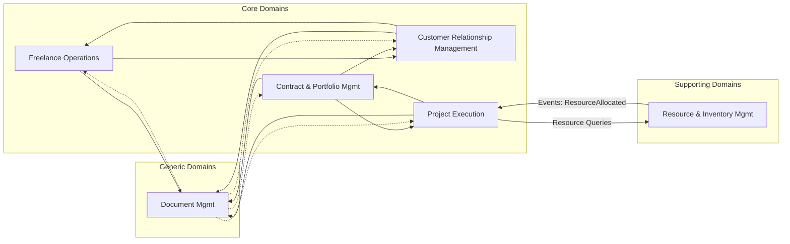
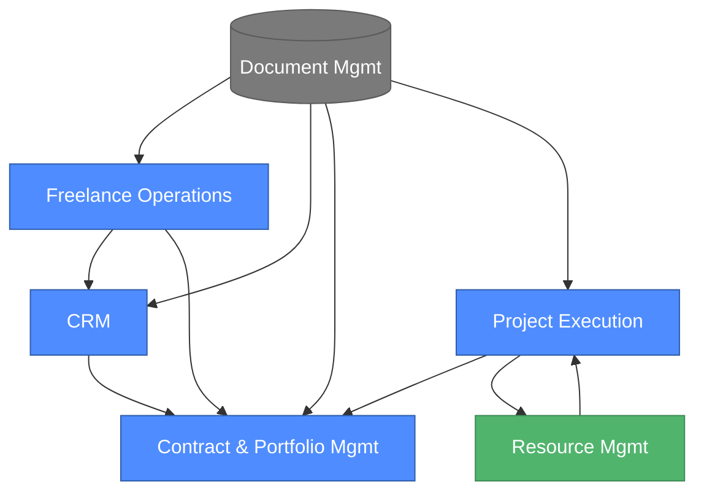
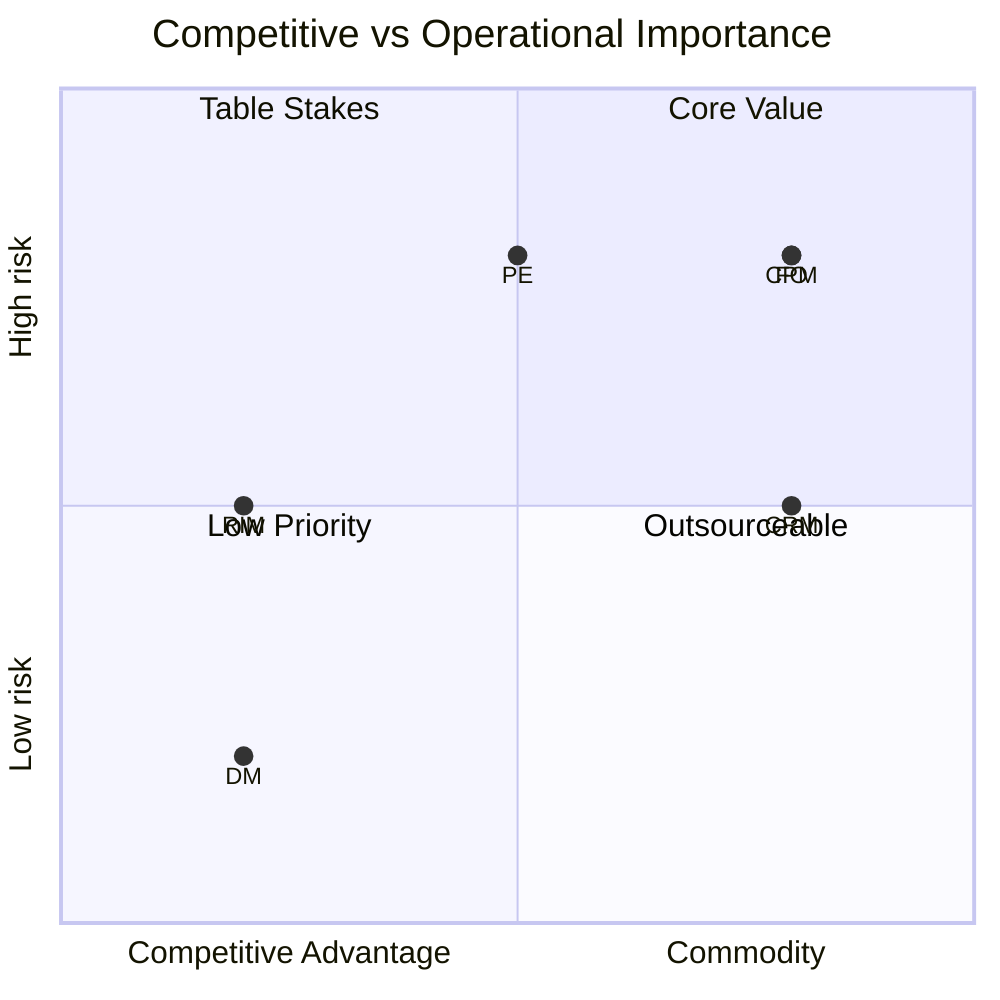
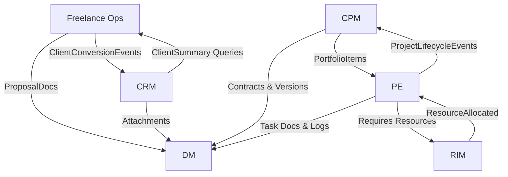
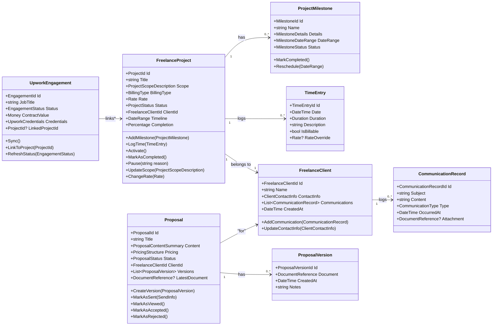
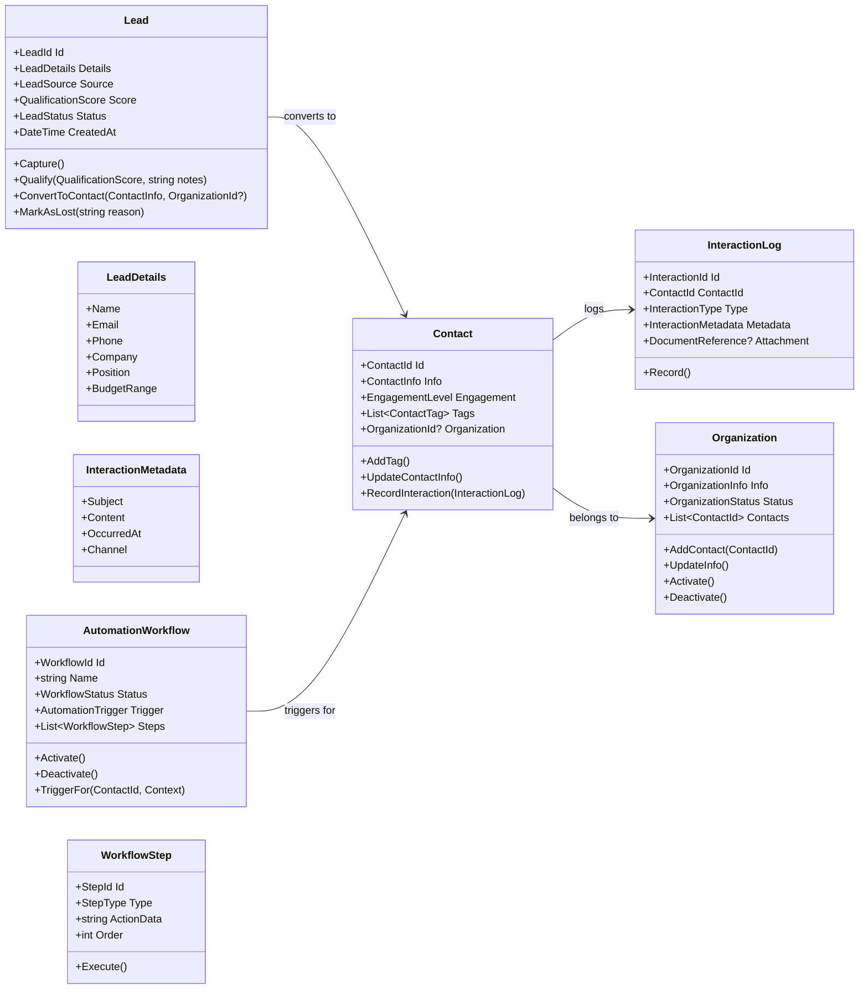
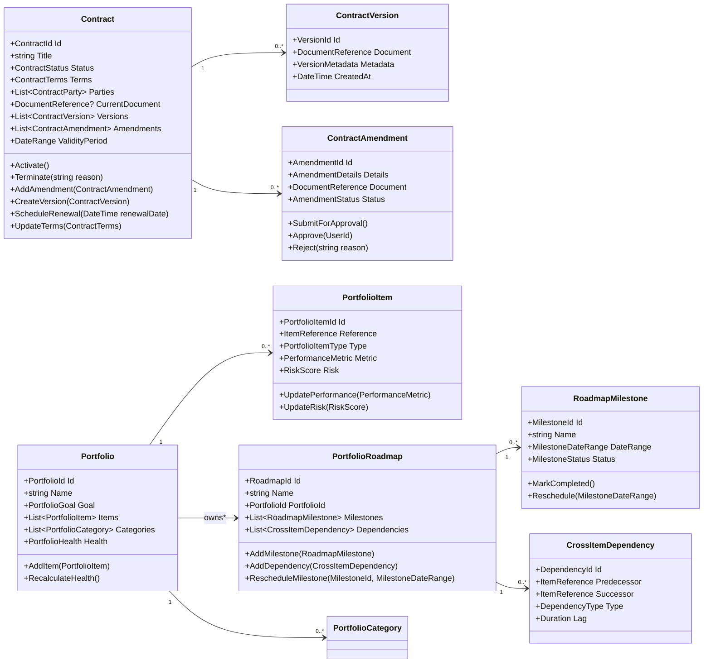
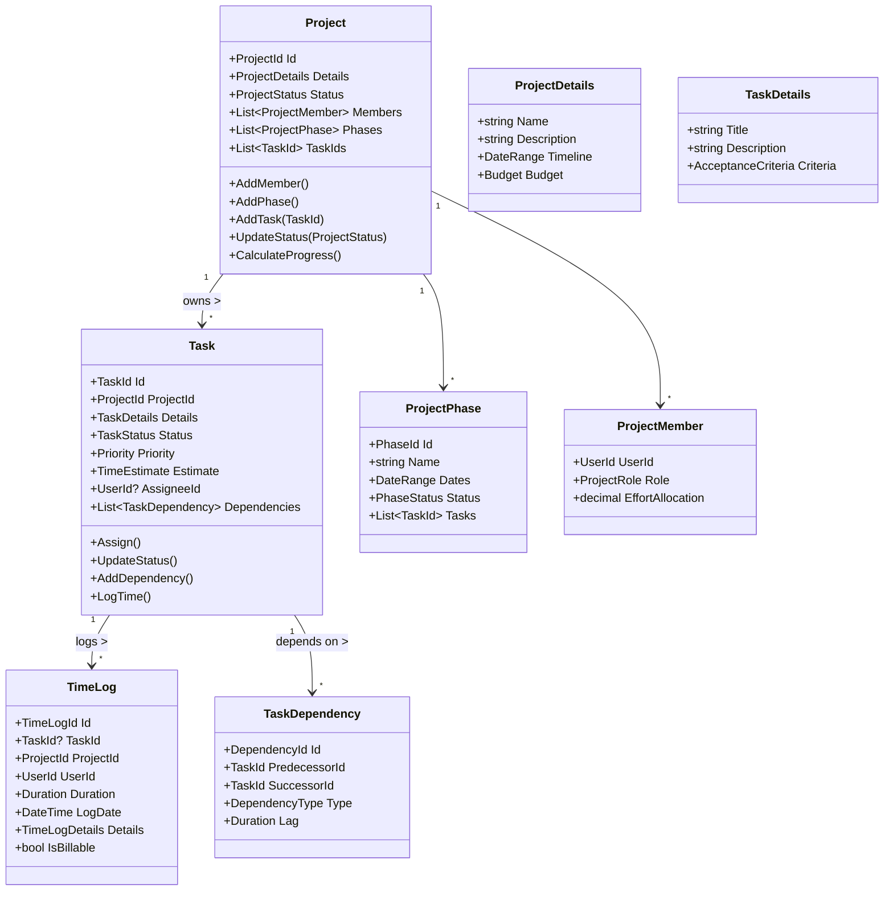
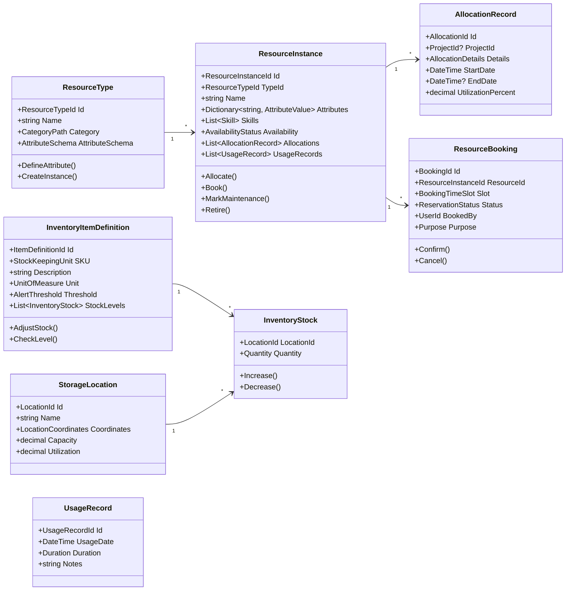
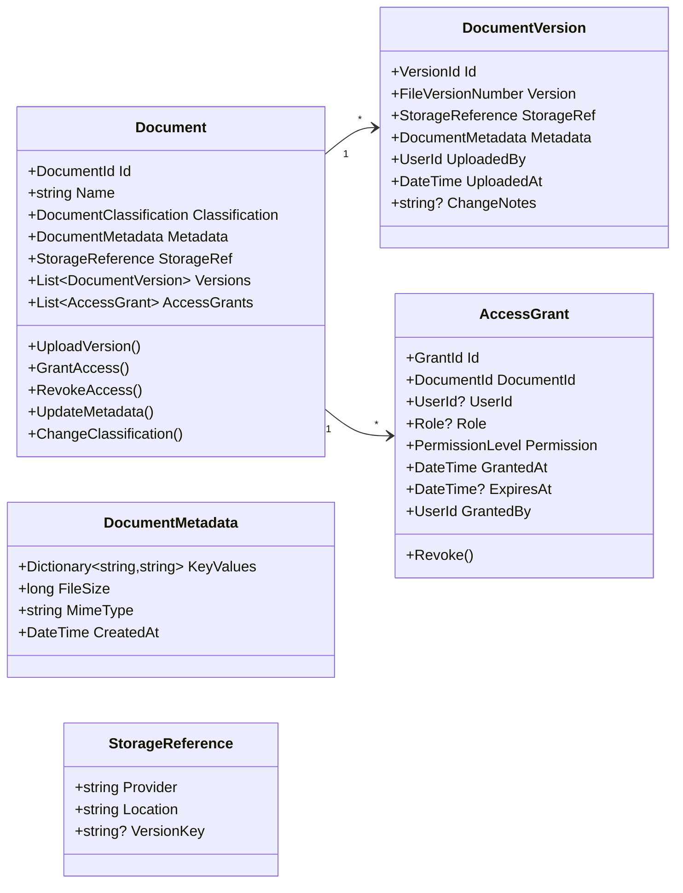

# **1. Executive Summary (Enhanced)**

## **1.1 Purpose of the System**

The **Business Operations Platform** is a unified operational system designed to coordinate and optimize:

* Freelance project and client management
* CRM capabilities and customer lifecycle management
* Contract drafting, versioning, approvals, and portfolio management
* Project execution, task management, and time tracking
* Resource allocation and inventory management
* Centralized document management, storage, and governance

The platform supports **configuration, automation, and cross-bounded-context integration** to enable operational excellence across the business.

---

## **1.2 Architecture Approach**

This regenerated version follows advanced DDD principles:

### **Strategic Patterns**

* **Domain-Driven Design** with rich domain behavior
* **Bounded Contexts** aligned to business capabilities
* **Context Map**, relationships, and integration modes
* **Ubiquitous Language** formalized across all contexts

### **Tactical Patterns**

* Aggregates with explicit invariants
* Value objects (strongly typed + domain rules)
* Domain events (lifecycle + status + invariant events)
* Domain services for cross-aggregate operations
* Policies + Specifications to enforce business rules

### **Implementation Architecture**

* CQRS with transactional commands
* Event-driven architecture for cross-BC workflows
* Event-sourced aggregates where high churn exists
* ABP Framework (.NET) for application boundaries
* Multi-tenant enforcement at domain and infrastructure layers

---

## **1.3 Core Domain Classification (Updated)**

Domains are classified based on strategic importance, competitive advantage, and domain complexity.

### **Core Domains**

* **Freelance Operations** — competitive differentiator
* **CRM** — customer relationships & revenue funnel
* **Contract & Portfolio Management** — high-value legal & strategic workflows
* **Project Execution** — core operational engine

### **Supporting Domains**

* **Resource & Inventory Management** — supports planning & allocation

### **Generic Domains**

* **Document Management** — centralized generic subsystem

---

# **2. Domain Architecture Overview (Enhanced)**

## **2.1 High-Level Structure**

Below is the enhanced architecture showing flows, dependencies, and anti-corruption layers.



### **Key Enhancements**

✔ All BCs use Document Management via **DocumentReference VO**
✔ Cross-BC direct dependencies removed → replaced with ACL patterns
✔ Consistency boundaries defined per aggregate
✔ Event flows normalized across BCs

---

## **2.2 Strategic Design Principles (Enhanced)**

### **1. Behavioral Domain Model**

Aggregates now expose **expressive behaviors**, not setters:

* `Project.Activate()`
* `Proposal.MarkAsAccepted()`
* `Task.Block(reason)`
* `Contract.EscalateForReview()`
* `Resource.AllocateTo(projectId)`

---

### **2. Value Object–Driven Model**

Strong VOs replace primitives:

* Money, Rate, Percentage
* Effort, Duration, DateRange
* Email, Phone, Address
* ContractValue, RiskScore
* MilestoneDateRange

This provides invariants and domain consistency.

---

### **3. Explicit Domain Policies & Specifications**

Each complex rule is extracted:

* `TimeLoggingPolicy`
* `TaskAssignmentPolicy`
* `ContractAmendmentPolicy`
* `PortfolioHealthCalculationPolicy`
* `ResourceAllocationPolicy`

Policies enforce **domain-wide invariants**.
Specifications enforce **contextual predicates**.

---

### **4. Event-Driven Consistency**

Every BC emits rich domain events:

* `ProjectCreated`
* `LeadConverted`
* `ContractVersioned`
* `ResourceAllocated`
* `DocumentUploaded`

Downstream BCs react through integration handlers.

---

### **5. Anti-Corruption Layers (ACL)**

No BC references the internal domain models of another BC.

Instead, each BC accesses others via:

* **Domain-friendly facades**
* **Context translation objects**
* **Read models**

Example:

```
ICRMClientContext.GetClientSummary(ClientId)
IFreelanceOpsContext.GetProjectBillingInfo(ProjectId)
```

---

### **6. Autonomy & Consistency Boundaries**

Each bounded context has:

* Its own aggregates
* Its own rules
* Its own domain events
* Clear boundaries for where invariants stop
* Eventual consistency where needed

---

## **2.3 Bounded Context Landscape (Updated)**

A highly explicit map of dependencies and flow types:

| From | To  | Type            | Interaction                 | Strength     |
| ---- | --- | --------------- | --------------------------- | ------------ |
| FO   | CRM | Event + Query   | Client conversion           | Low coupling |
| FO   | DM  | Service Call    | Proposal docs               | Medium       |
| CRM  | DM  | Service Call    | Interaction attachments     | Medium       |
| CPM  | DM  | Service Call    | Contract versions           | Medium       |
| PE   | RIM | Command + Query | Resource allocation         | Medium       |
| CPM  | PE  | Event           | Portfolio → Project updates | Low          |
| All  | DM  | Service         | Document storage            | Medium       |

Enhancements:
✔ Removed cyclic dependencies
✔ Introduced ACL boundaries
✔ Corrected upstream/downstream relationships

---

## **2.4 Revised Domain Map (Enhanced)**

A more explicit, DDD-style domain map:



---

## **2.5 Summary of Enhancements**

Below is what changes from your original document:

### ✔ Richer, behavior-driven aggregates

### ✔ Strong VO-based data model

### ✔ Full consistency boundaries + lifecycle rules

### ✔ Event-flow normalization across contexts

### ✔ Addition of domain services + specifications

### ✔ Strengthened multi-tenant rules at the domain level

### ✔ DocumentReference VO replacing primitive DocumentId usage

### ✔ Cross-BC isolation through ACL service interfaces

### ✔ Clearer, deeper domain invariants per aggregate

### ✔ Event-sourced aggregates where appropriate

### ✔ Improved diagrams, aggregate boundaries, and dependency correctness

---

# ✅ **PART 2 — Bounded Context Catalog (Enhanced)**

This section fully regenerates the **bounded context catalog**, redefines domain boundaries using strategic domain-driven design, and introduces enhanced autonomy, invariants, integration boundaries, and subdomains.

---

# **2.1 Bounded Context Catalog (Enhanced Version)**

Each bounded context is classified using:

* **Strategic Domain Type**: Core / Supporting / Generic
* **Domain Complexity**
* **Change Volatility** (how often domain rules evolve)
* **Team Cognitive Load**
* **Integration Role**
* **Event Responsibility** (upstream/downstream)

---

## **Freelance Operations (FO) – Core Domain**

| Property          | Value                                             |
| ----------------- | ------------------------------------------------- |
| Strategic Type    | **Core Domain** (Revenue-facing, differentiator)  |
| Priority          | **Critical**                                      |
| Complexity        | High                                              |
| Change Volatility | High (market-driven workflows)                    |
| Team Size         | 3–4                                               |
| Event Role        | Upstream to CRM, Project Execution, Document Mgmt |

### **Subdomains**

* **Freelance Project Management**
* **Client Management**
* **Proposal Management**
* **Upwork Integration**
* **Client Portal**

---

## **Customer Relationship Management (CRM) – Core Domain**

| Property          | Value                   |
| ----------------- | ----------------------- |
| Strategic Type    | **Core Domain**         |
| Priority          | Critical                |
| Complexity        | High                    |
| Change Volatility | Medium–High             |
| Team Size         | 3–4                     |
| Event Role        | Upstream to FO, CPM, PE |

### **Subdomains**

* Lead Management
* Contact Management
* Interaction Tracking
* Automation Workflows
* Analytics & Engagement Insights

---

## **Contract & Portfolio Management (C&PM) – Core Domain**

| Property          | Value                   |
| ----------------- | ----------------------- |
| Strategic Type    | **Core Domain**         |
| Priority          | High                    |
| Complexity        | High                    |
| Change Volatility | Medium                  |
| Team Size         | 3–4                     |
| Event Role        | Upstream to PE, CRM, DM |

### **Subdomains**

* Contract Lifecycle Management
* Version & Amendment Management
* Portfolio Oversight
* Roadmapping & Strategic Planning
* Risk & Compliance

---

## **Project Execution (PE) – Core Domain**

| Property          | Value                    |
| ----------------- | ------------------------ |
| Strategic Type    | **Core Domain**          |
| Priority          | High                     |
| Complexity        | Medium–High              |
| Change Volatility | High                     |
| Team Size         | 2–3                      |
| Event Role        | Upstream to CPM, RIM, DM |

### **Subdomains**

* Project Definition
* Task Management
* Time Tracking
* Resource Assignment
* Execution & Monitoring

---

## **Resource & Inventory Management (RIM) – Supporting Domain**

| Property          | Value                 |
| ----------------- | --------------------- |
| Strategic Type    | **Supporting Domain** |
| Priority          | Medium                |
| Complexity        | Medium                |
| Change Volatility | Medium                |
| Team Size         | 2–3                   |
| Event Role        | Upstream to PE, CPM   |

### **Subdomains**

* Resource Type & Skills
* Resource Instance Management
* Inventory Tracking
* Allocation Bookings
* Usage & Optimization

---

## **Document Management (DM) – Generic Domain**

| Property          | Value                       |
| ----------------- | --------------------------- |
| Strategic Type    | **Generic Domain**          |
| Priority          | Medium                      |
| Complexity        | Low–Medium                  |
| Change Volatility | Low                         |
| Team Size         | 1–2                         |
| Event Role        | Utility BC for all contexts |

### **Subdomains**

* Document Storage
* Versioning
* Access Control
* Metadata & Search

---

# **2.2 Strategic Domain Prioritization (Enhanced)**

Below is a more strategic view mapping domains to **competitive differentiation** and **business risk**:



---

# **2.3 Enhanced Domain Responsibility Definitions**

This section expands the responsibility boundaries for each BC using "What this BC owns", "What it does not own", and "Interaction Rules".

---

## **Freelance Operations (Enhanced Responsibility Definition)**

### **This BC Owns**

* Freelance project lifecycle
* Proposal lifecycle & versioning
* Client communication history
* Upwork synchronization
* Billing rules for freelance workflows

### **This BC Does Not Own**

* Contract legality (belongs to C&PM)
* Document storage (belongs to DM)
* Lead qualification (belongs to CRM)

### **Integration Rules**

* Uses CRM for client identity
* Publishes events to C&PM and PE
* Document references stored as **DocumentReference VO**, not raw IDs

---

## **CRM (Enhanced Responsibility Definition)**

### **This BC Owns**

* Lead lifecycle
* Contact segmentation
* Interaction logs
* Engagement scoring
* Automation workflows

### **This BC Does Not Own**

* Freelance billing
* Legal contracts & compliance
* Resource scheduling

### **Integration Rules**

* Publishes `LeadConverted` → FO
* Publishes `InteractionLogged` → C&PM
* Consumes document links from DM

---

## **Contract & Portfolio Management (Enhanced Responsibility Definition)**

### **This BC Owns**

* Contract versioning and amendment workflows
* Approval workflow for legal changes
* Portfolio insights, health, performance
* Cross-project strategical roadmap

### **This BC Does Not Own**

* Task-level execution (PE)
* Resource details (RIM)
* Client communication (CRM)

### **Integration Rules**

* Uses FO/CRM for high-level client summary
* Uses DM to store contract documents
* Publishes `ContractVersioned`, `PortfolioItemAdded` events

---

## **Project Execution (Enhanced Responsibility Definition)**

### **This BC Owns**

* Task lifecycle
* Time logging
* Assignment and workload rules
* Phase and milestone execution

### **This BC Does Not Own**

* Resource skill catalog (RIM)
* Contractual constraints (C&PM)

### **Integration Rules**

* Pulls resource availability via ACL from RIM
* Publishes `ProjectCompleted`, `TaskBlocked`, `TimeLogged`

---

## **Resource & Inventory Management (Enhanced Responsibility Definition)**

### **This BC Owns**

* Human + equipment resource catalog
* Allocation logic
* Inventory stock and movements
* Resource availability & skill modeling

### **This BC Does Not Own**

* Task planning (PE)
* Contractual obligations (C&PM)

### **Integration Rules**

* Publishes `ResourceAllocated`, `StockLevelAdjusted`

---

## **Document Management (Enhanced Responsibility Definition)**

### **This BC Owns**

* All file lifecycle management
* Version history and file diffing
* Access control
* Document metadata and search

### **This BC Does Not Own**

* Business meaning of documents
* Contract rules
* Proposal content rules

### **Integration Rules**

* Provides `UploadDocument`, `GrantAccess`, `GetMetadata`
* Emits `DocumentUploaded`, `DocumentVersioned`

---

# **2.4 Enhanced Context Map (With Explicit Relationships)**



Enhancements included:

* Eliminated direct references across BCs
* Added role of ACLs
* Linked events and queries explicitly

---

# **2.5 Subdomain Capability Matrix (Enhanced)**

| Capability          | FO | CRM | C&PM          | PE | RIM | DM |
| ------------------- | -- | --- | ------------- | -- | --- | -- |
| Projects            | ✔  | -   | ✔ (portfolio) | ✔  | -   | -  |
| Proposals           | ✔  | -   | -             | -  | -   | ✔  |
| Client Lifecycle    | ✔  | ✔   | -             | -  | -   | -  |
| Contracts           | -  | -   | ✔             | -  | -   | ✔  |
| Tasks               | -  | -   | -             | ✔  | -   | -  |
| Time Tracking       | ✔  | -   | -             | ✔  | -   | ✔  |
| Resource Allocation | -  | -   | -             | ✔  | ✔   | -  |
| Inventory           | -  | -   | -             | -  | ✔   | -  |
| Document Storage    | -  | -   | -             | -  | -   | ✔  |

---

# **2.6 Bounded Context Evolution Blueprint**

A roadmap for future extensibility:

### **Short-Term Enhancements**

* Event-sourcing for TimeLogs + InventoryTransactions
* Cross-context process automation
* Unified domain notification model

### **Mid-Term Enhancements**

* Portfolio → Resource planning automation
* Predictive workload management
* Legal contract compliance rules enhanced

### **Long-Term Enhancements**

* ML-based lead scoring
* Forecast-based resource planning
* Auto-generated proposals/contracts with templates

---

# ✅ **PART 3 — Freelance Operations Bounded Context (Enhanced)**

This is a full, enhanced regeneration of the **Freelance Operations Bounded Context (FO BC)** with:

* Enriched aggregates
* Strong value objects
* Explicit domain invariants
* Behavioral methods
* Domain services + policies + specifications
* Domain events
* Commands/queries
* Updated diagrams

---

# **3.1 Context Overview (Enhanced)**

## **FO Responsibility**

The Freelance Operations BC manages:

* Freelance project lifecycle
* Freelance client management
* Proposal lifecycle & versioning
* Upwork integration & synchronization
* Client portal collaboration

This is a **core domain** because it directly drives business revenue.

---

# **3.2 High-Level Domain Model (Enhanced Diagram)**



---

# **3.3 Aggregates (Enhanced)**

---

## **3.3.1 FreelanceProject Aggregate Root (Enhanced)**

### **Purpose**

Manages the lifecycle, billing, scope, and milestones of a freelance project.

### **Key Entities**

* `ProjectMilestone`
* `TimeEntry`

### **Key Value Objects**

* `ProjectId`
* `ProjectScopeDescription`
* `Rate`
* `DateRange`
* `Percentage`
* `ProjectStatus`

### **Domain Invariants**

1. A project **must have a client**.
2. A project cannot accept time entries when **Inactive/Paused/Completed**.
3. Milestone target date must be within project timeline.
4. Total completion percentage must remain within **0–100%**.
5. Time entry duration must be positive.
6. End date must be greater than start date.

### **Behavior (Methods)**

```csharp
public void Activate();
public void Pause(string reason);
public void MarkAsCompleted();
public void UpdateScope(ProjectScopeDescription newScope);
public void ChangeRate(Rate newRate);
public void AddMilestone(ProjectMilestone milestone);
public void LogTime(TimeEntry entry);
```

---

## **3.3.2 FreelanceClient Aggregate Root (Enhanced)**

### **Purpose**

Manages freelance client identity, contact info, and communication history.

### **Key Value Objects**

* `FreelanceClientId`
* `ClientContactInfo`
* `Email`, `PhoneNumber`, `Address`
* `CommunicationRecordId`

### **Domain Invariants**

1. A client must have **valid contact info**.
2. Communications are **immutable** once logged.
3. A client cannot be deleted if active projects exist.

### **Behavior**

```csharp
public void AddCommunication(CommunicationRecord record);
public void UpdateContactInfo(ClientContactInfo newInfo);
```

---

## **3.3.3 Proposal Aggregate Root (Enhanced)**

### **Purpose**

Manages proposals, revisions, sending, approval, and version history.

### **Key Value Objects**

* `ProposalId`
* `ProposalContentSummary`
* `PricingStructure`
* `ProposalStatus`
* `DocumentReference`

### **Domain Invariants**

1. A proposal can only be sent in **Draft** status.
2. A proposal cannot be modified after **Accepted** or **Rejected**.
3. A proposal must belong to an existing client.
4. Version numbers must be strictly incremental.

### **Behavior**

```csharp
public void CreateVersion(ProposalVersion version);
public void MarkAsSent(SendInfo info);
public void MarkAsViewed();
public void MarkAsAccepted();
public void MarkAsRejected();
```

---

## **3.3.4 UpworkEngagement Aggregate Root (Enhanced)**

### **Purpose**

Represents an Upwork contract engagement and syncs data from the Upwork API.

### **Key Value Objects**

* `EngagementId`
* `UpworkCredentials`
* `EngagementStatus`
* `Money`

### **Domain Invariants**

1. Upwork credentials must be valid.
2. Engagement cannot be linked to a non-existent project.
3. A contract cannot be linked to multiple projects.

### **Behavior**

```csharp
public void Sync(UpworkSyncData data);
public void LinkToProject(ProjectId projectId);
public void RefreshStatus(EngagementStatus status);
```

---

# **3.4 Value Objects (Enhanced)**

Here are the enhanced VOs that replace primitives:

### **Project VOs**

* `ProjectId`
* `ProjectScopeDescription`
* `DateRange (Start, End)`
* `Rate (Money, Frequency)`
* `Percentage (0–100)`
* `Duration`
* `BillingType`

### **Client VOs**

* `Email`
* `PhoneNumber`
* `ClientContactInfo (Email, Phone, Address)`

### **Proposal VOs**

* `ProposalId`
* `PricingStructure (Money breakdown)`
* `ProposalContentSummary`

### **Shared VO**

* `DocumentReference`
* `Money`
* `MilestoneDateRange`

---

# **3.5 Domain Services (Enhanced)**

## **3.5.1 Time Logging Domain Service**

Ensures time logging obeys project’s rules.

```csharp
public interface ITimeLoggingService
{
    void LogTime(FreelanceProject project, TimeEntry entry);
}
```

---

## **3.5.2 Proposal Workflow Service**

```csharp
public interface IProposalWorkflowService
{
    bool CanSend(Proposal proposal, FreelanceClient client);
    bool CanModify(Proposal proposal);
}
```

---

## **3.5.3 Upwork Sync Domain Service**

Handles Upwork → System synchronization.

---

# **3.6 Specifications (Enhanced)**

### **TimeEntryWithinProjectTimelineSpec**

Ensures entry date fits project timeline.

### **ProjectIsActiveSpec**

Ensures project is Active for time logging.

### **ValidProposalModificationSpec**

Proposal can be edited only when in Draft or UnderReview.

---

# **3.7 Policies (Enhanced)**

## **Time Logging Policy (Updated)**

```csharp
public ValidationResult Validate(FreelanceProject project, TimeEntry entry)
```

Rules:

* Project must be active
* Duration > 0
* Date within project timeline

---

## **Proposal Sending Policy**

Rules:

* Client contact info valid
* Proposal content complete
* Proposal status = Draft

---

# **3.8 Domain Events (Enhanced)**

### **FreelanceProjectCreated**

### **ProjectMilestoneCompleted**

### **TimeEntryLogged**

### **ProposalVersionCreated**

### **ProposalSent**

### **ProposalAccepted**

### **ClientCommunicationLogged**

### **UpworkEngagementSynced**

Each event includes:

* TenantId
* OccurredAt timestamp
* Domain data

---

# **3.9 Commands (Enhanced CQRS)**

```csharp
public record CreateFreelanceProject(...);
public record LogProjectTime(...);
public record UpdateProjectStatus(...);
public record CreateFreelanceClient(...);
public record AddClientCommunication(...);
public record CreateProposal(...);
public record SendProposal(...);
public record AcceptProposal(...);
public record SyncUpworkEngagement(...);
```

---

# **3.10 Queries (Enhanced)**

```csharp
public record GetFreelanceProjectDetails(ProjectId ProjectId);
public record GetProposalVersionHistory(ProposalId ProposalId);
public record GetActiveEngagements();
public record GetClientDetails(FreelanceClientId Id);
```

---

# ✅ **PART 4 — Customer Relationship Management (CRM) Bounded Context**

CRM is a **Core Domain** because it governs the **customer lifecycle**, **revenue pipeline**, and **engagement intelligence**, which directly influence the platform’s strategic value.

This regenerated version includes all enhancements requested earlier.

---

# **4.1 Context Overview (Enhanced)**

CRM manages the complete lifecycle of customer relationships:

* Lead capture → qualification → conversion
* Contact management and communication tracking
* Engagement scoring & segmentation
* Automated workflows (nurturing, follow-ups, reactivation)
* Interaction logs with documents & attachments
* Analytics and conversion insights

CRM is **upstream** to:

* Freelance Operations (Client identity + Interaction events)
* Contract/Portfolio Management (Organizations, contacts)

CRM is **downstream** from:

* Document Management (attachments)

---

# **4.2 High-Level Domain Model (Enhanced Diagram)**



---

# **4.3 Aggregates (Enhanced)**

---

## **4.3.1 Lead Aggregate Root (Enhanced)**

### **Purpose**

Manages the lifecycle of a potential customer.

### **Entities**

* `LeadDetails`
* `LeadQualificationRecord` (optional aggregate extension)

### **Value Objects**

* `LeadId`
* `LeadSource`
* `QualificationScore`
* `LeadStatus`
* `Email`, `PhoneNumber`

### **Domain Invariants**

1. Contact info must be valid.
2. Qualification score must be between **0–100**.
3. A converted lead cannot be modified.
4. A lost lead cannot be converted.

### **Behavior**

```csharp
public void Capture();
public void Qualify(QualificationScore score, string notes);
public ContactId ConvertToContact(ContactInfo info, OrganizationId? organizationId);
public void MarkAsLost(string reason);
```

---

## **4.3.2 Contact Aggregate Root (Enhanced)**

### **Purpose**

Represents an established customer or operational contact.

### **Entities**

* `ContactTag`
* `ContactGroupMembership`

### **Value Objects**

* `ContactId`
* `ContactInfo`
* `EngagementLevel`
* `OrganizationId`

### **Domain Invariants**

1. Contact must have valid `Name`, `Email`, & primary communication channel.
2. EngagementLevel auto-updates based on interactions.
3. Contact cannot belong to a deactivated organization.

### **Behavior**

```csharp
public void UpdateContactInfo(ContactInfo newInfo);
public void AddTag(ContactTag tag);
public void RemoveTag(ContactTag tag);
public InteractionId RecordInteraction(InteractionLog log);
public void AssignToOrganization(OrganizationId id);
```

---

## **4.3.3 InteractionLog Aggregate Root (Enhanced)**

### **Purpose**

Represents a single communication or engagement event.

### **Value Objects**

* `InteractionId`
* `InteractionType`
* `InteractionMetadata`
* `DocumentReference? Attachment`

### **Domain Invariants**

1. Interaction must reference a valid contact.
2. Timestamp must be immutable.
3. Interaction content must not be empty.

### **Behavior**

```csharp
public void Record();
```

---

## **4.3.4 Organization Aggregate Root (Enhanced)**

### **Purpose**

Represents a company or organization with contacts.

### **Value Objects**

* `OrganizationId`
* `OrganizationInfo`
* `OrganizationStatus`

### **Domain Invariants**

1. Organization name must be unique.
2. Contacts must exist before being linked.
3. Inactive organizations can't accept new contacts.

### **Behavior**

```csharp
public void AddContact(ContactId contactId);
public void UpdateInfo(OrganizationInfo info);
public void Activate();
public void Deactivate();
```

---

## **4.3.5 AutomationWorkflow Aggregate Root (Enhanced)**

### **Purpose**

Executes automated workflow steps based on triggers.

### **Entities**

* `WorkflowStep`
* `WorkflowExecutionRecord` (optional for event-sourcing)

### **Value Objects**

* `WorkflowId`
* `AutomationTrigger`
* `WorkflowStatus`
* `StepType`

### **Domain Invariants**

1. Workflow must have at least one step.
2. Trigger conditions must be valid and testable.
3. Active workflows cannot be deleted.

### **Behavior**

```csharp
public void Activate();
public void Deactivate();
public void TriggerFor(ContactId contactId, Dictionary<string, object> ctx);
```

---

# **4.4 Value Objects (Enhanced)**

## **Core VO Set**

* `LeadId`
* `ContactId`
* `InteractionId`
* `OrganizationId`
* `WorkflowId`

### **Contact & Lead VOs**

* `Email`, `PhoneNumber`, `Address`
* `LeadDetails`, `LeadSource`, `LeadStatus`
* `QualificationScore`
* `EngagementLevel` (Calculated VO)

### **Interaction VOs**

* `InteractionType` (Call, Email, Meeting, Demo, Chat, PortalMessage)
* `InteractionMetadata (Subject, Content, Channel, OccurredAt)`
* `DocumentReference`

### **Workflow VOs**

* `AutomationTrigger`
* `WorkflowStepDefinition`
* `WorkflowStatus`
* `StepType`

---

# **4.5 Domain Services (Enhanced)**

## **4.5.1 LeadQualificationService**

Uses rules/ML/criteria to calculate score.

```csharp
QualificationScore CalculateScore(Lead lead, Dictionary<string, object> inputs);
```

## **4.5.2 EngagementScoringService**

Updates engagement level based on interactions.

## **4.5.3 AutomationExecutionService**

Executes workflow steps.

---

# **4.6 Specifications (Enhanced)**

### **LeadHasEnoughInformationSpec**

Lead may be qualified only if details complete.

### **ContactHasValidCommunicationChannelsSpec**

### **InteractionAttachmentValidSpec**

Ensures attachment exists in Document Mgmt BC.

---

# **4.7 Policies (Enhanced)**

## **Automation Trigger Policy**

Defines when workflows execute:

* New Contact
* New Interaction
* Re-Engagement
* Score threshold

## **Engagement Update Policy**

Every interaction updates engagement:

* Recent interactions → Active
* Older but regular → Warm
* No interactions for long → Cold

---

# **4.8 Domain Events (Enhanced)**

### **LeadCaptured**

### **LeadQualified**

### **LeadConvertedToContact**

### **ContactUpdated**

### **InteractionLogged**

### **AutomationWorkflowTriggered**

### **AutomationStepExecuted**

Each event includes:

* TenantId
* Actor (UserId)
* Timestamp
* Context data

---

# **4.9 Commands (Enhanced)**

```csharp
public record CaptureLead(LeadDetails Details, LeadSource Source, UserId CapturedBy);
public record QualifyLead(LeadId LeadId, QualificationScore Score, string Notes, UserId QualifiedBy);
public record ConvertLeadToContact(LeadId LeadId, ContactInfo ContactInfo, OrganizationId? OrgId, UserId ConvertedBy);

public record CreateContact(ContactInfo Info, OrganizationId? Org, List<ContactTag> Tags, UserId CreatedBy);
public record UpdateContactInfo(ContactId Id, ContactInfo Info, UserId UpdatedBy);

public record LogInteraction(
    ContactId ContactId,
    InteractionType Type,
    string Subject,
    string Content,
    DocumentReference? Attachment,
    DateTime? OccurredAt,
    UserId LoggedBy
);

public record ConfigureAutomation(
    string Name,
    AutomationTrigger Trigger,
    List<WorkflowStepDefinition> Steps,
    UserId ConfiguredBy
);

public record TriggerAutomation(WorkflowId WorkflowId, ContactId ContactId, Dictionary<string, object> Context, UserId TriggeredBy);
```

---

# **4.10 Queries (Enhanced)**

```csharp
public record GetLeadDetails(LeadId LeadId);
public record SearchLeads(string Term, LeadStatus? Status);
public record GetContactDetails(ContactId ContactId);
public record GetContactInteractionHistory(ContactId ContactId);
public record GetLeadsByScore(int MinScore);
public record GetAutomationDefinitions();
public record GetOrganizationContacts(OrganizationId OrgId);
```

---

# ✅ **PART 5 — Contract & Portfolio Management (C&PM) Bounded Context (Enhanced)**

The Contract & Portfolio Management BC governs:

* Contract lifecycle (draft → approval → active → renewal/termination)
* Contract versions & amendments
* Portfolio structure for strategic business oversight
* Roadmaps & cross-project dependencies
* Risk & compliance scoring
* Performance metrics and analytics

This BC is a **Core Domain**, providing key strategic differentiation because it centralizes business-wide commitments and long-term planning.

---

# **5.1 Context Overview (Enhanced)**

C&PM connects legal, financial, operational, and strategic planning data.

### **Core Responsibilities**

* Contract authoring, versioning, and change governance
* Legal amendment flow with multi-level approval
* Portfolio hierarchy & categorization
* Strategic roadmap planning
* Cross-project dependencies & milestone management
* Risk scoring (legal, financial, delivery)
* Compliance tracking

### **Upstream/Downstream Roles**

* **Upstream of:** Project Execution, CRM
* **Downstream of:** Document Management (stores contracts)

---

# **5.2 High-Level Domain Model (Enhanced Diagram)**



---

# **5.3 Aggregates (Fully Enhanced)**

This section defines each aggregate with invariants, behaviors, VOs, and domain rules.

---

## **5.3.1 Contract Aggregate Root (Enhanced)**

### **Purpose**

Central entity governing the lifecycle of a legally binding business agreement.

### **Key Value Objects**

* `ContractId`
* `ContractTerms`
* `ValidityPeriod (DateRange)`
* `ContractStatus`
* `ContractParty`
* `DocumentReference`

### **Enhanced Domain Invariants**

1. Contract must have **minimum 2 parties**.
2. Validity end date must be **after** start date.
3. Only a contract in `Draft` can be edited.
4. Only one active version at a time.
5. Amendments can only be added when contract is `Active`.
6. Contract cannot be terminated twice.

### **Behavior (Methods)**

```csharp
public void Activate();
public void Terminate(string reason);
public void UpdateTerms(ContractTerms newTerms);
public ContractVersion CreateVersion(DocumentReference newDocument, VersionMetadata metadata);
public void AddAmendment(ContractAmendment amendment);
public void ScheduleRenewal(DateTime renewalDate);
```

---

## **5.3.2 ContractAmendment Aggregate (Enhanced)**

### **Purpose**

Represents a legal change that must go through an approval workflow.

### **Value Objects**

* `AmendmentId`
* `AmendmentDetails`
* `AmendmentStatus` (Draft, Submitted, Approved, Rejected)

### **Invariants**

* Amendments cannot be modified after approval/rejection.
* High-value amendments require multi-level approval (policy-driven).

### **Behavior**

```csharp
public void SubmitForApproval();
public void Approve(UserId approver);
public void Reject(string reason);
```

---

## **5.3.3 ContractVersion Entity (Enhanced)**

### **Purpose**

Tracks version history for legal auditability.

### **Invariants**

* Version numbers must be strict increments.
* DocumentReference must refer to a valid Document Management BC entry.

---

# **5.3.4 Portfolio Aggregate Root (Enhanced)**

### **Purpose**

Represents a business-level grouping of strategic items (projects, contracts, initiatives).

### **Key Value Objects**

* `PortfolioId`
* `PortfolioGoal`
* `PortfolioHealth`
* `PortfolioCategory`

### **Invariants**

1. Every portfolio must have a defined goal.
2. Every PortfolioItem must reference a valid external domain entity.
3. Portfolio health must be recalculated whenever an item changes performance or risk.

### **Behavior**

```csharp
public void AddItem(PortfolioItem item);
public void Categorize(PortfolioCategory category);
public void RecalculateHealth();
```

---

## **5.3.5 PortfolioItem Entity (Enhanced)**

### **Purpose**

Represents a strategic element inside a portfolio.

### **Value Objects**

* `ItemReference (ProjectId, ContractId, etc.)`
* `PortfolioItemType`
* `PerformanceMetric`
* `RiskScore`

### **Behavior**

```csharp
public void UpdatePerformance(PerformanceMetric metric);
public void UpdateRisk(RiskScore risk);
```

---

## **5.3.6 PortfolioRoadmap Aggregate (Enhanced)**

### **Purpose**

Defines strategic timeline + milestones + cross-item dependencies.

### **Value Objects**

* `RoadmapId`
* `MilestoneDateRange`
* `DependencyType`

### **Invariants**

1. Milestones must align with the portfolio timeline.
2. Dependencies must not create circular graphs.
3. Actual completion date can never be before target date.

### **Behavior**

```csharp
public void AddMilestone(RoadmapMilestone milestone);
public void AddDependency(CrossItemDependency dependency);
public void RescheduleMilestone(MilestoneId id, MilestoneDateRange newDate);
```

---

# **5.4 Value Objects (Enhanced)**

## **Contract VOs**

* `ContractId`
* `ContractTerms`
* `ContractParty` (Name, Role, Permissions)
* `ContractStatus`
* `AmendmentDetails`
* `VersionMetadata`

## **Portfolio VOs**

* `PortfolioGoal`
* `PortfolioCategory`
* `PerformanceMetric (budgetVariance, completionRate, scheduleVariance)`
* `RiskScore (0–100)`
* `HealthScore`

## **Roadmap VOs**

* `MilestoneDateRange`
* `DependencyType`
* `ItemReference`

---

# **5.5 Domain Services (Enhanced)**

## **5.5.1 ContractApprovalService**

Determines approval chain based on amendment value, contract type, and risk.

## **5.5.2 PortfolioHealthCalculationService**

Calculates portfolio health score from:

* Budget variance
* Completion rate
* Risk density
* Strategic alignment

## **5.5.3 DependencyGraphService**

Ensures roadmap dependencies never create cycles.

---

# **5.6 Specifications (Enhanced)**

### **ContractHasActiveStatusSpec**

### **ValidAmendmentApprovalSpec**

### **PortfolioItemReferenceValidSpec**

### **NoCircularDependencySpec**

---

# **5.7 Policies (Enhanced)**

## **Contract Amendment Policy**

```csharp
public AmendmentApprovalRequirement DetermineApproval(Contract contract, AmendmentDetails details)
```

## **Portfolio Performance Policy**

Aggregates item-level metrics into portfolio-level performance.

## **Roadmap Dependency Policy**

Ensures successor cannot start before predecessor in `Finish-to-Start` dependency types.

---

# **5.8 Domain Events (Enhanced)**

### **ContractCreated**

### **ContractVersioned**

### **ContractActivated**

### **ContractTerminated**

### **ContractAmendmentSubmitted**

### **ContractAmendmentApproved**

### **PortfolioCreated**

### **PortfolioItemAdded**

### **PortfolioHealthUpdated**

### **RoadmapMilestoneAdded**

### **RoadmapMilestoneCompleted**

### **RoadmapDependencyAdded**

All events include:

* Actor (UserId)
* TenantId
* Context snapshot

---

# **5.9 Commands (Enhanced)**

```csharp
public record CreateContract(...);
public record VersionContract(...);
public record SubmitContractAmendment(...);
public record ApproveContractAmendment(...);

public record CreatePortfolio(...);
public record AddPortfolioItem(...);
public record UpdatePortfolioItemPerformance(...);

public record CreatePortfolioRoadmap(...);
public record AddRoadmapMilestone(...);
public record AddCrossItemDependency(...);
```

---

# **5.10 Queries (Enhanced)**

```csharp
public record GetContractDetails(ContractId ContractId);
public record GetPortfolioOverview(PortfolioId PortfolioId);
public record GetPortfolioPerformance(PortfolioId PortfolioId);
public record GetRoadmapDetails(RoadmapId RoadmapId);
public record GetContractAmendments(ContractId ContractId);
```

---

# ✅ **PART 6 — Project Execution Bounded Context (Enhanced)**

Project Execution is a **Core Domain** because it directly governs day-to-day operational productivity: projects, tasks, workflows, time tracking, and dependencies.

This regenerated version introduces several major enhancements:

* Stronger aggregate boundaries
* Fully normalized relationships
* Circular dependency prevention (task DAG)
* Execution-grade value objects
* Assignment & workload modeling
* Phase-based project planning
* Realistic time logging & validation policies
* Domain services for planning, workload, scheduling
* Complete CQRS & event set

---

# **6.1 Context Overview (Enhanced)**

Project Execution manages:

* Project creation & lifecycle
* Task management, assignment & dependencies
* Workload distribution & effort allocation
* Time logging & billability
* Milestones & phases
* Execution progress calculation
* Integration with RIM for resource allocation
* Integration with C&PM for portfolio alignment
* Integration with Document Management for attachments

It is **upstream** to:

* RIM (resource demand events)
* Document Management (attachments)

It is **downstream** from:

* C&PM (portfolio items)
* CRM (contacts, organizations)
* Freelance Ops (freelance projects)

---

# **6.2 High-Level Domain Model (Enhanced UML)**



---

# **6.3 Aggregates (Enhanced)**

---

## **6.3.1 Project Aggregate Root (Enhanced)**

### **Purpose**

Primary unit of execution & coordination.

### **Entities**

* `ProjectMember`
* `ProjectPhase`

### **Value Objects**

* `ProjectId`
* `ProjectDetails`
* `ProjectStatus`
* `ProjectProgress`
* `Budget`
* `DateRange`

### **Invariants**

1. Project must have at least one member with `Owner` role.
2. Project cannot be completed unless **all tasks are completed**.
3. Phase dates must lie within project timeline.
4. Project deletion not allowed if tasks exist.

### **Behavior**

```csharp
public void AddMember(ProjectMember member);
public void AddPhase(ProjectPhase phase);
public void AddTask(TaskId taskId);
public void UpdateStatus(ProjectStatus newStatus);
public ProjectProgress CalculateProgress();
```

---

## **6.3.2 Task Aggregate Root (Enhanced)**

### **Purpose**

Represents executable work.

### **Entities**

* `TaskDependency`
* `TaskAssignment` (implicit via AssigneeId)

### **Value Objects**

* `TaskId`
* `TaskDetails`
* `TaskStatus`
* `Priority`
* `TimeEstimate`
* `AcceptanceCriteria`

### **Invariants**

1. Task must belong to a valid project.
2. Only one active assignment per task.
3. Dependencies must not form cycles.
4. Cannot complete a task whose predecessors are incomplete.

### **Behavior**

```csharp
public void AssignTo(UserId assigneeId, decimal effortAllocation);
public void UpdateStatus(TaskStatus newStatus, string? notes);
public void AddDependency(TaskDependency dependency);
public TimeLogId LogTime(TimeLog log);
```

---

## **6.3.3 TimeLog Aggregate Root (Enhanced)**

### **Value Objects**

* `TimeLogId`
* `Duration`
* `TimeLogDetails`
* `Billability`

### **Invariants**

1. Duration > 0
2. Log date ≤ Today
3. User must be a project member
4. If TaskId is set → must belong to ProjectId

---

# **6.4 Value Objects (Enhanced)**

## **Project VOs**

* `ProjectId`
* `ProjectDetails`
* `ProjectStatus { Planning, Active, OnHold, Completed, Cancelled }`
* `Budget` (amount + currency)
* `ProjectProgress` (%)

## **Task VOs**

* `TaskDetails (Title, Description, AcceptanceCriteria)`
* `TaskStatus { ToDo, InProgress, Blocked, Review, Done }`
* `Priority { Critical, High, Medium, Low }`
* `TimeEstimate (hours)`
* `AcceptanceCriteria`

## **Dependency VOs**

* `DependencyType { FinishToStart, FinishToFinish, StartToStart }`
* `LagTime (Duration)`

## **Time Log VOs**

* `TimeLogDetails { Description, ActivityType }`
* `Duration (minutes, hours)`
* `Billability`

---

# **6.5 Domain Services (Enhanced)**

---

## **6.5.1 TaskDependencyValidationService**

Ensures **no circular dependencies**.

```csharp
bool WillCreateCycle(TaskId predecessor, TaskId successor);
```

---

## **6.5.2 WorkloadCalculationService**

Maps effort to user availability.

---

## **6.5.3 ProjectProgressService**

Calculates weighted progress based on:

* Completed tasks
* Task estimates
* Phase completion

---

## **6.5.4 SchedulingService**

Validates cross-phase scheduling alignment.

---

# **6.6 Specifications (Enhanced)**

* **TaskMustHaveEstimateSpec**
* **ProjectMustHaveOwnerSpec**
* **TaskCompletionAllowedSpec**
* **ValidPhaseTimelineSpec**
* **TimeLogWithinProjectTimelineSpec**

---

# **6.7 Policies (Enhanced)**

---

## **6.7.1 Task Assignment Policy**

Validates:

* Assignee is project member
* Effort allocation (0–1.0)
* No overload beyond user capacity (via RIM BC integration)

---

## **6.7.2 Time Logging Policy**

Rules:

* Duration ≤ 24h
* Task must be in allowed status (`InProgress`, `Review`)
* Log date within project timeline
* Work cannot be logged on completed tasks

---

## **6.7.3 Task Dependency Policy**

Prevents circular dependencies.

---

# **6.8 Domain Events (Enhanced)**

### **Project Events**

* `ProjectCreated`
* `ProjectActivated`
* `ProjectStatusChanged`
* `ProjectCompleted`
* `ProjectPhaseDefined`

### **Task Events**

* `TaskCreated`
* `TaskAssigned`
* `TaskStatusUpdated`
* `TaskDependencyAdded`

### **Time Logging Events**

* `TimeLogged`
* `TimeLogUpdated`

Events contain:

* TenantId
* UserId actor
* Domain snapshot data

---

# **6.9 Commands (Enhanced)**

---

## **Project Commands**

```csharp
public record CreateProject(ProjectDetails Details, List<ProjectMemberDefinition> Members, UserId CreatedBy);
public record AddProjectMember(ProjectId ProjectId, UserId MemberId, ProjectRole Role, decimal EffortAllocation, UserId AddedBy);
public record DefineProjectPhase(ProjectId Id, string Name, DateRange Range, UserId DefinedBy);
public record UpdateProjectStatus(ProjectId Id, ProjectStatus NewStatus, UserId UpdatedBy);
```

---

## **Task Commands**

```csharp
public record CreateTask(ProjectId ProjectId, TaskDetails Details, Priority Priority, TimeEstimate Estimate, UserId CreatedBy);
public record AssignTask(TaskId TaskId, UserId UserId, decimal Effort, UserId AssignedBy);
public record SetTaskDependency(TaskId PredecessorId, TaskId SuccessorId, DependencyType Type, Duration Lag, UserId SetBy);
public record UpdateTaskStatus(TaskId TaskId, TaskStatus Status, string? Notes, UserId UpdatedBy);
```

---

## **Time Tracking Commands**

```csharp
public record LogTime(ProjectId ProjectId, TaskId? TaskId, Duration Duration, DateTime LogDate, TimeLogDetails Details, bool IsBillable, UserId LoggedBy);
public record UpdateTimeLog(TimeLogId TimeLogId, Duration NewDuration, TimeLogDetails NewDetails, bool IsBillable, UserId UpdatedBy);
```

---

# **6.10 Queries (Enhanced)**

---

### **Project Queries**

```csharp
public record GetProjectDetails(ProjectId ProjectId);
public record GetProjectProgress(ProjectId ProjectId);
public record GetProjectsByStatus(ProjectStatus Status);
```

### **Task Queries**

```csharp
public record GetTaskDetails(TaskId TaskId);
public record GetProjectTasks(ProjectId ProjectId);
public record GetUserTasks(UserId UserId, TaskStatus? Filter);
public record GetTaskDependencies(TaskId TaskId);
```

### **Time Tracking Queries**

```csharp
public record GetProjectTimeLogs(ProjectId ProjectId, DateTime? Start, DateTime? End);
public record GetUserTimeLogs(UserId UserId, DateTime Start, DateTime End);
```

---

# ✅ **PART 7 — Resource & Inventory Management (RIM) Bounded Context (Enhanced)**

RIM is a **Supporting Domain**, yet highly impactful:
It governs the availability, allocation, optimization, and tracking of **human resources**, **equipment**, and **inventory** that power all operations across the platform.

This regenerated version includes **major enhancements**:

* Strong separation between *Resource Types*, *Resource Instances*, and *Inventory Items*
* Unified capability model for skills and attributes
* Real-world resource scheduling & booking
* Inventory multi-location stock tracking
* Asset lifecycle modeling (Available → Allocated → Maintenance → Retired)
* Complete audit trail
* Circular booking conflict prevention
* Integration-ready domain events

---

# **7.1 Context Overview (Enhanced)**

RIM manages:

### **Human Resources**

* Skills
* Role-based allocation
* Workload planning
* Availability forecasting

### **Equipment & Assets**

* Asset types
* Custom attributes
* Booking & maintenance scheduling

### **Inventory Management**

* SKU-based stock definitions
* Multi-location inventory tracking
* Stock adjustments & audits
* Alerting (Minimum / Maximum thresholds)

### **Integrations**

* **Project Execution:** resource assignment, capacity check
* **C&PM:** portfolio resource demands
* **Document Management:** asset documents (manuals, compliance certs)

---

# **7.2 High-Level Domain Model (Enhanced Diagram)**



---

# **7.3 Aggregates (Enhanced)**

---

## **7.3.1 ResourceType Aggregate Root (Enhanced)**

### **Purpose**

Defines specifications for resource categories (Humans, Machines, Equipment, etc.).

### **Value Objects**

* `ResourceTypeId`
* `CategoryPath`
* `AttributeSchema` (dynamic attributes)

### **Invariants**

1. Resource type name must be unique within a category.
2. Attribute definitions cannot be removed if used by any instance.

### **Behavior**

```csharp
public void DefineAttribute(ResourceAttributeDefinition definition);
public ResourceInstance CreateInstance(string name, Dictionary<string, AttributeValue> attributes, List<Skill> skills);
```

---

## **7.3.2 ResourceInstance Aggregate Root (Enhanced)**

### **Purpose**

Represents a concrete resource (human or asset).

### **Value Objects**

* `ResourceInstanceId`
* `AvailabilityStatus`
* `Skill`
* `AttributeValue`

### **Entities**

* `AllocationRecord`
* `UsageRecord`

### **Invariants**

1. Cannot allocate if resource is in `Maintenance` or `Retired`.
2. Cannot double-book overlapping time slots.
3. Allocation % cannot exceed 100%.

### **Behavior**

```csharp
public void Allocate(AllocationRecord record);
public BookingId Book(ResourceBooking booking);
public void MarkMaintenance();
public void Retire();
public void LogUsage(UsageRecord usage);
```

---

## **7.3.3 ResourceBooking Aggregate Root (Enhanced)**

### **Purpose**

Represents a reservation for a resource.

### **Invariants**

1. Bookings cannot overlap for the same resource.
2. Past bookings are immutable except cancellation.

### **Behavior**

```csharp
public void Confirm();
public void Cancel();
public void Reschedule(BookingTimeSlot newSlot);
```

---

## **7.3.4 InventoryItemDefinition Aggregate Root (Enhanced)**

### **Purpose**

SKU-level item definition with multi-location stock.

### **Value Objects**

* `ItemDefinitionId`
* `SKU`
* `UnitOfMeasure`
* `AlertThreshold`
* `InventoryStock`
* `Quantity`

### **Invariants**

1. SKU must be unique.
2. Quantity cannot be negative.
3. Stock adjustments must respect UoM.

### **Behavior**

```csharp
public void AdjustStock(LocationId locationId, Quantity amount, TransactionType type, string reason);
public StockLevelResult CheckStockLevel(LocationId locationId);
```

---

## **7.3.5 StorageLocation Aggregate Root (Enhanced)**

### **Purpose**

Represents a container or warehouse.

### **Invariants**

1. Utilization cannot exceed capacity.
2. Location hierarchy cannot have cycles.

### **Behavior**

```csharp
public void AddInventoryItem(ItemDefinitionId id, Quantity qty);
public void RemoveInventoryItem(ItemDefinitionId id, Quantity qty);
```

---

# **7.4 Value Objects (Enhanced)**

## **Resource VOs**

* `ResourceInstanceId`
* `Skill (Name, Level)`
* `AttributeValue`
* `AvailabilityStatus { Available, Allocated, Maintenance, Retired }`
* `BookingTimeSlot (Start, End)`

## **Inventory VOs**

* `SKU`
* `UnitOfMeasure`
* `Quantity (Value, Unit)`
* `AlertThreshold (Min, Max?)`
* `LocationCoordinates`
* `StockLevelResult`

## **Allocation VOs**

* `AllocationDetails { Purpose, RequiredSkills, Description }`
* `UtilizationPercent`

## **Usage VOs**

* `UsageMetric`
* `Duration`

---

# **7.5 Domain Services (Enhanced)**

## **7.5.1 ResourceAllocationService**

Determines if a resource can be allocated.

```csharp
ValidationResult Validate(ResourceInstance resource, AllocationRecord record);
```

## **7.5.2 ResourceBookingService**

Checks time slot conflicts.

## **7.5.3 InventoryReplenishmentService**

Triggers alerts based on thresholds.

## **7.5.4 ResourceSkillMatchingService**

Finds best-fit resource based on skill profile.

---

# **7.6 Specifications (Enhanced)**

* **ResourceAvailableSpec**
* **NoBookingConflictSpec**
* **StockCannotGoNegativeSpec**
* **ResourceHasSkillsSpec**
* **ValidAllocationPercentageSpec**

---

# **7.7 Policies (Enhanced)**

## **7.7.1 Resource Allocation Policy**

* No allocation exceeding available capacity
* Skill-based validation
* Maintenance-prevention rule

## **7.7.2 Booking Policy**

* Overlapping slots prohibited
* Reschedule must pass availability checks

## **7.7.3 Inventory Management Policy**

* Minimum stock alerts
* Maximum capacity alerts
* Transaction auditability

---

# **7.8 Domain Events (Enhanced)**

### **Resource Events**

* `ResourceInstanceCreated`
* `ResourceAllocated`
* `ResourceMaintenanceScheduled`
* `ResourceRetired`
* `ResourceBooked`

### **Inventory Events**

* `StockLevelAdjusted`
* `InventoryAuditCompleted`
* `LowStockThresholdReached`

### **Allocation Events**

* `ResourceAllocationFailed`
* `ResourceAllocationSucceeded`

Each event contains:

* UserId actor
* TenantId
* Timestamp
* Snapshot details

---

# **7.9 Commands (Enhanced)**

## **Resource Commands**

```csharp
public record DefineResourceType(...);
public record CreateResourceInstance(...);
public record AllocateResource(...);
public record BookResource(...);
public record MarkResourceForMaintenance(...);
public record RetireResource(...);
public record LogResourceUsage(...);
```

## **Inventory Commands**

```csharp
public record DefineInventoryItem(...);
public record AdjustStockLevel(...);
public record ConductInventoryAudit(...);
public record CreateStorageLocation(...);
```

---

# **7.10 Queries (Enhanced)**

## **Resource Queries**

```csharp
public record GetResourceTypeDetails(ResourceTypeId Id);
public record ListResourceInstances(ResourceTypeId? TypeFilter, List<Skill>? Skills, AvailabilityStatus? Status);
public record GetResourceAllocations(ResourceInstanceId Id);
public record GetResourceAvailability(ResourceInstanceId Id, DateRange Range);
```

## **Inventory Queries**

```csharp
public record GetInventoryItemDefinition(ItemDefinitionId ItemId);
public record GetStockLevel(ItemDefinitionId ItemId, LocationId LocationId);
public record GetLowStockAlerts(LocationId? Filter);
public record GetInventoryTransactionHistory(ItemDefinitionId ItemId);
```

## **Analytics Queries**

```csharp
public record GetResourceUtilizationReport(DateRange Range, ResourceTypeId? Filter);
public record GetInventoryTurnoverReport(DateRange Range, CategoryPath? Filter);
```

---

# ✅ **PART 8 — Document Management (DM) Bounded Context (Enhanced)**

Document Management is a **Generic Domain** used by **all other bounded contexts**, but it is still critical to system correctness, auditability, and compliance.

This enhanced model includes:

* Full document lifecycle
* Strong version management
* Zero-trust access control
* Immutable audit chain
* Multi-tenant security
* Classification & tagging
* Full-text metadata search
* Storage abstraction for ANY backend

---

# **8.1 Context Overview (Enhanced)**

Document Management provides:

### **Document Storage**

* File ingestion, storage, retrieval
* Storage reference abstraction (S3, Azure Blob, local FS)

### **Version Control**

* Every update produces a new version
* Strict sequential version numbers
* Full auditability

### **Access Control**

* User-level and role-level grants
* Time-limited access tokens
* Strict permission levels: View → Edit → Owner
* Revocation and audit logging

### **Metadata & Search**

* Custom metadata key-value pairs
* Classification tags
* Search by title, tag, MIME type, metadata

### **Integrations**

* Freelance Operations → proposals
* CRM → interactions & attachments
* C&PM → contracts & amendments
* Project Execution → task attachments
* RIM → equipment manuals, compliance docs

---

# **8.2 High-Level Domain Model (Enhanced UML)**



---

# **8.3 Aggregates (Enhanced)**

---

## **8.3.1 Document Aggregate Root (Enhanced)**

### **Purpose**

The canonical representation of a business document, with versions, metadata, and permissions.

### **Value Objects**

* `DocumentId`
* `DocumentMetadata`
* `DocumentClassification`
* `StorageReference`
* `PermissionLevel`
* `AccessToken` (generated)

### **Entities**

* `DocumentVersion`
* `AccessGrant`

---

### **Invariants**

1. Every document must have at least one version.
2. Version numbers must be strictly sequential.
3. Grants must reference valid users or roles.
4. Metadata must always contain `FileSize` + `MimeType` + `CreatedAt`.
5. Classification cannot downgrade without an audit event.

---

### **Behavior**

```csharp
public DocumentVersion UploadVersion(Stream file, string mimeType, string? changeNotes, UserId uploadedBy);

public void GrantAccess(UserId? userId, Role? role, PermissionLevel permission, DateTime? expiresAt, UserId grantedBy);

public void RevokeAccess(UserId userId, UserId revokedBy);

public void UpdateMetadata(Dictionary<string, string> updates, UserId updatedBy);

public void ChangeClassification(DocumentClassification newClassification, UserId changedBy);
```

---

## **8.3.2 DocumentVersion (Enhanced)**

### **Value Objects**

* `VersionId`
* `FileVersionNumber`
* `StorageReference`

### **Invariants**

* Versions are immutable after creation.
* File content cannot be modified—only superseded by a new version.

---

## **8.3.3 AccessGrant (Enhanced)**

### **Value Objects**

* `PermissionLevel` (View, Edit, Owner)
* `TimeBoundAccess` (optional)

### **Invariants**

1. A document must have at least one Owner.
2. A user cannot have overlapping grants of different levels.
3. Expired grants must not give permissions.

### **Behavior**

```csharp
public void Revoke(UserId revokedBy);
```

---

# **8.4 Value Objects (Enhanced)**

## **Core VOs**

* `DocumentId`
* `VersionId`
* `StorageReference`
* `FileVersionNumber`
* `DocumentClassification` (Confidential, Internal, Public, Restricted)
* `PermissionLevel`
* `DocumentMetadata`
* `AccessToken` (for retrieval)

## **Metadata VOs**

* Core system metadata:

  * FileSize
  * MimeType
  * CreatedAt
* Custom metadata: Dictionary<string, string>

---

# **8.5 Domain Services (Enhanced)**

---

## **8.5.1 AccessControlService**

Resolves effective access combining User & Role grants.

```csharp
bool HasPermission(Document document, UserId userId, PermissionLevel level);
```

---

## **8.5.2 DocumentClassificationService**

Enforces classification rules:

* Confidential docs require explicit owner
* Restricted docs require multi-factor confirmation

---

## **8.5.3 DocumentVersioningService**

Ensures:

* Strict sequential version numbering
* New version inherits standard metadata

---

## **8.5.4 AuditTrailService**

Generates immutable audit records for:

* Uploads
* Access grants
* Classification changes

---

# **8.6 Specifications (Enhanced)**

* **DocumentMustHaveOwnerSpec**
* **MetadataMustBeValidSpec**
* **VersionMustIncrementSpec**
* **AccessGrantCannotConflictSpec**
* **ClassificationChangeRequiresReasonSpec**

---

# **8.7 Policies (Enhanced)**

## **8.7.1 Access Control Policy**

* User must have equal or higher access than requested.
* Revoked or expired grants are ignored.
* Owner access cannot be revoked unless >1 owners exist.

---

## **8.7.2 Classification Policy**

High-sensitivity doc rules:

* Confidential → All access must be explicitly granted.
* Restricted → No link-sharing allowed.

---

## **8.7.3 Versioning Policy**

* Version numbers increment by 1.
* Changes require notes unless auto-generated.

---

# **8.8 Domain Events (Enhanced)**

### **Document Events**

* `DocumentUploaded`
* `DocumentVersionCreated`
* `DocumentAccessGranted`
* `DocumentAccessRevoked`
* `DocumentClassificationChanged`
* `DocumentMetadataUpdated`

All events include:

* Actor UserId
* Timestamp
* TenantId
* Version snapshot
* Relevant metadata

---

# **8.9 Commands (Enhanced)**

```csharp
public record UploadDocument(string Name, Stream Content, string MimeType, Dictionary<string, string>? CustomMetadata, UserId UploadedBy);

public record CreateDocumentVersion(DocumentId DocumentId, Stream FileContent, string? ChangeNotes, UserId UploadedBy);

public record GrantDocumentAccess(DocumentId DocumentId, UserId? UserId, Role? Role, PermissionLevel Permission, DateTime? ExpiresAt, UserId GrantedBy);

public record RevokeDocumentAccess(DocumentId DocumentId, UserId UserId, UserId RevokedBy);

public record UpdateDocumentMetadata(DocumentId DocumentId, Dictionary<string, string> Metadata, UserId UpdatedBy);

public record ChangeDocumentClassification(DocumentId DocumentId, DocumentClassification Classification, UserId ChangedBy);
```

---

# **8.10 Queries (Enhanced)**

```csharp
public record GetDocumentMetadata(DocumentId DocumentId);
public record GetDocumentVersions(DocumentId DocumentId);
public record GetDocumentAccessList(DocumentId DocumentId);
public record SearchDocuments(string SearchTerm, string? MimeTypeFilter, DocumentClassification? Classification);
public record GetDocumentDownloadToken(DocumentId DocumentId, VersionId? VersionId, UserId RequestedBy);
```

---
