# **Chapter 1 — Executive Summary**

## **1.1 Vision & Purpose**

The Financial Management Platform is designed as a comprehensive, enterprise-grade system that brings together accounting, financial operations, forecasting, analytics, tax compliance, investment oversight, and personal/business financial planning into one unified, domain-driven architecture.

This platform supports:

* **Individuals** managing personal finances, debt, tax efficiency, and investment visibility.
* **Small and Medium Businesses (SMBs)** requiring bookkeeping, AP/AR cycles, compliance, and budgeting.
* **Enterprises** needing scalable, auditable, multi-ledger financial systems.

The system applies **Domain-Driven Design (DDD)** principles to ensure:

* High integrity of financial data
* Explicit domain boundaries
* Event-driven consistency
* Regulatory and audit readiness
* Composable and evolvable architecture

The objective is not only to *record* financial data but to *interpret it*, *analyze it*, and *drive financial decisions proactively*.

---

## **1.2 Core Problems the Platform Solves**

Financial operations suffer from fragmentation—data is scattered across spreadsheets, accounting tools, bank feeds, tax software, and disconnected workflow systems.

The platform solves key systemic problems:

### **1. Fragmented Financial Data**

By unifying GL, AP, AR, FP&A, tax, debt, banking, and analytics via shared models and event streams.

### **2. Inconsistent Financial Interpretations**

By enforcing:

* Double-entry accounting
* FX point-in-time correctness
* Period locking
* Universal financial transaction model

### **3. Manual and Error-Prone Operations**

With:

* Automated reconciliation
* Rule-based categorization
* Approval workflows
* Forecasting models
* Variance detection
* Anomaly detection

### **4. Lack of Predictive & Intelligent Insights**

Through AI-driven modules for:

* Cash-flow prediction
* Spending pattern recognition
* Risk and compliance monitoring
* Automated financial scenario modeling

---

## **1.3 Strategic Architecture Approach**

The system is built using:

### **Domain-Driven Design (DDD)**

* Bounded contexts with explicit ownership
* Aggregates with invariants
* Policies for financial logic
* Ubiquitous language unifying teams

### **Event-Driven Architecture**

* All financial movements emit domain events
* Downstream consumers: GL, Analytics, FP&A, Tax, Compliance
* Ensures eventual consistency

### **CQRS & Read Model Optimization**

* Commands mutate domain aggregates
* Read models optimize dashboards and reports
* Historical snapshots for audit and financial statements

### **Multi-Tenancy at the Core**

Supports:

* Individuals
* SMBs
* Enterprises
* Multi-entity accounting environments

### **Bank-Grade Compliance & Auditability**

* Immutable audit trail
* Regulatory classification
* Idempotent financial events
* GAAP/IFRS-compliant period controls

---

## **1.4 Core Domain Classification**

The platform identifies three domain categories:

### **Core Domains (Strategic)**

* **General Ledger (GL)**
* **Accounts Payable (AP)**
* **Accounts Receivable (AR)**
* **Financial Planning & Analysis (FP&A)**

These reflect the essential business logic of financial integrity.

### **Supporting Domains**

* Financial Analytics
* Tax Management
* Debt Management
* Investment Management
* Credit Score Monitoring

Supporting domains enrich insights and compliance.

### **Generic Domains**

* Audit Trail
* Currency & FX
* Document Management
* Approval Workflow (generic)

These provide reusable, cross-cutting functionality.

---

## **1.5 Guiding Principles**

### **1. Financial Data Integrity Above All**

Misstated numbers lead to misstated decisions.

### **2. Separation of Concerns via Bounded Contexts**

Financial operations are complex; domain clarity eliminates coupling.

### **3. Event-Driven Consistency Instead of Distributed Transactions**

Financial correctness without distributed locks.

### **4. Compliance as a First-Class Concern**

GAAP/IFRS policies encoded directly into domain logic.

### **5. Multi-Currency and FX Aware By Design**

Every amount carries currency, precision, and source rate.

### **6. Lifecycle-Oriented Financial Design**

Every financial object—bill, invoice, period—has a state machine.

### **7. Forecasting & Intelligence as Core Behavior**

The system is not just historical—it predicts, warns, and automates.

---

## **1.6 Key Enhancements Introduced in This Edition**

This enhanced architecture integrates improvements beyond the original specification:

### **1. FinancialTransaction (New Shared Kernel Aggregate)**

A unified abstraction for:

* Journal lines
* Bank transactions
* Payments
* Accruals
* FX adjustments

### **2. Approval Workflow (New Bounded Context)**

Reusable approvals across:

* Bills
* Invoices
* Expense Reports
* Payment Runs
* Budgets
* Period Close

### **3. FX Management (New Dedicated BC)**

Includes:

* Exchange Rates
* Currency Pairs
* Revaluation Entries
* FX Policies

### **4. Compliance Domain (New)**

Formalizes GAAP/IFRS rules:

* Matching principle
* Materiality
* Revenue recognition
* Accrual correctness

### **5. Refined State Machines**

Introduced for:

* Bills
* Invoices
* Budget
* Customer Payment
* Accounting Period
* Expense Reports

### **6. Analytics Domain Upgrade**

Adds:

* Financial anomaly detection
* Vendor trend models
* Category clustering
* Cash-flow simulation engine

### **7. Structured Modular Book Layout**

Creates a maintainable architecture guide.

---

## **1.7 High-Level Goals of the System**

1. Provide **real-time financial visibility**.
2. Ensure **strict financial correctness**.
3. Reduce operational overhead through **automation**.
4. Enable proactive decision-making with **analytics & forecasting**.
5. Support global operations with **multi-currency + tax jurisdiction awareness**.
6. Maintain **auditability and compliance** at every step.
7. Offer **scalability** from individuals to enterprises.

---

## **1.8 Summary**

This chapter introduces the financial management platform’s intent, value, and guiding principles. Subsequent chapters will explore each domain in depth—detailing aggregates, processes, policies, and the enhanced architectural elements added to form a world-class, enterprise-ready financial system.

# **Chapter 2 — Domain Architecture Overview**

## **2.1 Architectural Philosophy**

The Financial Management Platform is built upon **Domain-Driven Design (DDD)** principles, woven together with event-driven messaging, CQRS, and modular bounded context isolation. The architecture ensures that financial correctness, auditability, compliance, and extensibility remain foundational—regardless of scaling across individuals, SMBs, or enterprise multi-entity environments.

Key architectural goals:

* **Strong domain boundaries** to protect financial correctness
* **Event-driven communication** between domains, ensuring loose coupling
* **CQRS for scalability**, enabling high-performance reporting and analytics
* **Immutable financial data flows**, supporting audit-readiness and reconstruction
* **Shared kernel for cross-domain financial primitives** (e.g., MonetaryValue, FinancialTransaction)
* **Extensibility** for new financial modules, tax jurisdictions, AI models, and integrations

---

## **2.2 Context Map (High-Level)**

The platform is organized across core, supporting, and generic domains. Each bounded context represents a clear business capability with explicit ownership and well-defined integration boundaries.

```
┌───────────────────────┐    ┌────────────────────────┐    ┌────────────────────────┐
│   Accounts Payable     │───▶│      General Ledger     │◀───│   Accounts Receivable   │
└───────────────────────┘    └────────────────────────┘    └────────────────────────┘
            │                          │                              │
            ▼                          ▼                              ▼
┌───────────────────────┐    ┌────────────────────────┐    ┌────────────────────────┐
│  Financial Planning &  │◀──▶│      Audit Trail        │◀──▶│     Currency & FX       │
│       Analysis         │    └────────────────────────┘    └────────────────────────┘
└───────────────────────┘               ▲                              ▲
            │                          │                              │
            ▼                          │                              │
┌───────────────────────┐              │                ┌────────────────────────┐
│       Analytics        │◀────────────┘                │      Bank Connect       │
└───────────────────────┘                               └────────────────────────┘
            ▲                                                         ▲
            │                                                         │
            ▼                                                         ▼
┌───────────────────────┐                               ┌────────────────────────┐
│     Compliance         │◀──────────────────────────────│  Approval Workflow     │
└───────────────────────┘                               └────────────────────────┘
```

---

## **2.3 Context Interactions & Responsibilities**

Each bounded context fulfills specific responsibilities both independently and collaboratively.

### **2.3.1 Core Domains**

#### **General Ledger (GL)**

* Financial source of truth
* Double-entry accounting
* Period closing and re-opening
* Reconciliation
* FX revaluation
* Financial statements (P&L, Balance Sheet, Cash Flow)

#### **Accounts Payable (AP)**

* Vendor management
* Bills, approvals, payments, recurring bills
* Payment runs
* Expense allocation

#### **Accounts Receivable (AR)**

* Customer management
* Invoices, payments, credit memos
* Collections

#### **Financial Planning & Analysis (FP&A)**

* Budgets
* Forecasting
* Financial goals
* Variance analysis

---

### **2.3.2 Supporting Domains**

#### **Financial Analytics**

* Cash flow forecasting
* Vendor analytics
* Category analytics
* Machine learning anomaly detection

#### **Tax Management**

* Tax codes
* Jurisdiction rules
* Filing support
* Deductible tracking

#### **Debt Management**

* Loans
* Interest schedules
* Repayments

#### **Investment Management**

* Portfolio overview
* Asset performance
* Dividends, capital gains

#### **Credit Score Monitoring**

* Credit utilization
* Score trend detection

---

### **2.3.3 Generic Domains**

#### **Audit Trail**

* Immutable logs of all financial events
* Reconstruction of financial history
* Required for compliance and auditing

#### **Currency & FX (Enhanced)**

* Currency pairs
* Exchange rate sources
* FX gain/loss calculations
* Periodic revaluation entries

#### **Document Management**

* OCR
* Receipt storage
* Document association to financial entities

#### **Approval Workflow (New)**

* Multi-level configurations
* Threshold-based approvals
* Cross-context approval integration (Bills, Invoices, Budgets, Period Close)

---

## **2.4 Event-Driven Communication Model**

Domains communicate exclusively via **domain events**, enabling:

* Loose coupling
* Replayability
* Auditability
* Event sourcing compatibility
* Analytics enrichment

Examples of key events:

* `BillApproved`
* `InvoicePaid`
* `JournalBatchPosted`
* `BankTransactionImported`
* `ExchangeRateUpdated`
* `BudgetVarianceDetected`

Downstream effects:

* GL posts journal entries
* Analytics updates projections
* Compliance runs rule checks
* FP&A updates budgets and forecasts

---

## **2.5 Shared Kernel Components**

The platform uses a robust set of shared value objects and models:

### **MonetaryValue**

* Amount
* Currency
* Precision
* Arithmetic correctness

### **FinancialTransaction (New Abstract Model)**

All financial movements inherit from:

* Bank transactions
* Journal entries
* Payments
* Accruals
* FX adjustments

This creates consistency across domains and simplifies analytics.

### **Entity Identifiers**

Every major object uses:

* Strongly typed IDs
* Tenant-level scoped uniqueness
* Non-sequential, non-guessable IDs

---

## **2.6 CQRS & Read Models**

### Commands Mutate Domain

Examples:

* `PostJournalBatch`
* `ApproveBill`
* `ApplyCustomerPayment`

### Queries Use Optimized Read Stores

Examples:

* AP aging reports
* Trial balance
* Vendor spending summaries
* Invoice collection insights

Read models are updated asynchronously via event handlers, ensuring:

* Scalability
* Fault isolation
* Reporting speed

---

## **2.7 Anti-Corruption Layers (ACLs)**

To preserve domain integrity, integrations use ACLs:

### Banking ACL

* Normalizes provider data (Plaid/Yodlee/Open Banking)
* Converts raw transaction feeds into domain BankTransaction

### Currency ACL

* Standardizes FX rates
* Manages differences in data vendors

### Tax ACL

* Normalizes rules from tax authorities
* Ensures consistent jurisdiction behavior

The ACL pattern ensures external systems can never contaminate core financial logic.

---

## **2.8 Multi-Tenancy & Multi-Entity Support**

The system supports:

* Individual users
* SMBs
* Enterprises with multi-entity structure

All aggregates include `TenantId`, and GL additionally supports:

* Entity-specific ledgers
* Consolidation
* Intercompany eliminations (future enhancement)

Multi-tenancy ensures:

* Isolation of financial data
* Proper access control
* Configurable financial policies

---

## **2.9 Financial Data Lifecycle**

Every financial object follows a full lifecycle, often modeled via state machine:

### Examples:

* **Bill:** Draft → Pending Approval → Approved → Scheduled → Paid → Closed
* **Invoice:** Draft → Issued → Delivered → PartiallyPaid → Paid → Closed
* **Accounting Period:** Open → Pending Close → Closing → Closed → Reopened

Lifecycle modeling helps enforce:

* Invariants
* Compliance
* Accurate financial reporting

---

## **2.10 Architectural Summary**

The domain architecture emphasizes:

* Rigorous separation of financial capabilities via bounded contexts
* Event-driven flows to synchronize financial changes
* Shared kernel for financial primitives and policies
* Strong compliance orientation
* Extensibility through modular domain design

This chapter sets the foundation for the deep dive into each bounded context beginning in Chapter 3 and onward.

# **Chapter 3 — Strategic DDD Classification**

## **3.1 Purpose of Strategic Domain Classification**

Domain-Driven Design (DDD) emphasizes that not all parts of a system hold equal strategic value. Financial platforms, in particular, depend on a combination of mission-critical accounting logic, compliance mechanisms, auxiliary financial tools, and generic subsystems.

Strategic domain classification helps:

* Allocate engineering investment based on business value
* Identify core competencies of the platform
* Determine which domains require the highest precision and oversight
* Clarify which modules can be commoditized or standardized
* Guide outsourcing, integration, and build/buy decisions
* Inform domain boundaries and team structure

This chapter provides a deep analysis of the system’s **core**, **supporting**, and **generic** bounded contexts and the strategic value they bring.

---

# **3.2 Domain Taxonomy Overview**

The overarching platform is divided into three domain types:

```
   ┌───────────────────────────────┐
   │         Core Domains          │
   └───────────────────────────────┘
                 ▲
                 │
   ┌───────────────────────────────┐
   │      Supporting Domains       │
   └───────────────────────────────┘
                 ▲
                 │
   ┌───────────────────────────────┐
   │        Generic Domains        │
   └───────────────────────────────┘
```

Each tier contributes differently to the financial platform’s operational and strategic posture.

---

# **3.3 Core Domains (Strategic Tier)**

These domains define the platform’s **competitive advantage**, **financial integrity**, and **mission-critical capabilities**.
They must be:

* Highly protected from external contamination
* Modeled with rich invariants
* Carefully managed with state machines
* Extensively audited

## **Core Domains:**

### **1. General Ledger (GL)** — *The Financial Source of Truth*

The heart of the system. All financial flows eventually reconcile here.

Strategic responsibilities:

* Double-entry integrity
* Period closing and locking
* FX revaluation
* Trial balance, P&L, balance sheet
* FinancialTransaction normalization
* Compliance-sensitive operations

### **2. Accounts Payable (AP)** — *Outbound cash & vendor obligations*

Key capabilities:

* Vendor lifecycle
* Bills and approvals
* Payment runs
* Recurring AP
* AP aging and cash visibility

### **3. Accounts Receivable (AR)** — *Inbound payments & revenue realization*

Capabilities:

* Customer lifecycle
* Invoices
* Credit memos
* Collections
* Revenue recognition
* AR aging

### **4. Financial Planning & Analysis (FP&A)** — *Forward-looking financial intelligence*

Capabilities:

* Budgets
* Forecasting
* Scenario modeling
* Variance analysis
* KPI frameworks

**Why These Are Core:**
They directly determine:

* Financial correctness
* Cash health
* Compliance posture
* Ability to produce statements
* Long-term planning

If any of these domains fail, the entire financial platform becomes unreliable.

---

# **3.4 Supporting Domains (High Value, Non-Core)**

Supporting domains enrich, extend, or contextualize financial behavior.
However, they do not define financial correctness at the ledger level.

## **Supporting Domains:**

### **1. Financial Analytics**

Analytics layers convert raw data into actionable insights.

Capabilities:

* Vendor analysis
* Category trends
* Cash-flow simulation
* Machine learning anomaly detection
* Profitability insights

### **2. Tax Management**

Ensures regulatory compliance across jurisdictions.

Capabilities:

* Tax code modeling
* Jurisdiction enforcement
* Deductible logic
* Filing support

### **3. Debt Management**

Tracks borrower obligations.

Capabilities:

* Loan schedules
* Interest accrual
* Payment automation

### **4. Investment Management**

Tracks assets and portfolios.

Capabilities:

* Holdings
* Market value
* Gains & losses

### **5. Credit Score & Risk**

Assesses user creditworthiness.

Capabilities:

* Credit utilization
* Score movements
* Early risk warnings

**Strategic Value:**

* Improve user financial insights
* Enhance decision-making
* Increase product differentiation
* Strengthen financial intelligence layer

Supporting domains are **high-value but replaceable**—you could integrate or outsource parts if needed.

---

# **3.5 Generic Domains (Reusable, Commoditized)**

Generic domains are reusable across multiple industries or financial systems.
They provide foundational capabilities that do not differ significantly across implementations.

## **Generic Domains:**

### **1. Audit Trail**

Tracks all financial activity immutably.

Capabilities:

* Event logging
* Data lineage
* Forensics

### **2. Document Management**

Capabilities:

* OCR
* Storage
* Linking to financial entities

### **3. Currency & FX (Enhanced)**

Capabilities:

* Exchange rates
* Currency pairs
* Revaluation entries

### **4. Approval Workflow (New Generic Domain)**

Capabilities:

* Multi-step approvals
* Threshold rules
* Role-based routing
* Cross-context integration

These systems are reusable across:

* Banking
* ERP
* Payroll
* Billing systems

Their purpose is to offer **high leverage with low financial risk**.

---

# **3.6 Subdomain Mapping**

Each domain can be decomposed further into subdomains.

### **General Ledger Subdomains:**

* Ledger Engine
* COA Management
* Posting Engine
* Reconciliation Engine
* Period Close Management
* FX Revaluation

### **AP Subdomains:**

* Bill Management
* Vendor Management
* AP Automation
* Payments
* Approval routing (delegated to Approval Workflow BC)

### **AR Subdomains:**

* Invoice Management
* Customer Lifecycle
* Collections
* Payment Allocation

### **FP&A Subdomains:**

* Budgeting
* Forecast Modeling
* Goal Tracking
* Scenario Analysis

### **Analytics Subdomains:**

* Cash Flow Engine
* Profitability Insights
* ML Anomaly Engine
* Predictive Modeling

### **Compliance Subdomains:**

* GAAP/IFRS rule modeling
* Policy engine
* Violation detection

---

# **3.7 Domain Maturity Model**

Domains evolve through phases:

```
Prototype → Operational → Scalable → Autonomous → Intelligent
```

### **Core Domains Target: Autonomous**

* Full state machines
* Audit trail integration
* Policies & governance
* Event-driven interactions

### **Supporting Domains Target: Intelligent**

* ML insights
* Predictive modeling
* Automated recommendations

### **Generic Domains Target: Scalable**

* High availability
* Extensible
* Reusable components

---

# **3.8 Strategic Scoring Model**

Domains are assigned a strategic value score (1–5):

| Domain            | Strategic Score | Reasoning                                    |
| ----------------- | --------------- | -------------------------------------------- |
| GL                | 5               | Core financial truth; compliance-critical    |
| AP                | 5               | Directly impacts cash flow and liabilities   |
| AR                | 5               | Revenue-critical; cash inflow determinant    |
| FP&A              | 4               | Strategic planning and decision support      |
| Analytics         | 4               | Differentiator via intelligence              |
| Tax               | 4               | Required for compliance but not core engine  |
| Debt              | 3               | Value-added functionality                    |
| Investment        | 3               | Optional but beneficial                      |
| Credit Score      | 2               | Supporting feature                           |
| FX                | 4               | Critical in global ops; generic domain       |
| Bank Connectivity | 4               | Essential but non-core financial correctness |
| Approval Workflow | 3               | Generic system reused across BCs             |
| Audit Trail       | 5               | Compliance-critical, cross-cutting           |

---

# **3.9 Capability Heatmap**

```
Strategic Importance
HIGH |    GL  | AP  | AR  | FP&A | Analytics | Tax
     |-----------------------------------------------
MED  | FX | Bank | Approval WF | Debt | Investment
     |-----------------------------------------------
LOW  | Document Mgmt | Credit Score
```

This heatmap guides engineering investment and team resource allocation.

---

# **3.10 Role of Enhancements in Strategic Alignment**

The enhancements introduced in this architecture edition strengthen strategic posture:

### **1. FinancialTransaction (Shared Kernel)**

* Reinforces domain interoperability
* Enhances consistency across financial flows

### **2. FX BC**

* Improves global-readiness and compliance

### **3. Approval Workflow BC**

* Normalizes approval processes
* Simplifies AP, AR, FP&A integrations

### **4. Compliance Domain**

* Elevates financial correctness
* Reduces risk and audit exposure

### **5. Analytics Enhancements**

* Moves supporting domains toward *Intelligent* maturity stage

---

# **3.11 Summary**

This chapter established how the platform’s bounded contexts map to strategic, supporting, and generic categories. The classification guides architecture decisions, governance rules, and engineering investment.

With this foundation, we now proceed to **Part II**, exploring the first core domain in depth: **General Ledger (GL)**.

# **Chapter 4 — General Ledger (GL)**

### *Part II — Core Domains*

The **General Ledger (GL)** is the authoritative, centralized financial system of record. Every financial movement—originating in AP, AR, FP&A, Bank Connectivity, Tax, or Analytics—ultimately reconciles back to this bounded context through policies, state machines, and immutable financial events. This chapter provides a systemically enhanced, deeply technical view of the GL domain model, incorporating all improvements identified throughout the architectural enhancement process.

---

# **4.1 Purpose of the GL Domain**

The General Ledger is responsible for:

* Recording all financial transactions in a double-entry format
* Ensuring period-based financial correctness
* Supporting auditability and retrospective reconstruction
* Producing the organization’s official financial statements
* Providing secure, compliant, immutable accounting records

It acts as the **integration point** for:

* Accounts Payable postings (bills, payments)
* Accounts Receivable postings (invoices, receipts)
* Bank transaction reconciliations
* FX revaluation adjustments
* Budget and forecast variances
* Tax adjustments

---

# **4.2 GL Subdomains**

The GL is decomposed into the following subdomains:

### **1. Ledger Engine**

* Manages journal entries and postings
* Enforces double-entry balancing

### **2. Chart of Accounts (COA)**

* Hierarchical account architecture
* Account types, groups, and mapping models

### **3. Posting Engine**

* Converts FinancialTransaction into JournalEntryLines
* Applies policies
* Ensures compliance alignment

### **4. Accounting Period Management**

* Opening, closing, reopening periods
* State machine-driven lifecycle

### **5. Reconciliation Engine**

* Automated matching
* Bank transaction reconciliation
* Variance identification

### **6. FX Revaluation Engine**

* Periodic revaluation entries
* Point-in-time FX accuracy management

---

# **4.3 Key GL Aggregates**

Below are the core aggregates modeled with DDD precision.

---

## **4.3.1 LedgerAccount Aggregate**

Represents a financial account in the chart of accounts.

### **Attributes:**

* `AccountId`
* `Name`
* `AccountType` (Asset, Liability, Equity, Revenue, Expense)
* `ParentAccountId`
* `Currency`
* `IsActive`
* `AllowManualPosting`
* `Metadata`

### **Invariants:**

* Cannot deactivate accounts with non-zero balance
* Cannot change AccountType after transactions exist
* Cannot change currency for non-empty accounts

### **Behavior:**

* Activate/deactivate
* Update metadata
* Rollup reports using parent-child hierarchy
* Enforce COA policy constraints

### **Events:**

* `LedgerAccountCreated`
* `LedgerAccountUpdated`
* `LedgerAccountDeactivated`

---

## **4.3.2 JournalEntryBatch Aggregate**

A batch groups multiple Journal Entries for posting.

### **Attributes:**

* `BatchId`
* `Description`
* `PeriodId`
* `Lines[]` (transformed FinancialTransactions)
* `Status` (Draft, Validated, Posted, Reversed)

### **Invariants:**

* Must balance: TotalDebits == TotalCredits
* Period must be open
* No posting to inactive accounts

### **Behaviors:**

* Add line
* Validate batch
* Post
* Reverse

### **Events:**

* `JournalBatchDrafted`
* `JournalBatchValidated`
* `JournalBatchPosted`
* `JournalBatchReversed`

---

## **4.3.3 JournalEntryLine Entity**

Represents one side of a double-entry.

### **Attributes:**

* `LineId`
* `AccountId`
* `Debit`
* `Credit`
* `Currency`
* `Description`
* `SourceContext`

### **Invariants:**

* Either Debit > 0 or Credit > 0 (mutually exclusive)
* Currency must match account currency unless FX translation exists

---

# **4.4 Accounting Period Aggregate**

Accounting periods enforce financial boundaries and prevent modifications to closed periods.

### **States:**

```
Open → PendingClose → Closing → Closed → Reopened
```

### **Attributes:**

* `PeriodId`
* `StartDate`
* `EndDate`
* `Status`
* `CloseNotes`

### **Invariants:**

* Cannot post entries in Closed state
* Reopen requires permission and audit log
* Period must close sequentially (cannot close March before February)

### **Behaviors:**

* Initiate closing
* Finalize closing
* Reopen period

### **Events:**

* `PeriodClosingInitiated`
* `PeriodClosed`
* `PeriodReopened`

---

# **4.5 FX Revaluation Aggregate (New)**

Handles unrealized gains/losses due to currency fluctuations.

### **Attributes:**

* `RevaluationId`
* `ApplicablePeriodId`
* `CurrencyPair`
* `ExchangeRate`
* `RevaluationLines[]`

### **Invariants:**

* Rate must be valid for period end date
* Revaluation cannot be applied twice for same account in same period

### **Events:**

* `FXRevaluationCalculated`
* `FXRevaluationPosted`

---

# **4.6 Posting Engine**

The Posting Engine converts all domain financial movements into journal entries using policies.

### **Sources of journal postings:**

* AP: Bills, Vendor Payments
* AR: Invoices, Customer Payments
* Bank: BankTransactions
* FP&A: Budget Variances
* FX: Revaluation adjustments
* Tax: Tax liabilities

### **PostingPolicy (Shared Kernel Policy)**

* Ensures correct DR/CR mapping
* Applies accrual rules
* Applies revenue recognition rules

### **Examples:**

**Invoice Posted:**

* DR Accounts Receivable
* CR Revenue

**Bill Paid:**

* DR Expense
* CR Cash

**FX Revaluation:**

* DR Unrealized Loss / CR Unrealized Gain

---

# **4.7 Reconciliation Engine**

Used primarily with Bank Connectivity and AP/AR.

### **Capabilities:**

* Transaction matching (1:1, 1:N, N:1)
* Threshold-based amount matching
* Date-window matching
* Machine-learning-assisted categorization

### **ReconciliationEntry Entity:**

* `BankTransactionId`
* `JournalEntryLineId`
* `MatchScore`
* `Status`

### **Events:**

* `ReconciliationMatched`
* `ReconciliationPartiallyMatched`
* `ReconciliationFailed`

---

# **4.8 GL Compliance Alignment**

The GL adheres to GAAP/IFRS rules via the Compliance Domain.

### **Enforced principles:**

* **Matching Principle** — expenses recognized when incurred
* **Accrual Basis** — revenue recognized when earned
* **Materiality** — minor transactions can be grouped
* **Consistency** — uniform application of accounting policies

### **Compliance Checks:**

* Journal validation before posting
* FX correctness on entry date
* Period boundaries enforcement
* Account type constraints (e.g., cannot post credit to asset incorrectly)

---

# **4.9 GL Integration with FinancialTransaction (Shared Kernel)**

All postings originate from a normalized **FinancialTransaction** model.

Examples:

* BankTransaction → FinancialTransaction → JournalEntry
* BillPayment → FinancialTransaction → JournalEntry
* Invoice → FinancialTransaction → JournalEntry

### **Benefits:**

* Event lineage across contexts
* Simplified analytics
* Ease of debugging
* Consistency in postings

---

# **4.10 GL Diagrams**

Below are the primary mermaid diagrams to visualize the GL domain.

### **4.10.1 Ledger Engine Diagram**

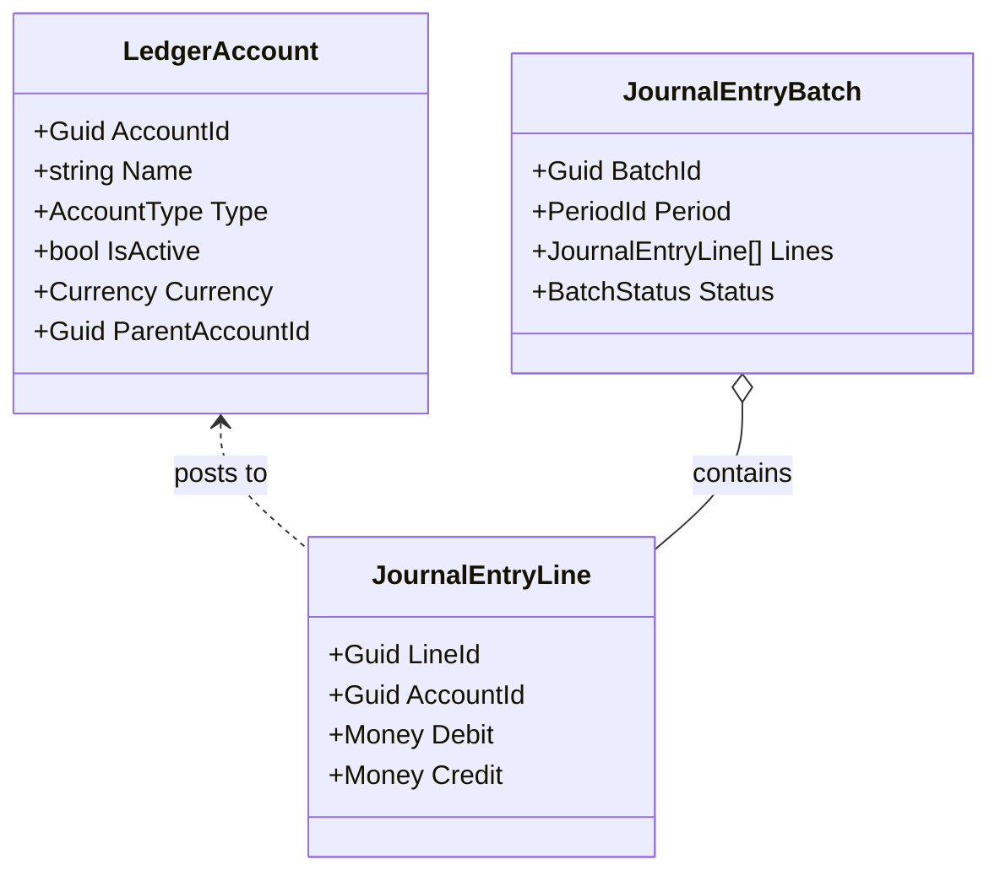

---

# **4.11 Events Produced by GL**

* `JournalBatchPosted`
* `JournalBatchReversed`
* `PeriodClosed`
* `PeriodReopened`
* `FXRevaluationPosted`
* `ReconciliationCompleted`

These events are consumed by:

* Analytics
* Tax
* FP&A
* Compliance
* Audit Trail

---

# **4.12 GL Read Models**

Optimized read models include:

* Trial Balance
* Ledger Account Summary
* Period Activity Summary
* Transaction Audit Rollup
* Reconciliation Dashboard
* FX Exposure Report

Read models are kept updated via event projections.

---

# **4.13 End-to-End GL Lifecycle Example**

1. User creates an Invoice in AR.
2. `InvoiceCreated` emits `FinancialTransactionRecorded`.
3. Posting Engine converts the transaction to JournalEntryLines.
4. JournalEntryBatch is validated.
5. Batch is posted.
6. GL updates read models (Trial Balance, P&L).
7. Audit Trail logs every step.
8. Analytics recalculates KPIs.

This lifecycle guarantees correctness, auditability, and consistency.

---

# **4.14 Summary**

The General Ledger is the authoritative financial core, enforcing correctness, compliance, and auditability. Its model integrates deeply with enhanced capabilities—FinancialTransaction, Approval Workflow (for period close), FX revaluation, and bank reconciliation—forming the backbone of the entire financial platform.

# **Chapter 5 — Accounts Payable (AP)**

### *Part II — Core Domains*

The **Accounts Payable (AP)** domain governs all outbound financial obligations—vendor bills, expenses, payments, cash disbursements, recurring payables, and approval workflows. AP is a strategically critical component because it directly impacts **cash flow**, **vendor relationships**, **financial compliance**, and **audit readiness**. This chapter presents a deeply enhanced, highly detailed DDD domain model for AP, aligned with enterprise-grade accounting systems.

---

# **5.1 Purpose of the AP Domain**

The AP domain ensures:

* All expenses and liabilities are recorded accurately.
* Outbound cash is controlled, approved, and compliant.
* Vendor obligations are tracked through their full lifecycle.
* Payment scheduling optimizes cash flow.
* GL postings remain correct and auditable.
* Workflow-driven approvals prevent fraud and unauthorized spending.

AP integrates with:

* **General Ledger** (expense posting, liability accrual, cash movement)
* **Bank Connectivity** (payment execution, bank reconciliations)
* **Approval Workflow** (multi-step bill approval)
* **Analytics** (vendor trends, spend analysis, cost control)
* **Compliance** (materiality/risk checks)

---

# **5.2 AP Subdomains**

AP is decomposed into the following subdomains:

### **1. Bill Management**

Lifecycle of vendor-supplied documents representing obligations.

### **2. Vendor Management**

Vendor profile, terms, relationships, risk, and payment preferences.

### **3. Payment Management**

Execution of payments against bills.

### **4. Payment Run Orchestration**

Batch payments, cash controls, and due-date-driven scheduling.

### **5. Recurring Payables**

Automation of repeated obligations.

### **6. AP Approvals**

Integrated with the generic Approval Workflow BC.

---

# **5.3 Key AP Aggregates**

---

## **5.3.1 Vendor Aggregate**

Represents upstream entities from which goods/services are purchased.

### **Attributes:**

* `VendorId`
* `Name`
* `VendorType` (Individual, Business, Contractor)
* `PaymentTerms` (VO)
* `TaxId` (VO)
* `PreferredPaymentMethod` (VO)
* `DefaultExpenseCategory`
* `Currency`
* `ContactInfo`
* `IsActive`
* `RiskScore` (Analytics integration)

### **Invariants:**

* TaxId must be valid for jurisdiction
* Vendor cannot be deactivated if unpaid bills exist
* Payment terms must align with organizational policies

### **Behaviors:**

* Activate/deactivate
* Update payment preferences
* Update risk score

### **Events:**

* `VendorCreated`
* `VendorUpdated`
* `VendorDeactivated`
* `VendorRiskScoreChanged`

---

## **5.3.2 Bill Aggregate**

The Bill Aggregate is one of the most complex in AP.

### **State Machine:**

```
Draft → AwaitingApproval → Approved → Scheduled → PartiallyPaid → Paid → Closed
                               ↑                   ↓
                         Rejected ←───────────────┘
```

### **Attributes:**

* `BillId`
* `VendorId`
* `IssueDate`
* `DueDate`
* `LineItems[]`
* `TotalAmount`
* `Currency`
* `PaymentTerms`
* `ApprovalRequestId` (from Approval Workflow BC)
* `Status`
* `Attachments[]`
* `Category` (optional)
* `Metadata`

### **LineItem Entity:**

* `Description`
* `Quantity`
* `UnitPrice`
* `Amount`
* `Category`

### **Invariants:**

* TotalAmount = Sum(LineItems)
* Currency cannot change after approval
* Vendor must be active
* Must be approved before scheduling payment

### **Behaviors:**

* Add/update/remove line items
* Submit for approval
* Mark approved/rejected
* Schedule for payment
* Apply payment
* Close bill

### **Events:**

* `BillCreated`
* `BillUpdated`
* `BillSubmittedForApproval`
* `BillApproved`
* `BillRejected`
* `BillScheduled`
* `BillPaymentApplied`
* `BillPaid`
* `BillClosed`
* `BillOverdue`

---

## **5.3.3 Payment Aggregate**

Represents a single payment made against a bill.

### **Attributes:**

* `PaymentId`
* `BillId`
* `VendorId`
* `Amount`
* `Currency`
* `ExchangeRate` (if multi-currency)
* `PaymentMethod`
* `PaidDate`
* `BankTransactionId`

### **Invariants:**

* Cannot exceed remaining balance on bill
* Payment currency must match or have valid FX translation

### **Events:**

* `PaymentInitiated`
* `PaymentCompleted`
* `PaymentFailed`

---

## **5.3.4 PaymentRun Aggregate**

Used for batch payment automation.

### **Attributes:**

* `PaymentRunId`
* `Bills[]` (scheduled for payment)
* `ScheduledDate`
* `ExecutionDate`
* `Status` (Draft, Ready, InProgress, Completed, Failed)

### **Invariants:**

* Only approved bills allowed
* Must maintain cash-flow constraints

### **Behaviors:**

* Add/Remove bills
* Execute payment run
* Retry failed batches

### **Events:**

* `PaymentRunCreated`
* `PaymentRunReady`
* `PaymentRunExecuted`
* `PaymentRunCompleted`
* `PaymentRunFailed`

---

# **5.4 Recurring Payables**

Recurring bills automate obligations like rent, software subscriptions, utilities.

### **RecurringBill Aggregate:**

* `RecurringBillId`
* `VendorId`
* `Schedule` (RecurrencePattern VO)
* `NextRunDate`
* `TemplateLineItems`
* `AutoApprove` flag

### **Events:**

* `RecurringBillGenerated`
* `RecurringBillExecuted`

---

# **5.5 Integration with Approval Workflow BC**

AP extensively uses the new generic **Approval Workflow BC**.

### **Bill approvals include:**

* Multi-level routing
* Threshold-based rules (e.g., manager approval above $5,000)
* Role-based approvers
* Parallel or sequential approvals

### **ApprovalRequestId** is stored in Bill Aggregate:

* Ensures decoupled approval tracking
* Allows analytics to inspect approval durations

---

# **5.6 Posting Rules (PostingPolicy)**

All AP postings use **PostingPolicy** from the Shared Kernel.

### **Bill Approval Posting:**

*None—approval does not impact GL until payment or accrual.*

### **Bill Payment Posting:**

```
DR  Expense / Accrued Expense
CR  Cash / Bank
```

### **Foreign Exchange Bills:**

* Must use exchange rate effective at payment date
* Unrealized gain/loss handled by FX BC

### **Partial Payments:**

* Bill transitions to PartiallyPaid
* GL tracks remaining liability

---

# **5.7 AP Integration with GL**

AP emits events:

* `BillApproved`
* `BillScheduled`
* `BillPaid`
* `BillClosed`

GL consumes these to post correct journal entries.

---

# **5.8 AP Integration with Bank Connectivity**

When payments are executed:

* AP sends `PaymentInitiated`
* Bank BC processes payment
* BankTransactionImported triggers reconciliation
* AP marks Payment as Completed

---

# **5.9 AP Integration with Analytics**

Analytics generates insights:

* Vendor spend trends
* Average approval duration
* Category concentration risks
* Cash burn projections from AP
* Late payment probability models

These insights feed into FP&A.

---

# **5.10 AP Integration with Compliance**

Compliance rules applied:

* Materiality thresholds
* Vendor risk evaluation
* Unauthorized vendor checks
* Policy-based rejection for large deviations

---

# **5.11 AP Domain Diagrams**

### **5.11.1 AP State Machine (Bill)**

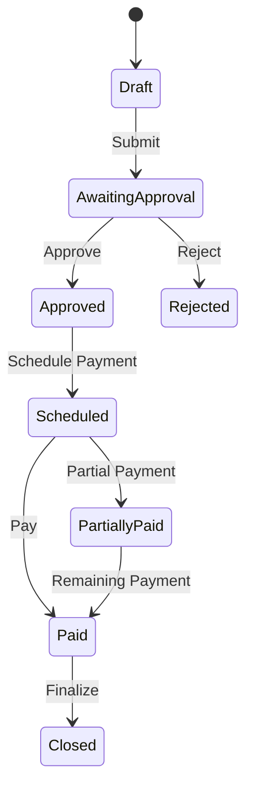

### **5.11.2 AP Domain Class Diagram**

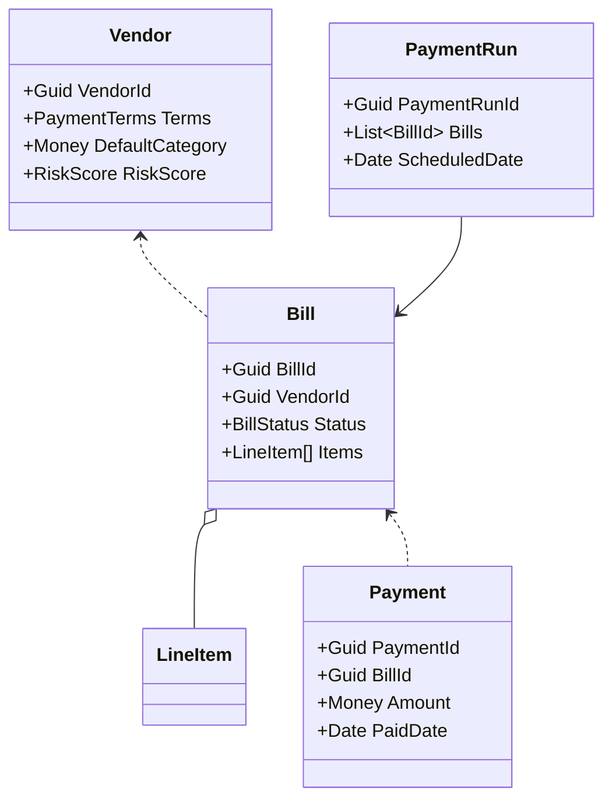

---

# **5.12 AP Read Models**

AP provides optimized read models for:

* AP Aging
* Vendor Spend Summary
* Category Spend Breakdown
* Approval Dashboard
* Upcoming Payment Obligations
* Recurring Bill Schedule

---

# **5.13 Example AP Lifecycle**

1. Vendor submits invoice.
2. User creates Bill.
3. Bill is submitted for approval.
4. Approval Workflow processes routing.
5. Bill is approved.
6. PaymentRun schedules payment.
7. Payment is executed by Bank BC.
8. GL posts:

   * DR: Expense / Accrued
   * CR: Cash
9. AP updates remaining balance.
10. Bill closes when fully paid.

---

# **5.14 Summary**

The AP domain ensures rigorous control over outbound cash, expenses, vendor relationships, and organizational compliance. Its enhanced integration with GL, Approval Workflow, FX, Compliance, Bank Connectivity, and Analytics provides a robust, enterprise-grade operational backbone.

# **Chapter 6 — Accounts Receivable (AR)**

### *Part II — Core Domains*

The **Accounts Receivable (AR)** domain governs all inbound financial obligations owed by customers—invoice creation, revenue recognition, collections, payment application, credit memos, and customer lifecycle management. AR is a strategic domain because it directly influences **cash inflows**, **customer liquidity**, **revenue integrity**, and **operational forecasting**.

This chapter presents a deeply detailed AR domain model, built using Domain-Driven Design (DDD), enhanced with the new shared kernel, policies, state machines, integration layers, and financial accuracy rules introduced in this architecture.

---

# **6.1 Purpose of the AR Domain**

The AR domain ensures:

* Revenue is recorded accurately and in the correct period.
* Customer obligations are tracked through full lifecycle.
* Payments are applied correctly to invoices.
* Credit memos and adjustments follow audit rules.
* Collections processes are supported.
* All cash receipts are reconciled with the bank.
* GL postings remain compliant and auditable.

AR integrates with:

* **General Ledger (GL)** for revenue, accruals, cash receipts.
* **Bank Connectivity** for customer payments & reconciliation.
* **Approval Workflow** for credit memos or high-value invoices.
* **Analytics** for collection forecasting & risk.
* **Compliance** for revenue recognition rules.
* **FP&A** for cash-flow projection and sales forecasting.

---

# **6.2 AR Subdomains**

AR is decomposed into the following subdomains:

### **1. Customer Management**

Customer profile, risk assessment, terms, and payment preferences.

### **2. Invoice Management**

Invoice creation, issuance, lifecycle, and revenue realization.

### **3. Payment Application**

Cash receipts, partial payments, and multi-invoice allocation.

### **4. Credit & Adjustment Management**

Credit memos, invoice corrections, and write-offs.

### **5. Collections Management**

Aging, reminders, escalation workflows.

### **6. AR Approvals**

Integrated with the generic Approval Workflow BC.

---

# **6.3 Key AR Aggregates**

---

## **6.3.1 Customer Aggregate**

Represents a party from whom payment is expected.

### **Attributes:**

* `CustomerId`
* `Name`
* `CustomerType` (Individual, Business)
* `CreditTerms` (VO)
* `CreditLimit`
* `RiskScore` (from Analytics)
* `DefaultCurrency`
* `ContactInfo`
* `IsActive`

### **Invariants:**

* Customer cannot be deactivated with open invoices
* Credit limit cannot be negative
* Currency must be valid ISO code

### **Behaviors:**

* Update risk score
* Update credit terms
* Activate/deactivate

### **Events:**

* `CustomerCreated`
* `CustomerUpdated`
* `CustomerRiskScoreChanged`
* `CustomerDeactivated`

---

## **6.3.2 Invoice Aggregate**

The most central AR aggregate.

### **State Machine:**

```
Draft → Issued → Delivered → PartiallyPaid → Paid → Closed
                    ↓
               Overdue (time-based)
```

### **Attributes:**

* `InvoiceId`
* `CustomerId`
* `IssueDate`
* `DueDate`
* `Currency`
* `LineItems[]`
* `TotalAmount`
* `TaxSummary`
* `Status`
* `ApprovalRequestId` (optional)
* `DeliveryTimestamp`
* `Metadata`

### **LineItem Entity:**

* `Description`
* `Quantity`
* `UnitPrice`
* `Amount`
* `TaxCategory`

### **Invariants:**

* TotalAmount = Sum(LineItems)
* Cannot deliver without issuing
* Cannot pay unissued invoices
* Currency cannot change after issuance
* Customer must be active

### **Behaviors:**

* Add/update/remove line items
* Issue invoice
* Mark delivered
* Apply payment
* Mark overdue (time-driven)
* Close invoice

### **Events:**

* `InvoiceCreated`
* `InvoiceIssued`
* `InvoiceDelivered`
* `InvoicePaymentApplied`
* `InvoiceOverdue`
* `InvoicePaid`
* `InvoiceClosed`

---

## **6.3.3 CustomerPayment Aggregate**

Represents an inbound payment event, usually tied to a BankTransaction.

### **Attributes:**

* `PaymentId`
* `CustomerId`
* `Amount`
* `Currency`
* `ExchangeRate` (if multi-currency)
* `ReceivedDate`
* `PaymentMethod`
* `BankTransactionId`
* `Allocations[]` (Invoice allocations)

### **Invariants:**

* Allocations cannot exceed payment amount
* Allocations cannot exceed invoice remaining balance

### **Allocation Entity:**

* `InvoiceId`
* `AppliedAmount`

### **Events:**

* `CustomerPaymentReceived`
* `CustomerPaymentAllocated`
* `CustomerPaymentCompleted`
* `CustomerPaymentFailed`

---

## **6.3.4 CreditMemo Aggregate**

Corrects overbilling, returns, or adjustments.

### **Attributes:**

* `CreditMemoId`
* `CustomerId`
* `InvoiceId` (optional)
* `Amount`
* `Currency`
* `Reason`
* `ApprovalRequestId`
* `Status`

### **Invariants:**

* Must be approved before applying
* Currency must match original invoice or FX applied

### **Events:**

* `CreditMemoCreated`
* `CreditMemoApproved`
* `CreditMemoApplied`

---

# **6.4 Revenue Recognition Policies (Compliance Integration)**

AR uses the **RevenueRecognitionPolicy** from the Shared Kernel.

### **Supported models:**

* Point-in-time recognition
* Over-time proportional recognition
* Milestone-based recognition
* Deferred revenue recognition

### **Typical Posting Example:**

```
DR Accounts Receivable
CR Deferred Revenue (if revenue not yet earned)
```

Then:

```
DR Deferred Revenue
CR Revenue
```

When earned.

---

# **6.5 AR Posting Rules (PostingPolicy)**

### **Invoice Issued:**

```
DR Accounts Receivable
CR Revenue (or Deferred Revenue)
```

### **Customer Payment Received:**

```
DR Cash / Bank
CR Accounts Receivable
```

### **Credit Memo Issued:**

```
DR Revenue
CR Accounts Receivable
```

(Or DR Deferred Revenue, depending on circumstances)

### **Write-Off:**

```
DR Bad Debt Expense
CR Accounts Receivable
```

---

# **6.6 AR Integration with GL**

AR emits events consumed by GL:

* `InvoiceIssued`
* `InvoicePaymentApplied`
* `InvoicePaid`
* `CreditMemoApproved`
* `CustomerPaymentReceived`

Posting Engine converts these into JournalEntryLines.

---

# **6.7 AR Integration with Bank Connectivity**

Customer payments sync:

1. Bank BC imports transaction
2. Creates FinancialTransaction
3. AR identifies customer payment
4. ReconciliationEntry links BankTransaction ↔ Payment
5. CustomerPayment allocations applied to invoices

---

# **6.8 AR Integration with Analytics**

Analytics generates:

* Collection forecasts
* Customer risk scores
* Days Sales Outstanding (DSO)
* Aging bucket analysis
* Payment likelihood scoring

---

# **6.9 AR Integration with Approval Workflow**

Approvals apply to:

* High-value invoices
* Credit memos
* Write-offs

Approval Workflow BC provides:

* Multi-step routing
* Threshold logic
* SLA tracking

---

# **6.10 AR Domain Diagrams**

### **6.10.1 Invoice State Machine**

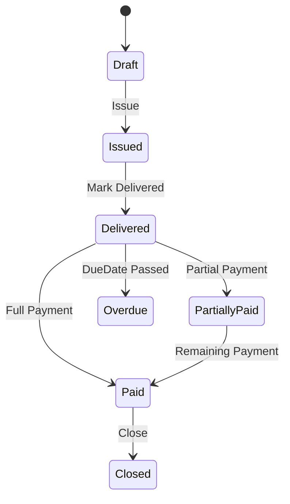

### **6.10.2 AR Domain Class Diagram**

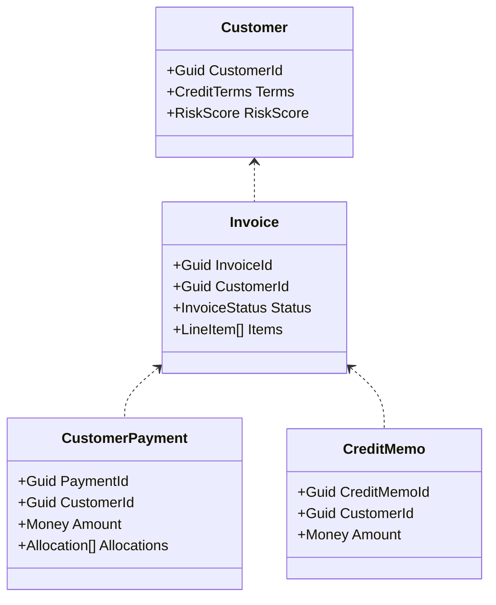

---

# **6.11 AR Read Models**

AR provides read models for:

* AR Aging
* Customer Balance Summary
* Invoice Ledger
* Cash Receipt Summary
* DSO report

---

# **6.12 AR Example Lifecycle**

1. Invoice created in Draft state.
2. Invoice Issued → GL posts AR & Revenue.
3. Invoice Delivered → triggers collection timeline.
4. Customer sends payment.
5. Bank imports transaction → triggers AR payment.
6. Payment applied (partial or full).
7. Invoice transitions to Paid.
8. GL posts Cash → AR.
9. Invoice Closed.

---

# **6.13 Summary**

The AR domain ensures accuracy of revenue recognition, customer obligations, credit operations, and inbound cash management. With enhanced integrations to GL, Analytics, Bank Connectivity, Approval Workflow, FX, and Compliance, AR is a fully enterprise-ready subsystem.

# **Chapter 7 — Financial Planning & Analysis (FP&A)**

### *Part II — Core Domains*

Financial Planning & Analysis (FP&A) provides the **forward‑looking intelligence** of the financial platform. While the General Ledger, AP, and AR domains capture *what has happened*, FP&A predicts *what will happen* through budgets, forecasts, scenarios, insights, and goal tracking.

This chapter delivers a deeply detailed DDD model for FP&A, integrating enhancements such as the Shared Kernel, FinancialTransaction abstraction, updated analytics modules, scenario modeling, and multi-currency forecasting.

---

# **7.1 Purpose of the FP&A Domain**

FP&A supports:

* Forward‑looking financial visibility
* Budget creation and enforcement
* Forecast modeling
* Scenario analysis and sensitivity modeling
* Variance analysis across all financial dimensions
* Financial goal planning and tracking
* KPI definition and monitoring

FP&A integrates with:

* **GL** for actuals, historical data, period snapshots
* **AP & AR** for spend and revenue predictions
* **Analytics** for trend analysis and anomaly detection
* **Currency/FX** for multi-currency forecasting
* **Compliance** for financially sound budget assumptions
* **Approval Workflow** for budget approvals

---

# **7.2 FP&A Subdomains**

FP&A is composed of several analytical subdomains:

### **1. Budgeting**

Traditional top‑down and bottom‑up budgeting.

### **2. Forecasting**

Predictive modeling of revenue, spend, cash flow, and margin.

### **3. Scenario Analysis**

"What‑if" simulations and financial sensitivity testing.

### **4. Variance Analysis**

Gap measurement between actuals and planned numbers.

### **5. Financial Goals**

User‑specific and business‑wide target tracking.

### **6. KPI Framework**

Standard and custom KPIs for dashboards and decision support.

---

# **7.3 Key FP&A Aggregates**

---

## **7.3.1 Budget Aggregate**

Captures a financial plan for a period.

### **Attributes:**

* `BudgetId`
* `Name`
* `OwnerId`
* `BudgetPeriod` (VO: Start, End, Frequency)
* `Lines[]`
* `TotalPlannedAmount`
* `Currency`
* `Status` (Draft, PendingApproval, Approved, Active, Locked)
* `ApprovalRequestId`

### **BudgetLine Entity:**

* `AccountId`
* `Category`
* `PlannedAmount`
* `Metadata`

### **Invariants:**

* Budget period cannot overlap with existing active budgets
* Currency must be consistent across all lines
* Total = Sum(LineAmounts)

### **Behaviors:**

* Add/update/remove budget lines
* Submit for approval
* Lock budget for enforcement
* Adjust budget (revision workflows)

### **Events:**

* `BudgetCreated`
* `BudgetUpdated`
* `BudgetSubmittedForApproval`
* `BudgetApproved`
* `BudgetActivated`
* `BudgetLocked`
* `BudgetVarianceDetected`

---

## **7.3.2 Forecast Aggregate**

Represents predictive modeling for future periods.

### **Attributes:**

* `ForecastId`
* `ModelType` (Linear, Seasonal, ML‑Based)
* `Inputs[]` (historical data, trend factors, events)
* `ForecastPeriod`
* `Projections[]`
* `Currency`

### **Projection Entity:**

* `Period`
* `ProjectedAmount`
* `ConfidenceInterval`
* `Drivers[]`

### **Invariants:**

* Forecast must reference a valid historical base period
* Projection currency must match organizational default or have FX mapping

### **Events:**

* `ForecastGenerated`
* `ForecastUpdated`
* `ForecastDriverChanged`

---

## **7.3.3 FinancialGoal Aggregate**

Defines target financial outcomes.

### **Attributes:**

* `GoalId`
* `Name`
* `TargetAmount`
* `CurrentProgress`
* `TargetDate`
* `Status` (Active, OnTrack, Behind, Achieved, Abandoned)
* `LinkedAccounts[]`
* `Currency`

### **Invariants:**

* TargetAmount > 0
* TargetDate must be in the future

### **Behaviors:**

* Update progress (event‑driven + manual)
* Adjust target
* Close goal

### **Events:**

* `GoalCreated`
* `GoalProgressUpdated`
* `GoalMilestoneReached`
* `GoalAchieved`
* `GoalAbandoned`

---

# **7.4 Scenario Analysis Engine**

A dedicated analytical engine used to generate "What‑If" financial outcomes.

### **Inputs:**

* GL actuals
* Budget lines
* Forecast drivers
* AP/AR projected flows
* FX rate projections

### **Outputs:**

* Best‑case scenario
* Worst‑case scenario
* Stress‑test scenario
* Sensitivity reports (e.g., +10% AR delays, −5% FX impact)

Scenario outputs are persisted as **ScenarioSnapshot** entities.

---

# **7.5 Variance Analysis Engine (Enhanced)**

Variance analysis compares actual performance vs projections.

### **Supported Variances:**

* Budget vs Actual
* Forecast vs Actual
* Prior Period vs Current
* Category variance
* Vendor variance

### **Variance Entry:**

* `Dimension` (Account, Category, Vendor, Project)
* `PlannedAmount`
* `ActualAmount`
* `VarianceAmount`
* `VarianceType` (Favorable/Unfavorable)

### **Triggers:**

* `JournalBatchPosted`
* `BillPaid`
* `CustomerPaymentReceived`
* FX adjustments

### **Events:**

* `BudgetVarianceDetected`
* `ForecastVarianceDetected`

FP&A can update the Budget or Forecast aggregates automatically or notify users.

---

# **7.6 FP&A Posting Rules & GL Integration**

Although FP&A does not generate standard operational postings, certain cases *do* create journal entries via PostingPolicy:

### **1. Accrual Adjustments**

```
DR Expense / Revenue Adjustment
CR Accrued Liability / Deferred Revenue
```

### **2. Budget Allocations (Optional Feature)**

When budgets translate into actual accrual events.

### **3. Reclassifications**

Driven by FP&A adjustments.

### **4. Forecast Adjustments (rare)**

Typically analytics‑only, but allowed for advanced enterprise versions.

All FP&A financial transactions use **FinancialTransaction** abstraction.

---

# **7.7 Integration with Other Domains**

## **GL → FP&A**

* Actuals feed budget/forecast updates
* FX revaluations impact projections
* Period close triggers budget variance verification

## **AP → FP&A**

* Bill schedules inform cash‑out forecasts
* Vendor analytics enhance budget insights

## **AR → FP&A**

* Cash‑in projections based on invoice patterns
* Collection likelihood models refine forecasts

## **Analytics → FP&A**

* Trend analysis
* Pattern recognition
* Driver prediction

## **Approval Workflow → FP&A**

* Budget approvals
* Forecast pull requests

## **Compliance → FP&A**

* Validates budget assumptions
* Enforces materiality thresholds

---

# **7.8 FP&A Domain Diagrams**

### **7.8.1 Budget State Machine**

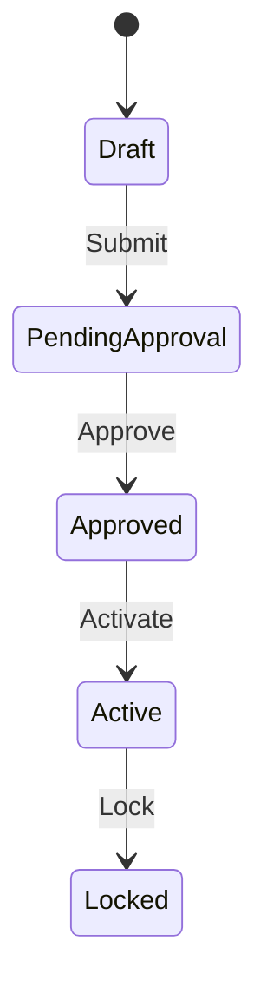

### **7.8.2 FP&A Class Diagram**

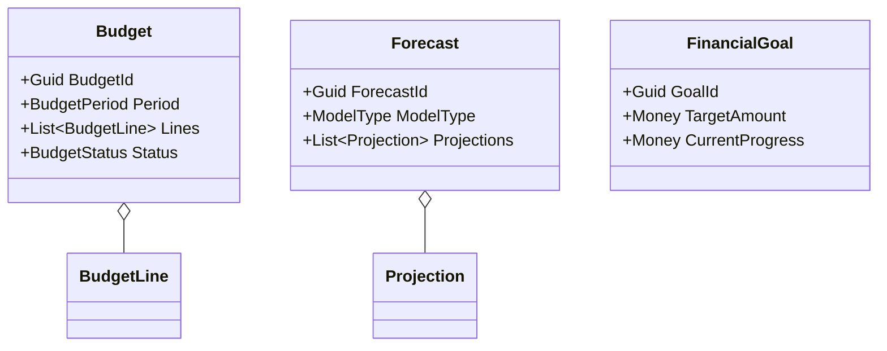

---

# **7.9 FP&A Read Models**

FP&A provides optimized read models for:

* Budget vs Actual dashboards
* Forecast models over time
* Scenario comparison charts
* KPI dashboards
* Goal progress summaries
* Category spending projections

These are updated by:

* GL posted events
* AP/AR payment events
* FX updates
* Analytics predictions

---

# **7.10 Example FP&A Lifecycle**

1. Finance team creates Budget in Draft.
2. Budget submitted → Approval Workflow handles routing.
3. Budget approved → Activated.
4. FP&A generates forecast using Budget + Analytics.
5. Actuals from GL feed into Variance Engine.
6. Variances trigger automatic adjustments or alerts.
7. Executives run scenario models.
8. Financial goals updated with progress.
9. Dashboards regenerate for leadership.

---

# **7.11 Summary**

FP&A provides strategic foresight across the financial system. It synthesizes data from GL, AP, AR, Bank, Analytics, and FX into budgets, forecasts, scenarios, and goals. With its enhanced models, policies, and analytics integrations, FP&A serves as the central engine for **financial decision‑making**, **risk forecasting**, and **organizational planning**.

# **Chapter 8 — Financial Analytics**

### *Part III — Supporting Domains*

The **Financial Analytics** bounded context transforms raw financial data into actionable intelligence. While the GL, AP, AR, and FP&A domains govern *financial correctness and operations*, Analytics delivers *interpretation, prediction, detection, and insight*.

With deep integration across the platform and enhancements aligned with enterprise-level intelligence systems, this chapter presents the full DDD model for the Analytics domain: aggregates, pipelines, KPIs, ML models, forecasting drivers, anomaly detection, and cross-domain intelligence flows.

---

# **8.1 Purpose of the Financial Analytics Domain**

Analytics answers questions such as:

* *Where is the money going?*
* *What is expected to happen next?*
* *Are there anomalies that suggest risk or fraud?*
* *What financial drivers impact the forecast most?*
* *Which vendors or customers represent concentrations of financial exposure?*

The purpose of this domain is to:

* Provide a real-time, data-driven decision layer
* Support FP&A with predictive insight
* Detect anomalies and mitigate financial risk
* Feed domain policies with dynamic intelligence
* Provide leadership with dashboards and KPIs

---

# **8.2 Analytics Subdomains**

Analytics is divided into specialized subdomains:

### **1. Cash Flow Analytics**

Predict short- and long-term liquidity.

### **2. Vendor & Category Analytics**

Identify spending patterns, cost spikes, vendor dependency, and efficiency.

### **3. Profitability Analytics**

Gross margin, net margin, unit economics.

### **4. Anomaly & Fraud Detection** *(Enhanced)*

Detect abnormal transactions, duplicate bills, suspicious behaviors.

### **5. Forecast Driver Discovery**

ML-driven extraction of leading predictors for FP&A.

### **6. KPI Management**

Framework for metrics, thresholds, dashboards.

---

# **8.3 Data Inputs into Analytics**

Analytics consumes data from across the system:

### **1. GL Data**

* JournalEntryLines
* Period snapshots
* FX revaluations
* Account balances

### **2. AP Data**

* Bills
* Vendor payments
* Recurring obligations
* Approval durations

### **3. AR Data**

* Invoices
* Customer payments
* DSO
* Credit memos

### **4. FP&A Data**

* Budget plans
* Forecast projections
* Variance outcomes

### **5. Bank Data**

* Raw bank transactions
* Reconciled entries
* Unmatched variances

### **6. FX Data**

* Rate changes
* Exposure mappings

### **7. Compliance Signals**

* Rule violations
* Policy escalations

---

# **8.4 Key Analytics Aggregates**

Although much of Analytics uses data processing pipelines, several aggregates anchor analytical consistency.

---

## **8.4.1 CashFlowProjection Aggregate**

Represents predicted inflows/outflows over a defined period.

### **Attributes:**

* `ProjectionId`
* `StartDate`
* `EndDate`
* `Currency`
* `PredictedInflows[]`
* `PredictedOutflows[]`
* `NetFlow`
* `ConfidenceInterval`
* `Drivers[]`

### **Events:**

* `CashFlowProjectionGenerated`
* `CashFlowProjectionUpdated`

---

## **8.4.2 SpendAnalysis Aggregate**

Tracks spending patterns.

### **Attributes:**

* `AnalysisId`
* `VendorBreakdown[]`
* `CategoryBreakdown[]`
* `Period`

### **Behavior:**

* Recompute daily/weekly/monthly

### **Events:**

* `SpendAnalysisCompleted`

---

## **8.4.3 AnomalyDetection Aggregate (Enhanced)**

ML-driven detection of unusual behavior.

### **Attributes:**

* `DetectionId`
* `FinancialObjectId` (Bill, Payment, Invoice, BankTransaction)
* `AnomalyScore`
* `AnomalyType`
* `IsConfirmed`
* `Severity`

### **AnomalyType Examples:**

* Duplicate Bill
* Unexpected Vendor Payment Spike
* Suspicious Customer Payment Pattern
* FX Rate Outlier
* Round-Trip Transactions
* Late-Night Payments

### **Events:**

* `FinancialAnomalyDetected`
* `AnomalyConfirmed`
* `AnomalyDismissed`

---

## **8.4.4 KPIDefinition Aggregate**

Defines KPIs displayed to leadership dashboards.

### **Examples:**

* Cash Runway
* Gross Margin
* Net Income
* AP/AR Turnover
* DSO / DPO
* Burn Rate
* Variance Forecast Accuracy

---

# **8.5 Analytics Processing Pipelines**

Analytics pipelines operate in 2 modes:

---

## **1. Streaming (Real-Time) Pipelines**

Triggered by domain events:

* JournalBatchPosted
* BillPaid
* InvoicePaid
* FXRateUpdated
* BankTransactionImported
* PeriodClosed

Each event updates:

* Projections
* KPIs
* Ongoing anomaly detection
* Vendor/category metrics

---

## **2. Batch Pipelines**

Run hourly, nightly, or monthly:

* Rebuild historical summaries
* Reclassify categories
* Refresh multi-period forecasts
* Recompute anomaly baselines

---

# **8.6 ML & Predictive Modeling Framework**

Analytics includes a dedicated ML framework.

### **Models:**

1. **Cash Flow Prediction Model**
2. **Anomaly Detection Model**
3. **Revenue Prediction Model**
4. **Vendor Spend Trend Model**
5. **Customer Payment Likelihood Model**
6. **Forecast Driver Model** (impact analysis)

### **Input Features:**

* Historical journal entries
* Seasonality trends
* Vendor/customer patterns
* FX volatility
* Approval delays
* Payment behaviors
* Category shifts

Models publish predictions via domain events.

---

# **8.7 Integration with Other Domains**

## **GL → Analytics**

* Actuals feed all analytical engines
* Revaluations affect exposure/risk

## **AP → Analytics**

* Vendor spend and cash-out timing
* Recurring bill detection

## **AR → Analytics**

* Customer payment patterns
* DSO and collections risk

## **FP&A → Analytics**

* Budget variance impact
* Driver weighting

## **Bank Connectivity → Analytics**

* Cash availability
* Bank-side anomalies

## **Compliance → Analytics**

* Flagged rules incorporated into anomaly models

---

# **8.8 Analytics Domain Diagrams**

### **8.8.1 Anomaly Detection Flow**

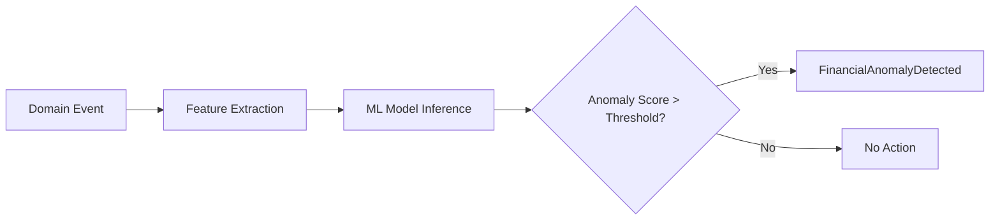

### **8.8.2 Analytics Aggregates Diagram**

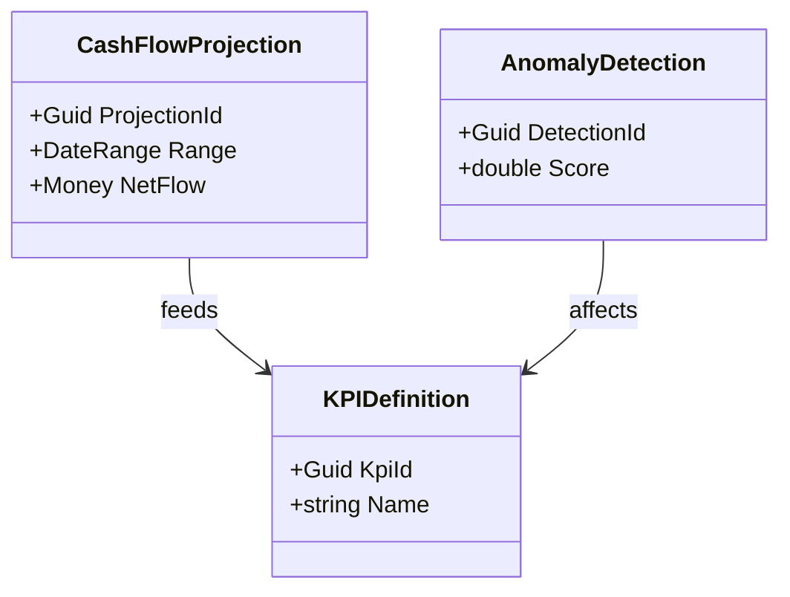

---

# **8.9 Analytics Read Models**

Analytics provides dashboards and summaries:

* Cash Flow Forecast
* Burn Rate Dashboard
* Vendor Spend Summary
* Customer Payment Prediction
* Financial Exposure Dashboard
* KPI Monitor
* Anomaly Report

---

# **8.10 Example Analytics Lifecycle**

1. GL posts a JournalBatch.
2. Analytics receives event.
3. Update projections and KPIs.
4. Run anomaly detection model.
5. Flag anomalies (if any).
6. Update FP&A forecast drivers.
7. Refresh dashboards.

---

# **8.11 Summary**

The Analytics domain acts as the *intelligence engine* of the financial platform. It consumes domain events from every core and supporting bounded context, applying ML and analytical rules to produce actionable insights, predictions, and anomalies.

# **Chapter 9 — Tax Management**

### *Part III — Supporting Domains*

Tax Management is a mission-critical supporting bounded context that ensures financial operations remain compliant across tax jurisdictions. It handles tax rules, tax codes, tax events, fiscal jurisdictions, deductible logic, withholding, multi-currency tax implications, and tax reporting. This chapter provides a comprehensive DDD domain model for tax operations integrated across GL, AP, AR, FP&A, and Compliance.

---

# **9.1 Purpose of the Tax Management Domain**

The Tax domain ensures:

* Correct calculation and recording of taxes
* Enforcement of jurisdictional rules
* Separation of deductible vs non-deductible expenses
* Proper tax treatment for inbound and outbound transactions
* Accurate financial statement preparation (GAAP/IFRS alignment)
* Filing-ready tax summaries

Tax Management integrates deeply with:

* **GL** (posting tax liabilities & tax expense entries)
* **AP** (VAT/GST on bills, withholding taxes)
* **AR** (sales tax, VAT, GST)
* **Bank** (withholding & remittance)
* **Compliance** (auditable tax rules & validations)
* **Analytics** (tax exposure, risk, optimization)

---

# **9.2 Tax Management Subdomains**

### **1. Tax Code Management**

Defines tax percentages, ranges, categories.

### **2. Jurisdiction Management**

Country/region-specific rules.

### **3. Tax Calculation Engine**

Applies calculation rules for AP, AR, FX, and accruals.

### **4. Tax Event Tracking**

Captures tax liabilities and events.

### **5. Tax Filing & Reporting**

Generates filing-ready summaries.

### **6. Withholding Tax Management**

Supports vendor/customer-side withholding.

---

# **9.3 Key Tax Aggregates**

---

## **9.3.1 TaxCode Aggregate**

Defines a specific tax category.

### **Attributes:**

* `TaxCodeId`
* `Code` (e.g., GST5, VAT20, US-SALES-8.25)
* `Rate` (percentage)
* `TaxCategory` (VAT, GST, SalesTax, Withholding, ServiceTax)
* `JurisdictionId`
* `IsDeductible`
* `EffectiveDateRange`

### **Invariants:**

* Rate must be >= 0
* Effective date cannot overlap for same code

### **Events:**

* `TaxCodeCreated`
* `TaxCodeRateUpdated`
* `TaxCodeRetired`

---

## **9.3.2 TaxJurisdiction Aggregate**

Represents a country/state/province/local authority.

### **Attributes:**

* `JurisdictionId`
* `Name`
* `Country`
* `Region`
* `Rules[]` (TaxRule VO)

### **Rules may include:**

* Thresholds
* Exemptions
* Reverse charge rules
* Deduction rules
* Filing frequency

### **Events:**

* `TaxJurisdictionCreated`
* `TaxJurisdictionRuleUpdated`

---

## **9.3.3 TaxEvent Aggregate**

Captures a taxable transaction.

### **Attributes:**

* `TaxEventId`
* `SourceContext` (AP, AR, Bank, GL)
* `ObjectId` (BillId, InvoiceId, PaymentId, etc.)
* `TaxCodeId`
* `BaseAmount`
* `TaxAmount`
* `Currency`
* `EventDate`

### **Invariants:**

* TaxAmount must match calculation rules
* TaxCode must be active for EventDate

### **Events:**

* `TaxEventRecorded`
* `TaxEventAdjusted`

---

## **9.3.4 TaxFiling Aggregate**

Represents a tax filing period.

### **Attributes:**

* `FilingId`
* `JurisdictionId`
* `PeriodStart`
* `PeriodEnd`
* `Status` (Open, PendingReview, Filed, Amended)
* `Events[]`

### **Behaviors:**

* Add events
* Validate totals
* File submission
* Amend filing

### **Events:**

* `TaxFilingOpened`
* `TaxFilingSubmitted`
* `TaxFilingAmended`

---

# **9.4 Tax Calculation Engine**

The engine applies rules from TaxCode and TaxJurisdiction to financial objects.

### **Inputs:**

* BaseAmount
* TaxCode
* Jurisdiction
* Deductibility rules
* Multi-currency FX

### **Outputs:**

* TaxAmount
* TaxEvent

### **Sample Calculation Logic:**

```
TaxAmount = BaseAmount * Rate
```

Adjustments include:

* Deductible vs non-deductible breakdown
* Withholding tax
* Reverse charge

---

# **9.5 Withholding Tax Handling**

Used in AP and AR.

### **Vendor Payment Scenario:**

If withholding is required:

```
VendorPayment = GrossAmount - WithholdingAmount
```

GL postings:

```
DR Expense
CR Cash (net payment)
CR WithholdingTaxLiability
```

---

# **9.6 Tax Integration with Other Domains**

## **AP → Tax**

* Bill line items calculate VAT/GST
* Withholding tax applied before payment
* TaxEvent created when bill is approved or paid

## **AR → Tax**

* Sales tax generated at invoice issuance
* TaxEvent created immediately

## **GL → Tax**

* Journal batches containing tax accounts update filing totals
* FX revaluation impacts tax liabilities in foreign currency

## **FP&A → Tax**

* Budget tax components by category
* Forecasting tax exposure

## **Bank Connectivity → Tax**

* Tax remittance payments
* Withholding tax cash movement

## **Compliance → Tax**

* Validates correct tax code usage
* Enforces jurisdiction rules

---

# **9.7 Tax Policies (Shared Kernel Integration)**

Tax Management uses policies from the Shared Kernel:

### **1. MaterialityPolicy**

Small tax variances may be grouped.

### **2. MatchingPrinciplePolicy**

Expenses recognized in correct period.

### **3. RevenueRecognitionPolicy**

Ensures tax aligns with revenue recognition.

### **4. PostingPolicy**

Maps tax events to correct journal entries.

---

# **9.8 Tax Posting Rules**

### **AP Tax Example:**

```
DR Expense
DR RecoverableTax (if deductible)
CR Accounts Payable
```

### **AR Tax Example:**

```
DR Accounts Receivable
CR Revenue
CR SalesTaxLiability
```

### **Withholding Example:**

```
DR Expense
CR Cash
CR WithholdingTaxLiability
```

---

# **9.9 Tax Reporting & Filing Engine**

### **Capabilities:**

* Summaries by tax category
* Jurisdiction-level aggregation
* Deductible vs non-deductible split
* Liability roll-forward
* Filing package generation

### **Filing Types:**

* Monthly/Quarterly VAT/GST sales tax returns
* Year-end adjustments
* Amended filings

### **Read Models:**

* Tax Summary Report
* Filing Detail Report
* Withholding Ledger

---

# **9.10 Tax Domain Diagrams**

### **9.10.1 Tax Object Diagram**

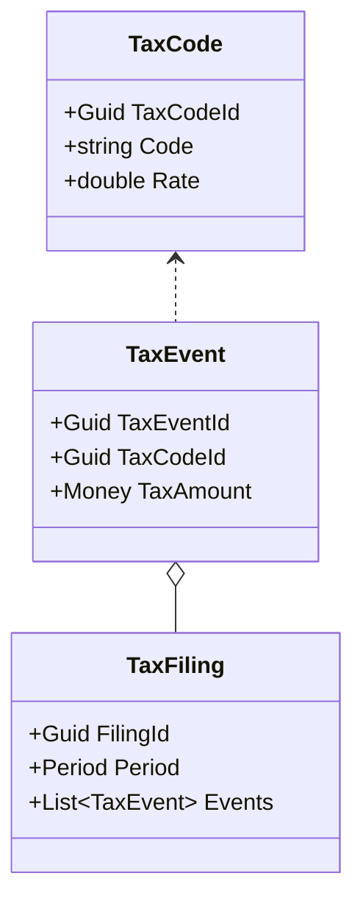

---

# **9.11 Example Tax Lifecycle**

1. Invoice issued with TaxCode VAT20.
2. TaxAmount calculated.
3. TaxEventRecorded emitted.
4. GL posts:

   * DR AR
   * CR Revenue
   * CR VAT Liability
5. Filing period aggregates VAT50.
6. Filing submitted and marked Filed.
7. Payment to tax authority reconciled in Bank.

---

# **9.12 Summary**

The Tax Management domain ensures compliance across complex multi-jurisdiction environments. With aggregates for tax codes, jurisdictions, tax events, and filings, plus a robust calculation and posting engine, it ensures the platform remains audit-ready and compliant.

# **Chapter 10 — Debt Management**

### *Part III — Supporting Domains*

The **Debt Management** bounded context handles all financial obligations that the user or business owes to lenders—such as loans, credit lines, mortgages, term loans, and structured debt instruments. This chapter provides a complete, deeply detailed DDD domain model for managing debt portfolios, amortization schedules, interest accrual, repayments, and GL integration.

Debt has a significant impact on financial forecasting, compliance, analytics, and cash flow visibility. This domain integrates tightly with GL, FP&A, Analytics, Tax, and Bank Connectivity.

---

# **10.1 Purpose of the Debt Management Domain**

Debt Management ensures:

* Accurate tracking of outstanding principal
* Daily, monthly, or periodic interest accruals
* Amortization schedule generation
* Payment application and variance detection
* Integration with GL for liability and interest postings
* Integration with FP&A for cash-out forecasting
* Compliance with accounting standards for loans and debt instruments

Debt Management supports:

* Personal loans
* Business loans
* Mortgages
* Revolving credit lines
* Equipment financing
* Deferred payment contracts

---

# **10.2 Debt Management Subdomains**

### **1. Loan Origination & Setup**

Initial creation of debt instrument.

### **2. Amortization & Schedule Management**

Creation and maintenance of payment schedules.

### **3. Interest Accrual Engine**

Accrues interest daily or monthly.

### **4. Payment Application & Tracking**

Applies real payments to principal/interest.

### **5. Variance & Exception Handling**

Detects underpayment, overpayment, or missed payments.

### **6. Debt Portfolio Analytics**

Exposure, maturity, and risk analytics.

---

# **10.3 Key Debt Aggregates**

---

## **10.3.1 Loan Aggregate**

Represents a debt instrument.

### **Attributes:**

* `LoanId`
* `Lender`
* `Principal`
* `OutstandingPrincipal`
* `InterestRate` (fixed or variable)
* `InterestType` (Simple, Compound)
* `CompoundingFrequency`
* `LoanTerm`
* `StartDate`
* `EndDate`
* `Currency`
* `PaymentSchedule[]`
* `Status` (Active, PaidOff, Defaulted)

### **Invariants:**

* Principal > 0
* InterestRate ≥ 0
* Term must be positive

### **Behaviors:**

* Generate amortization schedule
* Apply interest accrual
* Apply payment
* Recalculate outstanding principal

### **Events:**

* `LoanCreated`
* `LoanAmortizationScheduleGenerated`
* `LoanInterestAccrued`
* `LoanPaymentApplied`
* `LoanPaidOff`

---

## **10.3.2 PaymentSchedule Entry (Entity)**

Each scheduled payment is represented as an entity.

### **Attributes:**

* `ScheduleId`
* `DueDate`
* `PrincipalDue`
* `InterestDue`
* `TotalDue`
* `Currency`
* `Status` (Upcoming, Paid, Missed)

### **Invariants:**

* TotalDue = PrincipalDue + InterestDue

---

## **10.3.3 LoanPayment Aggregate**

Represents an actual payment.

### **Attributes:**

* `PaymentId`
* `LoanId`
* `Amount`
* `Currency`
* `PaymentDate`
* `BankTransactionId`
* `PrincipalApplied`
* `InterestApplied`

### **Invariants:**

* Cannot apply more than outstanding balance
* Currency must match loan currency or have FX mapping

### **Events:**

* `LoanPaymentReceived`
* `LoanPaymentAllocated`

---

# **10.4 Interest Accrual Engine**

Accrues interest based on:

* Daily balance
* Quoted rate
* Compounding frequency (Daily, Monthly, Quarterly, Annually)

### **Core Formula:**

For daily simple interest:

```
Interest = OutstandingPrincipal × (AnnualRate / 365)
```

For compounded interest:

```
A = P × (1 + r/n)^(n×t)
```

Where t = time in years.

### **Events:**

* `LoanInterestAccrued`

### **Posting to GL:**

```
DR InterestExpense
CR InterestPayable (Liability)
```

---

# **10.5 Payment Application Engine**

When a payment occurs:

### **Order of application:**

1. **InterestDue**
2. **PrincipalDue**
3. **Late fees or penalties** (optional)
4. **Principal prepayment** (if extra)

### **Events:**

* `LoanPaymentAllocated`
* `LoanPrincipalReduced`

### **GL Posting:**

```
DR LoanLiability (Principal)
DR InterestPayable (Interest)
CR Cash
```

---

# **10.6 Amortization Schedule Generation**

The Loan aggregate generates amortization schedules.

### **Each schedule includes:**

* Periodic payment amount
* Principal vs interest split
* Remaining balance after payment

### **Amortization Types:**

* Standard amortization
* Bullet payments
* Interest-only periods
* Variable rate adjustments

### **Events:**

* `LoanAmortizationScheduleGenerated`

---

# **10.7 Integration with Other Domains**

## **GL → Debt**

GL actuals validate principal & interest correctness.

## **AP → Debt**

Loan payments executed via AP/Bank pipeline.

## **AR → Debt**

Not typical—but used if customer-side financing is needed.

## **FP&A → Debt**

* Interest expense forecasting
* Principal repayment projections
* Debt maturity modeling

## **Analytics → Debt**

Risk analysis:

* Exposure by lender
* Interest rate sensitivity
* FX volatility effects

## **Bank Connectivity → Debt**

Loan payments tied to BankTransaction records.

---

# **10.8 Debt Domain Diagrams**

### **10.8.1 Loan Lifecycle**

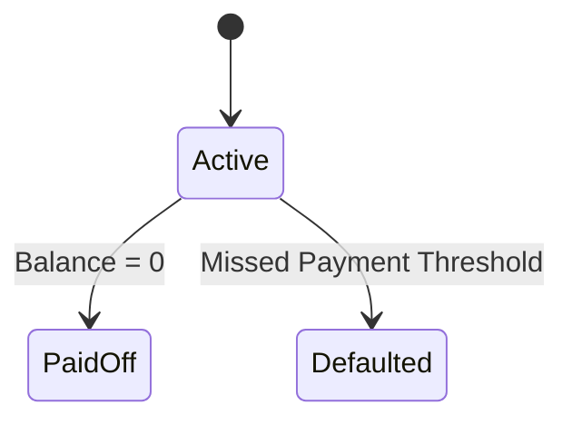

### **10.8.2 Debt Class Diagram**

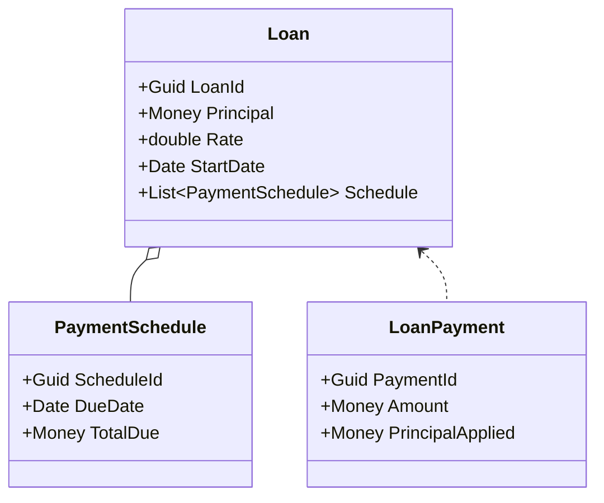

---

# **10.9 Debt Read Models**

* Loan Summary
* Outstanding Principal Report
* Interest Accrued Report
* Debt Maturity Ladder
* Payment Schedule Dashboard
* Exposure by Lender

---

# **10.10 Example Debt Lifecycle**

1. Loan created → amortization schedule generated.
2. Daily interest accrues → GL posts liability.
3. Payment occurs via Bank → PaymentAllocated.
4. Principal reduced.
5. Schedule updated.
6. Loan paid off after final payment.
7. GL reverses final balances.

---

# **10.11 Summary**

The Debt Management domain is critical for managing long-term financial obligations. With aggregates for loans, payments, schedules, and interest accrual integrated with GL, FP&A, Analytics, FX, and Bank Connectivity, it offers complete visibility and control over debt portfolios.

# **Chapter 11 — Investment Management**

### *Part III — Supporting Domains*

The **Investment Management** bounded context models the tracking, valuation, and performance analysis of investment instruments. It is used for both individuals and businesses that hold securities, assets, or investment products. This domain ensures accurate gain/loss tracking, supports GL integration for revaluations, and provides FP&A with projected investment income.

This chapter delivers a comprehensive DDD domain model for investments: asset classes, holdings, transactions, valuations, multi-currency positions, performance metrics, and integration across the financial system.

---

# **11.1 Purpose of the Investment Management Domain**

Investment Management ensures:

* Accurate tracking of asset holdings
* Realized and unrealized gain/loss calculations
* Periodic valuation updates
* Multi-currency investment accuracy
* Cash flow modeling for dividends, coupons, and interest income
* Integration with GL for valuation adjustments
* Portfolio performance analytics

It supports:

* Stocks
* Bonds
* ETFs and mutual funds
* Crypto assets (optional extension)
* Real estate (valuation-based)
* Derivatives (options, futures — optional advanced module)

---

# **11.2 Investment Management Subdomains**

### **1. Portfolio Management**

Group-level investment visibility.

### **2. Asset & Security Master**

Defines instrument metadata.

### **3. Holdings & Positions**

Tracks quantities, cost basis, and valuation.

### **4. Investment Transactions**

Trades, corporate actions, dividends.

### **5. Valuation Engine**

Periodic market price updates.

### **6. Performance Analytics**

Return, risk, diversification metrics.

---

# **11.3 Key Aggregates and Entities**

---

## **11.3.1 Portfolio Aggregate**

Represents a collection of investment holdings.

### **Attributes:**

* `PortfolioId`
* `OwnerId`
* `Name`
* `Holdings[]`
* `BaseCurrency`
* `PerformanceMetrics`

### **Behaviors:**

* Add/remove holdings
* Recalculate performance metrics

### **Events:**

* `PortfolioCreated`
* `PortfolioUpdated`
* `PortfolioPerformanceUpdated`

---

## **11.3.2 Holding Aggregate**

Represents a user’s or entity’s holding in a specific security.

### **Attributes:**

* `HoldingId`
* `PortfolioId`
* `SecurityId`
* `Quantity`
* `CostBasis` (VO)
* `CurrentValue`
* `UnrealizedGainLoss`
* `Currency`

### **Invariants:**

* Quantity cannot be negative
* CostBasis must reflect average or FIFO method

### **Events:**

* `HoldingCreated`
* `HoldingAdjusted`
* `HoldingValuationUpdated`

---

## **11.3.3 Security Aggregate**

Defines metadata for investment instruments.

### **Attributes:**

* `SecurityId`
* `Ticker`
* `AssetClass` (VO)
* `Market`
* `Currency`
* `Description`

### **Asset Classes:**

* Equity
* Bond
* Derivative
* Fund
* Commodity
* Crypto (extension)
* Real Estate (valuation-derived)

### **Events:**

* `SecurityCreated`
* `SecurityUpdated`

---

## **11.3.4 InvestmentTransaction Aggregate**

Represents a trade or event impacting a holding.

### **Types:**

* Buy
* Sell
* Dividend
* Interest Income
* Stock Split
* Corporate Action

### **Attributes:**

* `TransactionId`
* `HoldingId`
* `SecurityId`
* `TransactionType`
* `Quantity`
* `Price`
* `Amount`
* `Currency`
* `TransactionDate`

### **Events:**

* `InvestmentTransactionRecorded`
* `DividendReceived`
* `CorporateActionApplied`

---

# **11.4 Valuation Engine**

Valuation updates holdings based on market data.

### **Inputs:**

* Market price feed
* FX rate
* Security metadata

### **Outputs:**

* Updated CurrentValue
* Updated UnrealizedGainLoss

### **Events:**

* `HoldingValuationUpdated`
* `PortfolioPerformanceUpdated`

### **GL Integration:**

Unrealized gains/losses posting:

```
DR Unrealized Loss
CR Investment Asset (or reverse for gains)
```

---

# **11.5 Gain/Loss Calculations**

### **Realized Gain/Loss:** (on sale)

```
RealizedGainLoss = SaleProceeds – CostBasisForSoldUnits
```

### **Unrealized Gain/Loss:** (valuation-based)

```
Unrealized = CurrentMarketValue – CostBasis
```

Cost basis methods supported:

* FIFO
* LIFO
* Average Cost

---

# **11.6 Integration with Other Domains**

## **GL → Investment**

* Revaluation entries
* Gain/loss postings

## **FP&A → Investment**

* Forecast investment income
* Long-term asset performance

## **Analytics → Investment**

* Portfolio performance metrics
* Risk-adjusted returns
* Exposure by asset class

## **Tax → Investment**

* Capital gains tax calculation
* Dividend tax categories

## **Bank Connectivity → Investment**

* Dividend payments
* Trade settlements

---

# **11.7 Investment Domain Diagrams**

### **11.7.1 Portfolio–Holding Relationship**

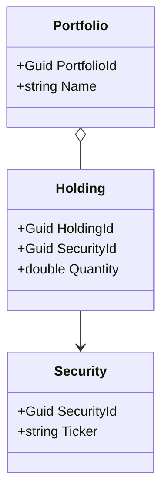

### **11.7.2 Investment Transaction Flow**

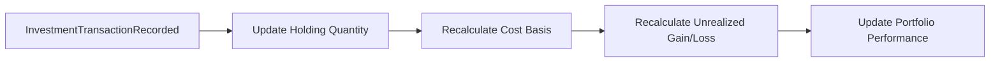

---

# **11.8 Investment Read Models**

* Portfolio Summary
* Holding Performance
* Asset Allocation
* Investment Gain/Loss Report
* Income (Dividend/Interest) Report
* Multi-currency Exposure Summary

---

# **11.9 Example Investment Lifecycle**

1. User buys 10 shares of AAPL at $150.
2. `InvestmentTransactionRecorded` → Holding updated.
3. Market price rises to $170.
4. `HoldingValuationUpdated` adjusts unrealized gain.
5. User sells 5 shares.
6. Realized gain recognized.
7. Dividend issued by company → `DividendReceived`.
8. GL posts financial impacts.
9. Analytics updates risk & performance.

---

# **11.10 Summary**

The Investment Management domain provides full lifecycle modeling of securities, including trades, valuations, gain/loss calculations, and performance analytics. Integrated with GL, FP&A, Analytics, Tax, and Bank Connectivity, it forms a critical component of long-term financial analysis.

# **Chapter 12 — Credit Score & Risk Monitoring**

### *Part III — Supporting Domains*

The **Credit Score & Risk Monitoring** bounded context models the financial health, creditworthiness, and behavioral risk patterns of users or businesses. It analyzes historical payment behaviors, outstanding obligations, credit utilization, and derived financial behaviors across AP, AR, Banking, Debt, and Analytics domains.

This chapter provides a complete DDD specification of the Credit Score & Risk Monitoring domain, including scoring models, risk event aggregation, ML-driven analysis, and integration into broader financial decision-making.

---

# **12.1 Purpose of the Credit Score & Risk Domain**

The domain answers key questions:

* *How risky is this user or business?*
* *Are they likely to pay their obligations on time?*
* *How is credit utilization trending?*
* *Are any risk signals present in recent financial activity?*

The domain provides value by:

* Offering credit insights for lenders
* Guiding risk-based decisioning for invoices or vendor management
* Providing users with score visibility and improvement suggestions
* Enhancing FP&A and Analytics models with risk-adjusted projections

---

# **12.2 Credit Score & Risk Subdomains**

### **1. Credit Utilization Tracking**

Tracks revolving credit use and available credit.

### **2. Payment Behavior Analysis**

On-time vs late payments, missed payments, delinquency trends.

### **3. Credit Score Modeling**

Score based on weighted financial factors.

### **4. Risk Event Monitoring**

Detects red flags such as sudden spending spikes or default-like behavior.

### **5. External Bureau Integration** *(optional)*

Integrates with credit bureaus for personal/business scores.

### **6. Credit Alerts & Recommendations**

Generates insights for users.

---

# **12.3 Key Aggregates and Entities**

---

## **12.3.1 CreditProfile Aggregate**

Represents the overall credit health of an entity.

### **Attributes:**

* `CreditProfileId`
* `OwnerId`
* `Score` (0–850)
* `Utilization` (% revolving credit used)
* `DelinquencyCount`
* `PaymentHistory[]`
* `CreditLimit`
* `RiskLevel` (Low, Medium, High)
* `LastUpdated`

### **Invariants:**

* Score must be within [0, 850]
* Utilization must be >= 0
* DelinquencyCount cannot be negative

### **Events:**

* `CreditProfileCreated`
* `CreditScoreUpdated`
* `CreditRiskLevelChanged`

---

## **12.3.2 RiskEvent Aggregate**

Represents detected risks tied to financial behavior.

### **Attributes:**

* `RiskEventId`
* `OwnerId`
* `RiskType`
* `Severity`
* `Description`
* `EventDate`

### **Risk Types:**

* Missed Payment
* Late Payment
* Overutilization
* Cash Flow Shock
* Fraudulent-like Activity
* Sudden Debt Increase
* Unusual Vendor Behavior

### **Events:**

* `RiskEventDetected`
* `RiskEventAcknowledged`

---

## **12.3.3 CreditBureauReport (Optional Integration)**

Pulled from external providers.

### **Attributes:**

* `ReportId`
* `OwnerId`
* `BureauName`
* `Score`
* `DerogatoryMarks`
* `Inquiries`
* `UpdatedDate`

### **Events:**

* `BureauReportImported`

---

# **12.4 Credit Scoring Model**

The Credit Score is a weighted combination of:

| Factor                    | Weight |
| ------------------------- | ------ |
| Payment history           | 35%    |
| Credit utilization        | 30%    |
| Length of credit history  | 15%    |
| New credit                | 10%    |
| Diversification of credit | 10%    |

### **Score Calculation Example:**

```
Score = 0.35 * PaymentScore
      + 0.30 * UtilizationScore
      + 0.15 * HistoryScore
      + 0.10 * NewCreditScore
      + 0.10 * DiversificationScore
```

Score updates trigger:

* `CreditScoreUpdated`
* `CreditRiskLevelChanged`

---

# **12.5 Risk Detection Engine**

The engine listens to domain events from:

* AP (late vendor payments)
* AR (late customer payments)
* Bank (low balance or overdraft activity)
* Debt (missed loan payments)
* Analytics (anomalies)
* FP&A (variance shocks)

### **Detection Rules:**

1. **Missed Payment Rule** — Payment > X days late
2. **Overutilization Rule** — Utilization > 90%
3. **Cash Flow Stress Rule** — NetFlow < threshold for Y days
4. **Anomaly Feedback Rule** — Risk score adjusted based on ML detection

### **Events:**

* `RiskEventDetected`

---

# **12.6 Integration with Other Domains**

## **AP → Credit**

* Late vendor payments impact business credit.

## **AR → Credit**

* Delayed customer payments impact customer credit scoring (B2B scenario).

## **Debt → Credit**

* Missed loan payments reduce score.

## **Bank Connectivity → Credit**

* Overdraft events generate risk flags.

## **Analytics → Credit**

* ML anomalies influence risk score.

## **FP&A → Credit**

* Deteriorating forecasts create risk adjustments.

---

# **12.7 Credit Alerts and Recommendations**

### **Generated Alerts:**

* "Your credit utilization exceeded 90% this month."
* "Missed payment detected—your score may be impacted."
* "Unusual spending spike recognized in Vendor X."

### **Recommendations:**

* Pay down high-utilization credit lines.
* Spread out credit inquiries.
* Improve payment timeliness.

---

# **12.8 Credit Domain Diagrams**

### **12.8.1 Credit Score Update Flow**

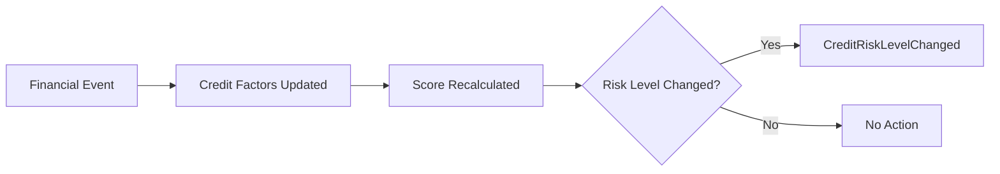

### **12.8.2 Credit Class Diagram**

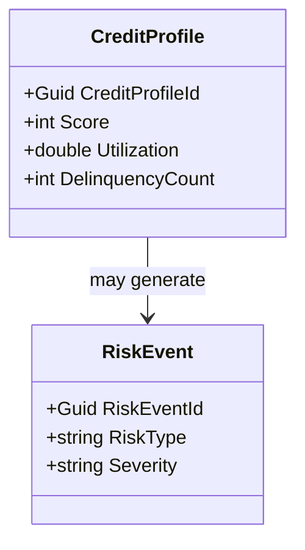

---

# **12.9 Credit Read Models**

* Credit Score Summary
* Risk Event Timeline
* Utilization Trend
* Payment History Dashboard
* Risk Category Breakdown

---

# **12.10 Example Credit Lifecycle**

1. Customer misses an invoice payment.
2. AR emits `InvoiceOverdue`.
3. Credit domain updates PaymentHistory.
4. RiskEventDetected created.
5. CreditScore recalculated.
6. CreditRiskLevelChanged emitted.
7. Analytics updates risk forecast.
8. FP&A adjusts projections.

---

# **12.11 Summary**

The Credit Score & Risk Monitoring domain tracks financial health and behavioral patterns, providing risk-adjusted intelligence across the platform. Its integration with AP, AR, Debt, Bank, Analytics, and FP&A ensures risk is proactively identified and managed.

# **Chapter 13 — Currency & FX Management**

### *Part IV — Generic Domains*

The **Currency & FX Management** bounded context provides the foundational multi-currency and foreign exchange capabilities required across AP, AR, GL, FP&A, Debt, Investments, and Analytics. It ensures consistent FX rate handling, accurate conversions, auditability of exchange rate usage, and compliance with accounting standards for FX revaluation.

This chapter defines the full DDD model for FX Management, including aggregates, VOs, policies, revaluation processes, posting rules, and integrations.

---

# **13.1 Purpose of the Currency & FX Domain**

The FX domain ensures:

* Standardized multi-currency conversions
* Historical and real-time FX rate storage
* Accurate realized and unrealized FX gain/loss calculations
* Compliance with IFRS, GAAP for revaluation
* FX exposure visibility for Analytics & FP&A
* Consistent FX application across all bounded contexts

This domain is **generic**, meaning all other domains depend on it, but it depends on none.

---

# **13.2 FX Management Subdomains**

### **1. Currency Master**

Defines available currencies and metadata.

### **2. FX Rate Storage**

Historical and current FX rate records.

### **3. FX Conversion Engine**

Applies rules to convert money across currencies.

### **4. FX Revaluation Engine**

Generates unrealized gain/loss for multi-currency balances.

### **5. Exposure Management**

Tracks exposure by account, vendor, customer, loan, or investment.

### **6. FX Posting Policy Integration**

Maps FX events to GL entries.

---

# **13.3 Key Aggregates and Entities**

---

## **13.3.1 Currency Entity**

Represents a standard ISO currency.

### **Attributes:**

* `CurrencyCode` (ISO 4217)
* `Name`
* `Symbol`
* `DecimalPrecision`
* `IsActive`

### **Invariants:**

* Must be valid ISO currency

---

## **13.3.2 FXRate Aggregate**

Represents the exchange rate between two currencies.

### **Attributes:**

* `FXRateId`
* `BaseCurrency`
* `QuoteCurrency`
* `Rate`
* `InverseRate`
* `EffectiveDate`
* `Source` (MarketFeed, Manual, Bank)

### **Invariants:**

* Rate > 0
* Base != Quote

### **Events:**

* `FXRateAdded`
* `FXRateUpdated`
* `FXRateSourceChanged`

---

## **13.3.3 FXExposure Aggregate**

Represents currency exposure across multiple positions.

### **Attributes:**

* `ExposureId`
* `OwnerId`
* `Currency`
* `NetExposureAmount`
* `Sources[]` (AP, AR, GL, Debt, Investments)

### **Events:**

* `FXExposureUpdated`

---

# **13.4 Value Objects**

### **Money VO**

* `Amount`
* `Currency`

### **ExchangeRate VO**

* `Base`
* `Quote`
* `Rate`
* `Date`

### **ConversionResult VO**

* `ConvertedAmount`
* `AppliedRate`
* `Source` (Audit trail)

---

# **13.5 FX Conversion Engine**

The FX engine performs conversions using:

* Direct rate
* Inverse rate
* Cross-currency routing (e.g., EUR → USD → INR)
* Historical or spot rates

### **Conversion Logic:**

```
ConvertedAmount = Amount × Rate
```

### **Three core rules:**

1. Always favor effective rate at transaction date.
2. If historical rate missing → fallback to nearest available.
3. Use same rate for entire transaction to maintain GL consistency.

---

# **13.6 FX Revaluation Engine**

Handles month-end or real-time revaluation of foreign-currency balances.

### **Revaluation Steps:**

1. Identify foreign-currency balances (AP, AR, GL, Debt, Investments).
2. Pull validation spot rate.
3. Calculate difference:

```
UnrealizedGainLoss = (CurrentRate − HistoricalRate) × Balance
```

4. Create Unrealized FX event.
5. Post via PostingPolicy.

### **Events:**

* `FXRevaluationPerformed`
* `UnrealizedFXGainRecorded`
* `UnrealizedFXLossRecorded`

---

# **13.7 FX Posting Rules (GL Integration)**

### **Unrealized Gain**

```
DR Foreign Currency Asset/Liability
CR Unrealized FX Gain
```

### **Unrealized Loss**

```
DR Unrealized FX Loss
CR Foreign Currency Asset/Liability
```

### **Realized Gain/Loss** (on settlement)

```
DR Cash
DR/CR Realized FX Gain/Loss
CR AR/AP/Debt
```

---

# **13.8 Integration with Other Domains**

## **AP → FX**

* Bills in foreign currency
* Payments converted at payment date

## **AR → FX**

* Invoices in foreign currency
* Customer payments cause realized gain/loss

## **GL → FX**

* FX revaluation entries
* Multi-currency journal posting

## **Debt → FX**

* Loan principal in foreign currency
* FX volatility affects interest & principal exposure

## **Investments → FX**

* Price feeds in foreign markets
* FX-adjusted valuation

## **FP&A → FX**

* Multi-currency forecasting
* Exposure impacts on projections

## **Analytics → FX**

* FX trend forecasting
* Volatility modeling

---

# **13.9 FX Exposure Management**

Tracks how much value is at risk due to currency fluctuations.

### **Exposure Sources:**

* AP obligations
* AR expected receipts
* Debt principal
* Investment positions
* Cash accounts

### **Exposure Computation:**

```
NetExposure = Sum(FXConvertedValues per Source)
```

### **Events:**

* `FXExposureUpdated`

---

# **13.10 FX Domain Diagrams**

### **13.10.1 FX Conversion Flow**

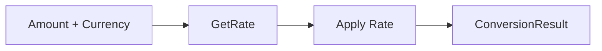

### **13.10.2 FX Class Diagram**

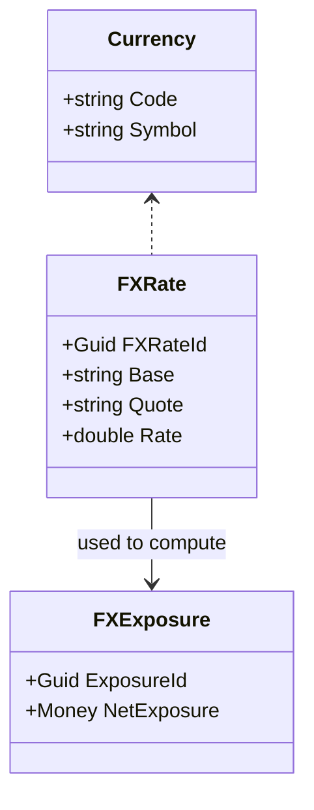

---

# **13.11 FX Read Models**

* FX Rate Table (historical & spot)
* Exposure Summary
* Unrealized Gain/Loss Summary
* Multi-currency Dashboard

---

# **13.12 Example FX Lifecycle**

1. AP Bill created in EUR.
2. Payment done in USD.
3. FX engine converts using historical rate.
4. GL posts realized gain/loss.
5. Month-end revaluation adjusts remaining balances.
6. Analytics updates FX exposure dashboard.

---

# **13.13 Summary**

The Currency & FX domain provides the essential foundation for multi-currency financial systems. With aggregates for FX rates, exposures, conversion and revaluation engines, and deep integrations across all financial domains, it ensures accuracy, compliance, and intelligence across the platform.

# **Chapter 14 — Bank Connectivity & Reconciliation**

### *Part IV — Generic Domains*

The **Bank Connectivity & Reconciliation** bounded context provides the foundational plumbing for synchronizing financial data with external financial institutions. It is responsible for importing bank transactions, maintaining bank account states, and performing automated or semi-automated reconciliation with internal financial activity.

This chapter presents the full DDD model for bank connectivity, ingestion pipelines, reconciliation workflows, and integrations across the financial platform.

---

# **14.1 Purpose of the Bank Connectivity Domain**

Bank Connectivity ensures:

* Secure syncing with bank accounts
* Consistent ingestion of bank transactions
* Reconciliation between internal and external records
* Detection of unmatched or suspicious transactions
* Support for payment confirmations
* Reliable basis for cash flow reporting

This domain is a core generic dependency for AP, AR, GL, Debt, Investments, Analytics, Tax, and Compliance.

---

# **14.2 Bank Connectivity Subdomains**

### **1. Bank Account Management**

Internal representation of linked bank accounts.

### **2. Bank Transaction Ingestion**

Pull or push transaction feeds from external institutions.

### **3. Reconciliation Engine**

Matches external transactions with internal financial events.

### **4. Bank Statement Processing**

Full statement import and reconciliation.

### **5. Exceptions & Unmatched Handling**

Handling cases where no match exists.

### **6. Payment Confirmation Services**

AP/AR payment confirmations.

---

# **14.3 Key Aggregates and Entities**

---

## **14.3.1 BankAccount Aggregate**

Represents a financial account in an external institution.

### **Attributes:**

* `BankAccountId`
* `InstitutionName`
* `AccountNumber`
* `AccountType` (Checking, Savings, Credit, Loan)
* `Currency`
* `Balance`
* `LastSyncedAt`
* `ConnectionMethod` (Plaid, DirectFeed, Manual)

### **Invariants:**

* AccountNumber must be masked in output
* Balance is derived, not manually modified

### **Events:**

* `BankAccountLinked`
* `BankAccountSynced`
* `BankAccountDisconnected`

---

## **14.3.2 BankTransaction Aggregate**

Represents a transaction imported from the bank.

### **Attributes:**

* `BankTransactionId`
* `BankAccountId`
* `PostedDate`
* `Description`
* `Amount`
* `Currency`
* `Type` (Debit/Credit)
* `ReferenceNumber`
* `Status` (Imported, Matched, Reconciled, Ignored)
* `InternalMatchId` (FinancialTransactionId, PaymentId, etc.)

### **Invariants:**

* Amount cannot be zero
* BankTransaction must map to a single internal event

### **Events:**

* `BankTransactionImported`
* `BankTransactionMatched`
* `BankTransactionReconciled`
* `BankTransactionIgnored`

---

## **14.3.3 ReconciliationEntry Aggregate**

Represents the link between a BankTransaction and internal financial activity.

### **Attributes:**

* `ReconciliationEntryId`
* `BankTransactionId`
* `InternalObjectId`
* `MatchType` (Exact, Fuzzy, RuleBased, MLModel)
* `ConfidenceScore`
* `Status` (Pending, Confirmed, Rejected)

### **Events:**

* `ReconciliationMatchFound`
* `ReconciliationConfirmed`
* `ReconciliationRejected`

---

# **14.4 Reconciliation Types**

### **1. Exact Match**

Match by amount, date, and reference.

### **2. Fuzzy Match**

Match by approximate amount, description similarity.

### **3. Rule-Based Match**

Business rules:

* Vendor name similarity
* Known transaction patterns

### **4. ML-Assisted Match** *(Enhanced)*

Predicts the most likely internal transaction.

---

# **14.5 Reconciliation Workflow**

### **Steps:**

1. Import BankTransaction.
2. Identify candidate internal financial transactions.
3. Apply rules/ML model.
4. Generate ReconciliationEntry.
5. Mark as Matched or Pending.
6. User review (optional).
7. Confirm reconciliation.

### **State Machine:**

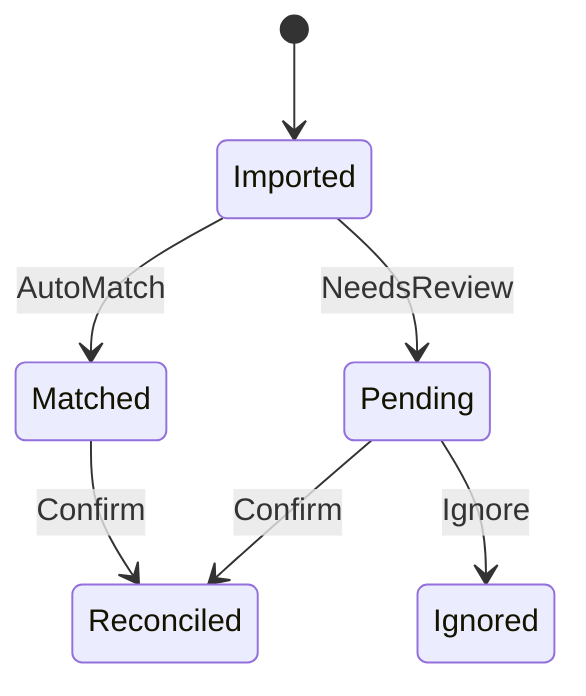

---

# **14.6 Bank Statement Processing**

Some banks provide full statements, allowing batch reconciliation.

### **BankStatement Entity:**

* `StatementId`
* `BankAccountId`
* `PeriodStart`
* `PeriodEnd`
* `Transactions[]`
* `EndingBalance`

### **Events:**

* `BankStatementImported`
* `StatementReconciliationCompleted`

---

# **14.7 Integration with Other Domains**

## **AP → Bank**

* Outgoing vendor payments are matched with bank debits.

## **AR → Bank**

* Customer payments matched with bank credits.

## **GL → Bank**

* GL cash accounts reconciled with bank balances.

## **FX → Bank**

* FX fluctuations applied to foreign-denominated bank accounts.

## **Debt → Bank**

* Loan payments detected via bank feeds.

## **Investments → Bank**

* Trade settlements captured as bank transactions.

## **Analytics → Bank**

* Anomaly detection on bank activity.

---

# **14.8 Posting Rules & GL Integration**

Bank transactions themselves do not generate GL entries, but **matched internal transactions do**.

### **Example:**

When AP Payment matches a bank debit:

```
DR Accounts Payable
CR Cash
```

If unmatched, no posting occurs.

---

# **14.9 Security & Compliance**

* OAuth-based bank connections
* Tokenized credentials
* Encrypted transaction data
* Audit trails for every reconciliation step

---

# **14.10 Bank Domain Diagrams**

### **14.10.1 Bank Transaction Lifecycle**

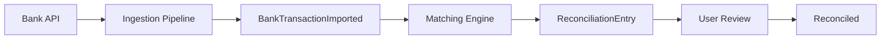

### **14.10.2 Bank Connectivity Class Diagram**

```mermaid
classDiagram
    class BankAccount {
        +Guid BankAccountId
        +string Institution
    }

    class BankTransaction {
        +Guid BankTransactionId
        +Money Amount
    }

    class ReconciliationEntry {
        +Guid ReconciliationEntryId
        +double ConfidenceScore
    }

    BankAccount --> BankTransaction
    BankTransaction --> ReconciliationEntry
```

---

# **14.11 Bank Read Models**

* Reconciliation Dashboard
* Unmatched Bank Transactions
* Cash Position Report
* Daily Bank Balance Summary
* Transaction History Timeline

---

# **14.12 Example Bank Reconciliation Lifecycle**

1. BankTransaction imported from API.
2. Matching Engine identifies candidate internal payment.
3. ReconciliationEntry created: ConfidenceScore = 0.82.
4. User confirms.
5. BankTransaction marked Reconciled.
6. Cash position updated.
7. Analytics re-evaluates cash flow projections.

---

# **14.13 Summary**

The Bank Connectivity & Reconciliation domain is the backbone of financial data accuracy. By syncing bank feeds, matching internal-to-external transactions, and maintaining reconciliation integrity, it enables accuracy across GL, AP, AR, FP&A, Debt, Investments, and Analytics.

# **Chapter 15 — Notification & Communication Infrastructure**

### *Part IV — Generic Domains*

The **Notification & Communication Infrastructure** bounded context provides a unified, event-driven messaging system used across all financial and operational domains. It ensures consistent delivery of messages, alerts, approvals, and system events to users across multiple channels—email, SMS, push, and in-app.

This domain is generic and cross-cutting, serving AP, AR, GL, FP&A, Analytics, Tax, Debt, Investments, Compliance, Approval Workflow, and Bank Connectivity.

---

# **15.1 Purpose of the Notification Domain**

This domain ensures:

* Reliable and consistent communication to users
* Support for multi-channel delivery
* Unified templates and personalization
* Event-triggered notifications
* Retry logic, throttling, and compliance enforcement
* Audit trails and delivery visibility

It is foundational for:

* Approval requests
* Payment confirmations
* Invoice reminders
* Reconciliation alerts
* Analytics insights
* Credit and risk warnings
* System updates

---

# **15.2 Notification Subdomains**

### **1. Channel Management**

Supports multiple channels and their specific rules.

### **2. Message Template Management**

Reusable templates for structured notifications.

### **3. Event Routing**

Maps domain events to notification triggers.

### **4. Delivery & Retry Engine**

Ensures reliable delivery.

### **5. Compliance & Policy Enforcement**

Adheres to messaging regulations.

### **6. User Notification Preferences**

Allows customization of frequency and channels.

---

# **15.3 Key Aggregates and Entities**

---

## **15.3.1 NotificationTemplate Aggregate**

Defines reusable structures for notifications.

### **Attributes:**

* `TemplateId`
* `Name`
* `ChannelType` (Email, SMS, Push, InApp)
* `Subject`
* `Body`
* `Placeholders[]`
* `Version`

### **Events:**

* `NotificationTemplateCreated`
* `NotificationTemplateUpdated`
* `NotificationTemplateDeprecated`

---

## **15.3.2 NotificationEvent Aggregate**

Represents a specific notification triggered by a domain event.

### **Attributes:**

* `NotificationEventId`
* `TriggeredByEvent` (DomainEventName)
* `RecipientId`
* `TemplateId`
* `Payload` (values for placeholders)
* `DeliveryStatus` (Pending, Sent, Failed)
* `ChannelType`
* `RetryCount`

### **Events:**

* `NotificationEventCreated`
* `NotificationSent`
* `NotificationFailed`
* `NotificationRetried`

---

## **15.3.3 NotificationPreferences Entity**

Defines user-specific configuration.

### **Attributes:**

* `UserId`
* `PreferredChannels[]`
* `DoNotDisturbRange`
* `FrequencyLimit`

### **Invariants:**

* Cannot send notifications during DoNotDisturb window

---

# **15.4 Notification Channels**

### **Supported Channels:**

* **Email** – detailed messaging, templated
* **SMS** – short, high-priority alerts
* **Push** – instant notifications
* **In-App** – context-aware info

Each channel has unique constraints such as:

* Character limits (SMS)
* Media support (Email, Push)
* Delivery timing rules
* Cost implications

---

# **15.5 Event Routing Engine**

Central logic that maps domain events to NotificationEvents.

### **Example Routing:**

* `BillApproved` → AP: notify requester
* `InvoiceIssued` → AR: notify customer
* `PaymentCompleted` → AP: notify vendor
* `CreditRiskLevelChanged` → Risk: notify user
* `FXRevaluationPerformed` → Analytics: notify finance team

### **Routing Rule:**

```
DomainEvent + RoutingConfig → NotificationEvent
```

---

# **15.6 Delivery & Retry Engine**

Ensures reliable message transmission.

### **Delivery States:**

* Pending
* Processing
* Sent
* Failed
* Retrying

### **Retry Rules:**

* Exponential backoff
* Maximum retry threshold
* Channel-specific retry behavior

### **Throttling:**

To prevent spamming users.

---

# **15.7 Compliance & Auditability**

### **Compliance Areas:**

* Anti-spam regulations (CAN-SPAM, GDPR)
* SMS sending windows
* Email unsubscribe enforcement
* Logging for audit trails

### **Audit Logs Capture:**

* Timestamp
* Channel
* Template version
* Payload
* Delivery result

---

# **15.8 Integration with Other Domains**

## **Approval Workflow → Notification**

* Approval assigned
* Step completed
* Request approved/rejected

## **AP → Notification**

* Bill approved or rejected
* Payment scheduled
* Vendor payment confirmation

## **AR → Notification**

* Invoice issued
* Payment received

## **Bank → Notification**

* Bank transaction imported
* Reconciliation needed

## **Analytics → Notification**

* Anomaly detected
* Cash flow warning
* KPI threshold exceeded

## **Debt → Notification**

* Loan payment reminder
* Missed payment alert

## **Investments → Notification**

* Dividend received
* Loss threshold alerts

## **Tax → Notification**

* Filing due reminders
* Large tax liability

---

# **15.9 Notification Domain Diagrams**

### **15.9.1 Notification Flow**

```mermaid
flowchart LR
    A[Domain Event] --> B[Routing Engine]
    B --> C[NotificationEvent]
    C --> D[Channel Dispatcher]
    D --> E[Delivery]
```

### **15.9.2 Notification Class Diagram**

```mermaid
classDiagram
    class NotificationTemplate {
        +Guid TemplateId
        +string Name
    }

    class NotificationEvent {
        +Guid EventId
        +string ChannelType
        +string Status
    }

    class NotificationPreferences {
        +Guid UserId
        +List~string~ Channels
    }

    NotificationTemplate --> NotificationEvent
    NotificationPreferences --> NotificationEvent
```

---

# **15.10 Notification Read Models**

* Notification History
* Delivery Status Dashboard
* User Notification Preferences
* System Health & Channel Status

---

# **15.11 Example Notification Lifecycle**

1. A Bill is approved in AP.
2. `BillApproved` event triggered.
3. Routing Engine maps event → NotificationTemplate.
4. NotificationEvent created.
5. Preferences checked.
6. Dispatcher sends Email.
7. Delivery result logged.
8. User notified.

---

# **15.12 Summary**

The Notification & Communication Infrastructure provides consistent, event-driven communication across every domain. With its template system, routing engine, delivery logic, user preferences, compliance guards, and integrations, it supports the entire financial platform.

# **Chapter 16 — Identity & Access Management (IAM)**

### *Part V — Technical Domains*

Identity & Access Management (IAM) is the foundational security and authorization layer of the entire financial platform. It governs who a user is, what they can access, what they can perform, and under what contextual constraints (tenant, role, permission scope). Every financial, analytic, and operational bounded context depends on IAM to enforce secure and compliant operations.

This chapter defines the full DDD model for IAM, including users, roles, permissions, authentication flows, policies, session management, SSO integration, and cross-domain authorization.

---

# **16.1 Purpose of the IAM Domain**

IAM ensures:

* Verified identity for every interacting actor
* Secure authentication & authorization
* Multitenant isolation
* Compliance with audit & regulatory requirements
* Controlled access to financial data & actions
* Enforcement of least-privilege and policy-based access

It applies to every domain:

* AP/AR: only approvers can approve, controllers can override
* GL: accountants post journal entries; auditors read-only
* FP&A: analysts view projections; managers modify budgets
* Bank: high-privilege permissions for payment execution
* Tax: restricted access to filings
* Analytics: sensitive data visibility

---

# **16.2 IAM Subdomains**

### **1. Identity Management**

User accounts, authentication, MFA, SSO.

### **2. Access Control**

Roles, permissions, scopes, authorization rules.

### **3. Session & Token Management**

JWT, OAuth tokens, session rotation.

### **4. Tenant Management**

Multitenant boundaries & isolation.

### **5. Audit Logging & Compliance**

User actions tracked for regulatory visibility.

### **6. Policy Engine**

AccessPolicy, AuthorizationPolicy, DelegationPolicy.

---

# **16.3 Key Aggregates & Entities**

---

## **16.3.1 User Aggregate**

Represents an authenticated actor.

### **Attributes:**

* `UserId`
* `Email`
* `PhoneNumber`
* `HashedPassword`
* `IsActive`
* `MFAEnabled`
* `TenantIds[]`
* `Roles[]`
* `Permissions[]` (direct)
* `LastLogin`

### **Invariants:**

* Email must be unique
* User must belong to at least one tenant
* Inactive users cannot authenticate

### **Events:**

* `UserCreated`
* `UserUpdated`
* `UserLoggedIn`
* `UserDeactivated`

---

## **16.3.2 Role Aggregate**

Defines a hierarchical set of permissions.

### **Attributes:**

* `RoleId`
* `TenantId`
* `Name`
* `Description`
* `Permissions[]`

### **Invariants:**

* Role cannot exist without tenant

### **Events:**

* `RoleCreated`
* `RoleUpdated`
* `RoleDeleted`

---

## **16.3.3 Permission Entity**

Atomic authorization unit.

### **Properties:**

* `PermissionKey` (e.g., `AP.Bill.Approve`, `GL.Journal.Post`)
* `ScopeType` (Global, Tenant, Object)
* `Description`

### **Examples:**

* `AP.Bill.Create`
* `AP.Bill.Approve`
* `AR.Invoice.Send`
* `GL.Journal.Post`
* `FP&A.Budget.Approve`
* `Bank.Payment.Execute`

---

## **16.3.4 Tenant Aggregate**

Defines a logical boundary of data segregation.

### **Attributes:**

* `TenantId`
* `Name`
* `IsActive`
* `Settings`

### **Events:**

* `TenantCreated`
* `TenantDeactivated`

---

# **16.4 Authentication Framework**

IAM supports:

* Username/password login
* OAuth 2.0 (Google, Microsoft, etc.)
* SSO (SAML/OpenID Connect)
* MFA (SMS, Email, Authenticator App)
* Device recognition

### **Authentication Flow:**

1. Submit credentials
2. Validate password/MFA
3. Generate access token (JWT)
4. Register session

### **Events:**

* `AuthenticationSucceeded`
* `AuthenticationFailed`
* `MFAChallenged`

---

# **16.5 Authorization Model (RBAC + PBAC)**

Access is determined by:

* **Role-Based Access Control (RBAC)**
* **Permission-Based Access Control (PBAC)**
* **Policy-Based Access Control (Attribute-Level)**

### **Authorization Formula:**

```
IsAuthorized(User, Action, Resource) =
   RolePermissions ∪ DirectPermissions ∪ PolicyRules
```

---

# **16.6 Policy Engine (Shared Kernel Integration)**

IAM integrates with the shared kernel’s:

* `AccessPolicy`
* `AuthorizationPolicy`
* `DelegationPolicy`

### **Example Access Policy:**

* Only approvers may approve bills above $10,000
* Only accountants can close periods
* Only tax managers can submit filings
* Only treasury can execute payments

When violated → `AccessDeniedEvent` emitted.

---

# **16.7 Session & Token Management**

Supports:

* JWT tokens
* Refresh tokens
* Session expiration
* Session revocation
* Device binding

### **Session Entity:**

* `SessionId`
* `UserId`
* `IssuedAt`
* `ExpiresAt`
* `DeviceInfo`

### **Events:**

* `SessionCreated`
* `SessionInvalidated`

---

# **16.8 Multitenancy Model**

IAM enforces strict tenant isolation.

### **Tenant Access Rules:**

* Every action must bind to a single tenant
* Cross-tenant access forbidden by default
* Super-admin roles span tenants

### **Events:**

* `TenantAccessGranted`
* `TenantAccessRevoked`

---

# **16.9 Audit Logging & Compliance**

IAM captures:

* Login attempts
* Resource access
* Permission modifications
* Role assignments
* Failed authorization attempts

### **AuditEvent:**

* `EventId`
* `UserId`
* `Timestamp`
* `Action`
* `Resource`
* `Result`
* `IPAddress`

Used for:

* Compliance audits
* Forensic analysis
* Behavioral analytics

---

# **16.10 Integration with Other Domains**

## **AP → IAM**

* Bill approvals restricted to authorized roles

## **AR → IAM**

* Only authorized users can issue invoices

## **GL → IAM**

* Only accountants can post journal entries

## **FP&A → IAM**

* Budget approval restricted to managers

## **Bank → IAM**

* Payments require dual-approval and MFA

## **Tax → IAM**

* Filing permissions restricted to authorized officers

## **Analytics → IAM**

* Privacy rules restrict access to sensitive analytics

---

# **16.11 IAM Domain Diagrams**

### **16.11.1 Authorization Flow**

```mermaid
flowchart LR
    A[User Request] --> B[Extract Token]
    B --> C[Validate Session]
    C --> D[Load Roles & Permissions]
    D --> E[Policy Evaluation]
    E -->|Allowed| F[Access Granted]
    E -->|Denied| G[AccessDeniedEvent]
```

### **16.11.2 IAM Class Diagram**

```mermaid
classDiagram
    class User {
        +Guid UserId
        +string Email
        +List~Role~ Roles
        +List~Permission~ DirectPermissions
    }

    class Role {
        +Guid RoleId
        +List~Permission~ Permissions
    }

    class Permission {
        +string Key
    }

    User --> Role
    Role --> Permission
```

---

# **16.12 IAM Read Models**

* User Access Summary
* Permissions Matrix
* Login History
* Tenant Access Overview
* Role Assignment Dashboard

---

# **16.13 Example IAM Lifecycle**

1. User signs up → `UserCreated`.
2. Assign roles → `RoleAssigned`.
3. Login attempt → `AuthenticationSucceeded`.
4. User accesses AP → IAM checks permissions.
5. Unauthorized action → `AccessDeniedEvent`.
6. User logs out → session invalidated.

---

# **16.14 Summary**

IAM is the backbone of security and authorization across the financial platform. With robust aggregates for users, roles, permissions, tenants, sessions, and policy enforcement, it ensures a secure, compliant, and auditable environment for all operations.

# **Chapter 17 — Audit Logging & Activity Tracking**

### *Part V — Technical Domains*

Audit Logging & Activity Tracking provides the **immutable, compliant, end‑to‑end traceability layer** that underpins all financial, operational, and administrative activity in the platform. Every sensitive action, data mutation, authentication attempt, financial approval, and workflow decision is captured. This ensures compliance, forensic visibility, risk management, and data integrity across all domains.

This chapter provides a comprehensive DDD model for the Audit Logging domain, including aggregates, event mappings, retention rules, cross‑context traceability, and architectural patterns.

---

# **17.1 Purpose of the Audit Logging Domain**

Audit Logging ensures:

* Complete historical trace of actions and system events
* Compliance with financial regulations (SOX, IFRS, ISO, SOC2)
* Transparency and non‑repudiation
* Forensic investigation support
* Risk analytics and anomaly detection
* Traceability for approval workflows, GL postings, AP/AR actions, etc.

Audit is **non‑business**, but **mission‑critical** to governance.

---

# **17.2 Audit Logging Subdomains**

### **1. Action Logging**

Captures user‑initiated activity (CRUD, approvals, postings).

### **2. System Event Logging**

Records domain events emitted by system processes.

### **3. Sensitive Access Logging**

Tracks access to confidential data (bank info, identity data, salaries, etc.).

### **4. Authentication & Security Logging**

Audits login attempts, MFA challenges, token creation, and access denials.

### **5. Forensic Investigation Tools**

Provides correlated, queryable activity timelines.

### **6. Retention & Compliance**

Manages immutability windows, archiving, encryption, and removal policies.

---

# **17.3 Key Aggregates & Entities**

---

## **17.3.1 AuditLog Aggregate**

The immutable root record of an auditable action or event.

### **Attributes:**

* `AuditLogId`
* `Timestamp`
* `ActorId` (UserId, System, Integration)
* `TenantId`
* `ActionType` (Create, Update, Delete, Approve, Reject, Post, Sync, Authenticate, etc.)
* `DomainContext` (AP, AR, GL, FP&A, FX, Debt, Bank, IAM, etc.)
* `ObjectType` (Bill, Invoice, JournalEntry, Loan, BankTransaction…)
* `ObjectId`
* `OldValue` (JSON snapshot)
* `NewValue` (JSON snapshot)
* `Metadata` (IP, device, source, correlationId)
* `IsSensitive`
* `IntegrityHash`

### **Invariants:**

* Cannot be modified after creation
* Must include ActorId or System tag
* IntegrityHash must match stored payload

### **Events:**

* `AuditLogCreated`

---

## **17.3.2 ActivityEvent Entity**

Represents fine‑grained actions within a broader audit event.

### **Attributes:**

* `EventId`
* `ActivityType`
* `Message`
* `SequenceNumber`
* `AdditionalMetadata`

Used for multi‑step processes (e.g., approval routing, file upload, reconciliation action).

---

## **17.3.3 AccessLog Entity**

Captures access to sensitive read operations.

### **Attributes:**

* `AccessLogId`
* `UserId`
* `ResourceType`
* `ResourceId`
* `Timestamp`
* `PurposeOfAccess`
* `SensitiveClassificationLevel`

---

# **17.4 Audit Value Objects**

### **AuditAction VO**

Defines categories such as:

* CREATE
* UPDATE
* DELETE
* APPROVE
* REJECT
* POST
* REVALUE
* PAY
* LOGIN
* LOGOUT
* VIEW_SENSITIVE

### **IntegrityHash VO**

Used to ensure immutability.

### **CorrelationId VO**

Used to link multi‑system events into a single timeline.

---

# **17.5 Domain Event → Audit Event Mapping**

Audit Logging consumes **all domain events** platform‑wide.

### **Examples:**

* `BillApproved` → Audit: Bill approval logged
* `InvoiceIssued` → Audit: AR invoice creation
* `JournalBatchPosted` → Audit: GL posting
* `LoanPaymentApplied` → Audit: Debt payment event
* `FXRevaluationPerformed` → Audit: currency valuation log
* `BankTransactionImported` → Audit: external financial data ingestion
* `AuthenticationSucceeded` → Audit: login
* `AccessDeniedEvent` → Audit: unauthorized attempt

Each is translated into one or more `AuditLog` entries.

---

# **17.6 Sensitive Data Logging Rules**

Sensitive read access ("VIEW" actions) must be logged when:

* User views bank account details
* User views tax filings
* User views payroll‑related expense or salary category
* Auditor views restricted data
* Admin accesses identity data

This creates an `AccessLog` entry.

### **SensitiveClassification Levels:**

* Level 1 – Low sensitivity (public business data)
* Level 2 – Medium (financial metrics, vendor records)
* Level 3 – High (bank accounts, credit score, identity data)
* Level 4 – Critical (tax IDs, salary details, audit-only data)

---

# **17.7 Integrity & Immutability Model**

Audit logs must be *append-only*.

### **Guarantees:**

* No deletion inside immutable window
* No modification ever
* Hash chain linking each log entry to previous
* Optional WORM (Write Once Read Many) storage integration
* Encryption at rest
* Monthly archive snapshots

---

# **17.8 Retention & Compliance Policies**

### **Retention Windows:**

* Financial transactions → 7–10 years
* Identity & Access logs → 1–5 years
* Sensitive access logs → 7 years
* Audit trails for filings → permanent

### **Archival Rules:**

* Move to cold storage after retention window expires
* Export for audits or compliance inspections

---

# **17.9 Cross‑Domain Correlation (Timeline View)**

Audit supports a **correlated timeline** using CorrelationId:

Example correlation across domains:

1. BillCreated (AP)
2. BillSubmittedForApproval (Approval Workflow)
3. ApprovalStepCompleted (Approval Workflow)
4. BillApproved (AP)
5. BillScheduled (AP)
6. PaymentInitiated (AP/Bank)
7. BankTransactionImported (Bank)
8. BillPaid (AP)

These appear in one linear audit timeline.

---

# **17.10 Integration with Other Domains**

## **IAM → Audit**

* Login events
* AccessDenied events
* MFA challenges

## **AP/AR/GL → Audit**

* All financial object lifecycle changes
* Posting events

## **Approval Workflow → Audit**

* Step routed, approved, rejected

## **Analytics → Audit**

* Anomaly detection logs
* Prediction model outputs

## **Tax → Audit**

* Tax filing events
* TaxEventCreated

## **Debt & Investments → Audit**

* Payment events
* Valuation adjustments

## **Bank → Audit**

* BankTransactionImported
* Reconciliation steps

---

# **17.11 Audit Domain Diagrams**

### **17.11.1 Audit Event Flow**

```mermaid
flowchart LR
    A[Domain Event] --> B[Audit Event Mapper]
    B --> C[AuditLogCreated]
    C --> D[Storage (Immutable)]
    D --> E[Timeline Query]
```

### **17.11.2 Audit Class Diagram**

```mermaid
classDiagram
    class AuditLog {
        +Guid AuditLogId
        +string DomainContext
        +string ActionType
        +string ObjectId
    }

    class AccessLog {
        +Guid AccessLogId
        +Guid UserId
        +string Resource
    }

    AuditLog --> AccessLog : related
```

---

# **17.12 Read Models & Dashboards**

* **Audit Timeline** (correlated by CorrelationId)
* **Sensitive Access Report**
* **Login & Security Report**
* **Financial Change Log**
* **Bank Reconciliation Audit**
* **Tax Filing Audit Trail**
* **User Action Log**

---

# **17.13 Example Audit Lifecycle**

1. User approves a bill.
2. AP emits `BillApproved`.
3. IAM verifies the action → logs Access (WRITE).
4. Audit logs:

   * Actor
   * Timestamp
   * Old/New data
   * Tenant
   * Hash
5. Approval Workflow updates audit for the step.
6. Bank records payment initiation later.
7. Audit correlates all events.

---

# **17.14 Summary**

Audit Logging & Activity Tracking forms the backbone of trust, security, and compliance across the platform. With immutable logs, sensitive access tracking, cross-domain correlation, retention policies, and integration with every financial domain, this capability ensures transparency and accountability.

# **Chapter 18 — Integration Layer & External Systems**

### *Part V — Technical Domains*

The **Integration Layer & External Systems** domain defines how the platform securely, reliably, and consistently communicates with third-party systems. This includes banks, accounting systems, ERPs, CRMs, tax authorities, payment processors, data providers, identity providers, analytics services, and external workflows.

This chapter establishes the full DDD model for connectors, integrations, protocols, contracts, event orchestration, idempotency, observability, retry logic, mapping, compliance, and external system boundaries.

---

# **18.1 Purpose of the Integration Layer**

The Integration Layer guarantees:

* Reliable and idempotent communication
* Secure transfer of financial and identity data
* Consistent mapping between internal and external schemas
* Resilient handling of outages, latency, rate limits
* Event-driven orchestration for outbound activity
* Inbound webhook processing with full validation
* Observability and auditability across system boundaries

This domain supports *all* financial bounded contexts:

* Bank Connectivity
* Tax Filing
* AP/AR (Vendor, Customer API sync)
* GL/Accounting integrations
* CRM sync for customer master data
* ERP integration for inventory, assets
* Analytics ingestion
* Identity providers / SSO

---

# **18.2 Integration Subdomains**

### **1. Connector Framework**

Reusable engine for building integrations.

### **2. External System Contracts**

Schema definitions and mapping rules.

### **3. Inbound Integration**

Webhooks, callbacks, polling.

### **4. Outbound Integration**

Push events, API calls, export flows.

### **5. Event Orchestration & Routing**

Central routing for integration events.

### **6. Reliability Layer**

Retries, idempotency, backoff, circuit breakers.

### **7. Observability & Monitoring**

Traces, logs, metrics for integration health.

### **8. Security & Compliance Layer**

Encryption, token management, data masking.

---

# **18.3 Key Aggregates & Entities**

---

## **18.3.1 IntegrationConnector Aggregate**

Represents a configured external system integration.

### **Attributes:**

* `ConnectorId`
* `Name`
* `Type` (Bank, Tax, CRM, ERP, Identity, Analytics)
* `AuthType` (OAuth2, APIKey, JWT, BasicAuth, Custom)
* `Credentials` (Encrypted)
* `EndpointConfiguration`
* `Status` (Active, Disabled)
* `LastSyncAt`

### **Events:**

* `IntegrationConnectorCreated`
* `IntegrationConnectorUpdated`
* `IntegrationConnectorDeactivated`
* `IntegrationSyncCompleted`

---

## **18.3.2 ExternalSystemContract Entity**

Defines the schema mapping between internal and external systems.

### **Attributes:**

* `ContractId`
* `ExternalSystem`
* `ObjectType` (Invoice, Payment, Journal, Customer, Vendor…)
* `MappingRules` (JSON)
* `FieldConstraints`
* `Version`

### **Invariants:**

* Mapping must be deterministic and reversible

---

## **18.3.3 IntegrationEvent Aggregate**

Represents a message flowing *to* or *from* an external system.

### **Attributes:**

* `IntegrationEventId`
* `Direction` (Inbound, Outbound)
* `SourceSystem`
* `Payload`
* `Status` (Pending, Processed, Failed, Retrying)
* `RetryCount`
* `CorrelationId`
* `IntegrityHash`

### **Events:**

* `IntegrationEventReceived`
* `IntegrationEventDispatched`
* `IntegrationEventFailed`
* `IntegrationEventRetried`

---

# **18.4 Inbound Integration Model**

Inbound events include:

* Webhooks from payment processors
* Bank event callbacks
* Tax authority filing updates
* CRM customer updates

### **Inbound Flow:**

```mermaid
flowchart LR
    A[Webhook/Inbound Call] --> B[Signature Validation]
    B --> C[Schema Validation]
    C --> D[IntegrationEventCreated]
    D --> E[EventRouter]
    E --> F[Domain Handler]
```

### **Inbound Guarantees:**

* Authenticity verification
* Replay protection
* Idempotency via event fingerprint
* Strict schema enforcement

---

# **18.5 Outbound Integration Model**

Outbound events include:

* Sending invoices
* Vendor sync
* Tax filing submissions
* Bank payments initiation
* GL export
* Analytics export

### **Outbound Flow:**

```mermaid
flowchart LR
    A[Domain Event] --> B[Mapping Layer]
    B --> C[IntegrationEvent]
    C --> D[Retry/Queue Layer]
    D --> E[External API Call]
    E --> F[Response Handling]
```

### **Outbound Guarantees:**

* At-least-once or exactly-once configuration
* Retries with exponential backoff
* Circuit breakers for outage protection
* Contract-based schema mapping

---

# **18.6 Idempotency Framework**

Integration operations must be idempotent.

### **Strategies:**

1. **Idempotency Keys** for API calls
2. **Hash-based duplicate detection** for inbound events
3. **CorrelationId** for event chains
4. **Replay protection** (timestamps + signatures)

---

# **18.7 Reliability Layer**

The system prevents failed integrations from breaking financial workflows.

### **Mechanisms:**

* Retry policies (exponential backoff)
* Dead-letter queues
* Circuit breakers
* Rate limiting
* Bulkheads (per integration isolation)

---

# **18.8 Security & Compliance Layer**

Protects sensitive data shared across boundaries.

### **Includes:**

* OAuth token refresh
* API key encryption
* TLS enforcement for all outbound/inbound requests
* PII redaction
* Field-level masking
* IP allowlists for sensitive systems
* Full audit logging for integration traffic

---

# **18.9 Integration Orchestration & Routing**

The routing engine maps domain events to integration actions.

### **Domain → External Mapping Examples:**

* `InvoiceIssued` → Send invoice to CRM
* `BillApproved` → Sync vendor payment request
* `PaymentCompleted` → Notify payment processor
* `FXRevaluationPerformed` → Update connected ERP
* `UserCreated` → Sync to identity provider (optional)

### **Routing Flow:**

```mermaid
flowchart LR
    A[Domain Event] --> B[Routing Rule]
    B --> C[IntegrationEvent]
    C --> D[Connector]
```

---

# **18.10 External System Categories & Patterns**

### **1. Bank Feeds**

* OAuth or API keys
* Webhooks + polling hybrid
* Encrypted transaction streams

### **2. Payment Processors**

* Webhooks for settlement
* API calls for initiation

### **3. ERP/Accounting Systems**

* Batch exports
* API-level GL/Journals sync
* Customer/vendor sync

### **4. Tax Authorities**

* Filing uploads via REST/SOAP
* Receive status callbacks

### **5. CRM/HRIS**

* Customer master sync
* Employee master sync

### **6. External Analytics**

* Periodic data exports
* Event streaming

---

# **18.11 Mapping Layer & Contracts**

Each external system has its own contract and mapping strategy.

### **Mapping Rules Include:**

* Field name transformations
* Enum translations
* Currency formatting
* Date/time normalization
* Error transformation

### **Contract Versioning:**

* Contracts pinned to IntegrationConnector version
* Old contracts preserved for replay

---

# **18.12 Observability & Monitoring**

Integration observability tracks:

* Latency
* Success/failure ratio
* Retry patterns
* Load per external connector
* SLA adherence

### **Read Models:**

* Integration Health Dashboard
* Connector Status Report
* Retry Queue Overview
* External Latency Heatmap

---

# **18.13 Example Integration Lifecycle**

1. AP approves a bill → `BillApproved` event.
2. Mapping Layer transforms bill into payment processor schema.
3. `IntegrationEvent` created.
4. Reliability Layer queues the event.
5. Outbound connector invokes payment API.
6. Payment processor returns success.
7. Inbound webhook confirms settlement.
8. Bank domain reconciles bank transaction.
9. Audit logs entire chain via correlation ID.

---

# **18.14 Summary**

The Integration Layer enables the platform to reliably and securely interoperate with banks, ERPs, tax authorities, CRMs, and other external systems. With robust aggregates, mapping rules, orchestration engines, idempotency frameworks, retry logic, contracts, and observability, this domain ensures that external connectivity is stable, compliant, and scalable.

# **Chapter 19 — Platform Telemetry, Logging & Observability**

### *Part V — Technical Domains*

The **Telemetry, Logging & Observability** domain provides the platform-wide monitoring, diagnostics, and performance insights required to maintain reliability, resilience, and operational excellence. It enables real-time insight into system behavior, distributed traces across microservices, performance metrics, log aggregation, alerting, and SLO/SLA management.

This chapter defines the complete DDD model for observability, including aggregates, telemetry signals, correlation models, retention rules, dashboards, and cross-domain integration.

---

# **19.1 Purpose of the Observability Domain**

The Observability domain ensures:

* Deep visibility into system behavior
* Early detection of failures, bottlenecks, latency, or anomalies
* Unified logging and metrics across all platforms
* End-to-end distributed tracing
* Integration with alerting systems
* Support for SLO/SLA governance
* Enhanced reliability through telemetry-driven insights

It underpins operational excellence across:

* Finance domains (AP, AR, GL, FP&A)
* Technical domains (IAM, Integration Layer, Bank Connectivity)
* Supporting domains (Analytics, Tax, Debt, Investments)

---

# **19.2 Observability Subdomains**

### **1. Logging Infrastructure**

Captures application and system logs.

### **2. Metrics Collection**

Captures quantitative measurements (latency, throughput, errors).

### **3. Distributed Tracing**

Captures request flows across services.

### **4. Alerting & Incident Management**

Triggers alarms based on defined thresholds.

### **5. Telemetry Correlation Engine**

Links logs, metrics, and traces to domain events.

### **6. Dashboards & SLO Monitoring**

Performance and health monitoring.

---

# **19.3 Key Aggregates & Entities**

---

## **19.3.1 TelemetrySignal Aggregate**

Represents a single unit of telemetry.

### **Attributes:**

* `TelemetryId`
* `SignalType` (Log, Metric, Trace)
* `Timestamp`
* `ServiceName`
* `HostInfo`
* `Severity` (for logs)
* `Value` (for metrics)
* `TraceId` (for traces)
* `SpanId`
* `CorrelationId`
* `Metadata` (tags)

### **Events:**

* `TelemetrySignalReceived`
* `TelemetrySignalCorrelated`

---

## **19.3.2 LogEntry Entity**

Captures individual application logs.

### **Attributes:**

* `LogId`
* `Message`
* `Severity` (Info, Warn, Error, Critical)
* `Timestamp`
* `ServiceName`
* `CorrelationId`
* `Metadata`

---

## **19.3.3 Metric Entity**

Represents a quantitative measurement.

### **Attributes:**

* `MetricId`
* `MetricName`
* `Value`
* `Unit`
* `Timestamp`
* `ServiceName`
* `Tags`

---

## **19.3.4 TraceSpan Entity**

Represents a segment in a distributed trace.

### **Attributes:**

* `SpanId`
* `TraceId`
* `ParentSpanId`
* `ServiceName`
* `OperationName`
* `StartTime`
* `Duration`
* `Status` (OK, Error)

---

# **19.4 Logging Model**

Logs include:

* Application logs
* Infrastructure logs
* Integration logs
* Security logs
* Network logs
* Error logs

### **Log Flow:**

```mermaid
flowchart LR
    A[Application] --> B[LogEmitter]
    B --> C[LogCollector]
    C --> D[LogStorage]
    D --> E[Dashboards]
```

### **Retention Rules:**

* Debug logs: 7–14 days
* Info/Warn logs: 30–90 days
* Errors/Critical logs: 1–2 years

---

# **19.5 Metrics Model**

Metrics include:

* Performance KPIs (latency, RPS)
* Resource usage (CPU, memory, I/O)
* Error rates
* Queue depth
* Integration latency
* Reconciliation success ratios

### **Metric Types:**

* Counter
* Gauge
* Histogram
* Summary

---

# **19.6 Distributed Tracing Model**

Tracing follows the **OpenTelemetry** conceptual structure.

### **Trace Flow:**

```mermaid
flowchart LR
    A[User Request] --> B[Service A]
    B --> C[Service B]
    C --> D[Service C]
    D --> E[Response]
```

### **Trace Guarantees:**

* Every request has a TraceId
* Spans track internal operations
* Errors captured at span-level
* Trace correlates with domain event correlation IDs

---

# **19.7 Alerting & Incident Management**

Supports:

* Threshold-based alerts
* Anomaly detection
* Heartbeat monitoring
* Service-level degradation alerts

### **Alert Sources:**

* High latency
* Elevated error rate
* External integration failures
* Low bank synchronization rate
* Stalled workflow processing
* High FX revaluation latency

### **Alert Destinations:**

* Email
* Slack/Teams
* PagerDuty
* On-call rotation

---

# **19.8 Telemetry Correlation Engine**

Links Telemetry ↔ Domain Events ↔ Audit Logs.

### **Correlation Keys:**

* `TraceId`
* `CorrelationId`
* `ObjectId`
* `DomainEventName`

### **Example Correlation:**

1. AP approves bill → domain event logged.
2. GL posts journal → audit log created.
3. Outbound integration fires → trace generated.
4. Latency spike → metric logged.
5. Dashboards show end-to-end path.

---

# **19.9 Integration with Other Domains**

## **IAM → Telemetry**

* Failed login attempts
* MFA issues

## **Integration Layer → Telemetry**

* Failed outbound requests
* External rate limiting

## **Bank Connectivity → Telemetry**

* Reconciliation failures
* Slow bank syncs

## **Analytics → Telemetry**

* ML model performance logs
* Anomaly detection logs

## **Financial Domains → Telemetry**

* Posting/approval latency
* Processing queue depth

---

# **19.10 Observability Dashboards**

* System Health Dashboard
* Latency Heatmap
* Error Rate Monitor
* Trace Explorer
* Integration Status Monitor
* Reconciliation Success Dashboard
* Financial Workflow Latency Monitor
* IAM Authentication Error Graph

---

# **19.11 SLO/SLA/SLI Model**

### **SLIs:**

* Availability
* Latency (P99, P95)
* Error Rate
* Throughput

### **SLOs:**

* “99.9% uptime over 30 days”
* “P99 < 300ms for 95% of user actions”
* “Integration latency < 2s for 99% of API calls”

### **SLAs:**

External contracts defining platform guarantees.

---

# **19.12 Example Telemetry Lifecycle**

1. User triggers AP invoice approval.
2. AP service logs `InvoiceApproved` trace span.
3. Integration Layer triggers external sync → new span.
4. Bank feed ingestion increases latency → alert fired.
5. Telemetry correlates AP, Integration, Bank traces together.
6. Ops team views chain in Trace Explorer.
7. Investigation links issue to external rate limit.

---

# **19.13 Summary**

Telemetry, Logging & Observability ensures the platform is operable, reliable, and diagnosable at scale. With metrics, logs, traces, alerting, correlation engines, and dashboards, it enables proactive monitoring, rapid debugging, and data-driven reliability improvements.

# **Chapter 20 — Glossary & Ubiquitous Language**

### *Part VI — Appendices*

The **Glossary & Ubiquitous Language** appendix defines the precise terminology used across the platform. It ensures clarity, consistency, and alignment between domain experts, engineers, designers, data modelers, and business stakeholders. This chapter forms the linguistic backbone of the Domain-Driven Design (DDD) ecosystem and prevents ambiguity across bounded contexts.

The terms below are organized by domain, followed by shared kernel definitions and general-purpose vocabulary.

---

# **20.1 Core Financial Terms (IFRS/GAAP-aligned)**

### **Account**

A structured record used to classify financial transactions.

### **Journal Entry**

A formal accounting entry recording debits and credits.

### **Chart of Accounts**

The framework that organizes all accounts in a financial system.

### **Debit / Credit**

Standard double-entry accounting constructs used to maintain balance.

### **Ledger**

Consolidated record of journal entries.

### **Posting**

The act of applying a journal entry to the ledger.

### **Accrual**

Recognition of revenue/expense before cash is received/paid.

### **Reconciliation**

Process of verifying internal financial records against external or independent data sources.

### **Fiscal Period / Fiscal Year**

Defined reporting time intervals used for accounting.

---

# **20.2 Accounts Payable (AP)**

### **Bill**

A vendor-issued request for payment.

### **Vendor**

Supplier who issues bills.

### **Payment Schedule**

A defined schedule for paying a bill.

### **Withholding Tax**

Tax deducted before making a payment.

### **AP Aging**

Categorization of outstanding bills by overdue duration.

---

# **20.3 Accounts Receivable (AR)**

### **Invoice**

A request for payment issued to a customer.

### **Customer**

Entity receiving goods/services and responsible for payment.

### **Receipt**

Recorded payment from a customer.

### **Credit Memo**

Reduction in amount owed by a customer.

---

# **20.4 General Ledger (GL)**

### **Journal Batch**

Group of journal entries posted together.

### **Trial Balance**

Listing of all accounts and their balances.

### **Revaluation**

FX adjustment of foreign-currency balances.

### **Closing Period**

Ending a fiscal period to prevent further postings.

---

# **20.5 FP&A (Financial Planning & Analysis)**

### **Budget**

Approved financial plan for a period.

### **Forecast**

Projection of future financial performance.

### **Variance**

Difference between actuals and forecast/budget.

### **Driver**

Business factor influencing financial outcomes.

---

# **20.6 Analytics & Intelligence**

### **KPI (Key Performance Indicator)**

Metric used to measure performance.

### **Predictive Signal**

Forward-looking indicator generated by analytic models.

### **Anomaly**

Data point or pattern significantly deviating from normal behavior.

### **Model Drift**

Decrease in predictive model accuracy over time.

---

# **20.7 Tax Management**

### **Tax Code**

Definition of tax rate and jurisdictional rule.

### **Tax Jurisdiction**

Geographic authority governing tax rules.

### **Tax Event**

Record of calculated tax for a specific transaction.

### **Tax Filing**

Submitted report to tax authority.

---

# **20.8 Debt Management**

### **Loan**

Contractual financial obligation with principal and interest.

### **Interest Accrual**

Accumulation of periodic interest.

### **Amortization Schedule**

Payment plan detailing principal/interest splits.

### **Principal**

Outstanding borrowed amount.

---

# **20.9 Investment Management**

### **Portfolio**

Collection of investment holdings.

### **Holding**

Quantity of a specific asset owned.

### **Security**

Financial instrument being invested in.

### **Unrealized Gain/Loss**

Value change without selling the asset.

### **Realized Gain/Loss**

Value change after selling the asset.

---

# **20.10 Credit Score & Risk**

### **Credit Profile**

Representation of financial trustworthiness.

### **Utilization**

Percentage of credit used relative to limit.

### **Delinquency**

Failure to make payment on time.

### **Risk Event**

Trigger indicating elevated risk.

---

# **20.11 Currency & FX**

### **Exchange Rate**

Price of one currency relative to another.

### **Spot Rate**

Current exchange rate.

### **Cross Rate**

Rate between two currencies derived using a third.

### **FX Exposure**

Value at risk due to currency fluctuations.

---

# **20.12 Bank Connectivity & Reconciliation**

### **Bank Transaction**

Record of debit/credit movement in a bank account.

### **Reconciliation Match**

Link between bank transaction and internal transaction.

### **Bank Feed**

Automated pull of bank transactions.

### **Statement**

Periodic document listing all bank transactions.

---

# **20.13 Notification & Communication**

### **Notification Template**

Reusable structure for sending messages.

### **Notification Event**

Triggered communication sent to a user.

### **Channel**

Medium used: email, SMS, push, in-app.

---

# **20.14 Identity & Access Management (IAM)**

### **Authentication**

Process of verifying identity.

### **Authorization**

Permissions granted to an authenticated user.

### **Role**

Grouping of permissions.

### **Permission**

Atomic unit of allowed action.

### **Tenant**

Isolated logical customer boundary.

---

# **20.15 Audit Logging & Activity Tracking**

### **Audit Log**

Immutable record of a system action.

### **Sensitive Access Log**

Record of viewing classified data.

### **Correlation ID**

Identifier linking actions across systems.

---

# **20.16 Integration Layer**

### **Connector**

Configuration enabling communication with an external system.

### **Integration Event**

Message exchanged across systems.

### **Mapping Contract**

Schema translation rules.

---

# **20.17 Telemetry, Logging & Observability**

### **Trace**

Record of request across services.

### **Metric**

Quantitative performance measure.

### **Log**

Recorded message for debugging/operations.

### **SLO / SLA / SLI**

Service reliability guarantees and indicators.

---

# **20.18 Shared Kernel Concepts**

### **Money (Value Object)**

Amount + currency combination.

### **Period (Value Object)**

Start and end dates, representing a closed time window.

### **Attachment**

File or document associated with a domain entity.

### **Approval Policy**

Rules governing approval workflows.

### **Posting Policy**

Rules defining ledger posting behavior.

---

# **20.19 Event Naming Conventions**

* Events end with a past-tense verb.
* Domain-specific prefix recommended.

### **Examples:**

* `BillCreated`
* `InvoicePaid`
* `JournalPosted`
* `LoanPaymentApplied`
* `TaxFilingSubmitted`
* `BankTransactionImported`
* `UserAuthenticated`
* `RiskEventDetected`

---

# **20.20 Ubiquitous Language Principles**

* Avoid synonyms within a bounded context.
* Use consistent verbs across domains (Issue, Approve, Post, Reconcile).
* Each domain must own its terminology.
* Prefer domain-expert language over technical jargon.

---

# **20.21 Summary**

This glossary unifies terminology across all bounded contexts, establishing a shared vocabulary for product, engineering, and domain experts. It reduces ambiguity and ensures consistent usage of concepts across the entire financial platform.

# **Chapter 21 — Event Catalog & Domain Event Reference**

### *Part VI — Appendices*

The **Event Catalog** is the authoritative reference for every domain event emitted across all bounded contexts in the platform. It standardizes event naming, structure, meaning, and propagation rules. This chapter provides a complete cross-domain event library, ensuring consistency, traceability, and interoperability across AP, AR, GL, Analytics, FP&A, Tax, Debt, Investments, FX, Bank, IAM, Audit, Notifications, and Technical infrastructure.

This is a foundational reference for:

* Microservice communication
* Event sourcing
* Integration routing
* Audit logging
* Workflow orchestration
* Analytics ingestion
* Telemetry correlation

---

# **21.1 Event Structure Standard**

All domain events follow a shared structural pattern.

### **Standard Event Schema:**

* `EventId`
* `EventName`
* `OccurredAt`
* `ActorId`
* `TenantId`
* `CorrelationId`
* `Context` (bounded context)
* `Payload` (object-specific details)

### **Event Naming Rules:**

* Past tense verbs
* Domain prefix recommended
* No abbreviations or slang

Examples:

* `BillCreated`
* `InvoicePaid`
* `LoanPaymentApplied`

---

# **21.2 Event Categories**

Events are grouped into categories:

### **1. Core Financial Events** (AP, AR, GL)

### **2. Supporting Domain Events** (FP&A, Analytics, Tax, Debt, Investments, Credit)

### **3. Generic Domain Events** (FX, Bank, Notifications)

### **4. Technical Platform Events** (IAM, Audit, Integration, Telemetry)

Each category contains subgroups by bounded context.

---

# **21.3 Core Financial Domain Events**

## **21.3.1 Accounts Payable (AP)**

* `BillCreated`
* `BillUpdated`
* `BillDeleted`
* `BillSubmittedForApproval`
* `BillApproved`
* `BillRejected`
* `BillScheduled`
* `PaymentInitiated`
* `PaymentCompleted`
* `PaymentFailed`

## **21.3.2 Accounts Receivable (AR)**

* `InvoiceCreated`
* `InvoiceUpdated`
* `InvoiceIssued`
* `InvoicePaid`
* `InvoiceOverdue`
* `RefundProcessed`

## **21.3.3 General Ledger (GL)**

* `JournalEntryCreated`
* `JournalEntryPosted`
* `JournalBatchPosted`
* `PeriodClosed`
* `PeriodReopened`
* `RevaluationPosted`

---

# **21.4 Supporting Domain Events**

## **21.4.1 FP&A Events**

* `BudgetCreated`
* `BudgetApproved`
* `ForecastUpdated`
* `VarianceCalculated`
* `DriverValueChanged`

## **21.4.2 Analytics & Intelligence**

* `AnomalyDetected`
* `CashFlowPredictionUpdated`
* `KPIThresholdBreached`
* `ModelPerformanceDegraded`

## **21.4.3 Tax Management**

* `TaxCodeCreated`
* `TaxEventRecorded`
* `TaxFilingOpened`
* `TaxFilingSubmitted`
* `TaxFilingAmended`

## **21.4.4 Debt Management**

* `LoanCreated`
* `InterestAccrued`
* `LoanPaymentApplied`
* `LoanPaidOff`

## **21.4.5 Investment Management**

* `HoldingCreated`
* `InvestmentTransactionRecorded`
* `HoldingValuationUpdated`
* `DividendReceived`

## **21.4.6 Credit Score & Risk**

* `CreditScoreUpdated`
* `RiskEventDetected`
* `CreditRiskLevelChanged`

---

# **21.5 Generic Domain Events**

## **21.5.1 FX & Currency Management**

* `FXRateAdded`
* `FXRevaluationPerformed`
* `UnrealizedFXGainRecorded`
* `UnrealizedFXLossRecorded`

## **21.5.2 Bank Connectivity**

* `BankAccountLinked`
* `BankTransactionImported`
* `ReconciliationMatchFound`
* `ReconciliationConfirmed`

## **21.5.3 Notifications**

* `NotificationEventCreated`
* `NotificationSent`
* `NotificationFailed`

---

# **21.6 Technical Domain Events**

## **21.6.1 Identity & Access Management (IAM)**

* `UserCreated`
* `UserLoggedIn`
* `UserDeactivated`
* `AccessDeniedEvent`

## **21.6.2 Audit Logging**

* `AuditLogCreated`
* `SensitiveAccessLogged`

## **21.6.3 Integration Layer**

* `IntegrationConnectorCreated`
* `IntegrationEventReceived`
* `IntegrationEventFailed`
* `IntegrationEventDispatched`

## **21.6.4 Telemetry / Observability**

* `TelemetrySignalReceived`
* `TelemetrySignalCorrelated`
* `ServiceLatencyThresholdBreached`

---

# **21.7 Event Flow Diagrams**

## **21.7.1 AP Bill → Payment → Bank Reconciliation Flow**

```mermaid
sequenceDiagram
    AP->>Approval: BillSubmittedForApproval
    Approval->>AP: BillApproved
    AP->>Bank: PaymentInitiated
    Bank->>Bank: BankTransactionImported
    Bank->>AP: PaymentCompleted
    AP->>GL: JournalEntryPosted
```

## **21.7.2 Tax Filing Cycle**

```mermaid
sequenceDiagram
    Tax->>Tax: TaxFilingOpened
    AP->>Tax: TaxEventRecorded
    AR->>Tax: TaxEventRecorded
    Tax->>TaxAuthority: TaxFilingSubmitted
    TaxAuthority->>Tax: FilingStatusUpdated
```

---

# **21.8 Event Versioning & Deprecation Rules**

Events are versioned to maintain backward compatibility.

### **Versioning Principles:**

* Additive changes → new version recommended
* Removing fields → not allowed
* Renaming events → deprecated, not removed
* Breaking change → new event name required (e.g., `InvoiceIssuedV2`)

---

# **21.9 Event Transport & Delivery Semantics**

### **Supported Models:**

* At-least-once delivery (default)
* Exactly-once (when orchestrated)
* Idempotent consumers by contract

### **Ordering Guarantees:**

* Per aggregate ordering
* No global ordering

---

# **21.10 Anti-Corruption & Event Mapping**

Integration Layer may transform internal events into external equivalents.

### **Examples:**

* `InvoiceIssued` → ERP event `InvoicePosted`
* `PaymentCompleted` → Payment processor `SettlementConfirmed`
* `TaxFilingSubmitted` → Government API `ReturnSubmitted`

Anti-corruption layer ensures:

* Vocabulary isolation
* Schema translation
* Version compatibility

---

# **21.11 Full Event Reference Table**

*A structured table will be provided in Chapter 22 as a downloadable reference table.*

---

# **21.12 Summary**

This Event Catalog provides the definitive reference for every domain event emitted across the platform. With clear naming conventions, categories, schemas, and cross-domain propagation rules, it ensures consistency, correctness, and interoperability across all bounded contexts.

# **Chapter 22 — Aggregates, Entities & Value Object Index**

### *Part VI — Appendices*

This chapter provides a **single, authoritative index** of all Aggregates, Entities, and Value Objects (VOs) defined across every bounded context in the platform. It acts as a systems-level reference for architects and developers implementing the Domain-Driven Design model.

The index is organized by domain layer:

* **Core Domains** (AP, AR, GL)
* **Supporting Domains** (FP&A, Analytics, Tax, Debt, Investments, Credit)
* **Generic Domains** (FX, Bank Connectivity, Notifications)
* **Technical Domains** (IAM, Audit, Integration, Telemetry)
* **Shared Kernel** (Money, Period, Attachment, Posting Policy, etc.)

Each entry includes:

* **Name**
* **Type** (Aggregate / Entity / VO)
* **Bounded Context**
* **Primary Responsibilities**
* **Key Attributes / Invariants**

---

# **22.1 Index Summary Table**

Below is the full categorized outline. Detailed descriptions follow in later sections.

## **Core Financial Domains**

### Accounts Payable (AP)

* **Aggregates**: Bill, Payment, Vendor
* **Entities**: BillLineItem, PaymentSchedule
* **Value Objects**: AmountBreakdown, DueDateRules

### Accounts Receivable (AR)

* **Aggregates**: Invoice, Receipt, Customer
* **Entities**: InvoiceLineItem
* **Value Objects**: InvoiceDueTerms, DiscountTerms

### General Ledger (GL)

* **Aggregates**: JournalEntry, JournalBatch, Account
* **Entities**: JournalLine
* **Value Objects**: AccountCode, PostingPeriod

---

# **22.2 Supporting Domain Index**

### FP&A

* **Aggregates**: Budget, Forecast
* **Entities**: ForecastScenario
* **VOs**: BudgetDriver, VarianceAnalysis

### Analytics

* **Aggregates**: AnalyticsModel, AnomalyEvent
* **Entities**: PredictionRecord
* **VOs**: KPI, Signal

### Tax Management

* **Aggregates**: TaxCode, TaxEvent, TaxFiling, TaxJurisdiction
* **Entities**: DeductionRule
* **VOs**: TaxRate, EffectiveDateRange

### Debt Management

* **Aggregates**: Loan, LoanPayment
* **Entities**: PaymentSchedule
* **VOs**: InterestRate, AmortizationEntry

### Investment Management

* **Aggregates**: Portfolio, Holding, Security, InvestmentTransaction
* **Entities**: ValuationRecord
* **VOs**: CostBasis, AssetClass

### Credit Score & Risk

* **Aggregates**: CreditProfile, RiskEvent
* **Entities**: PaymentHistoryEntry
* **VOs**: CreditUtilization, RiskFactor

---

# **22.3 Generic Domain Index**

### Currency & FX

* **Aggregates**: FXRate, FXExposure
* **Entities**: Currency
* **VOs**: Money, ExchangeRate, ConversionResult

### Bank Connectivity

* **Aggregates**: BankAccount, BankTransaction, ReconciliationEntry
* **Entities**: BankStatement
* **VOs**: MatchScore, StatementPeriod

### Notifications

* **Aggregates**: NotificationTemplate, NotificationEvent
* **Entities**: NotificationPreferences
* **VOs**: ChannelType, Placeholder

---

# **22.4 Technical Domain Index**

### Identity & Access Management (IAM)

* **Aggregates**: User, Role, Tenant
* **Entities**: Session, Permission
* **VOs**: AuthPolicy, RoleAssignment

### Audit Logging

* **Aggregates**: AuditLog
* **Entities**: ActivityEvent, AccessLog
* **VOs**: IntegrityHash, AuditAction, CorrelationId

### Integration Layer

* **Aggregates**: IntegrationConnector, IntegrationEvent
* **Entities**: ExternalSystemContract
* **VOs**: MappingRule, RetryPolicy

### Telemetry & Observability

* **Aggregates**: TelemetrySignal
* **Entities**: LogEntry, Metric, TraceSpan
* **VOs**: SeverityLevel, TraceMetadata

---

# **22.5 Shared Kernel Index**

The Shared Kernel provides foundational value objects and rules used across multiple bounded contexts.

### Shared Kernel Value Objects

* **Money** — amount + currency
* **Period** — time range
* **Attachment** — file/document wrapper
* **PostingPolicy** — ledger posting rules
* **ApprovalPolicy** — workflow rules
* **MaterialityPolicy** — expense-level significance rules
* **AuditPolicy** — sensitive data access rules

---

# **22.6 Detailed Aggregate Index (Expanded)**

Below are detailed descriptions of each aggregate.

## **ACCOUNTS PAYABLE (AP)**

### **Bill (Aggregate)**

* Represents a vendor-invoiced obligation.
* **Key attributes:** VendorId, BillLines, TotalAmount, DueDate.
* **Invariants:** Amount >= 0, Vendor must exist.

### **Payment (Aggregate)**

* Represents a completed or scheduled payment.
* **Invariants:** Cannot exceed bill amount.

---

## **ACCOUNTS RECEIVABLE (AR)**

### **Invoice (Aggregate)**

* Represents issued invoice to customers.
* **Invariants:** Must have at least one line item.

---

## **GENERAL LEDGER (GL)**

### **JournalEntry (Aggregate)**

* Represents balanced accounting entry.
* **Invariants:** Debits = Credits.

---

## **FP&A**

### **Budget (Aggregate)**

* Represents approved financial plan.

### **Forecast (Aggregate)**

* Represents projected performance.

---

## **ANALYTICS**

### **AnalyticsModel (Aggregate)**

* Represents ML model configuration.

### **AnomalyEvent (Aggregate)**

* Represents anomaly detection occurrence.

---

## **TAX**

### **TaxCode (Aggregate)**

* Represents tax category with rate.

### **TaxEvent (Aggregate)**

* Represents tax calculation instance.

---

## **DEBT**

### **Loan (Aggregate)**

* Represents long-term obligation.

### **LoanPayment (Aggregate)**

* Represents payment applied to loan.

---

## **INVESTMENTS**

### **Portfolio (Aggregate)**

* Group of holdings.

### **Holding (Aggregate)**

* Unit of asset ownership.

### **InvestmentTransaction (Aggregate)**

* Trade or event affecting holding.

---

## **CREDIT**

### **CreditProfile (Aggregate)**

* Overall creditworthiness.

### **RiskEvent (Aggregate)**

* Risk signal.

---

## **FX**

### **FXRate (Aggregate)**

* Market rate.

### **FXExposure (Aggregate)**

* Exposure aggregation.

---

## **BANK**

### **BankAccount (Aggregate)**

* External banking account.

### **BankTransaction (Aggregate)**

* Transaction imported.

### **ReconciliationEntry (Aggregate)**

* Matching between internal & external.

---

## **NOTIFICATIONS**

### **NotificationEvent (Aggregate)**

* Communication to user.

### **NotificationTemplate (Aggregate)**

* Reusable structure.

---

## **IAM**

### **User (Aggregate)**

* Authenticated entity.

### **Role (Aggregate)**

* Permission grouping.

### **Tenant (Aggregate)**

* Data isolation boundary.

---

## **AUDIT**

### **AuditLog (Aggregate)**

* Immutable action record.

---

## **INTEGRATION**

### **IntegrationConnector (Aggregate)**

* External system integration.

### **IntegrationEvent (Aggregate)**

* Message exchanged with external system.

---

## **TELEMETRY**

### **TelemetrySignal (Aggregate)**

* Log/metric/trace signal.

---

# **22.7 Summary**

This Aggregates, Entities & Value Object Index consolidates every model across the platform into one canonical reference. It supports engineers, architects, and analysts who need quick access to the domain structure, lifecycle constraints, and conceptual ownership.

# **Chapter 23 — API Surface & Service Endpoints**

### *Part VI — Appendices*

This chapter defines the complete **API Surface** of the enterprise financial platform. It includes RESTful endpoints, asynchronous event APIs, command interfaces, webhook contracts, schema structures, and cross-cutting behaviors such as authentication, multitenancy, pagination, and versioning.

This reference enables developers, integrators, and system architects to understand how every bounded context exposes its capabilities in a consistent, secure, extensible manner.

---

# **23.1 API Design Principles**

All APIs follow the platform's design standards:

### **1. Resource-Oriented Architecture (ROA)**

REST endpoints represent domain aggregates.

### **2. Command–Query Responsibility Segregation (CQRS)**

* **Commands** mutate domain state.
* **Queries** fetch read-models.

### **3. Multi-Tenant Isolation**

Every request is evaluated in the context of the active tenant.

### **4. Authenticated + Authorized by IAM**

* OAuth2 / JWT
* Permission-level enforcement

### **5. Idempotency for Mutating Operations**

Ensures safe retries for POST/PUT.

### **6. Versioned API Surface**

`/api/v1/...`

---

# **23.2 Global API Conventions**

### **Base URL**

```
/api/v1/{tenantId}/
```

### **Headers**

```
Authorization: Bearer <token>
Idempotency-Key: <uuid> (for POST/PUT)
Content-Type: application/json
Accept: application/json
```

### **Pagination**

```
?skip=0&take=50
```

### **Filtering**

```
?status=Approved&vendorId=123
```

### **Sorting**

```
?sortBy=date:desc
```

### **Timestamps**

UTC ISO-8601 format.

---

# **23.3 Core Financial Domain APIs**

# **23.3.1 Accounts Payable (AP)**

## **Bill APIs**

**GET /bills** — List bills
**GET /bills/{id}** — Get bill
**POST /bills** — Create bill
**PUT /bills/{id}** — Update bill
**POST /bills/{id}/submit** — Submit for approval
**POST /bills/{id}/approve**
**POST /bills/{id}/reject**

## **Payment APIs**

**GET /payments**
**POST /payments** — Initiate payment
**GET /payments/{id}**

## **Vendor APIs**

**GET /vendors**
**POST /vendors**
**GET /vendors/{id}**
**PUT /vendors/{id}**

---

# **23.3.2 Accounts Receivable (AR)**

## **Invoice APIs**

**GET /invoices**
**POST /invoices**
**POST /invoices/{id}/issue**
**GET /invoices/{id}**

## **Receipt APIs**

**POST /receipts** — Record payment

## **Customer APIs**

**GET /customers**
**POST /customers**
**GET /customers/{id}**

---

# **23.3.3 General Ledger (GL)**

## **Journal Entry APIs**

**GET /journals**
**POST /journals**
**POST /journals/{id}/post**

## **Account APIs**

**GET /accounts**
**GET /accounts/{id}**

## **Period Close APIs**

**POST /periods/{id}/close**
**POST /periods/{id}/reopen**

---

# **23.4 Supporting Domain APIs**

# **23.4.1 FP&A**

**GET /budgets**
**POST /budgets**
**POST /budgets/{id}/approve**
**GET /forecasts**
**POST /forecasts**

---

# **23.4.2 Analytics & Intelligence**

**GET /analytics/models**
**POST /analytics/models**
**GET /analytics/anomalies**
**POST /analytics/predict**

---

# **23.4.3 Tax Management**

**GET /tax/codes**
**POST /tax/codes**
**GET /tax/events**
**POST /tax/filings**
**POST /tax/filings/{id}/submit**

---

# **23.4.4 Debt Management**

**GET /loans**
**POST /loans**
**POST /loans/{id}/payments**

---

# **23.4.5 Investment Management**

**GET /portfolios**
**POST /portfolios**
**GET /portfolios/{id}/holdings**
**POST /transactions**

---

# **23.4.6 Credit Score & Risk**

**GET /credit/profiles**
**GET /credit/profiles/{id}**
**GET /credit/events**

---

# **23.5 Generic Domain APIs**

# **23.5.1 Currency & FX Management**

**GET /fx/rates**
**POST /fx/rates**
**POST /fx/revaluations**

---

# **23.5.2 Bank Connectivity**

**GET /bank/accounts**
**POST /bank/accounts**
**GET /bank/transactions**
**POST /bank/reconcile**

---

# **23.5.3 Notifications**

**GET /notifications/history**
**POST /notifications/trigger**
**GET /notifications/templates**

---

# **23.6 Technical Domain APIs**

# **23.6.1 Identity & Access (IAM)**

**POST /auth/login**
**POST /auth/refresh**
**GET /auth/me**

## **User APIs**

**GET /users**
**POST /users**
**PUT /users/{id}**

## **Role & Permission APIs**

**GET /roles**
**POST /roles**
**GET /permissions**

---

# **23.6.2 Audit Logging**

**GET /audit/logs**
**GET /audit/logs/{id}**
**GET /audit/access**

---

# **23.6.3 Integration Layer**

**GET /integrations/connectors**
**POST /integrations/connectors**
**GET /integrations/events**

---

# **23.6.4 Telemetry & Observability**

**GET /telemetry/logs**
**GET /telemetry/metrics**
**GET /telemetry/traces**

---

# **23.7 Webhook Endpoints (Inbound)**

External systems call these endpoints.

### **Payment Processor**

```
POST /webhooks/payments
```

### **Bank Feeds**

```
POST /webhooks/bank/transactions
```

### **Tax Authority**

```
POST /webhooks/tax/filings
```

### **CRM / ERP**

```
POST /webhooks/customer
POST /webhooks/vendor
```

---

# **23.8 Event Subscription APIs (Outbound Streaming)**

### **Client subscribes:**

```
GET /events/stream
```

(SSE or WebSocket)

### **Filters:**

```
?eventType=BillApproved&context=AP
```

---

# **23.9 API Versioning Strategy**

### **Semantic versioning:**

* Breaking change → new version `/v2`
* Additive change → minor version header

### **Deprecation Policy:**

* 6–12 months sunset window

---

# **23.10 Security & IAM Enforcement**

Each endpoint has permission requirements.

### Examples:

* `POST /bills` → `AP.Bill.Create`
* `POST /journal/post` → `GL.Journal.Post`
* `POST /payments` → `Bank.Payment.Execute`

Unauthorized → `403 Forbidden`.

---

# **23.11 SLA Requirements**

### Critical endpoints (<200ms P99):

* `/auth/login`
* `/payments`
* `/journals/post`
* `/events/stream`

### Standard (<500ms P99):

* List APIs
* Reporting APIs

---

# **23.12 Summary**

This chapter defines the complete API footprint of the platform, including REST endpoints, events, webhooks, and versioning strategies. It unifies access patterns across the entire financial domain ecosystem.

# **Chapter 24 — Deployment, Scaling & Cloud Architecture**

### *Part VI — Appendices*

This chapter defines the **runtime, infrastructure, and operational architecture** for deploying, scaling, and securing the entire financial platform. It translates the domain-driven model into cloud-native execution patterns while ensuring reliability, resilience, compliance, and global performance.

The architecture is based on:

* **Microservices** (bounded context aligned)
* **Event-driven communication**
* **Cloud-native infrastructure** (Kubernetes, managed DBs, serverless components)
* **Zero-downtime deployments**
* **Multi-tenant isolation**
* **Security-first design**
* **Global scale availability**

---

# **24.1 Cloud Architecture Principles**

The platform adheres to the following principles:

### **1. Bounded Context Isolation**

Each domain runs as an isolated service.

### **2. Database per Service**

Mandatory to maintain autonomy and avoid coupling.

### **3. Event-Driven Messaging**

Use of messaging backbone (Kafka, AWS EventBridge, GCP Pub/Sub).

### **4. Stateless Services**

Scale horizontally.

### **5. Immutable Infrastructure**

All deployments are CI/CD-driven and versioned.

### **6. Zero Trust Security**

Service-to-service communication requires identity verification.

### **7. Global Redundancy & Failover**

Multi-region active-active or active-passive.

---

# **24.2 High-Level Architecture Diagram**

```mermaid
flowchart TD
    subgraph Clients
        A[Web App]
        B[Mobile App]
        C[Integrations]
    end

    A --> D[API Gateway]
    B --> D
    C --> D

    D --> E[Kubernetes Cluster]

    subgraph Domain Services
        AP[AP Service]
        AR[AR Service]
        GL[GL Service]
        TAX[Tax Service]
        FX[FX Service]
        BANK[Bank Service]
        IAM[IAM Service]
    end

    E --> Domain Services

    Domain Services --> MQ[Event Bus]

    MQ --> AUDIT[Audit Service]
    MQ --> ANALYTICS[Analytics Service]

    Domain Services --> DB[(Per-Service Databases)]

    E --> OBS[Telemetry & Logs]
```

---

# **24.3 Deployment Architecture**

Deployments follow **Kubernetes-native** patterns.

### **Components Deployed Per Service:**

* Deployment (Pods)
* Service Mesh sidecar (if using Istio/Linkerd)
* Horizontal Pod Autoscaler
* Secret store mounts
* Config maps
* Ingress rules
* Liveness/readiness probes

### **Network Layers:**

* Public Layer → API Gateway
* Private Layer → Services
* Data Layer → Managed DBs (Postgres, MySQL, MongoDB, etc.)

---

# **24.4 Scaling Model**

### **Horizontal Scaling**

Triggered by:

* CPU
* Memory
* Queue length
* Latency (P95/P99)

### **Vertical Scaling**

Applied to stateful components only (DB, Cache, Streams).

### **Auto-scaling Examples:**

* AP service scales during month-end processing
* AR service scales during invoicing batch jobs
* FX & Bank services scale when ingesting large external feeds

---

# **24.5 Multi-Tenancy Architecture**

Supports **3 deployment models**:

### **Model A — Shared Cluster, Shared Services**

All tenants run in shared infrastructure with tenant-level isolation.

### **Model B — Shared Cluster, Data Partitioning**

Each tenant has isolated database schemas.

### **Model C — Dedicated Tenant Infrastructure**

Large enterprise tenants get:

* Dedicated cluster
* Dedicated DBs
* Dedicated routing

### **Tenant Isolation Methods:**

* TenantId baked into JWT
* Row-level security (RLS)
* Per-tenant secrets
* Data access guards
* IAM enforcement

---

# **24.6 Data Layer Architecture**

Each bounded context maintains its own database.

### **Databases Used:**

* Postgres / MySQL → Financial data
* MongoDB → Documents, attachments
* Redis → Caching, idempotency keys
* ElasticSearch → Search, analytics indexes
* S3 / Blob Storage → Statements, uploaded files

### **Backup Policies:**

* Automated DB snapshots
* Point-in-time recovery
* Daily offsite backup
* Cross-region replication

---

# **24.7 Messaging & Event Architectures**

### **Event Backbone:**

* Kafka, RabbitMQ, AWS EventBridge, or GCP Pub/Sub

### **Event Delivery Guarantees:**

* At-least-once (default)
* Exactly-once (optional via orchestration)

### **Event Consumers:**

* AP → Payment events
* AR → Receipt events
* GL → Posting events
* Audit → Full stream listener
* Analytics → Real-time ingestion
* Notification → Triggering messages

### **Event Patterns:**

* Event Sourcing for critical aggregates (optional)
* Saga orchestration for multi-step workflows

---

# **24.8 Service Mesh & Internal Networking**

### **Mesh Features:**

* mTLS between services
* Traffic shaping
* Retry policies
* Circuit breaking
* Distributed tracing propagation

### **Sidecar Container**

Each service pod runs a sidecar that enforces identity, routing, retries, and metrics.

---

# **24.9 Caching & Performance Layers**

### **Cache Types:**

* Redis: session caching, FX rate caching
* In-memory LRU: hot request caching
* Content Delivery Network (CDN)

### **Cache Invalidation Rules:**

* FX rates invalidate hourly or on update
* Invoice statuses invalidate on payment
* GL trial balance invalidates when journals post

---

# **24.10 CI/CD Pipeline**

### **Pipeline Stages:**

1. **Code Commit**
2. **Linting & Static Analysis**
3. **Unit Tests**
4. **Build Docker Image**
5. **Security Scan**
6. **Deploy to Staging**
7. **Integration Tests**
8. **Canary Release**
9. **Full Rollout**

### **Deployment Strategies:**

* Rolling Updates
* Blue/Green deployment
* Canary deployment with feature flags

---

# **24.11 Monitoring, Observability & Logging**

### **Tools:**

* Prometheus (metrics)
* Grafana (dashboards)
* ELK / OpenSearch (logs)
* Jaeger / Zipkin (traces)
* CloudWatch / Stackdriver (cloud metrics)

### **Golden Signals:**

* Latency
* Errors
* Traffic
* Saturation

### **Alerting Channels:**

* Slack
* PagerDuty
* Email

---

# **24.12 Security Architecture**

### **Identity:**

* OAuth2 / OIDC
* Role/Permission enforcement
* Device fingerprinting

### **Network Security:**

* mTLS
* Private VPC subnets
* Security groups & firewalls
* API Gateway rate limiting

### **Data Security:**

* Encryption at rest (KMS)
* Encryption in transit (TLS)
* Attribute-level encryption for PII

### **Secret Management:**

* Vault, AWS Secrets Manager, GCP Secrets

---

# **24.13 Disaster Recovery (DR) & High Availability**

### **DR Objectives:**

* **RPO:** < 5 minutes
* **RTO:** < 15–30 minutes

### **DR Strategies:**

* Multi-region replication
* Automated failover
* Active-active setup for mission-critical services
* Warm standby for secondary workloads

### **Backups:**

* Daily full backups
* Hourly log backups

---

# **24.14 Global Scale Deployment Model**

### **Regions:**

* US-East / US-West
* EU-Central
* APAC-East

### **Global Traffic Routing:**

* CloudFront / CDN edge routing
* Latency-based DNS routing
* Geo-restriction for compliance (GDPR)

---

# **24.15 Deployment Architecture Diagram (Detailed)**

```mermaid
flowchart TD
    subgraph Global
        CDN[CDN / Edge Routing]
        DNS[DNS + Geo Routing]
    end

    DNS --> CDN --> GW[API Gateway]

    subgraph Cluster[Kubernetes Cluster]
        SM[Service Mesh]
        AP[AP Service]
        AR[AR Service]
        GL[GL Service]
        FX[FX Service]
        BANK[Bank Service]
        IAM[IAM Service]
        TAX[Tax Service]
        AUD[Audit Service]
        OBS[Telemetry]
    end

    GW --> SM --> AP
    SM --> AR
    SM --> GL
    SM --> BANK
    SM --> IAM

    subgraph DataLayer
        DBAP[(AP DB)]
        DBAR[(AR DB)]
        DBGL[(GL DB)]
        CACHE[(Redis Cache)]
        STORAGE[(Blob Storage)]
    end

    AP --> DBAP
    AR --> DBAR
    GL --> DBGL
```

---

# **24.16 Summary**

This chapter formalizes the cloud-native operational architecture for the entire platform. With microservices aligned to bounded contexts, event-driven communication, cloud-optimized storage, automated deployments, global routing, observability, and zero-trust security, the system is engineered for enterprise reliability at scale.

# **Chapter 25 — Conclusion & Next Steps**

### *Final Chapter — Part VI: Appendices*

This final chapter synthesizes the full architectural, domain-driven, and operational landscape of the Financial Management Platform. It provides actionable guidance for implementation teams, architects, and product leaders on how to evolve, deploy, and continuously refine the system to meet modern enterprise financial requirements.

---

# **25.1 Recap of the Platform Vision**

Across 24 chapters, this book has defined a **complete enterprise-grade financial system** built on:

* **Domain-Driven Design (DDD)** for clear boundaries and ownership
* **Event-driven architecture** for resilience and interoperability
* **Microservices aligned to bounded contexts** for scale and autonomy
* **Cloud-native deployment** for global reliability
* **Multi-tenancy** for SaaS delivery
* **Zero-trust security & IAM policies** for compliance
* **Immutable audit trails & observability** for governance

The result is a platform capable of supporting:

* High-volume AP/AR workflows
* Real-time ledger postings
* Predictive analytics and FP&A automation
* Bank integrations and reconciliations
* Global currency/FX operations
* Tax management and regulatory compliance
* Investment and debt management
* Credit & risk monitoring

---

# **25.2 Core Achievements of the Architecture**

### **1. Full DDD Domain Map**

All bounded contexts designed with:

* Aggregates
* Entities
* Value Objects
* Domain services
* Policies and invariants

### **2. Strategic Classification**

Domains assigned as:

* Core Domains
* Supporting Domains
* Generic Domains
* Technical Domains
* Shared Kernel

### **3. End-to-End Event Catalog**

Hundreds of events across:

* Finance
* Operations
* Intelligence
* Infrastructure

### **4. Comprehensive API Surface**

A standardized, multi-tenant, secure API for all contexts.

### **5. Cloud Infrastructure & Deployment Model**

Global, high-availability, auto-scaled, secure environment.

### **6. Observability & Auditability**

Complete monitoring, logs, traces, and immutable audit records.

---

# **25.3 Implementation Roadmap**

Implementation should follow incremental layering.

## **Phase 1 — Foundation**

* IAM
* Audit Logging
* Notifications
* Integration Layer
* Telemetry & Observability

## **Phase 2 — Core Finance Engine**

* General Ledger
* AP
* AR
* FX Management

## **Phase 3 — Supporting Domains**

* FP&A
* Analytics
* Tax
* Debt & Investments

## **Phase 4 — Intelligence Expansion**

* Real-time analytics
* Predictive forecasting
* Behavioral risk scoring

## **Phase 5 — Enterprise Extensions**

* External ERP/CRM integrations
* Partner ecosystem
* Mobile and white-labeled portals

---

# **25.4 Future Enhancements**

The architecture is designed to evolve. Key opportunities include:

### **1. Autonomous Finance**

* AI-driven cash management
* Automatic vendor/payment optimization
* Autonomous GL reconciliation

### **2. Real-Time Ledger (Streaming Ledger)**

* Sub-second updates
* Kafka-backed ledger pipelines
* Event-sourced journal entries

### **3. Smart Tax Engine**

* Machine-driven jurisdictional change tracking
* Automated filing submissions globally

### **4. Advanced Risk & Credit Intelligence**

* Behavioral clustering
* Multi-source credit signals
* Real-time exposure scoring

### **5. Multi-Ledger Support**

* IFRS + GAAP dual-ledger model
* Ledger consolidation for global enterprises

### **6. Blockchain Integrations (optional)**

* Tokenized payments
* Immutable transaction proofs

---

# **25.5 Organizational Recommendations**

### **1. Establish Domain Teams**

Each bounded context should have:

* Product Owner
* Tech Lead
* Domain SME
* QA + analysts

### **2. Adopt DevOps & SRE Practices**

* Continuous deployment
* Observability-first development
* Error budget policies

### **3. Build a Governance Group**

Oversee:

* Ubiquitous language
* API consistency
* Event catalog stewardship
* Architectural runway

### **4. Create a Shared Kernel Guild**

Maintains:

* Money value objects
* Periods
* Posting policies
* Approval rules

---

# **25.6 Risks & Mitigation Strategies**

### **Risk 1: Domain Model Drift**

**Mitigation:** Regular domain model reviews.

### **Risk 2: Integration Sprawl**

**Mitigation:** Anti-corruption layers.

### **Risk 3: Over-coupled Microservices**

**Mitigation:** Contract tests + event-based communication.

### **Risk 4: Operational Overhead**

**Mitigation:** Platform engineering + reusable tooling.

### **Risk 5: Compliance Challenges**

**Mitigation:** Automated audit logging, explicit access policies.

---

# **25.7 Final Summary**

This book provides a complete, production-ready blueprint for an enterprise financial management platform. It spans:

* Domain design
* Architecture
* APIs
* Deployment
* Observability
* Governance
* Future innovation paths

Whether used by architects, engineers, or financial domain experts, this framework ensures that teams can build, scale, and evolve a robust financial system aligned with global best practices.

---

# **25.8 Next Steps**

### **For Architects**

* Begin establishing bounded context services.
* Set up event backbone.
* Implement IAM & Audit first.

### **For Engineers**

* Generate service templates for each domain.
* Build aggregate + entity code scaffolding.

### **For Product Teams**

* Define MVP workflows from AP, AR, GL.
* Model reporting & FP&A requirements.

### **For Leadership**

* Align business roadmap to domain model rollout.
* Invest in platform engineering & DevOps.
