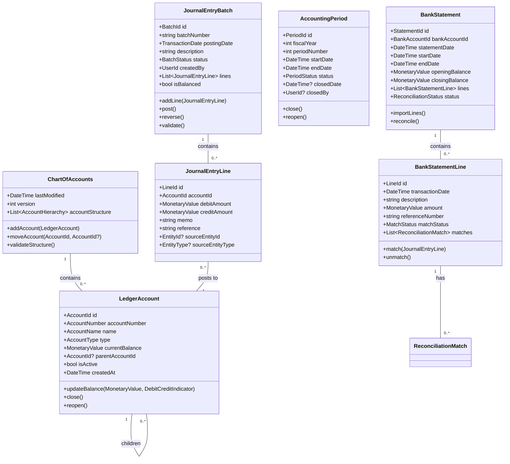
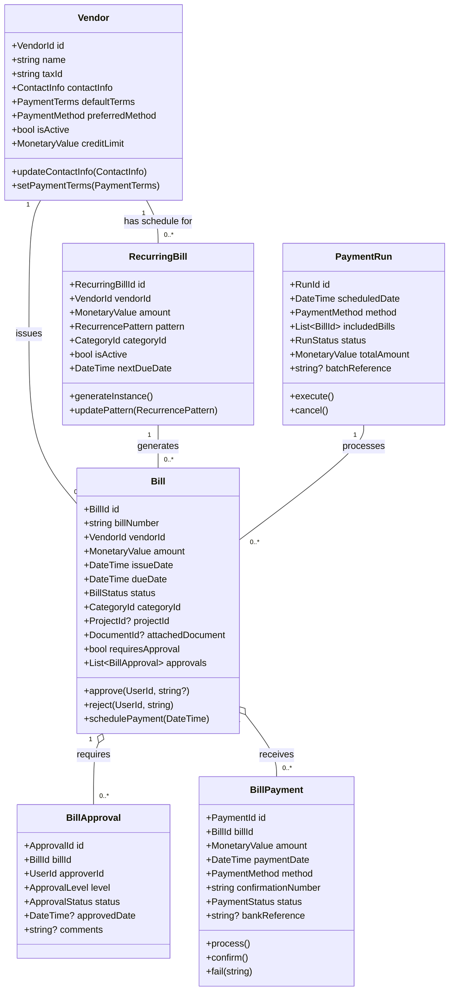
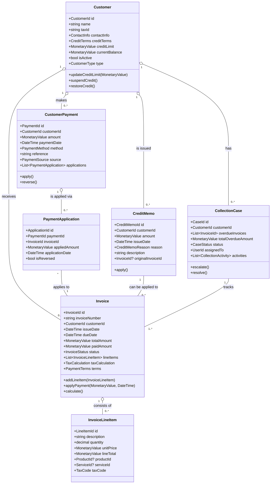
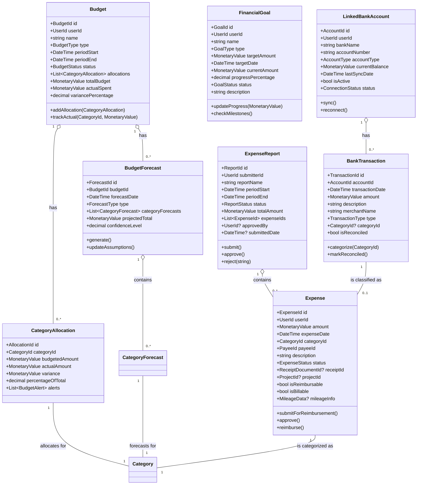
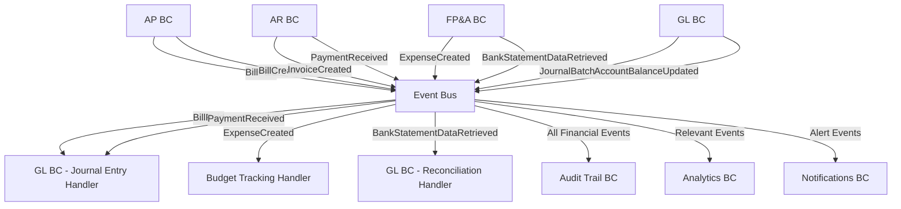
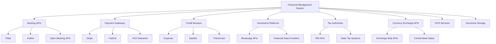

# Domain-Driven Design Architecture Specification
## Financial Management System

---

## Table of Contents

1. [Executive Summary](#1-executive-summary)
2. [Domain Architecture Overview](#2-domain-architecture-overview)
3. [Bounded Context Catalog](#3-bounded-context-catalog)
4. [Bounded Context Specifications](#4-bounded-context-specifications)
5. [Integration Patterns](#5-integration-patterns)
6. [Implementation Guidelines](#6-implementation-guidelines)
7. [Cross-Cutting Concerns](#7-cross-cutting-concerns)
8. [Dependency Matrix](#8-dependency-matrix)

---

## 1. Executive Summary

### 1.1 System Purpose
A comprehensive financial management platform integrating accounting, bookkeeping, financial planning, investment tracking, and AI-powered analytics to provide complete financial oversight for individuals and businesses.

### 1.2 Architecture Approach
- **Pattern**: Domain-Driven Design with CQRS and Event Sourcing
- **Framework**: .NET with Clean Architecture principles
- **Integration**: Event-driven architecture with eventual consistency
- **Scalability**: Microservices-ready bounded contexts with clear boundaries

### 1.3 Core Domain Classification
- **Core Domains**: General Ledger, Accounts Payable, Accounts Receivable, Financial Planning & Analysis
- **Supporting Domains**: Financial Analytics, Debt Management, Tax Management, Credit Score Monitoring, Investment Management
- **Generic Domains**: Audit Trail, Currency Management, Document Management

---

## 2. Domain Architecture Overview

### 2.1 Context Map

```
┌─────────────────┐    ┌─────────────────┐    ┌─────────────────┐
│   Accounts      │────│  General Ledger │────│   Accounts      │
│   Payable       │    │      (GL)       │    │  Receivable     │
│     (AP)        │    │                 │    │     (AR)        │
└─────────────────┘    └─────────────────┘    └─────────────────┘
         │                       │                       │
         │                       │                       │
┌─────────────────┐    ┌─────────────────┐    ┌─────────────────┐
│  Financial      │────│   Audit Trail   │────│   Currency      │
│  Planning &     │    │                 │    │  Management     │
│  Analysis (FP&A)│    │                 │    │                 │
└─────────────────┘    └─────────────────┘    └─────────────────┘
         │                       │                       │
         │              ┌─────────────────┐              │
         └──────────────│  Tax Management │──────────────┘
                        └─────────────────┘
                                 │
         ┌─────────────────┬─────────────────┬─────────────────┐
         │                 │                 │                 │
┌─────────────────┐ ┌─────────────────┐ ┌─────────────────┐ ┌─────────────────┐
│ Financial       │ │    Debt         │ │   Credit        │ │ Investment      │
│ Analytics       │ │ Management      │ │   Score         │ │ Management      │
│                 │ │                 │ │ Monitoring      │ │                 │
└─────────────────┘ └─────────────────┘ └─────────────────┘ └─────────────────┘
         │                       │                       │           │
         └───────────────────────┼───────────────────────┘           │
                                 │                                   │
                    ┌─────────────────┐                             │
                    │   Document      │─────────────────────────────┘
                    │  Management     │
                    │                 │
                    └─────────────────┘
```

### 2.2 Strategic Design Principles

1. **Financial Data Integrity**: All financial transactions must maintain double-entry principles
2. **Regulatory Compliance**: Built-in audit trails and compliance with financial regulations
3. **Event-Driven Consistency**: Financial state changes propagated through domain events
4. **Eventual Consistency**: Accept temporary inconsistency for scalability while ensuring financial accuracy
5. **Anti-Corruption Layers**: Protect financial domain integrity at all boundaries

---

## 3. Bounded Context Catalog

| Context | Type | Priority | Complexity | Team Size |
|---------|------|----------|------------|-----------|
| General Ledger | Core | Critical | High | 4-5 |
| Accounts Payable | Core | Critical | Medium | 2-3 |
| Accounts Receivable | Core | Critical | Medium | 2-3 |
| Financial Planning & Analysis | Core | High | High | 3-4 |
| Financial Analytics | Supporting | Medium | Medium | 2-3 |
| Debt Management | Supporting | Medium | Low | 1-2 |
| Tax Management | Supporting | High | Medium | 2-3 |
| Credit Score Monitoring | Supporting | Low | Medium | 2 |
| Investment Management | Supporting | Medium | High | 3-4 |
| Audit Trail | Generic | Critical | Low | 1-2 |
| Currency Management | Generic | Medium | Low | 1 |
| Document Management | Generic | Medium | Medium | 2 |

---

## 4. Bounded Context Specifications

### 4.1 General Ledger (GL) Bounded Context

#### 4.1.1 Context Overview
**Responsibility**: Maintains the authoritative record of financial transactions using double-entry principles, manages the Chart of Accounts, enables period closing, standard financial statement generation, and performs bank reconciliation.

**Strategic Classification**: Core Domain - Strategic

**Subdomains**:
- Ledger Core: Double-entry accounting and chart of accounts
- Bank Reconciliation: Automated and manual statement reconciliation
- Period Management: Financial period closing and opening
- Financial Reporting: Standard financial statement generation

#### 4.1.2 Core Domain Model



#### 4.1.3 Aggregates Specification

##### LedgerAccount Aggregate Root
**Purpose**: Represents an account in the chart of accounts with its current balance and transaction history

**Value Objects**:
- `AccountId`: Unique identifier with validation
- `AccountNumber`: Formatted account number (e.g., "1000", "1200.01")
- `AccountName`: Human-readable account name
- `AccountType`: Asset, Liability, Equity, Revenue, Expense
- `MonetaryValue`: Amount with currency and precision
- `DebitCreditIndicator`: Debit or Credit nature

**Business Invariants**:
- Account number must be unique within chart of accounts
- Account cannot be deleted if it has transactions
- Parent-child relationships cannot create cycles
- Balance calculations must maintain double-entry principles

##### JournalEntryBatch Aggregate Root
**Purpose**: Represents a balanced set of journal entries for a single business transaction

**Entities**:
- `JournalEntryLine`: Individual debit/credit entries within the batch

**Value Objects**:
- `BatchId`: Unique identifier
- `BatchNumber`: Sequential or formatted batch identifier
- `TransactionDate`: When the transaction occurred
- `BatchStatus`: Draft, Posted, Reversed
- `UserId`: Who created/posted the batch

**Business Invariants**:
- Batch must be balanced (total debits = total credits)
- Cannot post a batch with validation errors
- Cannot modify a posted batch (must reverse and create new)
- All lines must have valid account references

##### AccountingPeriod Aggregate Root
**Purpose**: Manages fiscal periods and controls when transactions can be posted

**Value Objects**:
- `PeriodId`: Unique identifier
- `FiscalYear`: Year for financial reporting
- `PeriodNumber`: Period within the fiscal year (1-12 typically)
- `PeriodStatus`: Open, Closed, Permanently Closed
- `PeriodDates`: Start and end dates for the period

**Business Invariants**:
- Cannot post transactions to closed periods
- Periods must be closed in sequential order
- Cannot have overlapping periods
- Must have at least one open period

##### BankStatement Aggregate Root
**Purpose**: Manages imported bank statements and reconciliation process

**Entities**:
- `BankStatementLine`: Individual transactions from bank statement
- `ReconciliationMatch`: Links between statement lines and journal entries

**Value Objects**:
- `StatementId`: Unique identifier
- `BankAccountId`: Reference to the bank account
- `StatementDate`: Date of statement
- `ReconciliationStatus`: Unreconciled, Partially Reconciled, Fully Reconciled
- `MatchStatus`: Unmatched, Matched, Suggested Match

**Business Invariants**:
- Statement lines cannot be modified after import
- Reconciliation differences must be explained
- Matched items cannot be modified without unmatching

##### ChartOfAccounts Aggregate Root
**Purpose**: Manages the hierarchical structure of all ledger accounts

**Entities**:
- `AccountHierarchy`: Represents parent-child relationships

**Value Objects**:
- `StructureVersion`: Version number for the chart structure
- `LastModified`: When structure was last changed

**Business Invariants**:
- Account numbers must follow organizational numbering scheme
- Cannot delete accounts with balances or children
- Hierarchy must be acyclic

#### 4.1.4 Commands & Queries (CQRS)

##### Commands
**Account Management**:
```csharp
public record CreateLedgerAccount(
    AccountNumber AccountNumber,
    AccountName Name,
    AccountType Type,
    AccountId? ParentAccountId,
    string Description,
    UserId CreatedBy
);

public record UpdateLedgerAccount(
    AccountId AccountId,
    AccountName? NewName,
    string? NewDescription,
    bool? IsActive,
    UserId UpdatedBy
);

public record MoveLedgerAccount(
    AccountId AccountId,
    AccountId? NewParentAccountId,
    UserId MovedBy
);
```

**Journal Entry Management**:
```csharp
public record CreateJournalEntryBatch(
    TransactionDate PostingDate,
    string Description,
    List<JournalEntryLineData> Lines,
    string? Reference,
    UserId CreatedBy
);

public record PostJournalEntryBatch(
    BatchId BatchId,
    UserId PostedBy
);

public record ReverseJournalEntryBatch(
    BatchId BatchId,
    string ReversalReason,
    TransactionDate ReversalDate,
    UserId ReversedBy
);
```

**Period Management**:
```csharp
public record CreateAccountingPeriod(
    int FiscalYear,
    int PeriodNumber,
    DateTime StartDate,
    DateTime EndDate,
    UserId CreatedBy
);

public record CloseAccountingPeriod(
    PeriodId PeriodId,
    List<ClosingEntry> ClosingEntries,
    UserId ClosedBy
);

public record ReopenAccountingPeriod(
    PeriodId PeriodId,
    string ReopenReason,
    UserId ReopenedBy
);
```

**Bank Reconciliation**:
```csharp
public record ImportBankStatement(
    BankAccountId BankAccountId,
    DateTime StatementDate,
    MonetaryValue OpeningBalance,
    MonetaryValue ClosingBalance,
    List<BankTransactionData> Transactions,
    UserId ImportedBy
);

public record MatchStatementLine(
    StatementId StatementId,
    LineId StatementLineId,
    List<BatchId> MatchingBatches,
    MatchType MatchType,
    UserId MatchedBy
);

public record CreateReconciliationEntry(
    StatementId StatementId,
    LineId StatementLineId,
    List<JournalEntryLineData> ReconciliationLines,
    string Explanation,
    UserId CreatedBy
);
```

##### Queries
**Account Queries**:
```csharp
public record GetLedgerAccountById(AccountId AccountId);
public record GetChartOfAccounts(bool? ActiveOnly = true);
public record GetAccountBalance(AccountId AccountId, DateTime? AsOfDate = null);
public record GetAccountTransactionHistory(
    AccountId AccountId,
    DateTime StartDate,
    DateTime EndDate,
    int PageNumber = 1,
    int PageSize = 50
);
```

**Journal Entry Queries**:
```csharp
public record GetJournalEntryBatch(BatchId BatchId);
public record SearchJournalEntries(
    DateTime? StartDate,
    DateTime? EndDate,
    AccountId? AccountFilter,
    string? DescriptionFilter,
    BatchStatus? StatusFilter,
    int PageNumber = 1,
    int PageSize = 50
);
```

**Financial Reporting Queries**:
```csharp
public record GenerateTrialBalance(DateTime AsOfDate);
public record GenerateBalanceSheet(DateTime AsOfDate);
public record GenerateIncomeStatement(DateTime StartDate, DateTime EndDate);
public record GenerateCashFlowStatement(DateTime StartDate, DateTime EndDate);
public record GenerateGeneralLedgerReport(
    AccountId? AccountFilter,
    DateTime StartDate,
    DateTime EndDate
);
```

**Reconciliation Queries**:
```csharp
public record GetBankStatementById(StatementId StatementId);
public record GetUnreconciledStatementLines(BankAccountId BankAccountId);
public record GetReconciliationStatus(BankAccountId BankAccountId, DateTime? AsOfDate = null);
public record GetSuggestedMatches(LineId StatementLineId);
```

#### 4.1.5 Events & Integration

##### Domain Events
```csharp
public class LedgerAccountCreated : DomainEvent
{
    public AccountId AccountId { get; }
    public AccountNumber AccountNumber { get; }
    public AccountName Name { get; }
    public AccountType Type { get; }
    public AccountId? ParentAccountId { get; }
    public UserId CreatedBy { get; }
}

public class JournalBatchPosted : DomainEvent
{
    public BatchId BatchId { get; }
    public string BatchNumber { get; }
    public TransactionDate PostingDate { get; }
    public List<JournalEntryLinePosted> Lines { get; }
    public MonetaryValue TotalAmount { get; }
    public UserId PostedBy { get; }
}

public class AccountBalanceUpdated : DomainEvent
{
    public AccountId AccountId { get; }
    public MonetaryValue PreviousBalance { get; }
    public MonetaryValue NewBalance { get; }
    public MonetaryValue ChangeAmount { get; }
    public DebitCreditIndicator ChangeType { get; }
    public BatchId? CausingBatchId { get; }
}

public class AccountingPeriodClosed : DomainEvent
{
    public PeriodId PeriodId { get; }
    public int FiscalYear { get; }
    public int PeriodNumber { get; }
    public DateTime ClosedDate { get; }
    public List<BatchId> ClosingEntries { get; }
    public UserId ClosedBy { get; }
}

public class BankStatementImported : DomainEvent
{
    public StatementId StatementId { get; }
    public BankAccountId BankAccountId { get; }
    public DateTime StatementDate { get; }
    public int TransactionCount { get; }
    public MonetaryValue StatementBalance { get; }
    public UserId ImportedBy { get; }
}

public class StatementLineMatched : DomainEvent
{
    public StatementId StatementId { get; }
    public LineId StatementLineId { get; }
    public List<BatchId> MatchedBatches { get; }
    public MatchType MatchType { get; }
    public MonetaryValue MatchedAmount { get; }
    public UserId MatchedBy { get; }
}
```

##### Critical Event Handlers

**Financial Statement Update Handler**:
```csharp
public class FinancialStatementUpdateHandler : 
    IEventHandler<JournalBatchPosted>,
    IEventHandler<AccountingPeriodClosed>
{
    public async Task Handle(JournalBatchPosted eventData)
    {
        // Update pre-computed financial statement balances
        foreach (var line in eventData.Lines)
        {
            await UpdateFinancialStatementBalance(
                line.AccountId,
                line.Amount,
                line.DebitCredit,
                eventData.PostingDate
            );
        }
    }
    
    public async Task Handle(AccountingPeriodClosed eventData)
    {
        // Generate period-end financial statements
        await GeneratePeriodEndStatements(eventData.PeriodId);
        
        // Archive transaction data for the closed period
        await ArchivePeriodTransactions(eventData.PeriodId);
    }
}
```

#### 4.1.6 Business Rules & Policies

##### Double-Entry Validation Policy
```csharp
public class DoubleEntryValidationPolicy
{
    public ValidationResult ValidateBatch(JournalEntryBatch batch)
    {
        var errors = new List<string>();
        
        // Must have at least 2 lines
        if (batch.Lines.Count < 2)
        {
            errors.Add("Journal entry batch must have at least 2 lines");
        }
        
        // Calculate totals
        var totalDebits = batch.Lines.Sum(l => l.DebitAmount?.Amount ?? 0);
        var totalCredits = batch.Lines.Sum(l => l.CreditAmount?.Amount ?? 0);
        
        // Must be balanced
        if (Math.Abs(totalDebits - totalCredits) > 0.01m) // Allow for rounding
        {
            errors.Add($"Batch is out of balance: Debits={totalDebits:C}, Credits={totalCredits:C}");
        }
        
        // Each line must have either debit or credit (not both, not neither)
        for (int i = 0; i < batch.Lines.Count; i++)
        {
            var line = batch.Lines[i];
            var hasDebit = line.DebitAmount?.Amount > 0;
            var hasCredit = line.CreditAmount?.Amount > 0;
            
            if (hasDebit && hasCredit)
            {
                errors.Add($"Line {i + 1}: Cannot have both debit and credit amounts");
            }
            else if (!hasDebit && !hasCredit)
            {
                errors.Add($"Line {i + 1}: Must have either debit or credit amount");
            }
        }
        
        return new ValidationResult(errors.Count == 0, errors);
    }
}
```

##### Period Closing Policy
```csharp
public class PeriodClosingPolicy
{
    public async Task<ClosingValidationResult> ValidatePeriodForClosing(
        PeriodId periodId,
        ILedgerAccountRepository accountRepository,
        IJournalEntryRepository journalRepository)
    {
        var issues = new List<string>();
        
        // Check for unposted batches in the period
        var unpostedBatches = await journalRepository.GetUnpostedBatchesInPeriod(periodId);
        if (unpostedBatches.Any())
        {
            issues.Add($"Period has {unpostedBatches.Count} unposted journal batches");
        }
        
        // Check for out-of-balance accounts
        var accounts = await accountRepository.GetAllActiveAccounts();
        var balanceIssues = new List<string>();
        
        foreach (var account in accounts)
        {
            var calculatedBalance = await CalculateAccountBalance(account.Id, periodId);
            if (Math.Abs(calculatedBalance.Amount - account.CurrentBalance.Amount) > 0.01m)
            {
                balanceIssues.Add($"Account {account.AccountNumber}: Balance mismatch");
            }
        }
        
        if (balanceIssues.Any())
        {
            issues.AddRange(balanceIssues);
        }
        
        // Check for pending bank reconciliations
        var pendingReconciliations = await GetPendingReconciliations(periodId);
        if (pendingReconciliations.Any())
        {
            issues.Add($"Period has {pendingReconciliations.Count} pending bank reconciliations");
        }
        
        return new ClosingValidationResult(issues.Count == 0, issues);
    }
}
```

#### 4.1.7 Technical Considerations

##### Performance Optimization
- **Account Balance Caching**: Cache frequently accessed account balances with invalidation
- **Financial Statement Pre-computation**: Maintain running balances for quick report generation
- **Partitioning**: Partition journal entries by fiscal year for historical data management
- **Indexing**: Optimize for common queries (by account, by date range, by reference)

##### Audit and Compliance
- **Immutable Journal Entries**: Posted entries cannot be modified, only reversed
- **Audit Trail Integration**: All changes automatically logged for regulatory compliance
- **Digital Signatures**: Support for digital signing of critical transactions
- **Backup and Recovery**: Point-in-time recovery capability for financial data

---

### 4.2 Accounts Payable (AP) Bounded Context

#### 4.2.1 Context Overview
**Responsibility**: Managing incoming bills, scheduling/recording payments owed, and initiating payments to vendors with full audit trail and approval workflows.

**Strategic Classification**: Core Domain - Strategic

**Subdomains**:
- Bill Management: Invoice receipt, processing, and lifecycle management
- Payment Processing: Payment scheduling, execution, and confirmation
- Vendor Management: Vendor information and payment preferences
- Approval Workflows: Multi-level approval processes for bills and payments

#### 4.2.2 Core Domain Model



#### 4.2.3 Aggregates Specification

##### Bill Aggregate Root
**Purpose**: Central entity representing a vendor invoice/bill requiring payment

**Entities**:
- `BillApproval`: Approval records for multi-level approval workflows
- `BillLineItem`: Individual line items on the bill
- `PaymentAllocation`: How payments are allocated to the bill

**Value Objects**:
- `BillId`: Unique identifier
- `BillNumber`: Vendor's invoice/bill number
- `VendorId`: Reference to vendor
- `MonetaryValue`: Amount owed with currency
- `IssueDate`: When vendor issued the bill
- `DueDate`: When payment is due
- `BillStatus`: Draft, Pending Approval, Approved, Paid, Overdue, Cancelled
- `CategoryId`: Expense category for accounting
- `ProjectId`: Optional project assignment
- `DocumentId`: Attached invoice document

**Business Invariants**:
- Bill cannot be paid without proper approvals (if required)
- Due date cannot be before issue date
- Cannot modify paid bills
- Total payments cannot exceed bill amount

##### Vendor Aggregate Root
**Purpose**: Manages vendor master data and payment preferences

**Entities**:
- `VendorContact`: Multiple contact persons for vendor
- `VendorPaymentAccount`: Bank/payment account details

**Value Objects**:
- `VendorId`: Unique identifier
- `VendorName`: Company name
- `TaxId`: Tax identification number
- `ContactInfo`: Primary contact information
- `PaymentTerms`: Net 30, Net 15, etc.
- `PaymentMethod`: Check, ACH, Wire, Card
- `CreditLimit`: Maximum outstanding amount allowed

**Business Invariants**:
- Tax ID must be unique if provided
- Cannot delete vendor with outstanding bills
- Credit limit cannot be exceeded
- Contact information must be valid

##### BillPayment Aggregate Root
**Purpose**: Represents actual payment made against a bill

**Value Objects**:
- `PaymentId`: Unique identifier
- `BillId`: Reference to bill being paid
- `Amount`: Payment amount
- `PaymentDate`: When payment was made
- `PaymentMethod`: How payment was made
- `ConfirmationNumber`: Bank/gateway confirmation
- `PaymentStatus`: Pending, Processed, Failed, Cancelled
- `BankReference`: Bank transaction reference

**Business Invariants**:
- Payment amount must be positive and not exceed bill balance
- Cannot modify processed payments
- Confirmation number required for processed payments

##### PaymentRun Aggregate Root
**Purpose**: Groups multiple bills for batch payment processing

**Value Objects**:
- `RunId`: Unique identifier
- `ScheduledDate`: When payments will be executed
- `PaymentMethod`: Method for all payments in run
- `RunStatus`: Scheduled, Processing, Completed, Failed
- `TotalAmount`: Sum of all payments in run
- `BatchReference`: External batch reference

**Business Invariants**:
- All bills in run must be approved
- Cannot modify run after execution starts
- Total amount must equal sum of individual bills

##### RecurringBill Aggregate Root
**Purpose**: Template for automatically generating recurring bills

**Value Objects**:
- `RecurringBillId`: Unique identifier
- `VendorId`: Vendor for recurring bills
- `Amount`: Standard amount (can be overridden)
- `RecurrencePattern`: Monthly, quarterly, etc.
- `NextDueDate`: When next bill should be generated
- `CategoryId`: Default expense category

**Business Invariants**:
- Cannot generate bills for inactive patterns
- Next due date must be calculated from pattern
- Generated bills can be modified independently

#### 4.2.4 Commands & Queries (CQRS)

##### Commands
**Bill Management**:
```csharp
public record CreateBill(
    string BillNumber,
    VendorId VendorId,
    MonetaryValue Amount,
    DateTime IssueDate,
    DateTime DueDate,
    CategoryId CategoryId,
    ProjectId? ProjectId,
    DocumentId? AttachedDocument,
    List<BillLineItemData>? LineItems,
    UserId CreatedBy
);

public record ApproveBill(
    BillId BillId,
    ApprovalLevel Level,
    bool IsApproved,
    string? Comments,
    UserId ApprovedBy
);

public record ScheduleBillPayment(
    BillId BillId,
    DateTime PaymentDate,
    PaymentMethod Method,
    string? PaymentReference,
    UserId ScheduledBy
);
```

**Payment Processing**:
```csharp
public record CreatePaymentRun(
    DateTime ScheduledDate,
    PaymentMethod Method,
    List<BillId> BillIds,
    string? Description,
    UserId CreatedBy
);

public record ExecutePaymentRun(
    RunId RunId,
    UserId ExecutedBy
);

public record RecordBillPayment(
    BillId BillId,
    MonetaryValue Amount,
    DateTime PaymentDate,
    PaymentMethod Method,
    string ConfirmationNumber,
    string? BankReference,
    UserId RecordedBy
);
```

**Vendor Management**:
```csharp
public record CreateVendor(
    string Name,
    string? TaxId,
    ContactInfo ContactInfo,
    PaymentTerms DefaultTerms,
    PaymentMethod PreferredMethod,
    MonetaryValue? CreditLimit,
    UserId CreatedBy
);

public record UpdateVendorPaymentInfo(
    VendorId VendorId,
    PaymentTerms? Terms,
    PaymentMethod? Method,
    VendorPaymentAccount? PaymentAccount,
    UserId UpdatedBy
);
```

**Recurring Bills**:
```csharp
public record CreateRecurringBill(
    VendorId VendorId,
    MonetaryValue Amount,
    RecurrencePattern Pattern,
    CategoryId CategoryId,
    DateTime StartDate,
    string? Description,
    UserId CreatedBy
);

public record GenerateRecurringBillInstance(
    RecurringBillId RecurringBillId,
    DateTime? AmountOverride,
    UserId GeneratedBy
);
```

##### Queries
**Bill Queries**:
```csharp
public record GetBillById(BillId BillId);
public record GetBillsByVendor(VendorId VendorId, BillStatus? StatusFilter = null);
public record GetBillsByStatus(BillStatus Status, DateTime? DueBefore = null);
public record GetOverdueBills(UserId? ResponsibleUser = null);
public record GetBillsRequiringApproval(UserId ApproverId, ApprovalLevel? Level = null);
```

**Payment Queries**:
```csharp
public record GetPaymentHistory(BillId BillId);
public record GetPaymentRunById(RunId RunId);
public record GetScheduledPayments(DateTime StartDate, DateTime EndDate);
public record GetPaymentRunStatus(RunId RunId);
```

**Vendor Queries**:
```csharp
public record GetVendorById(VendorId VendorId);
public record SearchVendors(string? NameFilter, bool? ActiveOnly = true);
public record GetVendorPaymentHistory(VendorId VendorId, DateTime StartDate, DateTime EndDate);
public record GetVendorBalance(VendorId VendorId);
```

**Reporting Queries**:
```csharp
public record GetAccountsPayableAging(DateTime AsOfDate);
public record GetCashFlowProjection(DateTime StartDate, DateTime EndDate);
public record GetVendorSpendAnalysis(DateTime StartDate, DateTime EndDate);
```

#### 4.2.5 Events & Integration

##### Domain Events
```csharp
public class BillCreated : DomainEvent
{
    public BillId BillId { get; }
    public string BillNumber { get; }
    public VendorId VendorId { get; }
    public string VendorName { get; }
    public MonetaryValue Amount { get; }
    public DateTime DueDate { get; }
    public CategoryId CategoryId { get; }
    public ProjectId? ProjectId { get; }
    public bool RequiresApproval { get; }
    public UserId CreatedBy { get; }
}

public class BillApproved : DomainEvent
{
    public BillId BillId { get; }
    public ApprovalLevel Level { get; }
    public UserId ApprovedBy { get; }
    public DateTime ApprovedAt { get; }
    public bool IsFinalApproval { get; }
    public MonetaryValue Amount { get; }
}

public class BillPaymentInitiated : DomainEvent
{
    public PaymentId PaymentId { get; }
    public BillId BillId { get; }
    public VendorId VendorId { get; }
    public MonetaryValue Amount { get; }
    public DateTime PaymentDate { get; }
    public PaymentMethod Method { get; }
    public RunId? PaymentRunId { get; }
    public UserId InitiatedBy { get; }
}

public class BillPaid : DomainEvent
{
    public BillId BillId { get; }
    public PaymentId PaymentId { get; }
    public VendorId VendorId { get; }
    public MonetaryValue Amount { get; }
    public DateTime PaymentDate { get; }
    public PaymentMethod Method { get; }
    public string ConfirmationNumber { get; }
    public CategoryId CategoryId { get; }
    public ProjectId? ProjectId { get; }
}

public class PaymentRunCompleted : DomainEvent
{
    public RunId RunId { get; }
    public DateTime ExecutedDate { get; }
    public PaymentMethod Method { get; }
    public int BillCount { get; }
    public MonetaryValue TotalAmount { get; }
    public List<PaymentResult> PaymentResults { get; }
    public UserId ExecutedBy { get; }
}
```

##### Critical Event Handlers

**General Ledger Integration Handler**:
```csharp
public class APGeneralLedgerIntegrationHandler : 
    IEventHandler<BillCreated>,
    IEventHandler<BillPaid>
{
    public async Task Handle(BillCreated eventData)
    {
        // Create journal entry for bill accrual
        var journalLines = new List<JournalEntryLineData>
        {
            new(
                AccountId: await GetExpenseAccount(eventData.CategoryId),
                DebitAmount: eventData.Amount,
                Memo: $"Bill from {eventData.VendorName} - {eventData.BillNumber}"
            ),
            new(
                AccountId: await GetAccountsPayableAccount(),
                CreditAmount: eventData.Amount,
                Memo: $"AP - {eventData.VendorName}"
            )
        };
        
        await CreateJournalEntry(
            $"Bill Accrual - {eventData.BillNumber}",
            journalLines,
            eventData.BillId,
            EntityType.Bill
        );
    }
    
    public async Task Handle(BillPaid eventData)
    {
        // Create journal entry for payment
        var journalLines = new List<JournalEntryLineData>
        {
            new(
                AccountId: await GetAccountsPayableAccount(),
                DebitAmount: eventData.Amount,
                Memo: $"Payment to {eventData.VendorName}"
            ),
            new(
                AccountId: await GetCashAccount(eventData.Method),
                CreditAmount: eventData.Amount,
                Memo: $"Payment {eventData.ConfirmationNumber}"
            )
        };
        
        await CreateJournalEntry(
            $"Bill Payment - {eventData.BillId}",
            journalLines,
            eventData.PaymentId,
            EntityType.Payment
        );
    }
}
```

#### 4.2.6 Business Rules & Policies

##### Approval Workflow Policy
```csharp
public class BillApprovalPolicy
{
    public async Task<List<ApprovalLevel>> DetermineRequiredApprovals(
        Bill bill,
        IUserRepository userRepository)
    {
        var requiredApprovals = new List<ApprovalLevel>();
        
        // Amount-based approval levels
        if (bill.Amount.Amount > 10000)
        {
            requiredApprovals.Add(ApprovalLevel.CFO);
        }
        else if (bill.Amount.Amount > 5000)
        {
            requiredApprovals.Add(ApprovalLevel.Manager);
            requiredApprovals.Add(ApprovalLevel.Director);
        }
        else if (bill.Amount.Amount > 1000)
        {
            requiredApprovals.Add(ApprovalLevel.Manager);
        }
        
        // Category-based rules
        var category = await GetCategoryById(bill.CategoryId);
        if (category.RequiresSpecialApproval)
        {
            requiredApprovals.Add(ApprovalLevel.Department);
        }
        
        // Project-based rules
        if (bill.ProjectId.HasValue)
        {
            var project = await GetProjectById(bill.ProjectId.Value);
            if (project.BudgetRemaining < bill.Amount.Amount)
            {
                requiredApprovals.Add(ApprovalLevel.ProjectManager);
            }
        }
        
        return requiredApprovals.Distinct().OrderBy(l => l).ToList();
    }
}
```

##### Payment Scheduling Policy
```csharp
public class PaymentSchedulingPolicy
{
    public DateTime CalculateOptimalPaymentDate(
        Bill bill,
        VendorPaymentTerms terms,
        CashFlowProjection cashFlow)
    {
        // Start with due date
        var targetDate = bill.DueDate;
        
        // Apply early payment discount consideration
        if (terms.EarlyPaymentDiscount != null)
        {
            var discountDeadline = bill.IssueDate.AddDays(terms.EarlyPaymentDiscount.DaysToQualify);
            var discountAmount = bill.Amount.Amount * terms.EarlyPaymentDiscount.DiscountPercentage;
            
            if (discountAmount > 100 && discountDeadline >= DateTime.Today) // Worth taking discount
            {
                targetDate = discountDeadline;
            }
        }
        
        // Check cash flow constraints
        var availableCash = cashFlow.GetProjectedBalance(targetDate);
        if (availableCash < bill.Amount.Amount)
        {
            // Find next date with sufficient cash
            targetDate = cashFlow.FindNextDateWithSufficientCash(bill.Amount.Amount, targetDate);
        }
        
        // Don't pay too early (cash management)
        var earliestPaymentDate = bill.DueDate.AddDays(-7); // Pay max 7 days early
        if (targetDate < earliestPaymentDate)
        {
            targetDate = earliestPaymentDate;
        }
        
        return targetDate;
    }
}
```

---

### 4.3 Accounts Receivable (AR) Bounded Context

#### 4.3.1 Context Overview
**Responsibility**: Managing customers, creating/sending invoices, tracking payments received, processing online/gateway payments, and managing collection activities.

**Strategic Classification**: Core Domain - Strategic

**Subdomains**:
- Customer Management: Customer master data and credit management
- Invoice Management: Invoice creation, delivery, and lifecycle
- Payment Processing: Payment receipt and application
- Collections Management: Overdue account management and collection activities

#### 4.3.2 Core Domain Model



#### 4.3.3 Aggregates Specification

##### Customer Aggregate Root
**Purpose**: Manages customer master data, credit terms, and account status

**Entities**:
- `CustomerContact`: Multiple contact persons
- `CustomerAddress`: Billing and shipping addresses
- `CustomerCreditHistory`: Historical credit decisions

**Value Objects**:
- `CustomerId`: Unique identifier
- `CustomerName`: Company or individual name
- `TaxId`: Tax identification number
- `ContactInfo`: Primary contact details
- `CreditTerms`: Payment terms and conditions
- `CreditLimit`: Maximum outstanding amount
- `CurrentBalance`: Total outstanding receivables
- `CustomerType`: Individual, Corporate, Government

**Business Invariants**:
- Credit limit cannot be negative
- Cannot exceed credit limit without approval
- Tax ID must be unique if provided
- Current balance must equal sum of outstanding invoices

##### Invoice Aggregate Root
**Purpose**: Represents a bill sent to customer for goods/services

**Entities**:
- `InvoiceLineItem`: Individual items/services on invoice
- `InvoiceDelivery`: Delivery tracking (email, postal)
- `InvoiceReminder`: Payment reminder history

**Value Objects**:
- `InvoiceId`: Unique identifier
- `InvoiceNumber`: Sequential or formatted invoice number
- `CustomerId`: Customer being billed
- `IssueDate`: When invoice was created
- `DueDate`: When payment is due
- `TotalAmount`: Calculated total including taxes
- `PaidAmount`: Total payments received
- `InvoiceStatus`: Draft, Sent, Paid, Overdue, Cancelled
- `PaymentTerms`: Specific terms for this invoice

**Business Invariants**:
- Total amount must equal sum of line items plus taxes
- Cannot modify sent invoices (must credit memo)
- Paid amount cannot exceed total amount
- Due date must be after issue date

##### CustomerPayment Aggregate Root
**Purpose**: Represents payment received from customer

**Entities**:
- `PaymentApplication`: How payment is applied to invoices
- `PaymentReversal`: If payment needs to be reversed

**Value Objects**:
- `PaymentId`: Unique identifier
- `CustomerId`: Customer making payment
- `Amount`: Payment amount
- `PaymentDate`: When payment was received
- `PaymentMethod`: Cash, Check, ACH, Credit Card, Wire
- `Reference`: Check number, transaction ID, etc.
- `PaymentSource`: Manual, Online Portal, Payment Gateway

**Business Invariants**:
- Payment amount must be positive
- Total applications cannot exceed payment amount
- Cannot reverse applied payments without unapplying first

##### CreditMemo Aggregate Root
**Purpose**: Reduces customer balance for returns, adjustments, or corrections

**Value Objects**:
- `CreditMemoId`: Unique identifier
- `CustomerId`: Customer receiving credit
- `Amount`: Credit amount
- `IssueDate`: When credit was issued
- `Reason`: Return, Discount, Correction, etc.
- `OriginalInvoiceId`: Invoice being credited (if applicable)

**Business Invariants**:
- Credit amount must be positive
- Cannot exceed original invoice amount (if specified)
- Must have valid reason for credit

##### CollectionCase Aggregate Root
**Purpose**: Manages collection activities for overdue accounts

**Entities**:
- `CollectionActivity`: Individual collection actions taken
- `CollectionNote`: Notes and communications log

**Value Objects**:
- `CaseId`: Unique identifier
- `CustomerId`: Customer with overdue balance
- `TotalOverdueAmount`: Sum of overdue invoices
- `CaseStatus`: Open, In Progress, On Hold, Resolved, Legal
- `AssignedTo`: Collection agent responsible
- `LastActivityDate`: Most recent collection activity

**Business Invariants**:
- Must have at least one overdue invoice
- Cannot close case with outstanding overdue balance
- Activities must be in chronological order

#### 4.3.4 Commands & Queries (CQRS)

##### Commands
**Customer Management**:
```csharp
public record CreateCustomer(
    string Name,
    string? TaxId,
    ContactInfo ContactInfo,
    CustomerType Type,
    CreditTerms CreditTerms,
    MonetaryValue? CreditLimit,
    UserId CreatedBy
);

public record UpdateCustomerCreditLimit(
    CustomerId CustomerId,
    MonetaryValue NewCreditLimit,
    string Justification,
    UserId UpdatedBy
);

public record SuspendCustomerCredit(
    CustomerId CustomerId,
    string Reason,
    UserId SuspendedBy
);
```

**Invoice Management**:
```csharp
public record CreateInvoice(
    CustomerId CustomerId,
    DateTime IssueDate,
    DateTime DueDate,
    PaymentTerms Terms,
    List<InvoiceLineItemData> LineItems,
    ProjectId? ProjectId,
    UserId CreatedBy
);

public record SendInvoice(
    InvoiceId InvoiceId,
    DeliveryMethod Method,
    string DeliveryAddress,
    UserId SentBy
);

public record ApplyPaymentToInvoice(
    InvoiceId InvoiceId,
    PaymentId PaymentId,
    MonetaryValue Amount,
    UserId AppliedBy
);
```

**Payment Processing**:
```csharp
public record RecordCustomerPayment(
    CustomerId CustomerId,
    MonetaryValue Amount,
    DateTime PaymentDate,
    PaymentMethod Method,
    string Reference,
    PaymentSource Source,
    List<PaymentApplicationData>? Applications,
    UserId RecordedBy
);

public record ProcessOnlinePayment(
    InvoiceId InvoiceId,
    MonetaryValue Amount,
    PaymentGatewayTransaction Transaction,
    UserId? ProcessedBy
);

public record ReverseCustomerPayment(
    PaymentId PaymentId,
    string ReversalReason,
    UserId ReversedBy
);
```

**Collections Management**:
```csharp
public record CreateCollectionCase(
    CustomerId CustomerId,
    List<InvoiceId> OverdueInvoices,
    UserId AssignedTo,
    CasePriority Priority,
    UserId CreatedBy
);

public record LogCollectionActivity(
    CaseId CaseId,
    ActivityType Type,
    string Description,
    DateTime ActivityDate,
    UserId? ContactedPerson,
    DateTime? FollowUpDate,
    UserId LoggedBy
);
```

##### Queries
**Customer Queries**:
```csharp
public record GetCustomerById(CustomerId CustomerId);
public record SearchCustomers(string? NameFilter, CustomerType? TypeFilter, bool? ActiveOnly = true);
public record GetCustomerBalance(CustomerId CustomerId);
public record GetCustomerPaymentHistory(CustomerId CustomerId, DateTime StartDate, DateTime EndDate);
public record GetCustomerInvoices(CustomerId CustomerId, InvoiceStatus? StatusFilter = null);
```

**Invoice Queries**:
```csharp
public record GetInvoiceById(InvoiceId InvoiceId);
public record GetInvoicesByStatus(InvoiceStatus Status, DateTime? IssuedAfter = null);
public record GetOverdueInvoices(int? DaysOverdue = null, CustomerId? CustomerFilter = null);
public record GetInvoicesForCollection(DateTime? OverdueSince = null);
```

**Payment Queries**:
```csharp
public record GetPaymentById(PaymentId PaymentId);
public record GetUnappliedPayments(CustomerId? CustomerFilter = null);
public record GetPaymentApplications(PaymentId PaymentId);
```

**Reporting Queries**:
```csharp
public record GetAccountsReceivableAging(DateTime AsOfDate);
public record GetCollectionReport(DateTime StartDate, DateTime EndDate, UserId? CollectorFilter = null);
public record GetSalesReport(DateTime StartDate, DateTime EndDate, CustomerId? CustomerFilter = null);
public record GetCashReceiptsReport(DateTime StartDate, DateTime EndDate);
```

#### 4.3.5 Events & Integration

##### Domain Events
```csharp
public class InvoiceCreated : DomainEvent
{
    public InvoiceId InvoiceId { get; }
    public string InvoiceNumber { get; }
    public CustomerId CustomerId { get; }
    public string CustomerName { get; }
    public MonetaryValue TotalAmount { get; }
    public DateTime IssueDate { get; }
    public DateTime DueDate { get; }
    public ProjectId? ProjectId { get; }
    public List<InvoiceLineItemData> LineItems { get; }
    public UserId CreatedBy { get; }
}

public class InvoiceSent : DomainEvent
{
    public InvoiceId InvoiceId { get; }
    public CustomerId CustomerId { get; }
    public DeliveryMethod Method { get; }
    public string DeliveryAddress { get; }
    public DateTime SentAt { get; }
    public UserId SentBy { get; }
}

public class PaymentReceived : DomainEvent
{
    public PaymentId PaymentId { get; }
    public CustomerId CustomerId { get; }
    public MonetaryValue Amount { get; }
    public DateTime PaymentDate { get; }
    public PaymentMethod Method { get; }
    public PaymentSource Source { get; }
    public string Reference { get; }
    public UserId RecordedBy { get; }
}

public class InvoicePaymentApplied : DomainEvent
{
    public InvoiceId InvoiceId { get; }
    public PaymentId PaymentId { get; }
    public MonetaryValue AppliedAmount { get; }
    public MonetaryValue RemainingBalance { get; }
    public bool IsFullyPaid { get; }
    public UserId AppliedBy { get; }
}

public class InvoiceOverdue : DomainEvent
{
    public InvoiceId InvoiceId { get; }
    public CustomerId CustomerId { get; }
    public MonetaryValue OverdueAmount { get; }
    public int DaysOverdue { get; }
    public DateTime OriginalDueDate { get; }
}

public class CollectionCaseCreated : DomainEvent
{
    public CaseId CaseId { get; }
    public CustomerId CustomerId { get; }
    public List<InvoiceId> OverdueInvoices { get; }
    public MonetaryValue TotalOverdueAmount { get; }
    public UserId AssignedTo { get; }
    public CasePriority Priority { get; }
}
```

##### Critical Event Handlers

**General Ledger Integration Handler**:
```csharp
public class ARGeneralLedgerIntegrationHandler : 
    IEventHandler<InvoiceCreated>,
    IEventHandler<PaymentReceived>
{
    public async Task Handle(InvoiceCreated eventData)
    {
        // Create journal entry for invoice
        var journalLines = new List<JournalEntryLineData>
        {
            new(
                AccountId: await GetAccountsReceivableAccount(),
                DebitAmount: eventData.TotalAmount,
                Memo: $"Invoice {eventData.InvoiceNumber} - {eventData.CustomerName}"
            ),
            new(
                AccountId: await GetSalesRevenueAccount(),
                CreditAmount: eventData.TotalAmount,
                Memo: $"Sales - {eventData.CustomerName}"
            )
        };
        
        await CreateJournalEntry(
            $"Invoice - {eventData.InvoiceNumber}",
            journalLines,
            eventData.InvoiceId,
            EntityType.Invoice
        );
    }
    
    public async Task Handle(PaymentReceived eventData)
    {
        // Create journal entry for payment receipt
        var journalLines = new List<JournalEntryLineData>
        {
            new(
                AccountId: await GetCashAccount(eventData.Method),
                DebitAmount: eventData.Amount,
                Memo: $"Payment from customer - {eventData.Reference}"
            ),
            new(
                AccountId: await GetAccountsReceivableAccount(),
                CreditAmount: eventData.Amount,
                Memo: $"Customer payment"
            )
        };
        
        await CreateJournalEntry(
            $"Customer Payment - {eventData.Reference}",
            journalLines,
            eventData.PaymentId,
            EntityType.Payment
        );
    }
}
```

**Collections Management Handler**:
```csharp
public class CollectionsManagementHandler : 
    IEventHandler<InvoiceOverdue>
{
    public async Task Handle(InvoiceOverdue eventData)
    {
        // Check if customer already has an open collection case
        var existingCase = await GetOpenCollectionCase(eventData.CustomerId);
        
        if (existingCase != null)
        {
            // Add invoice to existing case
            await AddInvoiceToCollectionCase(existingCase.CaseId, eventData.InvoiceId);
        }
        else
        {
            // Create new collection case if total overdue amount meets threshold
            var customerOverdueInvoices = await GetCustomerOverdueInvoices(eventData.CustomerId);
            var totalOverdue = customerOverdueInvoices.Sum(i => i.OverdueAmount);
            
            if (totalOverdue.Amount >= 100) // Minimum threshold for collection case
            {
                await CreateCollectionCase(
                    eventData.CustomerId,
                    customerOverdueInvoices.Select(i => i.InvoiceId).ToList(),
                    await GetDefaultCollector(),
                    DetermineCasePriority(totalOverdue, eventData.DaysOverdue)
                );
            }
        }
        
        // Send automated reminder if configured
        await SendPaymentReminder(eventData.InvoiceId, DetermineReminderLevel(eventData.DaysOverdue));
    }
}
```

#### 4.3.6 Business Rules & Policies

##### Credit Management Policy
```csharp
public class CreditManagementPolicy
{
    public async Task<CreditDecision> EvaluateCreditRequest(
        CustomerId customerId,
        MonetaryValue requestedAmount,
        ICustomerRepository customerRepository,
        IInvoiceRepository invoiceRepository)
    {
        var customer = await customerRepository.GetByIdAsync(customerId);
        var currentBalance = await CalculateCustomerBalance(customerId);
        var proposedBalance = currentBalance.Amount + requestedAmount.Amount;
        
        // Check credit limit
        if (proposedBalance > customer.CreditLimit.Amount)
        {
            return CreditDecision.Declined("Would exceed credit limit", 
                customer.CreditLimit.Amount - currentBalance.Amount);
        }
        
        // Check payment history
        var paymentHistory = await GetCustomerPaymentHistory(customerId, 12); // Last 12 months
        var averageDaysToPayment = CalculateAverageDaysToPayment(paymentHistory);
        
        if (averageDaysToPayment > 45) // Slow payer
        {
            return CreditDecision.RequiresApproval("Customer has slow payment history");
        }
        
        // Check for current overdue amounts
        var overdueInvoices = await GetOverdueInvoices(customerId);
        if (overdueInvoices.Any())
        {
            var totalOverdue = overdueInvoices.Sum(i => i.OverdueAmount);
            if (totalOverdue.Amount > customer.CreditLimit.Amount * 0.1m) // 10% of credit limit
            {
                return CreditDecision.Declined("Customer has significant overdue balance");
            }
        }
        
        return CreditDecision.Approved(requestedAmount);
    }
}
```

##### Collection Escalation Policy
```csharp
public class CollectionEscalationPolicy
{
    public CollectionAction DetermineNextAction(
        CollectionCase collectionCase,
        List<CollectionActivity> recentActivities)
    {
        var daysSinceLastActivity = (DateTime.Today - recentActivities.Max(a => a.ActivityDate)).Days;
        var totalDaysInCollection = (DateTime.Today - collectionCase.CreatedDate).Days;
        
        // Escalation based on time and amount
        if (collectionCase.TotalOverdueAmount.Amount > 10000)
        {
            if (totalDaysInCollection > 60)
            {
                return CollectionAction.LegalAction("Large balance overdue > 60 days");
            }
            else if (totalDaysInCollection > 30)
            {
                return CollectionAction.FormalDemandLetter("Large balance overdue > 30 days");
            }
        }
        
        // Standard escalation timeline
        if (totalDaysInCollection <= 15)
        {
            return CollectionAction.PhoneCall("Initial contact period");
        }
        else if (totalDaysInCollection <= 30)
        {
            return CollectionAction.FormalNotice("First formal notice");
        }
        else if (totalDaysInCollection <= 45)
        {
            return CollectionAction.FinalNotice("Final notice before legal action");
        }
        else
        {
            return CollectionAction.LegalReferral("Standard escalation timeline exceeded");
        }
    }
}
```

---

### 4.4 Financial Planning & Analysis (FP&A) Bounded Context

#### 4.4.1 Context Overview
**Responsibility**: Managing expenses, budgets, financial goals, forecasting, and fetching bank data for reconciliation with comprehensive reporting and analytics.

**Strategic Classification**: Core Domain - Strategic

**Subdomains**:
- Expense Management: Expense tracking, categorization, and reimbursement
- Budget Management: Budget creation, monitoring, and variance analysis
- Financial Forecasting: Predictive financial modeling and scenario planning
- Bank Integration: Account linking and transaction synchronization
- Goal Management: Financial target setting and progress tracking

#### 4.4.2 Core Domain Model



#### 4.4.3 Aggregates Specification

##### Expense Aggregate Root
**Purpose**: Represents individual expense transactions with full audit trail

**Entities**:
- `ExpenseAttachment`: Supporting documentation
- `MileageRecord`: Detailed mileage information
- `ExpenseApproval`: Approval workflow tracking

**Value Objects**:
- `ExpenseId`: Unique identifier
- `UserId`: Employee who incurred expense
- `MonetaryValue`: Amount with currency
- `ExpenseDate`: When expense was incurred
- `CategoryId`: Expense category for reporting
- `PayeeId`: Vendor/merchant who was paid
- `ExpenseStatus`: Draft, Submitted, Approved, Reimbursed, Rejected
- `ReceiptDocumentId`: Link to receipt image/document
- `MileageData`: Miles driven, rate, purpose

**Business Invariants**:
- Expense amount must be positive
- Expense date cannot be in the future
- Mileage expenses must have valid mileage data
- Receipts required for expenses over policy threshold
- Cannot modify approved/reimbursed expenses

##### ExpenseReport Aggregate Root
**Purpose**: Groups expenses for submission and approval workflow

**Value Objects**:
- `ReportId`: Unique identifier
- `SubmitterId`: Employee submitting report
- `ReportName`: Descriptive name for report
- `PeriodStart/End`: Date range for expenses included
- `ReportStatus`: Draft, Submitted, Under Review, Approved, Paid, Rejected
- `TotalAmount`: Sum of all included expenses
- `ApprovedBy`: Manager who approved report

**Business Invariants**:
- Report must contain at least one expense
- All expenses must be from same employee
- Cannot submit report with rejected expenses
- Total amount must equal sum of included expenses

##### Budget Aggregate Root
**Purpose**: Manages budget allocations and tracks actual vs. planned spending

**Entities**:
- `CategoryAllocation`: Budget allocation per category
- `BudgetVersion`: Historical versions of budget
- `BudgetAlert`: Configured alerts for variances

**Value Objects**:
- `BudgetId`: Unique identifier
- `UserId`: Budget owner
- `BudgetType`: Personal, Department, Project, Capital
- `BudgetStatus`: Draft, Active, Closed, Archived
- `TotalBudget`: Total budgeted amount
- `ActualSpent`: Total actual spending
- `VariancePercentage`: Budget vs. actual variance

**Business Invariants**:
- Total allocations cannot exceed total budget
- Cannot modify closed budgets
- Actual amounts must be calculated from real transactions
- Budget periods cannot overlap for same user/department

##### FinancialGoal Aggregate Root
**Purpose**: Tracks progress toward financial objectives

**Entities**:
- `GoalMilestone`: Intermediate targets
- `GoalContribution`: Individual contributions toward goal

**Value Objects**:
- `GoalId`: Unique identifier
- `GoalType`: Savings, Debt Reduction, Investment, Purchase
- `TargetAmount`: Goal amount to achieve
- `TargetDate`: When goal should be achieved
- `CurrentAmount`: Current progress toward goal
- `ProgressPercentage`: Calculated progress percentage
- `GoalStatus`: Active, On Track, Behind, Achieved, Abandoned

**Business Invariants**:
- Target amount must be positive
- Target date must be in the future
- Progress percentage must be calculated correctly
- Cannot modify achieved goals

##### LinkedBankAccount Aggregate Root
**Purpose**: Manages bank account connections and transaction synchronization

**Entities**:
- `SyncHistory`: Record of synchronization attempts
- `AccountBalance`: Historical balance records

**Value Objects**:
- `AccountId`: Unique identifier
- `BankName`: Financial institution name
- `AccountNumber`: Masked account number
- `AccountType`: Checking, Savings, Credit Card, Investment
- `CurrentBalance`: Most recent balance
- `LastSyncDate`: When account was last synchronized
- `ConnectionStatus`: Active, Error, Disconnected, Expired

**Business Invariants**:
- Account number must be unique per user
- Cannot sync disconnected accounts
- Balance updates must be in chronological order

##### BankTransaction Aggregate Root
**Purpose**: Represents individual bank transactions with categorization

**Value Objects**:
- `TransactionId`: Unique identifier from bank
- `AccountId`: Source account
- `TransactionDate`: When transaction occurred
- `Amount`: Transaction amount (positive/negative)
- `Description`: Bank-provided description
- `MerchantName`: Standardized merchant name
- `TransactionType`: Debit, Credit, Fee, Interest
- `CategoryId`: User-assigned category
- `IsReconciled`: Whether transaction has been reconciled

**Business Invariants**:
- Transaction ID must be unique per account
- Amount cannot be zero
- Reconciled transactions cannot be modified

#### 4.4.4 Commands & Queries (CQRS)

##### Commands
**Expense Management**:
```csharp
public record CreateExpense(
    MonetaryValue Amount,
    DateTime ExpenseDate,
    CategoryId CategoryId,
    PayeeId PayeeId,
    string Description,
    ProjectId? ProjectId,
    bool IsReimbursable,
    bool IsBillable,
    ReceiptDocumentId? ReceiptId,
    MileageData? MileageInfo,
    UserId CreatedBy
);

public record SubmitExpenseReport(
    string ReportName,
    DateTime PeriodStart,
    DateTime PeriodEnd,
    List<ExpenseId> ExpenseIds,
    UserId SubmittedBy
);

public record ApproveExpenseReport(
    ReportId ReportId,
    bool IsApproved,
    string? Comments,
    List<ExpenseId>? RejectedExpenses,
    UserId ApprovedBy
);
```

**Budget Management**:
```csharp
public record CreateBudget(
    string Name,
    BudgetType Type,
    DateTime PeriodStart,
    DateTime PeriodEnd,
    List<CategoryAllocationData> Allocations,
    UserId CreatedBy
);

public record UpdateBudgetAllocation(
    BudgetId BudgetId,
    CategoryId CategoryId,
    MonetaryValue NewAmount,
    string? Justification,
    UserId UpdatedBy
);

public record TrackBudgetActual(
    BudgetId BudgetId,
    CategoryId CategoryId,
    MonetaryValue ActualAmount,
    DateTime TransactionDate,
    string? Reference
);
```

**Goal Management**:
```csharp
public record CreateFinancialGoal(
    string Name,
    GoalType Type,
    MonetaryValue TargetAmount,
    DateTime TargetDate,
    string Description,
    UserId CreatedBy
);

public record UpdateGoalProgress(
    GoalId GoalId,
    MonetaryValue ContributionAmount,
    DateTime ContributionDate,
    string? Notes,
    UserId UpdatedBy
);
```

**Bank Integration**:
```csharp
public record LinkBankAccount(
    string BankName,
    string AccountNumber,
    AccountType AccountType,
    BankConnectionCredentials Credentials,
    UserId LinkedBy
);

public record SyncBankAccount(
    AccountId AccountId,
    DateTime? SyncFromDate,
    UserId SyncedBy
);

public record CategorizeBankTransaction(
    TransactionId TransactionId,
    CategoryId CategoryId,
    UserId CategorizedBy
);
```

##### Queries
**Expense Queries**:
```csharp
public record GetExpenseById(ExpenseId ExpenseId);
public record GetExpensesByUser(UserId UserId, DateTime? StartDate = null, DateTime? EndDate = null);
public record GetExpensesByCategory(CategoryId CategoryId, DateTime StartDate, DateTime EndDate);
public record GetPendingExpenseReports(UserId? ApproverId = null);
public record GetExpenseReport(ReportId ReportId);
```

**Budget Queries**:
```csharp
public record GetBudgetById(BudgetId BudgetId);
public record GetActiveBudgets(UserId UserId);
public record GetBudgetPerformance(BudgetId BudgetId, DateTime? AsOfDate = null);
public record GetBudgetVarianceReport(BudgetId BudgetId);
public record GetCategorySpending(CategoryId CategoryId, DateTime StartDate, DateTime EndDate);
```

**Financial Analysis Queries**:
```csharp
public record GetCashFlowProjection(UserId UserId, DateTime StartDate, DateTime EndDate);
public record GetSpendingTrends(UserId UserId, int MonthCount = 12);
public record GetGoalProgress(GoalId GoalId);
public record GetGoalsByUser(UserId UserId, GoalStatus? StatusFilter = null);
```

**Bank Account Queries**:
```csharp
public record GetLinkedBankAccounts(UserId UserId, bool? ActiveOnly = true);
public record GetBankTransactions(
    AccountId AccountId,
    DateTime? StartDate = null,
    DateTime? EndDate = null,
    bool? UnCategorizedOnly = null
);
public record GetAccountBalance(AccountId AccountId, DateTime? AsOfDate = null);
```

#### 4.4.5 Events & Integration

##### Domain Events
```csharp
public class ExpenseCreated : DomainEvent
{
    public ExpenseId ExpenseId { get; }
    public UserId UserId { get; }
    public MonetaryValue Amount { get; }
    public DateTime ExpenseDate { get; }
    public CategoryId CategoryId { get; }
    public PayeeId PayeeId { get; }
    public ProjectId? ProjectId { get; }
    public bool IsReimbursable { get; }
}

public class ExpenseReportSubmitted : DomainEvent
{
    public ReportId ReportId { get; }
    public UserId SubmitterId { get; }
    public MonetaryValue TotalAmount { get; }
    public List<ExpenseId> ExpenseIds { get; }
    public DateTime SubmittedDate { get; }
    public UserId? RequiresApprovalFrom { get; }
}

public class BudgetVarianceExceeded : DomainEvent
{
    public BudgetId BudgetId { get; }
    public CategoryId CategoryId { get; }
    public MonetaryValue BudgetedAmount { get; }
    public MonetaryValue ActualAmount { get; }
    public decimal VariancePercentage { get; }
    public DateTime DetectedDate { get; }
}

public class FinancialGoalMilestoneReached : DomainEvent
{
    public GoalId GoalId { get; }
    public UserId UserId { get; }
    public string GoalName { get; }
    public decimal ProgressPercentage { get; }
    public MonetaryValue CurrentAmount { get; }
    public MonetaryValue TargetAmount { get; }
}

public class BankAccountSynced : DomainEvent
{
    public AccountId AccountId { get; }
    public UserId UserId { get; }
    public DateTime SyncDate { get; }
    public int NewTransactionCount { get; }
    public MonetaryValue UpdatedBalance { get; }
    public DateTime LastTransactionDate { get; }
}

public class BankStatementDataRetrieved : DomainEvent
{
    public AccountId AccountId { get; }
    public DateTime StatementDate { get; }
    public MonetaryValue OpeningBalance { get; }
    public MonetaryValue ClosingBalance { get; }
    public List<BankTransactionData> Transactions { get; }
    public string StatementPeriod { get; }
}
```

##### Critical Event Handlers

**Budget Tracking Handler**:
```csharp
public class BudgetTrackingHandler : 
    IEventHandler<ExpenseCreated>,
    IEventHandler<BankTransactionCategorized>
{
    public async Task Handle(ExpenseCreated eventData)
    {
        // Find active budgets for this user and category
        var activeBudgets = await GetActiveBudgets(eventData.UserId);
        
        foreach (var budget in activeBudgets)
        {
            var allocation = budget.GetAllocation(eventData.CategoryId);
            if (allocation != null)
            {
                // Update actual spending
                await UpdateBudgetActual(budget.BudgetId, eventData.CategoryId, eventData.Amount);
                
                // Check for variance alerts
                var updatedAllocation = await GetUpdatedAllocation(budget.BudgetId, eventData.CategoryId);
                if (updatedAllocation.VariancePercentage > 10) // 10% over budget
                {
                    await PublishBudgetVarianceAlert(budget.BudgetId, eventData.CategoryId, updatedAllocation);
                }
            }
        }
        
        // Update financial goal progress if expense reduces goal (e.g., debt payment)
        await UpdateGoalProgressForExpense(eventData);
    }
}
```

**General Ledger Integration Handler**:
```csharp
public class FPAGeneralLedgerIntegrationHandler : 
    IEventHandler<ExpenseReportApproved>
{
    public async Task Handle(ExpenseReportApproved eventData)
    {
        // Create journal entries for reimbursable expenses
        var expenses = await GetExpensesInReport(eventData.ReportId);
        var reimbursableExpenses = expenses.Where(e => e.IsReimbursable).ToList();
        
        if (reimbursableExpenses.Any())
        {
            var totalReimbursable = reimbursableExpenses.Sum(e => e.Amount.Amount);
            
            var journalLines = new List<JournalEntryLineData>
            {
                new(
                    AccountId: await GetEmployeeAdvancesAccount(),
                    DebitAmount: new MonetaryValue(totalReimbursable, "USD"),
                    Memo: $"Employee reimbursement - Report {eventData.ReportId}"
                ),
                new(
                    AccountId: await GetAccountsPayableAccount(),
                    CreditAmount: new MonetaryValue(totalReimbursable, "USD"),
                    Memo: $"Reimbursement owed"
                )
            };
            
            await CreateJournalEntry(
                $"Employee Expense Reimbursement - {eventData.ReportId}",
                journalLines,
                eventData.ReportId,
                EntityType.ExpenseReport
            );
        }
    }
}
```

#### 4.4.6 Business Rules & Policies

##### Expense Approval Policy
```csharp
public class ExpenseApprovalPolicy
{
    public async Task<ApprovalRequirement> DetermineApprovalRequirement(
        ExpenseReport report,
        IUserRepository userRepository)
    {
        var requirements = new List<ApprovalLevel>();
        
        // Amount-based approval
        if (report.TotalAmount.Amount > 5000)
        {
            requirements.Add(ApprovalLevel.Director);
        }
        else if (report.TotalAmount.Amount > 1000)
        {
            requirements.Add(ApprovalLevel.Manager);
        }
        
        // Check for policy violations
        var expenses = await GetExpensesInReport(report.ReportId);
        
        foreach (var expense in expenses)
        {
            // Receipt requirement
            if (expense.Amount.Amount > 25 && expense.ReceiptId == null)
            {
                requirements.Add(ApprovalLevel.Manager);
            }
            
            // High-risk categories
            var category = await GetCategoryById(expense.CategoryId);
            if (category.RequiresApproval)
            {
                requirements.Add(ApprovalLevel.Manager);
            }
            
            // International expenses
            if (expense.Amount.Currency != "USD")
            {
                requirements.Add(ApprovalLevel.Finance);
            }
        }
        
        return new ApprovalRequirement(requirements.Distinct().ToList());
    }
}
```

##### Budget Variance Policy
```csharp
public class BudgetVariancePolicy
{
    public async Task<List<BudgetAlert>> EvaluateBudgetVariances(
        BudgetId budgetId,
        IBudgetRepository budgetRepository)
    {
        var budget = await budgetRepository.GetByIdAsync(budgetId);
        var alerts = new List<BudgetAlert>();
        
        foreach (var allocation in budget.Allocations)
        {
            var variancePercentage = CalculateVariancePercentage(allocation);
            
            // Warning at 80% of budget
            if (variancePercentage >= 80 && variancePercentage < 100)
            {
                alerts.Add(new BudgetAlert(
                    BudgetAlertType.Warning,
                    allocation.CategoryId,
                    $"Budget is {variancePercentage:F1}% used",
                    AlertSeverity.Medium
                ));
            }
            // Critical at 90% of budget
            else if (variancePercentage >= 90 && variancePercentage < 100)
            {
                alerts.Add(new BudgetAlert(
                    BudgetAlertType.Critical,
                    allocation.CategoryId,
                    $"Budget is {variancePercentage:F1}% used",
                    AlertSeverity.High
                ));
            }
            // Exceeded budget
            else if (variancePercentage >= 100)
            {
                alerts.Add(new BudgetAlert(
                    BudgetAlertType.Exceeded,
                    allocation.CategoryId,
                    $"Budget exceeded by {variancePercentage - 100:F1}%",
                    AlertSeverity.Critical
                ));
            }
        }
        
        return alerts;
    }
}
```

---

## 5. Integration Patterns

### 5.1 Event-Driven Integration

#### 5.1.1 Event Flow Architecture


#### 5.1.2 Financial Event Design Standards

**Event Naming Convention**:
- Format: `{Entity}{FinancialAction}` (e.g., `BillPaid`, `InvoiceCreated`)
- Include monetary impact in event name when relevant
- Past tense for completed financial transactions

**Financial Event Payload Design**:
```csharp
public abstract class FinancialDomainEvent : DomainEvent
{
    public MonetaryValue? Amount { get; protected set; }
    public string? AccountingReference { get; protected set; }
    public DateTime EffectiveDate { get; protected set; }
    public UserId? AuthorizedBy { get; protected set; }
    
    // Compliance and audit fields
    public string ComplianceContext { get; protected set; }
    public bool RequiresAuditEntry { get; protected set; } = true;
}

// Example implementation
public class BillPaid : FinancialDomainEvent
{
    public BillId BillId { get; }
    public VendorId VendorId { get; }
    public string VendorName { get; }
    public PaymentId PaymentId { get; }
    public PaymentMethod PaymentMethod { get; }
    public string ConfirmationNumber { get; }
    public CategoryId CategoryId { get; }
    public ProjectId? ProjectId { get; }
    
    // Include financial context to avoid query-back
    public AccountId ExpenseAccountId { get; }
    public AccountId PayableAccountId { get; }
    public AccountId CashAccountId { get; }
    
    public BillPaid(Bill bill, BillPayment payment, FinancialContext context)
    {
        BillId = bill.Id;
        VendorId = bill.VendorId;
        VendorName = bill.VendorName;
        PaymentId = payment.Id;
        Amount = payment.Amount;
        PaymentMethod = payment.Method;
        ConfirmationNumber = payment.ConfirmationNumber;
        CategoryId = bill.CategoryId;
        ProjectId = bill.ProjectId;
        EffectiveDate = payment.PaymentDate;
        
        // Financial context for GL integration
        ExpenseAccountId = context.ExpenseAccountId;
        PayableAccountId = context.PayableAccountId;
        CashAccountId = context.CashAccountId;
        
        ComplianceContext = "AP_PAYMENT";
    }
}
```

### 5.2 Saga Pattern for Financial Workflows

#### 5.2.1 Bill Payment Saga
```csharp
public class BillPaymentSaga : ISaga<BillPaymentInitiated>
{
    public async Task Handle(BillPaymentInitiated @event)
    {
        var sagaData = new BillPaymentSagaData
        {
            BillId = @event.BillId,
            PaymentId = @event.PaymentId,
            Amount = @event.Amount,
            VendorId = @event.VendorId,
            PaymentMethod = @event.PaymentMethod,
            InitiatedBy = @event.InitiatedBy
        };
        
        try
        {
            // Step 1: Validate payment authorization
            await ValidatePaymentAuthorization(@event.PaymentId);
            
            // Step 2: Process payment through external system
            var paymentResult = await ProcessExternalPayment(@event);
            
            if (paymentResult.IsSuccessful)
            {
                // Step 3: Record successful payment in AP
                await SendCommand(new RecordBillPayment(
                    @event.BillId,
                    @event.PaymentId,
                    paymentResult.ConfirmationNumber,
                    @event.InitiatedBy
                ));
                
                // Step 4: Create GL journal entry (handled by event handler)
                // Step 5: Update budget actuals (handled by event handler)
                // Step 6: Update cash flow projections (handled by event handler)
            }
            else
            {
                await SendCommand(new MarkPaymentFailed(
                    @event.PaymentId,
                    paymentResult.ErrorMessage
                ));
            }
        }
        catch (Exception ex)
        {
            await HandlePaymentFailure(@event.PaymentId, ex.Message);
        }
    }
    
    // Compensating actions
    public async Task Handle(PaymentProcessingFailed @event)
    {
        // Reverse any partial state changes
        await SendCommand(new CancelBillPayment(@event.PaymentId, @event.FailureReason));
        
        // Notify stakeholders
        await SendCommand(new NotifyPaymentFailure(@event.BillId, @event.FailureReason));
    }
}
```

#### 5.2.2 Invoice to Cash Saga
```csharp
public class InvoiceToCashSaga : ISaga<InvoiceCreated>
{
    public async Task Handle(InvoiceCreated @event)
    {
        var sagaData = new InvoiceToCashSagaData
        {
            InvoiceId = @event.InvoiceId,
            CustomerId = @event.CustomerId,
            Amount = @event.TotalAmount,
            DueDate = @event.DueDate
        };
        
        // Step 1: Create GL journal entry for invoice
        await SendCommand(new CreateJournalEntryForInvoice(
            @event.InvoiceId,
            @event.CustomerId,
            @event.TotalAmount,
            @event.LineItems
        ));
        
        // Step 2: Check customer credit limit
        var creditCheck = await CheckCustomerCredit(@event.CustomerId, @event.TotalAmount);
        if (!creditCheck.IsApproved)
        {
            await SendCommand(new FlagInvoiceForCreditReview(@event.InvoiceId, creditCheck.Reason));
        }
        
        // Step 3: Schedule invoice delivery
        await SendCommand(new ScheduleInvoiceDelivery(
            @event.InvoiceId,
            @event.CustomerId,
            DeliveryMethod.Email
        ));
        
        // Step 4: Set up payment reminders
        await SendCommand(new SchedulePaymentReminders(
            @event.InvoiceId,
            @event.DueDate
        ));
        
        // Step 5: Update AR aging schedule
        await SendCommand(new UpdateARAgingSchedule(@event.InvoiceId, @event.DueDate));
    }
    
    public async Task Handle(PaymentReceived @event)
    {
        // Apply payment to outstanding invoices
        await SendCommand(new ApplyCustomerPayment(
            @event.PaymentId,
            @event.CustomerId,
            @event.Amount
        ));
        
        // Update cash flow projections
        await SendCommand(new UpdateCashFlowActuals(
            @event.Amount,
            @event.PaymentDate,
            CashFlowCategory.CustomerPayments
        ));
        
        // Create GL journal entry for payment
        await SendCommand(new CreateJournalEntryForPayment(
            @event.PaymentId,
            @event.Amount,
            @event.PaymentMethod
        ));
    }
}
```

### 5.3 Anti-Corruption Layer (ACL) Pattern

#### 5.3.1 Financial Data Translation Layer
```csharp
public class FinancialDataTranslationService
{
    private readonly IGeneralLedgerService _glService;
    private readonly ICurrencyService _currencyService;
    
    public async Task<JournalEntryBatch> TranslateBillToJournalEntry(
        BillPaid billPaidEvent,
        ChartOfAccountsMapping accountMapping)
    {
        // Validate accounts exist and are active
        await ValidateAccountExists(accountMapping.ExpenseAccountId);
        await ValidateAccountExists(accountMapping.AccountsPayableAccountId);
        await ValidateAccountExists(accountMapping.CashAccountId);
        
        // Handle currency conversion if needed
        var baseAmount = billPaidEvent.Amount;
        if (billPaidEvent.Amount.Currency != "USD")
        {
            baseAmount = await _currencyService.ConvertToBaseCurrency(
                billPaidEvent.Amount,
                billPaidEvent.EffectiveDate
            );
        }
        
        // Create journal entry lines
        var lines = new List<JournalEntryLine>
        {
            new JournalEntryLine(
                AccountId: accountMapping.AccountsPayableAccountId,
                DebitAmount: baseAmount,
                Memo: $"Payment to {billPaidEvent.VendorName}",
                Reference: billPaidEvent.ConfirmationNumber,
                SourceEntityId: billPaidEvent.BillId,
                SourceEntityType: EntityType.Bill
            ),
            new JournalEntryLine(AccountId: accountMapping.CashAccountId,
                CreditAmount: baseAmount,
                Memo: $"Cash payment - {billPaidEvent.PaymentMethod}",
                Reference: billPaidEvent.ConfirmationNumber,
                SourceEntityId: billPaidEvent.PaymentId,
                SourceEntityType: EntityType.Payment
            )
        };
        
        // Handle foreign exchange gain/loss if applicable
        if (billPaidEvent.Amount.Currency != "USD")
        {
            var fxGainLoss = await CalculateForeignExchangeGainLoss(
                billPaidEvent.Amount,
                baseAmount,
                billPaidEvent.EffectiveDate
            );
            
            if (fxGainLoss.Amount != 0)
            {
                lines.Add(new JournalEntryLine(
                    AccountId: accountMapping.ForeignExchangeAccountId,
                    Amount: fxGainLoss,
                    Memo: "Foreign exchange gain/loss",
                    Reference: billPaidEvent.ConfirmationNumber
                ));
            }
        }
        
        return new JournalEntryBatch(
            PostingDate: billPaidEvent.EffectiveDate,
            Description: $"Bill Payment - {billPaidEvent.VendorName}",
            Lines: lines,
            Reference: billPaidEvent.BillId.ToString(),
            CreatedBy: billPaidEvent.AuthorizedBy ?? SystemUser.Id
        );
    }
}
```

#### 5.3.2 Bank Integration ACL
```csharp
public class BankIntegrationService
{
    private readonly IBankDataProvider _bankProvider;
    private readonly ITransactionCategorizer _categorizer;
    
    public async Task<BankStatementImportResult> ImportBankStatement(
        LinkedBankAccount account,
        DateTime startDate,
        DateTime endDate)
    {
        try
        {
            // Fetch raw bank data
            var rawBankData = await _bankProvider.FetchTransactions(
                account.ExternalAccountId,
                startDate,
                endDate
            );
            
            // Transform to domain model
            var bankTransactions = rawBankData.Transactions.Select(raw => 
                TransformRawTransaction(raw, account.AccountId)).ToList();
            
            // Auto-categorize transactions
            foreach (var transaction in bankTransactions)
            {
                var suggestedCategory = await _categorizer.SuggestCategory(
                    transaction.Description,
                    transaction.MerchantName,
                    transaction.Amount
                );
                
                if (suggestedCategory.ConfidenceLevel > 0.8m)
                {
                    transaction.CategoryId = suggestedCategory.CategoryId;
                }
            }
            
            // Create bank statement
            var bankStatement = new BankStatement(
                account.AccountId,
                endDate,
                startDate,
                endDate,
                rawBankData.OpeningBalance,
                rawBankData.ClosingBalance,
                bankTransactions
            );
            
            return new BankStatementImportResult(
                bankStatement,
                bankTransactions.Count,
                bankTransactions.Count(t => t.CategoryId != null)
            );
        }
        catch (BankConnectionException ex)
        {
            return BankStatementImportResult.Failed(ex.Message);
        }
    }
    
    private BankTransaction TransformRawTransaction(
        RawBankTransaction raw,
        AccountId accountId)
    {
        return new BankTransaction(
            TransactionId: new TransactionId(raw.Id),
            AccountId: accountId,
            TransactionDate: raw.Date,
            Amount: new MonetaryValue(raw.Amount, raw.Currency),
            Description: CleanDescription(raw.Description),
            MerchantName: ExtractMerchantName(raw.Description),
            TransactionType: DetermineTransactionType(raw.Amount, raw.Type),
            CategoryId: null, // Will be determined by categorizer
            IsReconciled: false
        );
    }
}
```

### 5.4 Read Model Synchronization

#### 5.4.1 Financial Analytics Projections
```csharp
public class FinancialAnalyticsProjection : 
    IEventHandler<JournalBatchPosted>,
    IEventHandler<BillPaid>,
    IEventHandler<PaymentReceived>,
    IEventHandler<ExpenseCreated>
{
    private readonly IFinancialAnalyticsRepository _repository;
    private readonly IAccountRepository _accountRepository;
    
    public async Task Handle(JournalBatchPosted @event)
    {
        foreach (var line in @event.Lines)
        {
            await UpdateAccountAnalytics(line, @event.PostingDate);
            await UpdateCashFlowAnalytics(line, @event.PostingDate);
            await UpdateProfitLossAnalytics(line, @event.PostingDate);
        }
    }
    
    public async Task Handle(BillPaid @event)
    {
        // Update vendor spending analytics
        await UpdateVendorSpendingAnalytics(@event.VendorId, @event.Amount, @event.EffectiveDate);
        
        // Update category spending analytics
        await UpdateCategorySpendingAnalytics(@event.CategoryId, @event.Amount, @event.EffectiveDate);
        
        // Update project cost analytics if applicable
        if (@event.ProjectId.HasValue)
        {
            await UpdateProjectCostAnalytics(@event.ProjectId.Value, @event.Amount, @event.EffectiveDate);
        }
        
        // Update cash flow projections
        await UpdateCashFlowProjections(@event.Amount, @event.EffectiveDate, CashFlowType.Outflow);
    }
    
    public async Task Handle(PaymentReceived @event)
    {
        // Update customer payment analytics
        await UpdateCustomerPaymentAnalytics(@event.CustomerId, @event.Amount, @event.PaymentDate);
        
        // Update cash flow projections
        await UpdateCashFlowProjections(@event.Amount, @event.PaymentDate, CashFlowType.Inflow);
        
        // Update AR aging analytics
        await UpdateARAgingAnalytics(@event.CustomerId, @event.Amount, @event.PaymentDate);
    }
    
    private async Task UpdateAccountAnalytics(JournalEntryLinePosted line, DateTime postingDate)
    {
        var account = await _accountRepository.GetByIdAsync(line.AccountId);
        var analytics = await _repository.GetAccountAnalytics(line.AccountId, postingDate.Year, postingDate.Month);
        
        if (analytics == null)
        {
            analytics = new AccountAnalytics(
                line.AccountId,
                account.AccountNumber,
                account.Name,
                account.Type,
                postingDate.Year,
                postingDate.Month
            );
        }
        
        // Update monthly totals
        if (line.DebitAmount.HasValue)
        {
            analytics.AddDebitAmount(line.DebitAmount.Value);
        }
        
        if (line.CreditAmount.HasValue)
        {
            analytics.AddCreditAmount(line.CreditAmount.Value);
        }
        
        analytics.UpdateLastTransactionDate(postingDate);
        
        await _repository.UpsertAccountAnalytics(analytics);
    }
}
```

#### 5.4.2 Financial Dashboard Projections
```csharp
public class FinancialDashboardProjection : 
    IEventHandler<AccountBalanceUpdated>,
    IEventHandler<BudgetVarianceExceeded>,
    IEventHandler<InvoiceOverdue>
{
    private readonly IDashboardRepository _repository;
    
    public async Task Handle(AccountBalanceUpdated @event)
    {
        var dashboard = await GetOrCreateUserDashboard(@event.AccountId);
        
        // Update account balance summary
        await UpdateAccountBalanceSummary(dashboard, @event);
        
        // Update net worth calculation if personal account
        if (IsPersonalAccount(@event.AccountId))
        {
            await RecalculateNetWorth(dashboard.UserId);
        }
        
        // Update cash position
        if (IsCashAccount(@event.AccountId))
        {
            await UpdateCashPosition(dashboard, @event.NewBalance);
        }
        
        await _repository.UpdateDashboard(dashboard);
    }
    
    public async Task Handle(BudgetVarianceExceeded @event)
    {
        var dashboard = await GetUserDashboardForBudget(@event.BudgetId);
        
        dashboard.AddAlert(new DashboardAlert(
            AlertType.BudgetVariance,
            AlertSeverity.Warning,
            $"Budget variance exceeded for {await GetCategoryName(@event.CategoryId)}",
            new
            {
                BudgetId = @event.BudgetId,
                CategoryId = @event.CategoryId,
                VariancePercentage = @event.VariancePercentage
            }
        ));
        
        await _repository.UpdateDashboard(dashboard);
    }
    
    public async Task Handle(InvoiceOverdue @event)
    {
        var dashboard = await GetUserDashboardForCustomer(@event.CustomerId);
        
        dashboard.AddAlert(new DashboardAlert(
            AlertType.OverdueInvoice,
            AlertSeverity.High,
            $"Invoice {await GetInvoiceNumber(@event.InvoiceId)} is overdue",
            new
            {
                InvoiceId = @event.InvoiceId,
                CustomerId = @event.CustomerId,
                OverdueAmount = @event.OverdueAmount,
                DaysOverdue = @event.DaysOverdue
            }
        ));
        
        await _repository.UpdateDashboard(dashboard);
    }
}
```

---

## 6. Implementation Guidelines

### 6.1 Development Standards

#### 6.1.1 Financial Aggregate Design Principles

**Monetary Value Consistency**:
```csharp
public class MonetaryValue : ValueObject
{
    public decimal Amount { get; }
    public string Currency { get; }
    public int DecimalPlaces { get; }
    
    public MonetaryValue(decimal amount, string currency)
    {
        if (currency == null) throw new ArgumentNullException(nameof(currency));
        if (string.IsNullOrWhiteSpace(currency)) throw new ArgumentException("Currency cannot be empty");
        
        Amount = Math.Round(amount, GetDecimalPlaces(currency));
        Currency = currency.ToUpperInvariant();
        DecimalPlaces = GetDecimalPlaces(currency);
    }
    
    public MonetaryValue Add(MonetaryValue other)
    {
        if (Currency != other.Currency)
            throw new InvalidOperationException($"Cannot add different currencies: {Currency} and {other.Currency}");
            
        return new MonetaryValue(Amount + other.Amount, Currency);
    }
    
    public MonetaryValue Subtract(MonetaryValue other)
    {
        if (Currency != other.Currency)
            throw new InvalidOperationException($"Cannot subtract different currencies: {Currency} and {other.Currency}");
            
        return new MonetaryValue(Amount - other.Amount, Currency);
    }
    
    public bool IsZero => Amount == 0;
    public bool IsPositive => Amount > 0;
    public bool IsNegative => Amount < 0;
    
    private static int GetDecimalPlaces(string currency)
    {
        return currency switch
        {
            "USD" => 2,
            "EUR" => 2,
            "JPY" => 0,
            "BTC" => 8,
            _ => 2
        };
    }
    
    protected override IEnumerable<object> GetEqualityComponents()
    {
        yield return Amount;
        yield return Currency;
    }
    
    public override string ToString()
    {
        return $"{Amount:F{DecimalPlaces}} {Currency}";
    }
}
```

**Financial Transaction Aggregate**:
```csharp
public abstract class FinancialTransaction : AggregateRoot<TransactionId>
{
    public DateTime TransactionDate { get; protected set; }
    public MonetaryValue Amount { get; protected set; }
    public string Description { get; protected set; }
    public string Reference { get; protected set; }
    public UserId AuthorizedBy { get; protected set; }
    public TransactionStatus Status { get; protected set; }
    
    // Audit trail
    public DateTime CreatedAt { get; protected set; }
    public UserId CreatedBy { get; protected set; }
    public DateTime? ModifiedAt { get; protected set; }
    public UserId? ModifiedBy { get; protected set; }
    
    protected FinancialTransaction() { } // For EF
    
    protected FinancialTransaction(
        TransactionId id,
        DateTime transactionDate,
        MonetaryValue amount,
        string description,
        string reference,
        UserId authorizedBy,
        UserId createdBy) : base(id)
    {
        if (transactionDate > DateTime.UtcNow.AddDays(1))
            throw new DomainException("Transaction date cannot be more than 1 day in the future");
            
        if (amount.IsNegative)
            throw new DomainException("Transaction amount must be positive");
            
        if (string.IsNullOrWhiteSpace(description))
            throw new DomainException("Transaction description is required");
        
        TransactionDate = transactionDate;
        Amount = amount;
        Description = description;
        Reference = reference;
        AuthorizedBy = authorizedBy;
        Status = TransactionStatus.Pending;
        CreatedAt = DateTime.UtcNow;
        CreatedBy = createdBy;
    }
    
    public virtual void Authorize(UserId authorizedBy)
    {
        if (Status != TransactionStatus.Pending)
            throw new DomainException($"Cannot authorize transaction in {Status} status");
            
        Status = TransactionStatus.Authorized;
        AuthorizedBy = authorizedBy;
        ModifiedAt = DateTime.UtcNow;
        ModifiedBy = authorizedBy;
        
        RaiseDomainEvent(new TransactionAuthorized(Id, Amount, authorizedBy));
    }
    
    public virtual void Complete(UserId completedBy)
    {
        if (Status != TransactionStatus.Authorized)
            throw new DomainException($"Cannot complete transaction in {Status} status");
            
        Status = TransactionStatus.Completed;
        ModifiedAt = DateTime.UtcNow;
        ModifiedBy = completedBy;
        
        RaiseDomainEvent(new TransactionCompleted(Id, Amount, TransactionDate, completedBy));
    }
}
```

#### 6.1.2 Double-Entry Accounting Enforcement

**Journal Entry Validation Service**:
```csharp
public class JournalEntryValidationService
{
    private readonly IChartOfAccountsService _chartService;
    private readonly IAccountingPeriodService _periodService;
    
    public async Task<ValidationResult> ValidateJournalEntry(JournalEntryBatch batch)
    {
        var errors = new List<string>();
        
        // Basic validations
        errors.AddRange(await ValidateBasicStructure(batch));
        errors.AddRange(await ValidateAccountReferences(batch));
        errors.AddRange(await ValidateBalancing(batch));
        errors.AddRange(await ValidateAccountingPeriod(batch));
        errors.AddRange(await ValidateBusinessRules(batch));
        
        return new ValidationResult(errors.Count == 0, errors);
    }
    
    private async Task<List<string>> ValidateBasicStructure(JournalEntryBatch batch)
    {
        var errors = new List<string>();
        
        if (batch.Lines.Count < 2)
        {
            errors.Add("Journal entry must have at least 2 lines");
        }
        
        if (batch.PostingDate == default)
        {
            errors.Add("Posting date is required");
        }
        
        if (string.IsNullOrWhiteSpace(batch.Description))
        {
            errors.Add("Description is required");
        }
        
        return errors;
    }
    
    private async Task<List<string>> ValidateAccountReferences(JournalEntryBatch batch)
    {
        var errors = new List<string>();
        var accountIds = batch.Lines.Select(l => l.AccountId).Distinct();
        
        foreach (var accountId in accountIds)
        {
            var account = await _chartService.GetAccountAsync(accountId);
            if (account == null)
            {
                errors.Add($"Account {accountId} does not exist");
            }
            else if (!account.IsActive)
            {
                errors.Add($"Account {account.AccountNumber} is inactive");
            }
            else if (!account.AllowsPosting)
            {
                errors.Add($"Account {account.AccountNumber} does not allow direct posting");
            }
        }
        
        return errors;
    }
    
    private async Task<List<string>> ValidateBalancing(JournalEntryBatch batch)
    {
        var errors = new List<string>();
        
        // Group by currency
        var currencyGroups = batch.Lines.GroupBy(l => 
            l.DebitAmount?.Currency ?? l.CreditAmount?.Currency);
        
        foreach (var currencyGroup in currencyGroups)
        {
            var currency = currencyGroup.Key;
            var totalDebits = currencyGroup
                .Where(l => l.DebitAmount != null)
                .Sum(l => l.DebitAmount.Amount);
            var totalCredits = currencyGroup
                .Where(l => l.CreditAmount != null)
                .Sum(l => l.CreditAmount.Amount);
            
            var difference = Math.Abs(totalDebits - totalCredits);
            if (difference > 0.01m) // Allow for small rounding differences
            {
                errors.Add($"Entry is not balanced for {currency}: " +
                          $"Debits={totalDebits:C}, Credits={totalCredits:C}, " +
                          $"Difference={difference:C}");
            }
        }
        
        // Validate each line has either debit or credit (not both, not neither)
        for (int i = 0; i < batch.Lines.Count; i++)
        {
            var line = batch.Lines[i];
            var hasDebit = line.DebitAmount?.Amount > 0;
            var hasCredit = line.CreditAmount?.Amount > 0;
            
            if (hasDebit && hasCredit)
            {
                errors.Add($"Line {i + 1}: Cannot have both debit and credit amounts");
            }
            else if (!hasDebit && !hasCredit)
            {
                errors.Add($"Line {i + 1}: Must have either debit or credit amount");
            }
        }
        
        return errors;
    }
    
    private async Task<List<string>> ValidateAccountingPeriod(JournalEntryBatch batch)
    {
        var errors = new List<string>();
        
        var period = await _periodService.GetPeriodForDateAsync(batch.PostingDate);
        if (period == null)
        {
            errors.Add($"No accounting period found for date {batch.PostingDate:yyyy-MM-dd}");
        }
        else if (period.Status == PeriodStatus.Closed)
        {
            errors.Add($"Cannot post to closed period {period.PeriodName}");
        }
        
        return errors;
    }
}
```

#### 6.1.3 Financial Command and Query Patterns

**Financial Command with Validation**:
```csharp
public record CreateBill : ICommand<BillId>
{
    [Required]
    public string BillNumber { get; init; }
    
    [Required]
    public VendorId VendorId { get; init; }
    
    [Required]
    [Range(0.01, double.MaxValue, ErrorMessage = "Amount must be positive")]
    public MonetaryValue Amount { get; init; }
    
    [Required]
    public DateTime IssueDate { get; init; }
    
    [Required]
    [DateGreaterThan(nameof(IssueDate), ErrorMessage = "Due date must be after issue date")]
    public DateTime DueDate { get; init; }
    
    [Required]
    public CategoryId CategoryId { get; init; }
    
    public ProjectId? ProjectId { get; init; }
    
    public DocumentId? AttachedDocument { get; init; }
    
    public List<BillLineItemData>? LineItems { get; init; }
    
    [Required]
    public UserId CreatedBy { get; init; }
}

public class CreateBillHandler : ICommandHandler<CreateBill, BillId>
{
    private readonly IBillRepository _billRepository;
    private readonly IVendorRepository _vendorRepository;
    private readonly IProjectQueryService _projectService;
    private readonly IBillValidationService _validationService;
    
    public async Task<BillId> Handle(CreateBill command)
    {
        // Validate vendor exists and is active
        var vendor = await _vendorRepository.GetByIdAsync(command.VendorId);
        if (vendor == null)
            throw new BusinessRuleException("VENDOR_NOT_FOUND", "Vendor does not exist");
        if (!vendor.IsActive)
            throw new BusinessRuleException("VENDOR_INACTIVE", "Vendor is inactive");
        
        // Validate project if specified
        if (command.ProjectId.HasValue)
        {
            var projectExists = await _projectService.ProjectExistsAsync(command.ProjectId.Value);
            if (!projectExists)
                throw new BusinessRuleException("PROJECT_NOT_FOUND", "Project does not exist");
        }
        
        // Check for duplicate bill number
        var existingBill = await _billRepository.GetByBillNumberAsync(
            command.VendorId, command.BillNumber);
        if (existingBill != null)
            throw new BusinessRuleException("DUPLICATE_BILL", 
                "Bill number already exists for this vendor");
        
        // Validate business rules
        var validationResult = await _validationService.ValidateNewBill(command);
        if (!validationResult.IsValid)
            throw new BusinessRuleException("VALIDATION_FAILED", 
                string.Join("; ", validationResult.Errors));
        
        // Create the bill
        var bill = Bill.Create(
            command.BillNumber,
            command.VendorId,
            command.Amount,
            command.IssueDate,
            command.DueDate,
            command.CategoryId,
            command.ProjectId,
            command.AttachedDocument,
            command.LineItems,
            command.CreatedBy
        );
        
        await _billRepository.SaveAsync(bill);
        
        return bill.Id;
    }
}
```

**Financial Query with Rich Projections**:
```csharp
public record GetAccountsPayableAging : IQuery<AccountsPayableAgingReport>
{
    public DateTime AsOfDate { get; init; } = DateTime.Today;
    public VendorId? VendorFilter { get; init; }
    public MonetaryValue? MinimumAmount { get; init; }
    public bool IncludeInactiveBills { get; init; } = false;
}

public class GetAccountsPayableAgingHandler : IQueryHandler<GetAccountsPayableAging, AccountsPayableAgingReport>
{
    private readonly IBillReadRepository _billRepository;
    private readonly IVendorReadRepository _vendorRepository;
    
    public async Task<AccountsPayableAgingReport> Handle(GetAccountsPayableAging query)
    {
        var spec = new UnpaidBillsSpecification(query.AsOfDate)
            .And(query.VendorFilter, b => b.VendorId == query.VendorFilter)
            .And(query.MinimumAmount, b => b.OutstandingAmount >= query.MinimumAmount.Amount)
            .And(!query.IncludeInactiveBills, b => b.BillStatus != BillStatus.Cancelled);
        
        var unpaidBills = await _billRepository.GetBySpecificationAsync(spec);
        
        var agingBuckets = new Dictionary<AgingBucket, List<BillAgingDetail>>();
        
        foreach (var bill in unpaidBills)
        {
            var daysOutstanding = (query.AsOfDate - bill.DueDate).Days;
            var bucket = DetermineAgingBucket(daysOutstanding);
            
            if (!agingBuckets.ContainsKey(bucket))
                agingBuckets[bucket] = new List<BillAgingDetail>();
            
            agingBuckets[bucket].Add(new BillAgingDetail(
                bill.BillId,
                bill.BillNumber,
                bill.VendorName,
                bill.IssueDate,
                bill.DueDate,
                bill.OutstandingAmount,
                daysOutstanding
            ));
        }
        
        var summary = agingBuckets.ToDictionary(
            kvp => kvp.Key,
            kvp => new AgingBucketSummary(
                kvp.Value.Count,
                kvp.Value.Sum(b => b.OutstandingAmount.Amount),
                kvp.Value.Sum(b => b.OutstandingAmount.Amount) / unpaidBills.Sum(b => b.OutstandingAmount.Amount) * 100
            )
        );
        
        return new AccountsPayableAgingReport(
            query.AsOfDate,
            summary,
            agingBuckets.SelectMany(kvp => kvp.Value).ToList(),
            unpaidBills.Sum(b => b.OutstandingAmount.Amount)
        );
    }
    
    private AgingBucket DetermineAgingBucket(int daysOutstanding)
    {
        return daysOutstanding switch
        {
            <= 0 => AgingBucket.Current,
            <= 30 => AgingBucket.Days1To30,
            <= 60 => AgingBucket.Days31To60,
            <= 90 => AgingBucket.Days61To90,
            _ => AgingBucket.Over90Days
        };
    }
}
```

### 6.2 Financial Data Security and Compliance

#### 6.2.1 Financial Data Encryption

```csharp
public class FinancialDataProtectionService
{
    private readonly IDataProtector _protector;
    private readonly IKeyVault _keyVault;
    
    public FinancialDataProtectionService(IDataProtectionProvider provider, IKeyVault keyVault)
    {
        _protector = provider.CreateProtector("FinancialData.SensitiveFields");
        _keyVault = keyVault;
    }
    
    public string ProtectSensitiveFinancialData(string data, string context)
    {
        if (string.IsNullOrEmpty(data)) return data;
        
        // Use context-specific protection for different types of financial data
        var contextProtector = _protector.CreateProtector(context);
        return contextProtector.Protect(data);
    }
    
    public string UnprotectSensitiveFinancialData(string protectedData, string context)
    {
        if (string.IsNullOrEmpty(protectedData)) return protectedData;
        
        var contextProtector = _protector.CreateProtector(context);
        return contextProtector.Unprotect(protectedData);
    }
    
    public async Task<string> EncryptBankAccountNumber(string accountNumber)
    {
        var key = await _keyVault.GetKeyAsync("bank-account-encryption");
        return await EncryptWithKey(accountNumber, key);
    }
    
    public async Task<string> DecryptBankAccountNumber(string encryptedAccountNumber)
    {
        var key = await _keyVault.GetKeyAsync("bank-account-encryption");
        return await DecryptWithKey(encryptedAccountNumber, key);
    }
}

// Entity configuration for automatic encryption
public class BillConfiguration : IEntityTypeConfiguration<Bill>
{
    public void Configure(EntityTypeBuilder<Bill> builder)
    {
        builder.HasKey(b => b.Id);
        
        // Encrypt sensitive fields
        builder.Property(b => b.VendorTaxId)
            .HasConversion(
                v => FinancialDataProtection.Protect(v, "VendorTaxId"),
                v => FinancialDataProtection.Unprotect(v, "VendorTaxId"));
        
        // Configure monetary values
        builder.OwnsOne(b => b.Amount, amount =>
        {
            amount.Property(a => a.Amount).HasColumnName("Amount").HasPrecision(18, 4);
            amount.Property(a => a.Currency).HasColumnName("Currency").HasMaxLength(3);
        });
        
        // Audit fields
        builder.Property(b => b.CreatedAt).IsRequired();
        builder.Property(b => b.CreatedBy).IsRequired();
        builder.Property(b => b.ModifiedAt);
        builder.Property(b => b.ModifiedBy);
        
        // Indexes for financial queries
        builder.HasIndex(b => b.VendorId);
        builder.HasIndex(b => b.DueDate);
        builder.HasIndex(b => b.Status);
        builder.HasIndex(b => new { b.VendorId, b.BillNumber }).IsUnique();
    }
}
```

#### 6.2.2 Financial Authorization Policies

```csharp
public static class FinancialPolicyNames
{
    public const string CanCreateBills = "CanCreateBills";
    public const string CanApproveBills = "CanApproveBills";
    public const string CanProcessPayments = "CanProcessPayments";
    public const string CanViewFinancialReports = "CanViewFinancialReports";
    public const string CanCloseAccountingPeriods = "CanCloseAccountingPeriods";
    public const string CanManageChartOfAccounts = "CanManageChartOfAccounts";
}

public class FinancialAuthorizationHandler : AuthorizationHandler<OperationAuthorizationRequirement, IFinancialEntity>
{
    protected override Task HandleRequirementAsync(
        AuthorizationHandlerContext context,
        OperationAuthorizationRequirement requirement,
        IFinancialEntity resource)
    {
        var userId = context.User.GetUserId();
        var userRoles = context.User.GetRoles();
        
        if (requirement == FinancialOperations.Create)
        {
            if (CanCreateFinancialEntity(context.User, resource))
            {
                context.Succeed(requirement);
            }
        }
        else if (requirement == FinancialOperations.Approve)
        {
            if (CanApproveFinancialEntity(context.User, resource, userId))
            {
                context.Succeed(requirement);
            }
        }
        else if (requirement == FinancialOperations.Process)
        {
            if (CanProcessFinancialTransaction(context.User, resource))
            {
                context.Succeed(requirement);
            }
        }
        
        return Task.CompletedTask;
    }
    
    private bool CanCreateFinancialEntity(ClaimsPrincipal user, IFinancialEntity entity)
    {
        // Basic permission check
        if (!user.HasClaim("permission", "financial:create"))
            return false;
        
        // Amount-based restrictions
        if (entity is Bill bill && bill.Amount.Amount > 10000)
        {
            return user.HasClaim("permission", "financial:create:large_amounts");
        }
        
        return true;
    }
    
    private bool CanApproveFinancialEntity(ClaimsPrincipal user, IFinancialEntity entity, UserId userId)
    {
        // Cannot approve own transactions
        if (entity.CreatedBy == userId)
            return false;
        
        // Role-based approval limits
        if (user.IsInRole("Manager"))
        {
            return entity.Amount?.Amount <= 50000;
        }
        else if (user.IsInRole("Director"))
        {
            return entity.Amount?.Amount <= 100000;
        }
        else if (user.IsInRole("CFO"))
        {
            return true; // No limit for CFO
        }
        
        return false;
    }
}

// Usage in command handler
public class ApproveBillHandler : ICommandHandler<ApproveBill>
{
    private readonly IBillRepository _repository;
    private readonly IAuthorizationService _authorizationService;
    private readonly ICurrentUserService _currentUserService;
    
    public async Task Handle(ApproveBill command)
    {
        var bill = await _repository.GetByIdAsync(command.BillId);
        if (bill == null)
            throw new AggregateNotFoundException(nameof(Bill), command.BillId.ToString());
        
        var authResult = await _authorizationService.AuthorizeAsync(
            _currentUserService.User,
            bill,
            FinancialOperations.Approve);
        
        if (!authResult.Succeeded)
            throw new ForbiddenException("You don't have permission to approve this bill");
        
        bill.Approve(command.ApprovedBy, command.Comments);
        await _repository.SaveAsync(bill);
    }
}
```

### 6.3 Financial Performance Optimization

#### 6.3.1 Financial Data Caching Strategy

```csharp
public class CachedAccountBalanceService : IAccountBalanceService
{
    private readonly IAccountBalanceService _inner;
    private readonly IDistributedCache _cache;
    private readonly IMemoryCache _memoryCache;
    private readonly ILogger<CachedAccountBalanceService> _logger;
    
    private const int MEMORY_CACHE_MINUTES = 5;
    private const int DISTRIBUTED_CACHE_MINUTES = 30;
    
    public async Task<MonetaryValue> GetAccountBalanceAsync(AccountId accountId, DateTime? asOfDate = null)
    {
        var cacheKey = GenerateBalanceCacheKey(accountId, asOfDate);
        
        // Try memory cache first (fastest)
        if (_memoryCache.TryGetValue(cacheKey, out MonetaryValue memoryBalance))
        {
            _logger.LogDebug("Account balance cache hit (memory): {AccountId}", accountId);
            return memoryBalance;
        }
        
        // Try distributed cache
        var distributedBalanceJson = await _cache.GetStringAsync(cacheKey);
        if (!string.IsNullOrEmpty(distributedBalanceJson))
        {
            var distributedBalance = JsonSerializer.Deserialize<MonetaryValue>(distributedBalanceJson);
            
            // Populate memory cache
            _memoryCache.Set(cacheKey, distributedBalance, TimeSpan.FromMinutes(MEMORY_CACHE_MINUTES));
            
            _logger.LogDebug("Account balance cache hit (distributed): {AccountId}", accountId);
            return distributedBalance;
        }
        
        // Calculate balance from source
        var balance = await _inner.GetAccountBalanceAsync(accountId, asOfDate);
        
        // Cache the result
        await CacheBalance(cacheKey, balance);
        
        _logger.LogDebug("Account balance calculated and cached: {AccountId}", accountId);
        return balance;
    }
    
    private async Task CacheBalance(string cacheKey, MonetaryValue balance)
    {
        var balanceJson = JsonSerializer.Serialize(balance);
        
        // Cache in both memory and distributed cache
        _memoryCache.Set(cacheKey, balance, TimeSpan.FromMinutes(MEMORY_CACHE_MINUTES));
        
        await _cache.SetStringAsync(cacheKey, balanceJson, new DistributedCacheEntryOptions
        {
            AbsoluteExpirationRelativeToNow = TimeSpan.FromMinutes(DISTRIBUTED_CACHE_MINUTES)
        });
    }
    
    private string GenerateBalanceCacheKey(AccountId accountId, DateTime? asOfDate)
    {
        var dateKey = asOfDate?.ToString("yyyy-MM-dd") ?? "current";
        return $"account-balance:{accountId}:{dateKey}";
    }
}

// Cache invalidation on balance changes
public class AccountBalanceCacheInvalidationHandler : IEventHandler<AccountBalanceUpdated>
{
    private readonly IDistributedCache _distributedCache;
    private readonly IMemoryCache _memoryCache;
    
    public async Task Handle(AccountBalanceUpdated @event)
    {
        // Invalidate current balance
        var currentBalanceKey = $"account-balance:{@event.AccountId}:current";
        await _distributedCache.RemoveAsync(currentBalanceKey);
        _memoryCache.Remove(currentBalanceKey);
        
        // Invalidate date-specific balance
        var dateBalanceKey = $"account-balance:{@event.AccountId}:{DateTime.Today:yyyy-MM-dd}";
        await _distributedCache.RemoveAsync(dateBalanceKey);
        _memoryCache.Remove(dateBalanceKey);
        
        // Invalidate related financial reports cache
        await InvalidateRelatedReportCache(@event.AccountId);
    }
}
```

#### 6.3.2 Financial Database Optimization

```csharp
// Optimized repository with read/write separation
public class BillRepository : IBillRepository
{
    private readonly FinancialDbContext _writeContext;
    private readonly IFinancialReadDbContext _readContext;
    
    public async Task<Bill?> GetByIdAsync(BillId id)
    {
        return await _readContext.Bills
            .Include(b => b.LineItems)
            .Include(b => b.Approvals)
            .Include(b => b.Payments)
            .FirstOrDefaultAsync(b => b.Id == id);
    }
    
    public async Task<PagedList<BillSummary>> GetBillsPagedAsync(
        BillSearchCriteria criteria,
        int pageNumber,
        int pageSize)
    {
        var query = _readContext.BillSummaries.AsQueryable();
        
        // Apply filters
        if (criteria.VendorId.HasValue)
            query = query.Where(b => b.VendorId == criteria.VendorId);
        
        if (criteria.Status.HasValue)
            query = query.Where(b => b.Status == criteria.Status);
        
        if (criteria.DueDateFrom.HasValue)
            query = query.Where(b => b.DueDate >= criteria.DueDateFrom);
        
        if (criteria.DueDateTo.HasValue)
            query = query.Where(b => b.DueDate <= criteria.DueDateTo);
        
        if (criteria.MinAmount.HasValue)
            query = query.Where(b => b.Amount >= criteria.MinAmount.Value.Amount);
        
        // Apply sorting
        query = criteria.SortBy switch
        {
            BillSortBy.DueDate => query.OrderBy(b => b.DueDate),
            BillSortBy.Amount => query.OrderByDescending(b => b.Amount),
            BillSortBy.Vendor => query.OrderBy(b => b.VendorName),
            _ => query.OrderByDescending(b => b.CreatedAt)
        };
        
        var totalCount = await query.CountAsync();
        var items = await query
            .Skip((pageNumber - 1) * pageSize)
            .Take(pageSize)
            .ToListAsync();
        
        return new PagedList<BillSummary>(items, totalCount, pageNumber, pageSize);
    }
    
    public async Task SaveAsync(Bill bill)
    {
        // Use write context for modifications
        _writeContext.Bills.Update(bill);
        
        // Dispatch domain events
        await DispatchDomainEventsAsync(bill);
        
        await _writeContext.SaveChangesAsync();
    }
}

// Read model for optimized queries
public class BillSummaryReadModel
{
    public BillId BillId { get; set; }
    public string BillNumber { get; set; }
    public VendorId VendorId { get; set; }
    public string VendorName { get; set; }
    public decimal Amount { get; set; }
    public string Currency { get; set; }
    public DateTime IssueDate { get; set; }
    public DateTime DueDate { get; set; }
    public BillStatus Status { get; set; }
    public string CategoryName { get; set; }
    public string? ProjectName { get; set; }
    public bool RequiresApproval { get; set; }
    public DateTime CreatedAt { get; set; }
    public DateTime? LastModified { get; set; }
    
    // Calculated fields
    public int DaysUntilDue => (DueDate - DateTime.Today).Days;
    public bool IsOverdue => DateTime.Today > DueDate && Status != BillStatus.Paid;
    public decimal OutstandingAmount { get; set; }
}

// Database configuration for performance
public class FinancialDbContextConfiguration
{
    public static void Configure(ModelBuilder modelBuilder)
    {
        // Partition journal entries by fiscal year for historical data
        modelBuilder.Entity<JournalEntryBatch>()
            .ToTable("JournalEntryBatches", b => b.IsPartitioned()
                .Partition("FiscalYear", x => x.HasRange("FiscalYear")));
        
        // Index optimization for common financial queries
        modelBuilder.Entity<Bill>()
            .HasIndex(b => new { b.VendorId, b.Status, b.DueDate })
            .HasDatabaseName("IX_Bills_Vendor_Status_DueDate");
        
        modelBuilder.Entity<Bill>()
            .HasIndex(b => new { b.Status, b.DueDate })
            .HasDatabaseName("IX_Bills_Status_DueDate")
            .HasFilter("[Status] IN ('Approved', 'PendingPayment')");
        
        // Covering index for accounts payable aging
        modelBuilder.Entity<Bill>()
            .HasIndex(b => new { b.DueDate, b.Status })
            .HasDatabaseName("IX_Bills_Aging")
            .IncludeProperties(b => new { b.VendorId, b.Amount })
            .HasFilter("[Status] <> 'Paid'");
        
        // Account balance calculation optimization
        modelBuilder.Entity<JournalEntryLine>()
            .HasIndex(l => new { l.AccountId, l.PostingDate })
            .HasDatabaseName("IX_JournalLines_Account_Date")
            .IncludeProperties(l => new { l.DebitAmount, l.CreditAmount });
    }
}
```

---

## 7. Cross-Cutting Concerns

### 7.1 Financial Auditing and Compliance

#### 7.1.1 Comprehensive Audit Trail

```csharp
public class FinancialAuditService
{
    private readonly IAuditRepository _auditRepository;
    private readonly ICurrentUserService _currentUserService;
    private readonly IDateTimeProvider _dateTimeProvider;
    
    public async Task LogFinancialTransaction(
        string transactionType,
        string entityId,
        string entityType,
        object oldValue,
        object newValue,
        string operationDescription,
        Dictionary<string, object>? additionalContext = null)
    {
        var auditEntry = new FinancialAuditEntry(
            Id: Guid.NewGuid(),
            Timestamp: _dateTimeProvider.UtcNow,
            UserId: _currentUserService.UserId,
            UserName: _currentUserService.UserName,
            TransactionType: transactionType,
            EntityId: entityId,
            EntityType: entityType,
            OperationDescription: operationDescription,
            OldValue: JsonSerializer.Serialize(oldValue),
            NewValue: JsonSerializer.Serialize(newValue),
            IPAddress: _currentUserService.IPAddress,
            UserAgent: _currentUserService.UserAgent,
            SessionId: _currentUserService.SessionId,
            AdditionalContext: additionalContext != null ? JsonSerializer.Serialize(additionalContext) : null,
            ComplianceFlags: DetermineComplianceFlags(transactionType, entityType),
            RetentionPeriod: DetermineRetentionPeriod(transactionType)
        );
        
        await _auditRepository.SaveAsync(auditEntry);
    }
    
    public async Task<AuditTrailReport> GenerateAuditTrail(
        DateTime startDate,
        DateTime endDate,
        string? entityType = null,
        string? userId = null,
        AuditSeverity? minimumSeverity = null)
    {
        var criteria = new AuditSearchCriteria(
            StartDate: startDate,
            EndDate: endDate,
            EntityType: entityType,
            UserId: userId,
            MinimumSeverity: minimumSeverity
        );
        
        var auditEntries = await _auditRepository.SearchAsync(criteria);
        
        var summary = new AuditTrailSummary(
            TotalEntries: auditEntries.Count,
            UniqueUsers: auditEntries.Select(e => e.UserId).Distinct().Count(),
            EntitiesModified: auditEntries.Select(e => e.EntityId).Distinct().Count(),
            HighRiskOperations: auditEntries.Count(e => e.ComplianceFlags.Contains("HIGH_RISK")),
            SuspiciousActivity: auditEntries.Count(e => e.ComplianceFlags.Contains("SUSPICIOUS"))
        );
        
        return new AuditTrailReport(
            GeneratedAt: _dateTimeProvider.UtcNow,
            ReportPeriod: new DateRange(startDate, endDate),
            Summary: summary,
            Entries: auditEntries.OrderBy(e => e.Timestamp).ToList()
        );
    }
    
    private List<string> DetermineComplianceFlags(string transactionType, string entityType)
    {
        var flags = new List<string>();
        
        // High-value transaction monitoring
        if (transactionType.Contains("PAYMENT") || transactionType.Contains("TRANSFER"))
        {
            flags.Add("FINANCIAL_TRANSACTION");
        }
        
        // Regulatory compliance flags
        if (entityType == "JournalEntry" || entityType == "Bill" || entityType == "Invoice")
        {
            flags.Add("SOX_COMPLIANCE");
        }
        
        // Anti-money laundering monitoring
        if (transactionType.Contains("LARGE_AMOUNT"))
        {
            flags.Add("AML_MONITORING");
        }
        
        return flags;
    }
}

// Automatic audit logging through events
public class FinancialAuditEventHandler : 
    IEventHandler<JournalBatchPosted>,
    IEventHandler<BillPaid>,
    IEventHandler<PaymentReceived>,
    IEventHandler<AccountingPeriodClosed>
{
    private readonly IFinancialAuditService _auditService;
    
    public async Task Handle(JournalBatchPosted @event)
    {
        await _auditService.LogFinancialTransaction(
            transactionType: "JOURNAL_ENTRY_POSTED",
            entityId: @event.BatchId.ToString(),
            entityType: "JournalEntryBatch",
            oldValue: new { Status = "Draft" },
            newValue: new { Status = "Posted", PostingDate = @event.PostingDate },
            operationDescription: $"Journal batch posted: {@event.BatchNumber}",
            additionalContext: new Dictionary<string, object>
            {
                ["BatchNumber"] = @event.BatchNumber,
                ["TotalAmount"] = @event.TotalAmount,
                ["LineCount"] = @event.Lines.Count,
                ["PostingDate"] = @event.PostingDate
            }
        );
    }
    
    public async Task Handle(AccountingPeriodClosed @event)
    {
        await _auditService.LogFinancialTransaction(
            transactionType: "PERIOD_CLOSED",
            entityId: @event.PeriodId.ToString(),
            entityType: "AccountingPeriod",
            oldValue: new { Status = "Open" },
            newValue: new { Status = "Closed", ClosedDate = @event.ClosedDate },
            operationDescription: $"Accounting period closed: {DateTime.Now.Year}-{@event.PeriodNumber:D2}",
            additionalContext: new Dictionary<string, object>
            {
                ["FiscalYear"] = @event.FiscalYear,
                ["PeriodNumber"] = @event.PeriodNumber,
                ["ClosingEntries"] = @event.ClosingEntries.Count
            }
        );
    }
}
```

#### 7.1.2 Regulatory Compliance Framework

```csharp
public class ComplianceValidationService
{
    public async Task<ComplianceValidationResult> ValidateSOXCompliance(
        JournalEntryBatch journalEntry)
    {
        var violations = new List<ComplianceViolation>();
        
        // SOX Section 302 - Financial statement accuracy
        if (journalEntry.Amount.Amount > 10000 && string.IsNullOrEmpty(journalEntry.SupportingDocumentation))
        {
            violations.Add(new ComplianceViolation(
                "SOX_302_001",
                "Large journal entries require supporting documentation",
                ComplianceSeverity.High
            ));
        }
        
        // SOX Section 404 - Internal controls
        if (!await HasRequiredApprovals(journalEntry))
        {
            violations.Add(new ComplianceViolation(
                "SOX_404_001",
                "Journal entry lacks required approvals",
                ComplianceSeverity.Critical
            ));
        }
        
        // Segregation of duties
        if (journalEntry.CreatedBy == journalEntry.ApprovedBy)
        {
            violations.Add(new ComplianceViolation(
                "SOX_CONTROLS_001",
                "Violation of segregation of duties",
                ComplianceSeverity.High
            ));
        }
        
        return new ComplianceValidationResult(violations.Count == 0, violations);
    }
    
    public async Task<ComplianceValidationResult> ValidateGAAPCompliance(
        FinancialTransaction transaction)
    {
        var violations = new List<ComplianceViolation>();
        
        // Revenue recognition principles
        if (transaction is Invoice invoice)
        {
            var revenueRecognitionResult = await ValidateRevenueRecognition(invoice);
            violations.AddRange(revenueRecognitionResult.Violations);
        }
        
        // Matching principle
        if (transaction is Bill bill)
        {
            var matchingResult = await ValidateMatchingPrinciple(bill);
            violations.AddRange(matchingResult.Violations);
        }
        
        // Materiality principle
        if (RequiresMaterialityDisclosure(transaction))
        {
            violations.Add(new ComplianceViolation(
                "GAAP_MATERIALITY_001",
                "Transaction requires materiality disclosure",
                ComplianceSeverity.Medium
            ));
        }
        
        return new ComplianceValidationResult(violations.Count == 0, violations);
    }
}

// Compliance monitoring background service
public class ComplianceMonitoringService : BackgroundService
{
    private readonly IComplianceRepository _repository;
    private readonly INotificationService _notificationService;
    
    protected override async Task ExecuteAsync(CancellationToken stoppingToken)
    {
        while (!stoppingToken.IsCancellationRequested)
        {
            try
            {
                await RunComplianceChecks();
                await Task.Delay(TimeSpan.FromHours(1), stoppingToken);
            }
            catch (Exception ex)
            {
                // Log error but continue monitoring
                _logger.LogError(ex, "Error during compliance monitoring");
            }
        }
    }
    
    private async Task RunComplianceChecks()
    {
        // Check for aging audit items
        var agingAuditItems = await _repository.GetAgingAuditItemsAsync(TimeSpan.FromDays(30));
        if (agingAuditItems.Any())
        {
            await _notificationService.NotifyComplianceTeam(
                "Audit items aging over 30 days",
                agingAuditItems);
        }
        
        // Check for missing reconciliations
        var unreconciledAccounts = await _repository.GetUnreconciledAccountsAsync(TimeSpan.FromDays(30));
        if (unreconciledAccounts.Any())
        {
            await _notificationService.NotifyAccountingTeam(
                "Bank accounts not reconciled in 30+ days",
                unreconciledAccounts);
        }
        
        // Check for unusual transaction patterns
        var suspiciousTransactions = await DetectSuspiciousTransactions();
        if (suspiciousTransactions.Any())
        {
            await _notificationService.NotifySecurityTeam(
                "Suspicious transaction patterns detected",
                suspiciousTransactions);
        }
    }
}
```

### 7.2 Financial Data Privacy and Security

#### 7.2.1 PII and Financial Data Protection

```csharp
public class FinancialDataPrivacyService
{
    private readonly IDataProtectionProvider _dataProtection;
    private readonly IPIIDetectionService _piiDetection;
    
    public async Task<string> SanitizeFinancialDescription(string description)
    {
        if (string.IsNullOrEmpty(description)) return description;
        
        // Detect and mask PII in financial descriptions
        var piiItems = await _piiDetection.DetectPIIAsync(description);
        
        var sanitized = description;
        foreach (var pii in piiItems)
        {
            sanitized = pii.Type switch
            {
                PIIType.CreditCardNumber => MaskCreditCard(sanitized),
                PIIType.BankAccountNumber => MaskBankAccount(sanitized),
                PIIType.SSN => MaskSSN(sanitized),
                PIIType.PhoneNumber => MaskPhoneNumber(sanitized),
                _ => sanitized
            };
        }
        
        return sanitized;
    }
    
    public async Task<FinancialDataExportPackage> PrepareDataExport(
        UserId userId,
        ExportScope scope,
        bool anonymize = true)
    {
        var exportData = new Dictionary<string, object>();
        
        // Export bills
        if (scope.IncludeBills)
        {
            var bills = await GetUserBills(userId);
            exportData["bills"] = anonymize ? AnonymizeBills(bills) : bills;
        }
        
        // Export invoices
        if (scope.IncludeInvoices)
        {
            var invoices = await GetUserInvoices(userId);
            exportData["invoices"] = anonymize ? AnonymizeInvoices(invoices) : invoices;
        }
        
        // Export expenses
        if (scope.IncludeExpenses)
        {
            var expenses = await GetUserExpenses(userId);
            exportData["expenses"] = anonymize ? AnonymizeExpenses(expenses) : expenses;
        }
        
        return new FinancialDataExportPackage(
            UserId: userId,
            ExportDate: DateTime.UtcNow,
            Scope: scope,
            Data: exportData,
            IsAnonymized: anonymize,
            RetentionPolicy: GetRetentionPolicy(scope)
        );
    }
    
    public async Task ExecuteDataDeletion(UserId userId, DeletionScope scope)
    {
        // Validate deletion request
        var validationResult = await ValidateDeletionRequest(userId, scope);
        if (!validationResult.CanDelete)
        {
            throw new DataDeletionException(
                "Cannot delete data due to compliance requirements",
                validationResult.Restrictions);
        }
        
        // Create audit record before deletion
        await CreateDeletionAuditRecord(userId, scope);
        
        // Perform soft deletion (required for financial data)
        if (scope.IncludeBills)
        {
            await SoftDeleteUserBills(userId);
        }
        
        if (scope.IncludePersonalData)
        {
            await AnonymizePersonalFinancialData(userId);
        }
        
        // Some financial data must be retained for compliance
        // Mark as anonymized but keep for audit trail
        await MarkFinancialDataAsAnonymized(userId);
    }
    
    private async Task<List<BillExportData>> AnonymizeBills(List<Bill> bills)
    {
        return bills.Select(b => new BillExportData
        {
            BillId = b.Id.ToString(),
            Amount = b.Amount,
            Date = b.IssueDate,
            VendorName = "*** ANONYMIZED ***",
            Category = b.CategoryName,
            Description = await SanitizeFinancialDescription(b.Description)
        }).ToList();
    }
}
```

### 7.3 Financial System Monitoring and Alerting

#### 7.3.1 Financial Health Monitoring

```csharp
public class FinancialSystemHealthCheck : IHealthCheck
{
    private readonly IFinancialDbContext _dbContext;
    private readonly IBankConnectionService _bankService;
    private readonly IPaymentGatewayService _paymentService;
    
    public async Task<HealthCheckResult> CheckHealthAsync(
        HealthCheckContext context,
        CancellationToken cancellationToken = default)
    {
        var healthData = new Dictionary<string, object>();
        var isHealthy = true;
        var issues = new List<string>();
        
        try
        {
            // Check database connectivity and performance
            var dbHealth = await CheckDatabaseHealth();
            healthData["database"] = dbHealth;
            if (!dbHealth.IsHealthy)
            {
                isHealthy = false;
                issues.Add("Database connectivity issues");
            }
            
            // Check critical financial balances
            var balanceHealth = await CheckCriticalBalances();
            healthData["balances"] = balanceHealth;
            if (!balanceHealth.IsHealthy)
            {
                isHealthy = false;
                issues.Add("Critical balance validation failures");
            }
            
            // Check external service connectivity
            var externalHealth = await CheckExternalServices();
            healthData["externalServices"] = externalHealth;
            if (!externalHealth.IsHealthy)
            {
                // External services are important but not critical
                healthData["warnings"] = "Some external services unavailable";
            }
            
            // Check for stale reconciliations
            var reconciliationHealth = await CheckReconciliationStatus();
            healthData["reconciliation"] = reconciliationHealth;
            if (!reconciliationHealth.IsHealthy)
            {
                issues.Add("Overdue bank reconciliations detected");
            }
            
            // Check audit trail integrity
            var auditHealth = await CheckAuditTrailIntegrity();
            healthData["auditTrail"] = auditHealth;
            if (!auditHealth.IsHealthy)
            {
                isHealthy = false;
                issues.Add("Audit trail integrity issues");
            }
            
        }
        catch (Exception ex)
        {
            return HealthCheckResult.Unhealthy(
                "Financial system health check failed", ex, healthData);
        }
        
        return isHealthy
            ? HealthCheckResult.Healthy("Financial system is healthy", healthData)
            : HealthCheckResult.Degraded(
                $"Financial system issues detected: {string.Join(", ", issues)}", 
                null, healthData);
    }
    
    private async Task<ServiceHealthStatus> CheckCriticalBalances()
    {
        var issues = new List<string>();
        
        // Check for out-of-balance conditions
        var unbalancedBatches = await _dbContext.JournalEntryBatches
            .Where(b => b.Status == BatchStatus.Posted && !b.IsBalanced)
            .CountAsync();
        
        if (unbalancedBatches > 0)
        {
            issues.Add($"{unbalancedBatches} unbalanced journal batches detected");
        }
        
        // Check for negative cash balances
        var negativeCashAccounts = await GetAccountsWithNegativeBalances(AccountType.Asset);
        if (negativeCashAccounts.Any())
        {
            issues.Add($"{negativeCashAccounts.Count} cash accounts with negative balances");
        }
        
        // Check trial balance
        var trialBalance = await CalculateTrialBalance();
        if (!trialBalance.IsBalanced)
        {
            issues.Add($"Trial balance out of balance by {trialBalance.Difference:C}");
        }
        
        return new ServiceHealthStatus(issues.Count == 0, issues);
    }
    
    private async Task<ServiceHealthStatus> CheckReconciliationStatus()
    {
        var issues = new List<string>();
        var staleThreshold = DateTime.Today.AddDays(-30);
        
        // Check for bank accounts not reconciled in 30+ days
        var staleReconciliations = await _dbContext.BankAccounts
            .Where(a => a.IsActive && a.LastReconciliationDate < staleThreshold)
            .CountAsync();
        
        if (staleReconciliations > 0)
        {
            issues.Add($"{staleReconciliations} bank accounts not reconciled in 30+ days");
        }
        
        // Check for large unreconciled differences
        var largeReconciliationDifferences = await _dbContext.BankStatements
            .Where(s => s.Status == ReconciliationStatus.PartiallyReconciled && 
                       Math.Abs(s.UnreconciledDifference) > 100)
            .CountAsync();
        
        if (largeReconciliationDifferences > 0)
        {
            issues.Add($"{largeReconciliationDifferences} statements with large unreconciled differences");
        }
        
        return new ServiceHealthStatus(issues.Count == 0, issues);
    }
}

// Financial alerting service
public class FinancialAlertingService
{
    private readonly INotificationService _notificationService;
    private readonly IFinancialMetricsService _metricsService;
    
    public async Task MonitorFinancialThresholds()
    {
        // Monitor cash flow
        var cashFlow = await _metricsService.GetCashFlowProjection(30);
        if (cashFlow.ProjectedBalance < 10000) // Low cash threshold
        {
            await _notificationService.SendAlert(new FinancialAlert(
                AlertType.LowCashFlow,
                AlertSeverity.High,
                "Projected cash flow below threshold",
                new { ProjectedBalance = cashFlow.ProjectedBalance, Days = 30 }
            ));
        }
        
        // Monitor overdue receivables
        var overdueReceivables = await _metricsService.GetOverdueReceivables();
        if (overdueReceivables.TotalAmount > 50000)
        {
            await _notificationService.SendAlert(new FinancialAlert(
                AlertType.HighOverdueReceivables,
                AlertSeverity.Medium,
                "High overdue receivables detected",
                new { TotalAmount = overdueReceivables.TotalAmount, Count = overdueReceivables.Count }
            ));
        }
        
        // Monitor expense variances
        var budgetVariances = await _metricsService.GetBudgetVariances();
        foreach (var variance in budgetVariances.Where(v => v.VariancePercentage > 20))
        {
            await _notificationService.SendAlert(new FinancialAlert(
                AlertType.BudgetVariance,
                AlertSeverity.Medium,
                $"Budget variance exceeded for {variance.CategoryName}",
                variance
            ));
        }
    }
}
```

---

## 8. Dependency Matrix

### 8.1 Bounded Context Dependencies

| From Context | To Context | Dependency Type | Purpose | Coupling Level |
|--------------|------------|-----------------|---------|----------------|
| Accounts Payable | General Ledger | Event Publishing | Journal entry creation | Loose |
| Accounts Payable | Currency Management | Service Call | Exchange rate lookup | Medium |
| Accounts Payable | Document Management | Service Call | Document storage | Medium |
| Accounts Receivable | General Ledger | Event Publishing | Revenue recognition | Loose |
| Accounts Receivable | Currency Management | Service Call | Multi-currency invoicing | Medium |
| Financial Planning & Analysis | General Ledger | Event Subscription | Bank statement import | Loose |
| Financial Planning & Analysis | Accounts Payable | Event Subscription | Budget tracking | Loose |
| Financial Analytics | All Financial BCs | Event Subscription | Data aggregation | Loose |
| Tax Management | General Ledger | Event Subscription | Tax calculation triggers | Loose |
| Tax Management | Accounts Payable | Event Subscription | Deductible expenses | Loose |
| Debt Management | General Ledger | Event Publishing | Interest accrual | Loose |
| Investment Management | General Ledger | Event Publishing | Investment transactions | Loose |
| Credit Score Monitoring | Financial Analytics | Query Service | Credit utilization data | Medium |
| Audit Trail | All BCs | Event Subscription | Audit logging | Loose |

### 8.2 External System Dependencies



### 8.3 Technology Stack Dependencies

**Core Framework Dependencies**:
- .NET 8.0+ with Entity Framework Core
- SQL Server for transactional data
- Redis for caching and session management
- Azure Service Bus for event messaging
- Azure Key Vault for encryption keys

**Financial-Specific Dependencies**:
- Decimal precision libraries for monetary calculations
- Multi-currency support libraries
- Financial calculation engines (compound interest, amortization)
- Tax calculation services
- Banking integration SDKs

**Compliance and Security Dependencies**:
- Audit logging frameworks
- Data encryption libraries
- Digital signature services
- Compliance validation engines
- PCI DSS compliant payment processing

### 8.4 Data Consistency Patterns

**Financial Transaction Consistency**:
1. **Strong Consistency**: Within GL bounded context for journal entries
2. **Eventual Consistency**: Cross-context financial event propagation
3. **Compensating Transactions**: For failed payment processing
4. **Audit Trail**: Immutable record of all financial state changes

**Multi-Currency Handling**:
1. **Base Currency**: All internal calculations in organization base currency
2. **Exchange Rate Point-in-Time**: Rates captured at transaction time
3. **Revaluation**: Periodic foreign currency revaluation for reporting

**Financial Reporting Consistency**:
1. **Read Models**: Pre-computed financial statements for performance
2. **Event Sourcing**: Rebuilding financial positions from events
3. **Snapshot Strategy**: Period-end financial snapshots for historical reporting
