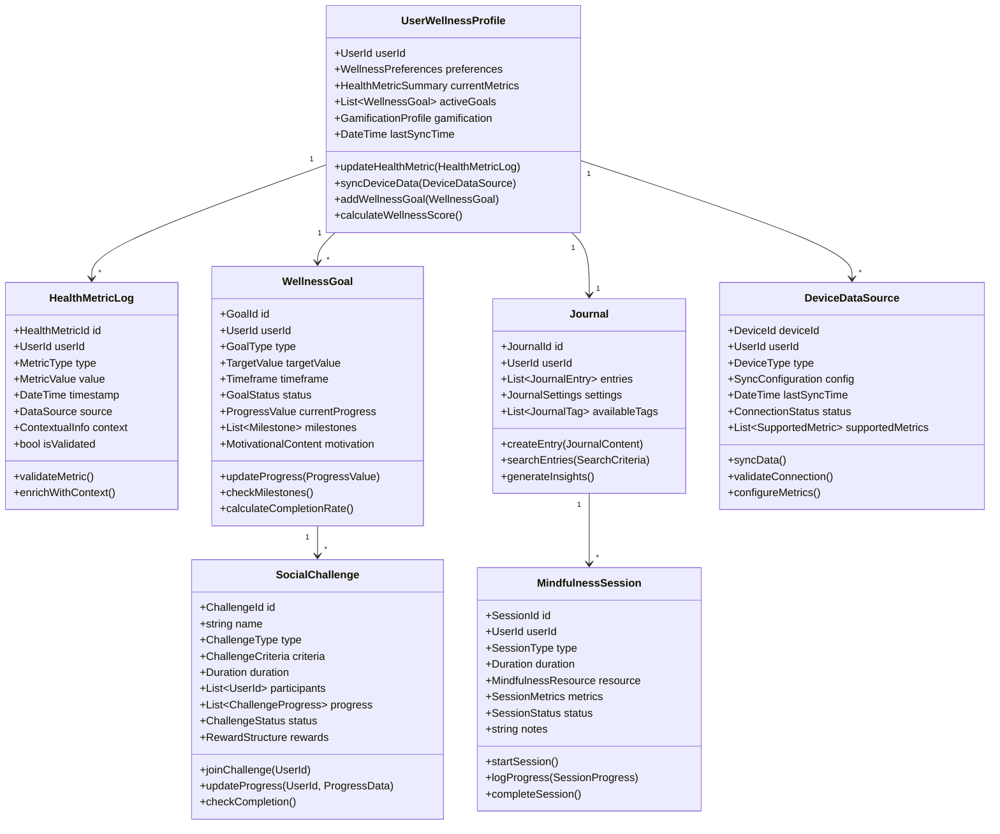
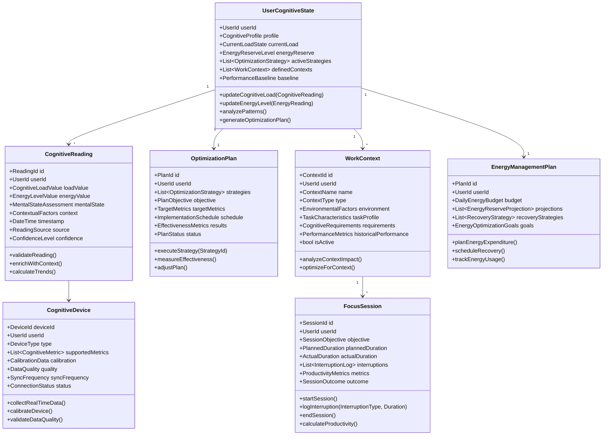
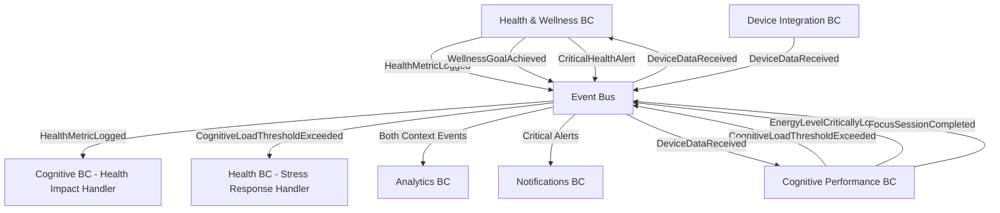
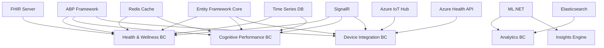

# Health, Wellness, and Cognitive Performance Management Platform Domain-Driven Design Architecture Specification
## Personal Health & Cognitive Optimization Platform

---

## Table of Contents

1. [Executive Summary](#1-executive-summary)
2. [Domain Architecture Overview](#2-domain-architecture-overview)
3. [Bounded Context Catalog](#3-bounded-context-catalog)
4. [Bounded Context Specifications](#4-bounded-context-specifications)
5. [Integration Patterns](#5-integration-patterns)
6. [Implementation Guidelines](#6-implementation-guidelines)
7. [Cross-Cutting Concerns](#7-cross-cutting-concerns)
8. [Dependency Matrix](#8-dependency-matrix)

---

## 1. Executive Summary

### 1.1 System Purpose
A comprehensive personal health, wellness, and cognitive performance management platform that integrates physical health tracking, mental wellness support, cognitive load optimization, and personalized insights to enhance overall well-being and mental performance.

### 1.2 Architecture Approach
- **Pattern**: Domain-Driven Design with CQRS and Event Sourcing
- **Framework**: ABP Framework (.NET)
- **Integration**: Event-driven architecture with real-time device connectivity
- **Scalability**: Microservices-ready bounded contexts with IoT device integration

### 1.3 Core Domain Classification
- **Core Domains**: Cognitive Performance Management, Personalized Wellness Insights
- **Supporting Domains**: Health Data Logging, Mindfulness Content Delivery, Gamification & Social Features
- **Generic Domains**: Wearable Device Integration, Data Visualization, User Authentication, Barcode Scanning

---

## 2. Domain Architecture Overview

### 2.1 Context Map

```
┌─────────────────────┐    ┌─────────────────────┐
│   Health & Wellness │────│ Cognitive Performance│
│      (Core)         │    │      (Core)         │
└─────────────────────┘    └─────────────────────┘
           │                           │
           │                           │
           │         ┌─────────────────────┐
           └─────────│   Device Integration│
                     │     (Generic)       │
           ┌─────────└─────────────────────┘
           │                           │
┌─────────────────────┐    ┌─────────────────────┐
│    Notifications    │    │     Analytics       │
│     (Generic)       │    │    (Supporting)     │
└─────────────────────┘    └─────────────────────┘
           │                           │
           └─────────────┬─────────────┘
                         │
        ┌─────────────────────┐
        │        IAM          │
        │     (Generic)       │
        └─────────────────────┘
```

### 2.2 Strategic Design Principles

1. **Health Data Sovereignty**: Users maintain complete control over their health data
2. **Real-time Responsiveness**: Immediate feedback for cognitive load and health metrics
3. **Privacy by Design**: Health data protection and anonymization at all levels
4. **Personalization Focus**: AI-driven insights tailored to individual patterns
5. **Holistic Integration**: Seamless connection between physical health and cognitive performance

---

## 3. Bounded Context Catalog

| Context | Type | Priority | Complexity | Team Size |
|---------|------|----------|------------|-----------|
| Health & Wellness | Core | Critical | High | 4-5 |
| Cognitive Performance | Core | Critical | High | 3-4 |
| Device Integration | Generic | High | Medium | 2-3 |
| Analytics & Insights | Supporting | High | High | 3-4 |
| Notifications | Generic | Medium | Low | 1-2 |
| IAM | Generic | Critical | Medium | 2 |

---

## 4. Bounded Context Specifications

### 4.1 Health & Wellness Bounded Context

#### 4.1.1 Context Overview
**Responsibility**: Manages comprehensive health and wellness tracking, including physical metrics, mental wellness tools, goal setting, and social/gamification features for sustained engagement.

**Strategic Classification**: Core Domain - Strategic

**Subdomains**:
- Health Data Management: Physical and mental health metric tracking
- Wellness Goal Management: Goal setting, tracking, and achievement
- Mindfulness & Mental Wellness: Meditation, journaling, and mental health tools
- Gamification & Social: Community features and engagement mechanics

#### 4.1.2 Core Domain Model



#### 4.1.3 Aggregates Specification

##### UserWellnessProfile Aggregate Root
**Purpose**: Central entity managing user's complete wellness journey and health data

**Entities**:
- `HealthMetricLog`: Individual health measurements and readings
- `DeviceSyncRecord`: Device synchronization history and status
- `WellnessInsight`: AI-generated insights based on health patterns
- `WellnessRecommendation`: Personalized recommendations for improvement

**Value Objects**:
- `UserId`: Unique user identifier
- `WellnessPreferences`: User preferences for tracking and notifications
- `HealthMetricSummary`: Aggregated current health status
- `GamificationProfile`: Points, badges, achievements, and levels
- `WellnessScore`: Calculated overall wellness rating

**Business Invariants**:
- User must have valid wellness preferences before logging metrics
- Health metrics must have valid timestamps and sources
- Wellness score must be recalculated when significant metrics change
- Device data must be validated before integration

##### WellnessGoal Aggregate Root
**Purpose**: Manages user-defined wellness objectives and progress tracking

**Entities**:
- `Milestone`: Intermediate checkpoints within goals
- `GoalProgressEntry`: Historical progress records
- `GoalAdjustment`: Modifications to goal parameters

**Value Objects**:
- `GoalId`: Unique goal identifier
- `GoalType`: Exercise, Nutrition, Sleep, Mindfulness, Custom
- `TargetValue`: Quantified goal target with units
- `Timeframe`: Goal duration and deadline
- `ProgressValue`: Current achievement level
- `CompletionRate`: Percentage progress toward goal

**Business Invariants**:
- Goal targets must be achievable and measurable
- Progress can only move forward (no retroactive decreases)
- Goal completion requires all mandatory milestones to be met
- Goal timeframes cannot be in the past

##### Journal Aggregate Root
**Purpose**: Personal wellness journaling and reflection management

**Entities**:
- `JournalEntry`: Individual journal entries with content and metadata
- `JournalTemplate`: Reusable structured templates for entries
- `MoodPattern`: Identified patterns in mood tracking

**Value Objects**:
- `JournalId`: Unique journal identifier
- `JournalContent`: Rich text content with media attachments
- `JournalTag`: Categorization tags for entries
- `MoodState`: Standardized mood measurements
- `ReflectionPrompt`: Guided reflection questions

**Business Invariants**:
- Journal entries must have valid timestamps
- Mood states must be within defined ranges
- Private entries cannot be shared without explicit permission
- Journal content must respect privacy settings

##### MindfulnessSession Aggregate Root
**Purpose**: Manages guided mindfulness, meditation, and mental wellness activities

**Entities**:
- `SessionProgress`: Real-time progress during active sessions
- `BreathingExercise`: Structured breathing patterns and guidance
- `MeditationGuide`: Audio/visual meditation content

**Value Objects**:
- `SessionId`: Unique session identifier
- `SessionType`: Meditation, Breathing, Mindfulness, Custom
- `Duration`: Session length and timing
- `SessionMetrics`: Heart rate, breathing rate, stress indicators
- `CompletionQuality`: User-rated session effectiveness

##### SocialChallenge Aggregate Root
**Purpose**: Community engagement through shared wellness challenges

**Entities**:
- `ChallengeParticipant`: Individual participant records and progress
- `ChallengeLeaderboard`: Ranking and competition tracking
- `ChallengeReward`: Achievement rewards and recognition

**Value Objects**:
- `ChallengeId`: Unique challenge identifier
- `ChallengeCriteria`: Specific requirements for challenge completion
- `ParticipationLevel`: Individual engagement level
- `RewardStructure`: Points, badges, and recognition system

#### 4.1.4 Commands & Queries (CQRS)

##### Commands
**Health Data Management**:
```csharp
public record LogPhysicalActivity(
    UserId UserId,
    ActivityType Type,
    Duration Duration,
    CaloriesBurned Calories,
    int Steps,
    DateTime StartTime,
    LocationInfo? Location,
    DeviceSource? Source
);

public record LogNutritionData(
    UserId UserId,
    FoodItem FoodItem,
    decimal Quantity,
    NutritionInfo Nutrition,
    DateTime ConsumedAt,
    MealType MealType,
    string? Notes
);

public record LogSleepSession(
    UserId UserId,
    DateTime BedTime,
    DateTime WakeTime,
    SleepQuality Quality,
    List<SleepStage> Stages,
    DeviceSource? Source
);

public record SyncDeviceData(
    UserId UserId,
    DeviceId DeviceId,
    List<HealthMetricReading> Readings,
    DateTime SyncTimestamp
);
```

**Wellness Goal Management**:
```csharp
public record CreateWellnessGoal(
    UserId UserId,
    GoalType Type,
    TargetValue Target,
    Timeframe Duration,
    List<MilestoneDefinition> Milestones,
    string Description
);

public record UpdateGoalProgress(
    GoalId GoalId,
    ProgressValue NewProgress,
    DateTime ProgressDate,
    string? Notes
);

public record AdjustGoalTarget(
    GoalId GoalId,
    TargetValue NewTarget,
    string Reason,
    UserId ModifiedBy
);
```

**Mindfulness & Mental Wellness**:
```csharp
public record StartMindfulnessSession(
    UserId UserId,
    SessionType Type,
    Duration PlannedDuration,
    MindfulnessResourceId? ResourceId,
    string? Intention
);

public record LogMoodState(
    UserId UserId,
    MoodRating Mood,
    EnergyLevel Energy,
    StressLevel Stress,
    string? Notes,
    List<MoodFactor> ContributingFactors
);

public record CreateJournalEntry(
    UserId UserId,
    JournalContent Content,
    List<JournalTag> Tags,
    MoodState? AssociatedMood,
    PrivacyLevel Privacy
);
```

**Social & Gamification**:
```csharp
public record JoinSocialChallenge(
    UserId UserId,
    ChallengeId ChallengeId,
    ParticipationLevel Level
);

public record AwardAchievement(
    UserId UserId,
    AchievementType Type,
    AchievementCriteria MetCriteria,
    DateTime EarnedAt
);
```

##### Queries
**Health Data Queries**:
```csharp
public record GetHealthMetricHistory(
    UserId UserId,
    MetricType Type,
    DateTime StartDate,
    DateTime EndDate,
    AggregationLevel Aggregation
);

public record GetWellnessProfileSummary(UserId UserId);

public record GetNutritionAnalysis(
    UserId UserId,
    DateTime StartDate,
    DateTime EndDate
);

public record GetSleepPatternAnalysis(
    UserId UserId,
    int DaysBack = 30
);
```

**Goal & Progress Queries**:
```csharp
public record GetActiveWellnessGoals(UserId UserId);

public record GetGoalProgressDetail(GoalId GoalId);

public record GetAchievementHistory(
    UserId UserId,
    DateTime? StartDate = null
);
```

**Mindfulness Queries**:
```csharp
public record GetMindfulnessSessionHistory(
    UserId UserId,
    SessionType? TypeFilter = null,
    int DaysBack = 30
);

public record GetMoodTrendAnalysis(
    UserId UserId,
    DateTime StartDate,
    DateTime EndDate
);

public record SearchJournalEntries(
    UserId UserId,
    string? SearchTerm,
    List<JournalTag>? TagFilter,
    DateTime? StartDate,
    DateTime? EndDate
);
```

#### 4.1.5 Events & Integration

##### Domain Events
```csharp
public class HealthMetricLogged : DomainEvent
{
    public UserId UserId { get; }
    public MetricType Type { get; }
    public MetricValue Value { get; }
    public DateTime Timestamp { get; }
    public DataSource Source { get; }
    public bool IsSignificantChange { get; }
}

public class WellnessGoalAchieved : DomainEvent
{
    public GoalId GoalId { get; }
    public UserId UserId { get; }
    public GoalType Type { get; }
    public DateTime AchievedAt { get; }
    public decimal CompletionRate { get; }
    public Duration TimeTaken { get; }
}

public class MindfulnessSessionCompleted : DomainEvent
{
    public SessionId SessionId { get; }
    public UserId UserId { get; }
    public SessionType Type { get; }
    public Duration ActualDuration { get; }
    public SessionQuality Quality { get; }
    public MoodState PostSessionMood { get; }
}

public class CriticalHealthAlertDetected : DomainEvent
{
    public UserId UserId { get; }
    public AlertType Type { get; }
    public MetricType AffectedMetric { get; }
    public AlertSeverity Severity { get; }
    public string AlertMessage { get; }
    public List<RecommendedAction> Actions { get; }
}

public class WellnessInsightGenerated : DomainEvent
{
    public UserId UserId { get; }
    public InsightType Type { get; }
    public string InsightContent { get; }
    public List<MetricType> BasedOnMetrics { get; }
    public ConfidenceLevel Confidence { get; }
    public List<ActionableRecommendation> Recommendations { get; }
}
```

#### 4.1.6 Business Rules & Policies

##### Health Data Validation Policy
```csharp
public class HealthDataValidationPolicy
{
    public ValidationResult ValidateHealthMetric(HealthMetricLog metric)
    {
        return metric.Type switch
        {
            MetricType.HeartRate => ValidateHeartRate(metric.Value),
            MetricType.BloodPressure => ValidateBloodPressure(metric.Value),
            MetricType.Weight => ValidateWeight(metric.Value),
            MetricType.Steps => ValidateSteps(metric.Value),
            _ => ValidationResult.Valid()
        };
    }
    
    private ValidationResult ValidateHeartRate(MetricValue value)
    {
        var bpm = value.NumericValue;
        
        if (bpm < 30 || bpm > 220)
            return ValidationResult.Invalid("Heart rate outside physiologically possible range");
            
        if (bpm < 40 || bpm > 200)
            return ValidationResult.Warning("Heart rate outside typical range - please verify");
            
        return ValidationResult.Valid();
    }
}
```

##### Wellness Goal Achievement Policy
```csharp
public class WellnessGoalAchievementPolicy
{
    public bool IsGoalAchieved(WellnessGoal goal, ProgressValue currentProgress)
    {
        // Check if target is reached
        if (currentProgress.Value < goal.TargetValue.Value)
            return false;
            
        // Check if all mandatory milestones are completed
        var mandatoryMilestones = goal.Milestones.Where(m => m.IsMandatory);
        if (mandatoryMilestones.Any(m => !m.IsCompleted))
            return false;
            
        // Check if goal is within timeframe
        if (DateTime.UtcNow > goal.Timeframe.EndDate)
            return false;
            
        return true;
    }
}
```

---

### 4.2 Cognitive Performance Bounded Context

#### 4.2.1 Context Overview
**Responsibility**: Monitors, analyzes, and optimizes cognitive load, energy levels, mental state, and performance to enhance focus, productivity, and mental well-being.

**Strategic Classification**: Core Domain - Strategic

**Subdomains**:
- Cognitive Load Management: Real-time and subjective cognitive load monitoring
- Energy Optimization: Mental energy tracking and optimization strategies
- Performance Analysis: Cognitive performance pattern analysis and insights
- Context Management: Environmental and situational factor tracking

#### 4.2.2 Core Domain Model



#### 4.2.3 Aggregates Specification

##### UserCognitiveState Aggregate Root
**Purpose**: Central cognitive profile managing user's mental performance and optimization

**Entities**:
- `CognitivePatternAnalysis`: Identified patterns in cognitive performance
- `AlertConfiguration`: User-defined thresholds and alert preferences
- `CognitiveInsight`: AI-generated insights about cognitive patterns

**Value Objects**:
- `UserId`: Unique user identifier
- `CognitiveProfile`: Baseline cognitive characteristics and preferences
- `CurrentLoadState`: Real-time cognitive load assessment
- `EnergyReserveLevel`: Current mental energy availability
- `PerformanceBaseline`: Personal performance benchmarks

**Business Invariants**:
- Cognitive load values must be within defined measurement scales
- Energy levels cannot exceed maximum capacity
- Baseline measurements require minimum data points for validity
- Pattern analysis requires at least 7 days of consistent data

##### CognitiveReading Aggregate Root
**Purpose**: Individual cognitive measurement capturing load, energy, and context

**Entities**:
- `ContextSnapshot`: Environmental and situational factors at reading time
- `TaskAssociation`: Connection to specific tasks or activities
- `ValidationRecord`: Data quality and confidence assessments

**Value Objects**:
- `ReadingId`: Unique reading identifier
- `CognitiveLoadValue`: Subjective and objective load measurements
- `EnergyLevelValue`: Mental energy assessment
- `MentalStateAssessment`: Focus, clarity, stress indicators
- `ConfidenceLevel`: Reliability of the reading

**Business Invariants**:
- Readings must have valid timestamps within reasonable bounds
- Subjective ratings must be within defined scales
- Device readings must pass quality validation
- Context information must be complete for analysis validity

##### OptimizationPlan Aggregate Root
**Purpose**: Personalized cognitive optimization strategies and implementation tracking

**Entities**:
- `OptimizationStrategy`: Individual optimization techniques
- `StrategyEffectivenessRecord`: Tracking of strategy success
- `PlanAdjustment`: Modifications based on results

**Value Objects**:
- `PlanId`: Unique plan identifier
- `PlanObjective`: Specific cognitive improvement goals
- `TargetMetrics`: Measurable success criteria
- `ImplementationSchedule`: Timeline for strategy execution
- `EffectivenessMetrics`: Success measurement data

##### WorkContext Aggregate Root
**Purpose**: Defined work environments and their cognitive impact

**Entities**:
- `ContextSwitchRecord`: Tracking of context changes and impact
- `EnvironmentalOptimization`: Context-specific optimization suggestions

**Value Objects**:
- `ContextId`: Unique context identifier
- `ContextType`: Home Office, Open Office, Café, Remote, Meeting Room
- `EnvironmentalFactors`: Noise, lighting, temperature, distractions
- `TaskCharacteristics`: Complexity, duration, cognitive requirements
- `CognitiveRequirements`: Focus level, attention type, mental resources needed

##### FocusSession Aggregate Root
**Purpose**: Dedicated deep work periods with performance tracking

**Entities**:
- `InterruptionLog`: Record of focus breaks and distractions
- `SessionMetrics`: Detailed performance measurements

**Value Objects**:
- `SessionId`: Unique session identifier
- `SessionObjective`: Intended outcome or task for the session
- `ProductivityMetrics`: Focus quality, output quantity, satisfaction
- `SessionOutcome`: Achievement level and key results

#### 4.2.4 Commands & Queries (CQRS)

##### Commands
**Cognitive Load Management**:
```csharp
public record LogCognitiveLoad(
    UserId UserId,
    CognitiveLoadValue LoadValue,
    MentalStateAssessment MentalState,
    TaskContext? AssociatedTask,
    EnvironmentalContext Environment,
    DateTime Timestamp
);

public record RecordRealTimeMetric(
    UserId UserId,
    DeviceId DeviceId,
    MetricType Type,
    decimal Value,
    DataQuality Quality,
    DateTime Timestamp
);

public record SetCognitiveAlert(
    UserId UserId,
    AlertType Type,
    ThresholdValue Threshold,
    AlertAction Action,
    bool IsEnabled
);
```

**Energy Management**:
```csharp
public record LogEnergyLevel(
    UserId UserId,
    EnergyLevelValue EnergyValue,
    EnergySource? Source,
    List<EnergyFactor> ContributingFactors,
    DateTime Timestamp
);

public record PlanEnergyExpenditure(
    UserId UserId,
    List<PlannedActivity> Activities,
    DateTime PlanDate,
    EnergyBudget AvailableBudget
);

public record ScheduleRecoverySession(
    UserId UserId,
    RecoveryType Type,
    Duration Duration,
    DateTime ScheduledTime,
    RecoveryObjective Objective
);
```

**Optimization & Performance**:
```csharp
public record CreateOptimizationPlan(
    UserId UserId,
    List<CognitiveGoal> Goals,
    PlanDuration Duration,
    List<PreferredStrategy> PreferredStrategies
);

public record DefineWorkContext(
    UserId UserId,
    ContextName Name,
    ContextType Type,
    EnvironmentalFactors Environment,
    TaskCharacteristics TaskProfile
);

public record StartFocusSession(
    UserId UserId,
    WorkContextId? ContextId,
    SessionObjective Objective,
    Duration PlannedDuration,
    FocusLevel TargetFocusLevel
);
```

**Device & Monitoring**:
```csharp
public record ConnectCognitiveDevice(
    UserId UserId,
    DeviceType Type,
    DeviceIdentifier DeviceId,
    List<MetricType> EnabledMetrics,
    SyncConfiguration SyncConfig
);

public record CalibrateDevice(
    DeviceId DeviceId,
    CalibrationProtocol Protocol,
    CalibrationData BaselineData
);
```

##### Queries
**Cognitive State Queries**:
```csharp
public record GetCurrentCognitiveState(UserId UserId);

public record GetCognitiveLoadHistory(
    UserId UserId,
    DateTime StartDate,
    DateTime EndDate,
    AggregationLevel Aggregation
);

public record GetCognitivePatternAnalysis(
    UserId UserId,
    AnalysisType Type,
    int DaysBack = 30
);
```

**Performance Analysis**:
```csharp
public record GetFocusSessionHistory(
    UserId UserId,
    WorkContextId? ContextFilter,
    DateTime? StartDate,
    DateTime? EndDate
);

public record GetProductivityTrends(
    UserId UserId,
    TrendPeriod Period,
    List<MetricType> Metrics
);

public record GetOptimalPerformanceTimes(
    UserId UserId,
    TaskType TaskType,
    int HistoryDays = 30
);
```

**Context & Environment**:
```csharp
public record GetWorkContextAnalysis(
    UserId UserId,
    WorkContextId ContextId
);

public record GetEnvironmentalImpactReport(
    UserId UserId,
    List<EnvironmentalFactor> Factors,
    DateTime StartDate,
    DateTime EndDate
);
```

#### 4.2.5 Events & Integration

##### Domain Events
```csharp
public class CognitiveLoadThresholdExceeded : DomainEvent
{
    public UserId UserId { get; }
    public CognitiveLoadValue CurrentLoad { get; }
    public ThresholdValue ExceededThreshold { get; }
    public AlertSeverity Severity { get; }
    public List<RecommendedAction> RecommendedActions { get; }
    public WorkContextId? CurrentContext { get; }
}

public class EnergyLevelCriticallyLow : DomainEvent
{
    public UserId UserId { get; }
    public EnergyLevelValue CurrentEnergy { get; }
    public EnergyLevelValue ThresholdLevel { get; }
    public List<RecoveryStrategy> SuggestedRecovery { get; }
    public DateTime RecommendedRecoveryTime { get; }
}

public class FocusSessionCompleted : DomainEvent
{
    public SessionId SessionId { get; }
    public UserId UserId { get; }
    public Duration PlannedDuration { get; }
    public Duration ActualDuration { get; }
    public ProductivityScore ProductivityScore { get; }
    public int InterruptionCount { get; }
    public WorkContextId? ContextId { get; }
    public SessionOutcome Outcome { get; }
}

public class CognitiveOptimizationSuggested : DomainEvent
{
    public UserId UserId { get; }
    public OptimizationType Type { get; }
    public List<OptimizationStrategy> Strategies { get; }
    public ConfidenceLevel Confidence { get; }
    public List<MetricType> BasedOnMetrics { get; }
    public ExpectedImpact ExpectedImpact { get; }
}

public class CognitivePatternIdentified : DomainEvent
{
    public UserId UserId { get; }
    public PatternType Type { get; }
    public PatternDescription Description { get; }
    public PatternSignificance Significance { get; }
    public List<ActionableInsight> Insights { get; }
    public DateTime IdentifiedAt { get; }
}
```

#### 4.2.6 Business Rules & Policies

##### Cognitive Load Alert Policy
```csharp
public class CognitiveLoadAlertPolicy
{
    public async Task<List<AlertAction>> DetermineAlertActions(
        CognitiveLoadValue currentLoad,
        UserCognitiveState userState,
        WorkContext? currentContext)
    {
        var actions = new List<AlertAction>();
        
        // Critical overload - immediate intervention
        if (currentLoad.Value >= userState.Profile.CriticalLoadThreshold)
        {
            actions.Add(new AlertAction(ActionType.ImmediateBreak, Priority.Critical));
            actions.Add(new AlertAction(ActionType.NotifyUser, Priority.Critical));
            
            // Suggest recovery based on context
            if (currentContext?.Type == ContextType.OpenOffice)
            {
                actions.Add(new AlertAction(ActionType.SuggestQuietSpace, Priority.High));
            }
        }
        
        // High load - preventive action
        else if (currentLoad.Value >= userState.Profile.HighLoadThreshold)
        {
            actions.Add(new AlertAction(ActionType.SuggestBreak, Priority.Medium));
            actions.Add(new AlertAction(ActionType.ReduceTaskComplexity, Priority.Medium));
        }
        
        return actions;
    }
}
```

##### Energy Reserve Management Policy
```csharp
public class EnergyReserveManagementPolicy
{
    public EnergyAllocationResult AllocateEnergyForTask(
        TaskEnergyRequirement requirement,
        EnergyReserveLevel currentReserve,
        List<PlannedActivity> upcomingActivities)
    {
        // Check if sufficient energy available
        if (currentReserve.Value < requirement.MinimumEnergy)
        {
            return EnergyAllocationResult.InsufficientEnergy(
                $"Task requires {requirement.MinimumEnergy}, but only {currentReserve.Value} available"
            );
        }
        
        // Calculate energy impact on future activities
        var remainingEnergy = currentReserve.Value - requirement.EstimatedConsumption;
        var conflictingActivities = upcomingActivities
            .Where(a => a.EnergyRequirement > remainingEnergy)
            .ToList();
        
        if (conflictingActivities.Any())
        {
            return EnergyAllocationResult.Warning(
                $"This allocation may impact {conflictingActivities.Count} upcoming activities",
                conflictingActivities
            );
        }
        
        return EnergyAllocationResult.Success(remainingEnergy);
    }
}
```

---

## 5. Integration Patterns

### 5.1 Event-Driven Integration

#### 5.1.1 Cross-Context Event Flow


### 5.2 Holistic Health Integration Patterns

#### 5.2.1 Morning Readiness Assessment
```csharp
public class HolisticReadinessHandler : 
    IEventHandler<SleepDataLogged>,
    IEventHandler<CognitiveBaselineUpdated>
{
    public async Task Handle(SleepDataLogged sleepEvent)
    {
        // Get cognitive profile
        var cognitiveState = await _cognitiveService.GetUserCognitiveState(sleepEvent.UserId);
        
        // Calculate cognitive readiness based on sleep quality
        var readinessImpact = CalculateCognitiveImpact(sleepEvent.SleepQuality, sleepEvent.Duration);
        
        // Update cognitive energy projection
        await _cognitiveService.AdjustEnergyProjection(
            sleepEvent.UserId, 
            readinessImpact
        );
        
        // Generate holistic morning recommendations
        var recommendations = await GenerateMorningRecommendations(
            sleepEvent,
            cognitiveState
        );
        
        await _recommendationService.PublishRecommendations(recommendations);
    }
    
    private CognitiveReadinessImpact CalculateCognitiveImpact(
        SleepQuality quality, 
        Duration sleepDuration)
    {
        var optimalSleep = TimeSpan.FromHours(8);
        var durationImpact = Math.Max(0, 1 - Math.Abs((sleepDuration - optimalSleep).TotalHours) / 3);
        
        var qualityMultiplier = quality switch
        {
            SleepQuality.Excellent => 1.0m,
            SleepQuality.Good => 0.9m,
            SleepQuality.Fair => 0.7m,
            SleepQuality.Poor => 0.5m,
            _ => 0.3m
        };
        
        return new CognitiveReadinessImpact(
            EnergyAdjustment: (decimal)durationImpact * qualityMultiplier,
            LoadCapacityAdjustment: qualityMultiplier,
            RecommendedStartingIntensity: quality >= SleepQuality.Good ? 
                CognitiveIntensity.Normal : CognitiveIntensity.Light
        );
    }
}
```

#### 5.2.2 Stress Detection & Intervention
```csharp
public class StressInterventionSaga : ISaga<CognitiveLoadThresholdExceeded>
{
    public async Task Handle(CognitiveLoadThresholdExceeded @event)
    {
        // Correlate with recent health data
        var recentHealthData = await _healthService.GetRecentHealthMetrics(
            @event.UserId, 
            TimeSpan.FromHours(2),
            new[] { MetricType.HeartRate, MetricType.StressLevel }
        );
        
        // Check if this is part of a stress pattern
        var stressPattern = await AnalyzeStressPattern(@event.UserId, recentHealthData);
        
        if (stressPattern.IsSignificantStressEvent)
        {
            // Trigger immediate interventions
            await TriggerImmediateInterventions(@event.UserId, stressPattern);
            
            // Schedule follow-up wellness activities
            await ScheduleWellnessInterventions(@event.UserId, stressPattern);
            
            // Update both cognitive and wellness profiles
            await UpdateIntegratedStressProfile(@event.UserId, @event, stressPattern);
        }
    }
    
    private async Task TriggerImmediateInterventions(UserId userId, StressPattern pattern)
    {
        // Cognitive interventions
        await _cognitiveService.SuggestImmediateBreak(userId);
        await _cognitiveService.ReduceCurrentTaskComplexity(userId);
        
        // Wellness interventions
        if (pattern.SuggestedInterventions.Contains(InterventionType.Breathing))
        {
            await _wellnessService.SuggestBreathingExercise(userId, pattern.Severity);
        }
        
        if (pattern.SuggestedInterventions.Contains(InterventionType.Mindfulness))
        {
            await _wellnessService.SuggestMindfulnessSession(userId, Duration.FromMinutes(5));
        }
    }
}
```

### 5.3 Device Integration Anti-Corruption Layer

```csharp
public class HealthDeviceIntegrationService
{
    private readonly Dictionary<DeviceType, IDeviceDataTranslator> _translators;
    
    public async Task<IntegrationResult> ProcessDeviceData(
        DeviceType deviceType,
        RawDeviceData rawData,
        UserId userId)
    {
        if (!_translators.TryGetValue(deviceType, out var translator))
        {
            return IntegrationResult.UnsupportedDevice(deviceType);
        }
        
        // Translate device-specific data to domain model
        var translationResult = await translator.TranslateData(rawData);
        
        if (!translationResult.IsSuccessful)
        {
            return IntegrationResult.TranslationFailed(translationResult.Errors);
        }
        
        var results = new List<IntegrationResult>();
        
        // Route to appropriate bounded contexts
        foreach (var healthMetric in translationResult.HealthMetrics)
        {
            var healthResult = await _healthService.LogHealthMetric(userId, healthMetric);
            results.Add(healthResult);
        }
        
        foreach (var cognitiveMetric in translationResult.CognitiveMetrics)
        {
            var cognitiveResult = await _cognitiveService.LogCognitiveReading(userId, cognitiveMetric);
            results.Add(cognitiveResult);
        }
        
        return IntegrationResult.Combined(results);
    }
}

// Device-specific translators
public class FitbitDataTranslator : IDeviceDataTranslator
{
    public async Task<TranslationResult> TranslateData(RawDeviceData rawData)
    {
        var fitbitData = JsonSerializer.Deserialize<FitbitApiResponse>(rawData.JsonData);
        
        var healthMetrics = new List<HealthMetric>();
        var cognitiveMetrics = new List<CognitiveMetric>();
        
        // Translate heart rate data
        if (fitbitData.HeartRateData != null)
        {
            healthMetrics.Add(new HealthMetric(
                MetricType.HeartRate,
                new MetricValue(fitbitData.HeartRateData.RestingHeartRate),
                fitbitData.HeartRateData.Timestamp,
                DataSource.Fitbit
            ));
            
            // Derive stress indicator from HRV if available
            if (fitbitData.HeartRateData.HRV != null)
            {
                cognitiveMetrics.Add(new CognitiveMetric(
                    CognitiveMetricType.StressIndicator,
                    CalculateStressFromHRV(fitbitData.HeartRateData.HRV),
                    fitbitData.HeartRateData.Timestamp,
                    DataSource.Fitbit
                ));
            }
        }
        
        return TranslationResult.Success(healthMetrics, cognitiveMetrics);
    }
}
```

---

## 6. Implementation Guidelines

### 6.1 Health Data Privacy & Security

#### 6.1.1 Data Encryption & Protection
```csharp
public class HealthDataProtectionService
{
    private readonly IDataProtector _healthDataProtector;
    private readonly IDataProtector _sensitiveMetricsProtector;
    
    public HealthDataProtectionService(IDataProtectionProvider provider)
    {
        _healthDataProtector = provider.CreateProtector("HealthWellness.HealthData");
        _sensitiveMetricsProtector = provider.CreateProtector("HealthWellness.SensitiveMetrics");
    }
    
    public ProtectedHealthData ProtectHealthMetric(HealthMetricLog metric)
    {
        var protector = IsSensitiveMetric(metric.Type) 
            ? _sensitiveMetricsProtector 
            : _healthDataProtector;
            
        return new ProtectedHealthData
        {
            Id = metric.Id,
            Type = metric.Type,
            ProtectedValue = protector.Protect(JsonSerializer.Serialize(metric.Value)),
            Timestamp = metric.Timestamp,
            Source = metric.Source,
            UserId = metric.UserId // Not encrypted - needed for queries
        };
    }
    
    private bool IsSensitiveMetric(MetricType type)
    {
        return type switch
        {
            MetricType.MentalHealthAssessment => true,
            MetricType.MoodState => true,
            MetricType.StressLevel => true,
            MetricType.CognitiveLoadSubjective => true,
            _ => false
        };
    }
}
```

#### 6.1.2 Consent Management
```csharp
public class HealthDataConsentManager
{
    public async Task<ConsentResult> RequestDataSharingConsent(
        UserId userId,
        DataSharingRequest request)
    {
        var existingConsent = await GetExistingConsent(userId, request.DataTypes);
        
        if (existingConsent?.GrantsPermissionFor(request.Purpose) == true)
        {
            return ConsentResult.AlreadyGranted(existingConsent);
        }
        
        // Create consent request
        var consentRequest = new DataSharingConsentRequest
        {
            UserId = userId,
            DataTypes = request.DataTypes,
            Purpose = request.Purpose,
            Recipient = request.Recipient,
            Duration = request.Duration,
            Scope = request.Scope,
            RequestedAt = DateTime.UtcNow
        };
        
        // Send to user for approval
        await _notificationService.SendConsentRequest(userId, consentRequest);
        
        return ConsentResult.PendingApproval(consentRequest.Id);
    }
    
    public async Task<bool> VerifyDataAccessPermission(
        UserId userId,
        DataAccessRequest accessRequest)
    {
        var relevantConsents = await GetActiveConsents(userId);
        
        return relevantConsents.Any(consent =>
            consent.CoversDataTypes(accessRequest.DataTypes) &&
            consent.PermitsPurpose(accessRequest.Purpose) &&
            consent.IsActiveAt(DateTime.UtcNow)
        );
    }
}
```

### 6.2 Real-Time Data Processing

#### 6.2.1 Streaming Analytics
```csharp
public class RealTimeCognitiveAnalyzer
{
    private readonly IStreamProcessor _streamProcessor;
    private readonly ICognitivePatternDetector _patternDetector;
    
    public async Task ProcessRealTimeStream(UserId userId)
    {
        var cognitiveStream = _streamProcessor.CreateStream<CognitiveReading>($"cognitive-{userId}");
        
        await cognitiveStream
            // Window for trend analysis
            .Window(TimeSpan.FromMinutes(5))
            
            // Detect anomalies
            .Where(window => _patternDetector.DetectAnomalies(window.ToList()))
            
            // Aggregate metrics
            .Select(window => new RealTimeAnalysis
            {
                UserId = userId,
                WindowStart = window.Key,
                AverageLoad = window.Average(r => r.LoadValue.Value),
                TrendDirection = CalculateTrend(window.ToList()),
                AnomalyScore = _patternDetector.CalculateAnomalyScore(window.ToList())
            })
            
            // Take action on high-risk patterns
            .Where(analysis => analysis.AnomalyScore > 0.8m || analysis.TrendDirection == TrendDirection.RapidIncrease)
            .Subscribe(async analysis =>
            {
                await TriggerRealTimeIntervention(analysis);
            });
    }
    
    private async Task TriggerRealTimeIntervention(RealTimeAnalysis analysis)
    {
        if (analysis.AnomalyScore > 0.9m)
        {
            // Critical intervention
            await _interventionService.TriggerEmergencyBreak(analysis.UserId);
        }
        else if (analysis.TrendDirection == TrendDirection.RapidIncrease)
        {
            // Preventive intervention
            await _interventionService.SuggestPreventiveBreak(analysis.UserId);
        }
    }
}
```

#### 6.2.2 Background Health Processing
```csharp
public class HealthDataProcessingService : BackgroundService
{
    private readonly Channel<HealthProcessingTask> _processingQueue;
    
    protected override async Task ExecuteAsync(CancellationToken stoppingToken)
    {
        await foreach (var task in _processingQueue.Reader.ReadAllAsync(stoppingToken))
        {
            try
            {
                await ProcessHealthTask(task);
            }
            catch (Exception ex)
            {
                _logger.LogError(ex, "Failed to process health task {TaskType} for user {UserId}", 
                    task.TaskType, task.UserId);
                
                // Retry logic for critical health data
                if (task.IsCritical && task.RetryCount < 3)
                {
                    task.RetryCount++;
                    await _processingQueue.Writer.WriteAsync(task, stoppingToken);
                }
            }
        }
    }
    
    private async Task ProcessHealthTask(HealthProcessingTask task)
    {
        switch (task.TaskType)
        {
            case HealthTaskType.GenerateInsights:
                await GeneratePersonalizedInsights(task.UserId, task.Parameters);
                break;
                
            case HealthTaskType.AnalyzePatterns:
                await AnalyzeHealthPatterns(task.UserId, task.Parameters);
                break;
                
            case HealthTaskType.UpdateRecommendations:
                await UpdateWellnessRecommendations(task.UserId, task.Parameters);
                break;
                
            case HealthTaskType.ProcessDeviceSync:
                await ProcessDeviceSynchronization(task.UserId, task.Parameters);
                break;
        }
    }
}
```

### 6.3 Machine Learning Integration

#### 6.3.1 Personalized Insights Generation
```csharp
public class PersonalizedInsightsEngine
{
    private readonly IMLModelService _mlService;
    private readonly IHealthDataRepository _healthRepository;
    private readonly ICognitiveDataRepository _cognitiveRepository;
    
    public async Task<List<PersonalizedInsight>> GenerateInsights(UserId userId)
    {
        // Collect comprehensive user data
        var healthHistory = await _healthRepository.GetUserHealthHistory(userId, TimeSpan.FromDays(90));
        var cognitiveHistory = await _cognitiveRepository.GetCognitiveHistory(userId, TimeSpan.FromDays(90));
        
        // Prepare feature vectors
        var features = await PrepareFeatureVectors(healthHistory, cognitiveHistory);
        
        var insights = new List<PersonalizedInsight>();
        
        // Sleep quality impact analysis
        var sleepInsight = await _mlService.AnalyzeSleepImpact(features);
        if (sleepInsight.Confidence > 0.7m)
        {
            insights.Add(new PersonalizedInsight(
                InsightType.SleepQualityImpact,
                sleepInsight.Description,
                sleepInsight.Recommendations,
                sleepInsight.Confidence
            ));
        }
        
        // Cognitive performance patterns
        var cognitivePatterns = await _mlService.IdentifyCognitivePatterns(features);
        insights.AddRange(cognitivePatterns.Where(p => p.Significance > 0.6m)
            .Select(p => new PersonalizedInsight(
                InsightType.CognitivePattern,
                p.Description,
                p.OptimizationSuggestions,
                p.Significance
            )));
        
        // Cross-domain correlations
        var correlations = await _mlService.FindCrossDomainCorrelations(features);
        insights.AddRange(correlations.Where(c => c.Strength > 0.5m)
            .Select(c => new PersonalizedInsight(
                InsightType.CrossDomainCorrelation,
                c.Description,
                c.ActionableAdvice,
                c.Strength
            )));
        
        return insights.OrderByDescending(i => i.Confidence).ToList();
    }
    
    private async Task<UserFeatureVector> PrepareFeatureVectors(
        List<HealthMetricLog> healthHistory,
        List<CognitiveReading> cognitiveHistory)
    {
        return new UserFeatureVector
        {
            // Sleep features
            AverageSleepDuration = healthHistory.Where(h => h.Type == MetricType.Sleep)
                .Average(h => ((SleepData)h.Value).Duration.TotalHours),
            
            SleepQualityTrend = CalculateSleepQualityTrend(healthHistory),
            
            // Activity features
            DailyStepsAverage = healthHistory.Where(h => h.Type == MetricType.Steps)
                .Average(h => h.Value.NumericValue),
            
            // Cognitive features
            AverageCognitiveLoad = cognitiveHistory.Average(c => c.LoadValue.Value),
            CognitiveLoadVariability = CalculateVariability(cognitiveHistory.Select(c => c.LoadValue.Value)),
            
            // Energy features
            EnergyPatterns = AnalyzeEnergyPatterns(cognitiveHistory),
            
            // Temporal features
            MorningPerformance = CalculateTimeBasedPerformance(cognitiveHistory, TimeOfDay.Morning),
            AfternoonPerformance = CalculateTimeBasedPerformance(cognitiveHistory, TimeOfDay.Afternoon),
            EveningPerformance = CalculateTimeBasedPerformance(cognitiveHistory, TimeOfDay.Evening)
        };
    }
}
```

### 6.4 Testing Strategy

#### 6.4.1 Health Data Testing
```csharp
public class HealthMetricLoggingTests
{
    [Fact]
    public async Task LogHealthMetric_WithValidData_ShouldStoreAndTriggerEvents()
    {
        // Arrange
        var userId = UserId.New();
        var heartRateReading = new HealthMetricLog(
            HealthMetricId.New(),
            userId,
            MetricType.HeartRate,
            new MetricValue(72),
            DateTime.UtcNow,
            DataSource.AppleWatch,
            new ContextualInfo { Activity = "Resting" }
        );
        
        // Act
        await _healthService.LogHealthMetric(heartRateReading);
        
        // Assert
        var storedMetric = await _healthRepository.GetMetricById(heartRateReading.Id);
        Assert.NotNull(storedMetric);
        Assert.Equal(72, storedMetric.Value.NumericValue);
        
        var publishedEvents = _eventCollector.GetEvents<HealthMetricLogged>();
        Assert.Single(publishedEvents);
        Assert.Equal(heartRateReading.Id, publishedEvents.First().MetricId);
    }
    
    [Theory]
    [InlineData(300, false)] // Too high
    [InlineData(20, false)]  // Too low
    [InlineData(72, true)]   // Normal
    [InlineData(100, true)]  // High but valid
    public async Task LogHealthMetric_HeartRateValidation_ShouldValidateCorrectly(
        int heartRate, bool shouldBeValid)
    {
        // Arrange
        var metric = CreateHeartRateMetric(heartRate);
        
        // Act & Assert
        if (shouldBeValid)
        {
            await _healthService.LogHealthMetric(metric);
            var stored = await _healthRepository.GetMetricById(metric.Id);
            Assert.NotNull(stored);
        }
        else
        {
            await Assert.ThrowsAsync<HealthDataValidationException>(
                () => _healthService.LogHealthMetric(metric));
        }
    }
}

public class CognitivePerformanceIntegrationTests : IntegrationTestBase
{
    [Fact]
    public async Task HighCognitiveLoad_ShouldTriggerWellnessInterventions()
    {
        // Arrange
        var userId = TestUsers.DefaultUser.Id;
        var highLoadReading = new CognitiveReading(
            ReadingId.New(),
            userId,
            new CognitiveLoadValue(9.5m), // Very high load
            new EnergyLevelValue(3.0m),   // Low energy
            new MentalStateAssessment { Focus = 2, Stress = 8 },
            new ContextualFactors(),
            DateTime.UtcNow,
            ReadingSource.SelfAssessment,
            ConfidenceLevel.High
        );
        
        // Act
        await SendCommandAsync(new LogCognitiveLoad
        {
            UserId = userId,
            LoadValue = highLoadReading.LoadValue,
            MentalState = highLoadReading.MentalState,
            Timestamp = highLoadReading.Timestamp
        });
        
        // Assert
        await WaitForEventProcessingAsync();
        
        // Check that cognitive threshold event was published
        var cognitiveEvents = GetPublishedEvents<CognitiveLoadThresholdExceeded>();
        Assert.Single(cognitiveEvents);
        
        // Check that wellness intervention was suggested
        var wellnessRecommendations = await GetWellnessRecommendationsAsync(userId);
        Assert.Contains(wellnessRecommendations, r => 
            r.Type == RecommendationType.MindfulnessSession ||
            r.Type == RecommendationType.TakeBreak
        );
    }
}
```

---

## 7. Cross-Cutting Concerns

### 7.1 Health Data Compliance

#### 7.1.1 HIPAA/GDPR Compliance Framework
```csharp
public class HealthDataComplianceService
{
    private readonly IDataRetentionPolicy _retentionPolicy;
    private readonly IDataAnonymization _anonymizationService;
    private readonly IAuditLogger _auditLogger;
    
    public async Task<ComplianceResult> EnsureDataCompliance(
        UserId userId,
        List<HealthDataAccess> accessRequests)
    {
        var complianceResults = new List<ComplianceCheck>();
        
        foreach (var request in accessRequests)
        {
            // Log access for audit
            await _auditLogger.LogDataAccess(new DataAccessAuditEntry
            {
                UserId = userId,
                DataTypes = request.DataTypes,
                AccessedBy = request.AccessedBy,
                Purpose = request.Purpose,
                Timestamp = DateTime.UtcNow
            });
            
            // Check retention policy
            var retentionCheck = await _retentionPolicy.ValidateDataAccess(request);
            complianceResults.Add(retentionCheck);
            
            // Apply anonymization if required
            if (request.RequiresAnonymization)
            {
                var anonymizationResult = await _anonymizationService.AnonymizeData(
                    request.DataTypes,
                    request.AnonymizationLevel
                );
                complianceResults.Add(anonymizationResult.ToComplianceCheck());
            }
        }
        
        return new ComplianceResult(complianceResults);
    }
    
    public async Task HandleDataPortabilityRequest(UserId userId)
    {
        // GDPR Article 20 - Right to data portability
        var userData = await GatherAllUserData(userId);
        var portableData = await ConvertToPortableFormat(userData);
        
        await _auditLogger.LogDataPortability(new DataPortabilityAuditEntry
        {
            UserId = userId,
            RequestedAt = DateTime.UtcNow,
            DataSize = portableData.Size,
            Format = portableData.Format
        });
        
        await DeliverPortableData(userId, portableData);
    }
    
    public async Task HandleDataDeletionRequest(UserId userId, DataDeletionScope scope)
    {
        // GDPR Article 17 - Right to erasure
        var deletionPlan = await CreateDeletionPlan(userId, scope);
        
        // Verify no legal obligations prevent deletion
        var legalCheck = await VerifyDeletionLegality(userId, scope);
        if (!legalCheck.CanDelete)
        {
            throw new DataDeletionException(legalCheck.Restrictions);
        }
        
        await ExecuteDeletionPlan(deletionPlan);
        
        await _auditLogger.LogDataDeletion(new DataDeletionAuditEntry
        {
            UserId = userId,
            Scope = scope,
            DeletedAt = DateTime.UtcNow,
            DeletedDataTypes = deletionPlan.AffectedDataTypes
        });
    }
}
```

#### 7.1.2 Data Anonymization
```csharp
public class HealthDataAnonymizationService : IDataAnonymization
{
    public async Task<AnonymizationResult> AnonymizeData(
        List<DataType> dataTypes,
        AnonymizationLevel level)
    {
        var results = new List<AnonymizedDataSet>();
        
        foreach (var dataType in dataTypes)
        {
            var anonymizer = GetAnonymizerForDataType(dataType);
            var anonymizedData = await anonymizer.Anonymize(dataType, level);
            results.Add(anonymizedData);
        }
        
        return new AnonymizationResult(results);
    }
    
    private IDataAnonymizer GetAnonymizerForDataType(DataType dataType)
    {
        return dataType switch
        {
            DataType.HealthMetrics => new HealthMetricsAnonymizer(),
            DataType.CognitiveReadings => new CognitiveDataAnonymizer(),
            DataType.LocationData => new LocationAnonymizer(),
            DataType.DeviceData => new DeviceDataAnonymizer(),
            _ => new GeneralDataAnonymizer()
        };
    }
}

public class HealthMetricsAnonymizer : IDataAnonymizer
{
    public async Task<AnonymizedDataSet> Anonymize(DataType dataType, AnonymizationLevel level)
    {
        return level switch
        {
            AnonymizationLevel.Pseudonymized => await PseudonymizeHealthData(),
            AnonymizationLevel.KAnonymized => await ApplyKAnonymity(),
            AnonymizationLevel.FullyAnonymized => await FullyAnonymizeHealthData(),
            _ => throw new ArgumentException($"Unsupported anonymization level: {level}")
        };
    }
    
    private async Task<AnonymizedDataSet> ApplyKAnonymity()
    {
        // Implement k-anonymity for health data
        // - Generalize age ranges
        // - Suppress rare conditions
        // - Group similar health profiles
        
        return new AnonymizedDataSet
        {
            AnonymizationMethod = "k-anonymity",
            PrivacyGuarantees = "k=5 anonymity with l=2 diversity",
            DataUtility = 0.85m // 85% of original data utility retained
        };
    }
}
```

### 7.2 Performance Monitoring

#### 7.2.1 Health-Specific Metrics
```csharp
public class HealthPlatformMetrics
{
    private readonly IMeterProvider _meterProvider;
    private readonly Counter<long> _healthMetricsLogged;
    private readonly Histogram<double> _deviceSyncLatency;
    private readonly Gauge<int> _activeDevices;
    
    public HealthPlatformMetrics(IMeterProvider meterProvider)
    {
        _meterProvider = meterProvider;
        var meter = _meterProvider.GetMeter("HealthPlatform");
        
        _healthMetricsLogged = meter.CreateCounter<long>(
            "health_metrics_logged_total",
            "Total number of health metrics logged"
        );
        
        _deviceSyncLatency = meter.CreateHistogram<double>(
            "device_sync_latency_seconds",
            "Latency of device data synchronization"
        );
        
        _activeDevices = meter.CreateGauge<int>(
            "active_devices_count",
            "Number of actively syncing devices"
        );
    }
    
    public void RecordHealthMetricLogged(MetricType type, DataSource source)
    {
        _healthMetricsLogged.Add(1, new KeyValuePair<string, object?>[]
        {
            new("metric_type", type.ToString()),
            new("source", source.ToString())
        });
    }
    
    public void RecordDeviceSyncLatency(DeviceType deviceType, TimeSpan latency)
    {
        _deviceSyncLatency.Record(latency.TotalSeconds, new KeyValuePair<string, object?>[]
        {
            new("device_type", deviceType.ToString())
        });
    }
}
```

### 7.3 Real-Time Alerting

#### 7.3.1 Critical Health Alerts
```csharp
public class CriticalHealthAlertService
{
    private readonly INotificationService _notificationService;
    private readonly IEmergencyContactService _emergencyService;
    
    public async Task ProcessCriticalAlert(CriticalHealthAlert alert)
    {
        // Immediate user notification
        await _notificationService.SendCriticalAlert(alert.UserId, new AlertNotification
        {
            Type = NotificationType.CriticalHealth,
            Title = "Critical Health Alert",
            Message = alert.Message,
            Priority = NotificationPriority.Critical,
            RequiresAcknowledgment = true,
            Actions = alert.RecommendedActions
        });
        
        // Escalation logic for unacknowledged alerts
        _ = Task.Run(async () =>
        {
            await Task.Delay(TimeSpan.FromMinutes(5));
            
            var acknowledgment = await CheckAlertAcknowledgment(alert.Id);
            if (!acknowledgment.WasAcknowledged)
            {
                await EscalateUnacknowledgedAlert(alert);
            }
        });
        
        // Log for medical records if configured
        if (alert.ShouldLogToMedicalRecord)
        {
            await LogToMedicalRecord(alert);
        }
    }
    
    private async Task EscalateUnacknowledgedAlert(CriticalHealthAlert alert)
    {
        var userPreferences = await GetUserEmergencyPreferences(alert.UserId);
        
        if (userPreferences.EnableEmergencyContactNotification)
        {
            await _emergencyService.NotifyEmergencyContacts(
                alert.UserId,
                alert,
                userPreferences.EmergencyContacts
            );
        }
        
        if (userPreferences.EnableHealthcareProviderNotification)
        {
            await _emergencyService.NotifyHealthcareProvider(
                alert.UserId,
                alert,
                userPreferences.PrimaryHealthcareProvider
            );
        }
    }
}
```

---

## 8. Dependency Matrix

### 8.1 Bounded Context Dependencies

| From Context | To Context | Dependency Type | Purpose | Coupling Level |
|--------------|------------|-----------------|---------|----------------|
| Health & Wellness | Cognitive Performance | Event Subscription | Sleep impact on cognition | Loose |
| Health & Wellness | Device Integration | Command Service | Device data processing | Medium |
| Health & Wellness | Analytics | Event Publishing | Health metrics for analysis | Loose |
| Cognitive Performance | Health & Wellness | Event Subscription | Stress detection integration | Loose |
| Cognitive Performance | Device Integration | Event Subscription | Real-time cognitive metrics | Loose |
| Cognitive Performance | Analytics | Event Publishing | Performance data analysis | Loose |
| Device Integration | Health & Wellness | Event Publishing | Device data forwarding | Loose |
| Device Integration | Cognitive Performance | Event Publishing | Cognitive device data | Loose |
| Analytics | Health & Wellness | Query Service | Historical health data | Medium |
| Analytics | Cognitive Performance | Query Service | Cognitive patterns | Medium |
| Notifications | All Health BCs | Event Subscription | Alert generation | Loose |

### 8.2 Technology Dependencies



### 8.3 Integration Flow Summary

**Real-Time Health Monitoring Flow**:
1. Device Data → Device Integration BC → Health/Cognitive BCs
2. Critical Threshold Detection → Alert Service → User Notification
3. Pattern Analysis → ML Analytics → Personalized Recommendations

**Cross-Domain Insights Flow**:
1. Sleep Data (Health BC) → Cognitive Readiness Calculation
2. Stress Detection (Cognitive BC) → Wellness Intervention (Health BC)
3. Combined Data → Analytics BC → Holistic Insights → Both BCs

**User Journey Flow**:
1. Daily Check-in → Health & Cognitive Data Collection
2. Real-time Monitoring → Continuous Optimization
3. Pattern Recognition → Personalized Coaching
4. Goal Achievement → Gamification & Social Recognition