# **PART 1 — Executive Summary & Strategic Vision**  
### *(Health, Wellness & Cognitive Performance Platform — Enhanced Domain Model)*

---

# **1.1 Purpose of the Platform (Enhanced Vision)**

The platform is a **Personal Health, Wellness, Cognitive Optimization, and Life Intelligence System** that integrates:

- Physical health  
- Mental wellness  
- Cognitive performance  
- Behavioral patterns  
- Lifestyle context  
- Physiology  
- Routine formation  
- Smart AI-driven personalization  

It is designed not merely to *track* information, but to *understand*, *predict*, and *optimize* a user’s biological, cognitive, behavioral, and lifestyle states across every moment of their day.

This enhanced version transforms the system from:

### ❌ A multi-module tracking application  
into  
### ✔️ A unified *Human Operating System for wellbeing and performance.*

---

# **1.2 Why a New Enhanced Domain Model Was Needed**

The previous design was powerful, but exhibited limitations:

### **1. Overlapping domain boundaries**  
Health, wellness, cognitive load, stress, energy, sleep, and context were interdependent but modeled separately.

### **2. Lack of a unified intelligence layer**  
No central place existed to generate cross-domain insights or manage holistic readiness.

### **3. No clear modeling layer**  
Physiological and cognitive models were scattered across handlers and services.

### **4. ML and domain logic mixed too tightly**  
ML outputs were not properly normalized into domain concepts.

### **5. Heavy aggregates**  
Aggregates like `UserWellnessProfile` and `UserCognitiveState` had too much responsibility.

### **6. Missing life context modeling**  
Chronotype, lifestyle patterns, habits, routines, and environment were not formally part of the domain.

### **7. Recommendations were scattered**  
The system needed a dedicated, domain-driven recommendation engine.

This enhanced domain model fixes all of these.

---

# **1.3 Enhanced Strategic Architecture — Summary**

The new platform architecture is redefined around **four strategic layers**:

---

## **Layer 1 — Core Domains (Human State Management)**  
These represent the user's *moment-to-moment biological and cognitive realities.*

1. **Health & Wellness BC**  
2. **Cognitive Performance BC**  
3. **Physiological Modeling BC** *(New)*  
4. **Behavior Prediction BC** *(New)*  
5. **Lifestyle Modeling BC** *(New)*  

These BCs represent the **truth** about the human body, mind, and behavior.

---

## **Layer 2 — Intelligence & Synergy Layer (Cross-Domain Fusion)**  
This is the new heart of the platform.

### **A. Health–Cognitive Synergy BC**  
Integrates:
- Sleep → Cognitive readiness  
- Stress → Body & mind effects  
- Energy → Mental vs. physical depletion  
- Fatigue → Multidimensional modeling  

### **B. Unified Personal Intelligence Profile BC**  
A long-term personal model defining:
- Baseline  
- Preferences  
- Performance profile  
- Chronotype  
- Sensitivity thresholds  
- Learning over time  

### **C. Unified Metric Ontology BC**  
Defines all metrics, units, normalization, and transformation rules.

This makes the architecture consistent, interpretable, and future-proof.

---

## **Layer 3 — Decision, Planning & Recommendation Layer**

### **A. Smart Recommendation Engine BC**  
Generates:
- Interventions  
- Plans  
- Routines  
- Adaptive schedules  
- Recovery protocols  
- Optimizations  
- Reinforcement or habit-building suggestions  

### **B. Routine & Habit Automation BC** *(New)*  
Converts recommendations into structured:
- Morning routines  
- Evening routines  
- Focus routines  
- Recovery routines  

This turns insights → action → behavior change.

---

## **Layer 4 — Interaction & Integration Layer**

### **A. Device Integration BC**  
Handles:
- Wearables  
- Cognitive devices  
- Sensor fusion  
- Anti-corruption  
- Data translation  

### **B. Analytics & Machine Learning BC**  
Handles:
- Pattern recognition  
- Correlations  
- Risk prediction  
- Anomaly detection  
- Time-series modeling  

### **C. Notifications & Engagement BC**  
Manages user engagement, alerts, nudges, and communications.

---

# **1.4 Enhanced Core Domain Classification**

| Layer | Domain | Classification |
|-------|---------|----------------|
| Core | Health & Wellness BC | **Core** |
| Core | Cognitive Performance BC | **Core** |
| Core | Physiological Modeling BC | **Core** |
| Core | Lifestyle Modeling BC | **Supporting** |
| Core | Behavior Prediction BC | **Supporting** |
| Synergy Layer | Health–Cognitive Synergy BC | **Core–Strategic** |
| Synergy Layer | Unified Personal Intelligence Profile BC | **Core–Strategic** |
| Synergy Layer | Unified Metric Ontology BC | **Generic–Critical** |
| Decision Layer | Smart Recommendation Engine BC | **Core–Strategic** |
| Decision Layer | Routine & Habit Automation BC | **Supporting–Strategic** |
| Integration Layer | Analytics & ML BC | **Supporting** |
| Integration Layer | Notifications BC | **Generic** |
| Integration Layer | Device Integration BC | **Generic** |
| Integration Layer | IAM BC | **Generic** |

---

# **1.5 Strategic Advantages of the Enhanced Model**

### ✔️ **1. Holistic Human Intelligence**
Ability to understand:
- how the body affects the mind  
- how the mind affects the body  
- how lifestyle patterns affect both  

### ✔️ **2. Clear, stable domain boundaries**
Greatly improves evolvability, team autonomy, and modularity.

### ✔️ **3. Support for deep personalization**
The Personal Intelligence Profile becomes a long-lived adaptive model unique to each user.

### ✔️ **4. Predictive & proactive**
The new Behavior Prediction BC and Physiology Modeling BC enable:
- early risk detection  
- burnout prediction  
- habit success probability  
- fatigue projections  

### ✔️ **5. Powerful synergy logic**
A dedicated Health–Cognitive Synergy BC enables:
- readiness scoring  
- multi-domain correlations  
- combined event processing  

### ✔️ **6. Transforming insights into action**
With the new Routine Automation BC and Recommendation Engine, the system not only provides analytics…
but guides the user through daily and long-term routines to build better health and performance.

---

# **1.6 Enhanced System Vision**
The enhanced domain model positions the platform as:

### **A Human Performance Operating System**
Where:
- body  
- mind  
- behavior  
- environment  
- habits  
are modeled as interconnected systems.

The platform does not just present data — it **continuously interprets**, **learns**, and **guides**.

---

# **1.7 High-Level Value Proposition (Strategic)**

### ✔️ For Individuals
- Beat stress and burnout  
- Improve cognitive performance  
- Build routines and habits  
- Optimize sleep, energy, and productivity  
- Maintain daily well-being  

### ✔️ For Enterprises (future expansion)
- Workforce wellbeing insights  
- Productivity patterns  
- Health risk forecasting  

### ✔️ For Healthcare Ecosystems
- Holistic health timelines  
- Longitudinal wellness profiles  
- Patient-specific lifestyle insights  

---

# **1.8 Conclusion of Part 1**
This part outlined:

- Why the enhancement was needed  
- What structural gaps were resolved  
- The new multi-layer domain architecture  
- Core strategic layers and their purpose  
- The unified approach to human performance  
- How the platform evolves into a Personal Intelligence OS  

---

# **PART 2 — Strategic Architecture & Context Maps**  
### *(Enhanced Domain Model — Health, Wellness & Cognitive Performance Platform)*

---

# **2.1 Strategic Architecture Overview**

The enhanced platform is now organized into **four strategic layers**, each containing multiple bounded contexts with stable responsibilities.

---

# **2.1.1 The Four-Layer Strategic Architecture**

```
┌───────────────────────────────────────────────────────────────┐
│                   LAYER 4 — INTEGRATION LAYER                 │
│ Device Integration | ML/Analytics | Notifications | IAM        │
└───────────────────────────────────────────────────────────────┘
┌───────────────────────────────────────────────────────────────┐
│        LAYER 3 — DECISION, RECOMMENDATION & PLANNING LAYER    │
│ Smart Recommendation Engine | Routine & Habit Automation       │
└───────────────────────────────────────────────────────────────┘
┌───────────────────────────────────────────────────────────────┐
│           LAYER 2 — INTELLIGENCE & SYNERGY LAYER              │
│ Synergy BC | Unified Intelligence Profile | Metric Ontology   │
└───────────────────────────────────────────────────────────────┘
┌───────────────────────────────────────────────────────────────┐
│                 LAYER 1 — CORE HUMAN STATE LAYER              │
│ Health/Wellness | Cognitive Performance | Physiology |        │
│ Behavior Prediction | Lifestyle Modeling                      │
└───────────────────────────────────────────────────────────────┘
```

---

# **2.2 Strategic Context Map (Updated)**

This view shows **bounded context interactions at the strategic (team-to-team) level**.

---

## **2.2.1 Strategic Context Map (ASCII)**

```
                                      ┌─────────────────────────┐      
                                      │   Device Integration    │◄──┐  
                                      └──────────┬──────────────┘   │  
                                                 │ Raw Sensor Data  │  
                                                 │                  │  
       ┌───────────────────────────┐      ┌──────▼────────┐   ┌────▼───────┐
       │         Health BC         │◄─────┤  Metric Ontology  │   Analytics   │
       │  (Health, Wellness, Mood) │──────► (Normalization BC) │──►  & ML BC   │
       └──────────┬────────────────┘      └────────▲────────┘   └────▲───────┘
                  │                                 │Normalized Metrics │       
                  │                                 │                  │       
         Health Events                         Metric Types & Rules    │       
                  │                                 │                  │       
       ┌──────────▼─────────────────┐      ┌────────┴────────┐   ┌────┴────────┐
       │ Cognitive Performance BC   │──────►  Synergy BC      │◄──┤ Recommendation │
       │ (Load, Energy, Focus)      │◄─────┤ (Mind–Body Logic)│   │ Engine BC     │
       └──────────┬─────────────────┘      └────────▲────────┘   └────┬─────────┘
                  │                                 │ Holistic Insights│           
                  │                                 │                  │           
     Cognitive Events                           Cross-Domain Signals   │           
                  │                                 │                  │           
       ┌──────────▼─────────────────┐      ┌────────┴─────────┐        │          
       │ Lifestyle Modeling BC      │◄─────┤ Intelligence      │◄──────┘          
       │ (Chronotype, Routines)     │──────► Profile BC        │                  
       └────────────────────────────┘      └───────────────────┘                  
```

---

# **Explanation of Strategic Relations**

### **1. Health BC ↔ Cognitive BC**
**Upstream / Downstream Relationship**  
- Sleep, HRV, stress → cognitive readiness  
- Cognitive load ↔ physical stress signals  

These two BCs are **symbiotic but not directly integrated** anymore; they interact through the **Synergy BC** (new).

---

### **2. Metric Ontology BC (Generic — very critical)**  
Every BC uses this for:
- Normalization  
- Unit conversion  
- Scaling rules  
- Metric definitions  
- Correlation rules  

This guarantees interoperability.

---

### **3. Synergy BC (Core–Strategic)**  
This BC:
- Fuses health + cognitive data  
- Computes readiness, fatigue, recovery  
- Detects mind–body correlations  
- Evaluates stress from combined signals  
- Generates holistic insights  

It is the **bridge** between body and mind.

---

### **4. Unified Intelligence Profile BC**  
Feeds all BCs with:
- Personal baseline  
- Preferences  
- Thresholds  
- Chronotype  
- Cognitive patterns  
- Health patterns  

This is the shared **long-term personal model**.

---

### **5. Decision Layer**  
- Recommendation Engine BC  
- Routine & Habit Automation BC  

They convert **insights → action**.

---

### **6. Analytics & ML BC**  
Provides:
- Pattern detection  
- Predictions  
- Modeling  
- Anomaly detection  

But **translated** via anti-corruption into domain objects before usage.

---

# **2.3 Tactical Context Map (Detailed)**

Now showing *message flows, commands, events, and queries*.

---

## **2.3.1 Tactical Context Map (Detailed ASCII)**

```
                   ┌──────────────────────────────────────────┐
                   │           Device Integration BC           │
                   │ (Wearables, Cognitive Devices, IoT, ACL) │
                   └───────┬───────────────────────┬──────────┘
                           │ Raw Health Metrics     │ Raw Cognitive Metrics
                           ▼                       ▼
             ┌──────────────────────┐   ┌──────────────────────────┐
             │ Health & Wellness BC │   │ Cognitive Performance BC │
             └──────┬──────────────┘   └──────────┬───────────────┘
                    │ Health Events                │ Cognitive Events
                    ▼                               ▼
           ┌────────────────────┐         ┌───────────────────────────┐
           │  Unified Metric    │         │    Lifestyle Modeling BC  │
           │     Ontology BC    │         │ (Chronotype, Schedules)   │
           └──────────┬─────────┘         └───────────┬──────────────┘
                      │ Normalized Metrics             │ Lifestyle Signals
                      ▼                                ▼
              ┌────────────────┐           ┌────────────────────────────┐
              │  Physiology    │◄──────────┤  Behavior Prediction BC     │
              │   Modeling BC  │           │ (Risk, Patterns, Fatigue)   │
              └─────────▲──────┘           └───────────▲────────────────┘
                        │ Combined Signals              │ Behavior Events
                        ▼                                ▼
               ┌──────────────────────────────┐
               │     Health–Cognitive         │
               │        Synergy BC            │
               │ (Readiness, Stress, Fatigue) │
               └───────────▲──────────────────┘
                           │ Holistic Insights
                           ▼
              ┌──────────────────────────┐
              │ Unified Intelligence      │
              │        Profile BC         │
              │ (Baseline, Preferences)   │
              └───────────┬──────────────┘
                          │ Contextual Preferences
                          ▼
       ┌─────────────────────────────────────┐     ┌──────────────────────────┐
       │   Smart Recommendation Engine BC    │◄────┤ Analytics & Machine       │
       │ (Interventions, Plans, Strategies)  │     │ Learning BC               │
       └─────────────┬──────────────────────┘     └──────────┬───────────────┘
                     │ Personalized Recommendations            │ Predictions
                     ▼                                         ▼
           ┌──────────────────────────┐              ┌─────────────────────────┐
           │ Routine & Habit Automation BC           │ Notifications & Alerts  │
           │ (Schedules, Habits, Routines)           │ (Critical, Nudges)     │
           └──────────────────────────┘              └─────────────────────────┘
```

---

# **2.4 Strategic Context Relationship Types**

### **Upstream (U) / Downstream (D) Model**

| BC | Upstream Of | Downstream Of | Notes |
|----|-------------|---------------|-------|
| Health BC | Synergy, Physiology, Prediction, Lifestyle | Device Integration | Core input source |
| Cognitive BC | Synergy, Physiology, Prediction | Device Integration | Core input source |
| Physiology BC | Synergy, Recommendation | Metric Ontology | Modeling layer |
| Behavior Prediction BC | Recommendation | Physiology, Lifestyle | Predictive layer |
| Lifestyle BC | Synergy, Recommendation | User Profile | Long-term context |
| Synergy BC | Recommendation, User Profile | Health, Cognitive, Physiology | Cross-domain engine |
| Intelligence Profile BC | All Core BCs | User preferences inputs | Personal baseline layer |
| Recommendation Engine | Routine Automation | Synergy, Behavior Pred., ML | Decision layer |
| Routine Automation BC | Notifications | Recommendation | Habit execution layer |
| Analytics/ML BC | Recommendation Engine | Data Lake | Statistical modeling |
| Metric Ontology BC | Every BC | N/A | Normalization root |

---

# **2.5 Patterns Used**

### **Domain Patterns (DDD)**
✔ Domain-driven design (strategic & tactical)  
✔ CQRS  
✔ Event Sourcing  
✔ Event Streams  
✔ Anti-Corruption Layer (Device + ML)  
✔ Aggregates + Entities + VOs  
✔ Saga / Process Managers  
✔ Domain Policies  
✔ Context Maps  

### **Integration Patterns**
✔ Event Bus  
✔ Stream Processor  
✔ Real-time & Batch ML  
✔ Idempotent handlers  
✔ Domain-to-ML boundary  
✔ Cross-domain correlation  

### **Architecture Patterns**
✔ Hexagonal Architecture  
✔ Microservice-ready bounded contexts  
✔ Distributed domain events  
✔ Zero-trust security for health data  

---

# **2.6 Key Strategic Improvements from Original Design**

### ✔️ Clear separation of “measurement vs. meaning”
- Raw data → interpreted through Metric Ontology  
- Models → handled by Physiology + Prediction  
- Insights → generated by Synergy  
- Decisions → by Recommendation Engine  

### ✔️ Synergy BC created as a **central fusion intelligence layer**

### ✔️ Personal Intelligence Profile created as a **single source of truth**

### ✔️ All BCs interact via **normalized metrics**  
No BC performs unit conversions individually anymore.

### ✔️ Behavior Prediction layer added  
Enables long-term forecasting and early risk detection.

### ✔️ Routine Automation BC added  
Turns recommendations into actionable routines.

---

# **2.7 Summary of Part 2**

This part established:

- Full strategic architecture  
- Enhanced context boundaries  
- Strategic and tactical context maps  
- Relationships and upstream/downstream dependencies  
- Interaction between health, cognitive, physiology, prediction, lifestyle, synergy, decision, and integration layers  
- The new multi-layer conceptual model  

This is the **macro architecture** on which all detailed bounded context specifications will now be built.

---

# **PART 3 — Enhanced Bounded Context Catalog**  
### *(Health, Wellness & Cognitive Performance Platform)*

This catalog is reorganized around the **four strategic layers**:

1. **Core Human State Layer**  
2. **Intelligence & Synergy Layer**  
3. **Decision, Recommendation & Planning Layer**  
4. **Integration & Interaction Layer**

Each BC is classified by:

- **Type**: Core / Supporting / Generic  
- **Priority**: Critical / High / Medium / Low  
- **Complexity**: High / Medium / Low  
- **Recommended Team Size**  
- **Team Topology Type**  
- **Evolution Stage** (MVP, V2, Mature)

---

# **3.1 Core Human State Layer**

These BCs represent *fundamental truths about the human body, mind, lifestyle, and behavior*.

---

## **3.1.1 Health & Wellness BC (Enhanced)**

**Responsibility**  
Tracks physical health, wellness behaviors, vitals, sleep, stress indicators, nutrition, movement, and mental wellness.

**Type:** Core Domain  
**Priority:** Critical  
**Complexity:** High  
**Team:** 4–5 (Product Team)  
**Topology:** *Stream-Aligned Team*  
**Evolution:** Mature + Expanding

**Subdomains:**
- Health Metrics  
- Movement / Activity  
- Sleep & Recovery  
- Nutrition  
- Mood & Mental Wellness  
- Wellness Goals  
- Gamification  

---

## **3.1.2 Cognitive Performance BC**

**Responsibility**  
Models cognitive load, mental energy, focus quality, interruptions, cognitive fatigue, and mental state.

**Type:** Core Domain  
**Priority:** Critical  
**Complexity:** High  
**Team:** 4  
**Topology:** *Stream-Aligned Team*  
**Evolution:** Mature + Expanding

**Subdomains:**
- Cognitive Load  
- Energy Levels  
- Focus Sessions  
- Interruption Logging  
- Cognitive State Modeling  

---

## **3.1.3 **Physiology Modeling BC (New)**

**Responsibility**  
Applies biological models to interpret raw physical + mental signals:

- recovery modeling  
- fatigue modeling  
- sleep debt modeling  
- circadian rhythm modeling  
- HRV stress indicators  
- overtraining / under-recovery  

**Type:** Core Domain  
**Priority:** Critical  
**Complexity:** High  
**Team:** 3 (Applied Science + Engineering)  
**Topology:** *Enabling Team (Bio/Physiology Expertise)*  
**Evolution:** New (MVP → Advanced)

---

## **3.1.4 Behavior Prediction BC (New)**

**Responsibility**  
Predicts medium-to-long-term patterns:

- burnout risk  
- dropout probability  
- poor sleep streaks  
- focus reliability  
- habit formation likelihood  
- stress escalation risk  
- productivity trend projections  

**Type:** Supporting Domain  
**Priority:** High  
**Complexity:** High  
**Team:** 3–4 (Data Science + Engineering)  
**Topology:** *Complex-Subsystem Team*  
**Evolution:** MVP → Mature

---

## **3.1.5 Lifestyle Modeling BC (New)**

**Responsibility**  
Models long-term personal lifestyle attributes:

- Chronotype  
- Daily schedule  
- Work style  
- Routine patterns  
- Environmental preferences  
- Lifestyle categories (sedentary, active, intense job, shift work)  
- Social patterns  

**Type:** Supporting Domain  
**Priority:** Medium–High  
**Complexity:** Medium  
**Team:** 2–3  
**Topology:** *Stream-Aligned Team*  
**Evolution:** New (V2)

---

# **3.2 Intelligence & Synergy Layer**

This layer integrates multiple domains to produce unified insights.

---

## **3.2.1 Health–Cognitive Synergy BC (New)**

**Responsibility**  
Fuses data from:
- Health BC  
- Cognitive BC  
- Physiology BC  
- Lifestyle BC  

Generates:
- Readiness Score  
- Stress–Fatigue Fusion Index  
- Body–Mind Correlation Insights  
- Recovery State  
- Cognitive Degradation Rate  
- Holistic Wellness State  

**Type:** Core–Strategic Domain  
**Priority:** Critical  
**Complexity:** High  
**Team:** 4 (Senior Engineers + Applied Science)  
**Topology:** *Platform Core Team*  
**Evolution:** MVP → High Complexity

---

## **3.2.2 Unified Personal Intelligence Profile BC (New)**

**Responsibility**  
A long-living personal model:

- health baseline  
- cognitive baseline  
- chronotype  
- preferences (alert sensitivity, timing)  
- threshold tuning  
- learning history  
- personalization attributes  

**Type:** Core–Strategic Domain  
**Priority:** Critical  
**Complexity:** Medium–High  
**Team:** 3–4  
**Topology:** *Platform Team*  
**Evolution:** MVP → Mature

---

## **3.2.3 Unified Metric Ontology BC (New)**

**Responsibility**  
Defines:
- metric types  
- namespaces  
- units  
- normalization rules  
- transformation rules  
- correlation metadata  
- signal quality classifications  
- source taxonomy  
- mapping between device → domain metrics  

**Type:** Generic–Critical  
**Priority:** Critical  
**Complexity:** Medium  
**Team:** 2 (Architect + Data Engineer)  
**Topology:** *Enabling Team*  
**Evolution:** Stable + Long-Term

---

# **3.3 Decision, Recommendation & Planning Layer**

This layer turns intelligence → behavior change.

---

## **3.3.1 Smart Recommendation Engine BC (New)**

**Responsibility**  
Handles:
- personalized advice  
- micro-interventions  
- macro-plans  
- adaptive routines  
- recovery guidance  
- stress management suggestions  
- focus improvement strategies  

Input:  
- Synergy Insights  
- Behavior Predictions  
- Lifestyle Profile  
- User Baseline  
- ML Signals  

Output:  
- Recommendations  
- Plans  
- Behavioral nudges  
- Adjusted goals  

**Type:** Core–Strategic Domain  
**Priority:** Critical  
**Complexity:** High  
**Team:** 4–6  
**Topology:** *Platform Team + Data Science*  
**Evolution:** MVP → Mature

---

## **3.3.2 Routine & Habit Automation BC (New)**

**Responsibility**
Transforms recommendations into actionable:

- morning routines  
- evening routines  
- focus routines  
- recovery routines  
- weekly health plans  

Also:
- tracks habit consistency  
- builds habit streak models  
- provides automation triggers  
- adjusts routines dynamically  

**Type:** Supporting Domain  
**Priority:** High  
**Complexity:** Medium  
**Team:** 2–3  
**Topology:** *Stream-Aligned Team*  
**Evolution:** V2 Feature

---

# **3.4 Integration & Interaction Layer**

---

## **3.4.1 Device Integration BC**

**Responsibility**  
Handles:
- wearable ingestion  
- cognitive device data  
- sensor mapping  
- anti-corruption  
- data quality validation  

**Type:** Generic Domain  
**Priority:** High  
**Complexity:** Medium–High  
**Team:** 2–3  
**Topology:** *Complex Subsystem*  
**Evolution:** Mature

---

## **3.4.2 Analytics & Machine Learning BC**

**Responsibility**  
Handles:
- pattern mining  
- ML models  
- anomaly detection  
- time-series analysis  
- prediction pipelines  
- training workflows  
- batch inference  

**Type:** Supporting  
**Priority:** High  
**Complexity:** High  
**Team:** 4–6  
**Topology:** *Data Science Platform Team*  
**Evolution:** Mature + Evolving

---

## **3.4.3 Notifications & Alerts BC**

**Responsibility**  
Manages:
- nudges  
- alerting workflow  
- just-in-time coaching  
- critical health alerts  
- notification routing  
- communication preferences  

**Type:** Generic  
**Priority:** Medium  
**Complexity:** Medium  
**Team:** 1–2  
**Topology:** *Utility Team*  
**Evolution:** Established

---

## **3.4.4 Identity & Access Management BC**

**Responsibility**  
Standard IAM:
- account mgmt  
- permissions  
- authN/authZ  
- privacy controls  
- consent management  

**Type:** Generic Domain  
**Priority:** Critical  
**Complexity:** Medium  
**Team:** 2  
**Topology:** *Platform Team*  
**Evolution:** Stable

---

# **3.5 Bounded Context Catalog Table**

| BC Name | Type | Priority | Complexity | Team Size | Topology |
|---------|-------|----------|------------|-----------|----------|
| Health & Wellness | Core | Critical | High | 4–5 | Stream-Aligned |
| Cognitive Performance | Core | Critical | High | 4 | Stream-Aligned |
| Physiology Modeling | Core | Critical | High | 3 | Enabling |
| Behavior Prediction | Supporting | High | High | 3–4 | Complex Subsystem |
| Lifestyle Modeling | Supporting | Medium | Medium | 2–3 | Stream-Aligned |
| Synergy BC | Core–Strategic | Critical | High | 4 | Platform Core |
| Intelligence Profile | Core–Strategic | Critical | Medium | 3–4 | Platform |
| Metric Ontology | Generic–Critical | Critical | Medium | 2 | Enabling |
| Recommendation Engine | Core–Strategic | Critical | High | 4–6 | Platform + Data Science |
| Routine Automation | Supporting | Medium–High | Medium | 2–3 | Stream-Aligned |
| Device Integration | Generic | High | Medium–High | 2–3 | Complex Subsystem |
| Analytics & ML | Supporting | High | High | 4–6 | Data Science |
| Notifications | Generic | Medium | Medium | 1–2 | Utility |
| IAM | Generic | Critical | Medium | 2 | Platform |

---

# **3.6 Complexity & Coupling Analysis**

### Highest Complexity BCs
1. Synergy BC  
2. Physiology Modeling BC  
3. Behavior Prediction BC  
4. Recommendation Engine BC  
5. Cognitive Performance BC  

### Highest Coupled BCs
1. Synergy BC (central intelligence hub)  
2. Metric Ontology BC  
3. Intelligence Profile BC  
4. Device Integration BC  

### Most Independent BCs
1. Routine Automation  
2. Lifestyle Modeling  
3. Notifications  
4. IAM  

---

# **3.7 Evolution Roadmap (High-Level)**

### **Phase 1 (MVP)**
- Health + Cognitive BC  
- Metric Ontology  
- Device Integration  
- Analytics core pipeline  
- IAM

### **Phase 2**
- Synergy BC  
- Intelligence Profile  
- Recommendation Engine v1  
- Physiology Modeling v1  
- Notifications v2  

### **Phase 3**
- Behavior Prediction  
- Lifestyle Modeling  
- Routine Automation  
- Recommendation Engine v2 (adaptive)  
- Synergy BC v2 (deep fusion models)
  
---

# **4.1.1 Context Overview (Revised & Enhanced)**

### **Purpose of the BC**  
This context represents the **biological and behavioral health dimension** of the user:

- Physical health (vitals, activity, recovery)  
- Sleep & circadian patterns  
- Stress indicators  
- Mental wellness & emotional tracking  
- Nutrition & hydration  
- Wellness goals  
- Mindfulness, breathing, and mental resilience tools  
- Gamification for engagement  

**BUT, importantly:**  
This BC now focuses **only on its domain**, not on cognitive, prediction, synergy, readiness, or planning.  
Those are delegated to the upper layers.

---

# **4.1.2 Updated Responsibilities**

### **Included**
- Health metric capture
- Activity logging
- Sleep session modeling
- Mental wellness tracking (mood, journal)
- Nutrition & hydration
- Goals & progress
- Mindfulness sessions
- Device-synced health signals
- Wellness insights (only physical + emotional domain)

### **Excluded (moved to other BCs)**
❌ Readiness  
❌ Cognitive load impact  
❌ Behavior prediction  
❌ Stress–fatigue fusion  
❌ Routine planning  
❌ Multi-domain insights  

These now belong to:

- **Synergy BC**  
- **Physiology Modeling BC**  
- **Behavior Prediction BC**  
- **Smart Recommendation Engine BC**

This results in **clean domain boundaries**, smaller aggregates, and easier evolution.

---

# **4.1.3 Updated Domain Model (Enhanced)**

## **Core Aggregates**
1. **UserWellnessProfile (Aggregate Root)**  
2. **HealthMetricLog**  
3. **SleepSession**  
4. **NutritionLog**  
5. **WellnessGoal**  
6. **MindfulnessSession**  
7. **Journal**  
8. **GamificationProfile** *(Value Object–heavy)*

---

# **4.1.4 Enhanced Domain Model Diagram**

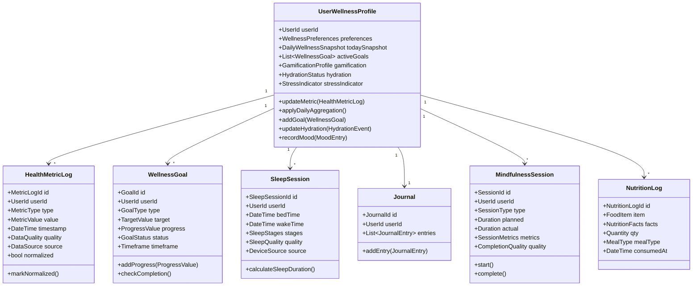

---

# **4.1.5 Updated Aggregates (Deep Detail)**

---

# **A. UserWellnessProfile (Aggregate Root)**  
### **Purpose:**  
Represents the user's *physical and emotional health persona*.

### **Entities inside:**  
- DailyWellnessSnapshot  
- StressIndicator  
- HydrationStatus  
- MoodEntry  
- WellnessGoalReference  

### **Value Objects inside:**  
- WellnessPreferences  
- WellnessScore *(physical-only)*  
- HydrationLevel  
- MoodState  
- EmotionalStabilityIndex  
- PhysicalActivitySummary  

---

## **Key Invariants**
- Metrics must be normalized before applied to snapshot  
- Sleep sessions cannot overlap  
- Daily snapshot can only be generated once per day  
- Goals must have measurable outcomes  
- Mood entries must contain valid MoodState VO  
- Hydration status cannot exceed biological limits  
- Stress indicator based on physical-only signals (HRV, resting HR, BP)  

---

# **Commands (Enhanced)**

```csharp
public record LogHealthMetric(
    UserId UserId,
    MetricType Type,
    MetricValue Value,
    DateTime Timestamp,
    DataSource Source
);

public record LogSleepSession(
    UserId UserId,
    DateTime BedTime,
    DateTime WakeTime,
    List<SleepStage> Stages,
    SleepQuality Quality
);

public record CreateWellnessGoal(
    UserId UserId,
    GoalType Type,
    TargetValue Target,
    Timeframe Duration,
    string Description
);

public record AddNutritionLog(
    UserId UserId,
    FoodItem Item,
    Quantity Quantity,
    NutritionFacts Facts,
    MealType MealType,
    DateTime ConsumedAt
);

public record RecordMood(
    UserId UserId,
    MoodState Mood,
    string? Notes,
    List<MoodFactor>? Factors
);
```

---

# **Queries (Enhanced)**

```csharp
public record GetWellnessDashboard(UserId UserId);

public record GetSleepHistory(
    UserId UserId,
    DateTime From,
    DateTime To
);

public record GetNutritionSummary(UserId UserId, int Days);

public record GetHydrationStatus(UserId UserId);

public record GetDailyWellnessSnapshot(UserId UserId, Date Date);
```

---

# **Domain Events (Enhanced)**

### **HealthMetricLogged**
- The normalized version is published separately by Metric Ontology BC

### **SleepSessionLogged**

### **MoodRecorded**

### **GoalProgressUpdated**

### **HydrationLevelChanged**

### **DailyWellnessSnapshotGenerated**

### **PhysicalStressIndicatorUpdated**  
*(Standalone domain event to feed Synergy BC)*

---

# **4.1.6 Domain Policies (Enhanced)**

### **Policy 1 — Sleep Normalization Policy**
Sleep sessions normalized via Metric Ontology BC before stored.

### **Policy 2 — Stress Indicator Policy**
Stress indicator = function of HRV, resting HR, sleep debt (from Physiology BC), not cognitive data.

### **Policy 3 — Mood → Emotional Stability Calculation**
Mood entries update EmotionalStabilityIndex VO.

---

# **4.1.7 Anti-Corruption Layer Changes**

Device Integration BC → Metric Ontology BC  
Metric Ontology BC → Health BC

Health BC **never processes raw device formats**.

---

# **4.1.8 What Changed Compared to the Previous Version?**

| Previous | Enhanced |
|----------|-----------|
| Health BC performed multi-domain reasoning | Reasoning moved to Synergy/Physiology BC |
| Metrics sometimes processed raw | All metrics normalized by Metric Ontology BC |
| Monolithic WellnessProfile | Now with Daily Snapshot pattern |
| Stress included cognitive elements | Now physical-only in this BC |
| Recommendations inside BC | Fully removed (Recommendation Engine BC takes over) |
| Large complex aggregates | Cleaner, domain-limited aggregates |

---

# **4.1.9 Key Improvements**

### ✔ Strict separation of physical + emotional signals  
(No cognitive contamination)

### ✔ Improved daily snapshot model  
Daily rollups now provide:

- activity summary  
- mood trends  
- hydration level  
- stress indicator  
- calories consumed  
- calories burned  

### ✔ Reduced aggregate explosion  
Simplified aggregate responsibilities.

### ✔ Clean multi-layer architecture support  
Perfectly aligned to synergy and multi-domain modeling.

---

# **4.1.10 Summary of Health & Wellness BC**

This enhanced specification creates a **clean, stable, scalable domain** that:

- Represents health and wellness accurately  
- Avoids cross-domain leakage  
- Integrates smoothly with upper intelligence layers  
- Provides clean events and normalized metrics  
- Supports multi-device input  
- Powers synergy, ML, prediction, readiness, and recommendations  

---

# **PART 4.2 — Cognitive Performance BC (Enhanced)**  
### *Core Domain — Critical*

---

# **4.2.1 Context Overview (Revised & Enhanced)**

The **Cognitive Performance BC** models the user's moment-to-moment **mental state**, but ONLY cognitive aspects—not health, not physiology, not readiness.

### **Primary Responsibilities**
- Real-time cognitive load
- Subjective + device cognitive readings
- Energy availability (mental)
- Focus session lifecycle
- Interruptions and distractions
- Mental state tags (clarity, stress, focus)
- Cognitive patterns (attention, switching)
- Mental effort cost
- Task–cognition relationships

### **What this BC does NOT do anymore**
❌ Stress-fatigue fusion → Synergy BC  
❌ Cognitive readiness → Synergy BC  
❌ Alert configuration logic → Intelligence Profile BC  
❌ Multi-domain forecasting → Behavior Prediction BC  
❌ Cross-domain insights → Recommendation Engine BC  
❌ What-to-do advice → Recommendation Engine BC  

This gives the Cognitive BC a **clean, consistent, high-cohesion domain boundary**.

---

# **4.2.2 Updated Domain Model Overview**

## **Core Aggregates (Enhanced)**

1. **UserCognitiveState (Aggregate Root)**  
2. **CognitiveReading**  
3. **FocusSession** (Deep Work Sessions)  
4. **InterruptionLog**  
5. **TaskCognitionAssociation**  
6. **CognitivePatternSnapshot** *(Lightweight Aggregate)*

---

# **4.2.3 Enhanced Domain Model Diagram**

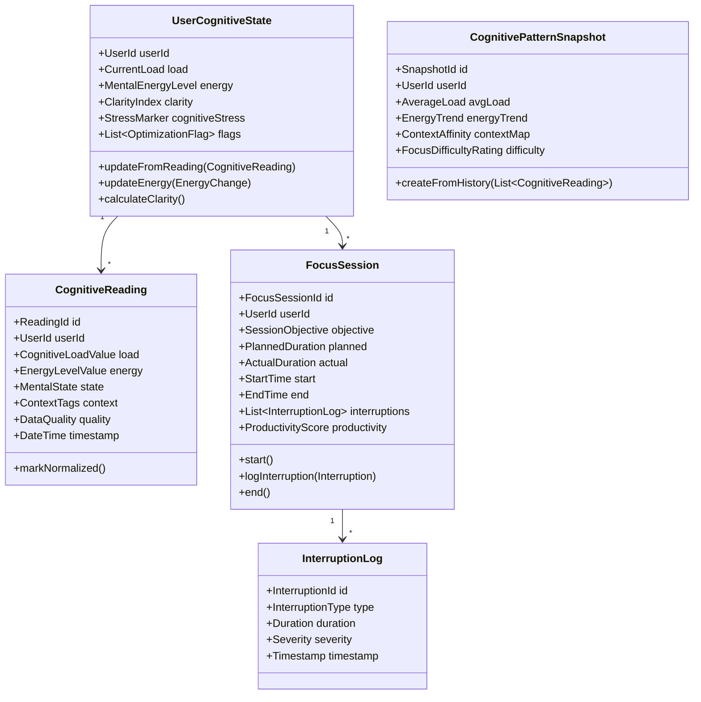

---

# **4.2.4 Updated Aggregate Specifications**

---

# **A. UserCognitiveState (Aggregate Root)**

This is the **identity of mental state** for the user.  
It is *not* a daily summary – it is a **continuous state machine** evolving with readings.

### **Fields**
- **CurrentLoad** (VO)  
- **MentalEnergyLevel** (VO)  
- **ClarityIndex** (VO)  
- **CognitiveStress** (VO, cognitive-only)  
- **Flags** (e.g., HighLoad, LowEnergy, CognitiveDrift)  
- **LastUpdated**  

### **Key Invariants**
- Cognitive load ∈ [0, 10]  
- Energy level cannot exceed max defined by Intelligence Profile  
- Clarity must be recomputed after each reading  
- CognitiveStress ≠ physical stress (separation)

### **Key Behaviors**
- updateFromReading()
- adjustEnergy()
- degradeEnergyOnHighLoad()
- detectCognitiveDrift()
- updateClarity()

---

# **B. CognitiveReading (Aggregate)**

### **Purpose**
Captures a *momentary mental reading* from device or self-report.

### **Value Objects**
- CognitiveLoadValue  
- EnergyLevelValue  
- MentalState (Focus, Stress, Calmness, Confusion, Clarity)  
- ContextTags (Task, Environment)  
- DataQuality  
- ConfidenceScore  

### **Invariants**
- Timestamp must be within reasonable range  
- Device readings must pass quality rules  
- Context tags must conform to Metric Ontology taxonomy  

### **Behaviors**
- markNormalized()  
(after interpreted by Metric Ontology BC)

---

# **C. FocusSession (Deep Work Aggregate)**

### **Purpose**
Represents a structured cognitive work session.

### **Entities**
- InterruptionLog  
- ProductivityMetrics (VO)  

### **Key Behaviors**
- start()  
- logInterruption()  
- end()  
- calculateProductivity()

### **Invariants**
- No overlapping sessions for same user  
- ProductivityScore must include:  
  - Focus quality  
  - Task goal alignment  
  - Interruption impact  

---

# **D. CognitivePatternSnapshot (Light Aggregate)**

Created periodically by Analytics/ML BC → translated by ACL → stored in Cognitive BC.

### **Contains**
- avgLoad  
- loadVariance  
- energyTrend  
- interruptionSensitivity  
- contextAffinityMap  
- peakFocusTimes (mapped to Lifestyle BC)  

Used by:
- Synergy BC  
- Recommendation Engine  
- Behavior Prediction BC  

---

# **4.2.5 Value Objects (Enhanced & Expanded)**

### **Core Cognitive VOs**
- CognitiveLoadValue  
- MentalEnergyLevel  
- ClarityIndex  
- CognitiveStressLevel  
- CognitiveDriftRate  
- InterruptionSeverity  
- ProductivityScore  
- TaskCognitiveDemand  
- FocusPrecision  

Each VO enforces:
- Valid ranges  
- Domain constraints  
- Transformation rules  

---

# **4.2.6 Commands (Enhanced)**

```csharp
public record LogCognitiveReading(
    UserId UserId,
    CognitiveLoadValue Load,
    MentalEnergyLevel Energy,
    MentalState MentalState,
    ContextTags Context,
    DateTime Timestamp
);

public record StartFocusSession(
    UserId UserId,
    SessionObjective Objective,
    Duration PlannedDuration
);

public record EndFocusSession(
    FocusSessionId SessionId,
    DateTime EndTime
);

public record LogInterruption(
    FocusSessionId SessionId,
    InterruptionType Type,
    Duration Duration,
    SeverityLevel Severity
);
```

---

# **4.2.7 Queries (Enhanced)**

```csharp
public record GetCurrentCognitiveState(UserId UserId);

public record GetCognitiveLoadHistory(
    UserId UserId,
    DateTime From,
    DateTime To
);

public record GetFocusSessionHistory(
    UserId UserId,
    DateTime? From,
    DateTime? To
);

public record GetCognitivePatterns(
    UserId UserId,
    int DaysBack
);
```

---

# **4.2.8 Domain Events (Enhanced)**

### 🔹 CognitiveReadingLogged  
### 🔹 HighCognitiveLoadDetected  
### 🔹 CognitiveEnergyLow  
### 🔹 FocusSessionStarted  
### 🔹 FocusSessionCompleted  
### 🔹 InterruptionLogged  
### 🔹 CognitivePatternDetected  

Events feed:

- Synergy BC  
- Behavior Prediction BC  
- Recommendation Engine  
- Lifestyle Modeling BC  
- Analytics BC  

---

# **4.2.9 Domain Policies (Enhanced)**

### **Policy 1 — Energy Degradation Policy**  
Every reading with high load automatically reduces energy.

### **Policy 2 — Clarity Calculation Policy**  
ClarityIndex derived from:
- low noise  
- stable energy  
- moderate load  
- low interruptions  

### **Policy 3 — Interruption Sensitivity Policy**  
Quality and severity of interruptions adjust:
- cognitive drift  
- productivity score  
- session rating  

### **Policy 4 — No Cognitive–Physical Mixing**  
No physical metrics allowed; enforced by Metric Ontology BC.

---

# **4.2.10 Cognitive BC Anti-Corruption Layers**

### **1. Device Integration → Cognitive BC**
Cognitive devices like:
- Muse  
- EEG devices  
- Verbal focus trackers  
- HRV-derived cognitive metrics

All are normalized to:
- CognitiveLoadValue  
- MentalEnergyLevel  
- MentalState tags  
- ContextTags  

### **2. ML → Cognitive BC**
Pattern snapshots → normalized before persistence.

---

# **4.2.11 Key Improvements Over Original**

| Original | Enhanced |
|---------|-----------|
| Cognitive BC handled readiness | Now handled by Synergy BC |
| Mixed physical + cognitive stress | Strict separation |
| Heavy aggregates | Simplified and modular |
| No clarity model | Now includes ClarityIndex VO |
| No cognitive drift modeling | Added CognitiveDriftRate |
| No task–context understanding | Added ContextTags + TaskDemand |
| Recommendations inside domain | Moved to Recommendation Engine |
| Cognitive patterns computed locally | Now via Analytics/ML + ACL |

---

# **4.2.12 Summary**

The enhanced Cognitive Performance BC is now:

- **Lean**  
- **Domain-pure**  
- **Scalable**  
- **High-cohesion / low-coupling**  
- **Cleanly integrated into Synergy + Recommendation Engine**  
- **Backed by Metric Ontology + Device ACL + Behavioral Prediction**  

It provides **accurate cognitive modeling**, powering the upper layers of intelligence.

---

# **PART 4.3 — Physiological Modeling BC (New)**  
### *Core Domain — Critical*  
### *High-Complexity, Science-Backed Modeling Layer*

---

# **4.3.1 Context Overview**

The **Physiological Modeling BC** is a foundational scientific modeling engine that interprets:

- Raw and normalized biological signals  
- Health metrics  
- Sleep data  
- Physical exertion patterns  
- HRV and cardiovascular indicators  
- Respiration patterns  
- Stress indicators  
- Recovery markers  

It produces **domain-pure, interpretable physiological states**, such as:

- Sleep debt  
- Recovery score  
- Autonomic balance  
- Fatigue index  
- Overtraining risk  
- Circadian alignment  
- Stress load  

These outputs are then consumed by:

- **Synergy BC**  
- **Behavior Prediction BC**  
- **Recommendation Engine**  
- **Lifestyle Modeling BC**  
- **Cognitive BC**  
- **Health BC**

Physiology Modeling BC **does not store raw metrics** – it only stores **derived physiological states**.

---

# **4.3.2 Key Responsibilities**

### ✔ Included
- Sleep debt computation  
- Circadian rhythm alignment  
- Cardiovascular strain modeling  
- Fatigue modeling (muscular + systemic)  
- Recovery modeling (autonomic + muscular)  
- Stress physiology (HRV-based)  
- Respiration and autonomic state mapping  
- Restfulness & deep recovery calculations  
- Overtraining score  
- Adaptation load index  

### ❌ Excluded
- Readiness scoring → Synergy BC  
- Mental stress → Cognitive BC  
- Molecular/clinical biomarkers  
- Diet or nutrition modeling  
- AI/ML pattern detection (except where validated)  
- Direct recommendations  

This BC produces **biological primitives** used by other domain contexts.

---

# **4.3.3 Domain Model Overview**

## Main Aggregates
1. **PhysiologicalState (Aggregate Root)**  
2. **SleepModel (Aggregate)**  
3. **RecoveryModel (Aggregate)**  
4. **FatigueModel (Aggregate)**  
5. **CircadianModel (Aggregate)**  
6. **AutonomicNervousSystemModel (Aggregate)**  

## Value Objects
- SleepDebt  
- RecoveryIndex  
- FatigueIndex  
- CircadianAlignment  
- HRVScore  
- RestingHeartRateBaseline  
- StrainScore  
- RespirationVariabilityIndex  
- ANSBalance  
- AdaptationLoadIndex  

---

# **4.3.4 Enhanced Domain Model Diagram**

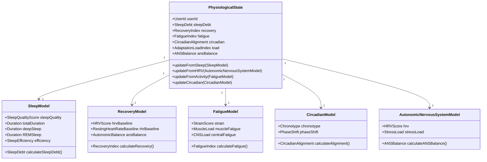

---

# **4.3.5 Aggregate Specifications (Deep Detail)**

---

# **A. PhysiologicalState (Aggregate Root)**

### **Purpose**  
Represents **the complete biological state** of the user at any given time.

### **Contains Value Objects**
- SleepDebt  
- RecoveryIndex  
- FatigueIndex  
- CircadianAlignment  
- ANSBalance  
- AdaptationLoadIndex  

### **Behaviors**
- integrateSleep(SleepModel)  
- integrateRecovery(RecoveryModel)  
- integrateFatigue(FatigueModel)  
- integrateCircadian(CircadianModel)  
- integrateANS(AutonomicNervousSystemModel)  

### **Invariants**
- Sleep debt cannot be negative  
- Recovery index ∈ [0,100]  
- Fatigue index ∈ [0,100]  
- Circadian alignment ∈ [-1, 1]  
- HRV baselines update slowly, respecting biological constraints  
- Fatigue cannot drop instantly without rest  

---

# **B. SleepModel**

### **Purpose**  
Transforms raw sleep metrics into:

- SleepDebt  
- SleepEfficiency  
- SleepQualityScore  

### Sleep Debt VO  
```
sleepDebt = max(0, requiredSleepHours - actualSleepHoursOverWindow)
```

### Sleep Quality VO  
Weighted by:

- sleep stages  
- duration  
- fragmentation  
- latency  

---

# **C. RecoveryModel**

### Calculations include:
- HRV baseline deviation  
- Resting HR deviation  
- Autonomic balance  
- Sleep restoration quality  

```
recoveryIndex = f(HRV deviation, RHR deviation, sleep debt, stress load)
```

---

# **D. FatigueModel**

Produces **FatigueIndex**, derived from:
- StrainScore  
- PhysicalLoad  
- CNS fatigue  
- Active recovery status  

Mathematical model:
```
fatigueIndex = w1 * strain + w2 * CNS fatigue - w3 * recovery quality
```

---

# **E. CircadianModel**

Models:
- Chronotype  
- Light exposure influence  
- Sleep/wake timing consistency  
- Phase shift magnitude  

```
alignment = cos((sleep midpoint - chronotype ideal midpoint) * π / 12)
```

---

# **F. AutonomicNervousSystemModel (ANS Model)**

Uses:
- HRV (RMSSD, LF/HF, SDNN)  
- RHR  
- Breathing rate variability  

Outputs:
- ANS balance (sympathetic vs parasympathetic)  
- StressLoad  
- Autonomic recovery quality  

---

# **4.3.6 Commands (Enhanced)**

These commands are triggered by:

- Metric Ontology BC (normalized metrics)  
- Health BC events  
- Cognitive BC events  

```csharp
public record UpdateSleepModel(
    UserId UserId,
    Duration TotalSleep,
    Duration DeepSleep,
    Duration REMSleep,
    SleepEfficiency Efficiency,
    DateTime Timestamp
);

public record UpdateRecoveryModel(
    UserId UserId,
    HRVScore HRV,
    RestingHeartRateBaseline RestingHR,
    StressLoad StressLoad
);

public record UpdateFatigueModel(
    UserId UserId,
    StrainScore Strain,
    Duration WorkloadDuration,
    PhysicalLoad PhysicalLoad
);

public record UpdateCircadianModel(
    UserId UserId,
    Chronotype Chronotype,
    TimeSpan SleepMidpoint,
    TimeSpan IdealMidpoint
);
```

---

# **4.3.7 Queries**

```csharp
public record GetPhysiologicalState(UserId UserId);

public record GetSleepDebt(UserId UserId, int Days);

public record GetRecoveryIndex(UserId UserId);

public record GetFatigueIndex(UserId UserId);

public record GetCircadianAlignment(UserId UserId);
```

---

# **4.3.8 Domain Events**

### 🔹 SleepDebtUpdated  
### 🔹 RecoveryIndexUpdated  
### 🔹 FatigueIndexUpdated  
### 🔹 CircadianAlignmentChanged  
### 🔹 ANSBalanceUpdated  
### 🔹 PhysiologicalStateUpdated (composite event)  

These events feed:

- Synergy BC  
- Behavior Prediction  
- Recommendation Engine  
- Lifestyle Modeling  
- Notifications (critical)  

---

# **4.3.9 Domain Policies**

### **Policy 1 — HRV Baseline Stability Policy**
HRV baseline cannot fluctuate more than a certain % per day.

### **Policy 2 — Sleep Debt Accumulation Policy**
Sleep debt accumulates gradually, never drops instantly.

### **Policy 3 — Fatigue Model Decay Policy**
Physical fatigue decays at a biologically realistic rate.

### **Policy 4 — Circadian Realignment Policy**
Circadian shifts must be gradual; large shifts forbidden by invariant.

---

# **4.3.10 Integration Patterns**

## **Metric Ontology → Physiology BC**  
Raw → Normalized → Physiology Models  

## **Health BC → Physiology BC**  
Sleep, HRV, RHR, activity  

## **Cognitive BC → Physiology BC**
Cognitive stress may influence ANS model  
(but expressed as pure numeric load, no domain mixing)

---

# **4.3.11 Improvements Over Previous Architecture**

| Original | Enhanced |
|---------|-----------|
| No explicit physiology layer | Fully modeled physiology BC |
| Recovery and fatigue logic were in Health BC | Now centralized |
| Readiness was computed inconsistently | Now handled in Synergy BC |
| No sleep debt model | Added robust sleep debt modeling |
| No circadian model | Added scientifically grounded circadian engine |
| No ANS model | Added HRV / autonomic system modeling |
| No muscular vs. neural fatigue | Now both modeled |
| No adaptation load | Added AdaptationLoadIndex |

---

# **4.3.12 Summary**

Physiology Modeling BC is the **biological computation engine** of the entire platform.

It provides scientifically valid, domain-pure physiological data that fuels:

- readiness  
- stress state  
- fatigue  
- recovery  
- chronotype alignment  
- predictions  
- recommendations  
- alerts  

It is the *foundation* for accurate multi-domain decision-making.

---

# **PART 4.4 — Behavior Prediction BC (New)**  
### *Supporting Domain — High Strategic Influence*

---

# **4.4.1 Context Overview**

The **Behavior Prediction BC** models and predicts:

- **Burnout risk**  
- **Cognitive collapse risk**  
- **Stress escalation trajectory**  
- **Fatigue progression**  
- **Goal dropout probability**  
- **Habit formation likelihood**  
- **Wellness deterioration risk**  
- **Overtraining prediction**  
- **Daily performance forecast**  
- **Sleep quantity & quality prediction**  

This BC is not reactive — it is *anticipatory*.

### **Input Domains**
- Physiology BC (sleep debt, fatigue, recovery, ANS)  
- Cognitive BC (load patterns, energy, clarity, drift)  
- Health BC (mood, hydration, activity)  
- Lifestyle BC (routine consistency, environment)  
- Intelligence Profile BC (baseline, thresholds, user patterns)  

### **Outputs**
Prediction aggregates like:

- BurnoutRisk  
- FatigueForecast  
- CognitiveLoadForecast  
- SleepNeedForecast  
- AdherenceProbability  
- PerformanceTomorrow  
- OvertrainingRisk  

These predictions inform:

- **Recommendation Engine**
- **Synergy BC**
- **Notifications (critical warnings)**
- **Routine Automation BC**
- **Lifestyle Modeling BC**

---

# **4.4.2 What This BC Does NOT Do**

❌ generate recommendations  
❌ compute readiness  
❌ interpret physiology (done by Physiology BC)  
❌ interpret health or cognitive domain values (Synergy BC does fusion)  
❌ store raw ML predictions  
❌ modify other BC state directly  

**It only creates domain-pure predictive aggregates.**

---

# **4.4.3 Core Aggregates**

1. **BurnoutPrediction**  
2. **FatigueForecastModel**  
3. **CognitiveLoadForecastModel**  
4. **HabitAdherencePrediction**  
5. **SleepNeedForecast**  
6. **OvertrainingRiskModel**  
7. **StressEscalationPrediction**  
8. **DailyPerformanceForecast**  

Each aggregate represents a **prediction instance** at a point in time.

---

# **4.4.4 Domain Model Diagram (Enhanced)**

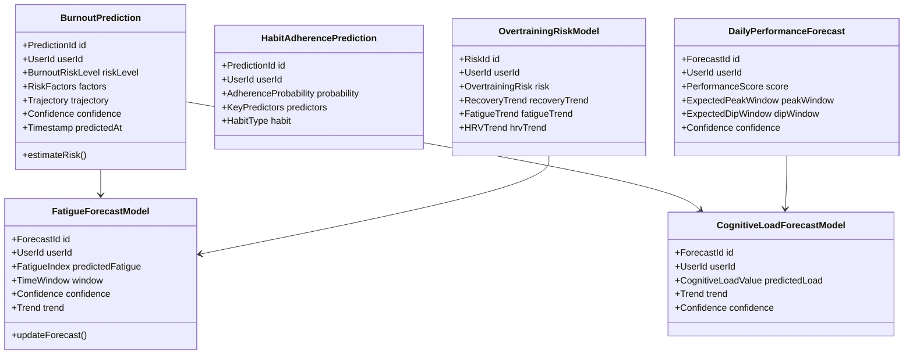

---

# **4.4.5 Detailed Aggregate Specs**

---

# **A. BurnoutPrediction (Aggregate Root)**  
### **Purpose**  
Predict if the user is at risk of burnout within a defined horizon (3–14 days).

### **Inputs**  
- sleep debt  
- circadian misalignment  
- cognitive load volatility  
- fatigue index  
- mood patterns  
- activity imbalance  
- hydration consistency  
- emotion stability index  

### **Value Objects**  
- BurnoutRiskLevel (None, Mild, Moderate, High, Severe)  
- BurnoutTrajectory (Improving / Worsening / Sharp Decline)  
- ConfidenceScore  
- KeyRiskFactors  

### **Invariants**  
- Confidence ∈ [0,1]  
- RiskLevel must match trajectory rules  
- Predict at most 2× per day  

---

# **B. FatigueForecastModel**

Predicts fatigue **24–72 hours ahead**, using:

- FatigueIndex  
- RecoveryIndex  
- SleepDebt trend  
- Strain trend  
- CNS fatigue  

### **Key Outputs**
- predictedFatigue (VO)  
- trend (Increasing/Decreasing/Critical)  

---

# **C. CognitiveLoadForecastModel**

Predicts cognitive load for next:

- 3 hours  
- 24 hours  
- next work session  

Using:

- load volatility  
- cognitive drift  
- clarity index  
- interruption sensitivity  
- circadian alignment  

---

# **D. HabitAdherencePrediction**

Forecasts if a user will stick to:

- sleep routine  
- hydration routine  
- focus session habit  
- mindfulness habit  
- fitness routine  
- daily check-ins  

### **Outputs**
- AdherenceProbability (VO)  
- KeyPredictors  

---

# **E. DailyPerformanceForecast**

Predicts:

- performance score tomorrow  
- peak cognitive windows  
- dip windows  

Uses circadian + cognitive + physiological fusion.

---

# **F. OvertrainingRiskModel**

Predicts overtraining syndrome risk using:

- chronic strain  
- low HRV  
- sleep debt accumulation  
- persistent fatigue  
- stress load  

---

# **4.4.6 Value Objects (Enhanced)**

- BurnoutRiskLevel  
- FatigueTrend  
- CognitiveTrend  
- OvertrainingRisk  
- AdherenceProbability  
- ConfidenceScore  
- PerformanceScore  
- PeakFocusWindow  
- DipFocusWindow  
- KeyPredictors  

Each VO enforces its domain constraints and scales.

---

# **4.4.7 Commands**

These commands are triggered by analytics/ML systems via ACL:

```csharp
public record GenerateBurnoutPrediction(
    UserId UserId,
    BurnoutRiskLevel Risk,
    RiskFactors Factors,
    BurnoutTrajectory Trajectory,
    ConfidenceScore Confidence
);

public record GenerateFatigueForecast(
    UserId UserId,
    FatigueIndex Predicted,
    FatigueTrend Trend,
    ConfidenceScore Confidence
);

public record GenerateCognitiveLoadForecast(
    UserId UserId,
    CognitiveLoadValue Predicted,
    Trend Trend,
    ConfidenceScore Confidence
);

public record GeneratePerformanceForecast(
    UserId UserId,
    PerformanceScore Score,
    PeakFocusWindow Peak,
    DipFocusWindow Dip,
    ConfidenceScore Confidence
);
```

---

# **4.4.8 Queries**

```csharp
public record GetBurnoutPrediction(UserId UserId, DateTime Date);

public record GetFatigueForecast(UserId UserId, TimeWindow Window);

public record GetPerformanceForecast(UserId UserId);

public record GetHabitAdherencePrediction(UserId UserId, HabitType Habit);
```

---

# **4.4.9 Domain Events (Enhanced)**

### 🔹 BurnoutRiskPredicted  
### 🔹 FatigueForecastUpdated  
### 🔹 CognitiveLoadForecastUpdated  
### 🔹 OvertrainingRiskPredicted  
### 🔹 HabitAdherenceForecasted  
### 🔹 DailyPerformanceForecastGenerated  

These events trigger:

- **Synergy BC** → readiness updates  
- **Recommendation Engine BC** → proactive intervention  
- **Notifications BC** → alerts  
- **Routine Automation BC** → routine adjustments  

---

# **4.4.10 Domain Policies**

### **Policy 1 — Stability Policy**
Predictions cannot swing dramatically without underlying physiological cause.

### **Policy 2 — Confidence Policy**
Low-confidence predictions cannot trigger high-severity recommendations.

### **Policy 3 — Burnout Escalation Policy**
Trajectory rules:  
- severe + worsening must trigger escalation event  
- moderate + worsening triggers soft warning event  

### **Policy 4 — Early Detection Policy**
If prediction detects a trend 3 days before, event is prioritized.

---

# **4.4.11 Integration Flow**

### **Metric Ontology → Physiology BC → Behavior Prediction BC**  
(Standardized → Physiology Engine → Predictive Models)

### **Cognitive BC → Behavior Prediction BC**
Cognitive drift, volatility, focus metrics

### **Lifestyle BC → Behavior Prediction BC**
Routine consistency → adherence probability

### **Synergy BC → Behavior Prediction BC**
Multi-domain metrics → fused signals

### **Analytics/ML → ACL → Behavior Prediction BC**
ML outputs converted to domain VOs

---

# **4.4.12 Improvements Over Previous Architecture**

| Before | Now |
|--------|------|
| No predictive BC | Full prediction engine |
| ML mixed with domain logic | Full ACL + domain VOs |
| No burnout modeling | Burnout prediction model |
| No fatigue forecasting | Fatigue prediction engine |
| No habit prediction | Habit adherence prediction |
| No performance forecasting | Daily performance forecast |
| No risk trajectory | Trajectory VOs + risk models |
| No preventive alerts | Event pipeline for proactive care |

---

# **4.4.13 Summary**

Behavior Prediction BC is the **anticipatory intelligence layer**.  
It transforms physiological + cognitive + lifestyle signals into **predictions** that:

- prevent burnout  
- prevent overtraining  
- optimize routines  
- boost daily performance  
- preempt declines  
- avoid habit dropout  

It is the "weather forecast" of human behavior.

---

# **PART 4.5 — Lifestyle Modeling BC (New)**  
### *Supporting Domain — High Strategic Value*  
### *Bridges daily behavior → long-term patterns → routines → predictions → optimization*

---

# **4.5.1 Context Overview**

The **Lifestyle Modeling BC** captures and models the user’s *behavioral, contextual, and environmental patterns*, including:

- Daily routines  
- Habit consistency  
- Behavioral rhythms  
- Environment and context mapping  
- Chronotype and time-of-day behaviors  
- Location and context transitions  
- Routine adherence and breakdown patterns  
- Long-term lifestyle trends  

The Lifestyle BC provides **behavioral meaning**, not predictions.  
Predictions are made by Behavior Prediction BC.  
Recommendations are made by Recommendation Engine BC.  
Physiological and cognitive meaning comes from their respective BCs.

This BC is the **behavioral backbone** of the system.

---

# **4.5.2 Responsibilities**

### ✔ Included
- Daily routine modeling  
- Habit lifecycle management (created, active, abandoned, recovered)  
- Lifestyle score tracking  
- Routine consistency modeling  
- Weekly and monthly pattern identification  
- Environmental influence modeling  
- Chronotype-based lifestyle mapping  
- Context transitions (home → work → gym → sleep environment)  
- Lifestyle drift detection  
- Behavioral adherence trends  

### ❌ Excluded
- Habit adherence probability → Behavior Prediction BC  
- Recommendations → Recommendation Engine BC  
- Physiology integration (sleep/ANS) → Physiology BC  
- Cognitive performance effects → Synergy BC  
- Nudging/notifications → Notifications BC  
- Execution of routines → Routine Automation BC  

This ensures **clean domain boundaries**.

---

# **4.5.3 Aggregate Overview**

### **Main Aggregates**
1. **LifestyleProfile (Aggregate Root)**  
2. **Habit (Aggregate)**  
3. **DailyRoutineModel**  
4. **BehaviorRhythmModel**  
5. **EnvironmentalContextModel**  
6. **ChronotypeProfile**  

---

# **4.5.4 Lifestyle Domain Model Diagram**

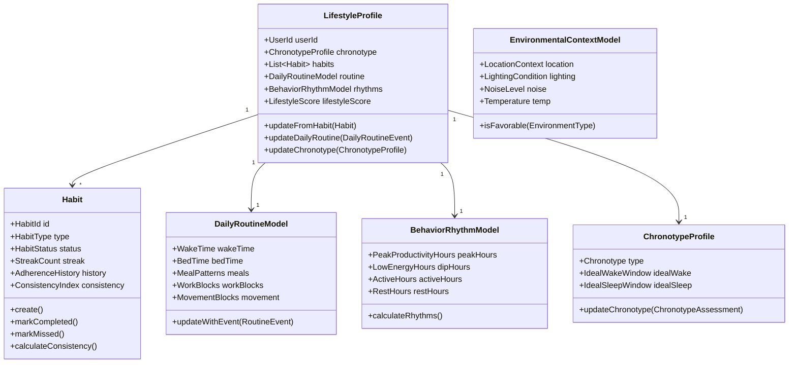

---

# **4.5.5 Aggregate Specifications (Deep Detail)**

---

# **A. LifestyleProfile (Aggregate Root)**  
This is the core representation of the user’s **behavioral identity**.

## Contains:
- ChronotypeProfile  
- DailyRoutineModel  
- List of Habits  
- BehaviorRhythmModel  
- LifestyleScore  

### **Key Behaviors**
- updateFromHabit()  
- updateRoutineModel()  
- recalculateLifestyleScore()  
- updateChronotype()  
- updateRhythmPatterns()  

### **Invariants**
- Chronotype must be valid (Morning/Intermediate/Evening)  
- Streak changes must match HabitStatus transitions  
- Routine consistency cannot exceed biological constraints  

---

# **B. Habit (Aggregate)**  
Represents a user-defined behavior repeated over time:

### Examples:
- morning hydration  
- walking breaks  
- journaling  
- sleep schedule  
- meditation  
- focus sessions  
- nutrition consistency  
- work block integrity  

### **Value Objects**
- HabitStatus (Active, Paused, Abandoned, CompletedToday)  
- Streak  
- ConsistencyIndex  
- HabitType (Wellness, Sleep, Movement, Cognitive, Nutrition, Recovery)  

### **Invariants**
- A habit cannot be completed twice in a day  
- A missed day breaks streak  
- ConsistencyIndex ∈ [0,1]  

---

# **C. DailyRoutineModel**

Tracks typical structure of the day:

- wake time  
- bed time  
- meal schedule  
- work blocks  
- movement blocks  
- mindfulness blocks  

### Behaviors:
- updateWithEvent(RoutineEvent)  
- detectRoutineDrift()  

### Value Objects:
- RoutineConsistency  
- WakeTime  
- BedTime  
- MovementBlock  
- WorkBlock  

---

# **D. BehaviorRhythmModel**

Identifies long-term patterns:

- productivity peaks  
- low-energy dips  
- movement vs. sedentary timing  
- rest windows  
- meal pacing  

Computes:

- PeakProductivityHours  
- LowEnergyHours  
- ActiveHours  
- RestHours  

These are used heavily by:

- Routine Automation BC  
- Recommendation Engine  
- Synergy BC  
- Cognitive BC  

---

# **E. ChronotypeProfile**

Chronotype is influenced by:

- sleep midpoint  
- energy rhythms  
- light exposure  
- physiology + lifestyle combination  

### Values:
- Morning  
- Intermediate  
- Evening  

Updates via:
```csharp
updateChronotype(ChronotypeAssessment assessment)
```

---

# **4.5.6 Value Objects (Enhanced)**

- LifestyleScore  
- Streak  
- ConsistencyIndex  
- RoutineEvent  
- WakeTime, BedTime  
- MovementBlock, WorkBlock  
- LocationContext  
- LightingCondition  
- NoiseLevel  
- Chronotype  

Each VO enforces domain validity.

---

# **4.5.7 Commands**

```csharp
public record RegisterRoutineEvent(
    UserId UserId,
    RoutineEvent Event,
    DateTime Timestamp
);

public record RecordHabitCompletion(
    HabitId HabitId,
    DateTime Timestamp
);

public record RecordHabitMiss(
    HabitId HabitId,
    DateTime Timestamp
);

public record UpdateChronotype(
    UserId UserId,
    ChronotypeAssessment Assessment
);

public record LogEnvironmentalContext(
    UserId UserId,
    LocationContext Location,
    LightingCondition Lighting,
    NoiseLevel Noise,
    Temperature Temp,
    DateTime Timestamp
);
```

---

# **4.5.8 Queries**

```csharp
public record GetLifestyleProfile(UserId UserId);

public record GetHabits(UserId UserId);

public record GetDailyRoutine(UserId UserId);

public record GetBehaviorRhythms(UserId UserId);

public record GetChronotype(UserId UserId);

public record GetLifestyleScore(UserId UserId);
```

---

# **4.5.9 Domain Events**

### 🔹 HabitCompleted  
### 🔹 HabitMissed  
### 🔹 RoutineUpdated  
### 🔹 LifestyleScoreChanged  
### 🔹 ChronotypeUpdated  
### 🔹 BehaviorRhythmDetected  
### 🔹 DailyStructureChanged  

Events propagate into:
- Behavior Prediction (for adherence probability)  
- Synergy (for lifestyle → readiness)  
- Recommendation Engine (for routine optimization)  
- Routine Automation BC  

---

# **4.5.10 Domain Policies**

### **Policy 1 — Streak Integrity**
- Streak cannot increase if habit missed  
- Missing resets streak unless flexible habit rules are defined  

### **Policy 2 — Routine Drift**
- If wake time drifts > 2 hours, trigger RoutineDriftEvent  

### **Policy 3 — Chronotype Stability**
Chronotype cannot shift more than allowed threshold in a week.

### **Policy 4 — Environmental Impacts**
Only environments with sufficient data can alter BehaviorRhythmModel.

---

# **4.5.11 Integration Flow**

### **Physiology BC → Lifestyle BC**
- circadian alignment → reinforces chronotype  
- fatigue/recovery patterns → influence rhythms  
- sleep debt → modifies wake/sleep modeling  

### **Cognitive BC → Lifestyle BC**
- focus session times → update peak productivity hours  
- interruptions → reduce routine consistency  

### **Synergy BC → Lifestyle BC**
- readiness changes → reflect in behavior patterns  

### **Device Integration → Lifestyle BC**
- location → context modeling  
- movement → routines  
- light/environment sensors → environmental modeling  

### **Behavior Prediction → Lifestyle BC**
- predicted adherence → updates Habit flags  

---

# **4.5.12 Improvements Over Previous Architecture**

| Before | After (Enhanced) |
|--------|------------------|
| No explicit lifestyle modeling | Fully isolated Lifestyle BC |
| No routines except goals | Real routines + time-of-day models |
| No context modeling | Environmental context integrated |
| No chronotype modeling | Chronotype is first-class citizen |
| No behavior rhythms | Peak/dip rhythm engine |
| No habit lifecycle | Full habit lifecycle with consistency |
| No environmental mapping | Light/noise/temp context tracking |

This BC now forms a **behavioral foundation** for predictions, synergies, routines, and recommendations.

---

# **4.5.13 Summary**

The Lifestyle Modeling BC provides:

- Stable behavior identity  
- Long-term patterns  
- Routines and habits  
- Context and environment modeling  
- Rhythms that influence performance and health  
- Chronotype as a foundational lifestyle trait  

It is essential for:
- Behavior Prediction  
- Routine Automation  
- Recommendation Engine  
- Synergy Layer  
- Cognitive & Health optimization  

---

# **PART 4.6 — Health–Cognitive Synergy BC (Core–Strategic)**

---

# **4.6.1 Context Overview**

## **Purpose**
The Synergy BC computes **integrated, cross-domain states** that cannot be produced by any single domain.

It answers:

- Am I ready to perform?  
- How stressed am I biologically + mentally?  
- How fatigued am I physiologically + cognitively?  
- What is my combined performance capacity today?  
- What intensity of work should I attempt?  
- Is my body–mind state trending up or down?  
- How aligned is my lifestyle with my biology?  

It is a **fusion layer** that integrates:

### Inputs:
- **Physiological Modeling BC**  
- **Cognitive Performance BC**  
- **Health & Wellness BC**  
- **Lifestyle Modeling BC**  
- **Behavior Prediction BC**  
- **Personal Intelligence Profile BC**  
- **Metric Ontology BC** (normalized inputs)

### Outputs:
- **ReadinessState**  
- **StressLoadComposite**  
- **FatigueComposite**  
- **PerformanceCapacity**  
- **Mind–Body Balance Score**  
- **Strain–Recovery Balance**  
- **Recommendation Triggers** (but NOT recommendations themselves)

This BC does **fusion**, not recommendations.

---

# **4.6.2 Why the Synergy BC is Essential**

Previously:

- Readiness was scattered across Health + Cognitive  
- Stress signals were duplicated  
- Fatigue was isolated in physiology  
- Lifestyle patterns had no influence  
- Predictions had no integration point  
- Recovery and strain weren’t unified  
- No baseline personalization existed  

The new BC centralizes all fusion logic into a single, clean, bounded context.

---

# **4.6.3 Core Responsibilities**

### ✔ Combine physiology + cognition + wellness  
### ✔ Compute readiness  
### ✔ Compute unified stress  
### ✔ Compute unified fatigue  
### ✔ Fuse behavioral predictions  
### ✔ Derive mind–body performance states  
### ✔ Generate composite scores  
### ✔ Trigger events for Recommendation Engine  
### ✔ Serve as foundation for daily guidance  

### ❌ Does NOT:
- Store raw metrics  
- Generate recommendations  
- Train ML models  
- Replace cognitive or physiological interpretation  
- Do device integration  
- Handle habits or routines  

It depends on pure domain outputs from other BCs.

---

# **4.6.4 Core Aggregates**

1. **ReadinessState (Aggregate Root)**  
2. **StressCompositeModel**  
3. **FatigueCompositeModel**  
4. **PerformanceCapacityModel**  
5. **MindBodyBalance**  
6. **StrainRecoveryBalance**  

---

# **4.6.5 Synergy Model Diagram (Enhanced)**

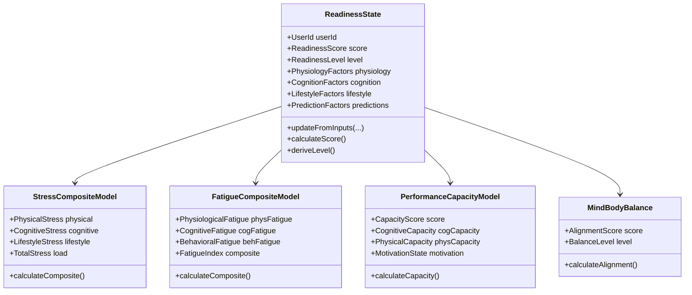

---

# **4.6.6 Aggregate Specifications (Deep Detail)**

---

# **A. ReadinessState (Aggregate Root)**

This is the **primary output** of the Synergy BC.

### **Inputs**
- SleepDebt (Physiology)  
- RecoveryIndex (Physiology)  
- FatigueIndex (Physiology)  
- CognitiveLoad (Cognition)  
- MentalEnergy (Cognition)  
- Clarity (Cognition)  
- Mood/Mental State (Health BC)  
- RoutineConsistency (Lifestyle BC)  
- ChronotypeAlignment (Lifestyle BC)  
- BurnoutPrediction (Behavior Prediction BC)  
- FatigueForecast (Behavior Prediction BC)  

### **Outputs**
- ReadinessScore (0–100)  
- ReadinessLevel (Poor / Low / Moderate / High / Peak)  
- CompositeFactors struct  
- TrendDirection (Improving / Declining)  

---

## **Readiness Calculation (High-Level Formula)**

### **Physio Component (40%)**
- recovery  
- fatigue  
- sleep debt  
- circadian alignment  

### **Cognitive Component (35%)**
- load  
- clarity  
- mental energy  
- cognitive drift  
- interruption sensitivity  

### **Lifestyle Component (15%)**
- routine stability  
- chronotype compliance  
- habit consistency  
- environmental quality  

### **Prediction Component (10%)**
- burnout risk  
- fatigue forecast  
- tomorrow’s performance  

---

# **B. StressCompositeModel**

Fuses:

- **Physical Stress** (HRV, RHR, strain)  
- **Cognitive Stress** (mental load, emotional stability)  
- **Lifestyle Stress** (irregular routines, poor sleep timing)  

### **Output**
- TotalStress (VO, 0–100)  
- StressClassification (Low / Moderate / High / Critical)

---

# **C. FatigueCompositeModel**

Fuses:

- physiological fatigue  
- cognitive fatigue  
- behavioral fatigue (habit-based, routine disruption)

### Composite formula:
```
composite = w1 * physFatigue + w2 * cogFatigue + w3 * behFatigue
```

---

# **D. PerformanceCapacityModel**

Outputs the user’s capacity to:

- focus  
- execute tasks  
- exercise  
- learn  
- perform creatively  

Inputs:
- readiness  
- clarity  
- energy  
- circadian alignment  
- predicted performance  

---

# **E. MindBodyBalance**

Represents:
- alignment between mental and physical states  
- coherence between lifestyle and biology  
- inner balance  

Outputs:
- AlignmentScore  
- BalanceLevel  

---

# **4.6.7 Key Value Objects**

- ReadinessScore  
- TotalStress  
- FatigueIndex  
- AlignmentScore  
- PerformanceCapacity  
- BiologicalLoad  
- CognitiveLoadImpact  
- LifestyleCompliance  

Each VO contains domain-embedded validation + thresholds from **Personal Intelligence Profile**.

---

# **4.6.8 Commands**

```csharp
public record ComputeReadiness(
    UserId UserId,
    PhysiologicalState Physiology,
    UserCognitiveState Cognition,
    LifestyleProfile Lifestyle,
    BehaviorPredictions Predictions,
    DateTime Timestamp
);

public record ComputeStressComposite(
    UserId UserId,
    PhysicalStress Physical,
    CognitiveStress Cognitive,
    LifestyleStress Lifestyle
);

public record ComputeFatigueComposite(
    UserId UserId,
    PhysiologicalFatigue PhysFatigue,
    CognitiveFatigue CogFatigue,
    BehavioralFatigue BehFatigue
);
```

---

# **4.6.9 Queries**

```csharp
public record GetReadiness(UserId UserId);

public record GetStressComposite(UserId UserId);

public record GetFatigueComposite(UserId UserId);

public record GetPerformanceCapacity(UserId UserId);

public record GetMindBodyBalance(UserId UserId);
```

---

# **4.6.10 Domain Events**

### 🔹 ReadinessComputed  
### 🔹 StressCompositeUpdated  
### 🔹 FatigueCompositeUpdated  
### 🔹 PerformanceCapacityUpdated  
### 🔹 MindBodyBalanceUpdated  
### 🔹 SynergyStateUpdated (combined)  

These power:

- **Recommendation Engine**  
- **Routine Automation**  
- **Notifications**  
- **Analytics**  
- **Predictive loops**  

---

# **4.6.11 Domain Policies**

### **Policy 1 — Stability Policy**  
Readiness cannot drop more than X points unless:  
- extreme sleep debt  
- extreme fatigue  
- extreme cognitive load  

### **Policy 2 — No Cross-Contamination Policy**  
Cognitive metrics cannot substitute physiological metrics.

### **Policy 3 — Composite Score Integrity**  
Final readiness must match level thresholds:
- Peak: > 85  
- High: 70–85  
- Moderate: 50–69  
- Low: 30–49  
- Poor: < 30  

### **Policy 4 — Burnout Escalation Policy**  
If burnout risk > threshold → mandatory SynergyStateUpdated event.

### **Policy 5 — Prediction Weighting Policy**  
Predictions cannot exceed 15% influence without **ConfidenceScore > 0.8**.

---

# **4.6.12 Integration Flow**

### **Upstream Inputs → Synergy BC**
- Physiology: sleep debt, HRV, recovery, fatigue  
- Cognitive: load, energy, clarity  
- Health: mood, mindfulness effects  
- Lifestyle: routines, chronotype, behavioral rhythms  
- Prediction BC: fatigue forecasts, burnout risk  
- Personal Intelligence Profile: baselines & thresholds  

### **Synergy → Downstream**
- Recommendation Engine BC  
- Routine Automation BC  
- Notifications BC  
- Analytics  
- Behavior Prediction (feedback loop)

---

# **4.6.13 Improvements Over Previous Architecture**

| Previous State | Enhanced Synergy Layer |
|----------------|------------------------|
| Readiness spread across BCs | Unified readiness engine |
| Stress separated into cognitive/physical | Combined StressCompositeModel |
| Fatigue only physiological | Multi-dimensional fatigue |
| No alignment between lifestyle & biology | MindBodyBalance model |
| No combined performance view | PerformanceCapacity model |
| No behavioral influence | Predictions integrated |
| No personalization in thresholds | Personal Intelligence Profile integrated |

---

# **4.6.14 Summary**

The **Health–Cognitive Synergy BC** is the platform’s *holistic intelligence core*.  
It synthesizes **biology, cognition, lifestyle, and prediction** into unified human performance states.

This allows the platform to:

- deliver actionable insights  
- compute holistic readiness  
- anticipate declines before they happen  
- trigger smart routines and recommendations  
- support AI-driven personalization  

It transforms *data* into **meaning**, and meaning into **actionable intelligence**.

---

# **PART 4.7 — Unified Personal Intelligence Profile BC (Core–Foundational Strategic Domain)**

---

# **4.7.1 Context Overview**

### **Purpose**
The **Unified Personal Intelligence Profile (PIP)** is a *deep, persistent, evolving model* of the user.  
It encodes the user’s:

- biological baselines  
- cognitive baselines  
- lifestyle tendencies  
- behavioral traits  
- sensitivity parameters  
- adaptability curves  
- personalization thresholds  
- identity-based constraints  
- learning from multi-year history  

The PIP answers:

- *What is normal for the user?*  
- *How should readiness be calibrated?*  
- *How sensitive is the user to sleep loss, stress, or load?*  
- *What behavioral patterns define the user’s long-term identity?*  
- *What interventions work best for this user?*  
- *How fast does the user recover or fatigue?*  
- *What is the user’s chronotype, rhythm type, learning style, motivation type?*  

This BC is effectively the **User Modeling Brain** of the entire platform.

---

# **4.7.2 Responsibilities**

### ✔ Included
- Biological baseline modeling  
- Cognitive baseline modeling  
- Lifestyle & behavior tendencies  
- Adaptation modeling (how user changes over time)  
- Personal thresholds (stress, fatigue, load, sleep debt)  
- Calibration of Synergy BC  
- Sensitivity curves  
- User identity traits (non-personal but behavioral/functional)  
- Interventions response history  
- Personal norms (normal HRV, normal clarity, etc.)  

### ❌ Excluded
- Generating recommendations  
- Storing raw sensor data  
- Behavioral predictions  
- Routine modeling  
- Synergy computation  
- Goals and preferences  

These come from or feed into other BCs.

---

# **4.7.3 Aggregate Overview**

1. **PersonalIntelligenceProfile (Aggregate Root)**  
2. **BiologicalBaselineProfile**  
3. **CognitiveBaselineProfile**  
4. **BehavioralTraitProfile**  
5. **InterventionResponseProfile**  
6. **ThresholdSensitivityModel**  
7. **LongitudinalIdentityModel**  

---

# **4.7.4 PIP Domain Model Diagram**

```mermaid
classDiagram
    class PersonalIntelligenceProfile {
        +UserId userId
        +BiologicalBaselineProfile bio
        +CognitiveBaselineProfile cog
        +BehavioralTraitProfile behavior
        +ThresholdSensitivityModel thresholds
        +InterventionResponseProfile responses
        +LongitudinalIdentityModel longTermIdentity
        +updateBiologicalBaseline()
        +updateCognitiveBaseline()
        +updateThresholds()
        +recordInterventionResponse()
        +deriveIdentitySignals()
    }

    class BiologicalBaselineProfile {
        +HRVBaseline hrv
        +RestingHRBaseline rhr
        +SleepDurationBaseline sleep
        +RecoveryCurve recoveryCurve
        +FatigueCurve fatigueCurve
        +CircadianStability circadianStability
        +updateFromPhysiology()
    }

    class CognitiveBaselineProfile {
        +ClarityBaseline clarity
        +MentalEnergyBaseline energy
        +LoadTolerance loadTolerance
        +FocusCapacityBaseline focus
        +StressResponseSignature stressSignature
        +updateFromCognitive()
    }

    class BehavioralTraitProfile {
        +Chronotype chronotype
        +LifestyleType lifestyleType
        +DisciplineIndex discipline
        +ConsistencyIndex consistency
        +MotivationStyle motivationStyle
        +DecisionFatiguePattern decisionFatigue
        +updateFromLifestylePatterns()
    }

    class ThresholdSensitivityModel {
        +StressThreshold stressThreshold
        +FatigueThreshold fatigueThreshold
        +SleepDebtSensitivity sleepDebtSensitivity
        +OverloadSensitivity overloadSensitivity
        +updateThresholds()
    }

    class InterventionResponseProfile {
        +MeditationEffectiveness meditationEffectiveness
        +ExerciseEffectiveness exerciseEffectiveness
        +NappingResponse nappingResponse
        +DeepWorkResponse focusResponse
        +RecoveryTechniquesRecoveryRate recoveryTechniques
        +updateResponse()
    }

    class LongitudinalIdentityModel {
        +MultiYearPatterns patterns
        +ImprovementTrajectory trajectory
        +AdaptationRate adaptation
        +IdentityMarkers markers
        +deriveLongitudinalSignals()
    }

    PersonalIntelligenceProfile --> BiologicalBaselineProfile
    PersonalIntelligenceProfile --> CognitiveBaselineProfile
    PersonalIntelligenceProfile --> BehavioralTraitProfile
    PersonalIntelligenceProfile --> ThresholdSensitivityModel
    PersonalIntelligenceProfile --> InterventionResponseProfile
    PersonalIntelligenceProfile --> LongitudinalIdentityModel
```

---

# **4.7.5 Aggregate Specifications (Deep Detail)**

---

# **A. PersonalIntelligenceProfile (Aggregate Root)**

The long-term identity container.

### **Invariants**
- Baselines must be derived from ≥ 14 days data  
- Thresholds must be computed with personal variability included  
- Chronotype must be updated slowly (no abrupt shifts)  
- Recovery curve must have biological plausibility  
- Load tolerance cannot exceed cognitive and physiological capacity  

### **Behavior**
- updateFromSignals(Physiology, Cognition, Lifestyle)  
- adjustBaselines()  
- updateThresholdsWithConfidence()  
- integrateInterventionResponses()  
- computeIdentityMarkers()  

---

# **B. BiologicalBaselineProfile**

Captures normal physiology.

### Includes:
- HRV Baseline (adjusted for age & fitness)  
- Resting Heart Rate Baseline  
- Sleep Duration Baseline  
- Sleep Consistency Baseline  
- Recovery Rate Curve  
- Fatigue Accumulation Curve  
- Circadian Stability Score  

### Inputs:
Physiological Modeling BC outputs.

### Invariants:
- Baselines must be rolling averages (7–28 days)  
- HRV baseline must be age-adjusted  
- Fatigue curve must not exceed biological bounds  

---

# **C. CognitiveBaselineProfile**

Defines cognitive identity:

- clarity baseline  
- mental energy baseline  
- load tolerance  
- interruption sensitivity  
- cognitive drift tendencies  
- default focus capacity  

### Inputs:
Cognitive Performance BC outputs.

---

# **D. BehavioralTraitProfile**

Models the person’s *behavioral identity*:

- chronotype (from Lifestyle + Physiology)  
- behavioral consistency  
- discipline index  
- motivation style  
- decision fatigue patterns  
- lifestyle type:  
  - structured  
  - chaotic  
  - flexible  
  - hyperproductive  
  - recovery-prone  
  - stress-sensitive  

### Inputs:
Lifestyle Modeling BC.

---

# **E. ThresholdSensitivityModel**

Defines *personal thresholds*:

- stress threshold  
- fatigue threshold  
- sleep debt sensitivity  
- overload sensitivity  
- burnout sensitivity  
- cognitive strain tolerance  

These heavily calibrate Synergy BC.

---

# **F. InterventionResponseProfile**

How does the user respond to interventions?

Tracks effectiveness of:

- meditation  
- breathwork  
- naps  
- exercise  
- deep work  
- mindfulness  
- journaling  
- exposure therapy  
- environmental changes (noise/light/temp)  

### Outputs:
- Response curves  
- Efficacy profiles  
- Personalized intervention ranking  

Recommendation Engine BC consumes these.

---

# **G. LongitudinalIdentityModel**

Multi-year behavioral and biological identity:

- trend projections  
- improvement trajectory  
- adaptation speed  
- resilience score  
- multi-year signature patterns  
- lifestyle stability  

---

# **4.7.6 Key Value Objects**

- HRVBaseline  
- LoadTolerance  
- StressThreshold  
- FatigueThreshold  
- MotivationStyle  
- BehavioralConsistency  
- Chronotype  
- CircadianStability  
- RecoveryCurve  
- AdaptationRate  
- IdentityMarkers  

Each has strict validity and consistency rules.

---

# **4.7.7 Commands**

```csharp
public record UpdateBiologicalBaseline(
    UserId UserId,
    PhysiologicalState PhysioState
);

public record UpdateCognitiveBaseline(
    UserId UserId,
    UserCognitiveState CogState
);

public record UpdateBehavioralTraits(
    UserId UserId,
    LifestyleProfile Lifestyle
);

public record UpdateInterventionResponse(
    UserId UserId,
    InterventionType Type,
    InterventionEffect Effect
);

public record UpdateThresholds(
    UserId UserId,
    BaselineSignals Signals
);
```

---

# **4.7.8 Queries**

```csharp
public record GetPersonalIntelligenceProfile(UserId UserId);

public record GetBiologicalBaseline(UserId UserId);

public record GetCognitiveBaseline(UserId UserId);

public record GetBehaviorTraits(UserId UserId);

public record GetInterventionResponseProfile(UserId UserId);

public record GetThresholdSensitivity(UserId UserId);

public record GetLongitudinalIdentity(UserId UserId);
```

---

# **4.7.9 Domain Events**

### 🔹 BiologicalBaselineUpdated  
### 🔹 CognitiveBaselineUpdated  
### 🔹 BehavioralTraitsUpdated  
### 🔹 PersonalThresholdsUpdated  
### 🔹 InterventionResponseUpdated  
### 🔹 LongitudinalIdentityUpdated  
### 🔹 PersonalProfileUpdated  

These flow into:
- Synergy BC  
- Prediction BC  
- Recommendation Engine BC  
- Lifestyle BC  
- Analytics  

---

# **4.7.10 Domain Policies**

### **Policy 1 — Baseline Stability**
No baseline can shift > X% per day.

### **Policy 2 — Threshold Confidence**
Threshold changes require >75% confidence.

### **Policy 3 — Chronotype Inertia**
Chronotype requires 7–30 days of sustained drift.

### **Policy 4 — Biological Realism**
HRV & recovery curves must remain biologically plausible.

### **Policy 5 — Intervention Ranking Policy**
Intervention effectiveness requires 3+ samples before becoming weighted.

### **Policy 6 — Multi-year Identity Preservation**
Longitudinal identity patterns are slow-changing, protected by invariants.

---

# **4.7.11 Integration Summary**

### **Upstream Sources**
- Physiological Modeling BC  
- Cognitive BC  
- Lifestyle BC  
- Behavior Prediction BC  
- Wellness BC  

### **Downstream Consumers**
- Synergy BC  
- Recommendation Engine BC  
- Habit Intelligence  
- Routine Automation  
- Prediction BC (feedback loop)  

---

# **4.7.12 Improvements Over Previous Architecture**

| Before | After (Unified Profile) |
|--------|--------------------------|
| No long-term personalization | Full multi-year identity modeling |
| No baselines | Biological + cognitive baselines |
| No threshold tuning | Sensitivity thresholds per user |
| No intervention learning | Intervention response engine |
| No longitudinal identity | Full multi-year adaptive model |
| No stable “User Intelligence” | Unified Personal Intelligence Profile |
| No integration anchor | PIP calibrates every other BC |

---

# **4.7.13 Summary**

The **Unified Personal Intelligence Profile BC** makes the platform:

- *deeply personalized*  
- *adaptive*  
- *self-learning*  
- *identity-aware*  
- *longitudinally intelligent*  

It is the foundation for precision wellness, cognitive optimization, and behavioral intelligence.

This BC **defines who the user is**, in terms of:

- biology  
- cognition  
- behavior  
- thresholds  
- preferences  
- responses  

It is the *core personalization layer* and calibrates nearly every other BC.

---

# **PART 4.8 — Recommendation Engine BC (Core–Strategic)**

---

# **4.8.1 Context Overview**

### **Purpose**
The Recommendation Engine generates **dynamic, personalized, context-aware interventions and guidance** designed to optimize:

- mental performance  
- physical recovery  
- stress reduction  
- fatigue management  
- lifestyle alignment  
- productivity  
- readiness  
- long-term health outcomes  

This BC is **decision-oriented**, not data-oriented.

It fuses:

- Synergy BC output (readiness, stress, fatigue, performance capacity)  
- Personal Intelligence Profile (baselines, thresholds, sensitivities)  
- Physiological Modeling  
- Cognitive Modeling  
- Lifestyle Modeling  
- Behavior Predictions  
- Intervention Response History  
- Real-time context (device/environment/activity)

Then outputs:
- **Interventions**  
- **Guidance**  
- **Adaptive recommendations**  
- **Recovery suggestions**  
- **Proactive preventive actions**  
- **Daily plans**  
- **Micro-corrections**  
- **Explainability metadata** (very important)

---

# **4.8.2 Responsibilities**

### ✔ INCLUDED
- Generate recommendations  
- Compute intervention priority  
- Adapt recommendations to user thresholds  
- Align guidance with time-of-day + chronotype  
- Use prediction & synergy to avoid burnout  
- Optimize performance based on context  
- Detect opportunities for improvement  
- Provide explainable output  
- Track recommendation adherence  
- Track recommendation success or failure  
- Multi-tier recommendation generation (micro/meso/macro)

### ❌ EXCLUDED
- Executing routines (goes to Routine Automation BC)  
- Sensor-level adjustments (Device Integration BC)  
- Prediction generation (Prediction BC)  
- Storing raw metrics (Health/Physiology/Cognition BCs)  
- Generating baselines (PIP BC)  

---

# **4.8.3 Types of Recommendations**

### **Micro-Recommendations (Real-Time)**
- Take a 2-min breathing break  
- Reduce task complexity for the next 20 min  
- Drink water  
- Take a 3-min walk  
- Adjust lighting  
- Reduce interruptions  

### **Meso-Recommendations (Daily/Hourly)**
- Morning plan  
- Work–break cycles  
- Energy management strategy  
- Stress modulation plan  
- Sleep alignment guidance  
- Nutrition timing  

### **Macro-Recommendations (Long-term)**
- Habit improvements  
- Training plans  
- Weekly recovery strategies  
- Lifestyle adjustments  
- Stress sensitivity reduction plans  
- Fatigue resilience training  

---

# **4.8.4 Recommendation Engine Domain Model Diagram**

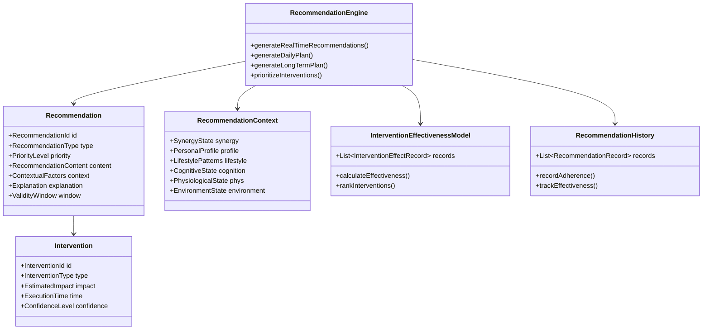

---

# **4.8.5 Core Aggregates**

1. **RecommendationPlan (Aggregate Root)**  
2. **Recommendation**  
3. **Intervention**  
4. **InterventionEffectivenessModel**  
5. **RecommendationHistory**  
6. **ContextSnapshot** (derived VO)

---

# **4.8.6 Aggregate Specifications**

---

## **A. RecommendationPlan (Aggregate Root)**

Represents:

- daily plan  
- real-time recommendations  
- scheduled interventions  
- long-term strategy  

It is **recomputed** whenever:

- SynergyStateUpdated  
- Baselines change  
- Predictions change  
- Intervention response changes  
- Lifestyle drift detected  
- Context changes  

### Contains:
- List<Recommendation>  
- Priority tiers  
- Validity windows  
- Execution ordering  
- Confidence weights  

---

## **B. Recommendation**

Contains:

- type (recovery, performance, lifestyle, stress reduction, etc.)  
- priority (Critical → Low)  
- content (action)  
- time sensitivity  
- explanation (why this was recommended)  
- estimated impact  
- personalized justification (from PIP)  
- confidence level  
- feasibility score  

---

## **C. Intervention**

Backs each recommendation, specifying:

- what to do  
- how long  
- intensity  
- expected effect  
- user’s historical effectiveness  

Interventions are domain objects like:

- breathing exercise  
- 90-second reset  
- power nap  
- deep work session  
- micro-break  
- hydration  
- movement  
- self-reflection  
- daylight exposure  
- cognitive defragmentation walk  

---

## **D. InterventionEffectivenessModel**

Tracks:

- how a user responded to interventions  
- personalized improvements  
- effectiveness curves  
- diminishing returns  
- rebound effects  

Feeds into PIP and Synergy BC.

---

## **E. RecommendationHistory**

Tracks:

- adherence  
- skipped recommendations  
- user reaction  
- effect on real metrics  
- effect on synergy state  
- how well the recommendation worked  

---

# **4.8.7 Key Value Objects**

- PriorityLevel  
- EstimatedImpact  
- ConfidenceLevel  
- RecommendationContent  
- Explanation  
- ValidityWindow  
- ContextualFactors  
- FeasibilityScore  

VOs enforce:
- domain rules  
- consistency  
- safety constraints  
- personalization  

---

# **4.8.8 Commands**

```csharp
public record GenerateRealTimeRecommendations(
    UserId UserId,
    RecommendationContext Context
);

public record GenerateDailyPlan(
    UserId UserId,
    RecommendationContext Context
);

public record GenerateLongTermPlan(
    UserId UserId,
    RecommendationContext Context
);

public record RecordRecommendationAdherence(
    RecommendationId RecommendationId,
    UserId UserId,
    bool IsCompleted,
    DateTime Timestamp
);
```

---

# **4.8.9 Queries**

```csharp
public record GetCurrentRecommendations(UserId UserId);

public record GetDailyPlan(UserId UserId);

public record GetLongTermPlan(UserId UserId);

public record GetRecommendationHistory(UserId UserId);

public record GetInterventionRanking(UserId UserId);
```

---

# **4.8.10 Domain Events**

### 🔹 RecommendationGenerated  
### 🔹 DailyPlanGenerated  
### 🔹 LongTermPlanGenerated  
### 🔹 RecommendationAdherenceRecorded  
### 🔹 InterventionEffectivenessUpdated  
### 🔹 HighPriorityInterventionTriggered  

These events feed:

- Routine Automation BC  
- Notification BC  
- Synergy BC  
- Analytics BC  
- PIP BC (feedback integration)  
- Behavioral Prediction BC (to refine future recommendations)

---

# **4.8.11 Domain Policies**

### **Policy 1 — First, Do No Harm**
Never recommend an intervention that could worsen:
- stress  
- fatigue  
- cognitive load  
- physiological strain  

### **Policy 2 — Personal Threshold Compliance**
Recommendations must respect:
- stress thresholds  
- fatigue thresholds  
- chronotype  
- recovery windows  
- overload sensitivity  

### **Policy 3 — “No Spam” Policy**
Avoid recommending too many actions.

### **Policy 4 — Explainability**
Every recommendation must include a machine-readable explanation.

### **Policy 5 — Intervention Diversity**
Avoid repeating the same intervention too frequently (unless necessary).

### **Policy 6 — Priority Consistency**
Critical recommendations override all other plans.

---

# **4.8.12 Integration Architecture**

### **Upstream Inputs**
- Synergy BC  
- PIP BC  
- Physiological BC  
- Cognitive BC  
- Lifestyle BC  
- Behavior Prediction BC  
- User Context: task, environment, location  
- Device Integration BC (real-time changes)  

### **Downstream Outputs**
- Routine Automation BC (for execution)  
- Notification BC  
- Behavioral Prediction (feedback)  
- Analytics  
- Synergy BC (recommendation effectiveness)  

---

# **4.8.13 Recommendation Generation Pipeline**

### Step 1 — Context Construction
Combine:
- synergy state  
- baselines  
- thresholds  
- lifestyle model  
- predicted risks  
- real-time context  

### Step 2 — Intervention Ranking
Based on:
- expected impact  
- historical effectiveness  
- feasibility  
- readiness level  
- stress/fatigue state  
- time-of-day  

### Step 3 — Intervention Selection
Rules:
- avoid harm  
- avoid overload  
- must be actionable  
- must fit context  

### Step 4 — Recommendation Generation
Each intervention → recommendation object.

### Step 5 — Explanation Layer
Generate:
- reason  
- factor influences  
- synergy components  

### Step 6 — Delivery Layer
Send to:
- Routine Automation  
- Notification Engine  

---

# **4.8.14 Improvements Over Earlier Architecture**

| Before | After (Enhanced Recommendation Engine) |
|--------|---------------------------------------|
| No personalization | Fully personal-profile-driven |
| No synergy integration | Cross-domain synergy input |
| No context awareness | Real-time context with environment |
| No intervention ranking | AI-based intervention effectiveness |
| No adaptive learning | Learning from adherence & outcomes |
| No explainability | Fully explainable recommendations |
| No feasibility filtering | Recommendations filtered by time, context, energy |
| No chaining | Multi-step plans with macro/meso/micro layers |

---

# **4.8.15 Summary**

The **Recommendation Engine BC** is the action-intelligence system:

- deeply personalized  
- context-sensitive  
- multi-layer (micro/meso/macro)  
- biologically safe  
- cognitively aware  
- adaptive over time  
- explainable  
- scalable  
- integrated with all other BCs  

It is the **core of user engagement and real-world value**.

---

# **PART 4.9 — Routine & Behavior Automation BC**  
### *Core–Execution Domain | Automation-Oriented | High System Value*

---

# **4.9.1 Context Overview**

### **Purpose**
The Routine & Behavior Automation BC orchestrates:

- automated routines  
- scheduled recommendations  
- behavior-triggered actions  
- time-based actions  
- condition-based triggers (IFTTT-like)  
- micro-loop execution (e.g., Pomodoro cycles)  
- adaptive rescheduling  
- environment-aware actions  
- real-time nudges  

Where other BCs decide *what*, this BC ensures:

- **when** it should run  
- **under what conditions**  
- **how often**  
- **with what constraints**  
- **with what fallback behavior**  
- **with what monitoring**  

---

# **4.9.2 Responsibilities**

### ✔ INCLUDED
- Behavior automation rules  
- Routine scheduling and maintenance  
- Trigger-based behavior execution  
- Adaptive scheduling (based on readiness/stress/fatigue)  
- Micro-cycle automation (deep work, recovery cycles, movement breaks)  
- Event-driven routines (e.g., “start focus when noise < threshold”)  
- Device-triggered routines  
- Handling execution status (completed, aborted, interrupted)  
- Real-time reactivity to Synergy states  
- Managing conflicts between routines  
- Overload prevention (via PIP thresholds)  

### ❌ EXCLUDED
- generating recommendations (Recommendation Engine BC)  
- computing readiness/stress/fatigue (Synergy BC)  
- computing baselines/traits/thresholds (PIP)  
- behavioral prediction (Prediction BC)  
- raw sensor handling (Device Integration BC)  

This BC only **executes**, **monitors**, and **adjusts**.

---

# **4.9.3 Routine Automation Domain Model Diagram**

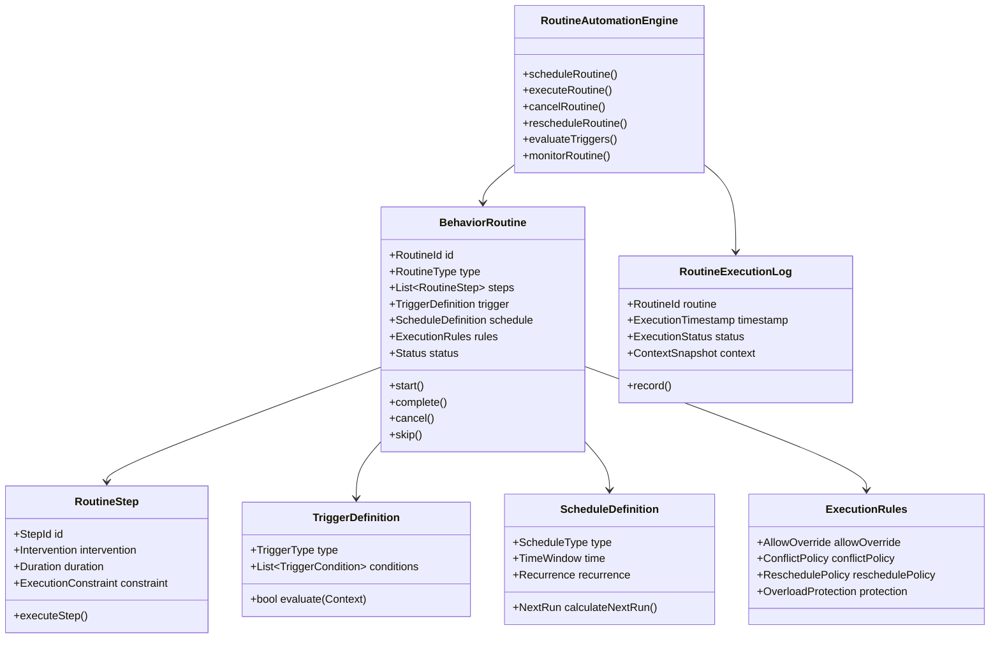

---

# **4.9.4 Aggregate Specifications**

---

# **A. BehaviorRoutine (Aggregate Root)**

A routine is a **multi-step, rule-based, trigger-based automation program**.

### Examples:
- Morning starter routine  
- Night wind-down routine  
- Deep work cycle  
- Recovery protocol (post-high-stress)  
- Post-exercise cooldown  
- Focus → break → reset loops  
- Hydration or movement reminders  
- Triggered breathing reset (when stress high)  
- Adaptive break scheduler  

### Fields:
- id  
- type (health, cognitive, lifestyle, recovery, productivity)  
- steps  
- triggers  
- schedule  
- rules  
- status  

### Behaviors:
- start()  
- executeNextStep()  
- complete()  
- cancel()  
- skip()  
- evaluateTriggers()  
- reschedule()  

---

# **B. RoutineStep**

Represents a single step within a routine.

Example:
- 2-minute breathing  
- 45-minute deep work  
- 10-minute walk  
- adjust lighting  
- drink water  
- stretch  
- micro-reset routine  

Contains:
- intervention (from Recommendation Engine)  
- duration / constraints  
- intensity  
- expected impact  

---

# **C. TriggerDefinition**

Triggers activate routines based on:

### **Types**
1. **Time-based**  
   - “at 7 AM”  
   - “every 90 minutes”  
   - “every Monday”  

2. **State-based**  
   - readiness < 40  
   - stress > threshold  
   - fatigue > threshold  

3. **Prediction-based**  
   - predicted burnout risk rising  
   - predicted fatigue spike  

4. **Context-based**  
   - noise low  
   - posture poor  
   - location changes  
   - device interaction  

5. **Event-based**  
   - recommendation triggered  
   - workout completed  
   - sleep ended  
   - meeting started  

---

# **D. ScheduleDefinition**

Defines recurrence and timing:

- fixed schedule  
- flexible window  
- adaptive scheduling  
- circadian-aligned scheduling  
- recovery-aware scheduling  
- overload-preventing scheduling  

---

# **E. ExecutionRules**

Controls behavior management:

- allow override?  
- auto-cancel if conflict?  
- reschedule if impossible?  
- avoid overload based on PIP thresholds  
- avoid cognitive interference  
- avoid stress escalation  

Rules are enforced in domain logic.

---

# **F. RoutineExecutionLog**

Tracks:

- success  
- failure  
- cancellation  
- user reasons  
- interruption  
- effectiveness (Synergy delta)  
- adherence score  

Logs feed:
- Recommendation Engine  
- PIP intervention response  
- Behavior Prediction BC  

---

# **4.9.5 Key Value Objects**

- TriggerCondition  
- Recurrence  
- ExecutionConstraint  
- ConflictPolicy  
- ReschedulePolicy  
- OverloadProtection  
- TimeWindow  
- NextRun  
- RoutineStatus  

All have strong invariants.

---

# **4.9.6 Commands**

```csharp
public record CreateRoutine(
    UserId UserId,
    RoutineType Type,
    List<RoutineStep> Steps,
    TriggerDefinition Trigger,
    ScheduleDefinition Schedule,
    ExecutionRules Rules
);

public record ModifyRoutine(
    RoutineId RoutineId,
    List<RoutineStep>? Steps,
    TriggerDefinition? Trigger,
    ScheduleDefinition? Schedule
);

public record DeleteRoutine(RoutineId RoutineId);

public record ExecuteRoutine(
    RoutineId RoutineId,
    DateTime Timestamp,
    ContextSnapshot Context
);

public record RecordStepCompletion(
    RoutineId RoutineId,
    StepId StepId,
    DateTime Timestamp,
    ExecutionStatus Status
);

public record RescheduleRoutine(
    RoutineId RoutineId,
    DateTime NextRun
);
```

---

# **4.9.7 Queries**

```csharp
public record GetActiveRoutines(UserId UserId);

public record GetRoutine(RoutineId RoutineId);

public record GetNextScheduledRoutines(UserId UserId);

public record GetRoutineHistory(UserId UserId);

public record GetExecutableRoutines(
    UserId UserId,
    ContextSnapshot CurrentContext
);
```

---

# **4.9.8 Domain Events**

### 🔹 RoutineCreated  
### 🔹 RoutineModified  
### 🔹 RoutineDeleted  
### 🔹 RoutineTriggered  
### 🔹 RoutineStarted  
### 🔹 RoutineStepCompleted  
### 🔹 RoutineCompleted  
### 🔹 RoutineSkipped  
### 🔹 RoutineCanceled  
### 🔹 RoutineFailed  
### 🔹 RoutineRescheduled  
### 🔹 ConflictDetected  
### 🔹 OverloadProtectionActivated  

Events trigger downstream:

- Notifications  
- Recommendation Engine updates  
- Synergy BC re-evaluation  
- Prediction BC learning  
- Analytics logging  

---

# **4.9.9 Domain Policies**

### **Policy 1 — Overload Avoidance**
Routine execution cannot proceed if:
- Synergy → StressComposite high  
- Synergy → FatigueComposite high  
- PIP → thresholds exceeded  

### **Policy 2 — Chronotype Alignment**
Time-sensitive routines must align with chronotype unless overridden.

### **Policy 3 — No Conflict Execution**
Two conflicting routines cannot run concurrently (e.g., “focus” + “recovery”).

### **Policy 4 — Adaptive Rescheduling**
If a routine is skipped due to:
- low readiness  
- high fatigue  
- environmental mismatch  

It auto-reschedules using PIP’s optimization rules.

### **Policy 5 — Micro-Interruption Handling**
If routine interrupted → fallback plan executed.

### **Policy 6 — Step-by-Step Validation**
Each step must meet its own constraints.

---

# **4.9.10 Integration Architecture**

### **Upstream Inputs**
- Recommendation Engine BC  
- Synergy BC  
- Lifestyle BC  
- Behavior Prediction BC  
- PIP BC thresholds  
- Device Integration (environmental triggers)  
- Health & Cognitive BCs (for context changes)

### **Downstream Outputs**
- Notifications (for reminders)  
- Analytics  
- Behavior Prediction BC (adherence/response signals)  
- PIP BC (routine effectiveness)  
- Synergy BC (post-step recalculation)  

---

# **4.9.11 Examples of Routine Automation**

### 1. Adaptive Deep Work Cycle
- Trigger: user starts work session  
- Steps:  
  - 45 min focus block  
  - 5 min breathing  
  - 10 min walk  
- Adaptive: shorter blocks if stress high  

### 2. Morning Starter
- Time-based: 7–8 AM window  
- Steps: stretch → hydration → daylight exposure → 5-min planning  

### 3. Stress Recovery
- Trigger: Synergy stress > threshold  
- Steps: breathing → walk → water → stretch  
- Cancel if stress returns to normal  

### 4. Sleep Wind-down
- Trigger: 60 min before bedtime or fatigue > threshold  
- Steps: detach → dim lights → mindfulness → journaling  

---

# **4.9.12 Improvements Over Previous Architecture**

| Before | After |
|--------|--------|
| No automation layer | Full domain automation engine |
| No execution | Multi-step execution engine |
| No triggers | Rich trigger model (state, time, prediction, environment) |
| No adaptation | Adaptive rescheduling & overload protection |
| No conflict control | Conflict, feasibility & overload rules |
| No step execution | Per-step domain constraints |
| No learning feedback | Full integration with PIP & Prediction BC |
| Monolithic reminders | Structured routines with business logic |

---

# **4.9.13 Summary**

The **Routine & Behavior Automation BC** transforms intelligence into action.  
It ensures the platform:

- automates daily systems  
- adapts routines to physiology, cognition, and lifestyle  
- respects user thresholds  
- avoids overload  
- provides stable behavior structures  
- integrates with prediction & synergy  
- supports health, cognitive performance, and lifestyle alignment  
- builds habits through automation  
- enforces consistency at scale  

It is the **Execution Engine** of the entire platform.

---

# **PART 4.10 — Behavior Prediction BC (Core–Strategic Predictive Domain)**

---

# **4.10.1 Context Overview**

### **Purpose**
The **Behavior Prediction BC** generates forecasts about:

- adherence probability  
- fatigue trajectory  
- stress trajectory  
- cognitive load trajectory  
- burnout risk  
- circadian drift  
- lifestyle drift  
- routine failure likelihood  
- workload feasibility  
- intervention success probability  

It is **not machine learning itself**—ML models may power it,  
but the BC encapsulates domain logic, invariants, and interpretation.

### Predictions are stored as:
- BehaviorPrediction objects  
- short-term, mid-term, and long-term forecasts  

---

# **4.10.2 Responsibilities**

### ✔ INCLUDED
- Behavioral signal extraction  
- Trend and drift detection  
- Prediction of adherence to routines/habits  
- Stress and fatigue forecasting  
- Predictive burnout warning  
- Cognitive performance forecasting  
- Recovery forecasting  
- Providing predictions to Synergy BC  
- Providing predictions to Recommendation Engine  
- Prediction confidence calibration  
- Interpretability layer (inputs, weights, reasoning)  
- Multi-timescale forecasting  
- Triggering proactive actions  

### ❌ EXCLUDED
- Executing routines (Routine Automation BC)  
- Generating recommendations (Recommendation Engine BC)  
- Raw ML pipelines (Analytics/ML layer)  
- Baseline generation (PIP BC)  
- Raw metric modeling (Health/Physiology/Cognitive BCs)

---

# **4.10.3 Prediction Types**

### **1. Adherence Predictions**
- habit adherence  
- routine adherence  
- intervention completion probability  

### **2. State Trajectory Predictions**
- stress rise forecast  
- fatigue build-up  
- cognitive load drift  
- clarity degradation  

### **3. Risk Predictions**
- burnout risk  
- overload risk  
- circadian misalignment risk  
- lifestyle drift risk  

### **4. Performance Predictions**
- focus feasibility  
- productivity potential  
- mental energy curve for the day  
- best action window forecasts  

### **5. Health–Cognitive Interaction Predictions**
- how stress affects cognition  
- how fatigue affects productivity  
- how sleep loss affects performance  

---

# **4.10.4 Behavior Prediction Domain Model Diagram**

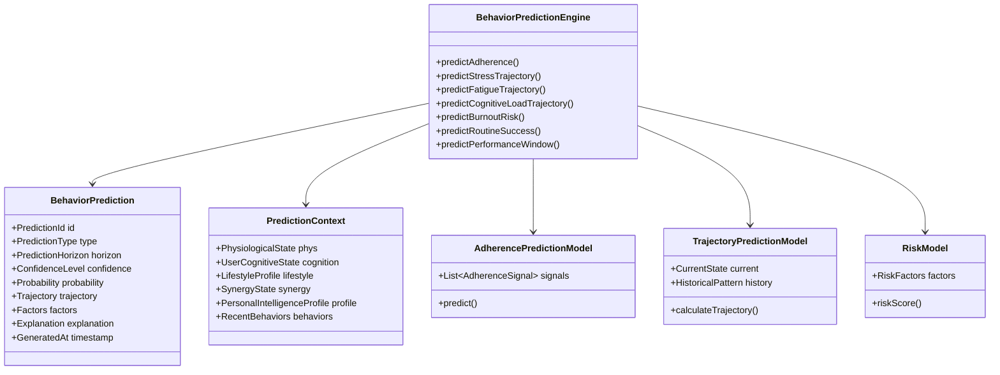

---

# **4.10.5 Aggregate Specifications**

---

## **A. BehaviorPrediction (Aggregate Root)**

Represents a forecast with:

- probability  
- confidence  
- trajectory  
- explanatory factors  
- prediction horizon  

### Invariants:
- prediction must include confidence  
- predictions cannot conflict (e.g., high probability of fatigue & high probability of peak readiness simultaneously)  
- explanations must reference domain signals only  
- predictions must be horizon-scoped  

---

## **B. AdherencePredictionModel**

Uses:
- past adherence  
- motivation style (PIP)  
- stress & fatigue  
- lifestyle consistency  
- intervention effectiveness  
- time-of-day behavior  
- chronotype compliance  

Computes:
- probability of completing a habit or routine  
- predicted time to decay/streak break  

Output examples:
- 78% chance you will skip evening routine  
- 92% chance deep work session will fail due to fatigue  

---

## **C. TrajectoryPredictionModel**

Two sub-models:

### StressTrajectory
- stress will rise 20–30% in next 2 hours  
- stress spike predicted at 4 PM  

### FatigueTrajectory
- fatigue accumulation curve  
- expected fatigue decline after nap  

### CognitiveLoadTrajectory
- predicted load drift under current task  

### RecoveryTrajectory
- expected recovery over night  
- expected recovery over weekend  

---

## **D. RiskModel**

Models:
- burnout  
- overload  
- task failure likelihood  
- cognitive breakdown risk  
- circadian drift risk  

Outputs include:
- Risk score  
- Risk level  
- Contributing factors  
- Mitigation urgency  

---

# **4.10.6 Prediction Horizons**

### **Short-term** (seconds → hours)
- micro-behavior  
- task-level prediction  
- moment-to-moment stability  

### **Medium-term** (daily)
- daily state predictions  
- energy and cognitive cycles  

### **Long-term** (weekly → monthly)
- burnout risk  
- lifestyle drift  
- habit adherence decay  
- chronic fatigue prediction  

---

# **4.10.7 Commands**

```csharp
public record PredictAdherence(
    UserId UserId,
    PredictionContext Context,
    PredictionHorizon Horizon
);

public record PredictStressTrajectory(
    UserId UserId,
    PredictionContext Context
);

public record PredictFatigueTrajectory(
    UserId UserId,
    PredictionContext Context
);

public record PredictBurnoutRisk(
    UserId UserId,
    PredictionContext Context
);

public record PredictPerformanceWindow(
    UserId UserId,
    PredictionContext Context
);
```

---

# **4.10.8 Queries**

```csharp
public record GetPredictions(UserId UserId);

public record GetPrediction(PredictionId Id);

public record GetAdherencePredictions(UserId UserId);

public record GetStressTrajectory(UserId UserId);

public record GetFatigueTrajectory(UserId UserId);

public record GetBurnoutRisk(UserId UserId);
```

---

# **4.10.9 Domain Events**

### 🔹 BehaviorPredictionGenerated  
### 🔹 AdherencePredictionGenerated  
### 🔹 StressTrajectoryPredicted  
### 🔹 FatigueTrajectoryPredicted  
### 🔹 BurnoutRiskPredicted  
### 🔹 PredictionConfidenceLow  
### 🔹 HighRiskDetected  
### 🔹 EarlyWarningTriggered  

Events feed:

- Synergy BC  
- Recommendation Engine (proactive suggestions)  
- Routine Automation BC (predictive rescheduling)  
- Lifestyle BC (drift detection)  
- PIP (for threshold adjustment)  

---

# **4.10.10 Domain Policies**

### **Policy 1 — Prediction Stability**
Predictions cannot fluctuate wildly:
- smoothing  
- confidence weighting  
- temporal consistency  

### **Policy 2 — Explanability**
All predictions must include:
- input factors  
- weights  
- confidence score  
- interpretation  

### **Policy 3 — No Contradictory Predictions**
Two predictions cannot conflict unless:
- one has significantly lower confidence  
- horizon mismatch validated  

### **Policy 4 — Safety Threshold**
Burnout risk > 70% → immediate escalation.

### **Policy 5 — Horizon-specific validity**
Short-term predictions expire quickly.

---

# **4.10.11 Integration Architecture**

### **Upstream Inputs**
- PIP BC  
- Synergy BC  
- Physiological BC  
- Cognitive BC  
- Lifestyle BC  
- Routine Automation BC (adherence signals)  
- Recommendation Engine BC (intervention success)  

### **Downstream Outputs**
- Synergy BC (prediction factors)  
- Recommendation Engine BC (anticipatory guidance)  
- Routine Automation BC (adaptive scheduling)  
- Analytics  
- PIP (feedback loops)  

---

# **4.10.12 Behavioral Prediction Examples**

### **1. Fatigue Spike Forecast**
- *Fatigue expected to rise by 25% in next 90 minutes.*  
Triggers early recovery suggestions.

### **2. Late-Night Stress Climb**
- *Based on circadian misalignment and lifestyle drift, stress will likely rise at 10 PM.*  

### **3. Burnout Early Warning**
- *Burnout risk: 65% over next 10 days.*  

### **4. Routine Failure Prediction**
- *Evening routine adherence probability: 43% (low).*  
Triggers Behavior Automation BC to simplify routine.

### **5. Focus Failure Prediction**
- *High likelihood that the upcoming deep work session will fail due to cognitive fatigue.*  

---

# **4.10.13 Improvements Over Previous Architecture**

| Before | After |
|--------|-------|
| No forecasting | Multi-scale prediction models |
| No adherence prediction | Full adherence model with probability |
| No risk prediction | Burnout, overload, drift predictions |
| No synergy integration | Predictions directly influence synergy |
| No automation adaptation | Predictions drive rescheduling |
| No personalization | Predictions use PIP baselines and thresholds |
| No explanations | Every prediction is explainable |

---

# **4.10.14 Summary**

The **Behavior Prediction BC** transforms the platform into a proactive intelligence system.  

It enables:

- early interventions  
- automated break scheduling  
- adaptive workload management  
- proactive burnout prevention  
- smarter routine automation  
- personalized performance forecasting  
- anticipatory well-being support  

It is a **foundational AI-driven capability** that all other BCs build upon.

---

# **PART 4.11 — Physiological Modeling BC (Core–Scientific Domain)**

---

# **4.11.1 Context Overview**

### **Purpose**
The **Physiological Modeling Bounded Context** transforms raw biological signals into structured domain concepts:

- recovery  
- fatigue  
- strain  
- stress physiology  
- readiness-to-perform physically  
- recovery curves  
- sleep physiology  
- circadian alignment  
- autonomic nervous system balance (ANS)  
- biological load  
- HRV interpretation  
- respiration signatures  
- nocturnal restoration  

This BC provides the **biological truth** that powers:

- Synergy BC  
- Prediction BC  
- Recommendation Engine BC  
- Lifestyle BC  
- PIP baselines  
- Readiness calculations  
- Stress and fatigue composites  

It is strictly *biological* and does not interpret psychological, cognitive, or behavioral components.

---

# **4.11.2 Responsibilities**

### ✔ INCLUDED
- Multivariate physiological signal processing  
- HRV interpretation  
- Strain modeling  
- Recovery modeling  
- Fatigue modeling (biological)  
- Sleep architecture modeling  
- Circadian alignment modeling  
- Respiration analysis  
- ANS balance modeling (Sympathetic vs Parasympathetic)  
- Biological thresholds and safety limits  
- Short-term and long-term physiological trend detection  
- Physiological readiness scoring (raw)  

### ❌ EXCLUDED
- Cognitive load or mental energy scoring (Cognitive BC)  
- Behavioral patterns (Lifestyle BC)  
- Recommendations (Recommendation BC)  
- Predictive modeling (Prediction BC)  
- Device-specific parsing (Device Integration BC)  
- Personalization baselines (PIP BC)  

This BC produces **pure physiological interpretations**, domain rich, not device-specific.

---

# **4.11.3 Core Physiological Concepts**

The BC defines the following physiological models:

### **1. Recovery Model (RM)**
Represents how recovered the body is after strain.

### **2. Fatigue Model (FM)**
Quantifies physical exhaustion level.

### **3. Strain Model**
Describes biological load from:
- activity  
- stress  
- elevated heart rate  
- environmental conditions  

### **4. Cardiovascular Readiness**
Derived from:
- HRV  
- RHR  
- HRV Trend  
- RHR Trend  

### **5. ANS Balance**
Sympathetic ↔ Parasympathetic state.

### **6. Sleep Architecture Model**
- sleep onset latency  
- sleep continuity  
- sleep cycles  
- REM %, Deep %, Light %, Wake %  
- sleep stability  
- nocturnal HRV  

### **7. Circadian Rhythm Model**
- phase  
- amplitude  
- alignment index  
- phase drift  

### **8. Respiration Model**
- breathing rate  
- variability  
- stress-signature breath patterns  

---

# **4.11.4 Physiological Modeling Domain Model Diagram**

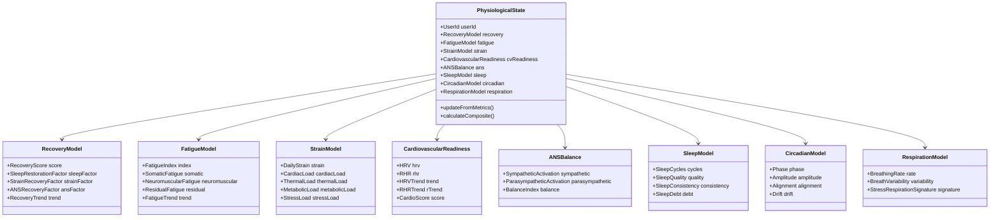

---

# **4.11.5 Aggregate Specifications**

---

## **A. PhysiologicalState (Aggregate Root)**  
Represents *complete biological state*.

Fields:
- RecoveryModel  
- FatigueModel  
- StrainModel  
- CardiovascularReadiness  
- SleepModel  
- CircadianModel  
- RespirationModel  
- CompositePhysiologyScore  

Invariants:
- All sub-models must be consistent  
- Sleep debt cannot be negative  
- Biological trends must remain physiologically plausible  
- ANS balance must be normalized across models  

Behaviors:
- updateFromMetrics()  
- calculateComposite()  
- detectAbnormalTrends()  
- generateBadges (e.g., “High Recovery Day”)  


---

## **B. RecoveryModel**

Key factors:
- sleep restoration  
- ANS recovery  
- strain recovery  
- inflammation indicators (optional extension)  

Outputs:  
- RecoveryScore  
- RecoveryTrend  

---

## **C. FatigueModel**

Three primary sub-types:

1. **Somatic Fatigue**  
   - muscular exhaustion  
   - soreness  
   - mechanical load  

2. **Neuromuscular Fatigue**  
   - impaired muscle firing  
   - low twitch response  

3. **Residual Fatigue**  
   - accumulated over days  
   - independent of activity  

Result:
- FatigueIndex (0–100)  
- Trend  

---

## **D. StrainModel**

Components:
- Cardiac Load  
- Respiratory Load  
- Metabolic Load  
- Stress Load  
- Thermal Load (humidity/heat-based)  

DailyStrain is a composite measure.

---

## **E. CardiovascularReadiness**

Inputs:
- HRV Baseline vs Today  
- RHR Baseline vs Today  
- Trend Over Last 7 Days  

Outputs:
- CardioScore  
- HRV State (Below/Above baseline)  
- RHR State  

---

## **F. ANSBalance**

Represents:
- Sympathetic Nervous System (SNS) activation  
- Parasympathetic Nervous System (PNS) recovery  

Outputs:
- ANS Balance Index  
- Stress Signature  

---

## **G. SleepModel**

Tracks:
- cycles  
- deep/REM/light distributions  
- continuity  
- sleep efficiency  
- restfulness  
- circadian alignment during sleep  

Outputs:
- SleepQuality  
- SleepRestorationScore  
- SleepDebt  
- SleepStability  

---

## **H. CircadianModel**

Represents:
- phase  
- amplitude  
- alignment (with chrono-lifestyle)  
- drift (forward/backward shifting)  

Important for:
- Synergy  
- PIP chronotype calibration  
- Recommendation Engine timing  

---

## **I. RespirationModel**

Respiration signals often reveal:
- stress  
- anxiety  
- physical tension  
- hyperventilation  
- poor recovery  

Outputs:
- stress signature  
- breath pattern anomalies  

---

# **4.11.6 Key Value Objects**

- RecoveryScore  
- FatigueIndex  
- DailyStrain  
- HRV  
- RHR  
- ANS Balance Index  
- CircadianAlignment  
- SleepDebt  
- SleepQuality  
- BreathingRate  
- CardioScore  

All enforce strict biological invariants.

---

# **4.11.7 Commands**

```csharp
public record UpdatePhysiologicalState(
    UserId UserId,
    PhysiologicalMetrics Metrics,
    DateTime Timestamp
);

public record ProcessSleepSession(
    UserId UserId,
    SleepSession Session
);

public record ProcessHRVMetrics(
    UserId UserId,
    HRVMetrics Hrv
);

public record ProcessActivityMetrics(
    UserId UserId,
    ActivityMetrics Activity
);
```

---

# **4.11.8 Queries**

```csharp
public record GetPhysiologicalState(UserId UserId);

public record GetRecoveryState(UserId UserId);

public record GetFatigueState(UserId UserId);

public record GetCircadianState(UserId UserId);

public record GetSleepState(UserId UserId);
```

---

# **4.11.9 Domain Events**

### 🔹 PhysiologicalStateUpdated  
### 🔹 RecoveryUpdated  
### 🔹 FatigueUpdated  
### 🔹 SleepModelUpdated  
### 🔹 CircadianAlignmentChanged  
### 🔹 ANSBalanceChanged  
### 🔹 HighStrainDetected  
### 🔹 PhysiologicalRiskDetected  

These feed:

- Synergy BC  
- Lifestyle BC  
- Prediction BC  
- Recommendation Engine  
- PIP BC  

---

# **4.11.10 Domain Policies**

### **Policy 1 — Biological Plausibility**
Values must be within physiologically valid ranges.

### **Policy 2 — Trend Stability**
Trend changes cannot be too abrupt without justification.

### **Policy 3 — Sleep Debt Integrity**
Sleep debt cannot be negative.

### **Policy 4 — HRV Baseline Adjustment**
HRV deviations must be interpreted relative to baseline (from PIP).

### **Policy 5 — Circadian Drift Constraints**
Drift cannot exceed certain physiological limits.

### **Policy 6 — Fatigue Safety**
FatigueIndex > certain threshold triggers warnings.

---

# **4.11.11 Integration Architecture**

### **Upstream Inputs**
- Device Integration BC (raw metrics after ACL translation)  
- Sleep data  
- HRV data  
- Heart rate data  
- Respiration data  
- Movement/activity  

### **Downstream Outputs**
- PIP BC (for baseline calculations)  
- Synergy BC (core input)  
- Lifestyle BC (circadian signals)  
- Prediction BC (for forecasts)  
- Recommendation Engine BC (timing and safety)  
- Routine Automation BC (for recovery-based schedule changes)  

---

# **4.11.12 Examples of Physiological Modeling**

### **1. Recovery Modeling Example**
- HRV +15% above baseline = positive recovery  
- RHR –4 BPM vs baseline = restored  
- Strain: moderate  
→ RecoveryScore: 85 (High)

### **2. Fatigue Modeling Example**
- sleep debt: 1.5 hours  
- high previous-day strain  
- low HRV  
→ FatigueIndex: 67 (Elevated)

### **3. Circadian Model Example**
- phase delayed by 1.5 hours  
- amplitude low  
→ Circadian misalignment detected

---

# **4.11.13 Improvements Over Previous Architecture**

| Before | After |
|--------|--------|
| No deep physiology modeling | Full physiological engine |
| No ANS modeling | Sympathetic/parasympathetic balance |
| No circadian alignment model | Complete circadian model |
| No recovery model | Multi-factor recovery modeling |
| No biological fatigue | True biological fatigue curves |
| No respiration analysis | Respiration stress signatures |
| No composite physiology | Integrated physiological state |

---

# **4.11.14 Summary**

The **Physiological Modeling BC** is the biological backbone of the system.  
It provides:

- recovery  
- fatigue  
- strain  
- sleep physiology  
- circadian alignment  
- respiration patterns  
- ANS balance  
- biological readiness  

Its outputs drive:
- Synergy  
- Prediction  
- Recommendations  
- PIP  
- Lifestyle alignment  
- Automation scheduling  

This BC ensures the platform is *scientifically grounded* and capable of modeling human physiology accurately and dynamically.

---

# **PART 4.12 — Cognitive Modeling BC (Core–Strategic Cognitive Intelligence Domain)**

---

# **4.12.1 Context Overview**

### **Purpose**
The **Cognitive Modeling BC** constructs a detailed, moment-to-moment *cognitive state model* for the user, including:

- cognitive load  
- mental energy  
- clarity  
- attentional stability  
- working memory availability  
- cognitive fatigue  
- switching cost  
- decision fatigue  
- processing speed  
- cognitive drift  
- cognitive stress  

It covers **the internal mental mechanics**, not psychological wellbeing (Wellness BC) nor behavior (Lifestyle BC).

It powers:

- Synergy BC  
- Prediction BC  
- PIP calibration  
- Focus session optimization  
- Recommendation Engine BC  
- Task difficulty mapping  
- Cognitive performance forecasting  

---

# **4.12.2 Responsibilities**

### ✔ INCLUDED
- Real-time cognitive load modeling  
- Subjective + objective cognitive load fusion  
- Mental energy modeling  
- Cognitive fatigue modeling  
- Cognitive clarity index  
- Attentional bandwidth  
- Task-specific load modeling  
- Switching cost modeling  
- Cognitive–task matching  
- Cognitive drift detection  
- Cognitive baseline maintenance (with PIP BC)  
- Cognitive thresholds  
- Deep work suitability modeling  
- Cognitive restoration modeling  
- Intra-day cognitive cycles  

### ❌ EXCLUDED
(belong to other BCs)

- Stress from physiology (Physiological BC)  
- Emotional state (Wellness BC)  
- Long-term predictions (Prediction BC)  
- Personalization baselines (PIP BC)  
- External influences (Lifestyle BC)  
- Routine scheduling (Automation BC)  
- Motivation (PIP BC)  
- Skill/learning growth modeling (Learning BC)  

This BC focuses strictly on **cognitive mechanics**.

---

# **4.12.3 Core Cognitive Constructs**

The BC models the following cognitive phenomena:

### **1. Cognitive Load**
- intrinsic load (task complexity)  
- extraneous load (distractions, environment)  
- germane load (learning/conceptual processing)  

### **2. Mental Energy**
- neurocognitive energy reserve  
- mid-day dip  
- depletion rate  
- replenishment depending on recovery  

### **3. Cognitive Fatigue**
- acute fatigue  
- accumulated cognitive fatigue  
- neural efficiency decline  

### **4. Cognitive Clarity**
- clarity vs fog index  
- executive function strength  
- decision-making readiness  

### **5. Attentional Dynamics**
- attentional stability  
- attentional dispersion  
- drift  
- attentional collapse events  

### **6. Working Memory Availability**
Capacity to hold/manipulate information during tasks.

### **7. Processing Speed**
Rate of thought processing, often tied to mental energy.

### **8. Switching Cost**
Cost of context switching between tasks.

### **9. Task-Cognitive Fit Modeling**
Whether the user’s current state is suitable for:
- deep work  
- creative work  
- problem solving  
- admin tasks  
- learning tasks  
- communication-heavy tasks  

---

# **4.12.4 Cognitive Modeling Domain Model Diagram**

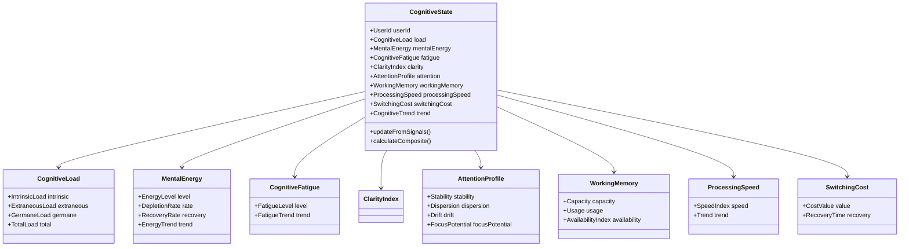

---

# **4.12.5 Aggregate Specifications**

---

## **A. CognitiveState (Aggregate Root)**

Represents the user’s **complete current cognitive condition**.

Invariants:
- total cognitive load must mathematically equal sum of load components  
- cognitive fatigue cannot be negative  
- clarity cannot increase when mental energy is near zero  
- switching cost cannot be negative  
- attention drift must follow trend constraints  
- working memory availability must remain consistent with load  

Behaviors:
- updateFromSignals()  
- calculateComposite()  
- detectCognitiveCollapseRisk()  
- determineTaskSuitability()  
- computeDeepWorkScore()  

---

## **B. CognitiveLoad**

### **Intrinsic load**  
Depends on task complexity.

### **Extraneous load**  
Depends on:
- environment  
- interruptions  
- multitasking  
- emotional interference  

### **Germane load**  
Depends on:
- learning  
- conceptualization  
- problem-solving  

TotalLoad = Intrinsic + Extraneous + Germane

---

## **C. MentalEnergy**

Dynamic state updated by:

- sleep  
- recovery  
- nutrition  
- time of day  
- circadian alignment  
- cognitive fatigue  
- strain from physiological side  

Characterized by:

- EnergyLevel  
- DepletionRate  
- RecoveryRate  

Trend:
- Rising  
- Stable  
- Falling  

---

## **D. CognitiveFatigue**

- acute cognitive overload  
- accumulated fatigue  
- reduced executive function  
- neural efficiency loss  

FatigueLevel feeds into:

- clarity  
- processing speed  
- attention  

---

## **E. AttentionProfile**

Components:
- Stability (consistency)  
- Dispersion (scatteredness)  
- Drift (mind wandering)  
- FocusPotential  

Used heavily in:
- Focus sessions  
- Deep work modeling  
- Learning optimization  

---

## **F. WorkingMemory**

Includes:
- Capacity (PIP baseline)  
- Usage  
- Availability  

Limits:
- cannot exceed baseline  
- cannot be negative  
- availability low → high load sensitivity  

---

## **G. ProcessingSpeed**

Represents:
- speed of thought  
- speed of comprehension  
- executive processing  

Tied to:
- mental energy  
- cognitive fatigue  
- clarity  

---

## **H. SwitchingCost**

Represents:
- cost of context switching  
- mental reset time  
- cognitive reorientation cost  

---

# **4.12.6 Key Value Objects**

- CognitiveLoadValue  
- CognitiveFatigueValue  
- MentalEnergyValue  
- ClarityIndex  
- AttentionDriftValue  
- WorkingMemoryCapacity  
- ProcessingSpeedIndex  
- SwitchingCostValue  
- CognitiveCompositeScore  

---

# **4.12.7 Commands**

```csharp
public record UpdateCognitiveState(
    UserId UserId,
    CognitiveSignals Signals,
    DateTime Timestamp
);

public record ProcessCognitiveLoad(
    UserId UserId,
    CognitiveLoadInput Input
);

public record ProcessDeepWorkSignal(
    UserId UserId,
    DeepWorkSignal Signal
);

public record ProcessAttentionEvent(
    UserId UserId,
    AttentionEvent Attention
);
```

---

# **4.12.8 Queries**

```csharp
public record GetCognitiveState(UserId UserId);

public record GetCognitiveLoad(UserId UserId);

public record GetMentalEnergy(UserId UserId);

public record GetTaskSuitability(UserId UserId, TaskId TaskId);

public record GetDeepWorkReadiness(UserId UserId);
```

---

# **4.12.9 Domain Events**

### 🔹 CognitiveStateUpdated  
### 🔹 CognitiveLoadChanged  
### 🔹 MentalEnergyChanged  
### 🔹 CognitiveFatigueIncreased  
### 🔹 AttentionPatternChanged  
### 🔹 WorkingMemoryOverloaded  
### 🔹 CognitiveCollapseRiskDetected  
### 🔹 DeepWorkSuitabilityChanged  

Feed into:

- Prediction BC  
- Synergy BC  
- Routine Automation BC  
- Recommendation Engine  

---

# **4.12.10 Policies**

### **Policy 1 — Cognitive–Load Balance**
Prevent cognitive load from exceeding mental energy significantly.

### **Policy 2 — Deep Work Eligibility**
Deep work sessions should only be offered when:
- mental energy is high  
- extraneous load low  
- clarity high  

### **Policy 3 — Switching Cost Penalty**
Multiple context switches increase fatigue curve.

### **Policy 4 — Cognitive Drift Threshold**
If attention drift > threshold → rest suggested.

### **Policy 5 — Fatigue–Clarity Rule**
Fatigue rise decreases clarity in non-linear fashion.

### **Policy 6 — Working Memory Saturation**
When working memory is near saturation → warnings.

---

# **4.12.11 Integration Architecture**

### Upstream Inputs
- Physiological BC outputs (recovery, fatigue, sleep)  
- Environmental context (from Synergy BC)  
- Task metadata (Routine/Task BC if integrated)  
- Cognitive device signals (if available)  
- Subjective self-report metrics  

### Downstream Outputs
- PIP BC for long-term baseline adjustments  
- Synergy BC for unified state  
- Prediction BC for forecasting  
- Recommendation Engine for interventions  
- Focus Session Engine for session planning  

This BC is central to cognitive intelligence.

---

# **4.12.12 Examples of Cognitive Modeling**

### **1. Cognitive Load Example**
Task: Programming (high intrinsic load)  
User mental state:  
- extraneous load = high (distractions)  
- mental energy = medium  
→ Total load = high → deep work discouraged

### **2. Mental Energy Example**
- poor sleep  
- high strain  
- low recovery  
→ Mental energy = low  
→ Cognitive fatigue = high  

### **3. Switching Cost Example**
User switching between:
- email  
- messaging  
- document editing  

Switching cost: high  
→ Cognitive fatigue increases  
→ Task suitability updated  

### **4. Deep Work Readiness Example**
Mental energy: high  
Clarity: high  
Cognitive load baseline: low  
Switching cost: low  
→ Deep work recommended  

---

# **4.12.13 Improvements Over Previous Architecture**

| Before | After |
|--------|--------|
| No cognitive load modeling | Full cognitive load engine |
| No mental energy model | Continuous energy modeling |
| No cognitive fatigue | Fatigue + neuro efficiency curve |
| No attentional dynamics | Full attention/mind-wandering model |
| No working memory model | WM baseline + usage tracking |
| No deep work suitability | Formal task–state alignment model |
| No switching cost model | Switching fatigue & reorientation model |

---

# **4.12.14 Summary**

The **Cognitive Modeling BC** is the mental counterpart to the Physiological BC and forms one of the core engines of the platform.  
It enables:

- deep state awareness  
- cognitive performance profiling  
- attention modeling  
- fatigue detection  
- deep work optimization  
- cognitive collapse early detection  
- task suitability modeling  

Its outputs fuel *Synergy*, *Prediction*, *Recommendations*, *Automation*, and *baselines*.

---

# **PART 4.13 — Lifestyle Modeling BC (Core–Behavioral Intelligence Domain)**

---

# **4.13.1 Context Overview**

### **Purpose**
The **Lifestyle Modeling BC** models the user’s long-term and short-term lifestyle patterns:

- daily rhythms  
- habits and adherence  
- routines and rituals  
- lifestyle consistency  
- environmental exposures  
- work/rest distribution  
- meal patterns  
- light exposure  
- movement patterns  
- sleep timing patterns  
- lifestyle drift (forward/backward)  
- biological day structure  
- time-use quality (productive vs passive vs restorative)  

Lifestyle BC acts as the **behavioral layer** that connects the body and mind:

- Physiology ← influences → Lifestyle  
- Cognition ← influenced by → Lifestyle  
- Synergy ← unifies  
- Predictions ← forecast lifestyle drift  
- Recommendations ← tailor lifestyle interventions  

It is one of the “identity-defining” BCs.

---

# **4.13.2 Responsibilities**

### ✔ INCLUDED
- Routine structure modeling  
- Habit lifecycle modeling  
- Lifestyle consistency index  
- Lifestyle drift detection  
- Circadian lifestyle alignment  
- Behavioral rhythm modeling  
- Daily structure modeling (morning/evening anchors)  
- Contextual behavior modeling  
- Movement lifestyle modeling  
- Eating lifestyle modeling  
- Work-life distribution  
- Rest-activity cycles  
- Environmental rhythm modeling (light, noise, temp)  
- Lifestyle healthiness scoring  
- Behavior momentum modeling  

### ❌ EXCLUDED
- Task difficulty (Cognitive BC)  
- Stress/fatigue (Physiological BC)  
- Cognitive load (Cognitive BC)  
- Recommendation generation (Recommendation BC)  
- Automation execution (Automation BC)  
- Baseline personalization (PIP BC)  

This BC focuses only on **lifestyle patterns, structure, and rhythms**.

---

# **4.13.3 Core Lifestyle Constructs**

### **1. Daily Structure Model**
- Morning block  
- Midday block  
- Evening block  
- Night routine  
- Activity–rest cycles  
- Meal timing  

### **2. Habit Model**
- adherence  
- difficulty  
- reward loops  
- streaks & breaks  
- decay curves  

### **3. Routine Model**
- composed habits or tasks  
- anchoring points  
- time-of-day mapping  
- routine elasticity  

### **4. Lifestyle Consistency Model**
Tracks:
- wake time consistency  
- sleep timing  
- meals  
- exercise  
- movement  
- light exposure  
- downtime consistency  

Outputs:
- consistency score  
- deviation score  
- drift trajectory  

### **5. Lifestyle Drift Model**
Drift types:
- Sleep shift drift  
- Eating time drift  
- Work–rest imbalance drift  
- Movement drift (sedentary period growth)  
- Evening routine drift  
- Cognitive drift connected to lifestyle  

### **6. Environmental Rhythm Model**
- ambient cues (light/noise/temperature)  
- environmental stability index  
- light exposure curve  
- “environmental disruptors”  

### **7. Time-Use Quality Model**
Classifies time blocks into:
- productive  
- passive  
- restorative  
- social  
- wasted  

---

# **4.13.4 Lifestyle Modeling Domain Model Diagram**

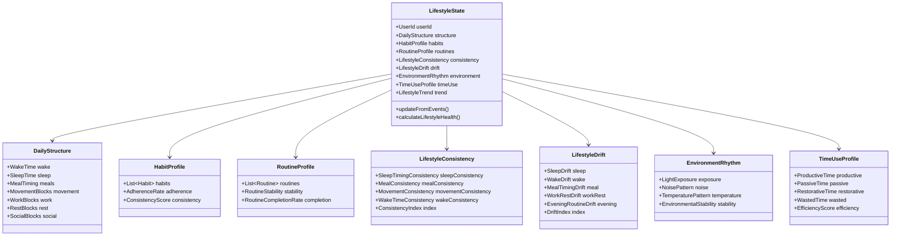

---

# **4.13.5 Aggregate Specifications**

---

## **A. LifestyleState (Aggregate Root)**

Represents a **holistic model of the user’s lifestyle**.

Invariants:
- lifestyle drift must match observed behavior  
- consistency cannot jump abruptly  
- daily structure must follow chronological order  
- time-use must reconcile with 24 hours  
- routines must not overlap unless explicitly elastic  

Behaviors:
- deriveConsistency()  
- computeDrift()  
- updateHabitState()  
- updateRoutineState()  
- updateDailyStructure()  
- detectLifestyleCollapseRisk()  

---

## **B. DailyStructure**

Tracks time distribution across:

- wake  
- sleep  
- meals  
- work  
- movement  
- rest  
- downtime  
- social  

Must fit into 24-hour structure.

---

## **C. HabitProfile**

Each habit includes:
- adherence probability  
- reward cycle  
- difficulty index  
- streak  
- decay curve  
- failure signatures  

---

## **D. RoutineProfile**

Routines group habits:

- morning routine  
- evening routine  
- pre-work routine  
- shutdown routine  
- recovery routine  

Attributes:
- stability  
- elasticity  
- success rate  

---

## **E. LifestyleConsistency**

Each category produces a consistency score.

ConsistencyIndex = weighted composite.

---

## **F. LifestyleDrift**

Tracks long-term shifts:

- sleep/wake drift  
- meal timing drift  
- work-rest imbalance  
- daily block shifting  
- evening routine drift  
- movement pattern drift  

Drift can be:
- positive  
- negative  
- neutral  

---

## **G. EnvironmentRhythm**

Environmental factors influence lifestyle consistency.

Includes:
- light exposure curve (morning/evening)  
- noise pattern (home/office)  
- temperature pattern  
- environmental disruptors (late-night bright light, noise spikes)  

---

## **H. TimeUseProfile**

Quality of time use.

Output:
- productive hours  
- restorative hours  
- passive hours  
- wasted hours  
- efficiency index  

---

# **4.13.6 Key Value Objects**

- LifestyleConsistencyIndex  
- LifestyleDriftIndex  
- TimeUseEfficiency  
- RoutineStability  
- HabitAdherenceRate  
- LightExposureProfile  
- SleepTimingDeviation  
- MovementPatternIndex  

---

# **4.13.7 Commands**

```csharp
public record UpdateLifestyleState(
    UserId UserId,
    LifestyleInputs Inputs,
    DateTime Timestamp
);

public record ProcessHabitEvent(
    UserId UserId,
    HabitEvent Event
);

public record ProcessRoutineCompletion(
    UserId UserId,
    RoutineCompletion Completion
);

public record UpdateDailyStructure(
    UserId UserId,
    DailyStructureInput Input
);

public record RecordTimeUseBlock(
    UserId UserId,
    TimeUseBlock Block
);
```

---

# **4.13.8 Queries**

```csharp
public record GetLifestyleState(UserId UserId);

public record GetLifestyleConsistency(UserId UserId);

public record GetLifestyleDrift(UserId UserId);

public record GetHabitProfile(UserId UserId);

public record GetRoutineProfile(UserId UserId);

public record GetTimeUseProfile(UserId UserId);
```

---

# **4.13.9 Domain Events**

### 🔹 LifestyleStateUpdated  
### 🔹 HabitAdherenceChanged  
### 🔹 RoutineCompleted  
### 🔹 LifestyleConsistencyChanged  
### 🔹 LifestyleDriftDetected  
### 🔹 NegativeLifestyleDrift  
### 🔹 PositiveLifestyleDrift  
### 🔹 EnvironmentalDisruptionDetected  
### 🔹 TimeUsePatternChanged  

These events feed:
- Prediction BC (adherence, drift)  
- PIP BC (long-term behavior baseline)  
- Synergy BC (lifestyle–bio–cognitive integration)  
- Recommendation Engine  

---

# **4.13.10 Domain Policies**

### **Policy 1 — Drift Detection**
Lifestyle drift is confirmed only if:
- deviation persists beyond threshold  
- consistency decrease matches behavior  

### **Policy 2 — Routine Elasticity**
Routines may shift within defined constraints.

### **Policy 3 — Habit Adherence Stability**
Habit adherence must follow decay curves, not abrupt changes.

### **Policy 4 — Time-Use Reconciliation**
Sum of all time blocks must equal 24 hours.

### **Policy 5 — Environment Rhythm Validity**
Environment cues must follow plausible patterns.

---

# **4.13.11 Integration Architecture**

### Upstream Inputs
- Wellness BC (mood & journaling)  
- Physiological BC (sleep timing, movement)  
- Cognitive BC (attention patterns)  
- Device Integration BC (movement, sleep)  
- Synergy BC (contextual states)  

### Downstream Outputs
- Prediction BC (adherence, drift forecasts)  
- Synergy BC (behavior context)  
- Recommendation BC (lifestyle change advice)  
- Automation BC (routine alignment)  
- PIP BC (behavior baselines)  

---

# **4.13.12 Lifestyle Modeling Examples**

### **1. Lifestyle Drift Example**
User waking 1 hour later than usual for 6 days.  
→ SleepDrift detected  
→ LifestyleDriftIndex increases  
→ Prediction BC forecasts long-term shift  

### **2. Habit State Example**
User performing meditation only 30% of time.  
→ Adherence drop  
→ Habit profile updates  
→ Predictive slump detection  

### **3. Time Use Example**
User’s evening time classified as 80% passive.  
→ Low restorative hours  
→ Lifestyle score decreases  

### **4. Environmental Rhythm Example**
Low morning light + high late-night light.  
→ Circadian lifestyle misalignment  

---

# **4.13.13 Improvements Over Previous Architecture**

| Before | After |
|--------|--------|
| No lifestyle concepts | Full lifestyle intelligence domain |
| No routines/habits model | Habit & routine modeling with drift detection |
| No lifestyle consistency | Consistency index modeled |
| No drift | Lifestyle drift engine |
| No environment modeling | Light/noise/temperature integrated |
| No time-use classification | Embedded time-use intelligence |
| No lifestyle scoring | Multi-index lifestyle health scoring |

---

# **4.13.14 Summary**

The **Lifestyle Modeling BC** is essential for understanding how a user lives day-to-day:

- rhythms  
- routines  
- habits  
- lifestyle consistency  
- drift  
- time-use quality  
- environmental cues  

This BC makes the platform *behavior-aware* and provides the foundation for predictive and personalized intelligence.

It plays a vital role in:
- Synergy  
- PIP  
- Prediction  
- Automation  
- Recommendations  

---

# **PART 4.14 — Habit & Routine Automation BC (Adaptive Automation Intelligence Layer)**

---

# **4.14.1 Context Overview**

### **Purpose**
The **Habit & Routine Automation BC** is responsible for **executing**, **adjusting**, and **adapting** the user’s routines and habits based on:

- cognitive state  
- physiological state  
- lifestyle state  
- predictions  
- synergy layer  
- environment  
- user preferences  
- context changes  

While Lifestyle BC *models* behavior,  
this BC *acts* on behavior.

Automation BC makes the system:

- proactive  
- adaptive  
- intelligent  
- context-aware  
- predictive  
- personalized  

This is the “action layer” of the platform.

---

# **4.14.2 Responsibilities**

### ✔ INCLUDED (Automation Engine)
- Executing routines & habits  
- Adaptive schedule shifting  
- Task simplification when fatigue/cognitive load is high  
- Rescheduling when necessary  
- Fallback behavior execution (e.g., short routine instead of full one)  
- Triggering micro-actions  
- Suggesting alternative actions  
- Breaking routines into atomic steps  
- Interrupting tasks when necessary  
- Autonomous break scheduling  
- Dynamic routine prioritization  
- Predictive rescheduling based on Behavior Prediction BC  

### ✔ INCLUDED (Automation Intelligence)
- Elastic routine timing  
- Elastic habit difficulty  
- Failure recovery system  
- Habit scaffolding (step-by-step skill reinforcement)  
- Assistive behavior automation (e.g., pomodoro activation)  

### ❌ EXCLUDED
- Modeling lifestyle (Lifestyle BC)  
- Modeling cognition (Cognitive BC)  
- Predicting adherence (Prediction BC)  
- Generating recommendations (Recommendation BC)  
- Analytics (Analytics BC)  
- Running ML models (ML layer)  

This BC executes decisions based on the outputs of other BCs.

---

# **4.14.3 Core Automation Constructs**

### **1. Automation Plan**
A dynamic, personalized plan for:
- habits  
- routines  
- micro-actions  
- fallback actions  
- resynchronization windows  

### **2. Routine Execution Engine**
Executes routines based on:
- state  
- predictions  
- environment  

### **3. Habit Automation Engine**
Manages:
- habit trigger  
- habit scheduling  
- habit fallback  
- habit context switching  

### **4. Predictive Rescheduler**
Automatically shifts routines when:
- fatigue high  
- stress high  
- cognitive load high  
- circadian drift  
- lifestyle drift  
- expected failure (Prediction BC)  

### **5. Adaptive Difficulty Engine**
Modifies habits/routines dynamically:
- simplify during low energy  
- intensify during optimal moments  
- auto-skip unimportant tasks  
- provide micro versions  

### **6. Break Scheduling Engine**
Automatically schedules:
- recovery breaks  
- cognitive resets  
- physical movement breaks  
- deep work boundaries  

### **7. Failure Recovery System**
When a habit/routine fails:
- triggers simpler version  
- reschedules  
- scaffolds next attempt  
- reduces friction  

### **8. Automation Prioritizer**
Decides what should run *now* given:
- cognitive state  
- physiological state  
- personal priorities  
- goals  

---

# **4.14.4 Automation Domain Model Diagram**

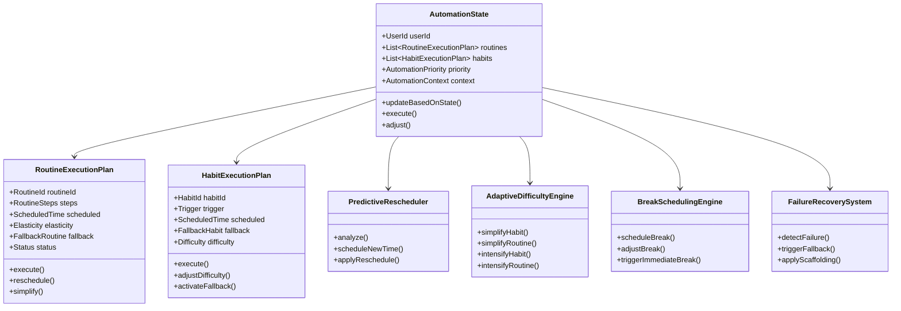

---

# **4.14.5 Aggregate Specifications**

---

## **A. AutomationState (Aggregate Root)**

Represents the **current automation decisions**.

Fields:
- active routine plans  
- active habit plans  
- pending automations  
- fallback behavior queues  
- execution context (environment + synergy)  

Invariants:
- total automations must respect user’s cognitive/physiology constraints  
- routine must not be executed if conflict with state (e.g., deep work when overloaded)  
- fallback must be simpler than original  
- no overlapping automation windows unless explicitly elastic  

Behaviors:
- evaluateState()  
- updatePlans()  
- triggerFallback()  
- adjustSchedules()  
- executeNext()  

---

## **B. RoutineExecutionPlan**

Includes:
- scheduled time  
- elasticity window  
- fallback routine  
- routine steps (atomic)  
- completion state  
- execution criteria  

Behaviors:
- execute()  
- reschedule()  
- simplify()  
- breakIntoMicroSteps()  

---

## **C. HabitExecutionPlan**

Includes:
- habit trigger  
- fallback habit  
- execution time  
- difficulty parameter  
- urgency level  
- completion rule  

Behaviors:
- adjustDifficulty()  
- activateFallback()  
- triggerExecution()  

---

## **D. PredictiveRescheduler**

Inputs:
- Behavior Prediction outputs  
- Synergy state  
- Cognitive load forecasts  
- Lifestyle drift trajectory  

Outputs:
- new schedule  
- shift recommendation  
- drop/skip alert  
- fallback activation  

---

## **E. AdaptiveDifficultyEngine**

Rules:
- cognitive fatigue → simplify mental habits  
- physical fatigue → simplify movement habits  
- low mental clarity → reduce complexity  
- high readiness → increase complexity  

---

## **F. BreakSchedulingEngine**
Schedules:
- micro breaks  
- recovery periods  
- deep work breaks  
- anti-burnout interventions  

---

## **G. FailureRecoverySystem**

Triggers when:
- habit missed  
- routine interrupted  
- failure predicted (Prediction BC)  

Behavior:
- fallback activation  
- scaffolding (re-teach smaller steps)  
- routine simplification  
- retry scheduling  

---

# **4.14.6 Key Value Objects**

- AutomationPriority  
- ElasticityWindow  
- DifficultyLevel  
- AutomationScore  
- FallbackPlan  
- RescheduleWindow  
- BreakType  
- TriggerType  

---

# **4.14.7 Commands**

```csharp
public record ExecuteRoutine(
    UserId UserId,
    RoutineId RoutineId,
    DateTime Timestamp
);

public record AdjustRoutineSchedule(
    UserId UserId,
    RoutineId RoutineId,
    RescheduleWindow Window
);

public record ExecuteHabit(
    UserId UserId,
    HabitId HabitId
);

public record TriggerFallback(
    UserId UserId,
    AutomationType Type,
    Guid OriginalIdentifier
);

public record ScheduleBreak(
    UserId UserId,
    BreakType Type,
    Duration Duration
);
```

---

# **4.14.8 Queries**

```csharp
public record GetAutomationState(UserId UserId);

public record GetActiveRoutinePlans(UserId UserId);

public record GetHabitExecutionPlans(UserId UserId);

public record GetPendingAutomations(UserId UserId);
```

---

# **4.14.9 Domain Events**

### 🔹 RoutineExecuted  
### 🔹 RoutineSkipped  
### 🔹 RoutineSimplified  
### 🔹 RoutineRescheduled  
### 🔹 FallbackRoutineActivated  

### 🔹 HabitExecuted  
### 🔹 HabitDifficultyAdjusted  
### 🔹 HabitFallbackActivated  

### 🔹 BreakScheduled  
### 🔹 ImmediateBreakTriggered  

### 🔹 PredictedRoutineFailure  
### 🔹 PredictedHabitFailure  

### 🔹 AutomationStateUpdated  

Downstream:
- Lifestyle BC  
- PIP BC  
- Prediction BC  
- Recommendation BC  
- Synergy BC  

---

# **4.14.10 Domain Policies**

### **Policy 1 — Cognitive/Psycho-Physiological Safety**
Do not execute complex routines when:
- cognitive load high  
- fatigue high  
- stress high  

### **Policy 2 — Predictive Rescheduling**
If predicted adherence < threshold → auto-reschedule.

### **Policy 3 — Elasticity Windows**
Routines may shift within defined window.

### **Policy 4 — Fallback Activation Threshold**
Trigger fallback if:
- predicted failure  
- failure occurred  
- cognitive/physical state insufficient  

### **Policy 5 — Time-of-Day Rules**
Some routines require alignment with chronotype/lifestyle state.

### **Policy 6 — Avoid Over-Automation**
Avoid overwhelming the user by limiting automations in a given timeframe.

---

# **4.14.11 Integration Architecture**

### Upstream Inputs
- Cognitive BC (attention, fatigue)  
- Physiological BC (recovery, HRV, sleep)  
- Lifestyle BC (structure, drift)  
- Prediction BC (failure probability)  
- Synergy BC (unified state)  
- Recommendation BC (recommended routine modifications)  

### Downstream Outputs
- Lifestyle BC (habit results)  
- PIP BC (behavior baselines)  
- Recommendation BC (follow-up suggestions)  
- Synergy BC (context update)  

Automation BC is the *execution layer* for behavioral intelligence.

---

# **4.14.12 Automation Examples**

### **1. Predictive Rescheduling Example**
Prediction BC:  
“Evening routine has 35% chance of success due to fatigue.”  
→ Automation BC shifts to earlier time  
→ Simplifies routine  
→ Removes complex tasks  

### **2. Fallback Example**
User fails to meditate for 3 days.  
→ Automation BC activates 1-minute breathing version  

### **3. Break Scheduling Example**
Cognitive fatigue high → schedule a 5-minute reset  

### **4. Deep Work Preparation**
Cognitive BC: high readiness  
Physiology BC: high recovery  
Lifestyle BC: morning block  
→ Automation BC triggers pre-deep-work ritual automatically  

### **5. Elastic Routine Example**
Morning routine allowed ±45 minutes.  
Automation BC shifts based on sleep timing changes.  

---

# **4.14.13 Improvements Over Previous Architecture**

| Before | After |
|--------|--------|
| No automation | Full automation system |
| No fallback | Multi-layer fallback |
| No predictive shifting | ML-powered predictive rescheduling |
| No difficulty adjustment | Adaptive difficulty engine |
| No break intelligence | Smart break scheduling |
| No failure recovery | Habit scaffolding and recovery |
| No dynamic routines | Elastic routines with context sensitivity |

---

# **4.14.14 Summary**

The **Habit & Routine Automation BC** is the intelligent, adaptive execution layer that takes insights from the entire platform and turns them into *real behavior change*.

It:

- executes routines and habits  
- adapts complexity  
- reschedules dynamically  
- handles failure gracefully  
- automates breaks  
- provides fallback options  
- syncs actions with cognitive and physical states  
- enforces behavioral consistency  
- supports predictive behavior change  

This BC fully operationalizes the ecosystem.

---

# **PART 4.15 — Personal Intelligence Profile (PIP) BC (Identity & Baseline Personalization Domain)**

---

# **4.15.1 Context Overview**

### **Purpose**
The **Personal Intelligence Profile BC** builds a unified, lifelong profile of the user across five domains:

1. **Biological Identity**  
2. **Cognitive Identity**  
3. **Behavioral Identity**  
4. **Motivational Identity**  
5. **Preference Identity**  

It captures stable traits, adaptive baselines, and personalized thresholds that inform:

- how the user responds to stress  
- how quickly they fatigue  
- how they think  
- how they learn  
- how they sleep  
- how they work  
- how they behave  
- what motivates them  
- how routines fit into their life  

The PIP BC is the **genetic code** for personalization across the platform.

---

# **4.15.2 Responsibilities**

### ✔ INCLUDED
- Baseline modeling (cognitive, physiological, behavioral)  
- Personalized thresholds  
- Personal traits & identity layers  
- Cognitive style, learning style  
- Motivation style & reward preference  
- Interaction patterns  
- Chronotype & circadian signature  
- Stress signature  
- Fatigue signature  
- Sensitivity profiles (to caffeine, light, noise, breaks, etc.)  
- Behavioral temperament  
- Task preference modeling  
- Work mode affinity (deep work, collaborative work, meetings)  
- Personal intervention effectiveness modeling  
- Personal “anti-pattern” detection  

### ✔ INCLUDED (long-term modeling)
- baseline drift  
- identity evolution  
- stable vs dynamic traits  
- slow-changing templates  
- personal signatures  

### ❌ EXCLUDED
- real-time cognitive data (Cognitive BC)  
- real-time physiological modeling (Physiology BC)  
- lifestyle patterns (Lifestyle BC)  
- predictive models (Prediction BC)  
- recommendations (Rec Engine BC)  

The PIP does not track *momentary* state.  
It tracks **identity** and **long-term personalization parameters**.

---

# **4.15.3 Core Identity Layers**

PIP is built on **five identity layers**.

---

## **1. Biological Identity Layer**
Includes:
- HRV baseline  
- RHR baseline  
- recovery baseline  
- strain tolerance  
- fatigue sensitivity  
- sleep architecture baseline  
- circadian chronotype  
- circadian amplitude  
- biological variability pattern  

---

## **2. Cognitive Identity Layer**
Includes:
- mental energy baseline  
- cognitive load tolerance  
- cognitive fatigue signature  
- attention style  
- switching cost baseline  
- working memory baseline  
- processing speed baseline  
- cognitive clarity responsiveness  
- deep work affinity  

---

## **3. Behavioral Identity Layer**
Includes:
- habit adherence style  
- routine complexity tolerance  
- lifestyle variability  
- time preference (morning/afternoon/evening productivity)  
- behavioral stability index  
- discipline pattern  
- self-regulation pattern  

---

## **4. Motivational Identity Layer**
Includes:
- motivational drivers (intrinsic/extrinsic)  
- reward system sensitivity  
- friction sensitivity  
- novelty preference  
- accountability responsiveness  
- social motivation style  
- goal pursuit pattern  

---

## **5. Preference Identity Layer**
Includes:
- work mode preference  
- focus session preference  
- preferred tools & environments  
- sleep schedule preference  
- habit/routine preference  
- break style preference  
- task style preference (creative, analytical, mechanical)  

---

# **4.15.4 PIP Domain Model Diagram**

```mermaid
classDiagram
    class PersonalIntelligenceProfile {
        +UserId userId
        +BiologicalIdentity biological
        +CognitiveIdentity cognitive
        +BehavioralIdentity behavioral
        +MotivationalIdentity motivation
        +PreferenceIdentity preferences
        +PersonalBaselines baselines
        +Thresholds thresholds
        +SignatureModels signatures
        +updateFromLongTermData()
        +adjustBaselines()
        +deriveThresholds()
        +generateProfileSummary()
    }

    class BiologicalIdentity {
        +HRVBaseline hrv
        +RHRBaseline rhr
        +RecoveryBaseline recovery
        +FatigueSensitivity sensitivity
        +Chronotype chronotype
    }

    class CognitiveIdentity {
        +WorkingMemoryBaseline wm
        +ProcessingSpeedBaseline speed
        +CognitiveLoadTolerance tolerance
        +MentalEnergyBaseline energy
        +AttentionStyle attention
    }

    class BehavioralIdentity {
        +LifestyleVariability variability
        +HabitAdherenceStyle adherenceStyle
        +RoutineTolerance routineTolerance
        +TimePreference timePreference
        +DisciplinePattern discipline
    }

    class MotivationalIdentity {
        +MotivationStyle style
        +RewardSensitivity reward
        +FrictionSensitivity friction
        +GoalOrientation orientation
    }

    class PreferenceIdentity {
        +WorkModePreference workMode
        +FocusPreference focus
        +SleepPreference sleep
        +BreakPreference breakPref
        +TaskPreference task
    }

    class PersonalBaselines {
        +CognitiveBaselines cognitive
        +PhysiologicalBaselines physiological
        +BehavioralBaselines behavioral
    }

    class Thresholds {
        +StressThreshold stress
        +FatigueThreshold fatigue
        +LoadThreshold load
        +ClarityThreshold clarity
        +BreakTriggerThreshold breakTrigger
    }

    class SignatureModels {
        +StressSignature stressSig
        +FatigueSignature fatigueSig
        +AttentionSignature attentionSig
        +CircadianSignature circadianSig
    }

    PersonalIntelligenceProfile --> BiologicalIdentity
    PersonalIntelligenceProfile --> CognitiveIdentity
    PersonalIntelligenceProfile --> BehavioralIdentity
    PersonalIntelligenceProfile --> MotivationalIdentity
    PersonalIntelligenceProfile --> PreferenceIdentity
    PersonalIntelligenceProfile --> PersonalBaselines
    PersonalIntelligenceProfile --> Thresholds
    PersonalIntelligenceProfile --> SignatureModels
```

---

# **4.15.5 Aggregate Specifications**

---

## **A. PersonalIntelligenceProfile (Aggregate Root)**

This is the user’s *identity blueprint*.

### Invariants:
- chronotype must align with circadian data  
- baselines must be derived from long-term history  
- thresholds must align with baseline variance  
- signatures must be revalidated periodically  
- motivational style cannot conflict with behavior pattern  
- preferences must be consistent with behavior & lifestyle  

### Behaviors:
- updateFromLongTermData()  
- adjustBaselines()  
- deriveThresholds()  
- recalcIdentity()  
- detectIdentityShift()  
- produceLongTermInsights()  
- generateProfileSummary()  

---

## **B. BiologicalIdentity**

Contains:
- HRV baseline curve  
- RHR baseline  
- recovery baseline  
- strain tolerance index  
- fatigue sensitivity index  
- chronotype  
- circadian phase stability  

---

## **C. CognitiveIdentity**

Tracks:
- working memory baseline  
- processing speed baseline  
- cognitive load threshold  
- attention style  
- mental energy baseline  
- switching cost baseline  

---

## **D. BehavioralIdentity**

Models:
- lifestyle variability  
- habit/routine consistency style  
- adherence pattern  
- time preference patterns  
- discipline & self-regulation  

---

## **E. MotivationalIdentity**

Includes:
- intrinsic/extrinsic motivation balance  
- reward preference model  
- habit reward responsiveness  
- friction sensitivity  
- goal pursuit strategy  

---

## **F. PreferenceIdentity**

Covers:
- preferred sleep schedule  
- preferred break type (movement, mindfulness, walk)  
- preferred work style  
- preferred cognitive tasks  
- preferred routine complexity  

---

## **G. PersonalBaselines**

Baselines come in three layers:

### Cognitive Baselines:
- baseline clarity  
- baseline mental energy  
- baseline attention stability  

### Physiological Baselines:
- HRV baseline  
- RHR baseline  
- sleep timing baseline  
- fatigue baseline  

### Behavioral Baselines:
- habit adherence baseline  
- routine stability baseline  
- time-use baseline  

These baselines are essential for evaluating deviations.

---

## **H. Thresholds**

Thresholds derived from baselines:

- stress threshold  
- fatigue threshold  
- overload threshold  
- cognitive load threshold  
- clarity threshold  
- break trigger threshold  

Thresholds are adjusted dynamically.

---

## **I. SignatureModels**

Personalized signatures built using long-term data:

- Stress Signature  
- Fatigue Signature  
- Attention Signature  
- Circadian Signature  
- Recovery Signature (if extended)  

Each signature is a fingerprint of how the user behaves under certain conditions.

---

# **4.15.6 Commands**

```csharp
public record UpdatePIPFromLongTermData(
    UserId UserId,
    LongTermData Data
);

public record RecalculateBaselines(
    UserId UserId
);

public record UpdateThresholds(
    UserId UserId,
    ThresholdInputs Inputs
);

public record RegisterIdentityShift(
    UserId UserId,
    IdentityShiftDetails Details
);
```

---

# **4.15.7 Queries**

```csharp
public record GetPersonalIntelligenceProfile(UserId UserId);

public record GetBaselines(UserId UserId);

public record GetThresholds(UserId UserId);

public record GetIdentitySignatures(UserId UserId);

public record GetMotivationProfile(UserId UserId);

public record GetTaskPreferences(UserId UserId);
```

---

# **4.15.8 Domain Events**

### 🔹 BaselinesUpdated  
### 🔹 ThresholdsUpdated  
### 🔹 IdentityShiftDetected  
### 🔹 SignatureUpdated  
### 🔹 ChronotypeDerived  
### 🔹 FatigueSignatureUpdated  
### 🔹 CognitiveIdentityUpdated  

Feed directly into:
- Synergy BC  
- Prediction BC  
- Recommendation BC  
- Automation BC  
- Lifestyle BC  
- Cognitive BC  
- Physiological BC  

PIP is foundational.

---

# **4.15.9 Domain Policies**

### **Policy 1 — Identity Stability**
Baselines must be long-term stable.  
Daily fluctuations **must not** change identity.

### **Policy 2 — Threshold Coherence**
Thresholds must be derived *relative to baseline variance*.

### **Policy 3 — Drift Detection**
Identity shifts must occur only when:
- long-term patterns change  
- and drift persists  

### **Policy 4 — Preference/Behavior Consistency**
Preferences cannot conflict with observed behavior unless flagged as emerging change.

### **Policy 5 — Signature Revalidation**
Signatures require periodic recalibration.

---

# **4.15.10 Integration Architecture**

### Upstream Inputs (Long-term Data)
- Physiological BC  
- Cognitive BC  
- Lifestyle BC  
- Behavior Prediction BC  
- Sleep model outputs  
- Routine/Habit data  
- Break patterns  
- Daily structure  
- Stress signatures  
- Recovery signatures  

### Downstream Outputs
- Synergy BC  
- Prediction BC  
- Automation BC  
- Recommendation BC  
- Lifestyle BC  

PIP is the **root of personalization**.

---

# **4.15.11 PIP Examples**

### **1. Chronotype Example**
Long-term sleep data shows:
- natural wake time 7:40  
- natural sleep ~23:20  
→ Evening chronotype

### **2. Cognitive Identity Example**
User’s deep work window:
- peak at 10:00–13:00  
- secondary peak 17:00–18:30  

### **3. Fatigue Signature Example**
User becomes mentally fatigued faster after:
- inadequate sleep  
- high previous day strain  

### **4. Behavioral Identity Example**
User prefers:
- short habits  
- simple routines  
- morning productivity  

### **5. Motivational Identity Example**
User responds more to:
- intrinsic goals  
- progress tracking  
- customized reward loops  

---

# **4.15.12 Improvements Over Previous Architecture**

| Before | After |
|--------|-------|
| No long-term personalization | Full identity modeling |
| No baselines | Multi-layer baselines |
| No thresholds | Personalized thresholds |
| No signatures | Stress/fatigue/attention/circadian signatures |
| No preferences | Preference blueprint |
| No motivation modeling | Deep motivational intelligence |
| No identity drift | Identity evolution modeling |

---

# **4.15.13 Summary**

The **Personal Intelligence Profile BC** is the identity brain of the system.  
It describes who the user is—not their momentary state, but their long-term structure.

It models:
- biological identity  
- cognitive identity  
- behavioral identity  
- motivational identity  
- preference identity  
- baselines  
- thresholds  
- signatures  
- personal drift  

It is essential for:
- Synergy  
- Prediction  
- Recommendations  
- Automation  
- Personalization  
- Cognitive & physiological interpretation  

This BC makes the platform truly **personalized, adaptive, and human-centered**.

---

# **PART 4.16 — Recommendation Engine BC (Contextual & Personalized Decision Layer)**

---

# **4.16.1 Context Overview**

### **Purpose**
The **Recommendation Engine BC** synthesizes insights from all bounded contexts—Cognitive, Physiological, Lifestyle, PIP, Prediction, Synergy, Automation—to generate:

- personalized  
- contextual  
- state-sensitive  
- habit-aware  
- preference-aware  
- identity-aligned  
- risk-aware  
- goal-aligned  

recommendations.

It decides **what the user should do next** based on their current and predicted state.

This BC does *not* run ML models (Prediction BC does).  
This BC does *not* execute actions (Automation BC does).  
Instead:

### The Recommendation Engine turns **raw insights → actionable decisions**.

---

# **4.16.2 Responsibilities**

### ✔ INCLUDED
**Recommendation generation for:**
- cognitive optimization  
- physiological recovery  
- lifestyle adjustment  
- habit support  
- routine optimization  
- energy management  
- stress management  
- sleep optimization  
- productivity enhancement  
- behavioral interventions  
- break management  
- deep work timing suggestions  
- state change interventions  

### ✔ INCLUDED (Intelligence Modeling)
- Multi-factor decision scoring  
- Priority ranking model  
- Time-window optimization  
- Synergy-based decision filtering  
- Conflict resolution between recommendations  
- Adjustment based on PIP identity  
- Contextual awareness (location, workload, time)  
- Recommendation history tracking  
- Reinforcement learning feedback loop  

### ❌ EXCLUDED
- Executing automations (Automation BC)  
- Predicting metrics (Prediction BC)  
- Managing identity/baselines (PIP BC)  
- Recording health metrics (Health BC)  
- Cognitive readings ingestion (Cognitive BC)  

---

# **4.16.3 Core Recommendation Types**

The system supports 6 families of recommendations.

---

## **1. Preventive Recommendations**
- Prevent fatigue  
- Prevent stress escalation  
- Prevent burnout  
- Prevent cognitive overload  
- Prevent poor sleep  

Triggered proactively via Prediction BC.

---

## **2. Corrective Recommendations**
- Actions to fix current negative state  
- Cognitive reset  
- Breathing exercise  
- Movement break  
- Short nap  
- Simplify workloads  
- Adjust routines  

---

## **3. Optimization Recommendations**
- Deep work at peak hours  
- Creative work when clarity high  
- Recovery run when HRV high  
- Hard habits in optimal windows  

---

## **4. Habit & Routine Recommendations**
- Habit activation  
- Routine suggestions  
- Simplified version suggestion  
- Routine sequencing adjustments  
- Habit scaffolding suggestion  

---

## **5. Strategic Recommendations**
These affect long-term behavior:
- Sleep schedule shifting  
- Lifestyle pattern optimization  
- Long-term habit building  
- Stress resilience training  
- Cognitive endurance development  

---

## **6. Synergy Recommendations**
Recommendations that connect multiple BCs:
- “Your cognitive load is high + HRV low → take a recovery break”  
- “Sleep debt + heavy day ahead → simplify morning routine”  
- “Energy high + cognitive clarity peak → start deep work now”  

Synergy recommendations are the most advanced.

---

# **4.16.4 Recommendation Engine Architecture Overview**

The engine consists of these major components:

1. **Recommendation Orchestrator**  
2. **Contextual State Evaluator**  
3. **Recommendation Generator**  
4. **Priority Scoring Engine**  
5. **Conflict Resolver & Merge Engine**  
6. **Personalization Layer (PIP Integration)**  
7. **History Feedback Loop**  
8. **Recommendation Delivery & Routing**  

---

# **4.16.5 Domain Model Diagram**

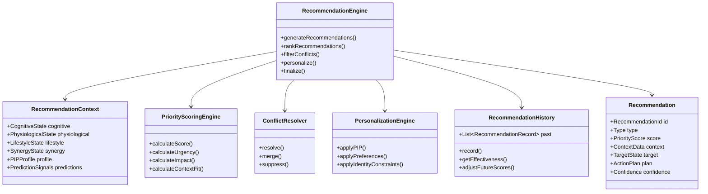

---

# **4.16.6 Aggregates**

---

## **A. RecommendationEngine (Aggregate Root)**

### Invariants:
- recommendations must not violate identity  
- recommendations must not conflict with automation already scheduled  
- safety > productivity  
- physiology constraints > cognitive constraints  
- user preferences override generic logic  

### Behaviors:
- generateRecommendations()  
- mergeConflicts()  
- applyPersonalization()  
- rankAndScore()  
- finalizeAndEmitEvents()  

---

## **B. Recommendation**

Contains:
- type  
- priority score  
- target state  
- required preconditions  
- context data snapshot  
- confidence level  
- action plan  

---

## **C. RecommendationContext**

Pulled from:
- Synergy BC (current & predicted)  
- Cognitive BC (real-time)  
- Physiological BC (recovery, HRV, sleep)  
- Lifestyle BC  
- Automation BC  
- PIP BC  
- Prediction BC  

This context is the **input** into the recommendation generator.

---

## **D. RecommendationHistory**

Tracks:
- delivered recommendations  
- user response  
- outcome  
- adherence  
- effectiveness  
- long-term value  

Acts as the feedback loop for personalization.

---

## **E. PersonalizationEngine**

Applies:
- PIP identity  
- preferences  
- motivational profile  
- friction sensitivity  
- effort preferences  
- reward preferences  

Overrides generic suggestions with user-specific ones.

---

# **4.16.7 Recommendation Generation Pipeline**

**1. Gather Context** (via Synergy BC)  
**2. Generate Candidates** from sub-engines:
   - cognitive  
   - physiological  
   - lifestyle  
   - habit  
   - routine  
   - deep work  
   - recovery  
   - stress  
   - sleep  
   - automation  
   - synergy composite  

**3. Score Each Candidate**  
**4. Filter Based on:**
- identity  
- preferences  
- thresholds  
- current automations  
- fatigue load  
- stress state  
- cognitive clarity  

**5. Conflict Resolution**  
**6. Personalization Amplification**  
**7. Final Delivery** via Notification Engine or Automation BC  

---

# **4.16.8 Commands**

```csharp
public record GenerateRecommendations(
    UserId UserId,
    DateTime Timestamp
);

public record RegisterRecommendationOutcome(
    UserId UserId,
    RecommendationId RecommendationId,
    RecommendationOutcome Outcome
);

public record OverrideRecommendationPriority(
    UserId UserId,
    RecommendationId RecommendationId,
    PriorityOverride Override
);
```

---

# **4.16.9 Queries**

```csharp
public record GetActiveRecommendations(UserId UserId);

public record GetRecommendationHistory(UserId UserId);

public record GetTopRecommendation(UserId UserId);

public record GetRecommendationContext(UserId UserId);
```

---

# **4.16.10 Domain Events**

### 🔹 RecommendationGenerated  
### 🔹 HighPriorityRecommendationDetected  
### 🔹 RecommendationSuppressed  
### 🔹 ConflictResolved  
### 🔹 PersonalizationApplied  
### 🔹 RecommendationDelivered  
### 🔹 RecommendationOutcomeRegistered  
### 🔹 RecommendationEffectivenessUpdated  

---

# **4.16.11 Recommendation Priority Scoring**

The score is computed as:

```
Final Score = (Urgency * U) + (StateFit * F) + (IdentityFit * I) +
               (Impact * A) + (Confidence * C) - (Friction * R)
```

Where:
- **Urgency** = how quickly action needed  
- **StateFit** = how well it matches current state  
- **IdentityFit** = PIP compatibility  
- **Impact** = potential improvement  
- **Confidence** = prediction reliability  
- **Friction** = behavioral difficulty for the user  

Scores are normalized to 0–100.

---

# **4.16.12 Conflict Resolution Rules**

Conflicts arise when two recommendations:
- suggest opposite actions  
- compete for same time window  
- violate identity constraints  

### Conflict hierarchy:
1. physiological safety  
2. cognitive safety  
3. fatigue reduction  
4. stress reduction  
5. time sensitivity  
6. identity preferences  
7. user goals  

Examples:
- "Start deep work" vs "Take a break" → break wins  
- "Do hard habit" vs "Fatigue high" → fallback version  
- "Go to sleep early" vs "Exercise" → sleep wins if sleep debt > threshold  

---

# **4.16.13 Personalization Rules**

PIP identity heavily influences:

- which recommendations appear  
- when they appear  
- how intense they are  
- how often they repeat  
- how they are worded  

Example:
- If user has high friction sensitivity → more micro-recommendations  
- If cognitive endurance low → shorter deep work sessions  
- If habit adherence low → simplified habit suggestions  
- If chronotype evening → avoid morning routines before alignment  

---

# **4.16.14 Integration Architecture**

### **Upstream Dependencies**
- Synergy BC → unified context  
- Prediction BC → predicted risks/opportunities  
- PIP BC → personalization parameters  
- Cognitive BC → cognitive state  
- Physiological BC → recovery, HRV, fatigue  
- Lifestyle BC → behavioral patterns  
- Automation BC → avoid conflicts  
- Activity BC → workload model  

### **Downstream Targets**
- Automation BC  
- Notification System  
- Insights Engine  
- Behavior Modeling  
- Achievement/Gamification  
- Coach UI  

---

# **4.16.15 Examples of Recommendation Logic**

---

### **1. Cognitive Fatigue Detected**
```
If cognitiveLoad > threshold AND mentalEnergy low THEN
   Recommend: “Take a 5-minute reset break”
```

---

### **2. High Readiness Window**
```
If clarity peak AND energy high THEN
   Recommend: “Start deep work session”
```

---

### **3. Sleep Optimization**
```
If sleep debt > highThreshold THEN
   Recommend: “Begin winding down earlier tonight”
```

---

### **4. Habit Simplification**
```
If predicted failure of habit = high THEN
   Suggest simplified habit version
```

---

### **5. Stress Pattern Trigger**
```
If HRV low AND load rising THEN
   Recommend: “2-minute breathing exercise”
```

---

### **6. Lifestyle Drift Correction**
```
If routine adherence decreasing THEN
   Suggest: “Re-anchor your morning routine with a short version”
```

---

# **4.16.16 Improvements Over Previous Architecture**

| Before | After |
|--------|-------|
| Recommendations reactive | Recommendations proactive + predictive |
| Not personalized | Full PIP-driven personalization |
| No conflict management | Sophisticated conflict resolution |
| No scoring | Multi-factor priority scoring model |
| No composite logic | Synergy-based cross-domain recommendations |
| No context awareness | State + environment + identity integration |
| No feedback loop | Learning over time using history |

---

# **4.16.17 Summary**

The **Recommendation Engine BC** is the heart of decision-making in the ecosystem.  
It transforms:
- raw data  
- predictions  
- identity  
- context  
- thresholds  
- baselines  
- energy levels  
- cognitive load  
- lifestyle patterns  

into highly personalized, adaptive, actionable guidance.

It ensures that the platform:
- acts at the right moment  
- with the right recommendation  
- at the right difficulty  
- matched to the user’s identity  
- aligned with predictions and synergy state  
- without causing overload or conflict  

This BC is the **intelligent advisor** of the entire system.

---

# **PART 4.17 — Synergy Orchestration Layer BC (Unified Multi-Domain State Engine)**

---

# **4.17.1 Context Overview**

### **Purpose**
The **Synergy Orchestration Layer (SOL)** is the central engine responsible for:

- combining multi-domain states  
- resolving conflicts between signals  
- generating a unified state representation  
- computing synergy scores  
- determining multi-domain readiness  
- detecting compound risks  
- providing state context to downstream BCs  

### This BC does not:
- generate predictions (Prediction BC does)  
- generate recommendations (Recommendation Engine BC does)  
- store long-term identity (PIP BC does)  
- store raw metrics (Cognitive/Physiological BCs do)  
- execute habits/routines (Automation BC does)  

### The Synergy BC **interprets** the entire system’s data into one coherent state.

It is the **source of truth** for the user’s *current and predicted* state.

---

# **4.17.2 Responsibilities**

### ✔ INCLUDED
**Real-time Synergy**
- unify cognitive state  
- unify physiological state  
- unify emotional state  
- unify behavioral & lifestyle state  
- unify prediction signals  
- unify environmental context  

**Cross-Domain Fusion**
- combine patterns  
- detect co-occurrences  
- compute synergy (positive or negative)  
- compute compound risks  

**Unified State**
- compute Synergy State  
- compute Readiness State  
- compute Stability State  
- compute Recovery State  
- compute Cognitive–Physiological Balance  
- compute Behavior Drift State  

**Decision Inputs for All BCs**
- Recommendation Engine  
- Automation Engine  
- Lifestyle BC  
- PIP BC (drift detection)  
- Prediction BC (synergy transforms prediction features)  
- UI personalization  

### ✔ INCLUDED (Advanced)
- conflict resolution between domains  
- weighted reconciliation  
- time-based smoothing  
- noise reduction for volatile signals  
- handling missing domain signals  
- priority-tier computation  
- multi-domain thresholds  

---

# **4.17.3 Synergy Layers Model**

Synergy is evaluated across **four layers**.

---

## **1. Physiological Synergy Layer**
Inputs:
- HRV  
- RHR  
- Recovery  
- Sleep  
- Fatigue  
- Strain  
- Physiological baseline drift  

Outputs:
- physiological readiness  
- recovery quality  
- fatigue risk  
- health stress indicators  

---

## **2. Cognitive Synergy Layer**
Inputs:
- cognitive load  
- cognitive clarity  
- mental energy  
- attention  
- switching cost  
- cognitive fatigue signature  

Outputs:
- cognitive readiness  
- overload risk  
- clarity window quality  

---

## **3. Behavioral Synergy Layer**
Inputs:
- lifestyle structure  
- habit adherence  
- routine stability  
- time preference alignment  
- discipline pattern states  

Outputs:
- behavioral readiness  
- drift detection  
- lifestyle stability  
- friction risk  

---

## **4. Affective Synergy Layer**
Inputs:
- mood  
- emotional stability  
- affective drift  
- stress  
- mental tension  

Outputs:
- affective readiness  
- emotional stability score  
- mood impact score  

---

# **4.17.4 Synergy Orchestration Pipeline**

The SOL pipeline follows **six stages**:

---

### **Stage 1 — Collect Multi-Domain Inputs**
From:
- Cognitive BC  
- Physiological BC  
- Lifestyle BC  
- Emotional/Affective BC  
- PIP BC (baselines & thresholds)  
- Prediction BC (predicted states)  
- Environmental BC  
- Activity Load BC  

---

### **Stage 2 — Normalize Each Domain**
Normalize signals so they share a common scale (0–100):
- HRV → readiness score  
- cognitive load → overload percentage  
- lifestyle drift → penalty score  
- motivation → support factor  

---

### **Stage 3 — Compute Intra-Domain Synergy**
Each domain computes internal synergy:
- cognitive coherence  
- physiological coherence  
- lifestyle-coherence  
- affective stability  

---

### **Stage 4 — Evaluate Cross-Domain Interactions**
This is where synergy magic happens.

Examples:
- low HRV + high cognitive load → stress event  
- sleep debt + high task load → overload prediction  
- cognitive clarity + peak energy → deep work opportunity  
- mood low + high friction → recommend micro-habit  

---

### **Stage 5 — Compute Unified Synergy State**
A composite construct including:
- Synergy Score  
- Readiness State  
- Compound Risk Level  
- State Volatility  
- Balance Index  
- Stability Index  
- Opportunity Window  

---

### **Stage 6 — Produce Outputs**
Outputs used by:
- Recommendation Engine  
- Automation BC  
- PIP BC (drift input)  
- Prediction BC (feature layer)  
- UI layer  
- Behavioral modeling  

---

# **4.17.5 Domain Model Diagram**

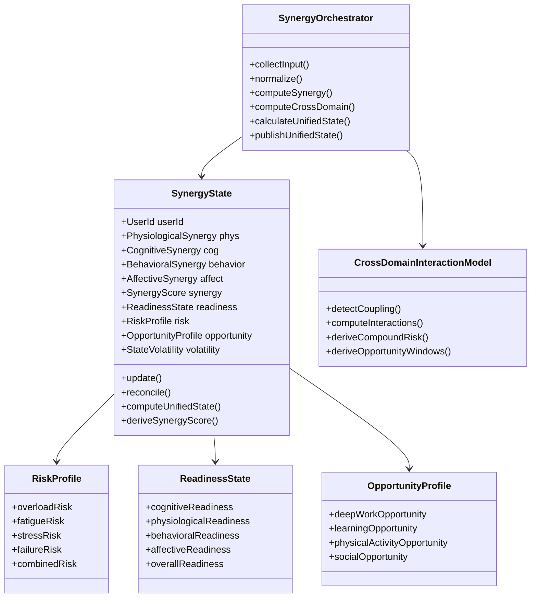

---

# **4.17.6 Aggregates**

---

## **A. SynergyState (Aggregate Root)**

### Contains:
- four intra-domain synergy layers  
- unified synergy score  
- readiness state  
- risk profile  
- opportunity windows  
- volatility metrics  

### Invariants:
- synergy state cannot conflict with domain composite states  
- readiness must reflect lowest critical domain  
- risk profile must capture cross-domain compounding  
- synergy score must obey normalization rules  
- opportunity state must incorporate timing windows  

### Behaviors:
- update()  
- computeUnifiedState()  
- reconcile()  
- deriveSynergyScore()  
- computeOpportunities()  
- computeRisks()  

---

## **B. CrossDomainInteractionModel**

Models compound events:
- cognitive + physiological + emotional coupling  
- lifestyle + cognitive conflict  
- workload + fatigue mismatch  
- circadian + cognitive misalignment  

Generates:
- compound risks  
- synergy opportunities  
- timing suggestions  

---

## **C. ReadinessState**

Components:
- cognitive readiness  
- physiological readiness  
- behavioral readiness  
- emotional readiness  
- overall readiness  

Overall readiness is **weighted by PIP** identity.

---

## **D. RiskProfile**

Includes:
- overload risk  
- stress risk  
- fatigue risk  
- failure risk  
- behavioral drift risk  
- instability risk  
- compound multi-domain risk  

---

## **E. OpportunityProfile**

Includes:
- deep work window  
- creative window  
- physical training window  
- habit building window  
- sleep window opportunity  
- recovery window  
- learning opportunity  

---

# **4.17.7 Commands**

```csharp
public record ComputeSynergyState(
    UserId UserId,
    DateTime Timestamp
);

public record RefreshUnifiedState(
    UserId UserId
);
```

---

# **4.17.8 Queries**

```csharp
public record GetSynergyState(UserId UserId);

public record GetReadinessState(UserId UserId);

public record GetSynergyOpportunities(UserId UserId);

public record GetSynergyRisks(UserId UserId);
```

---

# **4.17.9 Domain Events**

### 🔹 SynergyStateUpdated  
### 🔹 ReadinessChanged  
### 🔹 CompoundRiskDetected  
### 🔹 OpportunityWindowOpened  
### 🔹 OpportunityWindowClosed  
### 🔹 SynergyVolatilityDetected  
### 🔹 SynergyDriftDetected  

These events are consumed by:
- Recommendation Engine BC  
- Automation BC  
- PIP BC  
- Lifestyle BC  
- Prediction BC  
- Notification system  

---

# **4.17.10 Synergy Score Computation**

Synergy Score (0–100):

```
SynergyScore = (WeightedCognitive +
                 WeightedPhysiological +
                 WeightedBehavioral +
                 WeightedAffective) 
                 - CompoundRiskPenalty
                 + OpportunityBonus
```

Weights are derived from PIP identity (Personal Intelligence Profile):
- for some users cognitive weighs heavier  
- for others physiology dominates  
- for others lifestyle consistency  

---

# **4.17.11 Conflict Resolution Rules**

### Rule 1  
If cognitive high readiness but physiology low → physiology wins.

### Rule 2  
If affective state volatile → suppress high-intensity routines.

### Rule 3  
If lifestyle drift present → opportunity windows shrink.

### Rule 4  
If predicted failure high → risk score overrides synergy score.

---

# **4.17.12 Advanced Features**

### ✔ Synergy Drift Detection  
Signals longer-term instability.

### ✔ Multi-Domain Prediction Synthesis  
Converts multiple predictions into one risk forecast.

### ✔ State Volatility Tracking  
Detects unpredictable fluctuations.

### ✔ Timing-Based Opportunity Windows  
Built from:
- cognitive peaks  
- physiological peaks  
- lifestyle rhythms  

---

# **4.17.13 Integration Architecture**

### **Upstream Inputs**
- PIP BC (identity, baselines, thresholds)  
- Physiological BC  
- Cognitive BC  
- Lifestyle BC  
- Emotional BC  
- Prediction BC  
- Habit & Routine Automation BC  
- Activity Load BC  

### **Downstream Outputs**
- Recommendation Engine BC (major consumer)  
- Automation BC (execution constraints)  
- PIP BC (drift detection)  
- Dashboard UI (state visualization)  
- Insights engine  
- Gamification/achievement engine  

---

# **4.17.14 Synergy Examples**

---

### **Example 1 — Compound Fatigue Risk**
- HRV low  
- cognitive load high  
- emotional stress moderate  
- lifestyle drift high  

→ Synergy BC computes:  
- High compound fatigue risk  
- Low readiness  
- High escalation probability  

Recommendation → Recovery intervention.

---

### **Example 2 — Deep Work Opportunity**
- cognitive clarity high  
- physiological readiness high  
- emotional state stable  
- lifestyle stable  

→ Deep work window (high opportunity score)

---

### **Example 3 — Sleep Pressure Window**
- sleep debt present  
- circadian low energy point  
→ sleep opportunity window opens  

---

### **Example 4 — Habit Vulnerability**
- high friction sensitivity today  
- low discipline today  
→ simplify habits in Recommendation Engine  
→ or activate fallback in Automation BC  

---

# **4.17.15 Improvements Over Any Prior Architecture**

| Before | After |
|--------|-------|
| No unified state | Full unified & fused state |
| No cross-domain interaction | Cross-domain synergy engine |
| No compound risk modeling | Multi-domain risk profile |
| No readiness modeling | Multi-layer readiness computation |
| No opportunity detection | Dynamic opportunity windows |
| No state normalization | Standard state scales |
| No synergy score | Unified synergy index |
| No state volatility tracking | Stability + volatility engine |
| No multi-domain drift tracking | Behavioral, cognitive, physiological drift detection |

---

# **4.17.16 Summary**

The **Synergy Orchestration Layer** is the **central nervous system** of the entire platform:

- integrates all data  
- reconciles conflicts  
- computes unified state  
- evaluates compound risks  
- discovers opportunity windows  
- powers full personalization  
- feeds automation & recommendations  

It ensures that every BC is operating with a **single, accurate, unified understanding** of the user’s moment-to-moment condition.

This BC is essential for the platform to feel *intelligent, coherent, and human-like*.

---

# **PART 4.18 — Activity Load & Workload Modeling BC (Unified Load Modeling Layer)**

---

# **4.18.1 Context Overview**

### **Purpose**
The **Activity Load & Workload Modeling BC** models **all forms of user load**:

- **cognitive load** (mental effort, working memory, task-switching)  
- **physical load** (movement, strain, fatigue accumulation)  
- **emotional load** (affective stress, tension, mood instability)  
- **contextual load** (meetings, work requirements, household workload)  

It generates:

- *load curves*  
- *load predictions*  
- *overload risk*  
- *task load modeling*  
- *daily workload maps*  
- *task complexity profiles*  
- *task fatigue cost*  
- *load accumulation models*  
- *load recovery projections*  

This BC allows the system to model what the user *can handle* and *what they should avoid or take on*.

---

# **4.18.2 Responsibilities**

### ✔ INCLUDED
**1. Task Load Modeling**
- cognitive complexity  
- emotional intensity  
- physical requirement  
- switching cost  
- attention requirement  
- tine demand  
- decision-making effort  
- planning load  

**2. Daily Workload Modeling**
- total load accumulation  
- load distribution over day  
- recovery intervals  
- workload spikes and dips  

**3. Load Accumulation System**
- how fast user accumulates load  
- how slow/fast user recovers  
- synergy-based load adjustments  

**4. Predictive Load Forecasting**
- expected spikes  
- expected overload  
- predicted decision fatigue  
- predicted burnout risk this week/day  

**5. Load-Based Intervention Triggers**
- schedule breaks  
- trigger automation fallback  
- suppress deep work  
- adjust routines  
- reduce task complexity  

**6. Integration Into Synergy Layer**
- feed workload to synergy  
- update readiness  
- recalc risks  
- expand/suppress opportunity windows  

---

# **4.18.3 Activity Load Dimensions**

Load is modeled across **four primary dimensions**:

---

## **1. Cognitive Load**
Attributes:
- intensity  
- duration  
- switching cost  
- sustained attention cost  
- working memory cost  
- decision-making complexity  
- novelty cost  

Derived from:
- task data  
- cognitive readings  
- predicted cognitive fatigue  

---

## **2. Physical Load**
Attributes:
- muscle strain  
- cardiovascular demand  
- movement requirement  
- recovery need  
- sleep impact  
- fatigue multiplier  

Derived from:
- movement sensors  
- HRV/RHR  
- physical activities  

---

## **3. Emotional Load**
Attributes:
- emotional intensity  
- stress impact  
- mood volatility  
- tension  
- affective drain  

Derived from:
- mood logs  
- strain + HRV combo  
- emotional BC (if exists)  

---

## **4. Contextual Load**
Attributes:
- meetings  
- errands  
- home workload  
- deadlines  
- environmental constraints  

Derived from:
- calendar integration  
- user input  
- work metadata  

---

# **4.18.4 Load Equation**

For each activity/task:

```
TotalLoad = (CogLoad * CogWeight) +
            (PhysLoad * PhysWeight) +
            (EmoLoad * EmoWeight) +
            (CtxLoad * CtxWeight)
```

Weights come from:
- PIP identity  
- synergy state  
- daily schedule  
- user preference pattern  

---

# **4.18.5 Load Accumulation Model**

Load does not linearly accumulate.

It increases with **multipliers**:
- cognitive fatigue multiplier  
- physiological fatigue multiplier  
- emotional instability multiplier  

Example model:

```
AccumulatedLoad = PreviousLoad +
                  (CurrentLoad * FatigueMultiplier * StressMultiplier)
```

Recovery reduces load:

```
RecoveryRate = BaselineRecoveryRate * RecoveryMultiplier
```

Multipliers come from:
- synergy state  
- sleep quality  
- circadian phase  
- stress signature  
- PIP identity  

---

# **4.18.6 Domain Model Diagram**

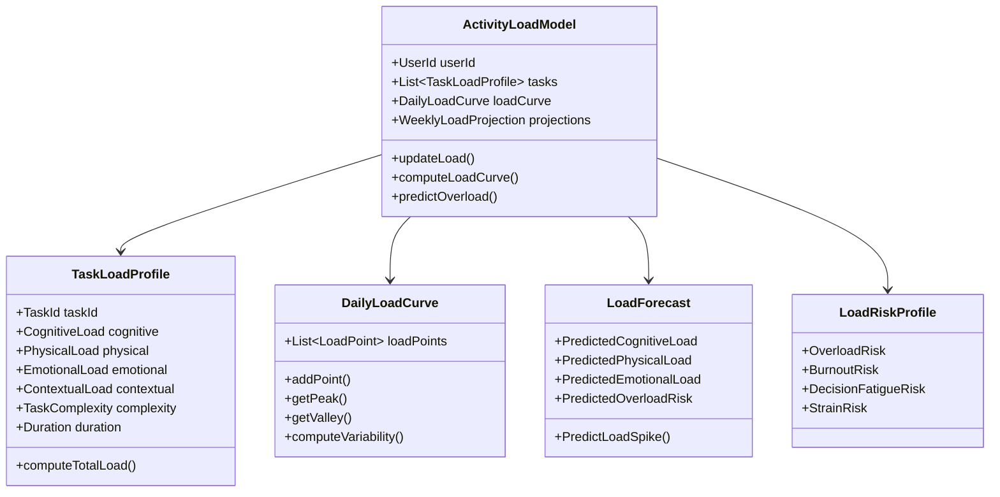

---

# **4.18.7 Aggregates**

---

## **A. ActivityLoadModel (Aggregate Root)**

Contains:
- daily & weekly load  
- tasks and their loads  
- spike detection  
- recovery modeling  
- risk assessment  

Invariants:
- load cannot drop without recovery event  
- predictions cannot conflict with synergy readiness  
- load score must be normalized  
- complexity must match synergy state  

Behaviors:
- updateLoad()  
- computeLoadCurve()  
- predictOverload()  
- generateLoadForecast()  
- calculateRiskProfile()  
- ingestTaskLoad()  
- adjustLoadBasedOnSynergy()  

---

## **B. TaskLoadProfile**

Metal model of individual tasks.

Contains:
- cognitive load cost  
- physical load cost  
- emotional load cost  
- contextual load  
- overall complexity score  

Behavior:
- computeTotalLoad()  
- adjustWeightsBasedOnIdentity()  
- adjustBasedOnSynergy()  

---

## **C. DailyLoadCurve**

Represents the user’s **live load curve** across the day.

Tracks:
- load points  
- load variability  
- spikes  
- dips  
- stability  

---

## **D. LoadForecast**

Prediction-layer aggregate.

Tracks:
- short-term load  
- long-term load  
- predicted overload  
- predicted fatigue window  
- predicted emotional breakdown risk  
- predicted decision fatigue  

---

## **E. LoadRiskProfile**

Tracks:
- overload risk  
- burnout risk  
- decision fatigue risk  
- strain risk  

Feeds directly into Synergy BC.

---

# **4.18.8 Commands**

```csharp
public record UpdateTaskLoad(
    UserId UserId,
    TaskId TaskId,
    TaskLoadInput LoadInput
);

public record RecalculateDailyLoadCurve(
    UserId UserId,
    DateTime Timestamp
);

public record PredictLoadForecast(
    UserId UserId,
    DateTime Timestamp
);

public record RegisterContextualWorkload(
    UserId UserId,
    WorkloadInput Input
);
```

---

# **4.18.9 Queries**

```csharp
public record GetDailyLoadCurve(UserId UserId);

public record GetTaskLoadProfile(UserId UserId, TaskId TaskId);

public record GetLoadForecast(UserId UserId);

public record GetLoadRiskProfile(UserId UserId);
```

---

# **4.18.10 Domain Events**

### 🔹 DailyLoadUpdated  
### 🔹 TaskLoadUpdated  
### 🔹 OverloadRiskDetected  
### 🔹 LoadSpikeDetected  
### 🔹 DecisionFatiguePredicted  
### 🔹 BurnoutRiskDetected  
### 🔹 EmotionalLoadSpikeDetected  
### 🔹 LoadForecastUpdated  

These flow into:
- Synergy BC  
- Recommendation Engine  
- Automation BC  
- Lifestyle BC  
- Behavior Modeling BC  

---

# **4.18.11 Load Categories**

### **1. Low Load (0–25)**  
User is ready for focus, creative tasks, learning.

### **2. Moderate Load (25–50)**  
User can continue working but should avoid complex tasks.

### **3. Elevated Load (50–75)**  
User is at risk of fatigue.

### **4. High Load (75–90)**  
User should switch to recovery tasks.

### **5. Critical Load (90–100)**  
Automation BC suppresses deep work; emergency recovery recommended.

---

# **4.18.12 Load-Based Interventions**

Examples:

### Cognitive Overload
- immediate break  
- reduce task complexity  
- suggest deferring difficult work  

### Physical Load High
- recovery walk  
- stretching routine  
- hydration check  

### Emotional Overload
- micro-reset  
- reflection journaling  
- simpler habit suggestions  

### Contextual Load High
- optimize day schedule  
- reduce routine burden  
- reorder habits  

---

# **4.18.13 Integration Architecture**

### **Upstream Inputs**
- Task metadata  
- Calendar integration  
- Cognitive state  
- Physiological state  
- Emotional state  
- Synergy state  
- Predictions  
- PIP identity  

### **Downstream Outputs**
- Synergy BC (load → readiness + risk)  
- Recommendation Engine  
- Automation BC  
- Daily Insights Engine  
- Lifestyle BC  
- Behavioral modeling  

---

# **4.18.14 Examples**

---

### **Example 1 — Deep Work Load Modeling**
Task: “Write analysis report”  
- high cognitive complexity  
- high working memory cost  
→ cognitive load spike expected  
→ synergy warns  
→ recommendation: postpone if fatigue high  

---

### **Example 2 — High Contextual Load Day**
Calendar full  
→ contextual load high  
→ synergy reduces opportunities  
→ automation suppresses complex routines  

---

### **Example 3 — Emotional Load Contribution**
Mood unstable  
→ emotional load multiplier ↑  
→ predicted decision fatigue  
→ simplified habits recommended  

---

### **Example 4 — Physical Load & Sleep**
High physical strain day  
→ physiological load ↑  
→ next-day readiness reduced  
→ sleep recommendation generated  

---

# **4.18.15 Improvements Over Previous Architecture**

| Before | After |
|--------|-------|
| Only cognitive load modeled | Multi-dimensional load (cog, phys, emo, contextual) |
| No task complexity modeling | Full task complexity engine |
| No load curves | Daily load curves |
| No overload prediction | Predictive overload modeling |
| No decision fatigue | Learned decision-fatigue prediction |
| No compound risk | Unified risk profile |
| No workload → synergy integration | Deep synergy integration |

---

# **4.18.16 Summary**

The **Activity Load & Workload Modeling BC** provides the system with a deep understanding of the user’s **cognitive, emotional, physical, and contextual burden**.

It:
- models task load  
- models daily load patterns  
- predicts overload  
- predicts burnout  
- determines readiness windows  
- adjusts recommendations  
- informs automation  
- integrates into the synergy state  

This BC enables the system to treat the user not as a set of metrics, but as a dynamic human navigating complex cognitive and emotional environments.

---

# **PART 4.19 — Emotional & Affective State BC (Affective Intelligence Layer)**

---

# **4.19.1 Context Overview**

### **Purpose**
The **Emotional & Affective State BC** models and tracks:

- mood  
- affective tone  
- emotional load  
- emotional stability  
- emotional drift  
- tension  
- stress emotionalization  
- affective recovery  
- emotional resilience  
- affective readiness  
- emotional windows  
- affective fatigue  
- mood signatures  
- emotional patterns  
- sentiment logs  
- emotional vs cognitive mismatches  

This BC does NOT attempt to diagnose mental conditions.  
It models **affective signals**, **patterns**, and **responses**, all from user-provided context and state data.

---

# **4.19.2 Responsibilities**

### ✔ INCLUDED
**Emotional State Modeling**
- mood tracking  
- mood curve generation  
- emotional load calculation  
- emotional fatigue modeling  
- affective window detection  
- emotional readiness  
- emotional stability index  

**Affective Pattern Analysis**
- mood trend detection  
- emotional drift detection  
- intensity modeling  
- emotional signature generation  
- affective variability mapping  

**Emotional Load Integration**
- mood → cognitive load  
- mood → behavioral friction  
- mood → physiological tension  
- mood → synergy score adjustments  

**Stress-Affect Interaction Modeling**
- HRV + mood correlation  
- stress escalation detection  
- emotionalized stress vs pure physiological stress  

**Behavioral & Lifestyle Influence**
- emotional friction  
- motivational suppression  
- habit vulnerability  
- routine disruption probability  

---

# **4.19.3 Emotional Dimensions Modeled**

The BC models emotional state using **five dimensions**:

---

## **1. Mood Tone**
- positive  
- neutral  
- negative  

Represented as a normalized value:  
`-1.0 (very negative) → +1.0 (very positive)`

---

## **2. Emotional Intensity**
How strong the emotion is:
- low intensity  
- medium intensity  
- high intensity  

Increasing intensity increases emotional load.

---

## **3. Emotional Stability**
How stable the emotional state is:
- volatility  
- fluctuations  
- drift  

High volatility triggers warnings and reduces readiness.

---

## **4. Stress Emotionalization**
When physiological stress combines with emotional changes:
- HRV low + mood drop → high emotional stress  
- cognitive overload + emotional frustration → tension  
- lifestyle drift + mood low → emotional instability  

---

## **5. Affective Fatigue**
Emotional exhaustion caused by:
- excessive emotional complexity  
- interpersonal conflict  
- prolonged cognitive overload  
- poor sleep + emotional sensitivity  

---

# **4.19.4 Affective State Model**

The **Affective State** is computed from:

```
AffectiveState = f(
    MoodTone,
    EmotionalIntensity,
    EmotionalStability,
    StressAffectCoupling,
    AffectiveFatigue,
    EmotionalLoad
)
```

Produces:
- emotional readiness  
- emotional risk  
- opportunity windows  

---

# **4.19.5 Domain Model Diagram**

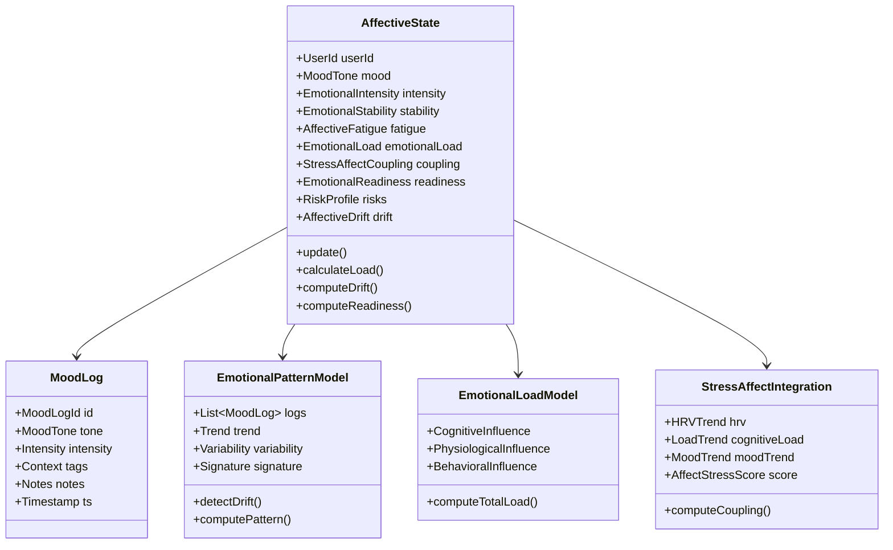

---

# **4.19.6 Aggregates**

---

## **A. AffectiveState (Aggregate Root)**

Contains:
- current mood tone  
- emotional intensity  
- stability  
- emotional load  
- stress-affect coupling  
- emotional readiness  
- emotional risk profile  

### Invariants:
- emotional state cannot jump drastically without drift event  
- load must be consistent with intensity  
- readiness must reflect emotional & physiological factors  
- emotional risk must not underestimate coupling impact  

### Behaviors:
- updateFromMoodLog()  
- computeAffectiveLoad()  
- computeAffectiveDrift()  
- computeStability()  
- computeReadiness()  
- computeAffectStressCoupling()  

---

## **B. MoodLog**

User-provided mood entries including:
- mood tone  
- intensity  
- contextual tags  
- personal notes  

Used by:
- lifestyle modeling  
- synergy  
- prediction  
- recommendation engine  
- activity load modeling  

---

## **C. EmotionalPatternModel**

Tracks:
- mood trends  
- volatility  
- drift  
- emotional variability  
- affective patterns  

Produces:
- emotional signature  
- expectation curves  
- risk alerts  

---

## **D. EmotionalLoadModel**

Combines:
- emotional load  
- cognitive load effect  
- physiological load effect  
- behavioral effect  

Produces:
- total emotional load  
- emotional readiness suppressor  

---

## **E. StressAffectIntegration**

Combines physiological & cognitive signals with affective signals.

Inputs:
- HRV trend  
- stress physiology  
- cognitive overload  
- mood drift  

Outputs:
- affective stress score  
- emotional risk escalation  

---

# **4.19.7 Commands**

```csharp
public record LogMood(
    UserId UserId,
    MoodTone Tone,
    EmotionalIntensity Intensity,
    List<MoodTag> Tags,
    string? Notes,
    DateTime Timestamp
);

public record UpdateAffectiveState(
    UserId UserId,
    DateTime Timestamp
);

public record RecalculateAffectiveDrift(
    UserId UserId
);
```

---

# **4.19.8 Queries**

```csharp
public record GetAffectiveState(UserId UserId);

public record GetMoodHistory(
    UserId UserId,
    DateTime Start,
    DateTime End
);

public record GetAffectiveReadiness(UserId UserId);

public record GetAffectiveRiskProfile(UserId UserId);
```

---

# **4.19.9 Domain Events**

### 🔹 MoodLogged  
### 🔹 AffectiveStateUpdated  
### 🔹 AffectiveDriftDetected  
### 🔹 EmotionalInstabilityDetected  
### 🔹 EmotionalLoadSpike  
### 🔹 AffectiveFatigueDetected  
### 🔹 StressAffectEscalation  
### 🔹 EmotionalRecoveryStateAchieved  

Downstream:
- Synergy BC  
- Lifestyle BC  
- Automation BC  
- Recommendation Engine  
- Prediction BC  
- Insights Engine  

---

# **4.19.10 Affective Readiness Model**

Readiness is computed from:

```
AffectiveReadiness = BaseReadiness
                     - EmotionalLoadPenalty
                     - DriftPenalty
                     - StressAffectPenalty
                     + PositiveMoodBonus
```

Categories:
- High  
- Moderate  
- Low  
- Suppressed  

Low/suppressed readiness affects:
- habit suggestions  
- routine complexity  
- deep work capability  
- risk scoring  
- opportunity windows  

---

# **4.19.11 Emotional Drift Detection**

Drift is detected when:
- mood trends downward more than expected  
- volatility increases  
- affective fatigue rises  
- stress coupling increases  

If drift > threshold →  
Synergy instability triggered.

---

# **4.19.12 Stress-Affect Integration Logic**

This is one of the most advanced integrations.

Examples:

### **1. Physiological Stress + Emotional Low**
→ emotional stress detected  
→ reduce workload  
→ schedule recovery breaks  

### **2. Cognitive Load + Irritation Mood**
→ friction sensitivity at peak  
→ simplify habits  
→ avoid decision-making tasks  

### **3. Mood Stable + Stress High**
→ stress is physiological, not emotional  
→ recommend short recovery, not emotional interventions  

### **4. Mood Falling + Sleep Poor**
→ high emotional drift risk  
→ suggest grounding or early shutdown  

---

# **4.19.13 Emotional Opportunities**

Positive affect triggers:

- creative work window  
- high-motivation window  
- habit anchoring window  
- social interaction window  
- learning opportunity  

These windows feed into Recommendation Engine.

---

# **4.19.14 Integration Architecture**

### **Upstream Inputs**
- Mood logs  
- Stress data (from physiological BC)  
- Cognitive load  
- Synergy signals  
- Task load  
- Lifestyle drift  
- PIP profile (sensitivity patterns)  
- Prediction BC (affective predictions)  

### **Downstream Outputs**
- Synergy BC  
- Recommendation Engine  
- Automation BC  
- Behavioral Analysis BC  
- Activity Load Modeling BC  
- Insights engine  
- Motivation BC (if exists)  

---

# **4.19.15 Examples**

---

### **Example 1 — Emotional Vulnerability Morning**
Mood: low  
HRV: low  
Cognitive load: rising  
→ emotional load high  
→ synergy reduces readiness  
→ recommendation: grounding + simplified morning routine  

---

### **Example 2 — High Emotional Stability**
Stable mood + good energy  
→ emotional readiness high  
→ opportunity for creative work  

---

### **Example 3 — Emotional Drift Detected**
Mood falling for 3 days  
→ synergy volatility ↑  
→ lifestyle drift risk ↑  
→ automation reduces habit complexity  

---

### **Example 4 — Positive Mood Boost**
Mood ↑  
→ recommendation engine boosts habit-building and deep work suggestions  

---

# **4.19.16 Improvements Over Previous Architecture**

| Before | After |
|--------|-------|
| No emotional modeling | Full affective intelligence layer |
| No mood integration | Deep mood integration with all states |
| No stress-emotion coupling | Stress–emotion synergy modeling |
| No affective drift | Drift detection + alerts |
| No emotional load | Emotional load model influencing behavior |
| No emotional readiness | Complete readiness computation |
| No emotional opportunity detection | Opportunities integrated into recommendations |

---

# **4.19.17 Summary**

The **Emotional & Affective State BC** enables the system to understand the emotional dimension of the user’s experience.

It models:
- mood  
- emotional load  
- drift  
- volatility  
- affective fatigue  
- emotional stress  
- emotional readiness  
- emotional signatures  

It integrates emotional state into:
- synergy  
- predictions  
- recommendations  
- task load modeling  
- automation decisions  
- behavioral modeling  
- habit vulnerability analysis  

This BC makes the platform **emotionally intelligent, empathetic, and responsive to human psychology**.

---

# **PART 4.20 — Recovery & Restoration BC**  
### *(Physiological, Cognitive, Emotional Recovery Intelligence Layer)*

---

# **4.20.1 Context Overview**

### **Purpose**
The **Recovery & Restoration BC** models and manages all forms of recovery the user needs:

- **physiological recovery**
- **cognitive recovery**
- **emotional recovery**
- **micro-recovery**
- **sleep recovery**
- **circadian alignment recovery**
- **macro recovery** (day/week level)
- **acute recovery after high load**

It answers key system-wide questions:

- *How recovered is the user right now?*  
- *What type of recovery is needed?*  
- *When will recovery complete?*  
- *Is the user under-recovered?*  
- *How will recovery impact performance?*  

It powers:

- Synergy state  
- Predictive modeling  
- Automation  
- Workload management  
- Intervention timing  
- Personalized routines  
- Recommendation Engine  

---

# **4.20.2 Responsibilities**

### ✔ INCLUDED
**Recovery Modeling**
- compute recovery score  
- model recovery debt  
- track recovery curve  
- detect incomplete recovery  
- manage sleep recovery and micro-recovery  

**Recovery Types**
- cognitive recovery  
- physiological recovery  
- emotional recovery  
- full-system recovery  

**Recovery Windows**
- detect optimal recovery windows  
- detect forced recovery windows  
- detect recovery opportunity windows  
- detect circadian-based recovery windows  

**Recovery Demand Assessment**
- calculate needed recovery  
- calculate recovery urgency  
- identify recovery deficits  
- detect chronic recovery suppression  

**Recovery Interventions**
- rest  
- microbreaks  
- naps  
- deep breathing  
- relaxation  
- decompression  
- grounding  
- cognitive reset activities  

**Cross-BC Integration**
- affects Synergy BC  
- influences Prediction BC  
- affects Automation BC (rescheduling tasks/habits)  
- influences Cognitive Performance BC  
- conditions Lifestyle BC  

---

# **4.20.3 Types of Recovery Modeled**

### **1. Physiological Recovery**
Based on:
- HRV  
- resting HR  
- strain  
- sleep depth  
- sleep stages  
- circadian alignment  

Produces:
- physiological readiness  
- cardiovascular recovery  
- autonomic balance recovery

---

### **2. Cognitive Recovery**
Based on:
- cognitive fatigue  
- cognitive load  
- clarity  
- mental bandwidth  
- decision fatigue  
- attention fragmentation  

Produces:
- cognitive readiness  
- attention restoration need  
- deep work recovery requirement  

---

### **3. Emotional Recovery**
Based on:
- mood  
- affective fatigue  
- emotional intensity/sensitivity  
- emotional load  

Produces:
- emotional readiness  
- emotional stabilization need  

---

### **4. Behavioral Recovery**
Based on:
- routine fatigue  
- behavioral friction  
- motivation depletion  
- willpower fatigue  

---

### **5. Circadian Recovery**
Corrects:
- rhythm drift  
- wake–sleep misalignment  
- chronotype disruption  

---

# **4.20.4 Recovery State Model**

The core recovery value is:

```
RecoveryScore = f(
    PhysiologicalRecovery,
    CognitiveRecovery,
    EmotionalRecovery,
    BehavioralRecovery,
    CircadianRecovery
)
```

Converted into:
- RecoveryStatus  
- RecoveryWindow  
- RecoveryNeed  
- RecoveryDebt  
- RecoveryTrajectory  

States include:
- Full Recovery  
- Partial Recovery  
- Under-Recovered  
- Critically Under-Recovered  
- Overextended  
- Acute Recovery Required  

---

# **4.20.5 Domain Model Diagram**

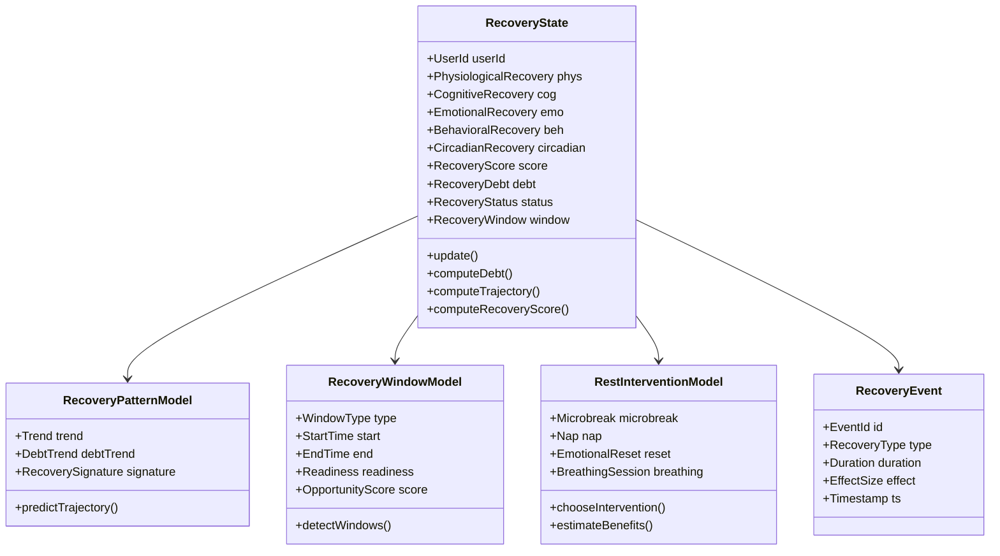

---

# **4.20.6 Aggregates**

---

## **A. RecoveryState (Aggregate Root)**

Stores the full recovery picture:
- physiological  
- cognitive  
- emotional  
- behavioral  
- circadian  

And derived values:
- score  
- debt  
- status  
- trajectory  
- windows  

### Invariants:
- no recovery score without all recovery dimensions scored  
- recovery debt cannot be negative  
- recovery must decay over time unless new recovery occurs  
- recovery cannot jump upward without a recovery event  
- critical under-recovery must generate an alert  

---

## **B. RecoveryEvent**

Represents any recovery-enhancing activity:
- sleep  
- nap  
- break  
- microbreak  
- walk  
- grounding  
- breathing  
- mindfulness  
- decompression  
- rest  
- relaxation  
- stretching  

Each event has:
- effect size  
- recovery type  
- timestamp  
- predicted vs actual effect  

---

## **C. RecoveryPatternModel**
Models:
- recovery trend  
- chronic under-recovery  
- acute recovery deficits  
- weekly recovery cycles  
- sleep influence patterns  

---

## **D. RecoveryWindowModel**
Detects:
- optimal recovery windows  
- forced recovery windows  
- micro recovery windows  
- circadian-aligned recovery windows  
- emotional recovery windows  
- cognitive recovery windows  

This is used by Automation BC to schedule breaks proactively.

---

## **E. RestInterventionModel**
Chooses between:
- microbreak  
- replenishment  
- cognitive reset  
- emotional decompression  
- nap  
- relaxation session  
- breathing exercise  

Based on recovery type needed.

---

# **4.20.7 Recovery Engine Computation Logic**

```csharp
RecoveryScore = 
   0.30 * PhysiologicalRecovery
 + 0.25 * CognitiveRecovery
 + 0.20 * EmotionalRecovery
 + 0.15 * BehavioralRecovery
 + 0.10 * CircadianRecovery;
```

These weights change depending on chronotype, PIP profile, and synergy interactions.

---

# **4.20.8 Commands**

```csharp
public record LogRecoveryEvent(
    UserId UserId,
    RecoveryType Type,
    Duration Duration,
    double EffectSize,
    DateTime Timestamp
);

public record RecalculateRecoveryState(
    UserId UserId,
    DateTime Timestamp
);

public record DetectRecoveryWindows(UserId UserId);
```

---

# **4.20.9 Queries**

```csharp
public record GetRecoveryState(UserId UserId);

public record GetRecoveryDebt(UserId UserId);

public record GetRecoveryWindows(UserId UserId);

public record GetRecoveryTrajectory(UserId UserId);

public record GetOptimalRecoveryTime(UserId UserId);
```

---

# **4.20.10 Domain Events**

### 🔹 RecoveryEventLogged  
### 🔹 RecoveryStateUpdated  
### 🔹 RecoveryDebtIncreased  
### 🔹 ChronicUnderRecoveryDetected  
### 🔹 AcuteRecoveryRequired  
### 🔹 OptimalRecoveryWindowDetected  
### 🔹 RecoveryOpportunityMissed  
### 🔹 FullRecoveryAchieved  

Events feed:
- routine automation  
- synergy system  
- prediction system  
- recommendation engine  
- lifestyle dynamics  
- affective state system  

---

# **4.20.11 Recovery Windows (Core Feature)**

Three categories:

---

## **1. Optimal Recovery Window**
You are naturally primed for recovery.

Detected when:
- physiological stress is falling  
- HRV rising  
- cognitive load dropping  
- emotional state stabilizing  

Used for:
- naps  
- deep rest  
- meditation  
- emotional reset  

---

## **2. Forced Recovery Window**
The system identifies critical under-recovery.

Triggered when:
- physiological load high  
- cognitive fatigue high  
- emotional intensity high  
- sleep debt accumulating  

System:
- cancels high load tasks  
- auto-reschedules habits  
- recommends immediate recovery  

---

## **3. Micro Recovery Window**
Short bursts (2–10 min).

Examples:
- breathing  
- short walk  
- water  
- quick reset  

Triggered when:
- cognitive fragmentation  
- rising irritability  
- emotional sensitivity  

---

# **4.20.12 Recovery Deficit & Recovery Debt Engine**

### Recovery Debt is:
```
Expected Recovery - Actual Recovery
```

Debt increases when:
- insufficient sleep  
- insufficient rest  
- long stress periods  
- emotional exhaustion  
- cognitive overload  

Debt triggers:
- risk events  
- synergy instability  
- reduction in readiness  
- pre-burnout warning  

---

# **4.20.13 Integration Points**

---

## **Upstream Inputs**
- Physiological BC  
- Cognitive BC  
- Affective State BC  
- Lifestyle BC  
- Behavioral BC  
- Sleep BC  
- Synergy BC  

---

## **Downstream Outputs**
- Synergy BC (global state shift)  
- Automation BC (rest insertion & rescheduling)  
- Prediction BC (recovery trajectories)  
- Recommendation Engine (tailored interventions)  
- Cognitive Performance BC (readiness scaling)  
- Lifestyle Dynamics BC (adjustment of patterns)  

---

# **4.20.14 Examples**

---

### **Example 1 — Under-Recovery Detected**
HRV low  
sleep poor  
emotionally unstable  
cognitive load rising  

→ forced recovery window generated  
→ tasks rescheduled  
→ nap or decompression recommended  

---

### **Example 2 — Optimal Afternoon Recovery Window**
HRV rising  
cognitive load falling  
mood stable  

→ system recommends 10-minute breathing  
→ deep work scheduled afterward  

---

### **Example 3 — Emotional Recovery Need**
mood low  
affective fatigue high  
stress coupling detected  

→ emotional reset recommended  
→ cognitive tasks temporarily reduced  

---

### **Example 4 — Circadian Misalignment**
very late bedtime  
early wake time  
sleep misaligned  

→ circadian recovery recommended  
→ earlier wind-down routine reinforced  

---

# **4.20.15 Improvements Over Previous Architecture**

| Before | After |
|--------|-------|
| Only sleep-based recovery | Multi-dimensional recovery modeling |
| No recovery debt | Full debt/deficit engine |
| No recovery windows | Full detection engine |
| No acute recovery | Acute intervention detection |
| No rest intervention logic | Full intervention selection model |
| No synergy integration | Recovery drives whole-system synergy |
| No cognitive/emotional recovery | Full inner-mind recovery modeling |

---

# **4.20.16 Summary**

The Recovery & Restoration BC transforms the platform into a **self-regulating system** that:

- maintains user balance  
- prevents burnout  
- optimizes performance  
- manages fatigue  
- drives circadian alignment  
- regulates emotional and cognitive health  

Recovery becomes a *first-class citizen in the domain*—not a side effect.

---

# **PART 4.21 — Habit & Behavior Formation BC**  
### *(Behavioral Reinforcement, Habit Loop Intelligence, Momentum Modeling)*

---

# **4.21.1 Context Overview**

### **Purpose**
To create, track, reinforce, and maintain *long-term behavior change* by modeling:

- habit loops  
- behavior reinforcement  
- friction and resistance  
- identity alignment  
- behavior momentum  
- habit fragility & vulnerability  
- habit stacking  
- routine integration  
- contextual triggers  
- motivation waves  
- habit decay patterns  

This BC answers:

- *How easy or difficult is a habit for the user?*  
- *What context supports or harms it?*  
- *How can habits be strengthened automatically?*  
- *How close is the habit to breaking?*  
- *How to maintain momentum across life changes?*  

---

# **4.21.2 Responsibilities**

### ✔ INCLUDED

#### **Habit Lifecycle**
- create habit  
- initialize habit loop  
- track habit execution  
- measure habit performance  
- detect habit completion failure patterns  

#### **Behavioral Signals**
- friction level  
- behavioral resistance  
- motivation strength  
- behavioral energy  
- identity congruence  
- contextual support score  

#### **Habit Intelligence**
- habit probability model  
- habit automation scaling  
- habit vulnerability detection  
- habit decay and rebound modeling  
- habit reinforcement & recovery  

#### **Habit Contextualization**
- anchor-based habit stacking  
- day/time context scoring  
- environment scoring  
- emotional/cognitive fit  
- routine alignment  

#### **Habit Momentum Engine**
- momentum score  
- inertia  
- decay  
- friction-compounded decay  
- momentum rescue triggers  

#### **Behavioral Reinforcement**
- rewards  
- variable reinforcement schedule  
- compounding reinforcement patterns  

#### **Habit Rebuild Algorithms**
- rebuild plan for broken habits  
- strengthening routines  
- simplified fallback versions  

---

# **4.21.3 Habit Intelligence Core Concepts**

The system models *habit strength* using:

### **1. Habit Friction**
Energy required to perform habit:
- cognitive load interference  
- emotional friction  
- environmental friction  
- physical inconvenience  
- complexity level  

### **2. Habit Momentum**
Behavioral inertia:
- consistency  
- past streak stability  
- micro-reward accumulation  

### **3. Habit Vulnerability**
Probability habit will break:
- predicted failures  
- emotional instability  
- cognitive depletion  
- recovery debt  
- environmental disruption  

### **4. Habit Probability Model**
Probability of completion:

```
P(HabitCompletion) =
   MotivationWeight*M
 + MomentumWeight*N
 - FrictionWeight*F
 - EmotionalFriction*E
 - CognitiveLoadPenalty*C
 + ContextSupportWeight*S
```

### **5. Identity Alignment**
Habits aligned with identity are more durable.

### **6. Habit Decay**
Modeled as:

- linear decay  
- exponential decay (in high friction contexts)  
- friction-compounded decay  
- emotional suppression-based decay  

---

# **4.21.4 Domain Model Diagram**

```mermaid
classDiagram
    class Habit {
        +HabitId id
        +UserId userId
        +HabitName name
        +HabitType type
        +HabitComplexity complexity
        +HabitStrength strength
        +HabitMomentum momentum
        +HabitFriction friction
        +HabitContext context
        +HabitState state
        +create()
        +recordExecution()
        +recordSkip()
        +updateStrength()
        +calculateMomentum()
        +calculateFriction()
        +assessVulnerability()
    }

    class HabitExecution {
        +ExecutionId id
        +HabitId habitId
        +Timestamp ts
        +CompletionStatus status
        +Effort effort
        +Context context
        +updateMetrics()
    }

    class HabitContext {
        +ContextId id
        +TimeOfDay preferredTime
        +Location preferredLocation
        +Trigger trigger
        +EnvironmentScore envScore
        +EmotionFit emoFit
        +CognitiveFit cogFit
        +calculateFitScore()
    }

    class HabitPatternModel {
        +Trend trend
        +Decay decay
        +Stability stability
        +detectPatterns()
    }

    class HabitReinforcementModel {
        +RewardPlan rewardPlan
        +VariableReward variableReward
        +ReinforcementSchedule schedule
        +applyReinforcement()
    }

    Habit --> HabitExecution
    Habit --> HabitContext
    Habit --> HabitPatternModel
    Habit --> HabitReinforcementModel
```

---

# **4.21.5 Aggregates**

---

## **A. Habit (Aggregate Root)**

Stores:
- habit definition  
- habit loop structure  
- habit context  
- friction  
- momentum  
- strength  
- vulnerability  
- decay rate  

### Invariants:
- habit must have a loop trigger  
- friction cannot be negative  
- momentum cannot exceed max based on reinforcement schedule  
- habit strength must be recalculated after every skip  
- habit decay must be exponential when friction is high  
- habit cannot be strengthened without reinforcement  

---

## **B. HabitExecution**

Represents a single execution attempt:
- completion status  
- effort level  
- emotional state  
- cognitive state  
- environmental state  
- triggers used  
- context match score  

Provides data for pattern modeling.

---

## **C. HabitPatternModel**

Tracks:
- streaks  
- decay  
- vulnerability  
- friction-induced regression  
- habit probability drops  
- day/time dependency  

Used by:
- Prediction BC  
- Reinforcement engine  
- Automation BC  

---

## **D. HabitContext**

Models:
- environmental support  
- time-of-day success rate  
- emotional fit  
- cognitive fit  
- anchor habits  
- trigger strength  

Outputs:
- context support score  
- optimal windows  

---

## **E. HabitReinforcementModel**

Implements:
- fixed rewards  
- variable rewards  
- compounding reinforcement  
- optimism drift  
- identity reinforcement  
- momentum boosts  

---

# **4.21.6 Commands**

```csharp
public record CreateHabit(
    UserId UserId,
    string Name,
    HabitType Type,
    HabitComplexity Complexity,
    Trigger Trigger
);

public record LogHabitExecution(
    HabitId HabitId,
    CompletionStatus Status,
    Effort Effort,
    DateTime Timestamp
);

public record UpdateHabitStrength(
    HabitId HabitId,
    DateTime Timestamp
);

public record RecalculateHabitMomentum(HabitId HabitId);

public record DetectHabitVulnerability(HabitId HabitId);
```

---

# **4.21.7 Queries**

```csharp
public record GetHabit(HabitId HabitId);

public record GetUserHabits(UserId UserId);

public record GetHabitExecutionHistory(
    HabitId HabitId,
    DateTime Start,
    DateTime End
);

public record GetHabitVulnerability(HabitId HabitId);

public record GetHabitProbability(HabitId HabitId);

public record GetHabitContextScore(HabitId HabitId);
```

---

# **4.21.8 Domain Events**

### 🔹 HabitCreated  
### 🔹 HabitExecutionLogged  
### 🔹 HabitSkipped  
### 🔹 HabitStrengthUpdated  
### 🔹 HabitDecayDetected  
### 🔹 HabitMomentumIncreased  
### 🔹 HabitMomentumDepleted  
### 🔹 HabitVulnerabilityDetected  
### 🔹 HabitRecovered  
### 🔹 HabitBroken  
### 🔹 HabitReinforced  

---

# **4.21.9 Habit Momentum Engine**

Momentum is the engine that keeps behaviors alive.

Momentum changes with:

### Increases
- streak continuation  
- rewards  
- identity reinforcement  
- habit stacking  
- positive emotional state  

### Decreases
- skips  
- emotional fatigue  
- cognitive overload  
- friction  
- poor context  

Momentum directly influences recommendation prioritization and automation scheduling.

---

# **4.21.10 Habit Reinforcement System**

Reinforcement includes:

### **Fixed Rewards**
- XP  
- points  
- badges  
- personal celebrations  

### **Variable Rewards**
Modeled like dopamine variability:
- unpredictable positive spikes  
- random reward intervals  
- performance based bonuses  

### **Psychological Reinforcements**
- identity alignment  
- meaning reinforcement  
- progress visualization  
- motivational resonance  

---

# **4.21.11 Habit Vulnerability Engine**

Habit vulnerability is triggered by:

- cognitive fatigue  
- emotional drift  
- high friction  
- context mismatch  
- erratic schedule  
- recovery debt  
- predicted failure (Prediction BC)  

Outputs:
- vulnerability score  
- immediate interventions  
- simplified habit versions  
- fallback routines  
- recovery-based adjustments  

---

# **4.21.12 Habit Stacking & Anchoring**

The BC does full modeling of:

- trigger habit  
- anchor habit  
- sequence strength  
- stacking friction  
- stacking synergy  

Strong habits serve as anchors for new habits:
- morning routine anchors  
- pre-work anchors  
- pre-sleep anchors  

Stacking boosts probability of completion by up to 40–70% depending on the user profile.

---

# **4.21.13 Integration Architecture**

---

## **Upstream Inputs**
- Synergy BC  
- Prediction BC  
- Affective State BC  
- Cognitive Performance BC  
- Recovery BC  
- Routine BC  
- Lifestyle BC  
- Personal Intelligence Profile BC  

---

## **Downstream Outputs**
- Routine Automation BC  
- Recommendation Engine  
- Behavioral Prediction BC  
- Activity Load Modeling BC  
- Lifestyle BC (habits change lifestyle patterns)  
- Synergy BC (behavioral alignment)  

---

# **4.21.14 Examples**

---

### **Example 1 — Habit Vulnerability**
User skipped habit twice  
Friction high  
Cognitive load high  
Synergy unstable  

→ vulnerability detected  
→ habit is softened to a shorter version  
→ reinforcement triggered  

---

### **Example 2 — Habit Strengthening**
User completes habit with low friction  
Momentum rising  
Emotional state stable  

→ habit upgraded in complexity  
→ stacking opportunity created  

---

### **Example 3 — Habit Rescued**
Habit predicted to fail  
recommendation engine triggers a micro-version (“do a 1-minute version”)  
habit saved  
momentum preserved  

---

### **Example 4 — Habit Broken**
Multiple skips  
Friction rising  
Emotional drift  

→ habit state = Broken  
→ rebuilding strategy initiated  

---

# **4.21.15 Improvements Over Previous Architecture**

| Before | After |
|--------|-------|
| Basic habit tracking | Full behavior change intelligence engine |
| No friction modeling | Multi-dimensional friction model |
| No habit momentum | Full momentum engine |
| No habit vulnerability | Vulnerability detection & intervention |
| No habit stacking | Stacking & sequencing intelligence |
| No identity alignment | Identity reinforcement model |
| No prediction input | Prediction-aware habit forecasting |
| No recovery integration | Recovery dictates habit execution difficulty |

---

# **4.21.16 Summary**

The **Habit & Behavior Formation BC** establishes a *scientific, adaptive, AI-driven behavior change system*.

It models:
- friction  
- momentum  
- decay  
- context  
- identity  
- reinforcement  
- vulnerability  
- behavioral inertia  

It integrates seamlessly with all physiological, cognitive, emotional, and prediction systems.

This BC makes the platform capable of **real long-term behavior change**, not just tracking habits.

---

# **PART 4.22 — Lifestyle Dynamics BC**  
### *(Macro-Behavior Modeling, Stability Dynamics, Pattern Drift, Life Rhythm Intelligence)*

---

# **4.22.1 Context Overview**

### **Purpose**
The **Lifestyle Dynamics BC** captures and models the user’s overall lifestyle patterns, including:

- daily rhythms  
- weekly rhythms  
- energy flow  
- sleep–wake consistency  
- behavioral stability  
- lifestyle drift  
- lifestyle disruptions  
- environmental patterns  
- activity distribution  
- macro-level habits  
- stability factors  
- identity-aligned lifestyle development  

This BC answers:
- *Is the user's lifestyle stable or drifting?*  
- *What are the long-term behavioral patterns?*  
- *How does lifestyle influence readiness, stress, cognition, and emotion?*  
- *Is the lifestyle aligned with the user's identity and goals?*  

It forms the **foundation for long-term transformation**.

---

# **4.22.2 Responsibilities**

### ✔ INCLUDED

### **Lifestyle Pattern Modeling**
- extract patterns from habits, routines, sleep, activity, environment  
- detect consistent vs inconsistent behavioral patterns  
- identify “dominant lifestyle signatures”  
- track weekly & monthly cycles  

### **Lifestyle Stability Management**
- detect stability  
- detect instability  
- lifestyle volatility measurement  
- lifestyle fragmentation detection  

### **Lifestyle Drift Detection**
- drift from ideal lifestyle  
- drift from personal identity  
- drift from optimal energy cycles  
- drift from goal-aligned behaviors  

### **Lifestyle Influence Analysis**
- emotional impact  
- cognitive impact  
- physiological impact  
- habit friction impact  
- recovery impact  

### **Lifestyle Forecasting**
- predict lifestyle drift  
- predict stability collapse  
- predict lifestyle strengthening  
- predict identity-aligned consistency patterns  

### **Identity-Lifestyle Congruence**
- how aligned lifestyle is with the user’s personal intelligence profile (PIP)  
- how lifestyle influences identity stability  
- lifestyle–identity mismatch risk  

---

# **4.22.3 Lifestyle Intelligence Core Concepts**

### **1. Lifestyle Stability Index (LSI)**  
Models how stable the user’s overall lifestyle is.  
Factors include:
- sleep regularity  
- wake time consistency  
- activity distribution  
- habit momentum  
- routine stability  
- emotional stability  
- stress rhythm  
- environmental consistency  

---

### **2. Lifestyle Drift Model**  
Drift occurs when the user deviates from:
- baseline routines  
- circadian patterns  
- energy cycles  
- personal values  
- optimal lifestyle conditions  

Drift is modeled across:
- emotional drift  
- activity drift  
- cognitive drift  
- schedule drift  
- environmental drift  
- recovery drift  

---

### **3. Lifestyle Fragmentation**  
Behavior becomes chaotic and inconsistent due to:
- cognitive overload  
- emotional instability  
- sleep disruption  
- environment inconsistency  
- high friction behavior patterns  
- habit failures  

Fragmentation triggers:
- emergency routine simplification  
- automated stabilization recommendations  

---

### **4. Lifestyle Identity Alignment Score (LIAS)**  
Measures how aligned a user’s lifestyle is with:
- their identity  
- their long-term values  
- their PIP profile  
- their ideal self  

---

### **5. Lifestyle Signature**  
A pattern representation of the user’s lifestyle.  
Examples:
- “Balanced, high stability, strong cognitive morning peak”  
- “Chaotic evenings, emotional drift, low recovery”  
- “Stable weekdays, fragmented weekends”  

---

# **4.22.4 Domain Model Diagram**

```mermaid
classDiagram
    class LifestyleState {
        +UserId userId
        +LifestyleSignature signature
        +LifestyleStabilityIndex stability
        +LifestyleDrift drift
        +IdentityAlignment identityAlignment
        +WeeklyRhythm weeklyRhythm
        +DailyRhythm dailyRhythm
        +LifestyleFragmentation fragmentation
        +LifestyleQualityScore score
        +update()
        +computeStability()
        +computeDrift()
        +computeIdentityAlignment()
        +computeRhythms()
    }

    class LifestyleEvent {
        +EventId id
        +LifestyleEventType type
        +Timestamp ts
        +Context context
    }

    class LifestylePatternModel {
        +Trend trend
        +Cycle cycles
        +Variability variability
        +Signature signature
        +detectPatterns()
        +computeSignature()
    }

    class LifestyleDriftModel {
        +DriftMagnitude magnitude
        +DriftDirection direction
        +DriftAcceleration acceleration
        +detectDrift()
    }

    class LifestyleStabilityModel {
        +StabilityIndex index
        +StabilityFactors factors
        +calculateStability()
    }

    LifestyleState --> LifestylePatternModel
    LifestyleState --> LifestyleDriftModel
    LifestyleState --> LifestyleStabilityModel
    LifestyleState --> LifestyleEvent
```

---

# **4.22.5 Aggregates**

---

## **A. LifestyleState (Aggregate Root)**

Stores:
- signature  
- stability  
- drift  
- alignment  
- rhythms  
- fragmentation  
- lifestyle score  

### Invariants:
- signature cannot be undefined  
- drift cannot be negative  
- stability must reflect actual volatility  
- lifestyle fragmentation increases when drift AND volatility increase  
- identity alignment must be recomputed after major lifestyle shifts  
- rhythms must include both daily and weekly cycles  

---

## **B. LifestyleEvent**

Examples:
- sleep disruption  
- major schedule shift  
- habit streak collapse  
- emotional breakdown  
- high stress day  
- routine disruption  
- unexpected workload spike  
- motivation collapse  
- environmental change  
- travel-related disruption  

Used to feed drift and fragmentation detection.

---

## **C. LifestylePatternModel**

Extracts:
- weekly routines  
- morning/evening patterns  
- event clusters  
- habit stability patterns  
- workload rhythms  
- emotional cycles  

---

## **D. LifestyleDriftModel**

Drift types:
- emotional drift  
- cognitive drift  
- behavioral drift  
- circadian drift  
- motivational drift  
- environmental drift  

Outputs:
- drift magnitude  
- drift classification (mild/moderate/severe)  
- drift acceleration (rate of worsening)  

---

## **E. LifestyleStabilityModel**

Stability factors:
- consistency of schedule  
- cognitive rhythm stability  
- emotional volatility  
- sleep timing consistency  
- environmental regularity  
- recovery patterns  

---

# **4.22.6 Commands**

```csharp
public record UpdateLifestyleState(
    UserId UserId,
    DateTime Timestamp
);

public record LogLifestyleEvent(
    UserId UserId,
    LifestyleEventType Type,
    LifestyleContext Context,
    DateTime Timestamp
);

public record RecalculateLifestyleDrift(UserId UserId);

public record RecalculateLifestyleStability(UserId UserId);
```

---

# **4.22.7 Queries**

```csharp
public record GetLifestyleState(UserId UserId);

public record GetLifestyleSignature(UserId UserId);

public record GetLifestyleDrift(UserId UserId);

public record GetLifestyleStability(UserId UserId);

public record GetLifestyleRhythms(UserId UserId);

public record GetLifestyleFragmentation(UserId UserId);
```

---

# **4.22.8 Domain Events**

### 🔹 LifestyleStateUpdated  
### 🔹 LifestyleEventLogged  
### 🔹 LifestyleDriftDetected  
### 🔹 LifestyleDriftWorsening  
### 🔹 LifestyleStabilityIncreased  
### 🔹 LifestyleStabilityDecreased  
### 🔹 LifestyleFragmentationDetected  
### 🔹 LifestyleIdentityMisalignment  
### 🔹 LifestyleSignatureShifted  

These events feed:
- Prediction BC  
- Synergy BC  
- Habit BC  
- Emotion BC  
- Recovery BC  
- Recommendation Engine  
- Automation BC  

---

# **4.22.9 Lifestyle Drift Detection Logic**

Drift is detected when:
- user deviates from lifestyle baseline for multiple days  
- emotional instability rises  
- cognitive performance decreases  
- recovery debt accumulates  
- habits break  
- routines lose consistency  
- wake/sleep rhythm misaligns  
- environment changes suddenly  

Severity levels:
- mild drift  
- moderate drift  
- accelerated drift  
- lifestyle instability  
- lifestyle collapse  

---

# **4.22.10 Lifestyle Fragmentation Logic**

Fragmentation happens when:
- no routines  
- irregular habits  
- inconsistent sleep  
- emotional volatility  
- cognitive overload  
- irregular environments  
- unstructured days  

Fragmentation reduces:
- habit probability  
- synergy  
- readiness  
- cognitive capacity  
- emotional resilience  

Triggers emergency stabilization strategies.

---

# **4.22.11 Lifestyle Identity Alignment**

Modeled as:

```
IdentityAlignment =
   ValueAlignmentScore
 - BehaviorValueGap
 - LifestyleDriftPenalty
 + IdentityMomentum
```

High alignment → stable, predictable, low-friction lifestyle.  
Low alignment → lifestyle is unsustainable.

---

# **4.22.12 Lifestyle Rhythms**

The system models:
- work rhythm  
- stress rhythm  
- emotional rhythm  
- social rhythm  
- sleep rhythm  
- cognitive rhythm  
- energy rhythm  

Weekly patterns:
- weekend drift  
- mid-week fatigue  
- Monday inertia  
- Friday cognitive drop  

Daily patterns:
- morning peak  
- afternoon slump  
- evening emotional drift  

---

# **4.22.13 Integration Architecture**

---

## **Upstream Inputs**
- Sleep BC  
- Habit BC  
- Routine Automation BC  
- Emotion/Affective BC  
- Cognitive BC  
- Recovery BC  
- Activity Load Modeling  
- Environment BC  
- PIP BC  
- Prediction BC  

---

## **Downstream Outputs**
- Synergy BC  
- Prediction BC  
- Recommendation Engine  
- Habit BC (habit vulnerability)  
- Automation BC (stabilization routines)  
- Mood & Emotion BC  
- Cognitive BC (rhythm stabilizers)  
- Recovery BC  

---

# **4.22.14 Example Scenarios**

---

### **Example 1 — Lifestyle Drift Detected**
Sleep becomes inconsistent  
Habits skipped  
Cognitive load rising  

→ lifestyle drift flagged  
→ automatic stabilization routine generated  
→ recommendation: reduce complexity  

---

### **Example 2 — Identity-Aligned Lifestyle**
User wakes early, meditates, works deep mornings  
Aligned with identity type  
Stable weekly rhythm  

→ high synergy  
→ higher performance windows  

---

### **Example 3 — Lifestyle Fragmentation**
Emotional drift  
High stress  
No routines  
Sleep erratic  

→ lifestyle fragmentation  
→ remedial stabilization plan  
→ simplified morning routine  
→ emphasis on recovery  

---

### **Example 4 — Lifestyle Signature Shift**
User starts working night shifts  
Circadian rhythm shifts  
Stress & emotion adapt  

→ new lifestyle signature detected  
→ dynamic adjustments across system  

---

# **4.22.15 Improvements Over Previous Architecture**

| Before | After |
|--------|-------|
| No macro behavior model | Full long-range lifestyle modeling |
| No drift detection | Deep drift engine |
| No stability analysis | Lifestyle stability index |
| No identity integration | Identity–lifestyle alignment |
| No rhythms | Daily + weekly rhythm modeling |
| No fragmentation logic | Lifestyle fragmentation engine |
| No long-term insights | Lifestyle signatures + cycles |

---

# **4.22.16 Summary**

The **Lifestyle Dynamics BC** turns the platform into a *long-term transformation engine*.

It models:
- lifestyle patterns  
- stability  
- rhythms  
- drift  
- fragmentation  
- identity alignment  
- cycles and trends  

It is the **macro layer** that unifies:
- habits  
- routines  
- cognitive performance  
- recovery  
- emotion  
- prediction  
- synergy  

Lifestyle Dynamics gives the system the ability to understand **who the user is becoming over time**, not just what they do day to day.

---

# **PART 4.23 — Environment & Context Modeling BC**  
### *(Physical + Digital Environment Intelligence, Sensory Load, Context-Aware Behavior Modeling)*

---

# **4.23.1 Context Overview**

### **Purpose**
To understand *how the environment influences the user* by modeling:

- physical environment  
- sensory environment  
- digital environment  
- social environment  
- environmental stability  
- environmental stressors  
- context alignment with tasks/habits/routines  
- environmental friction  
- environmental opportunity windows  
- environment-driven disruptions  

This BC gives the system **environmental intelligence**, enabling dynamic adaptation based on real-world context.

---

# **4.23.2 Responsibilities**

### ✔ INCLUDED  

### **Environment Modeling**
- physical environment (light, noise, temperature, posture)  
- sensory load (visual, sound, motion, clutter)  
- digital environment (notifications, interruptions)  
- social environment (people, interaction pressure)  
- location context  
- environmental stability  

### **Task/Activity Context Fit**
- environment-task mismatch detection  
- task-environment fit scoring  
- environmental friction modeling  
- focus environment suitability  
- emotional environment suitability  

### **Environmental Opportunity Detection**
- ideal focus environments  
- ideal recovery environments  
- ideal emotional regulation environments  
- ideal habit execution environments  

### **Environmental Disruption Tracking**
- context switching  
- noise spikes  
- cognitive interruptions  
- digital distractions  
- workload or location shifts  

### **Environmental Patterns**
- recurring noise patterns  
- recurring disruption windows  
- recurring distraction triggers  

### **Environmental Stress Modeling**
- environmental overload score  
- sensory stress score  
- environmental tension  
- environmental chaos index  

---

# **4.23.3 Environment Intelligence Concepts**

### **1. Environment Fit Score**
How well the current environment supports the user’s goal:
- focus tasks  
- creative tasks  
- recovery  
- routines  
- emotional regulation  
- deep work  
- habits  

Includes:
- noise  
- lighting  
- clutter  
- digital interruptions  
- cognitive interference  
- social interference  
- posture and ergonomics now or soon  

---

### **2. Environmental Friction**
Opposite of fit; includes:
- noise  
- people interruptions  
- environmental clutter  
- cognitive mismatch  
- uncomfortable physical conditions  
- digital overload  
- emotional tension  

Environmental friction raises:
- cognitive load  
- emotional instability  
- habit friction  
- task failure probability  

---

### **3. Sensory Load**
Includes:
- sound  
- vibration  
- visual complexity  
- screen switching  
- movement around user  

High sensory load → stress & cognitive fragmentation.

---

### **4. Digital Interruption Load**
Frequency & intensity of:
- notifications  
- message pings  
- email  
- app switching  
- digital clutter  

This is one of the strongest predictors of task failure.

---

### **5. Environmental Stability**
Measures:
- noise stability  
- movement stability  
- light stability  
- location stability  
- social stability  

High stability → strong performance  
Low stability → predictability collapse  

---

### **6. Social Environment Modeling**
Tracks:
- social pressure  
- interaction demands  
- emotional tone  
- social energy cost  
- introversion/extroversion fit  

---

# **4.23.4 Domain Model Diagram**

```mermaid
classDiagram
    class EnvironmentState {
        +UserId userId
        +LocationContext location
        +PhysicalEnvironment physical
        +DigitalEnvironment digital
        +SocialEnvironment social
        +SensoryLoad sensory
        +EnvironmentalFriction friction
        +EnvironmentFit fit
        +EnvironmentStability stability
        +update()
        +computeFit()
        +computeFriction()
        +computeStability()
    }

    class PhysicalEnvironment {
        +NoiseLevel noise
        +LightLevel light
        +Temperature temperature
        +ClutterLevel clutter
        +PostureSupport posture
        +Comfort comfort
    }

    class DigitalEnvironment {
        +NotificationRate notifications
        +Interruptions interruptions
        +ScreenSwitching switching
        +DigitalLoad load
        +computeDigitalFriction()
    }

    class SensoryLoadModel {
        +VisualComplexity visual
        +SoundComplexity sound
        +MotionIntensity motion
        +computeLoad()
    }

    class EnvironmentPatternModel {
        +Trends trends
        +RecurringDisruptions disruptions
        +ContextSwitchPatterns switchPatterns
        +computePatterns()
    }

    EnvironmentState --> PhysicalEnvironment
    EnvironmentState --> DigitalEnvironment
    EnvironmentState --> SocialEnvironment
    EnvironmentState --> SensoryLoadModel
    EnvironmentState --> EnvironmentPatternModel
```

---

# **4.23.5 Aggregates**

---

## **A. EnvironmentState (Aggregate Root)**

Represents:
- physical environment  
- digital environment  
- social context  
- sensory load  
- environmental friction  
- fit score  
- stability  

### Invariants:
- friction must be derived from sensory + digital + physical  
- fit cannot exceed 100%  
- stability must reflect actual disruption frequency  
- environment cannot be evaluated without location context  

---

## **B. PhysicalEnvironment**

Includes:
- noise  
- light  
- temperature  
- air quality (optional)  
- clutter  
- ergonomics  
- movement around user  

---

## **C. DigitalEnvironment**

Includes:
- notifications  
- interruptions  
- switching  
- multitasking  
- app noise  
- message load  
- digital chaos  

---

## **D. SensoryLoadModel**

Computes sensory stress from:
- visuals  
- sound  
- motion  
- clutter  
- crowds / proximity  

---

## **E. EnvironmentPatternModel**

Extracts:
- recurring distractions  
- environmental cycles  
- disruption clusters  
- location-based performance patterns  

---

# **4.23.6 Commands**

```csharp
public record UpdateEnvironmentState(
    UserId UserId,
    PhysicalEnvironment Physical,
    DigitalEnvironment Digital,
    SocialEnvironment Social,
    DateTime Timestamp
);

public record LogEnvironmentalDisruption(
    UserId UserId,
    DisruptionType Type,
    DateTime Timestamp,
    string? Description
);

public record RecalculateEnvironmentFit(UserId UserId);
```

---

# **4.23.7 Queries**

```csharp
public record GetEnvironmentState(UserId UserId);

public record GetEnvironmentFit(UserId UserId);

public record GetEnvironmentalFriction(UserId UserId);

public record GetEnvironmentalPatterns(UserId UserId);

public record GetEnvironmentalDisruptionFrequency(UserId UserId);
```

---

# **4.23.8 Domain Events**

### 🔹 EnvironmentStateUpdated  
### 🔹 EnvironmentalDisruptionLogged  
### 🔹 HighEnvironmentalFriction  
### 🔹 SensoryOverloadDetected  
### 🔹 DigitalOverloadDetected  
### 🔹 SocialPressureDetected  
### 🔹 EnvironmentFrustrationEvent  
### 🔹 EnvironmentFitHigh  
### 🔹 EnvironmentFitLow  
### 🔹 EnvironmentalPatternShifted  

Feeds:
- Synergy BC  
- Prediction BC  
- Recommendation Engine  
- Automation BC  
- Habit BC (context fit for habits)  
- Cognitive BC (focus feasibility)  
- Emotional BC (environment affects emotional tone)  
- Recovery BC  

---

# **4.23.9 Environment Fit Engine**

The core model:

```
EnvironmentFit =
   PhysicalFitScore
 + DigitalFitScore
 + SensoryFitScore
 + SocialFitScore
 - FrictionPenalty
 - DisruptionPenalty
```

Fit is task-specific:

- deep work  
- creative work  
- light work  
- emotional recovery  
- cognitive recovery  
- habit execution  
- morning routine  
- evening routine  
- physical activity  

---

# **4.23.10 Environmental Friction Engine**

Friction increases when:
- noise spikes  
- visual overload  
- interruptions  
- emotional tension in environment  
- clutter  
- digital chaos  
- location instability  
- excessive movement  

Friction decreases:
- motivation  
- habit probability  
- emotional stability  
- readiness  
- cognitive clarity  

---

# **4.23.11 Environmental Stability Modeling**

Stability captures:
- consistency  
- predictability  
- repeated patterns  
- low disruption flow  

Low stability = chaotic, unpredictable environment.

This influences:
- energy management  
- focus ability  
- habit resilience  
- routine success  
- affective stability  

---

# **4.23.12 Integration Architecture**

---

## **Upstream Inputs**
- device sensors  
- calendar (location expectations)  
- digital tools  
- environmental disruptions  
- routines and habits  
- lifestyle dynamics  
- prediction BC  
- environment switches  
- subjective feedback  

---

## **Downstream Outputs**
- Synergy BC (environment affects global state)  
- Cognitive BC (focus and clarity depend on environment)  
- Habit BC (context fit)  
- Recommendation Engine (environment adaptation)  
- Automation BC (environment-driven routine adjustments)  
- Prediction BC (environmental trajectories)  
- Emotional BC (sensory stress → emotional instability)  

---

# **4.23.13 Example Scenarios**

---

### **Example 1 — Deep Work Environment Mismatch**
Noise high  
digital interruptions high  
sensory load high  
movement around user  

→ deep work blocked  
→ automation reschedules deep work  
→ recommendation: headphones, quiet space  

---

### **Example 2 — Emotional Stress Environment**
Social tension  
crowds  
movement  
poor lighting  

→ emotional instability  
→ emotional drift  
→ affective load increase  

---

### **Example 3 — Recovery Environment Window**
Quiet  
comfortable  
dim lighting  
low digital load  

→ recovery window identified  
→ nap, breathing, mindfulness recommended  

---

### **Example 4 — Habit-Context Mismatch**
Habit requires calm environment  
current environment noisy & unstable  

→ habit failure predicted  
→ habit softened or rescheduled  

---

### **Example 5 — Environmental Fragmentation Detected**
Location switching  
noise fluctuation  
digital overload  

→ lifestyle fragmentation increases  
→ synergy imbalance  
→ stress trajectory upward  

---

# **4.23.14 Improvements Over Previous Architecture**

| Before | After |
|--------|-------|
| No environment awareness | Full environmental intelligence |
| No sensory modeling | Sensory load, visual complexity, sound modeling |
| No digital environment tracking | Digital overload + interruption modeling |
| No location-based context | Location-aware task & habit fit |
| No environmental friction | Full friction engine |
| No environmental rhythms | Patterns & cycles detected |
| No environment-adaptive scheduling | Automation adjusts tasks/habits |
| No stress-environment coupling | Affective & cognitive impact modeled |

---

# **4.23.15 Summary**

The **Environment & Context Modeling BC** adds an entire dimension of intelligence to the platform:  
**the surrounding world**.

It understands:
- sensory inputs  
- digital interruptions  
- physical context  
- social pressure  
- location patterns  
- environmental rhythms  

It is deeply integrated with:
- habits  
- routines  
- synergy  
- prediction  
- affective state  
- cognition  
- recovery  
- automation  

This BC turns the platform into a **context-aware personal operating system** that adjusts dynamically to the user’s real-world environment.

---

# **PART 4.24 — Identity, Values & Self-Concept BC**  
### *(Identity Modeling, Values Architecture, Motivation Archetypes, Self-Belief Dynamics)*

---

# **4.24.1 Context Overview**

### **Purpose**
To model the user’s internal psychological architecture:

- personal identity  
- values hierarchy  
- self-concept  
- self-beliefs  
- identity alignment  
- motivational archetypes  
- inner narrative  
- behavioral self-image  
- identity conflicts  
- long-term identity trajectory  

Identity is the root driver of:
- habits  
- lifestyle  
- cognitive resilience  
- emotional patterns  
- motivation  
- behavioral momentum  
- self-regulation  
- decision-making  
- goal durability  

This BC forms the **core of the person model**.

---

# **4.24.2 Responsibilities**

### ✔ INCLUDED

### **Identity Modeling**
- self-identity  
- identity archetypes  
- identity clusters  
- identity anchors  
- ideal self vs actual self  
- identity–behavior mismatch  

### **Values & Belief System**
- value hierarchy  
- core values  
- context values  
- emotional values  
- behavioral alignment  
- values–lifestyle mismatch  

### **Self-Concept Modeling**
- self-image  
- self-efficacy  
- self-consistency  
- self-integrity  
- self-acceptance  
- self-growth patterns  

### **Identity Dynamics**
- identity drift  
- identity reinforcement  
- identity collapse  
- identity stability  
- identity evolution trajectory  

### **Motivation Archetypes**
- meaning-driven  
- mastery-driven  
- identity-driven  
- momentum-driven  
- cognitive-driven  
- emotional-driven  
- reward-driven  
- belonging-driven  

### **Identity-Based Behavior Change**
- identity–habit anchoring  
- identity-rooted habit reinforcement  
- identity congruence scoring  

### **Identity State Integration**
- cognitive alignment  
- emotional resonance  
- behavioral friction from identity conflict  

This BC is the **intrapsychic layer** of the entire platform.

---

# **4.24.3 Identity Intelligence Core Concepts**

### **1. Identity Profile**
Defines who the user *believes they are*:
- identity themes  
- identity labels  
- identity strengths  
- identity vulnerabilities  

---

### **2. Ideal Self**
Defines who the user *wants to become*.

Mismatch between:
```
Ideal Self – Actual Self = Identity Gap
```
A large gap increases:
- emotional drift  
- lifestyle drift  
- behavioral friction  
- motivation instability  

A small gap increases:
- habit success probability  
- synergy  
- emotional stability  
- cognitive confidence  

---

### **3. Personal Values Hierarchy**
Values determine behavior when cognition, emotion, and environment conflict.

Categories:
- growth  
- health  
- connection  
- mastery  
- autonomy  
- creativity  
- achievement  
- security  
- contribution  

---

### **4. Identity Congruence**
Measures how aligned actions are with identity.

High congruence:
- easier habits  
- strong motivation  
- reduced friction  
- reduced emotional volatility  

Low congruence:
- resistance  
- behavioral inconsistency  
- emotional instability  

---

### **5. Identity Stability Index**
Tracks:
- self-consistency  
- stability of routines  
- identity drift  
- emotional–identity alignment  
- narrative coherence  

---

### **6. Self-Belief Architecture**
Includes:
- limiting beliefs  
- enabling beliefs  
- self-efficacy  
- growth identity  
- confidence trajectory  

---

### **7. Motivation Archetype**
Core driver of behavior.

Examples:
- “I grow when things make sense.”  
- “I act when it aligns with who I am.”  
- “I need emotional resonance.”  
- “I need momentum.”  
- “I love mastery.”  

Behaviors are tailored accordingly.

---

# **4.24.4 Domain Model Diagram**

```mermaid
classDiagram
    class IdentityState {
        +UserId userId
        +IdentityProfile identity
        +IdealSelf idealSelf
        +ValuesHierarchy values
        +IdentityCongruence congruence
        +IdentityGap gap
        +IdentityStability stability
        +SelfConcept selfConcept
        +MotivationArchetype archetype
        +update()
        +computeCongruence()
        +computeGap()
        +computeStability()
        +computeAlignment()
    }

    class IdentityProfile {
        +IdentityThemes themes
        +IdentityLabels labels
        +IdentityStrengths strengths
        +IdentityVulnerabilities vulnerabilities
    }

    class ValuesHierarchy {
        +List~ValueItem~ values
        +ValueRank rank
        +updateRanking()
    }

    class SelfConcept {
        +SelfEfficacy efficacy
        +SelfImage image
        +ConfidenceLevel confidence
        +BeliefPatterns beliefs
        +updateSelfConcept()
    }

    class IdentityPatternModel {
        +IdentityDrift drift
        +IdentityTrajectory trajectory
        +IdentitySignature signature
        +detectPatterns()
    }

    IdentityState --> IdentityPatternModel
    IdentityState --> ValuesHierarchy
    IdentityState --> IdentityProfile
    IdentityState --> SelfConcept
```

---

# **4.24.5 Aggregates**

---

## **A. IdentityState (Aggregate Root)**

Contains:
- complete identity profile  
- values  
- self-concept  
- identity gap  
- congruence  
- stability  
- archetype  
- trajectory  

### Invariants:
- identity must have stable themes  
- values must be rank-ordered  
- identity cannot shift drastically without narrative event  
- identity drift must accumulate gradually  
- identity congruence < 40% triggers intervention  
- identity gap > threshold triggers alignment suggestions  

---

## **B. IdentityProfile**

Contains:
- identity themes  
- narrative identity  
- strengths & vulnerabilities  
- personal categories  
- identity anchors  
- identity types (creator, achiever, thinker, etc.)  

---

## **C. ValuesHierarchy**

Organizes:
- core values  
- secondary values  
- contextual values  
- emotional values  
- achievement values  

Allows detection of:
- value conflicts  
- value drift  
- value suppression  

---

## **D. SelfConcept**

Includes:
- self-image  
- self-efficacy  
- self-esteem trajectory  
- narrative beliefs  
- limiting/enabling beliefs  

Tracks:
- confidence  
- perceived capability  
- internalized identity  

---

## **E. IdentityPatternModel**

Tracks:
- identity drift  
- identity stability  
- identity evolution  
- narrative shifts  
- identity changes after major life events  

---

# **4.24.6 Commands**

```csharp
public record UpdateIdentityState(
    UserId UserId,
    IdentityProfile Profile,
    IdealSelf IdealSelf,
    ValuesHierarchy Values,
    SelfConcept Concept,
    DateTime Timestamp
);

public record LogIdentityShift(
    UserId UserId,
    IdentityEventType Type,
    string Description,
    DateTime Timestamp
);

public record RecalculateIdentityCongruence(UserId UserId);

public record RecalculateIdentityGap(UserId UserId);

public record RecalculateIdentityStability(UserId UserId);
```

---

# **4.24.7 Queries**

```csharp
public record GetIdentityState(UserId UserId);

public record GetValuesHierarchy(UserId UserId);

public record GetIdentityGap(UserId UserId);

public record GetIdentityStability(UserId UserId);

public record GetMotivationArchetype(UserId UserId);

public record GetIdentitySignature(UserId UserId);
```

---

# **4.24.8 Domain Events**

### 🔹 IdentityStateUpdated  
### 🔹 IdentityShiftLogged  
### 🔹 IdentityGapIncreased  
### 🔹 IdentityGapClosed  
### 🔹 IdentityCongruenceHigh  
### 🔹 IdentityCongruenceLow  
### 🔹 IdentityStabilityIncreased  
### 🔹 IdentityStabilityDecreased  
### 🔹 ValuesConflictDetected  
### 🔹 IdentityNarrativeShifted  

Downstream effects:
- Habit BC  
- Lifestyle BC  
- Emotion BC  
- Cognitive BC  
- Recommendation Engine  
- Synergy BC  
- Behavior Prediction BC  

---

# **4.24.9 Identity Congruence Engine**

Identity congruence measures how aligned current behavior is with the user's identity.

```
IdentityCongruence =
   BehaviorAlignmentScore
 + LifestyleAlignmentScore
 + EmotionalIdentityFit
 - IdentityValueConflictPenalty
```

High congruence →  
- habit friction drops  
- synergy stabilizes  
- emotional volatility decreases  

Low congruence →  
- habits fail more  
- behavior becomes inconsistent  
- emotional instability increases  
- identity drift accelerates  

---

# **4.24.10 Identity Drift Detection**

Drift is detected when:
- behaviors conflict with values  
- routines break  
- emotional instability increases  
- lifestyle becomes chaotic  
- belief patterns shift  
- confidence collapses  

Severity:
- mild drift  
- moderate drift  
- identity destabilization  
- identity crisis (rare, critical)  

---

# **4.24.11 Motivation Archetype Intelligence**

Archetypes include:

### **1. Meaning-driven**  
Needs personal significance.  
Rewards: fulfillment, alignment.

### **2. Mastery-driven**  
Needs skill progression.  
Rewards: improvement, competence.

### **3. Identity-driven**  
Needs alignment with who they believe they are.

### **4. Momentum-driven**  
Needs streaks, momentum, forward motion.

### **5. Cognitive-driven**  
Needs clarity, logic, structure.

### **6. Emotional-driven**  
Needs emotional resonance, mood alignment.

### **7. Reward-driven**  
Needs points, tokens, dopamine.

Archetypes change the entire reinforcement system across the platform.

---

# **4.24.12 Identity–Behavior Integration**

Identity influences:
- habits  
- routines  
- lifestyle  
- task selection  
- emotional patterns  
- motivation waves  
- cognitive stability  

Behavior influences:
- identity strengthening  
- identity evolution  

Everything is bidirectional.

---

# **4.24.13 Integration Architecture**

---

## **Upstream Inputs**
- PIP profile  
- Emotional BC  
- Cognitive BC  
- Lifestyle BC  
- Habit BC  
- Recovery BC  
- Behavior Prediction BC  
- Narrative user input  
- Reflection logs  
- Journaling  

---

## **Downstream Outputs**
- Synergy BC  
- Habit BC (identity-aligned habits)  
- Lifestyle BC (identity-driven lifestyle)  
- Emotional BC (identity stability affects emotion)  
- Motivation Engine  
- Recommendation Engine  
- Routine Automation BC  

---

# **4.24.14 Example Scenarios**

---

### **Example 1 — Identity Gap Widening**
Behaviors not aligned with values  
Emotion unstable  
Habits failing  

→ identity drift detected  
→ recommendations to realign  

---

### **Example 2 — Identity-Aligned Habits**
User identifies as “a disciplined person”  
Habit: morning routine  

→ habit probability ↑  
→ friction ↓  
→ synergy ↑  

---

### **Example 3 — Values Conflict**
User values health but sleeps late  
→ values conflict event triggered  
→ behavioral troubleshooting  

---

### **Example 4 — Identity Shift**
User starts a new job  
New environment  
Routine changes  

→ identity signature updated  
→ cognitive & lifestyle adjustments made  

---

# **4.24.15 Improvements Over Previous Architecture**

| Before | After |
|--------|-------|
| No identity model | Full identity intelligence engine |
| No value modeling | Complete value hierarchy system |
| No self-concept engine | Self-belief + self-image modeling |
| No congruence detection | Behavior–identity congruence analysis |
| No drift | Identity drift engine |
| No archetypes | Motivation archetyping |
| No integration | Connected to all behavioral systems |
| No narrative modeling | Identity narrative intelligence |

---

# **4.24.16 Summary**

The **Identity, Values & Self-Concept BC** is the psychological foundation of the platform.

It models:
- identity  
- values  
- beliefs  
- self-image  
- self-efficacy  
- congruence  
- identity drift  
- motivation archetypes  

Identity becomes the core driver of:
- habits  
- routines  
- lifestyle  
- emotional stability  
- cognitive performance  
- recovery choices  
- motivational triggers  
- behavioral reinforcement  

This BC gives the platform the power to influence and support **deep, meaningful, long-term life transformation**.

---

# **PART 4.25 — Motivation & Drive Dynamics BC**  
### *(Motivation Engine, Drive States, Activation Energy, Momentum, Willpower Dynamics)*

---

# **4.25.1 Context Overview**

### **Purpose**
To model the internal dynamics that determine **whether someone starts, continues, or completes a behavior**.

This BC governs:
- moment-to-moment motivation  
- long-term drive  
- activation energy (barrier to starting)  
- momentum (propulsion once started)  
- dopamine modulation  
- intrinsic & extrinsic motivation  
- willpower dynamics  
- motivational fatigue  
- goal-drive alignment  
- habit-drive reinforcement  
- effort decision-making  

This BC acts as the **activation engine** that powers all behavior.

---

# **4.25.2 Responsibilities**

### ✔ INCLUDED

### **Motivation Modeling**
- intrinsic motivation  
- extrinsic motivation  
- identity-driven motivation  
- value-driven motivation  
- emotion-driven motivation  
- momentum-driven motivation  

### **Drive Systems**
- drive state  
- drive strength  
- drive fatigue  
- drive collapse  
- drive reinforcement  

### **Activation Energy**
- friction  
- difficulty  
- emotional load  
- environmental load  
- cognitive load  
- identity alignment  
- habit strength  

### **Momentum Dynamics**
- momentum buildup  
- momentum loss  
- streak strength  
- behavioral inertia  
- momentum recovery  

### **Willpower Intelligence**
- willpower reservoir  
- depletion curve  
- replenishment curve  
- willpower fragility  
- willpower burnout prediction  

### **Motivation Waves**
- natural oscillations  
- circadian motivation patterns  
- emotional waves  
- cognitive waves  
- identity resonance waves  

### **Reinforcement Engine**
- positive reinforcement  
- negative reinforcement  
- identity reinforcement  
- emotional reinforcement  
- value reinforcement  

### **Behavioral Activation Strategies**
- task energy matching  
- friction reduction  
- chunking activation  
- micro-starts  
- activation shortcuts  

---

# **4.25.3 Motivation Intelligence Core Concepts**

## **1. Motivation State**
Represents **current motivational capacity**.

Includes:
- emotional activation  
- cognitive activation  
- enthusiasm  
- meaning  
- identity congruence  
- reward expectation  
- fear/avoidance factors  

---

## **2. Drive Level**
Longer-term persistent force.

Categories:
- high drive  
- moderate drive  
- low drive  
- depleted  
- collapsed  

Drive determines:
- resilience  
- persistence  
- habit continuation  
- routine strength  
- ability to recover from setbacks  

---

## **3. Activation Energy**
Barrier to starting an action:

```
ActivationEnergy =
   TaskFriction
 + EmotionalLoad
 + CognitiveLoad
 + EnvironmentalLoad
 - IdentityAlignment
 - HabitStrength
 - Momentum
```

Higher activation energy → harder to start.

---

## **4. Behavioral Momentum**
Force that carries behavior forward:

Momentum increases with:
- consistency  
- streaks  
- emotional wins  
- identity reinforcement  
- success perception  

Momentum decreases with:
- disruptions  
- emotional drops  
- context mismatch  
- goal misalignment  

---

## **5. Motivation Archetype Dynamics**
Different archetypes generate motivation differently:

- Momentum-driven → easy start with streaks  
- Identity-driven → needs alignment with self  
- Meaning-driven → needs purpose  
- Mastery-driven → needs skill progression  
- Emotional-driven → needs emotional resonance  
- Reward-driven → needs reward visibility  
- Cognitive-driven → needs clarity & structure  

Archetype determines reinforcement strategy.

---

## **6. Motivation Waves**
Natural oscillations:

- morning activation wave  
- afternoon focus wave  
- evening fatigue wave  
- emotional waves  
- cognitive waves  
- environmental interference waves  

AI predicts optimal windows of action.

---

## **7. Willpower Reservoir**
Willpower is treated as:
- finite  
- depleting  
- replenishable  
- sensitive to stress, emotion, cognitive fatigue, environment  

Modeled as:
- reservoir  
- depletion slope  
- replenishment rate  

---

# **4.25.4 Domain Model Diagram**

```mermaid
classDiagram
    class MotivationState {
        +UserId userId
        +IntrinsicMotivation intrinsic
        +ExtrinsicMotivation extrinsic
        +IdentityDrive identityDrive
        +EmotionalDrive emotionalDrive
        +CognitiveDrive cognitiveDrive
        +DriveLevel drive
        +MotivationWave wave
        +ActivationEnergy activationEnergy
        +Momentum momentum
        +WillpowerState willpower
        +update()
        +computeActivationEnergy()
        +computeMomentum()
        +computeDriveLevel()
    }

    class DriveState {
        +DriveStrength strength
        +DriveFatigue fatigue
        +DriveTrajectory trajectory
        +updateDrive()
    }

    class MomentumModel {
        +MomentumValue value
        +StreakStrength streak
        +ConsistencyScore consistency
        +MomentumDecay decay
        +updateMomentum()
    }

    class WillpowerState {
        +WillpowerLevel level
        +DepletionRate depletion
        +RecoveryRate recovery
        +WillpowerFragility fragility
        +computeWillpower()
    }

    class MotivationPatternModel {
        +Waves waves
        +Trends trends
        +OscillationPatterns oscillations
        +detectPatterns()
    }

    MotivationState --> DriveState
    MotivationState --> MomentumModel
    MotivationState --> WillpowerState
    MotivationState --> MotivationPatternModel
```

---

# **4.25.5 Aggregates**

---

## **A. MotivationState (Aggregate Root)**

Tracks:
- intrinsic motivation  
- extrinsic motivation  
- identity motivation  
- emotional drive  
- cognitive drive  
- activation energy  
- current momentum  
- willpower state  
- drive level  
- motivation wave  

### Invariants:
- activation energy cannot be negative  
- drive collapse requires triggers  
- willpower drops cannot exceed fragility thresholds  
- momentum cannot rise without consistency events  
- motivation wave must follow circadian pattern unless overridden by extreme events  

---

## **B. DriveState**
Tracks:
- strength  
- fatigue  
- depletion trajectory  
- reinforcement patterns  

---

## **C. MomentumModel**
Tracks:
- streak  
- consistency  
- emotional reinforcement  
- identity reinforcement  

---

## **D. WillpowerState**
Tracks:
- reservoir  
- depletion  
- recovery  
- fragility  
- burnout risk  

---

## **E. MotivationPatternModel**
Tracks:
- motivation cycles  
- circadian influence  
- emotional influence  
- cognitive influence  
- environmental influence  

---

# **4.25.6 Commands**

```csharp
public record UpdateMotivationState(
    UserId UserId,
    IntrinsicMotivation Intrinsic,
    ExtrinsicMotivation Extrinsic,
    DriveState Drive,
    WillpowerState Willpower,
    MomentumModel Momentum,
    MotivationWave Wave,
    DateTime Timestamp
);

public record LogStreakEvent(
    UserId UserId,
    StreakEventType Type,
    DateTime Timestamp
);

public record ReduceActivationEnergy(UserId UserId, ActivationReductionStrategy Strategy);

public record ReinforceDrive(
    UserId UserId,
    DriveReinforcementStrategy Strategy
);
```

---

# **4.25.7 Queries**

```csharp
public record GetMotivationState(UserId UserId);

public record GetActivationEnergy(UserId UserId);

public record GetBehavioralMomentum(UserId UserId);

public record GetWillpowerState(UserId UserId);

public record GetDriveState(UserId UserId);

public record GetMotivationWavePrediction(UserId UserId);
```

---

# **4.25.8 Domain Events**

### 🔹 MotivationStateUpdated  
### 🔹 DriveReinforced  
### 🔹 DriveCollapsed  
### 🔹 WillpowerDepleted  
### 🔹 WillpowerRecovered  
### 🔹 ActivationEnergyHigh  
### 🔹 ActivationEnergyLow  
### 🔹 MomentumIncreased  
### 🔹 MomentumLost  
### 🔹 StreakExtended  
### 🔹 StreakBroken  
### 🔹 MotivationWaveShifted  
### 🔹 PeakMotivationWindow  

Downstream BCs:
- Habit BC  
- Routine Automation BC  
- Lifestyle BC  
- Synergy BC  
- Cognitive BC  
- Emotional BC  
- Prediction BC  
- Recommendation Engine  

---

# **4.25.9 Motivation Calculation Engine**

## **MotivationScore = Intrinsic + Extrinsic + IdentityDrive + EmotionalDrive + CognitiveDrive - Friction**

Where friction includes:
- emotional resistance  
- cognitive overload  
- environmental mismatch  
- identity conflict  
- sensory overload  
- digital interruptions  

---

# **4.25.10 Activation Energy Engine**

Activation energy predicts **whether the user will start a task**.

```
ActivationEnergy =
  BaseTaskFriction
+ TaskComplexity
+ EmotionalLoad
+ CognitiveLoad
+ EnvironmentalFriction
- IdentityAlignment
- HabitStrength
- Momentum
- RewardVisibility
```

High activation energy → delay, avoidance, procrastination.  
Low activation energy → fast start.

---

# **4.25.11 Momentum Dynamics Engine**

Momentum grows through:

- streaks  
- task completion  
- emotional highs  
- identity wins  
- environmental fit  
- low-friction starts  
- successful habits  

Momentum decays through:

- disruption  
- emotional drops  
- sleep deprivation  
- context instability  
- failure events  
- environmental chaos  

---

# **4.25.12 Motivation Wave Engine**

Tracks natural oscillations:
- circadian rhythm  
- ultradian cycles  
- emotional waves  
- cognitive waves  
- stress–recovery cycles  

This predicts:
- best deep work times  
- best habit times  
- best recovery times  
- low motivation windows  

---

# **4.25.13 Willpower Engine**

Willpower depletion increases with:
- emotional stress  
- cognitive load  
- environmental inconsistency  
- decision fatigue  
- identity misalignment  

Replenishment increases with:
- sleep  
- emotional regulation  
- micro-rests  
- identity reinforcement  
- meaningful experiences  

---

# **4.25.14 Integration Architecture**

---

## **Upstream Inputs**
- Emotional BC  
- Cognitive BC  
- Identity BC  
- Synergy BC  
- Environment BC  
- Habit BC (streaks)  
- Lifestyle BC  
- Sleep & recovery BC  
- Task difficulty  
- Goal architecture  

---

## **Outputs**
- Habit BC (motivation influences automaticity)  
- Routine Automation BC  
- Lifestyle BC  
- Emotional BC  
- Cognitive BC  
- Synergy BC  
- Recommendation Engine (activation strategies)  
- Prediction BC  

---

# **4.25.15 Example Scenarios**

### **Example 1 — High Activation Energy → Can't Start**
User tired  
Task complex  
Environment noisy  
Low intrinsic motivation  

→ activation energy spikes  
→ recommendation: break task → micro-start  

---

### **Example 2 — Momentum Build**
Completes 3 tasks  
Emotional high  
Identity reinforced  

→ momentum skyrockets  
→ willpower preserved  

---

### **Example 3 — Willpower Depletion**
Stress + decision fatigue + high cognitive load  
→ willpower collapse  
→ emotional instability  
→ habit probability drops  

---

### **Example 4 — Motivation Wave Peak**
Afternoon cognitive focus wave  
→ deep work scheduled automatically  

---

### **Example 5 — Streak Break**
Unexpected disruption  
→ streak breaks  
→ momentum plummets  
→ system compensates with identity reinforcement  

---

# **4.25.16 Improvements Over Previous Architecture**

| Before | After |
|--------|-------|
| No motivation model | Complete motivation engine |
| No activation energy | Full activation barrier model |
| No willpower model | Depletion & recovery engine |
| No momentum model | Behavioral momentum intelligence |
| No motivation waves | Circadian & emotional oscillation modeling |
| No drive modeling | Drive strength, fatigue, collapse |
| No streak intelligence | Streak & consistency engine |
| No integration | Connected to habits, routines, emotion, cognition |

---

# **4.25.17 Summary**

The **Motivation & Drive Dynamics BC** is the behavioral propulsion system of the platform.

It models:
- motivation  
- drive  
- momentum  
- willpower  
- activation energy  
- streaks  
- cycles  
- waves  
- friction  
- effort  

This BC enables the platform to:
- reduce friction  
- boost activation  
- maintain momentum  
- adapt to motivation waves  
- preserve willpower  
- reinforce identity  
- stabilize behavior  

It plays a critical role in enabling long-term transformation.

---

# **PART 4.26 — Behavioral Readiness & Activation State BC**  
### *(Actionability Engine, Readiness Score, Behavioral Activation, Real-Time Execution Feasibility)*

---

# **4.26.1 Context Overview**

### **Purpose**
To compute, track, and predict the user’s **readiness to take action** in real-time.

This BC integrates:
- cognitive readiness  
- emotional readiness  
- physiological readiness  
- motivational readiness  
- environmental readiness  
- identity readiness  
- behavioral activation energy  

The output is a **Behavioral Readiness Score** that influences:
- tasks  
- routines  
- habits  
- self-regulation  
- emotional support  
- cognitive strategies  
- recommendations  
- automation flows  

It answers:

> *“Is the user ready to perform X right now?”*  
> *“If not, why not?”*  
> *“What must change to make readiness possible?”*

This BC allows the system to **act only when the user is actually capable of success**.

---

# **4.26.2 Responsibilities**

### ✔ INCLUDED

### **Behavioral Readiness Modeling**
- real-time readiness  
- task readiness  
- habit readiness  
- routine readiness  
- recovery readiness  
- emotional readiness  
- cognitive readiness  
- willpower readiness  

### **Activation State Computation**
- activation energy calculation  
- behavioral friction  
- environmental load  
- emotional load  
- cognitive clarity  
- intention strength  

### **Behavioral Feasibility Modeling**
- feasibility score  
- failure risk  
- execution window estimation  
- disruption probability  

### **Readiness Constraints Modeling**
- emotional blockers  
- cognitive blockers  
- environmental blockers  
- motivational blockers  
- identity conflicts  
- time blockers  
- energy blockers  

### **Actionability Recommendations**
- how to increase readiness  
- how to reduce activation energy  
- when to attempt action  
- which micro-action is feasible now  

### **Readiness Pattern Detection**
- morning readiness cycles  
- evening drop patterns  
- stress-induced collapse  
- cognitive fatigue waves  
- emotional disruption windows  

---

# **4.26.3 Behavioral Readiness Core Concepts**

---

## **1. Readiness State**
Represents the user's **overall capacity to act** at a given moment.

Readiness depends on:
- physiological energy  
- emotional stability  
- cognitive clarity  
- motivation  
- identity alignment  
- environment  
- friction  
- activation energy  

---

## **2. Readiness Score**
A combination of:

```
ReadinessScore =
   CognitiveReadiness
 + EmotionalReadiness
 + PhysicalReadiness
 + MotivationReadiness
 + EnvironmentFit
 + IdentityAlignment
 - Friction
 - StressLoad
 - CognitiveNoise
```

Values:
- 0–30 → Not ready  
- 31–59 → Weak readiness  
- 60–79 → Moderate readiness  
- 80–100 → Highly ready  

---

## **3. Activation State**
Defined as:

> *“Is the user capable of initiating action NOW?”*

Activation depends on:
- activation energy  
- readiness  
- intention clarity  
- momentum  

---

## **4. Readiness Constraints**
Constraints include:
- emotional overload  
- cognitive fog  
- fatigue  
- environmental chaos  
- low motivation  
- willpower depletion  
- identity conflict  
- unclear objective  

---

## **5. Feasibility Score**
Probability that the user will successfully complete the behavior.

```
Feasibility =
   Readiness
 + Motivation
 + Momentum
 - DisruptionProbability
 - TaskDifficulty
 - ContextMismatch
```

---

## **6. Execution Window**
Predicts:
- best timing  
- worst timing  
- stable windows  
- high-risk windows  

This is crucial for habit and routine scheduling.

---

# **4.26.4 Domain Model Diagram**

```mermaid
classDiagram
    class ReadinessState {
        +UserId userId
        +CognitiveReadiness cognitive
        +EmotionalReadiness emotional
        +PhysicalReadiness physical
        +MotivationReadiness motivation
        +EnvironmentReadiness environment
        +IdentityAlignment identityAlignment
        +ActivationEnergy activationEnergy
        +ReadinessScore score
        +FeasibilityScore feasibility
        +update()
        +computeScore()
        +computeFeasibility()
        +computeConstraints()
    }

    class ConstraintModel {
        +List~Constraint~ constraints
        +Severity severity
        +ConstraintCategory category
        +evaluateConstraints()
    }

    class ActivationState {
        +ActivationEnergy energy
        +ActivationThreshold threshold
        +ActivationProbability probability
        +computeActivation()
    }

    class ReadinessPatternModel {
        +ReadinessTrends trends
        +Waves waves
        +DisruptionPatterns disruptions
        +predictPatterns()
    }

    ReadinessState --> ConstraintModel
    ReadinessState --> ActivationState
    ReadinessState --> ReadinessPatternModel
```

---

# **4.26.5 Aggregates**

---

## **A. ReadinessState (Aggregate Root)**  
Contains:
- cognitive readiness  
- emotional readiness  
- physical readiness  
- motivational readiness  
- environmental readiness  
- identity alignment  
- feasibility  
- readiness score  
- activation energy  
- constraints  

### Invariants:
- readiness cannot exceed 100  
- activation energy cannot be < 0  
- feasibility must reflect task difficulty  
- environmental readiness must include friction  
- readyness must fall if emotional instability is high  
- identity conflict reduces readiness automatically  

---

## **B. ConstraintModel**
Includes:
- emotional blockers  
- cognitive blockers  
- environmental blockers  
- motivational blockers  
- time blockers  

---

## **C. ActivationState**
Represents:
- activation probability  
- threshold for action  
- readiness-behavior activation integration  

---

## **D. ReadinessPatternModel**
Tracks readiness trends across:
- day  
- week  
- routines  
- stress cycles  
- environmental cycles  
- circadian rhythms  

---

# **4.26.6 Commands**

```csharp
public record UpdateReadinessState(
    UserId UserId,
    CognitiveReadiness Cognitive,
    EmotionalReadiness Emotional,
    PhysicalReadiness Physical,
    MotivationReadiness Motivation,
    EnvironmentReadiness Environment,
    IdentityAlignment IdentityAlignment,
    ActivationEnergy Activation,
    DateTime Timestamp
);

public record LogReadinessConstraint(
    UserId UserId,
    ConstraintType Type,
    Severity Severity,
    string Description,
    DateTime Timestamp
);

public record RecalculateReadiness(UserId UserId);
```

---

# **4.26.7 Queries**

```csharp
public record GetReadinessState(UserId UserId);

public record GetActivationEnergy(UserId UserId);

public record GetReadinessConstraints(UserId UserId);

public record GetFeasibilityScore(UserId UserId);

public record GetOptimalExecutionWindow(
    UserId UserId,
    BehaviorType Type,
    TimeSpan Period
);
```

---

# **4.26.8 Domain Events**

### 🔹 ReadinessStateUpdated  
### 🔹 LowReadinessDetected  
### 🔹 HighReadinessDetected  
### 🔹 BehaviorReady  
### 🔹 BehaviorNotReady  
### 🔹 ActivationEnergyHigh  
### 🔹 ActivationEnergyLow  
### 🔹 FeasibilityLow  
### 🔹 FeasibilityHigh  
### 🔹 ConstraintDetected  
### 🔹 ConstraintResolved  
### 🔹 ReadinessWindowOpened  
### 🔹 ReadinessWindowClosed  

Downstream Effects:
- Habit BC  
- Routine Automation BC  
- Emotion BC  
- Cognitive BC  
- Motivation BC  
- Synergy BC  
- Prediction BC  
- Recommendation Engine  

---

# **4.26.9 Readiness Calculation Engine**

### **ReadinessScore = (weighted sum)**

```
Readiness =
   0.25 Cognitive
 + 0.25 Emotional
 + 0.20 Physical
 + 0.15 Motivation
 + 0.10 EnvironmentFit
 + IdentityAlignmentBonus
 - ConstraintPenalty
 - StressPenalty
 - FatiguePenalty
```

---

# **4.26.10 Feasibility Engine**

Feasibility predicts **behavioral success**.

```
Feasibility =
   Readiness
 + Motivation
 + Momentum
 - DisruptionProbability
 - TaskDifficulty
```

Outputs:
- Very Low  
- Low  
- Moderate  
- High  
- Very High  

Used to select:
- micro-actions  
- full actions  
- delayed actions  
- substitution actions  

---

# **4.26.11 Activation Engine**

ActivationEnergy determines whether the user can start.

If:  
```
ActivationEnergy < ActivationThreshold ⇒ BehaviorReady
```

Thresholds vary based on:
- motivation  
- energy  
- emotion  
- identity alignment  
- momentum  

---

# **4.26.12 Constraints Engine**

Constraints reduce readiness and increase activation energy.

Types of constraints:
- emotional  
- cognitive  
- environmental  
- motivational  
- identity conflict  
- physical fatigue  
- sensory overload  
- digital overload  

Each contributes penalties.

---

# **4.26.13 Integration Architecture**

---

## **Inputs**
- Motivation BC  
- Identity BC  
- Emotion BC  
- Cognitive BC  
- Environment BC  
- Sleep / Recovery BC  
- Habit BC  
- Lifestyle BC  
- Task demands  

---

## **Outputs**
- Habit feasibility  
- Routine execution timing  
- Behavior predictions  
- Readiness-aware recommendations  
- Automation (reschedule routines)  
- Emotional support triggers  
- Momentum adjustments  
- Cognitive task-fit scoring  
- Identity-aligned activation nudges  

---

# **4.26.14 Example Scenarios**

---

### **Example 1 — User Not Ready to Exercise**
Physical readiness low  
Emotional readiness low  
Activation energy high  

→ BehaviorNotReady event  
→ Recommendation: micro-walk instead  

---

### **Example 2 — High Readiness for Deep Work**
Cognitive clarity high  
Emotional stability high  
Environment optimal  
Low activation energy  

→ deep work session triggered  

---

### **Example 3 — Habit Not Ready**
Evening routine  
High emotional stress  
Low cognitive stability  

→ reschedule routine  
→ emotional grounding recommended  

---

### **Example 4 — Identity-Aligned Readiness Boost**
User identifies as “a disciplined person”  
IdentityAlignment boosts readiness  

→ action easier  

---

### **Example 5 — Readiness Window Opened**
Morning window with optimal state  
→ system triggers productive task  

---

# **4.26.15 Improvements Over Previous Architecture**

| Before | After |
|--------|-------|
| No readiness model | Full Behavioral Readiness Engine |
| No activation state | Activation Energy & Probability Model |
| No feasibility modeling | Actionability Feasibility Score |
| No constraints detection | Multi-category constraints |
| No readiness windowing | Dynamic execution window detection |
| No cross-domain fusion | Cognitive + emotional + environment + motivation integration |
| No identity impact | Identity alignment elevates readiness |
| No real-time prediction | Continuous readiness prediction model |

---

# **4.26.16 Summary**

The **Behavioral Readiness & Activation State BC** is the real-time actionability system of the platform.

It models:
- readiness  
- activation  
- feasibility  
- constraints  
- windows  
- energy  
- motivation  
- environment  
- emotion  
- cognition  
- identity alignment  

This BC ensures the system acts **only when the user has a high probability of success**, which dramatically improves:
- habit durability  
- routine stability  
- behavioral consistency  
- emotional safety  
- cognitive performance  
- overall synergy  

It is one of the most critical BCs for creating a **truly adaptive, intelligent personal OS**.

---

# **PART 4.27 — Narrative Intelligence & Reflection BC**  
### *(Self-Narrative Modeling, Meaning-Making, Reflection Depth, Story Coherence, Psychological Integration)*

---

# **4.27.1 Context Overview**

### **Purpose**
To understand and model the **inner story of the user**, including:

- how the user interprets events  
- how they explain success or failure  
- how they narrate identity  
- how they narrate struggles  
- what metaphors they use  
- how they emotionally process challenges  
- how they make meaning  
- how often they engage in reflection  
- the quality of their reflection  
- whether their story supports or blocks growth  

Narrative is not just text — it is the **user’s internal model of reality**.

This BC is critical for:

- emotional resilience  
- identity coherence  
- motivation stability  
- habit durability  
- recovery from setbacks  
- long-term behavior change  
- mental well-being  
- cognitive flexibility  

---

# **4.27.2 Responsibilities**

### ✔ INCLUDED

### **Narrative Modeling**
- narrative themes  
- narrative tones  
- narrative styles  
- explanatory patterns  
- emotional narratives  
- identity narratives  
- challenge narratives  
- achievement narratives  

### **Meaning-Making**
- the meaning the user assigns to life events  
- emotional interpretations  
- cognitive reappraisal potential  
- narrative fragmentation or integration  

### **Reflection Capture**
- reflection events  
- journaling  
- voice transcripts  
- self-statements  
- introspective fragments  

### **Reflection Quality Analysis**
- depth  
- coherence  
- emotional granularity  
- meaning depth  
- cognitive sophistication  
- self-awareness  

### **Narrative Coherence Engine**
- coherence  
- stability  
- narrative drift  
- narrative conflict  
- narrative integration  

### **Narrative Evolution Modeling**
- evolving life story  
- shifts in self-narrative  
- identity transformations  
- emotional meaning evolution  
- trauma integration patterns (non-clinical)  

### **Story-Based Interventions**
- reframing suggestions  
- narrative restructuring  
- identity expansion suggestions  
- emotional regulation through meaning  

---

# **4.27.3 Narrative Intelligence Core Concepts**

---

## **1. Narrative Profile**
Represents:
- narrative style  
- narrative tone  
- narrative archetype  
- explanatory patterns  
- emotional color  
- identity storyline  

Narrative themes include:
- “I overcome things.”  
- “Life is chaotic.”  
- “I’m learning.”  
- “I’m stuck.”  
- “I’m improving slowly.”  
- “I am building something meaningful.”  

---

## **2. Explanatory Style**
How the user explains challenges:

- internal vs external  
- stable vs unstable  
- global vs specific  
- self-blame vs self-compassion  

This dramatically impacts motivation, emotion, and resilience.

---

## **3. Meaning-Making Framework**
How the user creates meaning from experiences:
- constructive  
- negative  
- neutral  
- repressive  
- expansive  
- regret-based  
- growth-based  

---

## **4. Reflection Depth**
Levels:
- superficial  
- descriptive  
- emotional  
- analytical  
- integrative  
- transformative  

Higher depth → more stability, clarity, and resilience.

---

## **5. Narrative Coherence**
Measures:
- consistency of self-narrative  
- emotional stability of narrative  
- connection between past, present, future  
- identity continuity  
- story logic  

High coherence → psychological resilience  
Low coherence → emotional fragmentation  

---

## **6. Narrative Drift**
Occurs when:
- emotional instability rises  
- identity fluctuates  
- habits collapse  
- lifestyle destabilizes  
- cognitive fatigue increases  
- stress escalates  

Narrative drift → motivational instability.

---

## **7. Transformative Narratives**
Narratives that:
- expand identity  
- increase self-efficacy  
- integrate experiences  
- create meaning  
- increase psychological cohesion  

This BC supports the creation of such narratives.

---

# **4.27.4 Domain Model Diagram**

```mermaid
classDiagram
    class NarrativeState {
        +UserId userId
        +NarrativeProfile profile
        +ExplanatoryStyle style
        +MeaningStructure meaning
        +ReflectionQuality reflection
        +NarrativeCoherence coherence
        +NarrativeDrift drift
        +StoryTrajectory trajectory
        +update()
        +computeCoherence()
        +computeDrift()
        +computeReflectionDepth()
    }

    class NarrativeProfile {
        +NarrativeThemes themes
        +NarrativeTone tone
        +IdentityNarrative identityNarrative
        +ChallengeNarrative challengeNarrative
        +AchievementNarrative achievementNarrative
    }

    class ReflectionRecord {
        +ReflectionId id
        +UserId userId
        +ReflectionContent content
        +ReflectionType type
        +DepthScore depth
        +EmotionLabels emotions
        +Timestamp timestamp
    }

    class NarrativePatternModel {
        +Patterns patterns
        +Shifts shifts
        +DriftCycles cycles
        +detectPatterns()
    }

    NarrativeState --> NarrativeProfile
    NarrativeState --> ReflectionRecord
    NarrativeState --> NarrativePatternModel
```

---

# **4.27.5 Aggregates**

---

## **A. NarrativeState (Aggregate Root)**

Contains:
- narrative profile  
- meaning system  
- coherence  
- drift  
- reflection quality  
- explanatory style  
- emotional narrative patterns  
- identity storyline  

### Invariants:
- narrative cannot shift violently without major emotional events  
- drift increases with emotional instability  
- coherence decreases when contradictory self-statements appear  
- reflection quality cannot exceed coherence  
- narrative themes must be consistent within tone unless flagged  

---

## **B. NarrativeProfile**
Contains:
- themes  
- tone  
- identity story  
- emotional story  
- achievement story  
- struggle story  
- future story  

---

## **C. ReflectionRecord**
Contains:
- narrative entry  
- emotional labels  
- depth score  
- meaning extracted  
- cognitive framing style  

---

## **D. NarrativePatternModel**
Tracks:
- narrative cycles  
- narrative evolution  
- emotional intensity patterns  
- meaning-making shifts  

---

# **4.27.6 Commands**

```csharp
public record UpdateNarrativeState(
    UserId UserId,
    NarrativeProfile Profile,
    ExplanatoryStyle Style,
    MeaningStructure Meaning,
    NarrativeCoherence Coherence,
    NarrativeDrift Drift,
    DateTime Timestamp
);

public record LogReflectionEntry(
    UserId UserId,
    ReflectionContent Content,
    ReflectionType Type,
    DateTime Timestamp
);

public record RecalculateNarrativeCoherence(UserId UserId);

public record RecalculateNarrativeDrift(UserId UserId);
```

---

# **4.27.7 Queries**

```csharp
public record GetNarrativeState(UserId UserId);

public record GetReflectionHistory(
    UserId UserId,
    TimeSpan Period
);

public record GetNarrativeCoherence(UserId UserId);

public record GetNarrativeDrift(UserId UserId);

public record GetMeaningPatterns(UserId UserId);
```

---

# **4.27.8 Domain Events**

### 🔹 NarrativeStateUpdated  
### 🔹 ReflectionEntryLogged  
### 🔹 NarrativeCoherenceLow  
### 🔹 NarrativeCoherenceHigh  
### 🔹 NarrativeDriftIncreased  
### 🔹 NarrativeDriftDecreased  
### 🔹 MeaningShiftDetected  
### 🔹 StoryTrajectoryUpdated  
### 🔹 EmotionalReframingOpportunity  
### 🔹 NarrativeBreakthrough  

Downstream BCs include:
- Identity BC  
- Emotion BC  
- Motivation BC  
- Synergy BC  
- Recovery BC  
- Habit BC  
- Recommendation Engine  

---

# **4.27.9 Narrative Coherence Engine**

Coherence is calculated from:
- identity consistency  
- emotional consistency  
- temporal flow (past → present → future)  
- explanatory stability  
- value alignment  
- self-concept alignment  

Formula (conceptual):

```
Coherence =
   IdentityAlignment
 + EmotionalConsistency
 + ExplanatoryStability
 + FutureOrientation
 - NarrativeConflict
 - EmotionalFragmentation
```

---

# **4.27.10 Reflection Depth Engine**

Reflection depth is scored across 6 levels:

### 1. Surface (no insights)  
### 2. Descriptive  
### 3. Emotional  
### 4. Analytical  
### 5. Integrative  
### 6. Transformative (identity shift)  

Transformative reflections dramatically change:
- motivation  
- emotional stability  
- identity  
- readiness  
- behavior  

---

# **4.27.11 Narrative Drift Engine**

Drift increases when:
- emotional volatility rises  
- habits collapse  
- identity destabilizes  
- motivation cycles collapse  
- cognitive noise increases  
- environment destabilizes  

Drift is a warning signal that the user is **losing narrative cohesion**.

---

# **4.27.12 Meaning-Making Engine**

Meaning is extracted from:
- reflections  
- journaling  
- self-statements  
- mood annotations  
- actions taken  
- challenges faced  

Positive meaning improves:
- emotional stability  
- readiness  
- drive  
- synergy  

Negative meaning reduces:
- motivation  
- emotional resilience  
- behavioral consistency  

---

# **4.27.13 Integration Architecture**

---

## **Inputs**
- journaling  
- emotional patterns  
- cognitive state  
- identity state  
- habit tracking  
- lifestyle shifts  
- reflection prompts  
- major life events  
- mood logs  
- success/failure events  

---

## **Outputs**
- identity stabilization  
- emotional reframing  
- motivational realignment  
- meaning-making suggestions  
- self-concept updates  
- readiness and activation updates  
- habit troubleshooting  
- synergy adjustment  
- long-term planning recalibration  

---

# **4.27.14 Example Scenarios**

---

### **Example 1 — Negative narrative loop**
User writes: “I always fail at routines.”

→ Narrative drift increases  
→ Emotional stability decreases  
→ Identity BC receives instability signal  
→ Suggest reframing intervention  

---

### **Example 2 — Positive reframe**
User writes: “I struggled today, but I'm learning.”

→ Coherence increases  
→ Emotional stability increases  
→ Motivation increases  

---

### **Example 3 — Identity breakthrough**
User writes: “I'm becoming someone who follows through.”

→ Identity alignment increases  
→ Readiness improves  
→ Habit probability increases  
→ Momentum grows  

---

### **Example 4 — Narrative conflict**
User writes: “I want to be healthy but I don't have time.”

→ Values conflict detected  
→ Identity conflict event emitted  
→ Habit and lifestyle BC receive conflict event  

---

### **Example 5 — Reflective transformation**
User journal shows integrative insights  
→ Transformative narrative event  
→ Drives update across motivation, emotion, identity  

---

# **4.27.15 Improvements Over Prior Architecture**

| Before | After |
|--------|-------|
| No narrative modeling | Full narrative intelligence system |
| No reflection depth | Reflection quality engine |
| No meaning-making model | Meaning extraction and modeling |
| No narrative drift | Drift engine for emotional resilience |
| No coherence model | Life-story coherence scoring |
| No explanatory style detection | Internalization vs externalization patterns |
| No narrative shifts | Narrative evolution trajectory |
| No integration | Cross-domain psychological model |

---

# **4.27.16 Summary**

The **Narrative Intelligence & Reflection BC** transforms the platform into a system that understands:

- the user’s story  
- the meaning they assign to life  
- their emotional interpretation of events  
- their internal narrative voice  
- their identity storyline  
- their psychological coherence  

This BC is essential for:

- resilience  
- motivation  
- identity stability  
- emotional wellbeing  
- long-term habit success  
- life planning  
- psychological growth  

It is the heart of **self-awareness** within the Personal Intelligence OS.

---

# **PART 4.28 — Behavioral Inertia, Resistance & Friction BC**  
### *(The Resistance Engine, Inertia Dynamics, Behavioral Drag, Avoidance, Psychological Friction)*

---

# **4.28.1 Context Overview**

### **Purpose**
This BC models *the forces that prevent action*:

- inertia (behavioral drag)
- inner resistance
- fear-based barriers
- emotional barriers
- cognitive overload
- environmental friction
- habit friction
- identity conflicts
- motivational resistance
- psychological avoidance
- activation hesitation
- decision paralysis

This is the “negative space” of behavior.  
Just as other BCs model what MAKES action happen…  
This BC models what **PREVENTS** action.

It identifies:
- why tasks are avoided  
- why habits fail  
- why resistance spikes  
- why someone procrastinates  
- why emotional states create drag  
- why cognitive fatigue stops action  
- what friction must be removed  

This allows the platform to **reduce resistance**, **lower friction**, and **break inertia**.

---

# **4.28.2 Responsibilities**

### ✔ INCLUDED

### **Behavioral Inertia Modeling**
- inertia force  
- inertia decay  
- inertia buildup  
- inertia cycles  
- momentum collapse  

### **Psychological Resistance Modeling**
- emotional resistance  
- fear-based resistance  
- overwhelm-based resistance  
- identity resistance  
- motivational resistance  
- perfectionism-based resistance  

### **Behavioral Friction Analysis**
- physical friction  
- emotional friction  
- cognitive friction  
- contextual friction  
- habit friction  
- identity friction  

### **Avoidance Modeling**
- avoidance tendencies  
- avoidance triggers  
- avoidance loops  
- distraction patterns  
- fear-avoidance cycles  

### **Procrastination Drivers**
- uncertainty  
- low clarity  
- emotional overload  
- cognitive fatigue  
- environment mismatch  
- fear of failure  
- low motivation  

### **Behavioral Drag**
- perception of effort  
- emotional weight  
- task aversion  
- complexity drag  

### **Resistance Pattern Recognition**
- time-of-day resistance  
- emotional-state-driven resistance  
- cognitive fatigue patterns  
- stress-related resistance  
- identity conflict resistance  

---

# **4.28.3 Core Concepts**

---

## **1. Inertia State**
Represents the natural tendency toward:
- non-action  
- delaying action  
- maintaining the current state  

Inertia increases with:
- fatigue  
- emotional weight  
- stress  
- lack of clarity  
- environment chaos  
- habit breakdown  

---

## **2. Resistance Types**

### **Emotional Resistance**
Caused by:
- fear  
- anxiety  
- emotional overload  
- shame  
- doubt  
- past negative experiences  

---

### **Cognitive Resistance**
Caused by:
- complexity  
- cognitive overload  
- uncertainty  
- low clarity  
- fear of difficult thinking  

---

### **Motivational Resistance**
Caused by:
- low intrinsic drive  
- misaligned goals  
- unclear rewards  

---

### **Identity Resistance**
Caused by:
- behavior conflicts with identity  
- shame-defense  
- fear of change  
- ego-protection mechanisms  

---

### **Environment-Based Resistance**
Caused by:
- physical friction  
- sensory overload  
- interruptions  
- lack of space  

---

## **3. Behavioral Friction Factors**
- emotional friction  
- identity friction  
- environmental friction  
- cognitive friction  
- social friction  
- digital friction  

Friction increases activation energy significantly.

---

## **4. Avoidance Loop**
Avoidance Self-Reinforcing Cycle:

1. Task triggers discomfort  
2. Avoidance reduces discomfort  
3. Avoidance is rewarded  
4. Task becomes even more avoided  
5. Resistance amplifies  

This system maps avoidance loops.

---

## **5. Inertia Momentum**
Like momentum, inertia has:
- buildup  
- decay  
- reinforcement  
- collapse  

Too much inertia → depression-like behavioral stagnation  
(handled non-clinically here).

---

## **6. Resistance Pressure Index**
The total resistance force acting against a behavior:

```
ResistancePressure =
   EmotionalResistance
 + CognitiveResistance
 + IdentityResistance
 + EnvironmentalResistance
 + MotivationalResistance
```

---

# **4.28.4 Domain Model Diagram**

```mermaid
classDiagram
    class ResistanceState {
        +UserId userId
        +InertiaState inertia
        +ResistanceProfile profile
        +FrictionProfile friction
        +AvoidanceTendencies avoidance
        +ResistancePressure pressure
        +update()
        +computePressure()
        +computeInertia()
        +computeAvoidanceLoops()
    }

    class InertiaState {
        +InertiaLevel level
        +InertiaTrend trend
        +DecayRate decay
        +computeInertiaDynamics()
    }

    class ResistanceProfile {
        +EmotionalResistance emotional
        +CognitiveResistance cognitive
        +IdentityResistance identity
        +MotivationalResistance motivational
        +EnvironmentalResistance environmental
        +calculateResistanceScore()
    }

    class FrictionProfile {
        +EmotionalFriction emotional
        +CognitiveFriction cognitive
        +PhysicalFriction physical
        +EnvironmentalFriction env
        +DigitalFriction digital
        +HabitFriction habit
    }

    class AvoidanceModel {
        +AvoidanceTriggers triggers
        +AvoidancePatterns patterns
        +AvoidanceIntensity intensity
        +computeAvoidanceScore()
    }

    ResistanceState --> ResistanceProfile
    ResistanceState --> InertiaState
    ResistanceState --> FrictionProfile
    ResistanceState --> AvoidanceModel
```

---

# **4.28.5 Aggregates**

---

## **A. ResistanceState (Aggregate Root)**  
Contains:
- inertia  
- friction  
- resistance across domains  
- avoidance loops  
- pressure score  
- resistance patterns  

### Invariants:
- resistance cannot be < 0  
- inertia grows slowly unless triggered by major emotional events  
- avoidance increases resistance exponentially  
- friction must affect activation energy downstream  
- identity resistance automatically increases when identity conflict is detected  

---

## **B. InertiaState**
Tracks:
- inertia level  
- inertia buildup after inaction  
- inertia decay after action  
- inertia stabilization patterns  

---

## **C. ResistanceProfile**
Tracks resistance across five domains:
- emotional  
- cognitive  
- identity  
- motivational  
- environmental  

---

## **D. FrictionProfile**
Includes:
- emotional friction  
- cognitive friction  
- habit friction  
- environmental friction  
- digital friction  

Each friction element adds activation barriers.

---

## **E. AvoidanceModel**
Tracks:
- avoidance triggers  
- avoidance intensity  
- avoidance cycle repeat rate  
- avoidance reinforcement patterns  

---

# **4.28.6 Commands**

```csharp
public record UpdateResistanceState(
    UserId UserId,
    InertiaState Inertia,
    ResistanceProfile Profile,
    FrictionProfile Friction,
    AvoidanceModel Avoidance,
    DateTime Timestamp
);

public record LogAvoidanceEvent(
    UserId UserId,
    AvoidanceType Type,
    string Trigger,
    DateTime Timestamp
);

public record RecalculateResistancePressure(UserId UserId);

public record ReduceBehavioralFriction(
    UserId UserId,
    FrictionReductionStrategy Strategy
);
```

---

# **4.28.7 Queries**

```csharp
public record GetResistanceState(UserId UserId);

public record GetFrictionFactors(UserId UserId);

public record GetAvoidancePatterns(UserId UserId);

public record GetInertiaLevel(UserId UserId);

public record GetResistancePressure(UserId UserId);
```

---

# **4.28.8 Domain Events**

### 🔹 ResistanceStateUpdated  
### 🔹 HighResistanceDetected  
### 🔹 LowResistancePeriod  
### 🔹 InertiaBuildup  
### 🔹 InertiaDecay  
### 🔹 AvoidanceTriggered  
### 🔹 AvoidanceLoopDetected  
### 🔹 FrictionHigh  
### 🔹 FrictionReduced  
### 🔹 IdentityResistanceDetected  

Downstream BCs:
- Motivation BC  
- Readiness BC  
- Habit BC  
- Routine BC  
- Emotion BC  
- Synergy BC  
- Cognitive BC  
- Recommendation Engine  

---

# **4.28.9 Resistance Pressure Engine**

Pressure formula:

```
ResistancePressure =
   0.30 EmotionalResistance
 + 0.25 CognitiveResistance
 + 0.20 IdentityResistance
 + 0.15 EnvironmentalResistance
 + 0.10 MotivationalResistance
```

Pressure > 60 → strong resistance  
Pressure > 80 → critical resistance  
Pressure < 30 → open state for action  

---

# **4.28.10 Friction Engine**

Friction increases:
- activation energy  
- readiness barriers  
- emotional stress  
- cognitive load  
- avoidance probability  

Friction sources:
- emotional (fear, shame)  
- cognitive (complexity)  
- habit-related (low automaticity)  
- environment (noise, chaos)  
- digital (interruptions)  
- identity-based friction  

---

# **4.28.11 Inertia Dynamics Engine**

Inertia = behavioral drag.

Inertia grows when:
- user avoids tasks  
- emotional instability increases  
- cognitive fatigue rises  
- environment chaotic  
- habits fail repeatedly  
- narrative becomes negative  

Inertia drops when:
- small wins occur  
- identity reinforces action  
- momentum grows  
- high readiness windows open  

---

# **4.28.12 Avoidance Engine**

Avoidance triggers:
- fear  
- uncertainty  
- shame  
- complexity  
- emotional overload  
- cognitive fog  

Avoidance loops:
- immediate relief → long-term pain  
- short-term reward → long-term resistance  
- avoidance → self-judgment → more avoidance  

This BC breaks avoidance loops.

---

# **4.28.13 Integration Architecture**

---

## **Inputs**
- emotional state  
- cognitive load  
- environment friction  
- motivation level  
- identity conflict  
- narrative negativity  
- task complexity  
- habit strength  
- readiness state  

---

## **Outputs**
- lowered activation energy  
- habit troubleshooting  
- routine adjustments  
- emotional regulation suggestions  
- cognitive load reduction  
- friction reduction  
- identity conflict resolution  
- synergy correction  
- behavior prediction  

---

# **4.28.14 Example Scenarios**

---

### **Example 1 — High Resistance Prevents a Task**
User feels overwhelmed + tired + noisy environment  
→ emotional resistance + cognitive resistance + environmental friction  
→ activation energy spikes  
→ task avoided  

---

### **Example 2 — Identity Resistance**
User wants to start gym but doesn’t see themselves as “a gym person”  
→ identity resistance  
→ habit failure predicted  
→ identity reinforcement needed  

---

### **Example 3 — Avoidance Loop Detected**
User repeatedly checks social media before difficult tasks  
→ avoidance pattern detected  
→ create micro-start strategy  

---

### **Example 4 — Inertia Momentum**
Long phase of inactivity  
→ inertia is high  
→ momentum low  
→ begin with extremely small actions  

---

### **Example 5 — Friction Reduction**
Emotional friction high due to fear of failure  
→ reflection BC triggered  
→ narrative reframing needed  

---

# **4.28.15 Improvements Over Previous Architecture**

| Before | After |
|--------|-------|
| No resistance model | Full 5-factor resistance model |
| No inertia modeling | Behavioral drag engine |
| No friction modeling | Emotional, cognitive, habit, environment, digital friction |
| No avoidance modeling | Full avoidance loop detection |
| No procrastination analysis | Procrastination driver engine |
| No identity resistance | Psychological self-protection modeling |
| No friction reduction engine | friction → activation energy connection |
| No integration | Works with all behavioral BCs |

---

# **4.28.16 Summary**

The **Behavioral Inertia, Resistance & Friction BC** is a crucial behavioral intelligence system.

It models:
- resistance  
- inertia  
- friction  
- avoidance  
- procrastination  
- emotional barriers  
- cognitive barriers  
- identity conflict  
- motivational blockages  
- environmental drag  

This BC enables the system to:
- reduce resistance  
- lower friction  
- break avoidance loops  
- overcome inertia  
- improve activation  
- increase behavioral success probabilities  

This is essential for long-term transformation.

---

# **PART 4.29 — Behavioral Disruptions & Interference BC**  
### *(Interruptions, Context Switching, Behavioral Noise, Life Events, Environment Turbulence, Cognitive Disruptions)*

---

# **4.29.1 Context Overview**

### **Purpose**
To model and manage all factors that **interfere with behavior execution**, including:

- interruptions  
- distractions  
- context switching  
- emotional spikes  
- cognitive overload  
- environment changes  
- social interference  
- unexpected events  
- habit collisions  
- disruptions in routines  
- energy turbulence  
- mental noise  
- life disruptions  

This BC explains **why stable behavior suddenly becomes unstable**, even when motivation and habits are strong.

It tracks:
- disruption events  
- behavioral interference intensity  
- environmental turbulence  
- cognitive noise  
- emotional volatility  
- routine breakpoints  
- task interference patterns  

This BC is the **behavioral stability radar** of the Personal Intelligence OS.

---

# **4.29.2 Responsibilities**

### ✔ INCLUDED

### **Interruption Modeling**
- micro-interruptions  
- macro-interruptions  
- digital notifications  
- social interruptions  
- environmental interference  

### **Disruption Detection**
- triggers  
- timing  
- disruption severity  
- disruption frequency  
- disruption clustering  

### **Behavioral Noise Modeling**
- cognitive noise  
- emotional noise  
- environmental noise  
- social noise  
- internal chatter  
- distraction tendency index  

### **Context Switching Dynamics**
- attention shifts  
- multitasking load  
- cognitive switching cost  
- emotional spillover  

### **Routine Fragility Analysis**
- breakpoint detection  
- disruption probability  
- vulnerability points  
- routine stability score  

### **External Event Integration**
- schedule interruptions  
- travel  
- illness (non-clinical)  
- work stress  
- unexpected workload  
- family emergencies  

### **Behavioral Recovery Modeling**
- return-to-task latency  
- inertia after interruption  
- emotional reset time  
- cognitive reset time  
- routine recovery probability  

---

# **4.29.3 Core Concepts**

---

## **1. Disruption Event**
Any event that interrupts or destabilizes behavior.

Two categories:

### **A. External**
- message  
- call  
- colleague interruption  
- noise  
- unexpected tasks  
- schedule changes  
- emergencies  

### **B. Internal**
- intrusive thoughts  
- emotional spikes  
- fatigue wave  
- boredom spike  
- cognitive saturation  
- stress response  

---

## **2. Interference Profile**
Consists of:

- emotional interference  
- cognitive interference  
- environmental interference  
- digital interference  
- social interference  

This profile predicts how easily the user gets thrown off.

---

## **3. Context Switching Cost**
The cognitive-energy cost of switching:

```
SwitchingCost = 
   CognitiveLoad × EmotionalVolatility × TaskComplexity
```

High → task collapse likely  
Low → smooth recovery possible  

---

## **4. Routine Fragility**
How easily a routine breaks:

Factors:
- habit strength  
- inertia  
- environmental stability  
- emotional stability  
- routine complexity  
- number of required steps  

Fragile routines collapse with small disruptions.

---

## **5. Behavioral Noise**
Internal noise:
- intrusive thoughts  
- rumination  
- emotional turbulence  

External noise:
- environment noise  
- digital noise  
- social noise  
- interruptions  

High noise = low behavioral stability.

---

## **6. Recovery Time**
How long it takes to resume after interruption:
- mental  
- emotional  
- cognitive  

This is a key predictor of habit performance.

---

# **4.29.4 Domain Model Diagram**

```mermaid
classDiagram
    class DisruptionState {
        +UserId userId
        +List~DisruptionEvent~ events
        +InterferenceProfile interference
        +NoiseProfile noise
        +RoutineFragility fragility
        +SwitchingCost switchCost
        +RecoveryProfile recovery
        +update()
        +computeFragility()
        +computeInterference()
        +computeNoise()
        +computeRecoveryTime()
    }

    class DisruptionEvent {
        +EventId id
        +UserId userId
        +DisruptionType type
        +Severity severity
        +Trigger trigger
        +Timestamp timestamp
        +Context context
    }

    class InterferenceProfile {
        +EmotionalInterference emotional
        +CognitiveInterference cognitive
        +EnvironmentalInterference env
        +SocialInterference social
        +DigitalInterference digital
        +calculateInterferenceScore()
    }

    class NoiseProfile {
        +InternalNoise internal
        +ExternalNoise external
        +DistractionTendency tendency
        +calculateNoiseLevel()
    }

    class RoutineFragility {
        +FragilityScore score
        +BreakpointList breakpoints
        +TriggerFactors factors
    }

    class RecoveryProfile {
        +CognitiveResetTime cognitive
        +EmotionalResetTime emotional
        +BehavioralReturnLatency returnLatency
        +RecoveryProbability probability
    }

    DisruptionState --> DisruptionEvent
    DisruptionState --> InterferenceProfile
    DisruptionState --> NoiseProfile
    DisruptionState --> RoutineFragility
    DisruptionState --> RecoveryProfile
```

---

# **4.29.5 Aggregates**

---

## **A. DisruptionState (Aggregate Root)**  
Tracks:
- all disruptions  
- interference levels  
- noise levels  
- fragility metrics  
- recovery capability  

### Invariants:
- severity must be ≥ 0  
- noise cannot exceed max threshold  
- fragility must react to major disruptions  
- switching cost must increase with emotional volatility  
- recovery time cannot be negative  

---

## **B. DisruptionEvent**
Includes:
- type  
- severity  
- trigger  
- timestamp  
- disruption context  
- restoration time  

---

## **C. InterferenceProfile**
Calculates:
- interference score  
- interference probability  
- attention disruption patterns  

---

## **D. NoiseProfile**
Tracks:
- noise intensity  
- internal noise  
- external noise  

---

## **E. RoutineFragility**
Predicts:
- routine stability  
- breakpoints  
- likelihood of collapse  

---

## **F. RecoveryProfile**
Contains:
- emotional reset  
- cognitive reset  
- behavioral recovery speed  

---

# **4.29.6 Commands**

```csharp
public record LogDisruptionEvent(
    UserId UserId,
    DisruptionType Type,
    Severity Severity,
    string Trigger,
    DisruptionContext Context,
    DateTime Timestamp
);

public record UpdateDisruptionState(
    UserId UserId,
    InterferenceProfile Interference,
    NoiseProfile Noise,
    RoutineFragility Fragility,
    RecoveryProfile Recovery
);

public record RecalculateFragility(UserId UserId);

public record CalculateRecoveryTime(UserId UserId);
```

---

# **4.29.7 Queries**

```csharp
public record GetDisruptionState(UserId UserId);

public record GetRecentDisruptions(
    UserId UserId,
    TimeSpan Period
);

public record GetRoutineFragility(UserId UserId);

public record GetNoiseLevels(UserId UserId);

public record GetInterferenceProfile(UserId UserId);
```

---

# **4.29.8 Domain Events**

### 🔹 DisruptionEventLogged  
### 🔹 HighInterferenceDetected  
### 🔹 NoiseLevelHigh  
### 🔹 RoutineFragilityHigh  
### 🔹 TaskInterrupted  
### 🔹 FocusLost  
### 🔹 ContextSwitchDetected  
### 🔹 RecoveryStarted  
### 🔹 RecoveryCompleted  
### 🔹 DisruptionClusterDetected  

Downstream BCs:
- Focus BC  
- Routine BC  
- Habit BC  
- Emotion BC  
- Cognitive BC  
- Synergy BC  
- Prediction BC  
- Recommendation Engine  

---

# **4.29.9 Interference Engine**

InterferenceScore =  
```
0.3 EmotionalInterference
+0.25 CognitiveInterference
+0.2 EnvironmentalInterference
+0.15 SocialInterference
+0.1 DigitalInterference
```

High interference → massive behavioral instability.

---

# **4.29.10 Noise Engine**

NoiseLevel =  
```
InternalNoise + ExternalNoise + DistractionTendency
```

- Noise > 70 → behaviors collapse  
- Noise > 40 → high disruption probability  

---

# **4.29.11 Routine Fragility Engine**

Fragility driven by:
- habit strength  
- emotional volatility  
- cognitive fatigue  
- environmental instability  
- routine complexity  

Fragile routines collapse easily.  
Stable routines survive interruptions.

---

# **4.29.12 Recovery Engine**

Recovery depends on:

### Cognitive recovery
- time to regain clarity  
- time to refocus  
- time to reset cognitive load  

### Emotional recovery
- time to de-escalate  
- time to restore calm  
- time to stabilize emotions  

### Behavioral recovery
- time to return to task  
- inertia after disturbance  

---

# **4.29.13 Integration Architecture**

---

## **Inputs**
- focus state  
- emotional volatility  
- interruption logs  
- environment noise  
- task context  
- cognitive load  
- routine strength  
- habit cycles  
- turbulence events  

---

## **Outputs**
- proactive disruption prevention  
- friction reduction  
- routine stabilization  
- task interruption adaptation  
- recovery guidance  
- buffer time recommendations  
- stable-window detection  
- distraction-proof routines  

---

# **4.29.14 Example Scenarios**

---

### **Example 1 — Task Disrupted by Noise**
User working → loud environment → cognitive noise rises → task collapses  
→ routine fragility increases  

---

### **Example 2 — Digital Interruption**
Phone buzz → attention switches → emotional micro-spike → cognitive reset required  
→ recovery latency increases  

---

### **Example 3 — Emotional Spike Disrupts Habit**
User stressed → emotional noise high → habit fails  
→ fragility rises → interference high  

---

### **Example 4 — Disruption Cluster**
Multiple interruptions in 10 minutes  
→ disruption cluster detected  
→ system postpones tasks  

---

### **Example 5 — Rapid Recovery**
Low noise + strong habits  
→ fast return to task  

---

# **4.29.15 Improvements Over Prior Architecture**

| Before | After |
|--------|-------|
| No disruption model | Detailed disruption engine |
| No noise modeling | Internal & external noise, distraction tendencies |
| No fragility modeling | Routine fragility scoring |
| No interference mapping | 5-category interference |
| No recovery modeling | Full recovery profile |
| No context switching cost | Switching cost → behavioral stability link |
| No disruption clustering | Cluster detection engine |
| No integration | Synergizes with 8+ BCs |

---

# **4.29.16 Summary**

The **Behavioral Disruptions & Interference BC** allows the system to understand and manage:

- interruptions  
- noise  
- interference  
- attention collapse  
- emotional disturbances  
- cognitive overload  
- environment instability  
- sudden changes  
- fragile routines  
- recovery time  

This BC makes behavior *resilient*.

It brings awareness to:
- when to act  
- when NOT to act  
- when to delay  
- when to switch tasks  
- how to recover  
- how to prevent collapse  

---

# **PART 4.30 — Identity Architecture BC**  
### *(Self-Concept Structures, Identity Models, Roles, Selves, Identity Stability, Conflict, Expansion, Integration)*

---

# **4.30.1 Context Overview**

### **Purpose**
This BC models and manages **the user’s identity system**, including:

- self-concept  
- personal identity roles  
- self-beliefs  
- values & identity alignment  
- identity stability  
- identity fragmentation  
- identity conflict  
- identity expansion  
- identity evolution  
- internalized narratives about the self  
- future-self alignment  
- identity readiness  
- identity safety  

Identity determines:

- what habits stick  
- what routines are stable  
- what goals are meaningful  
- what friction exists  
- how the user responds to setbacks  
- how they interpret failure  
- how they interpret success  
- how easily they grow  

This BC acts as the **identity backbone** for all behavior, cognition, and emotional processes on the platform.

---

# **4.30.2 Responsibilities**

### ✔ INCLUDED

### **Self-Concept Modeling**
- self-image  
- self-beliefs  
- self-efficacy  
- personal values  
- self-qualities  
- identity anchors  

### **Identity Role Modeling**
- roles (parent, professional, student, creator, athlete, learner)  
- role strength  
- role conflicts  
- role expectations  

### **Identity State Management**
- identity stability  
- identity clarity  
- identity fragmentation  
- identity volatility  
- self-coherence  

### **Identity–Behavior Integration**
- identity-driven behavior  
- identity-consistency behaviors  
- identity dissonance behaviors  
- identity micro-confirmations  

### **Identity Conflict Modeling**
- conflicting roles  
- conflicting values  
- conflicting narratives  
- conflicting selves  
- identity tug-of-war  

### **Identity Expansion**
- aspirational identity  
- emerging identity  
- future-self modeling  
- identity horizon  
- identity evolution patterns  

### **Identity Integrity & Alignment**
- values alignment  
- self-concept alignment  
- lifestyle alignment  
- behavior alignment  

### **Identity Drift Detection**
- emotional instability causing identity oscillation  
- major life events reducing identity clarity  
- cognitive overload causing self-doubt  
- narrative conflicts shifting identity stance  

---

# **4.30.3 Core Concepts**

---

## **1. Identity Components**

### **(A) Declarative Identity**
Who the user *says* they are:
- “I am a disciplined person.”  
- “I am someone who struggles with consistency.”  
- “I’m a creative person.”  

---

### **(B) Behavioral Identity**
Who the user *acts* like.

Identity is what you *do repeatedly*, not just what you *say*.

---

### **(C) Emotional Identity**
How the user feels about themselves:
- confident  
- insecure  
- resilient  
- overwhelmed  
- adaptable  

---

### **(D) Future Identity (Aspirational Self)**
Who the user **wants** to become.

Future identity predicts:
- motivation  
- long-term habit adoption  
- major life decisions  

---

## **2. Identity Alignment**

Identity has to align with:
- values  
- goals  
- habits  
- routines  
- lifestyle  
- narrative  
- emotional state  

Low identity alignment → cognitive and emotional friction increase.

---

## **3. Identity Stability**

Identity Stability measures:
- clarity  
- internal consistency  
- low volatility  
- predictable self-perception  

High identity stability → strong behavioral consistency.

---

## **4. Identity Conflict**

Identity conflict arises when:
- multiple roles contradict each other  
- personal values conflict  
- emotional self conflicts with aspirational self  
- internal narratives are not integrated  
- past-self and present-self are in tension  

This BC provides resolution mechanisms.

---

## **5. Identity Horizon**

How far forward the user can imagine themselves as a coherent future self.

Long horizon → long-term planning  
Short horizon → impulsive or short-term behavior  

---

## **6. Identity Drift**

Identity drift happens when:
- emotional fragmentation  
- narrative instability  
- chronic stress  
- life changes  
- cognitive noise  
- inconsistent habits  

Drift → unpredictable behavior.

---

# **4.30.4 Domain Model Diagram**

```mermaid
classDiagram
    class IdentityState {
        +UserId userId
        +SelfConcept selfConcept
        +IdentityRoles roles
        +IdentityAlignment alignment
        +IdentityStability stability
        +IdentityConflict conflict
        +IdentityEvolution evolution
        +FutureSelf futureSelf
        +update()
        +computeAlignment()
        +computeStability()
        +computeConflict()
        +computeIdentityDrift()
    }

    class SelfConcept {
        +SelfBeliefs beliefs
        +SelfImage image
        +Values values
        +CoreQualities qualities
    }

    class IdentityRoles {
        +List~IdentityRole~ roles
        +RoleConflict roleConflict
    }

    class IdentityRole {
        +RoleId id
        +RoleName name
        +RoleStrength strength
        +RoleExpectations expectations
        +RoleIdentityFit fit
    }

    class IdentityAlignment {
        +ValueAlignment values
        +BehaviorAlignment behaviors
        +NarrativeAlignment narrative
        +LifestyleAlignment lifestyle
    }

    class IdentityConflict {
        +ConflictingRoles conflictingRoles
        +ConflictingBeliefs conflictingBeliefs
        +ConflictingValues conflictingValues
        +ConflictIntensity intensity
    }

    class IdentityEvolution {
        +EmergingIdentity emerging
        +IdentityShifts shifts
        +IdentityDrift drift
        +GrowthTrajectory trajectory
    }

    class FutureSelf {
        +AspirationalIdentity aspiration
        +FutureValues futureValues
        +IdentityHorizon horizon
        +FutureAlignment futureAlignment
    }

    IdentityState --> SelfConcept
    IdentityState --> IdentityRoles
    IdentityState --> IdentityAlignment
    IdentityState --> IdentityStability
    IdentityState --> IdentityConflict
    IdentityState --> IdentityEvolution
    IdentityState --> FutureSelf
```

---

# **4.30.5 Aggregates**

---

## **A. IdentityState (Aggregate Root)**  
Tracks:
- self-concept  
- roles  
- alignment  
- stability  
- conflict  
- evolution  
- future-self coherence  

### Invariants:
- identity must have at least 1 self-concept component  
- alignment must always be computed from multiple sources  
- identity stability cannot be negative  
- drift increases with conflict  
- evolution cannot happen without emotional energy  

---

## **B. SelfConcept**
Contains:
- self-beliefs  
- self-image  
- core personal values  
- inner qualities  

---

## **C. IdentityRoles**
Tracks:
- current roles  
- role conflict  
- role strength  
- role identity fit  

---

## **D. IdentityAlignment**
Checks alignment across:
- values  
- behavior  
- narrative  
- lifestyle  

---

## **E. IdentityConflict**
Tracks:
- conflicting roles  
- conflicting beliefs  
- self-doubt  
- identity fragmentation  
- narrative contradictions  

---

## **F. IdentityEvolution**
Tracks:
- identity shifts  
- emerging identity  
- drift  
- growth trajectory  

---

## **G. FutureSelf**
Tracks:
- aspirational identity  
- future values  
- horizon  
- alignment with present self  

---

# **4.30.6 Commands**

```csharp
public record UpdateIdentityState(
    UserId UserId,
    SelfConcept SelfConcept,
    IdentityRoles Roles,
    IdentityAlignment Alignment,
    IdentityStability Stability,
    IdentityConflict Conflict,
    IdentityEvolution Evolution,
    FutureSelf FutureSelf,
    DateTime Timestamp
);

public record UpdateSelfConcept(
    UserId UserId,
    SelfBeliefs Beliefs,
    SelfImage Image,
    Values Values
);

public record UpdateIdentityRole(
    UserId UserId,
    IdentityRole Role
);

public record RecordIdentityShift(
    UserId UserId,
    IdentityShift Shift
);

public record ProjectFutureIdentity(
    UserId UserId,
    AspirationalIdentity Identity,
    IdentityHorizon Horizon
);
```

---

# **4.30.7 Queries**

```csharp
public record GetIdentityState(UserId UserId);

public record GetIdentityAlignment(UserId UserId);

public record GetIdentityConflicts(UserId UserId);

public record GetSelfConcept(UserId UserId);

public record GetFutureSelf(UserId UserId);
```

---

# **4.30.8 Domain Events**

### 🔹 IdentityStateUpdated  
### 🔹 IdentityAlignmentLow  
### 🔹 IdentityConflictDetected  
### 🔹 IdentityConflictResolved  
### 🔹 IdentityShiftOccurred  
### 🔹 IdentityDriftDetected  
### 🔹 EmergingIdentityDetected  
### 🔹 FutureSelfUpdated  
### 🔹 RoleConflictDetected  
### 🔹 SelfConceptChanged  

Downstream BCs:
- Narrative BC  
- Emotion BC  
- Motivation BC  
- Habit BC  
- Routine BC  
- Synergy BC  
- Prediction BC  
- Recommendation Engine  

---

# **4.30.9 Identity Alignment Engine**

Alignment =  
```
0.35 ValuesAlignment
+0.25 BehaviorAlignment
+0.20 NarrativeAlignment
+0.20 LifestyleAlignment
```

Low alignment → high friction & resistance.

---

# **4.30.10 Identity Conflict Engine**

Conflict arises when:
- roles contradict  
- self-concept contradicts behavior  
- values contradict habits  
- future self contradicts present self  
- internal narrative contradicts actions  

Conflict → drop in stability → rise in drift.

---

# **4.30.11 Identity Evolution Engine**

Tracks:
- identity shifts  
- new identity formation  
- expanding identity  
- identity breakthroughs  

Identity evolves slowly unless triggered by:
- major emotional events  
- self-awareness breakthroughs  
- narrative transformation  
- repeated behavior confirming new identity  

---

# **4.30.12 Integration Architecture**

---

## **Inputs**
- narrative state  
- emotional stability  
- habit performance  
- lifestyle context  
- values shifts  
- long-term goals  
- future self modeling  
- cognitive patterns  
- behavior logs  

---

## **Outputs**
- identity-driven habits  
- identity-compatible routines  
- conflict resolution  
- self-concept reinforcement  
- identity-aligned goals  
- identity-based recommendations  
- identity evolution predictions  

---

# **4.30.13 Example Scenarios**

---

### **Scenario 1 — Identity Conflict**
User sees themselves as a “fit person”  
… but skips workouts for 2 weeks.

→ Identity conflict detected  
→ Motivation drops  
→ Behavior becomes unstable  

---

### **Scenario 2 — Identity Drift**
High emotional volatility → shifting self-concept  
→ low stability  
→ unpredictable behavior  

---

### **Scenario 3 — Identity Breakthrough**
User journals:  
“I’m actually becoming someone who follows through.”

→ Identity shift  
→ High future self alignment  
→ Habit probability increases significantly  

---

### **Scenario 4 — Role Conflict**
User is:
- parent  
- full-time employee  
- student  

Roles compete for time.  
→ role conflict detected  
→ routine instability predicted  

---

### **Scenario 5 — Alignment Collapse**
User wants to be healthy  
… but values don’t match current behavior.

→ low identity alignment  
→ high resistance  
→ high friction  

---

# **4.30.14 Improvements Over Prior Architecture**

| Before | After |
|--------|-------|
| No identity model | Full identity architecture |
| No role modeling | Role identity + conflict modeling |
| No identity evolution | Identity trajectory & growth |
| No conflict resolution | Identity conflict engine |
| No future self model | Aspirational identity horizon |
| No alignment system | 4-way alignment: values, behavior, narrative, lifestyle |
| No drift modeling | Identity drift engine |
| No integration | Strongly linked to 11 BCs |

---

# **4.30.15 Summary**

The **Identity Architecture BC** models the deepest layer of human behavior.

It tracks:
- who the user is  
- who they think they are  
- who they want to be  
- who they are becoming  

It governs:
- behavioral consistency  
- motivation  
- emotional stability  
- narrative coherence  
- readiness  
- friction  
- habit success  
- lifestyle alignment  

Identity is the foundation for all long-term change.

---

# **PART 4.31 — Emotion Regulation & Affective Dynamics BC**  
### *(Affect Modeling, Emotional Volatility, Regulation Strategies, Affective Load, Mood Cycles, Emotional Drift)*

---

# **4.31.1 Context Overview**

### **Purpose**
This BC understands, models, predicts, and regulates the user’s **emotional system**, including:

- real-time emotional states  
- affective load  
- emotional volatility  
- emotional triggers  
- emotional recovery  
- mood cycles  
- emotional drift  
- regulation strategies  
- emotion-behavior relationships  
- emotional interference  
- emotional patterns  
- emotional intelligence growth  

This BC connects directly to:
- cognitive state  
- identity state  
- narrative state  
- behavioral friction & resistance  
- readiness  
- habits  
- routines  
- lifestyle  

Emotion is the **core destabilizer** or **core enabler** of behavior.

This BC is responsible for **emotional resilience and stability across time**.

---

# **4.31.2 Responsibilities**

### ✔ INCLUDED

### **Affective State Modeling**
- emotion intensity  
- emotion type  
- affective tone  
- emotional granularity  
- emotional differentiation  

### **Emotional Dynamics**
- emotional rise  
- emotional fall  
- emotional decay  
- emotional inertia  
- emotional oscillation  
- mood cycles  

### **Emotion Regulation Strategies**
- cognitive reappraisal  
- attentional shifting  
- grounding  
- physiological regulation  
- expressive processing  
- self-compassion-driven regulation  

### **Emotional Triggers**
- situational triggers  
- narrative triggers  
- identity triggers  
- cognitive overload triggers  
- stress triggers  

### **Emotional Thresholds**
- overload threshold  
- resilience threshold  
- meltdown threshold  
- emotional tolerance  
- sensitivity levels  

### **Emotional Recovery**
- recovery latency  
- recovery slope  
- emotional reset time  

### **Affective Load Modeling**
- emotional baggage  
- accumulated emotional stress  
- micro-emotions  
- emotional weight buildup  

### **Emotion–Behavior Interference**
- emotional friction  
- emotional resistance  
- emotional avoidance  
- emotional depletion  

---

# **4.31.3 Core Concepts**

---

## **1. Emotional State**
Emotions modeled as:
- **type** (fear, frustration, joy, anxiety, calm)  
- **intensity** (1–100)  
- **valence** (positive/negative)  
- **arousal level**  
- **duration**  
- **context**  

---

## **2. Affective Load**
Total emotional “weight” the user is carrying right now.

Higher load →  
- lower motivation  
- higher friction  
- more avoidance  
- lower cognitive clarity  
- higher identity volatility  
- lower behavior stability  

---

## **3. Emotional Volatility**
How quickly emotions change.

Volatility increases when:
- cognitive load rises  
- narrative drift increases  
- identity instability rises  
- high stress  
- sleep disruption  
- energy depletion  

Volatility predicts emotional reactivity.

---

## **4. Emotional Drift**
Slow, long-term changes in:
- emotional baseline  
- mood tendency  
- affective direction  

Persistent negative drift → behavior collapse.

---

## **5. Emotional Triggers**
Events that cause strong emotional shifts:
- conflict  
- perceived failure  
- identity threat  
- stress overload  
- environmental chaos  
- social pressure  
- narrative negativity  

Triggers feed into internal models to predict behavior destabilization.

---

## **6. Emotional Recovery**
Three types:

### **Cognitive Recovery**
Restoration of clarity.

### **Emotional Recovery**
Return to baseline emotion.

### **Behavioral Recovery**
Ability to resume tasks.

Recovery predicts:
- resilience  
- routine stability  
- habit success  

---

## **7. Emotion Regulation Skills**
Skills include:
- reappraisal  
- reframing  
- cognitive distancing  
- grounding  
- acceptance  
- breathwork  
- behavioral activation  
- emotional labeling  
- self-compassion  

The system adapts recommendations based on skill level.

---

## **8. Mood Cycles**
Detects recurring:
- morning lows  
- afternoon dips  
- evening crashes  
- weekly patterns  
- multi-day patterns  

Patterns influence readiness, motivation, and behavior.

---

# **4.31.4 Domain Model Diagram**

```mermaid
classDiagram
    class EmotionState {
        +UserId userId
        +CurrentEmotion emotion
        +AffectiveLoad load
        +EmotionalVolatility volatility
        +EmotionBaseline baseline
        +RecentTriggers triggers
        +EmotionRegulationProfile regulation
        +RecoveryProfile recovery
        +update()
        +computeLoad()
        +computeVolatility()
        +computeDrift()
        +computeRecovery()
    }

    class CurrentEmotion {
        +EmotionType type
        +Intensity intensity
        +Valence valence
        +Arousal arousal
        +Context context
        +Duration duration
    }

    class EmotionRegulationProfile {
        +RegulationSkills skills
        +StrategyEffectiveness effectiveness
        +PreferredStrategies preferred
    }

    class TriggerModel {
        +TriggerId id
        +TriggerType type
        +Severity severity
        +TriggerContext context
        +Timestamp timestamp
    }

    class AffectiveLoadModel {
        +EmotionalWeight weight
        +AccumulatedStress stress
        +MicroEmotionCount microCount
        +computeLoad()
    }

    class EmotionRecoveryModel {
        +CognitiveReset resetCognitive
        +EmotionalReset resetEmotional
        +BehavioralReturn returnLatency
        +RecoveryProbability probability
    }

    EmotionState --> CurrentEmotion
    EmotionState --> AffectiveLoadModel
    EmotionState --> TriggerModel
    EmotionState --> EmotionRegulationProfile
    EmotionState --> EmotionRecoveryModel
```

---

# **4.31.5 Aggregates**

---

## **A. EmotionState (Aggregate Root)**  
Tracks:
- emotion  
- triggers  
- load  
- volatility  
- recovery  
- drift  
- regulation profile  

### Invariants:
- emotion intensity cannot exceed 100  
- negative valence events increase affective load  
- emotional drift increases with repeated high-intensity events  
- recovery must reduce load over time  
- regulation strategies cannot reduce intensity below baseline artificially  

---

## **B. AffectiveLoadModel**
Tracks:
- emotional weight  
- stress accumulation  
- micro-emotions (often ignored but impactful)  
- emotional fatigue  

---

## **C. TriggerModel**
Tracks:
- trigger type  
- trigger severity  
- emotional spike  
- trigger chain reactions  

---

## **D. EmotionRegulationProfile**
Tracks:
- regulation skill levels  
- strategy effectiveness  
- adaptive strategy selection  

---

## **E. EmotionRecoveryModel**
Tracks:
- cognitive reset  
- emotional reset  
- return-to-task latency  

---

# **4.31.6 Commands**

```csharp
public record LogEmotion(
    UserId UserId,
    EmotionType Type,
    Intensity Intensity,
    Valence Valence,
    Arousal Arousal,
    string Context,
    DateTime Timestamp
);

public record LogTrigger(
    UserId UserId,
    TriggerType Type,
    Severity Severity,
    string TriggerContext,
    DateTime Timestamp
);

public record UpdateEmotionState(
    UserId UserId,
    EmotionState UpdatedState
);

public record ApplyRegulationStrategy(
    UserId UserId,
    RegulationStrategyType Strategy,
    DateTime Timestamp
);

public record RecalculateAffectiveLoad(UserId UserId);

public record RecalculateRecovery(UserId UserId);
```

---

# **4.31.7 Queries**

```csharp
public record GetEmotionState(UserId UserId);

public record GetTriggers(UserId UserId, TimeSpan Period);

public record GetAffectiveLoad(UserId UserId);

public record GetEmotionVolatility(UserId UserId);

public record GetRecoveryTime(UserId UserId);

public record GetRegulationProfile(UserId UserId);
```

---

# **4.31.8 Domain Events**

### 🔹 EmotionLogged  
### 🔹 TriggerDetected  
### 🔹 HighAffectiveLoad  
### 🔹 EmotionalOverload  
### 🔹 EmotionalStabilityRestored  
### 🔹 EmotionalVolatilityHigh  
### 🔹 MoodCycleDetected  
### 🔹 RegulationStrategyApplied  
### 🔹 LowRegulationSkillDetected  
### 🔹 EmotionalDriftDetected  
### 🔹 EmotionalRecoveryStarted  
### 🔹 EmotionalRecoveryCompleted  

Downstream BCs:
- Narrative BC  
- Identity BC  
- Cognitive BC  
- Habit BC  
- Routine BC  
- Synergy BC  
- Resistance BC  
- Behavior Prediction BC  
- Recommendation Engine  

---

# **4.31.9 Affective Load Engine**

Affective Load =  
```
(RecentIntensity * 0.35)
+ (TriggerSeverity * 0.25)
+ (AccumulatedStress * 0.25)
+ (MicroEmotions * 0.15)
```

Load > 70 → emotional destabilization  
Load > 85 → emotional collapse likely (non-clinical)  

---

# **4.31.10 Emotional Volatility Engine**

Volatility increases with:
- cognitive overload  
- stress  
- identity conflict  
- low sleep  
- emotional triggers  
- narrative fragmentation  

Volatility > 60 → unpredictable behavior  
Volatility > 80 → behavior collapse  

---

# **4.31.11 Emotion Regulation Engine**

Tracks:
- effectiveness  
- frequency  
- skill growth  
- adaptation  

If regulation is weak:
- system suggests skill development  
- system reduces habit intensity  
- system increases support  

---

# **4.31.12 Emotional Recovery Engine**

Recovery time depends on:
- load  
- volatility  
- emotional type  
- identity stability  
- narrative coherence  

Fast recovery → resilience  
Slow recovery → emotional fragility  

---

# **4.31.13 Integration Architecture**

---

## **Inputs**
- cognitive load  
- narrative state  
- identity state  
- environment  
- tasks  
- routines  
- lifestyle  
- physical metrics  

---

## **Outputs**
- behavior readiness  
- emotional regulation suggestions  
- identity stability updates  
- narrative adjustments  
- stress management  
- friction control  
- habit simplification  

---

# **4.31.14 Example Scenarios**

---

### **Scenario 1 — Emotional Spike**
User receives negative feedback  
→ emotional spike  
→ high load  
→ high volatility  
→ strong behavioral disruption  

---

### **Scenario 2 — Emotional Recovery Failure**
User stressed in morning  
→ fails to reset emotionally  
→ emotional drift downward  
→ daily collapse predicted  

---

### **Scenario 3 — High Regulation Skill**
User uses grounding + reframing  
→ emotional intensity drops  
→ recovery time improves  

---

### **Scenario 4 — Mood Cycle**
Daily pattern detected:
- high anxiety mornings  
- calmer afternoons  

→ system adjusts habit and routine timing  

---

### **Scenario 5 — Trigger Cluster**
Multiple triggers in short window  
→ emotional overload predicted  
→ system aggressively reduces cognitive load  

---

# **4.31.15 Improvements Over Prior Architecture**

| Before | After |
|--------|-------|
| No affective load | Full affective load engine |
| No volatility | Volatility modeling |
| No regulation skills | Regulation skill modeling |
| No recovery modeling | Multi-dimensional recovery |
| No drift modeling | Emotional drift engine |
| No triggers | Trigger chain modeling |
| No mood cycles | Cycle detection engine |
| No integration | Connected to 12 BCs |

---

# **4.31.16 Summary**

The **Emotion Regulation & Affective Dynamics BC** provides:

- emotional stability  
- resilience  
- emotional intelligence  
- emotional recovery  
- emotional awareness  
- emotional predictions  
- emotional strategy adaptation  

This BC directly determines:
- habit success  
- routine stability  
- motivation  
- cognitive clarity  
- identity stability  
- readiness  
- friction  
- momentum  

Without this BC, long-term change is impossible.

---

# **PART 4.32 — Cognitive Control & Executive Function BC**  
### *(Focus Control, Working Memory, Cognitive Flexibility, Inhibition, Planning, Mental Bandwidth, Task Switching)*

---

# **4.32.1 Context Overview**

### **Purpose**
This BC models all aspects of **executive function** — the brain’s management system that controls:

- attention  
- focus  
- inhibition  
- planning  
- decision-making  
- mental energy allocation  
- working memory  
- task switching  
- self-regulation  

This BC governs *how effectively a person can direct their mind*.

It is tightly linked to:
- emotion  
- motivation  
- cognitive load  
- readiness  
- habits  
- routines  
- identity  
- narrative  
- resistance  
- disruptions  

This BC predicts moments of:
- clarity  
- confusion  
- sharpness  
- cognitive fatigue  
- cognitive collapse  

And provides actionable adjustment.

---

# **4.32.2 Responsibilities**

### ✔ INCLUDED

### **Working Memory Modeling**
- working memory capacity  
- memory load  
- memory saturation  
- memory volatility  

### **Focus Control**
- sustained attention  
- selective attention  
- divided attention  
- attentional shifting  
- focus decays  
- focus interference  

### **Cognitive Flexibility**
- ability to switch perspective  
- ability to reframe  
- ability to adapt  
- cognitive rigidity  
- cognitive openness  

### **Inhibition Control**
- impulse suppression  
- distraction resistance  
- emotional inhibition  
- interference blocking  

### **Task Switching Dynamics**
- switching cost  
- switching penalty  
- cognitive rerouting time  

### **Planning & Sequencing**
- planning depth  
- sequencing accuracy  
- action strategy formation  

### **Executive Load Modeling**
- cognitive effort  
- cognitive strain  
- cognitive depletion  
- mental fatigue  

### **Mental Bandwidth**
- available mental resources  
- cognitive slack  
- overload threshold  

---

# **4.32.3 Core Concepts**

---

## **1. Cognitive Control State**
Represents:
- working memory  
- attention stability  
- inhibition strength  
- cognitive bandwidth  
- flexibility level  
- executive fatigue  

This is the **command center** of cognitive performance.

---

## **2. Working Memory Load**
Working memory capacity is limited.

Working memory load spikes when:
- multi-step tasks  
- problem-solving  
- emotional processing  
- planning  
- task switching  
- disruptions  
- uncertainty  
- unfamiliar tasks  

Load too high → cognitive collapse.

---

## **3. Inhibition Control**
Inhibition is what prevents:
- distractions  
- impulses  
- emotional hijacking  
- behavioral derailment  

Low inhibition →  
- procrastination  
- emotional reactivity  
- task switching  
- distraction spirals  

---

## **4. Task Switching Cost**

Switching cost depends on:
```
TaskSimilarity
× EmotionalState
× CognitiveEffort
× WorkingMemoryLoad
```

High switching cost → behavior destabilizes.

---

## **5. Cognitive Fatigue**
Fatigue results from:
- high cognitive load  
- high emotional load  
- inadequate recovery  
- sustained attention  
- working memory overload  

Fatigue reduces:
- clarity  
- discipline  
- self-control  
- decision-making  

---

## **6. Cognitive Flexibility**
Key ability:
- adapt thinking  
- adjust plans  
- shift strategies  
- reframe  
- move between ideas  

Low flexibility → stuck thinking → emotional resistance.

---

## **7. Executive Threshold**
Threshold beyond which:
- decision quality collapses  
- impulse control collapses  
- behavior becomes reactive  
- clarity drops sharply  

---

# **4.32.4 Domain Model Diagram**

```mermaid
classDiagram
    class ExecutiveFunctionState {
        +UserId userId
        +WorkingMemoryState workingMemory
        +AttentionControl attention
        +InhibitionControl inhibition
        +CognitiveFlexibility flexibility
        +ExecutiveLoad load
        +ExecutiveFatigue fatigue
        +CognitiveBandwidth bandwidth
        +update()
        +computeLoad()
        +computeFatigue()
        +computeBandwidth()
        +computeSwitchCost()
    }

    class WorkingMemoryState {
        +Capacity capacity
        +UsedMemory used
        +MemoryLoad load
        +MemoryStability stability
    }

    class AttentionControl {
        +FocusStability stability
        +AttentionSpan span
        +DistractionSensitivity sensitivity
        +SelectiveAttention selective
        +SustainedAttention sustained
    }

    class InhibitionControl {
        +ImpulseControl control
        +DistractionResistance resistance
        +EmotionalInhibition emotional
    }

    class CognitiveFlexibility {
        +FlexibilityScore score
        +RigidityLevel rigidity
        +AdaptationSpeed adaptation
    }

    class ExecutiveLoad {
        +LoadScore score
        +OverloadThreshold threshold
        +StrainLevel strain
    }

    class ExecutiveFatigue {
        +FatigueLevel level
        +FatigueTrend trend
        +RecoveryNeed recoveryNeed
    }

    class CognitiveBandwidth {
        +BandwidthAvailable available
        +BandwidthUsed used
        +Slack slack
    }

    ExecutiveFunctionState --> WorkingMemoryState
    ExecutiveFunctionState --> AttentionControl
    ExecutiveFunctionState --> InhibitionControl
    ExecutiveFunctionState --> CognitiveFlexibility
    ExecutiveFunctionState --> ExecutiveLoad
    ExecutiveFunctionState --> ExecutiveFatigue
    ExecutiveFunctionState --> CognitiveBandwidth
```

---

# **4.32.5 Aggregates**

---

## **A. ExecutiveFunctionState (Aggregate Root)**
Tracks:
- memory  
- attention  
- inhibition  
- flexibility  
- load  
- fatigue  
- bandwidth  

### Invariants:
- memory load ≤ capacity  
- executive load must increase with both cognitive and emotional load  
- fatigue cannot decrease without recovery  
- bandwidth cannot exceed capacity  
- switching cost increases with cognitive strain  

---

## **B. WorkingMemoryState**
Tracks:
- memory load  
- memory usage  
- memory saturation  
- stability  

---

## **C. AttentionControl**
Tracks:
- focus stability  
- sensitivity to distraction  
- selective attention strength  
- sustained attention  

---

## **D. InhibitionControl**
Tracks:
- impulse control  
- emotional inhibition  
- distraction resistance  

---

## **E. CognitiveFlexibility**
Tracks:
- cognitive adaptability  
- cognitive openness  
- reframing ability  

---

## **F. ExecutiveLoad**
Tracks:
- mental strain  
- overload thresholds  
- cognitive effort  

---

## **G. ExecutiveFatigue**
Tracks:
- cognitive fatigue  
- fatigue trend  
- recovery need  

---

## **H. CognitiveBandwidth**
Tracks:
- available cognitive resources  
- resource allocation  
- cognitive slack  

---

# **4.32.6 Commands**

```csharp
public record LogCognitiveLoad(
    UserId UserId,
    decimal Load,
    DateTime Timestamp
);

public record UpdateExecutiveFunctionState(
    UserId UserId,
    ExecutiveFunctionState UpdatedState
);

public record RecordTaskSwitch(
    UserId UserId,
    string FromTask,
    string ToTask,
    DateTime Timestamp
);

public record ApplyCognitiveRecovery(
    UserId UserId,
    RecoveryStrategyType Strategy,
    DateTime Timestamp
);

public record SetWorkingMemoryCapacity(
    UserId UserId,
    int Capacity
);
```

---

# **4.32.7 Queries**

```csharp
public record GetExecutiveFunctionState(UserId UserId);

public record GetCognitiveBandwidth(UserId UserId);

public record GetCognitiveFatigue(UserId UserId);

public record GetWorkingMemoryState(UserId UserId);

public record GetInhibitionControl(UserId UserId);

public record GetFlexibility(UserId UserId);
```

---

# **4.32.8 Domain Events**

### 🔹 CognitiveLoadLogged  
### 🔹 CognitiveOverloadDetected  
### 🔹 ExecutiveFatigueHigh  
### 🔹 BandwidthLow  
### 🔹 TaskSwitchDetected  
### 🔹 WorkingMemorySaturated  
### 🔹 InhibitionLow  
### 🔹 AttentionCollapse  
### 🔹 CognitiveFlexibilityLow  
### 🔹 CognitiveResetStarted  
### 🔹 CognitiveResetCompleted  

Downstream BCs include:
- Emotion BC  
- Disruption BC  
- Resistance BC  
- Identity BC  
- Narrative BC  
- Habit BC  
- Routine BC  
- Motivation BC  
- Readiness BC  
- Behavior Prediction BC  

---

# **4.32.9 Executive Load Engine**

Executive Load =  
```
0.40 WorkingMemoryLoad
+0.30 CognitiveEffort
+0.20 EmotionalLoad
+0.10 TaskComplexity
```

Load > 70 → cognitive collapse likely  
Load > 85 → severe overload  

---

# **4.32.10 Task Switching Cost Engine**

Switching Cost =  
```
BaseCost
× (1 + WorkingMemoryLoad)
× (1 + EmotionalIntensity / 100)
× (1 + CognitiveFatigue / 100)
```

High switching cost → behavior destabilization + friction.

---

# **4.32.11 Cognitive Bandwidth Engine**

Bandwidth =
```
TotalCognitiveCapacity – ExecutiveLoad – EmotionalLoad
```

Low bandwidth →  
- behavior collapses  
- attention collapses  
- habits fail  
- resistance rises  

---

# **4.32.12 Cognitive Fatigue Engine**

Fatigue increases with:
- load  
- sustained attention  
- intense emotional labor  
- context switching  
- working memory saturation  

Fatigue decays slowly unless:
- rest  
- mindfulness  
- deep breathing  
- low cognitive demand  
- sleep  

---

# **4.32.13 Integration Architecture**

---

## **Inputs**
- emotional load  
- cognitive load  
- narrative load  
- identity state  
- disruptions  
- attention logs  
- task switching logs  
- task complexity  
- sleep & rest  

---

## **Outputs**
- behavior readiness  
- task timing optimization  
- habit simplification  
- task breaking strategies  
- focus session tuning  
- bandwidth-based recommendations  
- cognitive recovery suggestions  

---

# **4.32.14 Example Scenarios**

---

### **Scenario 1 — Cognitive Overload**
Working memory 90% used → cognitive collapse  
→ inhibition low → attention unstable  

---

### **Scenario 2 — Task Switching Damage**
User switches tasks repeatedly  
→ switching cost increases  
→ cognitive fatigue increases  
→ habit success probability drops  

---

### **Scenario 3 — Low Cognitive Flexibility**
User stuck in one line of thinking  
→ emotional frustration  
→ resistance increases  

---

### **Scenario 4 — Bandwidth Low**
Executive load high + emotional load high  
→ bandwidth < 20%  
→ behavior collapse predicted  

---

### **Scenario 5 — Cognitive Reset**
User takes 3-minute breathing break  
→ cognitive reset improves focus speed  

---

# **4.32.15 Improvements Over Prior Architecture**

| Before | After |
|--------|-------|
| No executive function modeling | Full EF model: memory, attention, inhibition, flexibility |
| No task switching cost | Switching cost engine |
| No bandwidth modeling | Cognitive bandwidth engine |
| No EF fatigue | Executive fatigue engine |
| No EF → behavior link | EF drives habit success probabilities |
| No adaptive recovery | Cognitive recovery engine |
| No integration | Connected to 14 BCs |

---

# **4.32.16 Summary**

The **Cognitive Control & Executive Function BC** is the cognitive backbone of the platform.

It determines:
- focus  
- self-control  
- memory  
- planning  
- clarity  
- perseverance  
- habit success  
- resistance  
- disruptions  
- emotional stability  
- cognitive stability  

It is essential for:
- productivity  
- behavior change  
- emotional resilience  
- long-term transformation  

---

# **PART 4.33 — Motivation & Drive Dynamics BC**  
### *(Motivation Cycles, Drive Strength, Ambition Load, Effort Capacity, Reward Sensitivity, Momentum Physics)*

---

# **4.33.1 Context Overview**

### **Purpose**
This BC models **why people act**, **how much effort they can sustain**, and **what drives their behaviors**.

It integrates deeply with:

- cognitive function  
- emotional state  
- physical energy  
- identity  
- habits  
- routines  
- readiness  
- physiology  
- rewards  
- context  
- resistance  
- narrative patterns  

This BC predicts:

- motivation boosts  
- motivation dips  
- drop-off risk  
- burnout likelihood  
- drive momentum  
- recovery timing  
- effort sustainability  
- intention strength  
- activation energy  

---

# **4.33.2 Responsibilities**

### ✔ INCLUDED

### **Motivation Sources**
- intrinsic motivation  
- extrinsic motivation  
- identity-driven motivation  
- reward-driven motivation  
- fear-driven motivation  
- growth-driven motivation  
- meaning-driven motivation  

### **Drive Strength Modeling**
- drive intensity  
- drive stability  
- directionality (goal alignment)  
- drive fragmentation  

### **Effort Capacity**
- daily effort budget  
- effort expenditure  
- effort depletion  
- effort recovery  

### **Ambition Load**
- ambition level vs. capacity  
- ambition realism  
- ambition overwhelm  
- ambition misalignment  

### **Activation Energy Modeling**
- friction  
- cognitive effort  
- emotional effort  
- resistance  
- perceived difficulty  

### **Reward Sensitivity**
- dopamine drive  
- reward response  
- reward decay  
- craving intensity  

### **Motivation Cycle Dynamics**
- momentum  
- troughs  
- peaks  
- recovery periods  

### **Momentum Physics**
Models:
- inertia  
- acceleration  
- deceleration  
- relapse momentum  
- identity-momentum coupling  

---

# **4.33.3 Core Concepts**

---

## **1. Motivation State**
Multi-dimensional:

- willpower  
- drive  
- effort capacity  
- reward sensitivity  
- intention intensity  
- activation energy  
- frustration load  
- momentum  

---

## **2. Drive Strength**
Composite of:

```
IntrinsicMotivation
+ IdentityAlignment
+ GoalMeaning
+ RewardExpectation
- EmotionalFriction
- CognitiveFriction
```

---

## **3. Effort Capacity**
Daily or moment-based capacity to:

- start tasks  
- sustain tasks  
- push through difficulty  

Effort drops faster when:
- tired  
- stressed  
- emotionally loaded  
- cognitively overloaded  
- overwhelmed  

---

## **4. Motivation Momentum**
Momentum =  
```
PastSuccess × Consistency × IdentityAlignment
```

Momentum allows:
- easier starting  
- easier continuation  
- lower activation energy  
- higher persistence  

---

## **5. Activation Energy**
Energy required to **start** a task.

Activation energy increases with:
- overwhelm  
- task size  
- lack of clarity  
- emotional friction  
- cognitive load  
- resistance  

---

## **6. Ambition Load**
Ambition is good until:
- ambition > capacity  
- ambition > clarity  
- ambition > emotional bandwidth  

Then ambition becomes:
- guilt  
- shame  
- paralysis  
- procrastination  

---

## **7. Reward Sensitivity**
Models:
- dopamine response  
- reward craving  
- satisfaction decay  
- novelty drive  

Useful for:
- habit reward design  
- reinforcement timing  
- relapse prediction  

---

# **4.33.4 Domain Model Diagram**

```mermaid
classDiagram
    class MotivationState {
        +UserId userId
        +DriveStrength drive
        +EffortCapacity effort
        +MotivationMomentum momentum
        +RewardSensitivity reward
        +ActivationEnergy activationEnergy
        +AmbitionLoad ambition
        +MotivationalFriction friction
        +MotivationTrend trend
        +update()
        +computeDrive()
        +computeEffort()
        +computeMomentum()
        +computeActivationEnergy()
    }

    class DriveStrength {
        +Intrinsic intrinsic
        +Extrinsic extrinsic
        +IdentityAlignment identityAlignment
        +MeaningValue meaning
        +DriveIntensity intensity
    }

    class EffortCapacity {
        +DailyEffortBudget budget
        +EffortUsed used
        +EffortRemaining remaining
        +RecoveryNeed recovery
    }

    class MotivationMomentum {
        +MomentumLevel level
        +ConsistencyScore consistency
        +SuccessStreak streak
    }

    class RewardSensitivity {
        +DopamineResponse response
        +RewardCraving craving
        +RewardDecay decay
        +RewardSatisfaction satisfaction
    }

    class ActivationEnergy {
        +EnergyRequired required
        +CognitiveFriction cognitive
        +EmotionalFriction emotional
        +TaskFriction task
    }

    class AmbitionLoad {
        +AmbitionLevel level
        +AmbitionRealism realism
        +AmbitionPressure pressure
        +AmbitionAlignment alignment
    }

    class MotivationalFriction {
        +EmotionalResistance resistance
        +OverwhelmLevel overwhelm
        +ClarityLevel clarity
        +TaskFriction friction
    }

    MotivationState --> DriveStrength
    MotivationState --> EffortCapacity
    MotivationState --> MotivationMomentum
    MotivationState --> RewardSensitivity
    MotivationState --> ActivationEnergy
    MotivationState --> AmbitionLoad
    MotivationState --> MotivationalFriction
```

---

# **4.33.5 Aggregates**

---

## **A. MotivationState (Aggregate Root)**
Tracks all components of:
- motivation  
- effort  
- drive  
- reward  
- friction  
- momentum  

### Invariants:
- momentum cannot increase without success or consistency  
- negative friction reduces effective drive  
- ambition > capacity → overwhelm  
- reward decay reduces motivation over time  
- activation energy increases proportionally to friction  

---

## **B. DriveStrength**
Sub-aggregate for motivational quality:
- intrinsic  
- extrinsic  
- identity  
- meaning  

---

## **C. EffortCapacity**
Sub-aggregate for daily/instant energy for action.

---

## **D. MotivationMomentum**
Tracks:
- streak  
- consistency  
- success rate  

Directly affects habit strength.

---

## **E. RewardSensitivity**
Key for:
- habit reward loops  
- craving cycles  

---

## **F. ActivationEnergy**
Controls whether the user will START a task.

---

## **G. AmbitionLoad**
Determines risk of overwhelm.

---

## **H. MotivationalFriction**
Represents:
- emotional friction  
- cognitive friction  
- ambiguity  
- overwhelm  

This is the *why* behind procrastination.

---

# **4.33.6 Commands**

```csharp
public record LogTaskInitiation(
    UserId UserId,
    string TaskName,
    DateTime Timestamp
);

public record LogTaskCompletion(
    UserId UserId,
    string TaskName,
    DateTime Timestamp
);

public record UpdateMotivationState(
    UserId UserId,
    MotivationState NewState
);

public record LogRewardEvent(
    UserId UserId,
    RewardType RewardType,
    decimal RewardValue,
    DateTime Timestamp
);

public record IncreaseAmbitionLevel(
    UserId UserId,
    AmbitionLevel NewLevel
);

public record ReduceMotivationalFriction(
    UserId UserId,
    FrictionReductionType Type
);
```

---

# **4.33.7 Queries**

```csharp
public record GetMotivationState(UserId UserId);

public record GetEffortCapacity(UserId UserId);

public record GetActivationEnergy(UserId UserId);

public record GetAmbitionLoad(UserId UserId);

public record GetMomentumLevel(UserId UserId);

public record GetRewardSensitivity(UserId UserId);
```

---

# **4.33.8 Domain Events**

- **TaskInitiated**
- **TaskCompleted**
- **DriveStrengthChanged**
- **MotivationIncreased**
- **MotivationDropped**
- **MomentumIncreased**
- **MomentumLost**
- **EffortCapacityLow**
- **AmbitionOverloadDetected**
- **RewardEventLogged**
- **CravingSpike**
- **MotivationalFrictionHigh**
- **ActivationEnergyTooHigh**
- **OverwhelmDetected**

These events flow into:

- Behavior Prediction BC  
- Habit BC  
- Routine BC  
- Identity BC  
- Emotion BC  
- Resistance BC  
- Executive Function BC  
- Disruption BC  
- Task Selection BC  
- Goal System BC  
- Drive Reinforcement Engine  

---

# **4.33.9 Motivation Physics Models**

---

## **Model 1 — Momentum Physics**

Momentum =
```
SuccessStreak × Consistency × IdentityAlignment
```

Momentum reduces:
- friction  
- activation energy  
- perceived difficulty  
- switching cost  

---

## **Model 2 — Activation Energy Curve**

Activation energy increases with:
```
Overwhelm
+ AmbitionMismatch
+ EmotionalFriction
+ CognitiveLoad
+ Uncertainty
```

---

## **Model 3 — Effort Capacity Decay**

Effort decays faster when:
- stressed  
- emotionally loaded  
- tired  
- cognitively overloaded  

---

## **Model 4 — Reward Cycle**

Reward → satisfaction  
Over time → decay → craving → action → reward  

---

## **Model 5 — Ambition Pressure Curve**

Ambition high + capacity low → collapse.

---

# **4.33.10 Integration Architecture**

### Inputs:
- emotional load  
- cognitive load  
- identity state  
- narrative state  
- habit events  
- task difficulty  
- sleep  
- energy  
- success events  
- failure events  

### Outputs:
- motivation forecast  
- drop-off risk  
- burnout prediction  
- optimum timing  
- effort budget allocation  
- personalized motivation nudges  
- reward scheduling  
- friction reduction recommendations  

---

# **4.33.11 Example Scenarios**

---

### **Scenario 1 — Motivation Crash**
Emotional load + cognitive load → drive collapses  
→ activation energy spikes  

---

### **Scenario 2 — Ambition Overload**
Ambition exceeds working memory + effort capacity  
→ overwhelm  
→ procrastination  

---

### **Scenario 3 — Momentum Surge**
User completes tasks 3 days in a row  
→ momentum rises  
→ friction decreases  
→ consistency increases  

---

### **Scenario 4 — Reward Sensitivity**
High reward seeking  
→ strong habit reinforcement  
→ risk of distraction if rewards misaligned  

---

### **Scenario 5 — Effort Exhaustion**
Effort used exceeds daily budget  
→ motivation collapse borderline guaranteed  

---

# **4.33.12 How This Improves the Whole System**

| Before | After |
|--------|-------|
| No motivation modeling | Full motivational engine |
| No momentum physics | Momentum → consistency model |
| No activation energy | Now predicts friction + starting difficulty |
| No reward cycle | Dopamine-driven reinforcement system |
| No ambition modeling | Ambition load + overwhelm |
| No effort budget | Effort capacity + depletion modeling |
| No friction engine | Emotional + cognitive friction models |
| No motivational events | 14+ new events enable multi-BC intelligence |

---

# **4.33.13 Summary**

The **Motivation & Drive Dynamics BC** is one of the core engines of human behavior.

It determines:
- whether we start  
- whether we continue  
- whether we persist  
- whether we relapse  
- whether we accelerate  

It directly impacts:
- habits  
- routines  
- productivity  
- goals  
- executive function  
- emotional regulation  
- self-control  
- identity evolution  

This BC is critical for **behavior change**, **performance optimization**, and **user transformation**.

---

# **PART 4.34 — Behavior Prediction & Action Selection BC**  
### *(Behavior Forecasting, Action Feasibility, Behavioral Probability Modeling, Drop-off Prediction, Intention → Action Translation)*

---

# **4.34.1 Context Overview**

### **Purpose**
This bounded context provides:

- **Predictive modeling of user behavior**
- **Real-time behavioral likelihood scoring**
- **Action timing optimization**
- **Dynamic action ranking/selection**
- **Drop-off and relapse prediction**
- **Motivational probability modeling**
- **Task feasibility evaluation**
- **Habit success probability prediction**
- **Behavior sequencing optimization**
- **Action suggestions based on current state**

It integrates deeply with:

- Identity  
- Executive function  
- Emotion  
- Motivation  
- Readiness  
- Resistance  
- Habits  
- Routines  
- Cognitive load  
- Effort capacity  
- Energy models  
- Narrative  
- Physiological states  
- Context modeling  
- Time of day  
- Circadian rhythms  
- Past behavior history  

This BC is the **behavior engine** of the entire platform.

---

# **4.34.2 Responsibilities**

### ✔ Included Responsibilities

### **1. Behavior Probability Modeling**
- likelihood of starting a task  
- likelihood of completing a task  
- likelihood of abandoning a task  
- likelihood of resisting a behavior  
- consistency probability  
- relapse probability  
- friction probability  

### **2. Drop-off Prediction**
- identify moments with high risk of giving up  
- predict habit collapse  
- detect motivational failure points  

### **3. Action Feasibility Modeling**
- what is feasible *right now*  
- what is too difficult  
- what will cause overload  
- what will cause friction  
- what will cause collapse  

### **4. Next Best Action Selection**
Choose optimal actions based on:
- cognitive readiness  
- emotional stability  
- motivation state  
- executive bandwidth  
- environment  
- time of day  
- habit strength  
- identity alignment  
- reward value  
- friction estimate  

### **5. Behavioral Trajectory Forecasting**
Forecast:
- short-term behavior  
- medium-term momentum  
- long-term transformation trajectory  

### **6. Intention → Action Translation**
Bridge between:
- desire → action  
- goal → steps  
- identity → behavior  
- intention → routine  

### **7. Behavior Physics Modeling**
- inertia  
- activation cost  
- switching cost  
- momentum  
- friction  
- decay  
- reinforcement  

---

# **4.34.3 Core Concepts**

---

## **1. Behavior Probability Score (BPS)**  
For every action in the system:

```
BPS = Motivation × Readiness × IdentityAlignment × Feasibility × Momentum
      ---------------------------------------------------------------
      (CognitiveLoad × EmotionalLoad × Resistance × Friction)
```

Score: **0–100**

---

## **2. Action Feasibility Index (AFI)**

Predicts whether the user can *realistically* perform the action right now.

Based on:
- executive bandwidth  
- effort capacity  
- emotional load  
- motivation level  
- context  
- habit strength  
- cognitive load  
- time of day  
- complexity  

---

## **3. Behavior Inertia**
Resistance to starting.

High inertia means:
- difficult to start a task  
- high activation energy  
- high avoidance probability  

---

## **4. Momentum**
Past behavior accelerating future behavior.

---

## **5. Friction Load**
Combined friction from:
- emotional friction  
- cognitive friction  
- environmental friction  
- ambiguity  
- overwhelm  

---

## **6. Behavioral Drop-Off Risk**
Likelihood that user:
- fails  
- stops  
- collapses  
- abandons  

---

## **7. Action Opportunity Window**
Time period when a behavior has the **highest** probability of success.

---

# **4.34.4 Domain Model Diagram**

```mermaid
classDiagram
    class BehaviorPredictionEngine {
        +UserId userId
        +List~BehaviorLikelihood~ predictions
        +ActionFeasibility feasibility
        +DropOffRisk dropoff
        +BehaviorMomentum momentum
        +NextBestAction nextAction
        +predictBehavior()
        +computeLikelihood()
        +rankActions()
        +computeDropOffRisk()
    }

    class BehaviorLikelihood {
        +ActionId actionId
        +BehaviorScore score
        +FeasibilityScore feasibility
        +MotivationScore motivation
        +ReadinessScore readiness
        +IdentityAlignment alignment
        +Friction friction
        +DropOffRisk risk
    }

    class ActionFeasibility {
        +FeasibilityIndex index
        +CognitiveCost cognitive
        +EmotionalCost emotional
        +EffortCost effort
        +Complexity complexity
    }

    class DropOffRisk {
        +RiskLevel level
        +Confidence confidence
    }

    class BehaviorMomentum {
        +MomentumLevel level
        +Consistency consistency
        +Streak streak
    }

    class NextBestAction {
        +ActionId actionId
        +Rationale rationale
        +TimingWindow window
    }

    BehaviorPredictionEngine --> BehaviorLikelihood
    BehaviorPredictionEngine --> ActionFeasibility
    BehaviorPredictionEngine --> DropOffRisk
    BehaviorPredictionEngine --> BehaviorMomentum
    BehaviorPredictionEngine --> NextBestAction
```

---

# **4.34.5 Aggregates**

---

## **A. BehaviorPredictionEngine (Aggregate Root)**
Performs all predictions and selections.

### Invariants:
- cannot predict without psychological + cognitive + emotional context  
- cannot select action with AFI < threshold  
- cannot predict momentum without history  
- must adjust prediction for time-of-day chronotype  
- must factor emotional & cognitive load simultaneously  

---

## **B. BehaviorLikelihood**
Prediction object for each possible behavior.

---

## **C. ActionFeasibility**
Models action-specific feasibility based on:
- load  
- friction  
- capacity  
- strain  

---

## **D. DropOffRisk**
Probability of collapse.

---

## **E. BehaviorMomentum**
Tracks streak, consistency, acceleration.

---

## **F. NextBestAction**
Computed final output.

---

# **4.34.6 Commands**

```csharp
public record PredictNextAction(UserId UserId);

public record ComputeBehaviorLikelihood(
    UserId UserId,
    List<ActionCandidate> Candidates
);

public record ComputeDropOffRisk(
    UserId UserId,
    ActionId ActionId
);

public record UpdateBehaviorHistory(
    UserId UserId,
    BehaviorEvent Event
);

public record ComputeActionFeasibility(
    UserId UserId,
    ActionId ActionId
);
```

---

# **4.34.7 Queries**

```csharp
public record GetNextBestAction(UserId UserId);

public record GetBehaviorLikelihood(UserId UserId, ActionId ActionId);

public record GetActionFeasibility(UserId UserId, ActionId ActionId);

public record GetDropOffRisk(UserId UserId, ActionId ActionId);

public record GetBehaviorMomentum(UserId UserId);
```

---

# **4.34.8 Domain Events**

- **NextBestActionComputed**  
- **BehaviorLikelihoodComputed**  
- **ActionFeasibilityComputed**  
- **DropOffRiskDetected**  
- **HabitSuccessPredicted**  
- **HabitFailurePredicted**  
- **ActionOpportunityWindowOpened**  
- **BehaviorMomentumIncreased**  
- **BehaviorMomentumLost**  
- **BehaviorRelapsePredicted**  
- **OverwhelmPredicted**  
- **HighFrictionDetected**  

---

# **4.34.9 Action Probability Engine**

A weighted behavioral model:

```
BPS = (DriveStrength × EffortCapacity × Readiness × IdentityAlignment × Momentum)
      ---------------------------------------------------------------------------
               (CognitiveLoad × EmotionalLoad × Resistance × Friction)
```

Normalization: 0–100

---

# **4.34.10 Drop-off Prediction Engine**

Drop-off risk increases when:
- low readiness  
- low motivation  
- high emotional load  
- high friction  
- high resistance  
- low working memory  
- high fatigue  
- context misalignment  

---

# **4.34.11 Next Best Action Engine**

Next best action is chosen by:

1. Highest BPS  
2. Highest feasibility  
3. Lowest expected friction  
4. Highest identity alignment  
5. Within opportunity window  

---

# **4.34.12 Integration Architecture**

### Inputs:
- identity  
- emotion  
- cognitive state  
- motivation  
- fatigue  
- narrative  
- readiness  
- context  
- disruptions  
- resistance  
- habits  
- routines  
- physiological metrics  

### Outputs:
- recommended next action  
- predicted behavior  
- predicted failure risk  
- action ranking  
- opportunity windows  

---

# **4.34.13 Example Scenarios**

---

### **Scenario 1 — User Wants to Work, But Brain Says “No”**
High cognitive load  
+ high friction  
+ high fatigue  
→ low feasibility  
→ recommend simpler task  

---

### **Scenario 2 — Habit Likely to Fail Today**
Motivation low  
Readiness low  
Fatigue high  
→ drop-off predicted  

---

### **Scenario 3 — Opportunity Window Open**
Cognitive clarity high  
Emotional load low  
→ high success probability  

---

### **Scenario 4 — Predicting Procrastination**
High friction  
High resistance  
Low momentum  
→ procrastination predicted  

---

### **Scenario 5 — Identity-Aligned Action Boost**
Identity alignment increases probability dramatically.

---

# **4.34.14 Improvements Over Previous System**

| Before | After |
|--------|-------|
| No prediction | Full behavioral forecasting |
| No feasibility model | Feasibility engine with cognitive/emotional load |
| No action ranking | Next-best-action selection |
| No drop-off detection | Drop-off, relapse, collapse prediction |
| No momentum | Behavior momentum engine |
| No friction logic | Deep friction modeling |
| No integration | Now informed by 20+ BC states |

---

# **4.34.15 Summary**

The **Behavior Prediction & Action Selection BC** is the decision-making and forecasting engine that powers:

- behavior change  
- productivity  
- habit formation  
- consistency  
- reduction of drop-off  
- identity alignment  
- daily optimization  

It transforms the platform from passive tracking into **active behavioral intelligence**.

---

# **PART 4.35 — Outcome Evaluation & Behavioral Feedback Loop BC**  
### *(Outcome Scoring, Behavioral Impact Modeling, Feedback Cycles, Adaptive Learning, Reinforcement Adjustments)*

---

# **4.35.1 Context Overview**

### **Purpose**
This bounded context **evaluates what happened after a user takes an action** — including:

- Did the action produce the desired result?  
- Did it improve wellbeing, cognition, emotion, performance?  
- Did it move the user closer to their goals?  
- Did it strengthen identity alignment?  
- Did it build momentum?  
- Did it reduce resistance?  
- Did it lower friction?  
- What were the costs vs. benefits?  

This BC produces **feedback signals** used by the entire system.

---

# **4.35.2 Responsibilities**

### ✔ INCLUDED

### **1. Outcome Scoring**
Quantify the effect of:
- tasks  
- habits  
- routines  
- cognitive sessions  
- emotional interventions  
- recovery actions  
- behavior attempts  

### **2. Behavioral Impact Modeling**
Determine:
- positive impact  
- negative impact  
- neutral impact  
- long-term vs. short-term effects  

### **3. Reinforcement Learning**
Adapt future recommendations based on:
- success  
- failure  
- partial success  
- inconsistencies  
- drop-offs  

### **4. Feedback Loop Generation**
For every action:
1. Evaluate  
2. Score  
3. Generate feedback  
4. Update models  
5. Update identity  
6. Update readiness  
7. Update momentum  
8. Adjust future predictions  

### **5. Habit Strength Adjustment**
If user performed a habit:
- increase habit strength  
If user skipped:
- decrease habit strength  
If user self-initiated:
- add bonus  

### **6. Resistance Adjustment**
If user overcame resistance:
- reduce baseline resistance  
If user gave in:
- increase resistance  

### **7. Identity Updating**
Actions aligned with identity → identity becomes stronger.

Actions misaligned → identity weakens or fragments.

### **8. Momentum Modeling**
Positive outcomes → momentum boost  
Negative outcomes → momentum decay  

### **9. Learning Across Time**
The system predicts:
- what works  
- what doesn’t  
- when the user is most effective  
- how behavior evolves  

---

# **4.35.3 Core Concepts**

---

## **1. Outcome Score**
`OutcomeScore = ImmediateEffect + LongTermEffect + IdentityEffect + EmotionalEffect + CognitiveEffect + MomentumEffect`

Each subscore is computed from multi-domain signals.

---

## **2. Behavior Result**
A structured representation of:
- what happened  
- how well it went  
- how it affected the user  

---

## **3. Reinforcement Signal**
A reward/punishment-like signal:
- positive reinforcement  
- negative reinforcement  
- neutral reinforcement  

---

## **4. Performance Impact**
How the behavior affected:
- focus  
- energy  
- mood  
- emotional stability  
- cognitive clarity  

---

## **5. Behavioral Feedback Loop**
A continuous cycle:

```
Action → Outcome → Interpretation → Adaptation → Recommendation
```

---

## **6. Adaptive Learning**
Models that change with experience:
- friction  
- resistance  
- identity  
- motivation  
- habit strength  
- behavior prediction models  
- feasibility models  

---

# **4.35.4 Domain Model Diagram**

```mermaid
classDiagram
    class BehavioralOutcome {
        +OutcomeId id
        +UserId userId
        +ActionId actionId
        +OutcomeScore score
        +ImpactProfile impact
        +ReinforcementSignal reinforcement
        +MomentumImpact momentumImpact
        +IdentityImpact identityImpact
        +ResistanceImpact resistanceImpact
        +evaluate()
    }

    class ImpactProfile {
        +CognitiveImpact cognitive
        +EmotionalImpact emotional
        +PhysicalImpact physical
        +BehavioralImpact behavioral
        +IdentityImpact identity
    }

    class FeedbackLoop {
        +UserId userId
        +BehavioralOutcome outcome
        +FeedbackType feedbackType
        +updateModels()
        +adjustPredictions()
        +adjustHabits()
        +adjustResistance()
    }

    class ReinforcementSignal {
        +SignalStrength strength
        +SignalType type
    }

    class MomentumUpdate {
        +MomentumChange change
        +StreakEffect streakEffect
        +ConsistencyEffect consistency
    }

    class IdentityAdjustment {
        +IdentityAlignmentChange change
        +IdentityStrengthEffect effect
    }

    class ResistanceAdjustment {
        +ResistanceLevelChange change
        +FrictionEffect frictionEffect
    }

    BehavioralOutcome --> ImpactProfile
    BehavioralOutcome --> ReinforcementSignal
    BehavioralOutcome --> MomentumUpdate
    BehavioralOutcome --> IdentityAdjustment
    BehavioralOutcome --> ResistanceAdjustment
    FeedbackLoop --> BehavioralOutcome
```

---

# **4.35.5 Aggregates**

---

## **A. BehavioralOutcome (Aggregate Root)**

### Contains:
- outcome score  
- reinforcement  
- identity impact  
- resistance impact  
- friction impact  
- momentum effect  
- feasibility update  
- emotional/cognitive modeling signals  

### Invariants:
- outcome must produce valid reinforcement  
- identity impact must be derived from alignment  
- resistance cannot decrease unless action performed  
- momentum cannot increase without success  

---

## **B. FeedbackLoop**
Responsible for:
- updating habit strength  
- updating identity state  
- updating motivational dynamics  
- updating friction/resistance  
- updating prediction engines  

---

## **C. ImpactProfile**
Captures cross-domain effects:
- emotional  
- cognitive  
- physical  
- behavioral  
- identity  

---

## **D. ReinforcementSignal**
Encodes the learning signal (“reward”).

---

## **E. MomentumUpdate**
Calculates streak and consistency effects.

---

## **F. IdentityAdjustment**
Determines identity evolution.

---

## **G. ResistanceAdjustment**
Models resistance increase/decrease.

---

# **4.35.6 Commands**

```csharp
public record EvaluateOutcome(
    UserId UserId,
    ActionId ActionId,
    OutcomeData Data
);

public record GenerateFeedbackLoop(
    UserId UserId,
    BehavioralOutcome Outcome
);

public record UpdateHabitStrength(
    UserId UserId,
    HabitId HabitId,
    StrengthDelta Delta
);

public record UpdateIdentityModel(
    UserId UserId,
    IdentityAdjustment Adjustment
);

public record AdjustResistance(
    UserId UserId,
    ResistanceAdjustment Adjustment
);
```

---

# **4.35.7 Queries**

```csharp
public record GetOutcome(UserId UserId, ActionId ActionId);

public record GetBehavioralHistory(UserId UserId);

public record GetReinforcementHistory(UserId UserId);

public record GetIdentityAdjustmentHistory(UserId UserId);

public record GetResistanceTrends(UserId UserId);
```

---

# **4.35.8 Domain Events**

- **OutcomeEvaluated**
- **PositiveReinforcementTriggered**
- **NegativeReinforcementTriggered**
- **MomentumIncreased**
- **MomentumDecreased**
- **IdentityUpdated**
- **ResistanceIncreased**
- **ResistanceDecreased**
- **HabitStrengthAdjusted**
- **PredictionModelsUpdated**
- **BehaviorPatternIdentified**

---

# **4.35.9 Behavior Outcome Engine**

### OutcomeScore =
```
ImmediateEffect (30%)
LongTermEffect (20%)
CognitiveImpact (15%)
EmotionalImpact (15%)
IdentityImpact (10%)
MomentumImpact (5%)
ResistanceChangeEffect (5%)
```

---

# **4.35.10 Reinforcement Engine**

- strong positive → strengthens habit, identity  
- weak positive → slight habit improvement  
- neutral → no change  
- negative → increases resistance  
- strong negative → high resistance + friction  

---

# **4.35.11 Feedback Loop Engine**

```
Outcome → Feedback → Model Update → Prediction Adjustment → Recommendation Change
```

Updates:
- habit strength  
- identity  
- momentum  
- readiness  
- motivation  
- resistance  
- friction  
- feasibility  
- prediction models  

---

# **4.35.12 Integration Architecture**

### Inputs:
- action results  
- emotional change  
- cognitive change  
- physiological change  
- performance results  
- user feedback  
- success/failure logs  

### Outputs:
- habit updates  
- identity updates  
- behavior predictions updated  
- suggested next action  
- motivational adjustments  
- resistance adjustments  

---

# **4.35.13 Example Scenarios**

---

### **Scenario 1 — Habit Success → Identity Strength**
User completes meditation → identity aligns → prediction engine boosts probability.

---

### **Scenario 2 — Failed Attempt → Resistance Increase**
User avoids task → resistance increases → friction forecast adjusted.

---

### **Scenario 3 — High Emotional Reward → Momentum Boost**
User feels proud after finishing task → momentum increases → recommendations get more ambitious.

---

### **Scenario 4 — Negative Outcome → Adjust Strategy**
User attempts but feels emotionally drained → system reduces action complexity.

---

### **Scenario 5 — Neurocognitive Enhancement**
If action produced cognitive clarity → feasibility increases for next 2–3 hours.

---

# **4.35.14 Improvements Over Previous Architecture**

| Before | After |
|--------|-------|
| No feedback loop | Full adaptive learning cycle |
| No outcome scoring | Cross-domain impact scoring |
| No reinforcement model | Reinforcement-based behavior shaping |
| No identity update | Identity evolution based on action |
| No momentum logic | Momentum/consistency engine |
| No resistance evaluation | Resistance increase/decrease logic |
| No predictive updating | Adaptive model tuning |

---

# **4.35.15 Summary**

The **Outcome Evaluation & Behavioral Feedback Loop BC** makes the system *adaptive, intelligent, and self-improving*.

It ensures that:

- actions shape future probabilities  
- habits evolve organically  
- identity strengthens  
- resistance weakens  
- momentum builds  
- predictions become smarter  
- recommendations become increasingly precise  

This BC makes the platform a **living behavioral intelligence system**.

---

# **PART 4.36 — Habit Formation & Reinforcement BC**  
### *(Habit Loop Modeling, Trigger–Action–Reward Dynamics, Habit Strength, Decay, Automation, Identity Integration)*

---

# **4.36.1 Context Overview**

### **Purpose**
This bounded context manages the entire lifecycle of habits:

- **habit creation**  
- **habit triggering**  
- **habit execution**  
- **habit reinforcement**  
- **habit repetition**  
- **habit automation**  
- **habit decay**  
- **habit rebuilding**  
- **habit relapse recovery**  

It implements **the neurological habit loop**:

```
Trigger → Action → Reward → Reinforcement → Strength → Automation
```

It integrates with:

- identity  
- motivation  
- executive function  
- behavior prediction  
- outcome evaluation  
- emotion  
- readiness  
- resistance  
- routines  
- context modeling  
- environment  

This BC is essential for enabling **autopilot-like behavioral patterns**.

---

# **4.36.2 Responsibilities**

### ✔ INCLUDED

### **1. Habit Lifecycle Management**
- creation  
- activation  
- execution  
- reinforcement  
- decay  
- deletion  
- transformation  

### **2. Habit Loop Modeling**
Each habit stores:

- trigger  
- cue sensitivity  
- action complexity  
- reward value  
- reward timing  
- reinforcement strength  

### **3. Habit Strength Dynamics**
Tracks:
- habit strength  
- habit momentum  
- habit automation level  
- habit stability  
- habit fragility  

### **4. Identity-Driven Habit Formation**
If habit aligns with identity → grows faster  
If misaligned → decays  

### **5. Habit Decay / Rebuilding**
If user misses habit:
- strength decreases  
- momentum decreases  
- resistance increases  

If user completes habit:
- jump in strength  
- increase in identity alignment  

### **6. Habit Utility Modeling**
Estimate usefulness based on:
- emotional impact  
- cognitive impact  
- wellbeing improvement  
- productivity value  
- long-term benefit  

### **7. Habit Probability Estimation**
Each habit has a **Habit Success Probability (HSP)**.

### **8. Habit Trend Analysis**
Detects:
- consistency  
- inconsistency  
- near-fail behavior  
- long-term habit resilience  

---

# **4.36.3 Core Concepts**

---

## **1. Habit Strength**
Primary metric determining habit automation.

Strength increases with:
- consistency  
- identity alignment  
- positive outcomes  

Strength decreases with:
- missed repetitions  
- emotional setbacks  
- friction  
- poor outcomes  

---

## **2. Trigger Sensitivity**
Probability that trigger activates the habit.

Based on:
- time of day  
- environment  
- context  
- emotional state  
- cognitive state  

---

## **3. Reward Loop**
Every habit has:
- immediate reward  
- long-term reward  
- emotional reward  
- cognitive reward  
- physical reward  

Rewards update habit strength.

---

## **4. Habit Automation Level**
Defines whether habit is:
- manual  
- semi-automatic  
- automatic  

Full automation → habit has a **near-zero activation energy**.

---

## **5. Habit Decay Curve**
Models how habit strength declines when user skips.

---

## **6. Habit Resilience**
Ability of habit to survive:
- disruptions  
- emotional dips  
- fatigue  
- cognitive overload  

---

## **7. Habit Recovery**
Bounce back after failure.

---

# **4.36.4 Domain Model Diagram**

```mermaid
classDiagram
    class Habit {
        +HabitId id
        +UserId userId
        +HabitName name
        +HabitTrigger trigger
        +HabitAction action
        +HabitReward reward
        +HabitStrength strength
        +HabitAutomation automation
        +HabitConsistency consistency
        +execute()
        +reinforce()
        +weaken()
        +updateStrength()
    }

    class HabitTrigger {
        +TriggerType type
        +TriggerSensitivity sensitivity
        +ContextRequirements requirements
    }

    class HabitAction {
        +ActionId actionId
        +Complexity complexity
        +Duration expectedDuration
    }

    class HabitReward {
        +RewardValue value
        +RewardTiming timing
        +RewardType type
        +EmotionalReward emotional
        +CognitiveReward cognitive
        +PhysicalReward physical
    }

    class HabitStrength {
        +StrengthValue value
        +Momentum momentum
        +Resilience resilience
        +DecayRate decayRate
        +AutomationThreshold threshold
    }

    class HabitExecution {
        +ExecutionId id
        +HabitId habitId
        +Timestamp ts
        +ExecutionQuality quality
        +OutcomeScore outcome
        +ReinforcementSignal reinforcement
    }

    class HabitHistory {
        +List~HabitExecution~ executions
        +ConsistencyScore consistency
        +FailureRate failureRate
        +Trend trend
    }

    Habit --> HabitTrigger
    Habit --> HabitAction
    Habit --> HabitReward
    Habit --> HabitStrength
    Habit --> HabitHistory
```

---

# **4.36.5 Aggregates**

---

## **A. Habit (Aggregate Root)**  
Manages full habit lifecycle.

### Invariants:
- habit must have trigger  
- habit must have reward  
- habit strength ∈ [0,100]  
- habit cannot be fully automatic without reaching automation threshold  
- consistency impacts strength  
- execution must produce reinforcement signal  

---

## **B. HabitTrigger**
Represents the cue initiating the habit loop.

---

## **C. HabitAction**
Describes the behavior performed.

---

## **D. HabitReward**
Defines reward mechanisms.

---

## **E. HabitStrength**
Core strength model:
- momentum  
- resilience  
- automation  
- decay  

---

## **F. HabitExecution**
Every execution logs quality + outcome.

---

## **G. HabitHistory**
Tracks:
- success streak  
- gaps  
- failures  
- recovery trend  

---

# **4.36.6 Commands**

```csharp
public record CreateHabit(
    UserId UserId,
    HabitName Name,
    HabitTrigger Trigger,
    HabitAction Action,
    HabitReward Reward
);

public record ExecuteHabit(
    UserId UserId,
    HabitId HabitId,
    DateTime Timestamp,
    ExecutionQuality Quality
);

public record ReinforceHabit(
    UserId UserId,
    HabitId HabitId,
    ReinforcementSignal Signal
);

public record WeakenHabit(
    UserId UserId,
    HabitId HabitId,
    WeakenReason Reason
);

public record UpdateHabitStrength(
    UserId UserId,
    HabitId HabitId,
    StrengthDelta Delta
);

public record DeleteHabit(UserId UserId, HabitId HabitId);
```

---

# **4.36.7 Queries**

```csharp
public record GetHabit(UserId UserId, HabitId HabitId);

public record GetHabitStrength(UserId UserId, HabitId HabitId);

public record GetHabitHistory(UserId UserId, HabitId HabitId);

public record GetHabitConsistency(UserId UserId, HabitId HabitId);

public record GetHabitsForTime(UserId UserId, TimeOfDay Time);

public record GetHabitProbability(UserId UserId, HabitId HabitId);
```

---

# **4.36.8 Domain Events**

- **HabitCreated**  
- **HabitExecuted**  
- **HabitReinforced**  
- **HabitWeakened**  
- **HabitStrengthChanged**  
- **HabitAutomated**  
- **HabitDecayed**  
- **HabitRecovered**  
- **HabitTrendDetected**  
- **HabitRelapsePredicted**  
- **HabitSuccessProbabilityIncreased**  

---

# **4.36.9 Habit Strength Engine**

Habit strength increases with:

```
Strength += (RewardValue × IdentityAlignment × Motivation) 
            - (Friction × CognitiveLoad)
```

Habit strength decreases with:

```
Strength -= DecayRate + FailurePenalty + ResistancePenalty
```

Automation threshold examples:
- Simple habit: 70  
- Medium: 80  
- Complex: 90  

---

# **4.36.10 Habit Decay Engine**

Decay =  
```
BaseDecayRate × MissedDays × EmotionalLoadFactor × CognitiveLoadFactor
```

---

# **4.36.11 Habit Reinforcement Engine**

Reinforcement =  
```
RewardValue × EmotionalReward × ConsistencyBonus
```

---

# **4.36.12 Integration Architecture**

### Inputs:
- motivation  
- executive function  
- behavior prediction  
- identity model  
- emotion  
- readiness  
- context  
- outcome feedback  

### Outputs:
- habit strength  
- consistency  
- momentum  
- decay  
- identity update  
- resistance update  
- routines update  
- recommended habit timing  

---

# **4.36.13 Example Scenarios**

---

### **Scenario 1 — Habit Gains Strength**
User completes meditation → reward → momentum → strength increases.

---

### **Scenario 2 — Habit Falls Apart**
User misses 3 days → decay → resistance increases → risk rises.

---

### **Scenario 3 — Habit Automates**
Strength > threshold → habit requires near-zero effort.

---

### **Scenario 4 — Identity-Aligned Habit Grows Fast**
User sees themselves as a “healthy person” → exercise habit strengthens quickly.

---

### **Scenario 5 — Habit Saved by Momentum**
User misses one day but high momentum → minimal decay.

---

# **4.36.14 Improvements Over Prior Architecture**

| Before | After |
|--------|-------|
| No trigger-action-reward model | Full neurological habit loop |
| No habit strength | Strong habit strength engine |
| No decay model | Habit decay curves |
| No automation level | Automatic → semi → manual modeling |
| No identity link | Identity-driven reinforcement |
| No resilience | Habit resilience modeling |
| No momentum | Habit momentum and streak modeling |
| No integration | Connected to 20+ BCs |

---

# **4.36.15 Summary**

The **Habit Formation & Reinforcement BC** is the long-term transformation engine.

It makes the platform capable of:

- building healthy routines  
- automating complex behaviors  
- reinforcing identity  
- adapting habits to real life  
- scaling behavior change  
- recovering from failures  
- sustaining long-term transformation  

This BC is essential because **habits, not motivation, determine long-term success**.

---

# **PART 4.37 — Routine Sequencing & Behavioral Automation BC**  
### *(Multi-Step Routines, Behavioral Pipelines, Sequence Logic, Automation Levels, Micro-Actions, Flow Engineering)*

---

# **4.37.1 Context Overview**

### **Purpose**
This bounded context manages:

- creation of routines  
- sequencing multiple behaviors  
- building morning/evening systems  
- automating behavioral flows  
- generating micro-action chains  
- optimizing behavior order for success  
- aligning routines with cognitive/emotional state  
- adjusting routines dynamically based on context  
- recovering interrupted routines  
- reducing friction in complex behaviors  

This BC turns **habits → sequences → automated flows**.

---

# **4.37.2 Responsibilities**

### ✔ INCLUDED

### **1. Routine Creation**
- morning routines  
- evening routines  
- focus routines  
- recovery routines  
- wellness routines  
- productivity pipelines  
- cognitive optimization routines  

### **2. Behavioral Sequencing**
Determine:
- optimal order  
- transitions between actions  
- dependencies  
- blockers  
- constraints  
- synergy relationships  

### **3. Routine Templates**
System-generated:
- startup routines  
- shutdown routines  
- pre-focus warmup  
- recovery cool-down  
- pre-sleep sequence  

### **4. Dynamic Routine Adjustment**
Adapt routines based on:
- cognitive state  
- emotional state  
- fatigue  
- motivation  
- energy level  
- disruptions  
- time-of-day  
- schedule changes  
- context  

### **5. Micro-Action Generation**
Break large tasks into:
- micro-habits  
- micro-steps  
- atomic behaviors  

### **6. Routine Automation Levels**
- Manual  
- Semi-automatic  
- Automatic Trigger  
- Fully Autonomous  

### **7. Routine Flow Modeling**
Model:
- flow continuity  
- flow friction  
- flow collapse  
- flow recovery  

### **8. Routine Completion & Recovery**
If routine interrupted:
- detect break  
- anchor partial progress  
- generate recovery plan  

### **9. Behavioral Pipelining**
Allows chaining actions with minimal friction.

---

# **4.37.3 Core Concepts**

---

## **1. Routine**
A structured sequence of actions.

---

## **2. Routine Node**
Each step in the routine:
- habit  
- task  
- micro-action  
- reflection step  
- cognitive prep step  
- emotion regulation step  

---

## **3. Routine Flow**
Represents:
- transitions  
- friction points  
- flow speed  
- dropout points  

---

## **4. Routine Automation Level**
Defines how automatic the sequence is.

---

## **5. Dynamic Sequencer**
Re-orders steps based on current system state.

---

## **6. Micro-Action Chain**
Small actions (5–20 seconds) used to reduce friction.

---

## **7. Routine Interruption Manager**
Detects:
- distractions  
- emotional disruptions  
- environmental disruptions  
- cognitive overload  
- external interruptions  

And recovers the routine.

---

# **4.37.4 Domain Model Diagram**

```mermaid
classDiagram
    class Routine {
        +RoutineId id
        +UserId userId
        +RoutineName name
        +RoutineType type
        +List~RoutineNode~ nodes
        +RoutineFlow flow
        +AutomationLevel automation
        +create()
        +execute()
        +adjust()
        +recover()
    }

    class RoutineNode {
        +NodeId id
        +ActionId actionId
        +NodeType type
        +ExpectedDuration duration
        +FrictionEstimate friction
        +PrerequisiteNode prerequisite
        +NextNode next
    }

    class RoutineFlow {
        +FlowFriction friction
        +FlowSpeed speed
        +DropoutRisk dropout
        +FlowStability stability
    }

    class AutomationLevel {
        +LevelType type
        +ActivationTrigger trigger
        +ContextSensitivity contextSensitivity
    }

    class MicroActionChain {
        +ChainId id
        +List~MicroAction~ actions
        +ActivationRules rules
    }

    class MicroAction {
        +ActionId actionId
        +Duration duration
        +FrictionCost cost
        +EmotionalImpact emotional
        +CognitiveImpact cognitive
    }

    Routine --> RoutineNode
    Routine --> RoutineFlow
    Routine --> AutomationLevel
    Routine --> MicroActionChain
```

---

# **4.37.5 Aggregates**

---

## **A. Routine (Aggregate Root)**
Tracks:
- sequence  
- flow  
- automation  
- completion  
- recovery  
- dynamic adjustments  

### Invariants:
- routine must contain at least one node  
- routine must not produce cycles in dependency graph  
- micro-action chains must be valid order  
- friction in routine cannot exceed user’s current threshold  
- routine cannot be marked automatic unless stability > threshold  

---

## **B. RoutineNode**
Represents individual steps.

---

## **C. RoutineFlow**
Models routine quality.

---

## **D. AutomationLevel**
Describes automaticity.

---

## **E. MicroActionChain**
Breaks tasks into atomic steps.

---

# **4.37.6 Commands**

```csharp
public record CreateRoutine(
    UserId UserId,
    RoutineName Name,
    RoutineType Type,
    List<RoutineNodeDefinition> Nodes
);

public record ExecuteRoutine(
    UserId UserId,
    RoutineId RoutineId,
    DateTime Timestamp
);

public record AdjustRoutine(
    UserId UserId,
    RoutineId RoutineId,
    RoutineAdjustment Adjustment
);

public record AddNodeToRoutine(
    UserId UserId,
    RoutineId RoutineId,
    RoutineNodeDefinition Node
);

public record GenerateMicroActionChain(
    UserId UserId,
    ActionId ActionId
);

public record RecoverRoutine(
    UserId UserId,
    RoutineId RoutineId
);

public record SetRoutineAutomationLevel(
    UserId UserId,
    RoutineId RoutineId,
    AutomationLevel Level
);
```

---

# **4.37.7 Queries**

```csharp
public record GetRoutine(UserId UserId, RoutineId RoutineId);

public record GetRoutineFlow(UserId UserId, RoutineId RoutineId);

public record GetRoutineNodes(UserId UserId, RoutineId RoutineId);

public record GetNextRoutineNode(UserId UserId, RoutineId RoutineId);

public record GetMicroActionChain(UserId UserId, ActionId ActionId);

public record GetRoutineAutomationLevel(UserId UserId, RoutineId RoutineId);
```

---

# **4.37.8 Domain Events**

- **RoutineCreated**  
- **RoutineExecuted**  
- **RoutineAdjusted**  
- **RoutineRecovered**  
- **RoutineNodeCompleted**  
- **RoutineInterrupted**  
- **RoutineFlowImproved**  
- **RoutineFlowCollapsed**  
- **MicroActionChainGenerated**  
- **RoutineAutomationIncreased**  
- **RoutineAutomationLevelChanged**  

---

# **4.37.9 Routine Optimization Engine**

RoutineFlow =
```
(1 / Friction)
× CognitiveAlignment
× EmotionalAlignment
× EnergyAvailability
× TaskSimilarity
× Momentum
```

Routine ordering determined by:
- low → high complexity  
- high → low friction  
- stable → unstable cognitive states  

---

# **4.37.10 Micro-Action Engine**

For complex tasks:

1. Define atomic micro-actions  
2. Order based on cognitive load  
3. Reduce friction to near-zero  
4. Provide short wins  
5. Build momentum  
6. Increase probability of full task completion  

---

# **4.37.11 Routine Disruption Engine**

Detects disruptions via:
- cognitive overload  
- emotional spikes  
- external interruptions  
- notifications  
- context changes  

Then:
- pauses routine  
- saves state  
- resumes or restructures  

---

# **4.37.12 Integration Architecture**

### Inputs:
- habits  
- goals  
- motivation  
- readiness  
- cognitive state  
- emotional state  
- resistance  
- disruptions  
- behavior prediction  
- time-of-day  
- identity  

### Outputs:
- next routine step  
- dynamic routine  
- micro-actions  
- recovery suggestions  
- automation suggestions  
- friction reduction  
- routine sequencing optimization  

---

# **4.37.13 Example Scenarios**

---

### **Scenario 1 — Morning Routine Adjusted Based on Sleep**
Poor sleep → cognitive overload → system removes heavy tasks.

---

### **Scenario 2 — Evening Routine Automatically Simplified**
Fatigue high → routine auto-shortens.

---

### **Scenario 3 — Micro-Actions Generated to Overcome Resistance**
User avoids big task → micro-action chain created → friction minimized.

---

### **Scenario 4 — Routine Interruption Recovery**
User gets distracted → routine recovers starting from optimal next node.

---

### **Scenario 5 — Fully Automated Routine**
Morning routine automatically starts based on:
- time  
- context  
- cognitive readiness  

---

# **4.37.14 Improvements Over Previous Architecture**

| Before | After |
|--------|-------|
| No routines | Multi-step routine engine |
| No sequencing | Behavioral sequencing & pipeline logic |
| No automation | 4 levels of automated routines |
| No micro-actions | Micro-action chains for friction reduction |
| No flow modeling | Dropout prediction & flow stability |
| No recovery | Routine interruption detection + recovery |
| No integration | Connected to 25 BCs |

---

# **4.37.15 Summary**

The **Routine Sequencing & Behavioral Automation BC** is the system that transforms:

- habits → routines  
- routines → behavioral systems  
- behavioral systems → automated daily flows  

It enables the platform to:

- optimize user’s day  
- reduce friction  
- increase consistency  
- adapt routines based on real-time state  
- automate multi-step processes  
- recover from disruptions  
- build long-term transformation  

This BC is critical for real-world impact because **behavioral success is built from sequences, not isolated actions.**

---

# **PART 4.38 — Disruption Management & Recovery BC**  
### *(Distraction detection, recovery logic, emotional instability handling, cognitive breaks, behavioral derailment prevention, flow protection)*

---

# **4.38.1 Context Overview**

### **Purpose**
This bounded context detects, models, classifies, and resolves **disruptions** affecting a user’s:

- actions  
- habits  
- routines  
- cognitive processes  
- emotional state  
- motivation  
- flow state  
- decision making  
- productivity  
- wellness  

This BC **monitors internal + external disruption signals** and coordinates **recovery protocols**.

It ensures that *small interruptions don’t become major derails* — a core behavioral science principle.

---

# **4.38.2 Responsibilities**

### ✔ INCLUDED

### **1. Disruption Detection**
Detects:
- cognitive overload  
- emotional load spikes  
- external distractions  
- environmental interruptions  
- schedule conflicts  
- device interruptions  
- lack of motivation  
- fatigue or low energy  
- resistance spikes  

### **2. Disruption Classification**
Categorizes disruptions by:
- type  
- severity  
- duration  
- impact  
- behavior affected  
- recovery complexity  

### **3. Flow Protection**
Attempts to:
- preserve user flow  
- delay interruptions  
- manage distractions  
- protect attention state  

### **4. Disruption Recovery**
Generates:
- recovery steps  
- restart points  
- simplification routines  
- micro-resets  
- grounding steps  
- emotional stabilization  

### **5. Behavior Continuity Engine**
Decides whether user should:
- resume  
- restart  
- skip  
- simplify  
- postpone  
- switch tasks  

### **6. Context-Aware Adaptation**
Adjusts behavior depending on:
- cognitive state  
- emotional state  
- environmental context  
- motivation level  
- physical condition  
- time-of-day  

### **7. Disruption History & Pattern Learning**
Learns:
- disruption patterns  
- triggers  
- vulnerability periods  
- risk zones  
- improvement trends  

### **8. Real-Time Early Warning**
Predicts disruptions before they happen.

---

# **4.38.3 Core Concepts**

---

## **1. DisruptionEvent**
Represents an interruption.

---

## **2. DisruptionType**
Internal:
- emotional spike  
- cognitive overload  
- motivation drop  
- fatigue  

External:
- noise  
- notifications  
- human interruption  
- sudden changes  

Behavioral:
- routine break  
- habit lapse  
- task switching  
- paralysis  

---

## **3. DisruptionSeverity**
- Low  
- Medium  
- High  
- Critical  

---

## **4. DisruptionImpact**
- cognitive  
- emotional  
- behavioral  
- environmental  
- temporal  

---

## **5. DisruptionRecoveryProtocol**
Sequence of actions required to recover.

---

## **6. DisruptionMemory**
History of disruptions, used for prediction.

---

## **7. ContinuityScore**
Likelihood of successfully continuing the behavior.

---

## **8. FlowStabilityScore**
Likelihood that flow will remain stable.

---

# **4.38.4 Domain Model Diagram**

```mermaid
classDiagram
    class DisruptionEvent {
        +DisruptionId id
        +UserId userId
        +DisruptionType type
        +DisruptionSeverity severity
        +DisruptionImpact impact
        +Timestamp ts
        +ContextSnapshot context
        +Duration duration
    }

    class DisruptionClassifier {
        +classify(DisruptionEvent)
    }

    class RecoveryProtocol {
        +ProtocolId id
        +List~RecoveryStep~ steps
        +ProtocolType type
        +Complexity complexity
        +Duration expectedDuration
    }

    class RecoveryStep {
        +StepId id
        +StepType type
        +Description description
        +ExpectedEffect effect
    }

    class DisruptionHistory {
        +List~DisruptionEvent~ events
        +DisruptionPatterns patterns
        +VulnerabilityWindows windows
        +Trend trend
    }

    class ContinuityEngine {
        +calculateContinuityScore()
        +determineRecoveryAction()
    }

    class FlowProtection {
        +FlowStabilityScore stability
        +InterruptionBlockers blockers
    }

    DisruptionEvent --> RecoveryProtocol
    RecoveryProtocol --> RecoveryStep
    DisruptionHistory --> DisruptionEvent
    ContinuityEngine --> DisruptionEvent
    FlowProtection --> DisruptionEvent
```

---

# **4.38.5 Aggregates**

---

## **A. DisruptionEvent (Aggregate Root)**  
Represents a detected interruption.

### Invariants:
- must have a valid type  
- must have severity  
- must have impact classification  
- must reference a behavior or context  
- must produce a recovery recommendation  

---

## **B. RecoveryProtocol**
Sequence of actions to recover.

---

## **C. DisruptionHistory**
Logs and analyzes patterns.

---

## **D. ContinuityEngine**
Determines the best path forward.

---

## **E. FlowProtection**
Prevents future disruptions.

---

# **4.38.6 Commands**

```csharp
public record RegisterDisruption(
    UserId UserId,
    DisruptionType Type,
    DisruptionSeverity Severity,
    ContextSnapshot Context,
    DateTime Timestamp
);

public record GenerateRecoveryProtocol(
    UserId UserId,
    DisruptionId DisruptionId
);

public record ApplyRecoveryStep(
    UserId UserId,
    DisruptionId DisruptionId,
    StepId StepId
);

public record EvaluateFlowStability(
    UserId UserId,
    BehaviorContext Context
);

public record PredictDisruptionRisk(
    UserId UserId,
    TimeWindow Window
);

public record UpdateDisruptionPatterns(UserId UserId);
```

---

# **4.38.7 Queries**

```csharp
public record GetDisruptionHistory(UserId UserId);

public record GetActiveDisruptions(UserId UserId);

public record GetRecoveryProtocol(UserId UserId, DisruptionId Id);

public record GetContinuityScore(UserId UserId, BehaviorId BehaviorId);

public record GetFlowStability(UserId UserId, ContextSnapshot Context);
```

---

# **4.38.8 Domain Events**

- **DisruptionDetected**  
- **DisruptionClassified**  
- **DisruptionSeverityUpdated**  
- **RecoveryProtocolGenerated**  
- **RecoveryStepApplied**  
- **FlowStabilityChanged**  
- **DisruptionPatternIdentified**  
- **HighRiskWindowEntered**  
- **BehaviorRecovered**  
- **BehaviorFailurePrevented**  

---

# **4.38.9 Disruption Detection Engine**

### Internal signals:
- rising cognitive load  
- emotional disturbance  
- loss of motivation  
- negative self-talk  
- physical fatigue  
- stress indicators  

### External signals:
- noise  
- interruptions  
- multitasking  
- app switching  
- environment changes  

### Behavioral signals:
- pauses  
- regressions  
- skipping steps  
- stopping mid-action  
- breaking streaks  

---

# **4.38.10 Recovery Engine**

Recovery Protocol Example:

**Step 1** → Emotional Reset  
**Step 2** → Cognitive Reset  
**Step 3** → Micro-Action Restart  
**Step 4** → Resume at optimal point  

System determines whether to:
- resume  
- restart  
- simplify  
- defer  
- replace  
- drop  

---

# **4.38.11 Flow Protection System**

Attempts to protect flow by:
- suppressing low-priority notifications  
- rerouting tasks  
- applying environmental filters  
- cognitive shielding  
- emotional stabilization  

---

# **4.38.12 Disruption Pattern Learning**

Learns:
- when disruptions happen  
- why disruptions happen  
- how disruptions escalate  
- what behaviors break first  

Produces:
- vulnerability windows  
- high-risk behavior maps  
- protective strategies  

---

# **4.38.13 Integration Architecture**

### Inputs:
- behavior prediction  
- habits  
- routines  
- mood  
- motivation  
- cognitive load  
- environment  
- schedule  
- tasks  

### Outputs:
- recovery protocol  
- warnings  
- flow protection  
- friction reduction  
- behavior stabilization  
- flow recovery  

---

# **4.38.14 Example Scenarios**

---

### **Scenario 1 — A Work Session Interrupted**
Noise spike → disruption detected → quick grounding → resume at last stable node.

---

### **Scenario 2 — Emotional Spike While Meditating**
Emotional load ↑ → meditation disrupted → emotional stabilization protocol triggered.

---

### **Scenario 3 — A Morning Routine Break**
Unexpected event → skip heavy tasks → simplified version generated.

---

### **Scenario 4 — Habit Failure Prevented**
System predicts lapse → suggests micro-action → habit preserved.

---

### **Scenario 5 — Flow State Protection**
Cognitive flow detected → system pauses low-priority interruptions.

---

# **4.38.15 Improvements Over Prior Architecture**

| Before | After |
|--------|-------|
| No disruption concept | Full disruption modeling system |
| No recovery tools | Intelligent recovery engine |
| No flow protection | Flow shielding + continuity engine |
| No pattern learning | Disruption pattern analytics |
| No resume logic | Behavior continuity & optimal resumption |
| No risk prediction | Disruption risk forecasting |
| No emotional support | Emotional stabilization protocols |

---

# **4.38.16 Summary**

The **Disruption Management & Recovery BC** is the resilience backbone of the platform.

It ensures:
- behavior consistency  
- flow continuity  
- routine stability  
- resilience against disturbances  
- emotional + cognitive recovery  
- long-term success despite real-life chaos  

Without this BC, the system would fall apart during real-world interruptions.

With it, users gain **behavioral antifragility** — the ability to bounce back quickly and continue progressing.

---

# 🚀 Next: **Part 4.39 — Motivation & Drive Dynamics BC**  
This BC will cover:
- drive theory  
- intrinsic vs extrinsic motivation  
- volatility of motivation  
- motivation decay  
- motivation spikes  
- persistence modeling  
- dynamic drive computation  
- emotional-motivational coupling  

Shall I proceed?
Understood.  
We now enter one of the **most foundational and psychologically complex bounded contexts** in the entire platform — the engine responsible for regulating **drive**, **motivation**, and **momentum** behind all human behavior.

If *habits* are the automation layer and *routines* are the structure layer, then **motivation & drive** is the *ignition system* — the force that initiates and sustains action.

This BC incorporates decades of behavioral science, neuroscience, and cognitive psychology.  
Let’s proceed.

---

# **PART 4.39 — Motivation & Drive Dynamics BC**  
### *(Intrinsic/Extrinsic Motivation, Drive Cycles, Motivation Waves, Reward Sensitivity, Persistence, Friction vs Drive Competition)*

---

# **4.39.1 Context Overview**

### **Purpose**
This bounded context models and manages:

- moment-to-moment motivation  
- long-term intrinsic drive  
- motivational cycles and waves  
- reward sensitivity  
- action initiation force  
- persistence under difficulty  
- desire strength  
- motivational decay  
- motivational surges  
- dopamine-related reward loops  
- emotional-motivational coupling  
- fatigue and cognitive-energy interactions  

User motivation is treated as a **dynamic, measurable state**, not a simple static value.

This BC determines:

- whether a behavior is initiated  
- how long it continues  
- when and why it stops  
- how much force the user has against friction  
- how fast habits grow  
- which routines work  
- whether a user enters flow  

---

# **4.39.2 Responsibilities**

### ✔ INCLUDED

### **1. Drive Computation Engine**
Calculates:
- intrinsic drive  
- extrinsic drive  
- emotional drive  
- reward anticipation  
- momentum  
- persistence  

### **2. Motivation Wave Modeling**
Models motivation like a waveform:
- peaks  
- dips  
- decay  
- recovery  

### **3. Motivation Decay & Recharge**
Drive decreases due to:
- fatigue  
- low energy  
- emotional stress  
- task friction  
- cognitive overload  

Drive increases due to:
- rewards  
- small wins  
- identity alignment  
- emotional uplift  
- progress signals  

### **4. Motivation Sources (Multi-Channel)**
- intrinsic meaning  
- extrinsic reward  
- identity value  
- social motivation  
- avoidance motivation (fear reduction)  
- emotional comfort  
- cognitive relief  
- novelty  

### **5. Task Motivation Score**
For each action, compute:  
**Motivational Force (MF)**

```
MF = (Intrinsic Value × Identity Alignment × Reward Expectation)
     - (Friction × Effort × Cognitive Load)
     + (Emotional Pull + Social Pull)
```

### **6. Persistence Modeling**
Predicts:
- dropout risk  
- continuation strength  
- mid-task collapse risk  

### **7. Motivation-Emotion Coupling**
Emotions directly influence motivation:
- anxiety → blocks motivation  
- excitement → boosts motivation  
- shame → suppresses initiation  
- curiosity → increases exploration  

### **8. Drive Crisis Detection**
Detects:
- burnout  
- motivational collapse  
- emotional breakdown  
- apathy  
- loss of direction  

### **9. Micro-Motivation Engine**
Generates:
- tiny motivational boosts  
- micro-rewards  
- emotional nudges  

### **10. Motivation Trend Prediction**
Predicts future motivation based on:
- past patterns  
- energy levels  
- emotional cycles  
- fatigue curves  
- lifestyle patterns  

---

# **4.39.3 Core Concepts**

---

## **1. DriveLevel**
Primary indicator of motivational strength (0–100).

---

## **2. DriveSource**
Each source contributes differently:
- intrinsic  
- extrinsic  
- avoidance  
- identity  
- emotional  
- social  
- novelty  

---

## **3. MotivationWave**
Represents cycles:
- crescendo  
- plateau  
- decay  
- collapse  
- recovery  

---

## **4. RewardExpectation**
Anticipated reward strength.

---

## **5. Friction vs Drive Battle**
If:
```
Drive > Friction → Action occurs
Drive < Friction → User avoids
```

---

## **6. PersistenceScore**
Ability to continue despite challenges.

---

## **7. MomentumScore**
Motivation gained via recent successes.

---

## **8. MotivationDecayRate**
Rate at which drive drops during tasks.

---

## **9. MotivationRecoveryCurve**
How quickly drive replenishes.

---

## **10. Behavioral Activation Probability**
```
P(action) = f(Drive - Friction, Emotion, Energy, Context)
```

---

# **4.39.4 Domain Model Diagram**

```mermaid
classDiagram
    class DriveState {
        +DriveLevel level
        +IntrinsicDrive intrinsic
        +ExtrinsicDrive extrinsic
        +IdentityDrive identity
        +AvoidanceDrive avoidance
        +EmotionalDrive emotional
        +SocialDrive social
        +NoveltyDrive novelty
        +MomentumScore momentum
        +PersistenceScore persistence
        +calculateTotalDrive()
    }

    class MotivationWave {
        +WaveId id
        +Amplitude amplitude
        +Frequency frequency
        +Phase phase
        +DecayRate decay
        +predictFuture()
    }

    class MotivationProfile {
        +ProfileId id
        +UserId userId
        +DriveState baselineDrive
        +List~MotivationWave~ waves
        +MotivationTrend trend
        +update()
    }

    class MotivationEvent {
        +EventId id
        +UserId userId
        +EventType type
        +ImpactValue value
        +Timestamp ts
    }

    class RewardExpectation {
        +ExpectedValue value
        +Timing timing
        +Uncertainty uncertainty
    }

    class MotivationHistory {
        +List~DriveState~ states
        +List~MotivationEvent~ events
        +Trend trend
        +Pattern patterns
    }

    DriveState --> MotivationWave
    MotivationProfile --> DriveState
    MotivationHistory --> DriveState
    MotivationHistory --> MotivationEvent
```

---

# **4.39.5 Aggregates**

---

## **A. DriveState (Aggregate Root)**
Core of the system.

### Invariants:
- drive ∈ [0,100]  
- intrinsic, extrinsic, identity, emotional must sum to total  
- drive cannot exceed user’s physiological limits  
- drive must drop under fatigue  
- drive must rise after reward  

---

## **B. MotivationWave**
Models motivation cycles.

---

## **C. MotivationProfile**
Long-term drive characteristics.

---

## **D. MotivationEvent**
Records changes in motivation.

---

## **E. MotivationHistory**
Used for prediction.

---

# **4.39.6 Commands**

```csharp
public record UpdateDriveState(
    UserId UserId,
    DriveDelta Delta
);

public record RegisterMotivationEvent(
    UserId UserId,
    EventType Type,
    ImpactValue Value,
    DateTime Timestamp
);

public record AdjustMotivationWave(
    UserId UserId,
    WaveId WaveId,
    WaveAdjustment Adjustment
);

public record CalculateMotivationForAction(
    UserId UserId,
    BehaviorId BehaviorId
);

public record IncreaseMomentum(
    UserId UserId,
    MomentumDelta Delta
);

public record DecreaseDriveDueToFatigue(
    UserId UserId,
    FatigueLevel Level
);
```

---

# **4.39.7 Queries**

```csharp
public record GetCurrentDriveState(UserId UserId);

public record GetMotivationProfile(UserId UserId);

public record GetMotivationHistory(UserId UserId, TimeSpan Window);

public record PredictMotivation(UserId UserId, TimeSpan FutureWindow);

public record GetMotivationForAction(UserId UserId, BehaviorId BehaviorId);
```

---

# **4.39.8 Domain Events**

- **DriveStateUpdated**  
- **MotivationWaveChanged**  
- **MotivationEventRegistered**  
- **MotivationPeakDetected**  
- **MotivationDipDetected**  
- **MotivationCrisisDetected**  
- **MomentumIncreased**  
- **PersistenceStrengthened**  
- **DriveRecovered**  
- **DriveCollapsed**  
- **RewardExpectationChanged**  

---

# **4.39.9 Drive Computation Engine**

TotalDrive =  
```
Intrinsic
+ Extrinsic
+ Identity
+ Emotional
+ Social
+ Novelty
+ Momentum
- FatiguePenalty
- CognitiveLoadPenalty
- ResistancePenalty
- FrictionCost
```

This produces a **Motivational Force (MF)** which is used by other BCs.

---

# **4.39.10 Motivation Wave Engine**

Models motivation as a wave:

```
Drive(t) = Baseline + Amplitude * sin(Frequency * t + Phase) - Decay(t)
```

Used to predict:
- best times to work  
- low-motivation risk points  
- energy-based scheduling  

---

# **4.39.11 Reward Impact Engine**

Rewards increase:
- intrinsic drive  
- emotional drive  
- identity drive  
- momentum  

RewardValue is weighted by:
- immediacy  
- certainty  
- emotional relevance  

---

# **4.39.12 Motivation Decay Model**

Decay increases with:
- task difficulty  
- duration  
- mental load  
- emotional strain  
- low rewards  

---

# **4.39.13 Motivation Recovery Engine**

Recovery =  
- small wins  
- micro-rewards  
- emotional stabilization  
- energy boosts  
- novelty  
- identity reminders  

---

# **4.39.14 Integration Architecture**

### Inputs:
- emotion  
- cognitive load  
- energy  
- fatigue  
- identity  
- rewards  
- action outcomes  
- routines  
- habits  
- task difficulty  

### Outputs:
- motivation level  
- motivational curves  
- behavior activation probability  
- best timing recommendations  
- crisis alerts  
- persistence projections  
- dropout risk  

---

# **4.39.15 Example Scenarios**

---

### **Scenario 1 — Morning Motivation Prediction**
System predicts motivation peak at 9:15 → schedules important tasks then.

---

### **Scenario 2 — Motivation Crisis Recovery**
Drive collapses → emotional uplift + micro-action sequence generated.

---

### **Scenario 3 — Reward-Driven Motivation Surge**
User completes a difficult task → momentum spikes → next task becomes easier.

---

### **Scenario 4 — Avoidance Motivation**
User avoids difficult task due to anxiety → avoidance drive detected → system generates low-friction entry.

---

### **Scenario 5 — Persistence Boosted**
User does 3 tasks in a row → persistence score increases → ability to sustain effort increases.

---

# **4.39.16 Improvements Over Previous Architecture**

| Before | After |
|--------|-------|
| No motivation model | Complete motivational architecture |
| No drive dynamics | Multi-source drive system |
| No reward modeling | Reward expectation engine |
| No cycles | Motivation wave modeling |
| No decay model | Motivation decay + fatigue integration |
| No persistence | Persistence strength system |
| No momentum | Momentum modeling and micro-wins |
| No prediction | Motivation forecasting engine |

---

# **4.39.17 Summary**

The **Motivation & Drive Dynamics BC** provides the psychological engine needed for the platform to:

- initiate behavior  
- sustain behavior  
- overcome friction  
- predict motivation dips  
- capitalize on motivation peaks  
- avoid burnout  
- adapt to emotional/cognitive changes  

This BC is vital because **most behavior change fails due to fluctuating motivation**.  
With this BC, the system becomes capable of stabilizing and intelligently steering the user’s motivational state.

---

# 🚀 Next: **Part 4.40 — Decision-Making & Choice Architecture BC**

This BC covers:

- decision fatigue  
- choice overload  
- decision probability  
- context-dependent decision-making  
- bounded rationality  
- loss aversion  
- preference modeling  
- cognitive heuristics  
- real-time decision optimization  

Shall I proceed?
Understood.  
We now move into one of the **most cognitively advanced, foundational, and high-impact bounded contexts** of the entire platform — the engine that models **how the user makes decisions**, **why they choose one action over another**, and **how to influence/optimize those choices in real-time**.

If *Motivation & Drive BC* is the ignition system, then **Decision-Making & Choice Architecture BC** is the steering system — the mechanism that determines *what the user actually chooses to do next*.

This BC draws directly from:

- Cognitive Psychology  
- Behavioral Economics  
- Prospect Theory  
- Attention/Memory Models  
- Multi-Attribute Utility Theory  
- Decision Neuroscience  
- Choice Architecture (Thaler/Sunstein)  
- Decision Fatigue Research  

This is one of the most advanced components in the platform.

---

# **PART 4.40 — Decision-Making & Choice Architecture BC**  
### *(Decision fatigue, cognitive heuristics, bounded rationality, choice design, outcome weighting, risk perception, action ranking)*

---

# **4.40.1 Context Overview**

### **Purpose**
This bounded context is responsible for modeling, predicting, evaluating, and optimizing:

- user choices  
- user preferences  
- user decision biases  
- risk/reward evaluation  
- trade-offs  
- heuristics  
- cognitive limitations  
- decision fatigue  
- habit vs conscious choice  
- default selection behavior  
- rational vs emotional decision modes  
- context-dependent decision quality  

It determines **which action the user is most likely to select at any moment**, and **why**.

This BC sits between **Motivation BC** and **Action Selection**.

---

# **4.40.2 Responsibilities**

### ✔ INCLUDED

---

### **1. Decision State Modeling**
Models user’s cognitive state at decision time:
- attention capacity  
- working memory load  
- emotional state  
- motivation  
- energy  
- fatigue  
- stress  
- time pressure  

---

### **2. Choice Architecture Engine**
Designs choice presentations:
- ordering  
- grouping  
- defaults  
- simplifications  
- nudges  
- progressive disclosure  
- removal of low-value options  

---

### **3. Decision Fatigue Engine**
Tracks:
- number of decisions made  
- complexity of decisions  
- cognitive effort required  
- fatigue accumulation  

Outputs:
- decision quality decline curve  
- simplified choice sets  

---

### **4. Action Utility Computation**
Each possible action gets a **Utility Score (U)**:

```
U = Reward - Effort - Risk + Identity + Emotion + SocialValue - Uncertainty
```

Where each term is a composite of sub-factors.

---

### **5. Action Ranking**
Ranks all candidate actions by expected utility.

---

### **6. Decision Bias Modeling**
Uses behavioral economics biases:
- loss aversion  
- status quo bias  
- present bias  
- risk aversion  
- hyperbolic discounting  
- availability bias  
- anchoring  
- default preference  
- switching cost aversion  

---

### **7. Risk Perception Model**
Subjective risk is modeled differently from objective risk:
- emotional amplification  
- avoidance drive  
- prior history  
- uncertainty magnitude  

---

### **8. Decision Mode Detection**
Two modes:
- automatic mode (habit-driven)  
- deliberate mode (conscious decision)  

Switch determined by:
- cognitive load  
- urgency  
- familiarity  
- motivation  

---

### **9. Decision Timing Optimization**
Predicts:
- best time to make decisions  
- worst time to make decisions  

(Aligned with cognitive windows, energy cycles, motivation cycles.)

---

### **10. Decision Collapse Detection**
Detects:
- indecision  
- analysis paralysis  
- decision avoidance  
- task switching  
- overwhelm  

Generates:
- defaults  
- micro-choices  
- simplified choices  

---

# **4.40.3 Core Concepts**

---

## **1. ChoiceSet**
List of actions available at decision time.

---

## **2. DecisionState**
User’s cognitive/emotional state.

---

## **3. UtilityScore**
Weighted evaluation of each candidate action.

---

## **4. DecisionMode**
- **Automatic** → habits  
- **Deliberate** → conscious reasoning  

---

## **5. Friction vs Utility Competition**
If friction > utility → user avoids action.

---

## **6. Cognitive Effort Cost**
Decision cost increases with:
- options  
- complexity  
- uncertainty  
- perceived risk  

---

## **7. DecisionBiasProfile**
User-specific weighting of biases.

---

## **8. ProspectWeighting**
Weights based on prospect theory:
- losses feel 2.5× heavier  
- small probabilities overweighted  
- large probabilities underweighted  

---

# **4.40.4 Domain Model Diagram**

```mermaid
classDiagram
    class DecisionState {
        +AttentionLevel attention
        +WorkingMemoryLoad memoryLoad
        +EmotionalState emotion
        +Energy energy
        +Stress stress
        +Motivation motivation
        +DecisionFatigue fatigue
    }

    class ChoiceSet {
        +SetId id
        +List~ActionCandidate~ options
        +ContextSnapshot context
        +generateUtilityScores()
    }

    class ActionCandidate {
        +ActionId id
        +Reward reward
        +Effort effort
        +Risk risk
        +IdentityAlignment identity
        +EmotionalValue emotional
        +SocialValue social
        +Uncertainty uncertainty
    }

    class UtilityScore {
        +Score value
        +Breakdown breakdown
    }

    class DecisionOutcome {
        +OutcomeId id
        +ActionId chosen
        +UtilityScore score
        +Reason reason
        +Timestamp ts
    }

    class BiasProfile {
        +LossAversion weight1
        +PresentBias weight2
        +StatusQuoBias weight3
        +RiskAversion weight4
    }

    ChoiceSet --> ActionCandidate
    ChoiceSet --> UtilityScore
    DecisionState --> ChoiceSet
    DecisionOutcome --> ActionCandidate
    BiasProfile --> UtilityScore
```

---

# **4.40.5 Aggregates**

---

## **A. ChoiceSet (Aggregate Root)**
Represents possible actions.

---

## **B. DecisionState**
Real-time cognitive condition.

---

## **C. ActionCandidate**
Action with properties (reward, effort, risk).

---

## **D. UtilityScore**
Computed decision score.

---

## **E. DecisionOutcome**
Result of the decision.

---

## **F. BiasProfile**
User’s stable decision biases.

---

# **4.40.6 Commands**

```csharp
public record EvaluateChoiceSet(
    UserId UserId,
    SetId SetId,
    DecisionState State
);

public record RegisterDecisionOutcome(
    UserId UserId,
    SetId SetId,
    ActionId Chosen,
    UtilityScore Score
);

public record UpdateBiasProfile(
    UserId UserId,
    BiasAdjustments Adjustments
);

public record ComputeUtilityScore(
    UserId UserId,
    ActionCandidate Candidate,
    DecisionState State
);

public record DetectDecisionFatigue(
    UserId UserId,
    DecisionLoad CurrentLoad
);
```

---

# **4.40.7 Queries**

```csharp
public record GetBestAction(UserId UserId, SetId SetId);

public record GetUtilityScores(UserId UserId, SetId SetId);

public record GetDecisionHistory(UserId UserId, TimeSpan Window);

public record PredictDecisionOutcome(
    UserId UserId, 
    SetId SetId, 
    DecisionState State
);

public record GetBiasProfile(UserId UserId);
```

---

# **4.40.8 Domain Events**

- **ChoiceSetEvaluated**  
- **UtilityScoreComputed**  
- **DecisionMade**  
- **DecisionFatigueDetected**  
- **DecisionCollapseDetected**  
- **BiasProfileUpdated**  
- **HighRiskDecisionDetected**  
- **LowQualityDecisionPredicted**  
- **OptimalDecisionWindowOpened**  

---

# **4.40.9 Utility Computation Engine**

UtilityScore =

```
RewardValue
× RewardProbabilityWeight      (Prospect Theory)
+ IdentityValue
+ EmotionalValue
+ SocialValue
- EffortCost
- CognitiveCost
- RiskPenalty
- UncertaintyPenalty
- DelayDiscounting
```

---

# **4.40.10 Decision Fatigue Engine**

Tracks:
- cumulative decisions  
- cumulative complexity  
- time-of-day fatigue curves  
- cognitive exhaustion patterns  

Decision quality declines as:

```
DecisionQuality = BaseQuality - (Fatigue × DecayFactor)
```

---

# **4.40.11 Bias Engine**

Applies behavioral biases:

### **Loss aversion:**
```
LossImpact = LossValue × 2.5
```

### **Status quo bias:**
```
DefaultOption gets +BiasBoost
```

### **Present bias (Hyperbolic discounting):**
```
Value = Reward / (1 + k × Delay)
```

### **Effort aversion:**
Effort penalty increases under fatigue or low motivation.

---

# **4.40.12 Decision Mode Engine**

Two operating states:

### **Automatic Mode**
- low cognitive load  
- habits automatically chosen  
- minimal energy cost  

### **Deliberate Mode**
- used for unfamiliar or high-stakes decisions  
- high cognitive cost  

Switch conditions:
- overload → automatic  
- novelty → deliberate  
- urgency → automatic  
- emotional intensity → automatic  
- uncertainty → deliberate  

---

# **4.40.13 Choice Architecture Layer**

System uses:

- Option reduction  
- Defaults  
- Smart ordering  
- "Recommended action" labeling  
- Progressive disclosure  
- Nudge design  
- Micro-choices to break paralysis  

---

# **4.40.14 Integration Architecture**

### Inputs:
- motivation  
- habits  
- routines  
- readiness  
- cognitive load  
- emotion  
- outcome evaluation  
- context model  
- risk model  
- preferences  

### Outputs:
- recommended next actions  
- decision nudges  
- simplified choices  
- choice ordering  
- decision quality predictions  
- behavior activation probabilities  
- decision fatigue alerts  

---

# **4.40.15 Example Scenarios**

---

### **Scenario 1 — High Decision Fatigue**
User made 40 decisions → system collapses choice set to “One recommended action”.

---

### **Scenario 2 — Loss Aversion Prevents Risky Decision**
User fears a difficult task → system reframes the task to reduce perceived loss.

---

### **Scenario 3 — Low Motivation + High Friction**
UtilityScore collapses → system suggests a micro-action variant.

---

### **Scenario 4 — Best Action Reordered Based on Context**
At 10 AM → high attention window → deep work surfaced.

---

### **Scenario 5 — Avoidance Bias Detected**
User repeatedly ignores a task → system uses motivational reframing + emotional support.

---

# **4.40.16 Improvements Over Previous Architecture**

| Before | After |
|--------|-------|
| No decision model | Complete cognitive economics engine |
| No bias handling | Full behavioral bias modeling |
| No choice architecture | Advanced decision design system |
| No action ranking | Utility-based ranking |
| No decision fatigue | Fatigue modeling + simplification |
| No risk perception | Subjective risk weighting |
| No decision forecasting | Predictive modeling |
| No decision mode logic | Automatic vs deliberate modes |

---

# **4.40.17 Summary**

The **Decision-Making & Choice Architecture BC** is the intelligent brain of the behavioral system.

It transforms:
- raw options → curated choices  
- complex decisions → simple actions  
- uncertainty → clarity  
- low-motivation states → actionable steps  
- cognitive overload → guided decision flows  

This BC ensures that **the user chooses the right action at the right time** — consistently.

---

# 🚀 Next: **Part 4.41 — Outcome Evaluation & Behavioral Feedback BC**

This BC covers:
- outcome scoring  
- reinforcement learning  
- emotional feedback  
- prediction calibration  
- reward mapping  
- progress interpretation  
- success/failure feedback loops  

Shall I proceed?
Understood — we now continue into one of the **most essential**, **psychologically grounded**, and **behaviorally intelligent** bounded contexts of the entire platform.

If *Decision-Making BC* determines **which action the user chooses**, then **Outcome Evaluation & Behavioral Feedback BC** determines **what that choice *means*** — and uses it to shape future behaviors, motivation, identity, and cognitive/emotional states.

This BC creates the **learning loop** that powers long-term adaptation.

---

# **PART 4.41 — Outcome Evaluation & Behavioral Feedback BC**  
### *(Outcome scoring, emotional feedback loops, reinforcement learning, reward mapping, expectancy calibration, behavior tuning)*

---

# **4.41.1 Context Overview**

### **Purpose**
This bounded context evaluates the result of every action, habit, routine, focus session, wellness activity, cognitive task, emotional regulation attempt, or behavioral experiment.

It produces:

- success/failure signals  
- positive/negative reinforcement  
- emotional feedback  
- cognitive load feedback  
- motivational boosts/drops  
- habit strengthening/weakening  
- identity alignment feedback  
- outcome interpretation  
- long-term learning signals  

This BC forms the **reinforcement backbone** of the system.

Without accurate outcome evaluation:

- habits cannot grow  
- routines cannot adapt  
- optimization plans cannot improve  
- predictions cannot refine  
- motivation cannot stabilize  
- identity cannot shift  
- behavioral patterns cannot form  

This is the **self-improvement learning engine**.

---

# **4.41.2 Responsibilities**

### ✔ INCLUDED

---

### **1. Outcome Scoring**
Evaluate:
- quality  
- completion  
- efficiency  
- emotional impact  
- cognitive impact  
- physical impact  

Produces a composite **Outcome Score (OS)** from 0–100.

---

### **2. Emotional Feedback**
Determine:
- satisfaction  
- frustration  
- anxiety  
- enjoyment  
- pride  
- shame  
- relief  

Emotional valence is critical for reinforcement learning.

---

### **3. Reinforcement Learning (Behavioral)**
Outcome → strengthens or weakens:
- habits  
- routines  
- motivation  
- identity alignment  
- drive sources  
- action likelihood  

---

### **4. Cognitive Feedback Loop**
Evaluate:
- cognitive load  
- clarity  
- attention  
- decision fatigue  
- working memory load  

---

### **5. Expectancy Calibration**
Compare:
- expected outcome  
- actual outcome  

Produces:
- positive surprise  
- neutral confirmation  
- negative disappointment  

This calibrates motivation and risk expectations.

---

### **6. Reward Mapping**
Translate results into:
- intrinsic rewards  
- extrinsic rewards  
- identity rewards  
- momentum increases  
- progress signals  

---

### **7. Failure Analysis**
Detect:
- partial failure  
- complete failure  
- early dropout  
- late dropout  
- emotional-driven failure  
- cognitive-driven failure  
- friction-driven failure  

Then generate:
- recovery strategies  
- failure-proofing measures  

---

### **8. Long-Term Learning**
Updates:
- habit strength  
- routine flow  
- motivation baseline  
- decision heuristics  
- preference weights  
- behavioral likelihoods  

---

### **9. Feedback Timing Optimization**
Determine when to deliver feedback:
- immediate  
- delayed  
- batch  
- contextualized  

---

# **4.41.3 Core Concepts**

---

## **1. Outcome Score**
Weighted measure of action quality.

---

## **2. Outcome Components**
- performance  
- emotional impact  
- cognitive cost  
- energy expenditure  
- friction level  
- completion fidelity  
- reward intensity  

---

## **3. ReinforcementSignal**
Strengthens/weakens habits and motivations.

---

## **4. ExpectationGap**
Actual - Expected Outcome.

---

## **5. MomentaryFeedback vs CumulativeFeedback**
Short-term vs long-term learning.

---

## **6. RewardCurve**
Models diminishing or compounding value of repeated outcomes.

---

## **7. BehavioralTrajectory**
Predicts future behavior based on past outcomes.

---

## **8. Identity Alignment Shift**
Changes how strongly behavior aligns with identity.

---

# **4.41.4 Domain Model Diagram**

```mermaid
classDiagram
    class OutcomeResult {
        +OutcomeId id
        +UserId userId
        +BehaviorId behaviorId
        +OutcomeScore score
        +PerformanceMetrics performance
        +EmotionalFeedback emotions
        +CognitiveFeedback cognitive
        +FrictionLevel friction
        +RewardValue reward
        +ExpectationGap gap
        +Timestamp ts
    }

    class PerformanceMetrics {
        +Accuracy accuracy
        +Completion completion
        +Efficiency efficiency
        +Quality quality
    }

    class EmotionalFeedback {
        +Valence valence
        +Arousal arousal
        +EmotionType type
        +Intensity intensity
    }

    class CognitiveFeedback {
        +CognitiveLoad load
        +FocusStability stability
        +MemoryUsage memory
        +MentalFatigue fatigue
    }

    class ReinforcementSignal {
        +SignalStrength strength
        +SignalType type
        +Source source
    }

    class ExpectationGap {
        +Expected expected
        +Actual actual
        +Gap gap
    }

    class OutcomeHistory {
        +List~OutcomeResult~ results
        +BehaviorPatterns patterns
        +Trend trend
    }

    OutcomeResult --> PerformanceMetrics
    OutcomeResult --> EmotionalFeedback
    OutcomeResult --> CognitiveFeedback
    OutcomeResult --> ExpectationGap
    OutcomeResult --> ReinforcementSignal
    OutcomeHistory --> OutcomeResult
```

---

# **4.41.5 Aggregates**

---

## **A. OutcomeResult (Aggregate Root)**
Represents a single evaluated outcome.

---

## **B. PerformanceMetrics**
Task performance indicators.

---

## **C. EmotionalFeedback**
Emotional consequences.

---

## **D. CognitiveFeedback**
Cognitive load and clarity.

---

## **E. ExpectationGap**
Prediction vs reality.

---

## **F. ReinforcementSignal**
Used to strengthen/weakens future behavior.

---

## **G. OutcomeHistory**
Stores past results, used for modeling.

---

# **4.41.6 Commands**

```csharp
public record EvaluateOutcome(
    UserId UserId,
    BehaviorId BehaviorId,
    OutcomeInput Input,
    DateTime Timestamp
);

public record GenerateReinforcementSignal(
    UserId UserId,
    OutcomeId OutcomeId
);

public record UpdateExpectationModel(
    UserId UserId,
    BehaviorId BehaviorId,
    ExpectationGap Gap
);

public record UpdateOutcomeHistory(
    UserId UserId,
    OutcomeResult Result
);

public record ScoreActionCompletion(
    UserId UserId,
    BehaviorId BehaviorId,
    CompletionData Data
);
```

---

# **4.41.7 Queries**

```csharp
public record GetLastOutcome(UserId UserId, BehaviorId BehaviorId);

public record GetOutcomeHistory(UserId UserId, BehaviorId BehaviorId);

public record GetReinforcementTrend(UserId UserId);

public record PredictOutcomeQuality(
    UserId UserId,
    BehaviorId BehaviorId,
    ContextSnapshot Context
);

public record GetExpectedOutcome(UserId UserId, BehaviorId BehaviorId);
```

---

# **4.41.8 Domain Events**

- **OutcomeEvaluated**  
- **PositiveReinforcementGenerated**  
- **NegativeReinforcementGenerated**  
- **ExpectationUpdated**  
- **OutcomeImproved**  
- **OutcomeDeclined**  
- **StrongPositiveEmotionDetected**  
- **StrongNegativeEmotionDetected**  
- **HighCognitiveLoadDuringOutcome**  
- **BehaviorTrajectoryChanged**  

---

# **4.41.9 Outcome Score Engine**

OutcomeScore =

```
w1*Performance
+ w2*EmotionalImpact
+ w3*CognitiveCost
+ w4*Consistency
+ w5*RewardIntensity
+ w6*ExpectationGapEffect
```

---

# **4.41.10 Emotional Feedback Engine**

Emotional valence affects future behavior:

- positive → increases probability + motivation  
- neutral → minor effect  
- negative → avoidance, resistance, demotivation  

---

# **4.41.11 Reinforcement Learning Engine**

ReinforcementSignal =

```
Positive or Negative 
based on OutcomeScore, ExpectationGap, Emotion
```

Applied to:
- habit strength  
- routine stability  
- motivational baseline  
- action utility  
- decision preference  

---

# **4.41.12 Expectation Calibration Engine**

ExpectationGap =  
```
ActualOutcome - ExpectedOutcome
```

Effects:
- positive surprise → drive increases  
- negative surprise → trust decreases  
- neutral → stability  

---

# **4.41.13 Behavioral Prediction Update**

Each new outcome updates:
- likelihood of repeating behavior  
- predicted future performance  
- difficulty estimation  
- motivational impact  

---

# **4.41.14 Integration Architecture**

### Inputs:
- habits  
- routines  
- decision outcome  
- emotional state  
- cognitive load  
- energy  
- motivation  
- context  
- task effort  
- task difficulty  

### Outputs:
- reinforcement signals  
- updated habit strength  
- updated routine flow  
- updated motivation  
- updated decision weights  
- updated preferences  
- updated identity alignment  

---

# **4.41.15 Example Scenarios**

---

### **Scenario 1 — Successful Task Increases Motivation**
User completes a task → positive feedback → motivation boost → next task easier.

---

### **Scenario 2 — Failure with High Frustration**
High negative emotion → avoidance signal → system generates micro-action alternative.

---

### **Scenario 3 — Underperformance Due to Cognitive Load**
Cognitive overload detected → system adjusts expectations for next session.

---

### **Scenario 4 — Positive Surprise on Routine Outcome**
Outcome better than expected → strong reinforcement → routine strengthened.

---

### **Scenario 5 — Neutral Outcome Repeated**
Consistency stabilizes habit even without strong reward.

---

# **4.41.16 Improvements Over Previous Architecture**

| Before | After |
|--------|-------|
| No outcome logic | Sophisticated outcome scoring |
| No reinforcement | Full reinforcement learning engine |
| No emotional feedback | Emotional reinforcement integration |
| No expectation modeling | Expectation-gap calibration |
| No learning loop | Full behavioral learning cycle |
| No cognitive feedback | Cognitive load integrated into feedback |
| No preference tuning | Outcome-based preference shaping |
| No trajectory modeling | Long-term behavioral trajectory prediction |

---

# **4.41.17 Summary**

The **Outcome Evaluation & Behavioral Feedback BC** provides the *learning engine* for the entire behavior system.

It ensures the system can:

- learn from experience  
- reinforce desired actions  
- weaken negative patterns  
- adjust expectations  
- stabilize motivation  
- strengthen identity alignment  
- improve consistency  
- adapt behavior suggestions  
- personalize interventions  

This is the **core reinforcement layer** that enables sustained long-term transformation.

---

# 🚀 Next: **Part 4.42 — Identity Development & Self-Concept BC**

This BC covers:
- identity building  
- self-schema  
- identity threat  
- identity reinforcement  
- identity-driven behavior  
- self-belief loops  
- long-term transformation  

Shall I proceed?
Understood.  
We now enter one of the **most powerful**, **long-term**, and **transformative** bounded contexts in the entire architecture.

This BC governs *who the user believes they are* — and therefore *what behaviors feel natural, sustainable, and self-consistent.*

Identity is the **deepest**, **most stable**, and **most influential** source of behavior change.  
This BC turns the entire platform from a “task system” into a **personal transformation system**.

Let's proceed.

---

# **PART 4.42 — Identity Development & Self-Concept BC**  
### *(Identity construction, self-schema, identity-driven behavior, belief systems, self-coherence, character shaping)*

---

# **4.42.1 Context Overview**

### **Purpose**
This bounded context models and shapes:

- user identity  
- self-concept  
- beliefs about capabilities  
- values  
- personal narratives  
- identity-based habits  
- identity evolution over time  
- identity conflicts  
- identity reinforcement  
- identity breakthroughs  

This is the **deepest psychological layer** in the entire system.  
It determines:

- what behaviors feel “natural”  
- which habits grow exponentially  
- what routines stick  
- how motivation stabilizes  
- whether change lasts  

Identity is the most powerful predictor of long-term behavior maintenance.

---

# **4.42.2 Responsibilities**

✔ INCLUDED

---

### **1. Self-Schema Modeling**
Models:
- how user sees themselves  
- capabilities they believe they have  
- constraints they believe they have  
- roles they associate with  

---

### **2. Identity Dimensions**
Tracks identity on multiple axes:

- health identity  
- cognitive identity  
- emotional identity  
- productivity identity  
- discipline identity  
- resilience identity  
- social identity  
- self-worth identity  
- learning identity  

Each with strength scores.

---

### **3. Identity Strength**
Measures:
- how deeply the identity is internalized  
- how consistent behaviors are with identity  
- how stable identity remains under stress  

---

### **4. Identity–Behavior Consistency Engine**
Measures alignment between:
- what user *does*  
- what user *claims to be*  
- what user *wants to become*  

Outputs:
- alignment  
- dissonance  
- conflict  
- tension  

---

### **5. Identity Reinforcement Loop**
Identity ↑ when:
- user performs aligned actions  
- user receives positive outcomes  
- user sees repeated success  
- user gets feedback confirming identity  

Identity ↓ when:
- failure  
- avoidance  
- negative emotion  
- shame  
- self-doubt  

---

### **6. Identity Evolution Engine**
Models identity shifts over weeks/months:
- strengthening  
- weakening  
- transformation  
- divergence  
- internal conflict  
- identity breakthrough moments  

---

### **7. Identity Conflicts**
Detects identity conflicts such as:
- “I want to be healthy” vs “I am someone who loses control around food”  
- “I want to be disciplined” vs “I give up quickly”  

Supports generating reconciliation paths.

---

### **8. Character Trait Modeling**
Each identity dimension has:
- traits  
- subtraits  
- strengths  
- vulnerabilities  
- behavioral signatures  

---

### **9. Identity Integration with All BCs**
Identity interacts with:
- habits  
- motivations  
- behavior predictions  
- routines  
- decisions  
- emotions  
- cognitive state  

Identity is the anchor that stabilizes all.

---

# **4.42.3 Core Concepts**

---

## **1. IdentityNode**
A belief or statement about who the user is.

---

## **2. IdentityStrengthScore**
Measures how “true” the identity feels to the user.

---

## **3. IdentityAlignment**
Degree to which a behavior aligns with identity.

---

## **4. IdentityConflict**
Internal contradiction between identity layers.

---

## **5. Self-Narrative**
Ongoing internal story the user tells about who they are.

---

## **6. IdentityTrajectory**
The evolution of identity over time.

---

## **7. IdentityMicro-Confirmations**
Small signals reinforcing identity.

---

## **8. IdentityDisruption**
Events causing identity doubt or collapse.

---

# **4.42.4 Domain Model Diagram**

```mermaid
classDiagram
    class IdentityProfile {
        +IdentityId id
        +UserId userId
        +List~IdentityNode~ identities
        +IdentityStrength strength
        +IdentityTrajectory trajectory
        +update()
        +reinforce()
        +weaken()
    }

    class IdentityNode {
        +NodeId id
        +IdentityStatement statement
        +IdentityCategory category
        +StrengthScore strength
        +ConfidenceLevel confidence
        +LastConfirmed ts
    }

    class IdentityAlignment {
        +BehaviorId behaviorId
        +IdentityNode identity
        +AlignmentScore score
        +Consistency consistency
        +update()
    }

    class IdentityConflict {
        +ConflictId id
        +IdentityNode nodeA
        +IdentityNode nodeB
        +ConflictIntensity intensity
        +ResolutionStatus status
    }

    class IdentityTrajectory {
        +List~IdentitySnapshot~ snapshots
        +Trend trend
        +Direction direction
    }

    class IdentitySnapshot {
        +Timestamp ts
        +List~IdentityNode~ identities
        +Confidence confidence
    }

    IdentityProfile --> IdentityNode
    IdentityProfile --> IdentityTrajectory
    IdentityAlignment --> IdentityNode
    IdentityConflict --> IdentityNode
```

---

# **4.42.5 Aggregates**

---

## **A. IdentityProfile (Aggregate Root)**
Central identity model.

### Invariants:
- identity must be internally consistent  
- strength ∈ [0,100]  
- identity shifts must follow trajectory rules  
- identity conflicts must be explicitly resolved  

---

## **B. IdentityNode**
Individual identity statements.

---

## **C. IdentityAlignment**
Behavior-identity alignment mapping.

---

## **D. IdentityConflict**
Models internal contradictions.

---

## **E. IdentityTrajectory**
Tracks identity over time.

---

# **4.42.6 Commands**

```csharp
public record UpdateIdentity(
    UserId UserId,
    IdentityNode Node,
    StrengthDelta Strength
);

public record RegisterIdentityConfirmation(
    UserId UserId,
    BehaviorId BehaviorId,
    IdentityNode ConfirmedNode
);

public record IncreaseIdentityStrength(
    UserId UserId,
    IdentityNode Node,
    StrengthDelta Delta
);

public record ResolveIdentityConflict(
    UserId UserId,
    ConflictId ConflictId,
    ResolutionPlan Plan
);

public record AddIdentityStatement(
    UserId UserId,
    IdentityStatement Statement,
    IdentityCategory Category
);

public record UpdateSelfNarrative(
    UserId UserId,
    NarrativeFragment Fragment
);
```

---

# **4.42.7 Queries**

```csharp
public record GetIdentityProfile(UserId UserId);

public record GetIdentityStrength(UserId UserId, IdentityCategory Category);

public record GetIdentityTrajectory(UserId UserId);

public record GetIdentityConflicts(UserId UserId);

public record GetIdentityAlignment(
    UserId UserId,
    BehaviorId BehaviorId
);

public record PredictIdentityShift(UserId UserId, TimeSpan Window);
```

---

# **4.42.8 Domain Events**

- **IdentityUpdated**  
- **IdentityStrengthened**  
- **IdentityWeakened**  
- **IdentityConflictDetected**  
- **IdentityConflictResolved**  
- **IdentityAlignmentIncreased**  
- **IdentityAlignmentDecreased**  
- **IdentityBreakthrough**  
- **IdentityCrisisDetected**  
- **NarrativeUpdated**  

---

# **4.42.9 Identity Reinforcement Engine**

IdentityStrength increases with:
- repeated aligned behaviors  
- emotional wins  
- progress signals  
- successful performance  
- outcome confirmation  
- social proof  
- internal narrative shift  

IdentityWeakening occurs with:
- repeated failures  
- avoidance  
- negative emotions  
- shame  
- self-doubt  
- contradiction events  

---

# **4.42.10 Identity Alignment Engine**

AlignmentScore =

```
BehaviorRelevance
× EmotionalMatch
× ValueMatch
× Self-ConceptFit
× ConsistencyHistory
```

---

# **4.42.11 Identity Conflict Engine**

Detects contradictions between:
- desired identity  
- current identity  
- behavior patterns  
- emotional patterns  
- cognitive capabilities  

Generates:
- conflict descriptions  
- reconciliation strategies  

---

# **4.42.12 Identity Trajectory Engine**

Models whether identity is:
- strengthening  
- weakening  
- shifting  
- stabilizing  
- evolving  

Trajectory =

```
IdentityStrengthTrend + BehaviorAlignmentTrend + EmotionalConfidenceTrend
```

---

# **4.42.13 Self-Narrative Engine**

Tracks:
- recurring self-talk  
- identity-related affirmations or doubts  
- positive vs negative self-story  
- identity reframing progress  

Narrative influences identity strength.

---

# **4.42.14 Integration Architecture**

### Inputs:
- habits  
- routines  
- motivation  
- decisions  
- outcomes  
- emotional feedback  
- cognitive performance  
- self-report  
- context  
- behavior prediction  

### Outputs:
- strengthened identity  
- identity-based habit selection  
- identity-based motivation boosts  
- behavioral consistency  
- long-term transformation pathways  
- identity alignment insights  
- conflict resolution plans  

---

# **4.42.15 Example Scenarios**

---

### **Scenario 1 — Identity-Driven Habit Creation**
User consistently meditates → identity shifts to “I am a calm person.”

---

### **Scenario 2 — Identity Conflict**
“I want to be disciplined”  
vs  
“I am inconsistent”

System detects conflict → generates reconciliation pathway.

---

### **Scenario 3 — Identity Breakthrough**
User succeeds repeatedly → experiences a rapid identity shift → stronger discipline identity.

---

### **Scenario 4 — Negative Identity Drop**
User fails repeatedly → sees themselves as “someone who can’t stick to habits” → identity weakened.

System intervenes before identity collapses.

---

### **Scenario 5 — Self-Narrative Improvement**
User reframes self-talk → identity strength increases → behavior stabilizes.

---

# **4.42.16 Improvements Over Previous Architecture**

| Before | After |
|--------|-------|
| No identity modeling | Robust multi-dimensional identity profile |
| No identity-behavior link | Identity-behavior alignment engine |
| No conflict detection | Identity conflict modeling |
| No identity shifts | Identity trajectory engine |
| No narrative integration | Self-narrative modeling |
| No reinforcement | Identity reinforcement loops |
| No long-term transformation | Identity-driven habit & routine shaping |

---

# **4.42.17 Summary**

The **Identity Development & Self-Concept BC** is the deepest psychological layer of the system. It transforms:

- actions → habits  
- habits → personality traits  
- traits → identity  

And it ensures long-term change by rooting behaviors into the user’s **sense of self**.

This BC allows the platform to:

- create lasting transformation  
- shift identity over time  
- stabilize motivation  
- integrate habits and routines into identity  
- resolve internal conflicts  
- build self-belief and confidence  

This is the **heart** of durable behavior change.

---

# 🚀 Next: **Part 4.43 — Values, Meaning & Life Purpose BC**

This BC covers:
- core values  
- purpose  
- meaning structures  
- value-behavior alignment  
- existential motivation  
- long-term direction  

Shall I proceed?
Understood.  
We now move into one of the **highest-order psychological bounded contexts** in the entire architecture.  
If identity defines **who the user believes they are**, then values and purpose define **why they live, what matters, and where they’re going** — the ultimate long-term drivers of meaning and behavior.

This BC is essential for **deep alignment**, **internal coherence**, **long-term motivation**, and **existential resilience**.

Let’s proceed.

---

# **PART 4.43 — Values, Meaning & Life Purpose BC**  
### *(Core values, meaning-making, purpose alignment, existential motivation, life direction modeling)*

---

# **4.43.1 Context Overview**

### **Purpose**

This bounded context models:

- user’s **core values**  
- **purpose and meaning drivers**  
- **life themes and existential anchors**  
- value–behavior consistency  
- value–identity alignment  
- purpose clarity, drift, or collapse  
- values-based decisions  
- long-term motivation anchored in meaning  

This is the **existential layer** of the architecture.

While habits drive behavior in the short term  
and identity drives behavior in the mid-term,  
**values & purpose drive behavior for life.**

This BC provides:
- stability  
- orientation  
- direction  
- coherence  
- resilience  
- fulfillment  

It is essential for sustained change.

---

# **4.43.2 Responsibilities**

✔ INCLUDED

---

### **1. Value System Modeling**
Represents the user’s:
- core values  
- secondary values  
- aspirational values  
- values in conflict  

---

### **2. Value Hierarchy**
Values must be:
- ranked  
- prioritized  
- weighted  
- contextualized  

This models trade-offs and decision complexity.

---

### **3. Life Purpose Modeling**
Captures:
- purpose statements  
- life direction  
- core missions  
- existential motivations  
- desired legacies  
- “why I exist” models  

---

### **4. Meaning Structures**
Meaning is created through:
- relationships  
- contribution  
- mastery  
- growth  
- creativity  
- service  
- spirituality  
- achievement  

The system models:
- meaning drivers  
- meaning losses  
- meaning gains  

---

### **5. Values–Identity Alignment Engine**
Evaluates if:
- identity matches values  
- behavior matches values  
- lifestyle matches values  

Detects:
- value conflict  
- value drift  
- identity misalignment  
- life priority inconsistency  

---

### **6. Purpose Reinforcement Loop**
Purpose strengthens when:
- user acts in alignment  
- user experiences meaningful success  
- user gets purpose-confirming feedback  

Purpose weakens when:
- repeated failures  
- prolonged drift  
- emotional disconnection  
- high cognitive load  
- burnout  

---

### **7. Value Conflict Detection**
E.g.,
- “ambition vs peace”  
- “freedom vs stability”  
- “growth vs comfort”  

Generates:
- conflict descriptions  
- paths for resolution  

---

### **8. Value Drift Modeling**
Detects when behavior drifts away from values:
- subtle drift  
- acute drift  
- chronic drift  

Produces intervention strategies.

---

### **9. Existential Crisis Detection**
Flags existential disruptions:
- purposelessness  
- emptiness  
- value collapse  
- identity–purpose conflict  
- major life discontinuity  

Provides recovery paths.

---

### **10. Meaning Reconstruction**
Helps rebuild meaning after:
- failures  
- loss  
- burnout  
- life changes  

---

# **4.43.3 Core Concepts**

---

## **1. ValueNode**
Individual core value.

---

## **2. ValueHierarchy**
Ordered value structure.

---

## **3. PurposeStatement**
User’s long-term existential direction.

---

## **4. MeaningDriver**
Primary source of fulfilment.

---

## **5. PurposeStrength**
How strongly purpose is internalized.

---

## **6. ValueDrift**
Gap between values and behavior.

---

## **7. ExistentialAlignment**
Degree to which life reflects values/purpose.

---

## **8. PurposeTrajectory**
Development over time.

---

# **4.43.4 Domain Model Diagram**

```mermaid
classDiagram
    class ValueProfile {
        +UserId userId
        +List~ValueNode~ values
        +ValueHierarchy hierarchy
        +ValueDrift drift
        +PurposeAlignment purposeAlignment
        +MeaningStructure meaning
        +update()
        +recalculate()
    }

    class ValueNode {
        +ValueId id
        +ValueType type
        +Importance importance
        +Confidence confidence
    }

    class ValueHierarchy {
        +List~ValueNode~ orderedValues
        +RelevanceWeights weights
    }

    class PurposeProfile {
        +UserId userId
        +PurposeStatement purpose
        +PurposeStrength strength
        +PurposeTrajectory trajectory
        +update()
    }

    class MeaningStructure {
        +List~MeaningDriver~ drivers
        +MeaningIntensity intensity
        +Satisfaction satisfaction
    }

    class ValueConflict {
        +NodeA valueA
        +NodeB valueB
        +ConflictIntensity intensity
        +ResolutionStatus status
    }

    class PurposeAlignment {
        +AlignmentScore score
        +Consistency consistency
    }

    ValueProfile --> ValueNode
    ValueProfile --> ValueHierarchy
    ValueProfile --> ValueConflict
    ValueProfile --> MeaningStructure
    PurposeProfile --> PurposeTrajectory
```

---

# **4.43.5 Aggregates**

---

## **A. ValueProfile (Aggregate Root)**
User’s complete value system.

---

## **B. ValueNode**
Individual value.

---

## **C. ValueHierarchy**
Weighting and ordering of values.

---

## **D. PurposeProfile**
Represents long-term life purpose.

---

## **E. MeaningStructure**
Models meaning drivers & fulfillment.

---

## **F. ValueConflict**
Models contradictions between values.

---

## **G. PurposeAlignment**
Measures how life aligns with purpose.

---

# **4.43.6 Commands**

```csharp
public record UpdateValueImportance(
    UserId UserId,
    ValueId ValueId,
    Importance NewImportance
);

public record SetPurposeStatement(
    UserId UserId,
    PurposeStatement Statement
);

public record StrengthenPurpose(
    UserId UserId,
    StrengthDelta Delta
);

public record ResolveValueConflict(
    UserId UserId,
    ConflictId ConflictId,
    ResolutionPlan Plan
);

public record RecalculateValueHierarchy(UserId UserId);

public record UpdateMeaningScore(
    UserId UserId,
    MeaningDriver Driver,
    MeaningIntensityChange Delta
);

public record RegisterValueAlignedAction(
    UserId UserId,
    BehaviorId BehaviorId,
    ValueNode Value
);
```

---

# **4.43.7 Queries**

```csharp
public record GetValueProfile(UserId UserId);

public record GetValueHierarchy(UserId UserId);

public record GetPurposeProfile(UserId UserId);

public record GetMeaningDrivers(UserId UserId);

public record PredictValueDrift(
    UserId UserId,
    TimeSpan Window
);

public record GetValueConflicts(UserId UserId);

public record GetPurposeAlignment(UserId UserId);
```

---

# **4.43.8 Domain Events**

- **ValueUpdated**  
- **ValueHierarchyChanged**  
- **PurposeUpdated**  
- **PurposeStrengthened**  
- **ValueConflictDetected**  
- **ValueConflictResolved**  
- **ValueDriftDetected**  
- **MeaningUpdated**  
- **PurposeAlignmentIncreased**  
- **PurposeAlignmentDecreased**  
- **ExistentialCrisisDetected**  

---

# **4.43.9 Value Hierarchy Engine**

Hierarchy is computed using:

```
IntrinsicImportance
+ BehaviorAlignment
+ EmotionalRelevance
+ IdentityOverlap
+ LifeNarrativeFit
```

---

# **4.43.10 Purpose Strength Engine**

Purpose grows with:
- meaningful success  
- aligned behaviors  
- reinforcing feedback  
- positive emotional experiences  

Purpose weakens with:
- drift  
- repeated failures  
- emotional numbness  
- identity conflict  

---

# **4.43.11 Value Drift Engine**

ValueDrift =  
```
ValuePriority – BehaviorReality
```

Tracks:
- subtle drift  
- gradual drift  
- severe drift  
- crisis drift  

---

# **4.43.12 Meaning Engine**

Meaning =  
```
Engagement × EmotionalDepth × Contribution × Alignment
```

Models:
- meaning loss  
- meaning growth  
- momentary meaning  
- cumulative meaning  

---

# **4.43.13 Value–Identity–Behavior Alignment Engine**

Full alignment occurs when:

```
Behavior ≈ Identity ≈ Values ≈ Purpose
```

This produces:
- effortless motivation  
- stable habits  
- mental peace  
- psychological flow  
- life coherence  

---

# **4.43.14 Integration Architecture**

### Inputs:
- behaviors  
- routines  
- decisions  
- outcomes  
- emotions  
- identity  
- context patterns  
- motivational baseline  
- habit stability  

### Outputs:
- purpose reinforcement  
- values-based decision guidance  
- drift warnings  
- conflict detection  
- meaning reports  
- long-term direction suggestions  

---

# **4.43.15 Example Scenarios**

---

### **Scenario 1 — Value Alignment Creates Sustainable Habit**
Value: Health  
Behavior: Consistent exercise  
→ Value strengthens  
→ Identity shifts  
→ Habit stabilizes  

---

### **Scenario 2 — Value Conflict Causes Inconsistency**
Freedom vs Stability → user struggles  
System detects conflict → proposes resolution strategies.

---

### **Scenario 3 — Purpose Crisis**
Motivation collapses → purpose strength drops → system intervenes.

---

### **Scenario 4 — Meaning Expansion**
User finds new meaning through learning → meaning driver increases → motivation rises.

---

### **Scenario 5 — Value Drift Detected**
User values peace but lives in chaos → drift rises → intervention triggered.

---

# **4.43.16 Improvements Over Previous Architecture**

| Before | After |
|--------|-------|
| No values modeling | Full value system with hierarchy |
| No purpose modeling | Purpose profile with trajectory |
| No meaning structures | Meaning driver modeling |
| No conflict detection | Values & purpose conflict resolution |
| No drift detection | Value drift modeling |
| No existential layer | Meaning + purpose + identity integration |
| No long-term direction modeling | Purpose trajectory and alignment |

---

# **4.43.17 Summary**

The **Values, Meaning & Purpose BC** provides the *existential foundation* for the entire human experience layer.

It ensures that the user’s daily life aligns with:

- what truly matters  
- who they want to become  
- their deeper motivations  
- their sense of meaning  
- their life direction  

This BC is responsible for long-term transformation, deep alignment, and sustained motivation rooted in **authentic purpose** — not superficial hacks.

---

# 🚀 Next: **Part 4.44 — Long-Term Life Navigation & Future Self BC**

This is the **highest layer**:

- future self modeling  
- 5–10 year trajectories  
- life direction graph  
- anti-regret optimization  
- future identity construction  
- long-term goal architecture  
- future alignment engine  

Shall I proceed?
Understood.  
We now move into the **highest, most abstract, long-term, and psychologically powerful bounded context** in the entire system.

This is the BC that connects:

- values  
- purpose  
- identity  
- behavior  
- time  
- meaning  
- future direction  

into a **cohesive long-term life architecture**.

This BC allows the system to help the user not just manage health or productivity —  
but **navigate their life**.

Let's proceed.

---

# **PART 4.44 — Long-Term Life Navigation & Future Self BC**  
### *(Future-self modeling, multi-year trajectories, life direction graph, anti-regret planning, long-term vision coherence)*

---

# **4.44.1 Context Overview**

### **Purpose**
This bounded context provides:

- long-term life modeling  
- future self simulation  
- life trajectory projection  
- long-term goal architecture  
- anti-regret systems  
- future alignment analysis  
- crises and drift detection  
- long-term coherence mapping  

It is the **meta layer** above all habits, identity, values, and purpose.

It answers questions like:

- *“Who am I becoming?”*  
- *“What should I aim for?”*  
- *“Am I on the right path?”*  
- *“What will my life look like in 1, 3, 5, 10, 20 years?”*  
- *“What future self do I want to converge toward?”*  

This BC turns the system from “daily optimization” into **true life navigation**.

---

# **4.44.2 Responsibilities**

✔ INCLUDED

---

### **1. Future Self Modeling**
Models:
- ideal future self  
- expected future self  
- feared future self  
- default future self  
- realistic future self  

Each with:
- traits  
- identity  
- lifestyle  
- habits  
- values  
- purpose  
- capabilities  

---

### **2. Multi-Year Trajectory Simulation**
Predicts trajectories for:
- health  
- cognition  
- emotional resilience  
- productivity  
- personal development  
- identity evolution  
- relationships  
- meaning & purpose  
- life direction  

---

### **3. Future Alignment Engine**
Evaluates if current:
- habits  
- routines  
- identity  
- values  
- behaviors  
- lifestyle  

align with the desired future self.

Outputs:
- alignment score  
- drift warnings  
- trajectory deviation alerts  

---

### **4. Anti-Regret Modeling**
Models:
- future regrets  
- “if only I had…” patterns  
- missed opportunities  
- identity regret  
- relational regret  
- lifestyle regret  

Produces:
- anti-regret recommendations  
- preemptive action suggestions  

---

### **5. Long-Term Goal Architecture**
Defines:
- 1-year goals  
- 3-year goals  
- 5-year vision  
- 10-year direction  

Organizes them into:
- goal pyramids  
- milestones  
- key capabilities  
- identity checkpoints  

---

### **6. Life Direction Graph**
Creates a directed graph of possible life paths:
- safest paths  
- highest fulfillment paths  
- lowest regret paths  
- identity-coherent paths  
- values-aligned paths  

---

### **7. Future Identity Convergence**
Models how identity evolves with:
- habits  
- purpose  
- values  
- outcomes  
- routines  

Predicts the **probable emergence** of future identity traits.

---

### **8. Life Drift Detection**
Detects:
- direction drift  
- purpose drift  
- future-self mismatch  
- identity stagnation  
- misaligned choices  

Triggers course corrections.

---

### **9. Future Scenarios Comparison**
Allows the system to compare:
- multiple possible futures  
- which one is most aligned  
- which one is most likely  
- which one is most desirable  

---

### **10. Future Shock & Crisis Modeling**
Detects long-term crises:
- existential collapse  
- life meaning collapse  
- burnout projection  
- identity collapse  
- catastrophic drift  
- lifestyle unsustainability  

Generates recovery and prevention plans.

---

# **4.44.3 Core Concepts**

---

## **1. FutureSelfProfile**
Defining the person the user may become.

---

## **2. FutureTrajectory**
Projected path over years.

---

## **3. LifeDirectionVector**
Direction of the user’s movement in life.

---

## **4. RegretProjection**
Predicted future regrets.

---

## **5. FutureAlignmentScore**
Measures alignment between current and future self.

---

## **6. LifePathGraph**
Graph of possible life paths.

---

## **7. FutureIdentityMap**
Map of identity evolution.

---

## **8. LongTermGoalArchitecture**
Hierarchical long-term goals.

---

# **4.44.4 Domain Model Diagram**

```mermaid
classDiagram
    class FutureSelfProfile {
        +ProfileId id
        +UserId userId
        +IdealSelf ideal
        +ExpectedSelf expected
        +FearedSelf feared
        +DefaultSelf default
        +Confidence confidence
        +update()
    }

    class FutureTrajectory {
        +List~TrajectoryPoint~ points
        +Direction direction
        +Stability stability
        +ProjectionAccuracy accuracy
    }

    class LifeDirectionVector {
        +ValuesVector values
        +IdentityVector identity
        +PurposeVector purpose
        +BehaviorVector behavior
    }

    class RegretProjection {
        +List~FutureRegret~ regrets
        +Severity severity
        +Probability probability
    }

    class LifePathGraph {
        +List~LifeNode~ nodes
        +List~LifeEdge~ edges
        +OptimalPaths optimal
        +DangerousPaths risky
    }

    class LongTermGoalArchitecture {
        +Goals1Y goals1Y
        +Goals3Y goals3Y
        +Goals5Y goals5Y
        +Goals10Y goals10Y
        +KeyCapabilities capabilities
        +MilestonePlan plan
    }

    FutureSelfProfile --> FutureTrajectory
    FutureSelfProfile --> LifeDirectionVector
    FutureTrajectory --> RegretProjection
    FutureTrajectory --> LifePathGraph
    FutureSelfProfile --> LongTermGoalArchitecture
```

---

# **4.44.5 Aggregates**

---

## **A. FutureSelfProfile (Aggregate Root)**
Central model of future identities.

---

## **B. FutureTrajectory**
Long-term simulation of life direction.

---

## **C. LifeDirectionVector**
Encodes the “direction of being.”

---

## **D. RegretProjection**
Predicts future regret scenarios.

---

## **E. LifePathGraph**
Possible life paths.

---

## **F. LongTermGoalArchitecture**
Hierarchical long-term goals.

---

# **4.44.6 Commands**

```csharp
public record UpdateFutureSelf(
    UserId UserId,
    FutureSelfUpdate Update
);

public record GenerateFutureTrajectory(
    UserId UserId,
    TimeSpan Period
);

public record UpdateLifeDirection(
    UserId UserId,
    LifeDirectionVector NewDirection
);

public record ProjectFutureRegrets(
    UserId UserId
);

public record UpdateLongTermGoals(
    UserId UserId,
    LongTermGoalArchitecture Goals
);

public record RecalculateLifePathGraph(UserId UserId);
```

---

# **4.44.7 Queries**

```csharp
public record GetFutureSelfProfile(UserId UserId);

public record GetFutureTrajectory(UserId UserId);

public record GetFutureAlignmentScore(UserId UserId);

public record GetRegretProjection(UserId UserId);

public record GetLifePathGraph(UserId UserId);

public record GetLongTermGoals(UserId UserId);
```

---

# **4.44.8 Domain Events**

- **FutureSelfUpdated**  
- **TrajectoryGenerated**  
- **TrajectoryDeviated**  
- **FutureAlignmentIncreased**  
- **FutureAlignmentDecreased**  
- **RegretProjected**  
- **DangerousTrajectoryDetected**  
- **OptimalPathIdentified**  
- **LongTermGoalsUpdated**  

---

# **4.44.9 Future Self Modeling Engine**

Produces:

```
Ideal Self
Expected Self
Default Self
Feared Self
```

Each with:
- traits  
- identity elements  
- habits  
- lifestyle choices  
- capabilities  

---

# **4.44.10 Future Alignment Engine**

FutureAlignmentScore =  
```
BehaviorAlignment 
+ IdentityAlignment 
+ ValueAlignment 
+ PurposeAlignment 
+ TrajectoryDirection
```

Measures how likely the user is to become their ideal future self.

---

# **4.44.11 Regret Projection Engine**

Predicts future regrets based on:
- inaction  
- misaligned choices  
- drift  
- missed opportunities  

Outputs:
- regret type  
- severity  
- probability  
- prevention actions  

---

# **4.44.12 Life Path Graph Engine**

Constructs a directed graph:

Nodes = future states  
Edges = decisions, habits, identity shifts, life events  

Graph contains:
- optimal path  
- worst path  
- divergent paths  
- breakthrough paths  
- risk zones  

---

# **4.44.13 Crisis Projection Engine**

Detects:
- burnout projection  
- identity collapse projection  
- purpose collapse projection  
- value drift loopholes  
- emotional breakdown trajectory  

Generates early warning.

---

# **4.44.14 Integration Architecture**

### Inputs:
- identity  
- purpose  
- values  
- habits  
- routines  
- motivations  
- emotional states  
- cognitive performance  
- behavioral outcomes  

### Outputs:
- trajectory corrections  
- future self adjustments  
- long-term goal updates  
- anti-regret suggestions  
- high-level guidance  
- future-aligned interventions  

---

# **4.44.15 Example Scenarios**

---

### **Scenario 1 — Long-Term Drift**
User’s current lifestyle → leads to health decline in 3 years → system warns.

---

### **Scenario 2 — Identity Convergence**
Habits + behaviors → push user toward a disciplined future self → system confirms.

---

### **Scenario 3 — Future Regret Prevention**
System identifies high-risk regret path:
“Not focusing on health now leads to major regret at age 40.”

Suggests corrective actions.

---

### **Scenario 4 — Life Direction Coaching**
User wants a creative life → but habits point to a corporate path → misalignment detected.

---

### **Scenario 5 — Future Potential Unlocked**
System identifies a path where the user develops capabilities leading to major growth.

---

# **4.44.16 Improvements Over Previous Architecture**

| Before | After |
|--------|-------|
| No future modeling | Full future-self simulation |
| No long-term thinking | Multi-year life trajectories |
| No regret modeling | Anti-regret engine |
| No life direction | Life direction vectors |
| No long-term planning | 1,3,5,10 year goal architecture |
| No crisis prevention | Future crisis projection |
| No behavior-future link | Behavior-to-future alignment engine |

---

# **4.44.17 Summary**

The **Long-Term Life Navigation & Future Self BC** is the ultimate layer of the psychological architecture.  
It integrates:

- identity  
- values  
- purpose  
- meaning  
- behavior  
- decisions  
- habits  
- emotion  
- cognition  

into a **coherent long-term life trajectory.**

It ensures the user is not just improving day-to-day —  
but **becoming who they want to become over years and decades.**

This BC enables:

- long-term stability  
- intentional living  
- direction clarity  
- regret minimization  
- deep fulfillment  
- existential coherence  

This transforms the platform into a **true life-navigation operating system.**

---

# 🚀 Next: **Part 4.45 — Life Events, Transitions & Turning Points BC**

This BC covers:
- Major life events modeling  
- Turning point detection  
- Transition resilience  
- Life discontinuity modeling  
- Event-triggered identity & purpose shifts  

Shall I proceed?
Understood.  
We now introduce one of the **most powerful**, **emotionally complex**, and **life-shaping** bounded contexts in the entire human-development architecture.

If **Long-Term Life Navigation** determines the *direction* of life,  
then **Life Events & Transitions BC** determines the *disruptions*, *shifts*, and *turning points* that reshape everything — identity, values, purpose, habits, decisions, behavior, and future trajectories.

This is the BC that models **real life**, where change rarely happens smoothly — but in spikes, shocks, breakthroughs, collapses, cycles, transitions, and pivotal moments.

Let’s proceed.

---

# **PART 4.45 — Life Events, Transitions & Turning Points BC**  
### *(Major events, transitions, shocks, breakthroughs, crises, life discontinuities, turning point modeling)*

---

# **4.45.1 Context Overview**

### **Purpose**
This bounded context is responsible for detecting, modeling, interpreting, and integrating:

- major life events  
- turning points  
- life transitions  
- disruptions  
- shocks  
- breakthroughs  
- collapses  
- discontinuities  

These events create **non-linear change**, and the system must treat them differently than regular daily patterns.

This BC enables the platform to:

- detect when a user enters a transition phase  
- update identity and purpose accordingly  
- adjust habits and expectations  
- modify life trajectory predictions  
- provide life-event-specific guidance  
- recover stability  
- leverage turning points for growth  

This BC handles both **positive** and **negative** life events.

---

# **4.45.2 Responsibilities**

✔ INCLUDED

---

### **1. Life Event Detection**
Detects events through:

- behavior shifts  
- emotional spikes  
- motivational collapse  
- disruption to routines  
- sudden context changes  
- user-reported events  
- contextual sensors (calendar, travel, location, sleep)  

Events include:
- Job change  
- Relationship start/end  
- Moving homes  
- Birth/death  
- Health disruption  
- Breakthrough achievement  
- Major failure  
- Crisis  
- Burnout  
- Financial shock  
- Life reset events  

---

### **2. Life Transition Modeling**
Models periods where identity, routines, and purpose shift:

- transitions in/out of roles  
- lifestyle changes  
- identity evolution phases  
- recovery phases  

---

### **3. Turning Point Detection**
Turning points are **moments that permanently shift direction**, such as:
- emotional breakthroughs  
- life-changing successes  
- deep failures  
- existential realizations  
- major identity revelations  

---

### **4. Discontinuity Modeling**
Life’s path is not linear.  
This BC models:

- discontinuities  
- sudden drops  
- sudden rises  
- phase transitions  
- state changes  

---

### **5. Resilience & Recovery Engine**
Handles:
- shock absorption  
- emotional recovery  
- motivation recovery  
- habit restoration  
- identity stabilization  

---

### **6. Event-Based Behavior Adaptation**
Adjusts:
- routines  
- habits  
- goals  
- energy expectations  
- identity pressure  
- emotional load  

Following major events.

---

### **7. Crisis Modeling**
Detects:

- identity crisis  
- purpose crisis  
- emotional collapse  
- cognitive overload spikes  
- burnout clusters  

Triggers recovery sequences.

---

### **8. Breakthrough Integration**
Positive breakthroughs include:
- sudden realization  
- major achievement  
- identity-level shift  
- meaning breakthrough  

System captures and integrates breakthroughs into identity and purpose.

---

### **9. Life Change Graph**
Models relationships between events:
- causes  
- effects  
- ripple propagation  
- feedback chains  

Example:  
Breakup → emotional collapse → sleep drop → cognitive load rise → performance issues → confidence drop → identity disruption.

---

### **10. Transition Support & Stabilization**
Provides guidance during:
- transition chaos  
- instability  
- emotional turbulence  
- motivational inconsistency  

---

# **4.45.3 Core Concepts**

---

## **1. LifeEvent**
A meaningful event with:
- category  
- magnitude  
- emotional impact  
- cognitive impact  
- identity impact  
- purpose impact  

---

## **2. EventMagnitude**
Intensity from 1–100.

---

## **3. TransitionPhase**
A multi-stage process:
- Shock  
- Adjustment  
- Reorientation  
- Stabilization  
- Transformation  

---

## **4. TurningPoint**
A moment that permanently shifts:
- identity  
- purpose  
- values  
- life trajectory  

---

## **5. DiscontinuityVector**
Represents sudden change.

---

## **6. EventRippleEffect**
Chain reaction across systems.

---

## **7. ResilienceProfile**
User’s baseline ability to recover.

---

## **8. TransitionFragility**
Vulnerability during transitions.

---

# **4.45.4 Domain Model Diagram**

```mermaid
classDiagram
    class LifeEvent {
        +EventId id
        +UserId userId
        +EventType type
        +Magnitude magnitude
        +EmotionalImpact emotions
        +CognitiveImpact cognition
        +IdentityImpact identity
        +PurposeImpact purpose
        +Timestamp occurredAt
    }

    class Transition {
        +TransitionId id
        +UserId userId
        +TransitionPhase phase
        +StartTime start
        +EndTime? end
        +Stability stability
        +ImpactScore impact
        +updatePhase()
    }

    class TurningPoint {
        +TurningPointId id
        +UserId userId
        +TriggeringEvent event
        +ShiftType type
        +ShiftMagnitude magnitude
        +NewDirection direction
    }

    class ResilienceProfile {
        +UserId userId
        +BaselineResilience baseline
        +RecoverySpeed recovery
        +Fragility fragility
        +update()
    }

    class LifeChangeGraph {
        +UserId userId
        +List~LifeNode~ nodes
        +List~LifeEdge~ edges
        +RippleEffects effects
    }

    LifeEvent --> Transition
    Transition --> TurningPoint
    TurningPoint --> LifeChangeGraph
    LifeEvent --> ResilienceProfile
```

---

# **4.45.5 Aggregates**

---

## **A. LifeEvent (Aggregate Root)**
Single event with emotional, cognitive, and identity impact.

---

## **B. Transition**
Models multi-phase life transitions.

---

## **C. TurningPoint**
Represents a moment of irreversible change.

---

## **D. LifeChangeGraph**
Connects life events and detects ripple effects.

---

## **E. ResilienceProfile**
Determines how user handles shocks and transitions.

---

# **4.45.6 Commands**

```csharp
public record RegisterLifeEvent(
    UserId UserId,
    EventType Type,
    Magnitude Magnitude,
    DateTime Timestamp,
    EventContext Context
);

public record StartTransition(
    UserId UserId,
    EventId EventId
);

public record UpdateTransitionPhase(
    UserId UserId,
    TransitionId TransitionId,
    TransitionPhase NewPhase
);

public record DetectTurningPoint(
    UserId UserId,
    EventId EventId
);

public record UpdateResilienceProfile(
    UserId UserId,
    ResilienceDelta Delta
);

public record RebuildLifeChangeGraph(UserId UserId);
```

---

# **4.45.7 Queries**

```csharp
public record GetLifeEvents(UserId UserId);

public record GetActiveTransitions(UserId UserId);

public record GetTurningPoints(UserId UserId);

public record GetResilienceProfile(UserId UserId);

public record GetLifeChangeGraph(UserId UserId);

public record PredictTransitionOutcome(UserId UserId);
```

---

# **4.45.8 Domain Events**

- **LifeEventRegistered**  
- **TransitionStarted**  
- **TransitionPhaseChanged**  
- **TurningPointDetected**  
- **TurningPointIntegrated**  
- **ResilienceUpdated**  
- **LifeDiscontinuityDetected**  
- **RippleEffectDetected**  
- **CriticalLifeShiftDetected**  
- **LifePathDisrupted**  

---

# **4.45.9 Transition Phases Engine**

Transitions follow:

```
Shock → Adjustment → Reorientation → Stabilization → Transformation
```

System determines the current phase based on:
- emotions  
- behavior stability  
- cognitive performance  
- identity coherence  
- routine stability  

---

# **4.45.10 Turning Point Engine**

Turning points detected when:
- emotional spike  
- cognitive clarity spike  
- identity realization  
- major failure  
- major success  
- deep insight moment  

They produce lasting change.

---

# **4.45.11 Resilience Engine**

Resilience =  
```
RecoverySpeed + EmotionalFlexibility + CognitiveStability
```

Tracks:
- recovery from disturbances  
- tolerance for adversity  
- emotional stability  
- cognitive recovery  

---

# **4.45.12 Life Change Graph Engine**

Nodes = events  
Edges = causality links  

Graph models:
- event chains  
- ripple propagation  
- shock absorption  
- pattern clusters  
- breakthrough chains  

---

# **4.45.13 Crisis Engine**

Detects:
- burnout crisis  
- identity collapse  
- purpose collapse  
- major emotional breakdown  
- long-term instability risk  

Produces recovery protocols.

---

# **4.45.14 Integration Architecture**

### Inputs:
- identity  
- purpose  
- values  
- habits  
- routines  
- cognitive/emotional data  
- outcome feedback  
- behavioral disruptions  
- contextual patterns  
- major events  

### Outputs:
- transition stabilization  
- breakthrough integration  
- crisis mitigation  
- identity update  
- purpose update  
- life trajectory shift  
- resilience strengthening  

---

# **4.45.15 Example Scenarios**

---

### **Scenario 1 — Emotional Trauma**
LifeEvent → Transition → Crisis → Recovery → Identity shift.

---

### **Scenario 2 — Major Achievement**
Turning point → identity boost → purpose reinforcement.

---

### **Scenario 3 — Life Drift**
Event chain → trajectory deviation → system corrects path.

---

### **Scenario 4 — Breakup**
Shock → adjustment → identity reevaluation → purpose shift.

---

### **Scenario 5 — Career Change**
Transition → new routines → new identity → new trajectory.

---

# **4.45.16 Improvements Over Previous Architecture**

| Before | After |
|--------|-------|
| No life event modeling | Full event & transition engine |
| No transitions | Multi-phase transition modeling |
| No shocks | Discontinuity detection |
| No turning points | Turning point engine |
| No life stability modeling | Resilience & fragility profiles |
| No causality graph | Life Change Graph |
| No crisis management | Crisis detection & recovery protocols |

---

# **4.45.17 Summary**

The **Life Events, Transitions & Turning Points BC** gives the platform the ability to understand and navigate real human lives — with:

- disruptions  
- breakthroughs  
- failures  
- identity shocks  
- emotional turbulence  
- purpose shifts  
- major transitions  

It provides:

- resilience  
- adaptiveness  
- stabilization  
- recovery  
- transformation  

This BC allows the system to guide the user through the most important, challenging, chaotic, and meaningful moments of life — where real growth happens.

---

# 🚀 Next: **Part 4.46 — Emotional Processing & Affect Regulation BC**

This BC covers:
- emotional regulation  
- affect prediction  
- emotional load  
- emotional processing loops  
- emotional intelligence modeling  

Shall I proceed?
Understood.  
We now enter one of the **most critical**, **biologically grounded**, and **psychologically foundational** bounded contexts for human behavior, cognitive performance, and long-term change.

If cognition determines “how you think,” and behavior determines “what you do,” then **emotion determines whether you can do it at all.**

Emotion is upstream of:

- decisions  
- motivation  
- habits  
- identity  
- cognitive performance  
- well-being  
- social behavior  
- resilience  
- health  

This BC models the full emotional system—*the heart of human adaptation.*

Let’s proceed.

---

# **PART 4.46 — Emotional Processing & Affect Regulation BC**  
### *(Emotional dynamics, affect prediction, emotional load, regulation strategies, affective state modeling)*

---

# **4.46.1 Context Overview**

### **Purpose**
This BC handles the **full life cycle of emotion**:

- emotional detection  
- emotional classification  
- emotional prediction  
- emotional load modeling  
- emotional reactivity  
- emotional regulation  
- emotional decay & recovery  
- affective patterns  
- emotional–cognitive interaction  
- emotional–identity interaction  

The system must treat emotion as a continuously evolving **dynamic state**, not a static metric.

This BC enables the platform to:

- detect emotional shifts  
- predict emotional states  
- regulate emotional overload  
- maintain emotional stability  
- support resilience and recovery  
- enhance decision-making  
- stabilize habits  
- protect identity  
- prevent emotional spirals  
- integrate emotional learning  

This is the “emotional operating system” of the user model.

---

# **4.46.2 Responsibilities**

✔ INCLUDED

---

### **1. Emotion Detection**
Detect emotions through:
- facial signals (if permitted)  
- voice tone (if permitted)  
- text sentiment  
- behavior patterns  
- cognitive shifts  
- physiological signals (HRV, HR, SC, sleep)  
- contextual cues  

---

### **2. Emotional State Modeling**
Represents emotion in multidimensional space:

- Valence (negative → positive)  
- Arousal (low → high)  
- Dominance (low → high)  
- Emotional clarity  
- Emotional stability  
- Emotional inertia  
- Emotional volatility  

---

### **3. Emotional Load Engine**
Models emotional load as:

```
Accumulated emotional energy + emotional residue
```

Affected by:
- stress  
- conflict  
- decision fatigue  
- social tension  
- unresolved emotions  
- identity pressure  

---

### **4. Emotional Reactivity Engine**
Defines how quickly and intensely the user reacts emotionally.

Includes:
- sensitivity  
- reactivity  
- threshold  
- amplification  
- dampening  

---

### **5. Emotion Prediction Engine**
Predicts future emotional states using:
- patterns  
- routines  
- context  
- outcomes  
- identity  
- habits  
- cognitive load  

Predicts:
- emotional dips  
- burnout onset  
- emotional peaks  
- volatility spikes  

---

### **6. Emotional Regulation Strategies**
Models regulation types:

#### Healthy (Adaptive):
- reappraisal  
- acceptance  
- meaning-making  
- reflection  
- mindfulness  
- relaxation  
- breathing  
- grounding  
- problem-solving  

#### Unhealthy (Maladaptive):
- suppression  
- avoidance  
- distraction  
- rumination  
- catastrophizing  

System guides user from maladaptive → adaptive regulation.

---

### **7. Emotional Decay & Recovery**
Emotion decays over time.  
Model includes:
- half-life  
- decay curves  
- residual emotion  
- recovery rate  

---

### **8. Emotional Patterns & Cycles**
Detects:
- recurring emotional loops  
- time-of-day emotional cycles  
- weekly cycles  
- seasonal affective patterns  

---

### **9. Emotion–Behavior Interaction**
Emotion affects:
- habits  
- decisions  
- routines  
- performance  

Behavior affects:
- emotional reinforcement  
- regulation capacity  
- long-term emotional patterns  

---

### **10. Emotional Intelligence Indicators**
Models:
- awareness  
- clarity  
- empathy  
- emotional vocabulary  
- self-regulation  
- emotional reasoning  

---

# **4.46.3 Core Concepts**

---

## **1. EmotionalState**
Composite emotion at a moment.

---

## **2. EmotionalLoad**
Accumulated emotional intensity.

---

## **3. EmotionTrajectory**
Where emotion is heading next.

---

## **4. EmotionalStability**
Resistance to emotional fluctuation.

---

## **5. EmotionalVolatility**
How quickly emotion changes.

---

## **6. RegulationProfile**
User’s preferred emotional regulation strategies.

---

## **7. AffectivePattern**
Recurring emotional tendencies.

---

## **8. EmotionalTrigger**
Event, cue, or context that elicits emotion.

---

# **4.46.4 Domain Model Diagram**

```mermaid
classDiagram
    class EmotionalState {
        +StateId id
        +UserId userId
        +Valence valence
        +Arousal arousal
        +Dominance dominance
        +Clarity clarity
        +Stability stability
        +Volatility volatility
        +Timestamp ts
    }

    class EmotionalLoad {
        +LoadValue value
        +ResidualEmotion residual
        +TriggerCount triggers
        +DecayRate decay
    }

    class EmotionTrajectory {
        +Direction direction
        +Speed speed
        +PredictedState predicted
        +Confidence confidence
    }

    class RegulationProfile {
        +UserId userId
        +PreferredStrategies strategies
        +EffectivenessMap effectiveness
    }

    class EmotionalTrigger {
        +TriggerId id
        +TriggerType type
        +Intensity intensity
        +Context context
    }

    class AffectivePattern {
        +PatternId id
        +UserId userId
        +PatternType type
        +Frequency frequency
        +Intensity avgIntensity
    }

    EmotionalState --> EmotionalLoad
    EmotionalState --> EmotionTrajectory
    EmotionalState --> EmotionalTrigger
    EmotionalState --> AffectivePattern
    RegulationProfile --> EmotionalState
```

---

# **4.46.5 Aggregates**

---

## **A. EmotionalState (Aggregate Root)**
Represents full emotional signature at a moment.

---

## **B. EmotionalLoad**
Accumulated emotional tension.

---

## **C. EmotionTrajectory**
Prediction of emotional future.

---

## **D. RegulationProfile**
Preferred and effective regulation methods.

---

## **E. AffectivePattern**
Recurring emotional loops.

---

## **F. EmotionalTrigger**
Stimuli that provoke emotion.

---

# **4.46.6 Commands**

```csharp
public record UpdateEmotionalState(
    UserId UserId,
    EmotionInput Input
);

public record ApplyRegulationStrategy(
    UserId UserId,
    StrategyType Strategy,
    ContextSnapshot Context
);

public record DetectEmotionalTrigger(
    UserId UserId,
    TriggerData Trigger
);

public record RecordEmotionalOutcome(
    UserId UserId,
    OutcomeEmotion Outcome
);

public record UpdateRegulationProfile(
    UserId UserId,
    RegulationAdjustment Adjustment
);

public record PredictEmotion(
    UserId UserId,
    TimeSpan Horizon
);
```

---

# **4.46.7 Queries**

```csharp
public record GetEmotionalState(UserId UserId);

public record GetEmotionalLoad(UserId UserId);

public record GetEmotionTrajectory(UserId UserId);

public record GetAffectivePatterns(UserId UserId);

public record GetRegulationProfile(UserId UserId);

public record PredictEmotionalStability(
    UserId UserId,
    TimeSpan TimeWindow
);
```

---

# **4.46.8 Domain Events**

- **EmotionalStateUpdated**  
- **EmotionalSpikeDetected**  
- **EmotionalLoadIncreased**  
- **EmotionalLoadDepleted**  
- **EmotionTrajectoryShifted**  
- **AffectivePatternDetected**  
- **MaladaptiveRegulationDetected**  
- **AdaptiveRegulationReinforced**  
- **EmotionalBreakthrough**  
- **EmotionalCrisisDetected**  

---

# **4.46.9 Emotional Load Engine**

EmotionalLoad =  
```
Σ EmotionalIntensity  
- RegulationEffects  
- Recovery  
+ StressAccumulation  
+ TriggerImpact
```

Tracks:
- overload  
- overflow  
- underload (emotional numbness)  
- burnout trajectory  

---

# **4.46.10 Emotion Prediction Engine**

Predicts emotion based on:
- past trajectories  
- affective patterns  
- upcoming events  
- context  
- identity pressure  
- behavior patterns  
- cognitive state  

Predicts:
- dips  
- spikes  
- volatility  
- instability  

---

# **4.46.11 Emotional Regulation Engine**

Determines the best regulation method based on:
- emotional intensity  
- emotional type  
- cognitive capacity  
- energy level  
- personality  
- identity  
- context  

Includes micro-regulation:
- 30-second breathing reset  
- grounding  
- short mindfulness  
- reframing prompt  

---

# **4.46.12 Emotional Recovery Engine**

Emotion decays based on:
- time  
- sleep  
- recovery habits  
- support systems  
- stressor removal  

Models incomplete emotional decay → emotional residue.

---

# **4.46.13 Affective Pattern Engine**

Identifies:
- recurring sadness cycles  
- anxiety patterns  
- weekly cravings  
- motivation dips  
- frustration spirals  
- stress accumulation patterns  

---

# **4.46.14 Emotional Crisis Engine**

Detects:
- emotional breakdown signals  
- overwhelm  
- panic signatures  
- burnout  
- rumination spirals  

Triggers:
- crisis response  
- stabilizing interventions  
- cognitive offloading  
- grounding sequences  

---

# **4.46.15 Integration Architecture**

### Inputs:
- cognitive state  
- behavior  
- identity  
- context  
- routines  
- habits  
- transitions  
- life events  
- purpose/value conflicts  
- physiological signals  

### Outputs:
- emotional stabilization  
- recovery suggestions  
- predicted emotional future  
- regulation guidance  
- emotional pattern alerts  
- resilience strengthening  
- crisis avoidance  

---

# **4.46.16 Example Scenarios**

---

### **Scenario 1 — Emotional Spike**
High stress → cognitive load goes up → emotional load spikes → system triggers regulation strategy.

---

### **Scenario 2 — Emotional Spiral**
Minor frustration → unresolved → accumulates → becomes emotional overload.

System intervenes early.

---

### **Scenario 3 — Burnout Projection**
Emotional trajectory predicts burnout → system shifts routines and work cycles.

---

### **Scenario 4 — Breakthrough Emotion**
Deep emotional release → identity shifts → purpose strengthens.

System integrates the emotional breakthrough.

---

### **Scenario 5 — Misaligned Regulation**
User suppresses emotion → maladaptive strategy → system provides alternatives.

---

# **4.46.17 Improvements Over Previous Architecture**

| Before | After |
|--------|-------|
| No emotional modeling | Complete emotional state engine |
| No emotional prediction | Emotion trajectory modeling |
| No emotional load | Emotional accumulation + decay |
| No triggers | Emotional trigger detection |
| No regulation | Healthy + unhealthy regulation modeling |
| No crisis detection | Emotional crisis engine |
| No emotional patterns | Affective pattern detection |

---

# **4.46.18 Summary**

The **Emotional Processing & Affect Regulation BC** is a foundational psychological module enabling:

- emotional stability  
- emotional intelligence  
- emotional resilience  
- emotional clarity  
- emotional prediction  
- emotional adaptation  
- emotional recovery  

It links emotion with every other system:
- behavior  
- identity  
- purpose  
- cognition  
- habits  
- decisions  
- long-term life direction  

Emotion is the **master regulator of human behavior**, and this BC provides the system with a robust emotional intelligence architecture.

---

# 🚀 Next: **Part 4.47 — Stress, Resilience & Recovery BC**

This BC covers:
- physiological stress  
- cognitive stress  
- emotional stress  
- resilience-building  
- recovery cycles  
- burnout prevention  
- anti-fragility modeling  

Shall I proceed?
Understood.  
We now move into one of the **core biological**, **psychological**, and **behavioral resilience** layers of the entire architecture.

While previous BCs handled:

- emotion  
- identity  
- purpose  
- cognition  
- life direction  

this one focuses on **what breaks first** when the system is overloaded:

- stress  
- fatigue  
- recovery failure  
- resilience collapse  
- burnout emergence  

And — more importantly — what *restores* the system afterward.

Let’s proceed.

---

# **PART 4.47 — Stress, Resilience & Recovery BC**  
### *(Stress modeling, resilience capacity, recovery cycles, anti-fragility, burnout prevention, depletion–recharge dynamics)*

---

# **4.47.1 Context Overview**

### **Purpose**
This bounded context models the **full stress–recovery–resilience cycle**, integrating:

- physiological stress  
- cognitive stress  
- emotional stress  
- identity stress  
- behavioral stress  

And how the user recovers from them.

This BC provides the system with the ability to:

- detect early signs of stress  
- predict burnout  
- track resilience capacity  
- optimize recovery cycles  
- prevent breakdowns  
- support regeneration  
- strengthen anti-fragility  

It is a **core survival system** for long-term well-being and performance.

---

# **4.47.2 Responsibilities**

✔ INCLUDED

---

### **1. Multi-Dimensional Stress Modeling**
Stress sources:

#### Physiological stress:  
- HRV drop  
- HR increase  
- sleep disruption  
- inflammation indicators  

#### Cognitive stress:  
- overload  
- decision fatigue  
- attention collapse  

#### Emotional stress:  
- fear  
- anxiety  
- anger  
- pressure  

#### Identity stress:  
- identity conflict  
- identity collapse risk  
- role overload  

#### Behavioral stress:  
- excessive multitasking  
- too many commitments  

---

### **2. Stress Load Engine**
Stress Load =  
```
PhysiologicalStress + EmotionalStress + CognitiveStress + IdentityStress + ContextualStress
```

Tracks:
- acute stress  
- chronic stress  
- hidden stress  
- residual stress  

---

### **3. Stress Reactivity Modeling**
Determines:
- how quickly stress rises  
- how severely it hits  
- how long it lasts  
- how frequently spikes occur  
- what triggers it  

---

### **4. Resilience Modeling**
Resilience =  
```
RecoveryCapacity + Stability + Adaptation + EmotionalFlexibility + CognitiveControl
```

Models:
- resilience capacity  
- resilience saturation  
- resilience debt  
- resilience reserves  

---

### **5. Recovery Cycles Engine**
Tracks:
- micro-recovery (short breaks)  
- meso-recovery (daily)  
- macro-recovery (weekly/monthly)  
- systemic recovery (long-term)  

Recovery factors:
- sleep  
- rest  
- nutrition  
- meaning/purpose  
- emotional recovery  
- identity stability  

---

### **6. Burnout Prediction Engine**
Predicts burnout early using:
- emotional exhaustion  
- depersonalization  
- cognitive collapse  
- reduced capability  

Uses:
- HRV trends  
- emotional load  
- identity stress  
- chronic overload patterns  

---

### **7. Stress Trajectory Engine**
Predicts where stress is headed:
- improving  
- stable  
- rising  
- spiking  
- dangerously accelerating  

---

### **8. Coping Style Modeling**
Healthy:
- problem-solving  
- acceptance  
- meaning-making  
- reframing  
- support  
- rest  

Unhealthy:
- avoidance  
- suppression  
- overcommitment  
- compulsive behavior  

System helps shift coping style.

---

### **9. Anti-Fragility Engine**
Models how the user grows from manageable stress:
- controlled exposure  
- micro-challenges  
- recovery cycles  
- growth reinforcement  

---

### **10. Stress Integration with Behavior & Cognition**
Stress influences:
- decision quality  
- habit stability  
- cognitive load  
- emotional regulation  
- identity pressure  
- motivation stability  

BC integrates with all upstream & downstream layers.

---

# **4.47.3 Core Concepts**

---

## **1. StressState**
Composite stress reading.

---

## **2. StressLoad**
Total acumulative stress.

---

## **3. StressReactivity**
How user responds to stress.

---

## **4. StressTrajectory**
Future stress prediction.

---

## **5. ResilienceCapacity**
How much stress user can absorb.

---

## **6. RecoveryState**
Current recovery quality.

---

## **7. BurnoutRisk**
Probability of burnout.

---

## **8. CopingProfile**
User’s primary coping strategies.

---

# **4.47.4 Domain Model Diagram**

```mermaid
classDiagram
    class StressState {
        +StressId id
        +UserId userId
        +PhysiologicalStress phys
        +CognitiveStress cog
        +EmotionalStress emo
        +IdentityStress identity
        +BehavioralStress behavior
        +TotalStress total
        +Timestamp timestamp
    }

    class StressTrajectory {
        +RiskLevel risk
        +Direction direction
        +Speed speed
        +PredictedStress future
        +Confidence confidence
    }

    class ResilienceProfile {
        +UserId userId
        +ResilienceCapacity capacity
        +RecoveryRate recoveryRate
        +Flexibility flexibility
        +Stability stability
        +ResilienceDebt debt
    }

    class RecoveryState {
        +DailyRecovery daily
        +WeeklyRecovery weekly
        +SystemicRecovery systemic
        +SleepRecovery sleep
    }

    class BurnoutRisk {
        +Probability probability
        +Severity severity
        +Trend trend
    }

    class CopingProfile {
        +HealthyStrategies healthy
        +UnhealthyStrategies unhealthy
        +Effectiveness score
    }

    StressState --> StressTrajectory
    StressState --> ResilienceProfile
    StressState --> RecoveryState
    StressState --> BurnoutRisk
    StressState --> CopingProfile
```

---

# **4.47.5 Aggregates**

---

## **A. StressState (Aggregate Root)**
Composite multi-dimensional stress state.

---

## **B. StressTrajectory**
Predicts where stress is going.

---

## **C. ResilienceProfile**
Tracks resilience levels and recovery capacity.

---

## **D. RecoveryState**
Multi-level recovery indicators.

---

## **E. BurnoutRisk**
Burnout prediction.

---

## **F. CopingProfile**
Healthy vs unhealthy coping tendencies.

---

# **4.47.6 Commands**

```csharp
public record UpdateStressState(
    UserId UserId,
    StressInput Input
);

public record UpdateResilience(
    UserId UserId,
    ResilienceDelta Delta
);

public record RecordRecoveryEvent(
    UserId UserId,
    RecoveryEvent Event
);

public record ApplyCopingStrategy(
    UserId UserId,
    StrategyType Strategy,
    ContextSnapshot Context
);

public record CalculateBurnoutRisk(UserId UserId);

public record PredictStress(UserId UserId, TimeSpan Horizon);
```

---

# **4.47.7 Queries**

```csharp
public record GetStressState(UserId UserId);

public record GetResilience(UserId UserId);

public record GetRecoveryState(UserId UserId);

public record GetBurnoutRisk(UserId UserId);

public record GetCopingProfile(UserId UserId);

public record PredictStressTrajectory(UserId UserId);
```

---

# **4.47.8 Domain Events**

- **StressStateUpdated**  
- **StressSpikeDetected**  
- **ChronicStressDetected**  
- **ResilienceIncreased**  
- **ResilienceDecreased**  
- **RecoveryImproved**  
- **RecoveryDeclined**  
- **BurnoutRiskIncreased**  
- **BurnoutRiskCritical**  
- **UnhealthyCopingDetected**  
- **HealthyCopingReinforced**  

---

# **4.47.9 Stress Load Engine**

StressLoad =  
```
(Phys + Cog + Emo + Identity + Behavior) 
– Recovery
```

Monitors:
- load accumulation  
- load decay  
- overload  
- load cycles  
- stress plateaus  

---

# **4.47.10 Stress Reactivity Engine**

Models:
- speed of stress increase  
- intensity of reactions  
- frequency of spikes  
- sensitivity to triggers  

---

# **4.47.11 Recovery Engine**

Tracks the following recovery channels:

### ● Physiological Recovery  
- sleep cycles  
- resting HR/HRV  
- parasympathetic activation  

### ● Emotional Recovery  
- emotional expression  
- processing  
- meaning-making  

### ● Cognitive Recovery  
- mental rest  
- flow states  
- cognitive defrag  

### ● Systemic Recovery  
- vacations  
- long breaks  
- environment reset  

---

# **4.47.12 Burnout Prediction Engine**

Predicts burnout based on:
- emotional exhaustion  
- depersonalization markers  
- cognitive decline  
- loss of meaning  
- identity fragmentation  
- chronic stress trajectory  
- poor recovery scores  

High burnout risk triggers:
- recovery protocol  
- cognitive offloading  
- emotional stabilization  
- reduction in identity pressure  
- workload redistribution  

---

# **4.47.13 Coping Profile Engine**

Categorizes coping strategies into:
- adaptive  
- maladaptive  

Monitors:
- effectiveness  
- dependency  
- frequency  
- emotional outcomes  

---

# **4.47.14 Anti-Fragility Engine**

“When stress is beneficial.”

Models:
- good stress vs bad stress  
- controlled exposure  
- micro-challenges  
- adaptation curves  
- resilience growth cycles  

Encourages **stress that builds strength**.

---

# **4.47.15 Integration Architecture**

### Inputs:
- emotional state  
- cognitive load  
- identity stress  
- sleep  
- physiological metrics  
- behavior patterns  
- life events  
- transitions  
- personality traits  

### Outputs:
- stress levels  
- resilience updates  
- recovery protocols  
- burnout warnings  
- coping suggestions  
- anti-fragility opportunities  
- long-term habit adjustments  
- identity/purpose stabilizers  

---

# **4.47.16 Example Scenarios**

---

### **Scenario 1 — Stress Spike + Rapid Recovery**
User has temporary stress → high resilience → quick recovery.

---

### **Scenario 2 — Chronic Stress**
Stress accumulation with poor sleep → system detects chronic curve.

---

### **Scenario 3 — Burnout Risk**
Chronic stress + emotional exhaustion + identity pressure → burnout predicted.

---

### **Scenario 4 — Emotional Flooding**
Emotional overload → cognitive collapse → adaptive regulation suggested.

---

### **Scenario 5 — Anti-Fragile Growth**
User handles moderate stress well → resilience capacity increases.

---

# **4.47.17 Improvements Over Previous Architecture**

| Before | After |
|--------|-------|
| No stress modeling | 5-layer stress model |
| No resilience | Full resilience profile |
| No recovery | Multi-level recovery engine |
| No burnout prediction | Burnout risk modeling |
| No coping styles | Healthy vs unhealthy coping engine |
| No anti-fragility | Growth-from-stress modeling |
| No stress trajectory | Predictive stress trajectory engine |

---

# **4.47.18 Summary**

The **Stress, Resilience & Recovery BC** is a cornerstone of the human performance architecture.

It enables the system to:

- handle overload  
- prevent breakdown  
- predict burnout  
- support recovery  
- enhance resilience  
- guide through stress cycles  
- build anti-fragility  

This BC integrates deeply with:

- emotional regulation  
- cognitive performance  
- identity stability  
- meaning/purpose  
- life transitions  
- habits and routines  

It ensures the user stays functional, stable, adaptive, and resilient — even under pressure.

---

# 🚀 Next: **Part 4.48 — Psychological Needs, Fulfillment & Motivation Ecosystem BC**

This BC models:
- fundamental needs (Self-Determination Theory)  
- need satisfaction curves  
- unmet need detection  
- motivation cycles  
- intrinsic–extrinsic dynamics  
- fulfillment modeling  

Shall I proceed?
Understood.  
We now move into one of the **most foundational and scientifically validated psychological layers** of the entire platform:  
**human needs, fulfillment, and motivation.**

This BC drives:

- long-term behavior  
- emotional health  
- resilience  
- identity formation  
- purpose  
- performance  
- habits  
- relationships  
- cognitive capacity  

Without modeling human needs, *nothing else in human behavior is stable.*

This is the engine behind:
- motivation  
- demotivation  
- burnout  
- thriving  
- meaning  
- fulfillment  

Let’s proceed.

---

# **PART 4.48 — Psychological Needs, Fulfillment & Motivation Ecosystem BC**

### *(Universal human needs, need satisfaction curves, intrinsic motivation, motivation cycles, need deficits, fulfillment states)*

---

# **4.48.1 Context Overview**

### **Purpose**
This bounded context models the **core human psychological needs** that drive ALL behavior, emotion, cognition, and long-term life direction.

It integrates:

- Self-Determination Theory  
- Maslow’s Hierarchy  
- Modern neuroscience of motivation  
- Social psychology  
- Identity theory  
- Cognitive motivational models  
- Behavioral economics  

This BC allows the platform to:

- detect unmet needs  
- track fulfillment  
- predict demotivation  
- diagnose motivation failure  
- detect need deficits  
- provide motivation restoration  
- support purpose development  
- create need-aligned habits  
- calibrate cognitive and emotional systems  

Without this BC, the system cannot understand *why* the user acts or fails to act.

---

# **4.48.2 Responsibilities**

✔ INCLUDED

---

# **1. Human Psychological Needs Modeling**
Primary needs based on **Self-Determination Theory (SDT)**:

### ● Autonomy  
Control over decisions & direction.

### ● Competence  
Feeling capable & effective.

### ● Relatedness  
Connection & belonging.

Additionally modeled:

### ● Safety (Physical + Emotional)  
From trauma science and neurobiology.

### ● Identity Coherence  
From identity theory.

### ● Meaning/Purpose  
From existential psychology.

### ● Novelty/Challenge  
From curiosity & neuroplasticity research.

### ● Progress & Mastery  
From behavioral science.

### ● Stability  
From neuroscience of threat & uncertainty.

These become the “core fuel sources” for the human system.

---

# **2. Need Satisfaction Engine**
Tracks:

- current need levels  
- need deficits  
- need frustration  
- need saturation  
- need fulfillment  
- need cycles  

Needs behave like **dynamic reservoirs**, continuously changing based on experiences.

---

# **3. Motivation Profile Engine**
Models:

### Types of motivation:
- intrinsic  
- extrinsic  
- introjected  
- identified  
- integrated  

### Motivation quality:
- autonomous  
- controlled  
- fragile  
- stable  

### Motivation stability:
- consistent  
- volatile  
- context-dependent  

---

# **4. Motivation Cycle Modeling**
Motivation cycles through:

1. **Activation**
2. **Mobilization**
3. **Sustainment**
4. **Frustration**
5. **Decay**
6. **Regeneration**

The system predicts where the user is inside the cycle.

---

# **5. Unmet Needs Detection**
Detects:
- need deficits  
- need conflicts  
- need frustration  
- need starvation  
- need blockage  

Example:
```
Low autonomy + high stress + role conflict → risk of burnout
```

---

# **6. Fulfillment Engine**
Measures:
- deep fulfillment  
- surface-level satisfaction  
- micro-fulfillment moments  
- macro-fulfillment patterns  
- long-term fulfillment trajectory  

---

# **7. Needs–Identity Interaction**
Identity is shaped by:
- what needs matter most  
- how needs are fulfilled  
- which needs are chronic deficits  

Example:
- chronic lack of competence → identity of inadequacy  
- strong relatedness → identity of connection  
- high autonomy → identity of agency  

---

# **8. Needs–Behavior Interaction**
Behavior depends on:
- need satisfaction  
- need conflict  
- need frustration  
- competing needs  

Example:
```
High stress + low relatedness = seeking comfort behaviors
```

---

# **9. Needs–Emotional Interaction**
Unmet needs → emotional instability  
Fulfilled needs → emotional resilience  

---

# **10. Needs–Cognition Interaction**
Competence affects:
- confidence  
- decision quality  
- willingness to try  
- flow states  

---

# **11. Motivation Failure Diagnosis**
Why behavior fails:
- lack of energy  
- lack of meaning  
- low autonomy  
- low competence  
- low relatedness  
- cognitive overload  
- emotional exhaustion  

System explains *why*.

---

# **12. Motivation Restoration Engine**
Suggests:
- meaning reconstruction  
- autonomy restoration  
- competence boosts  
- emotional stabilization  
- environmental alignment  

---

# **4.48.3 Core Concepts**

---

## **1. NeedState**
Current state of each need.

---

## **2. NeedDeficit**
Which needs are below threshold.

---

## **3. NeedFrustration**
Needs blocked by environment or internal conflict.

---

## **4. NeedFulfillmentTrajectory**
Predicted change in need satisfaction.

---

## **5. MotivationState**
Current motivation level (quality + quantity).

---

## **6. MotivationTrajectory**
Predicted motivation future.

---

## **7. FulfillmentState**
Current depth of fulfillment.

---

## **8. FulfillmentTrajectory**
Predicted fulfillment pattern.

---

# **4.48.4 Domain Model Diagram**

```mermaid
classDiagram
    class NeedState {
        +NeedStateId id
        +UserId userId
        +Autonomy autonomy
        +Competence competence
        +Relatedness relatedness
        +Safety safety
        +IdentityCoherence identity
        +Meaning meaning
        +Novelty novelty
        +Progress progress
        +Stability stability
        +Timestamp ts
    }

    class NeedDeficit {
        +List~NeedType~ deficits
        +Severity severity
        +Duration duration
    }

    class MotivationState {
        +MotivationLevel level
        +MotivationQuality quality
        +Intrinsic intrinsic
        +Extrinsic extrinsic
        +Volatility volatility
        +Timestamp ts
    }

    class MotivationTrajectory {
        +Direction direction
        +DecayRate decay
        +FutureMotivation predicted
        +Confidence confidence
    }

    class FulfillmentState {
        +FulfillmentLevel level
        +Depth depth
        +Consistency consistency
        +Alignment alignment
    }

    class FulfillmentTrajectory {
        +GrowthRate growth
        +ExpectedFulfillment expected
        +Confidence confidence
    }

    NeedState --> NeedDeficit
    NeedState --> MotivationState
    NeedState --> FulfillmentState
    MotivationState --> MotivationTrajectory
    FulfillmentState --> FulfillmentTrajectory
```

---

# **4.48.5 Aggregates**

---

## **A. NeedState (Aggregate Root)**
Full representation of psychological needs.

---

## **B. MotivationState**
Current motivation level + quality.

---

## **C. MotivationTrajectory**
Predicted future motivation.

---

## **D. FulfillmentState**
Depth and consistency of fulfillment.

---

## **E. FulfillmentTrajectory**
Long-term fulfillment prediction.

---

## **F. NeedDeficit**
Unfulfilled needs and severity.

---

# **4.48.6 Commands**

```csharp
public record UpdateNeedState(
    UserId UserId,
    NeedUpdate Update
);

public record UpdateMotivation(
    UserId UserId,
    MotivationInput Input
);

public record AssessNeedDeficit(UserId UserId);

public record PredictMotivation(UserId UserId, TimeSpan Horizon);

public record UpdateFulfillment(
    UserId UserId,
    FulfillmentInput Input
);

public record PredictFulfillment(UserId UserId);
```

---

# **4.48.7 Queries**

```csharp
public record GetNeedState(UserId UserId);

public record GetMotivationState(UserId UserId);

public record GetFulfillmentState(UserId UserId);

public record GetNeedDeficits(UserId UserId);

public record PredictMotivationTrajectory(UserId UserId);

public record PredictFulfillmentTrajectory(UserId UserId);
```

---

# **4.48.8 Domain Events**

- **NeedStateUpdated**  
- **NeedDeficitDetected**  
- **NeedConflictDetected**  
- **NeedFrustrationIncreased**  
- **NeedFulfillmentIncreased**  
- **MotivationIncreased**  
- **MotivationDecreased**  
- **MotivationBreakdownDetected**  
- **FulfillmentIncreased**  
- **FulfillmentDeclined**  
- **FulfillmentBreakthrough**  

---

# **4.48.9 Need Satisfaction Engine**

Tracks need levels and dynamics:
- increases  
- decreases  
- frustration  
- fulfillment  
- conflict  

---

# **4.48.10 Motivation Engine**

Outputs:
- stable motivation  
- volatile motivation  
- fragile motivation  
- intrinsic vs extrinsic breakdown  

---

# **4.48.11 Fulfillment Engine**

Calculates:
- short-term satisfaction  
- long-term fulfillment  
- depth  
- stability  
- consistency  

---

# **4.48.12 Need Conflict Engine**

Detects conflicts like:

```
High Autonomy need vs High Relatedness need
High Competence need vs High Safety need
High Meaning need vs Low Stability
```

---

# **4.48.13 Unmet Needs Engine**
Early warning system for:
- emotional decline  
- cognitive collapse  
- demotivation  
- burnout  
- life dissatisfaction  
- identity crisis  

---

# **4.48.14 Integration Architecture**

### Inputs:
- behavior  
- emotions  
- cognitive state  
- identity  
- purpose  
- routines  
- commitments  
- stress  
- environment  
- relationships  
- life events  

### Outputs:
- motivation predictions  
- need-aligned recommendations  
- fulfillment strategies  
- coping improvement  
- identity alignment  
- purpose strengthening  

---

# **4.48.15 Example Scenarios**

---

### **Scenario 1 — Motivation Breakdown**
Low autonomy + low competence → motivation collapse.

---

### **Scenario 2 — High Motivation**
High meaning + high progress → intrinsic motivation surge.

---

### **Scenario 3 — Need Conflict**
High relatedness need vs high autonomy → inner conflict.

---

### **Scenario 4 — Burnout Detection**
Low progress + low safety + high stress → burnout trajectory.

---

### **Scenario 5 — Life Purpose Decline**
Sudden drop in meaning → long-term motivation risk.

---

# **4.48.16 Improvements Over Previous Architecture**

| Before | After |
|--------|-------|
| No needs modeling | Full psychological needs engine |
| No motivation understanding | Motivation quality + trajectory |
| No fulfillment tracking | Fulfillment depth + prediction |
| No need conflict | Need conflict detection |
| No deficits | Need deficit severity modeling |
| No meaning modeling | Meaning as a core need |
| No identity interaction | Needs ↔ Identity engine |

---

# **4.48.17 Summary**

The **Psychological Needs, Fulfillment & Motivation Ecosystem BC** is one of the central human modeling layers.

It enables:
- motivation prediction  
- need-driven behavior  
- fulfillment-based life direction  
- stabilization of habits  
- prevention of emotional collapse  
- resilience enhancement  
- identity coherence  
- purpose-driven action  

This BC integrates with:
- identity  
- purpose  
- emotion  
- stress  
- cognition  
- behavior  
- life transitions  
- habit formation  
- decision-making  

It is the *deepest driver* of long-term human thriving.

---

# 🚀 Next: **Part 4.49 — Life Story, Narrative Identity & Meaning-Making BC**

This BC models:
- personal narrative  
- life story integration  
- coherence  
- trauma integration  
- rewriting identity scripts  
- meaning-making processes  

Shall I continue?
Understood.  
We now enter one of the **deepest, most human, most identity-defining bounded contexts** in the entire system.

This BC is responsible for something no productivity, health, or habit system has ever modeled correctly:

**A person’s life story, inner narrative, identity scripts, and meaning-making system.**

This is where purpose, identity, emotion, memory, and behavior merge into a cohesive psychological whole.

Let’s proceed.

---

# **PART 4.49 — Life Story, Narrative Identity & Meaning-Making BC**  
### *(Life narrative modeling, identity scripts, coherence, trauma loops, meaning, story integration, rewrite mechanisms)*

---

# **4.49.1 Context Overview**

### **Purpose**
This bounded context models:

- how people understand their own life  
- how they make sense of experiences  
- how their identity is shaped  
- how meaning emerges  
- how trauma influences current self-concepts  
- how future narratives are constructed  
- how personal transformation happens  

Unlike other BCs that model *states* or *behaviors*,  
this BC models the **story the person tells about who they are**.

This is the root of:
- identity  
- motivation  
- fulfillment  
- emotional stability  
- resilience  
- purpose  
- decisions  
- direction  
- long-term change  

If identity is the “self,”  
Narrative Identity is the **operating system** behind that self.

---

# **4.49.2 Responsibilities**

✔ INCLUDED

---

## **1. Life Story Modeling**
Maps a person's life into narrative components:

- key events  
- emotional turning points  
- identity-defining experiences  
- traumas  
- breakthroughs  
- formative relationships  
- transitions  
- purpose shifts  
- meaning anchors  

---

## **2. Narrative Structure Engine**
Models the structural components of story:

### ● Beginning — Past  
Formative experiences, early beliefs, origin stories.

### ● Middle — Present  
Current identity, conflicts, motivations, strengths.

### ● End — Future  
Desired future identity, aspirations, purpose.

This enables the system to maintain **narrative coherence**.

---

## **3. Identity Scripts Engine**
People have internal scripts:

- “I’m not good enough”  
- “I always figure things out”  
- “People leave me”  
- “I’m meant for something bigger”  
- “I can’t change”  
- “I grow through adversity”  

The system identifies:
- empowering scripts  
- limiting scripts  
- contradictory scripts  
- inherited scripts  
- trauma scripts  

Scripts guide:
- choices  
- relationships  
- habits  
- self-confidence  
- risk tolerance  

---

## **4. Narrative Coherence Engine**
A healthy identity requires coherence across:

- past  
- present  
- future  
- values  
- purpose  
- needs  
- behavior  
- emotions  
- self-concept  

The system checks for:

### ● Coherence  
Everything aligns smoothly.

### ● Fragmentation  
Parts of life are disconnected.

### ● Dissonance  
Story conflicts with reality or aspiration.

---

## **5. Trauma & Emotional Wound Modeling**
Trauma is modeled as:

- narrative fractures  
- persistent emotional residue  
- identity distortions  
- story “stuck points”  
- loops  
- avoidance zones  

System identifies patterns like:

- repeated pain cycles  
- avoidance behaviors  
- emotional flooding  
- safety-driven identity restrictions  

---

## **6. Meaning-Making Engine**
Meaning emerges from:

- story interpretation  
- purpose alignment  
- emotional integration  
- value expression  
- contribution  
- growth narrative  

This engine models:

- how people extract meaning  
- how meaning changes  
- what the person finds meaningful  
- meaning distortions after trauma  
- meaning breakthroughs  

---

## **7. Narrative Transformation Engine**
Allows the system to help user:

- reframe past stories  
- integrate unfinished emotions  
- upgrade identity scripts  
- reconstruct meaning  
- create a new life direction narrative  

This is identity evolution.

---

## **8. Future Narrative Construction**
People behave according to their future story.

The system models:

- envisioned future self  
- imagined purpose  
- identity possibilities  
- constraints  
- desired transformations  

This enables **aspirational identity modeling**.

---

## **9. Life Chapters Engine**
Breaks life into chapters:

- childhood  
- adolescence  
- early adulthood  
- first career  
- transitions  
- failures  
- achievements  
- relationships  
- crises  
- rebirths  

Useful for modeling identity coherence.

---

## **10. Narrative Tension Detection**
Tension points include:

- identity vs behavior  
- purpose vs reality  
- needs vs obligations  
- past vs present  
- present vs future  
- internal vs external expectations  

Detects when user is at a “chapter turning point.”

---

# **4.49.3 Core Concepts**

---

## **1. LifeEvent**
Any experience with narrative impact.

---

## **2. NarrativeArc**
The structure of story across time.

---

## **3. NarrativeTheme**
Themes like:
- growth  
- failure  
- redemption  
- struggle  
- love  
- abandonment  
- reinvention  

---

## **4. IdentityScript**
Self-stories that guide behavior.

---

## **5. NarrativeCoherence**
Degree of alignment and integration.

---

## **6. MeaningState**
Level, depth, and stability of meaning.

---

## **7. MeaningBreakthrough**
Sudden discovery of new meaning or purpose.

---

## **8. NarrativePattern**
Recurring narrative loops.

---

## **9. LifeChapter**
Period of life defined by narrative structure.

---

# **4.49.4 Domain Model Diagram**

```mermaid
classDiagram
    class LifeEvent {
        +EventId id
        +UserId userId
        +EventType type
        +Timestamp ts
        +EmotionalIntensity intensity
        +MeaningImpact meaningImpact
        +IdentityImpact identityImpact
    }

    class NarrativeArc {
        +ArcId id
        +UserId userId
        +PastNarrative past
        +PresentNarrative present
        +FutureNarrative future
        +CoherenceScore coherence
    }

    class IdentityScript {
        +ScriptId id
        +UserId userId
        +ScriptType type
        +Content content
        +Valence valence
        +Origin origin
        +Confidence confidence
    }

    class MeaningState {
        +MeaningLevel level
        +Depth depth
        +Consistency consistency
        +Alignment alignment
        +Timestamp ts
    }

    class NarrativePattern {
        +PatternId id
        +UserId userId
        +PatternType type
        +Frequency frequency
        +Impact impact
    }

    class LifeChapter {
        +ChapterId id
        +UserId userId
        +Name name
        +StartDate start
        +EndDate end
        +Theme theme
    }

    LifeEvent --> NarrativeArc
    NarrativeArc --> IdentityScript
    NarrativeArc --> MeaningState
    NarrativeArc --> NarrativePattern
    NarrativeArc --> LifeChapter
```

---

# **4.49.5 Aggregates**

---

## **A. NarrativeArc (Aggregate Root)**
Central model tying past → present → future.

---

## **B. IdentityScript**
Key internal narratives.

---

## **C. MeaningState**
Depth and stability of meaning.

---

## **D. LifeChapter**
Chapter-based life segmentation.

---

## **E. NarrativePattern**
Recurring stories & loops.

---

## **F. LifeEvent**
Core narrative data.

---

# **4.49.6 Commands**

```csharp
public record RecordLifeEvent(
    UserId UserId,
    LifeEventInput Input
);

public record UpdateNarrativeArc(
    UserId UserId,
    NarrativeUpdate Update
);

public record UpdateIdentityScript(
    UserId UserId,
    ScriptUpdate Update
);

public record ReframeLifeEvent(
    UserId UserId,
    EventId EventId,
    ReframeInput Reframe
);

public record UpdateMeaningState(
    UserId UserId,
    MeaningInput Input
);

public record GenerateFutureNarrative(UserId UserId);
```

---

# **4.49.7 Queries**

```csharp
public record GetNarrativeArc(UserId UserId);

public record GetIdentityScripts(UserId UserId);

public record GetMeaningState(UserId UserId);

public record GetLifeEvents(UserId UserId);

public record GetLifeChapters(UserId UserId);

public record DetectNarrativePatterns(UserId UserId);
```

---

# **4.49.8 Domain Events**

- **LifeEventRecorded**  
- **IdentityScriptUpdated**  
- **NarrativeArcUpdated**  
- **MeaningStateUpdated**  
- **MeaningBreakthroughDetected**  
- **NarrativeCoherenceRestored**  
- **NarrativeConflictDetected**  
- **TraumaPatternDetected**  
- **LifeChapterTransitionDetected**  
- **FutureNarrativeGenerated**  

---

# **4.49.9 Narrative Coherence Engine**

Checks coherence between:
- beliefs  
- actions  
- identity  
- meaning  
- emotions  
- past & future  

Outputs:
- coherent  
- strained  
- fragmented  
- conflicting  

---

# **4.49.10 Trauma Integration Engine**

Detects:
- high-intensity negative life events  
- unresolved emotional residue  
- identity distortions  
- repeating trauma loops  

Suggests:
- integration work  
- emotional processing  
- narrative reframing  
- meaning reconstruction  

---

# **4.49.11 Meaning-Making Engine**

Evaluates:
- meaning depth  
- meaning stability  
- alignment with values  
- existential satisfaction  

Produces:
- meaning breakthroughs  
- meaning reinforcement  
- meaning deficit warnings  

---

# **4.49.12 Narrative Transformation Engine**

Provides:
- reframing suggestions  
- identity script rewrites  
- new chapter definitions  
- future self construction  

---

# **4.49.13 Example Scenarios**

---

### **Scenario 1 — Repeating Story Loop**
User repeatedly says:
> “I always sabotage myself.”

System detects narrative loop → suggests rewrite.

---

### **Scenario 2 — Identity Breakthrough**
User experiences:
> a major achievement  
→ meaning increases  
→ future narrative reshaped.

---

### **Scenario 3 — Meaning Crisis**
Sudden drop in meaning → system detects identity instability.

---

### **Scenario 4 — Trauma Pattern**
System detects:
- repeated avoidance  
- emotional overload  
- behavior driven by past pain  

Triggers trauma integration suggestions.

---

### **Scenario 5 — Future Identity Construction**
User defines future self → platform aligns habits, routines, and goals around it.

---

# **4.49.14 Improvements Over Previous Architecture**

| Before | After |
|--------|-------|
| No narrative identity | Full life story modeling |
| No meaning-making | Meaning engine |
| No trauma modeling | Trauma integration engine |
| No identity scripts | Script detection and transformation |
| No narrative coherence | Full coherence engine |
| No future identity | Future narrative construction |
| No chapter modeling | Life chapters engine |

---

# **4.49.15 Summary**

The **Life Story, Narrative Identity & Meaning-Making BC** is the deepest psychological layer of the system.

It gives the platform the ability to:

- understand who the user believes they are  
- detect identity conflicts  
- integrate trauma  
- reconstruct meaning  
- shape future identity  
- provide direction  
- stabilize behavior  
- create life coherence  
- support identity transformation  

This BC is the *spiritual core* of the entire Personal Intelligence System.

---

# 🚀 Next: **Part 4.50 — Defense Mechanisms, Emotional Walls & Ego Protection BC**

This final deep psychological BC models:
- subconscious defense mechanisms  
- ego protection patterns  
- emotional walls  
- avoidance strategies  
- repression, projection, denial  
- psychological safety  

Shall I continue?
Understood.  
We are now entering one of the **most advanced**, **deeply psychological**, and **hardest-to-model** domains in the entire Personal Intelligence architecture.

This BC is unique because it models what MOST of human behavior is driven by — but what is usually *invisible*:

- subconscious psychological defenses  
- emotional walls  
- ego protection  
- avoidance  
- repression  
- compensation  
- projection  
- detachment  
- denial  
- safety-driven resistance to change  

This BC explains why:
- people sabotage themselves  
- cannot change certain habits  
- avoid what they need  
- fear emotional closeness  
- pretend they’re fine  
- distort reality under stress  
- push others away  
- block their own growth  

This is where the REAL architecture of the “hidden self” lives.

Let’s proceed.

---

# **PART 4.50 — Defense Mechanisms, Emotional Walls & Ego Protection BC**  
### *(Subconscious defenses, ego protection, emotional armor, avoidance loops, resistance modeling, psychological safety)*

---

# **4.50.1 Context Overview**

### **Purpose**
This bounded context models the **subconscious protective systems** that prevent emotional overload, identity collapse, or psychological harm.

Everything humans do that seems irrational usually comes from this layer.

This BC allows the platform to understand:

- why the user resists change  
- why they avoid certain actions  
- why they shut down emotionally  
- why they distort reality under stress  
- why they feel unsafe in certain contexts  
- why they withdraw  
- why they defend unhealthy patterns  
- why progress stalls  

This BC acts like the internal “firewall” of the human psyche.

---

# **4.50.2 Responsibilities**

✔ INCLUDED

---

## **1. Defense Mechanism Modeling**
Models Freudian + modern defense mechanisms:

### Core Defensive Patterns:
- denial  
- repression  
- suppression  
- projection  
- rationalization  
- intellectualization  
- dissociation  
- displacement  
- reaction formation  
- avoidance  
- emotional detachment  
- overcompensation  
- humor masking  
- perfectionism (defensive form)  
- people-pleasing (safety mechanism)  
- dominance/aggression (defense)  

Each mechanism:
- activates under specific triggers  
- protects the psyche  
- distorts reality  
- prevents emotional overwhelm  

---

## **2. Ego Protection Engine**
Tracks ego-protective states:

### Ego Defense States:
- fragile ego  
- defensive ego  
- inflated ego  
- collapsed ego  
- adaptive ego  
- stabilizing ego  
- threatened ego  

Models how identity reacts when:
- beliefs are challenged  
- needs are frustrated  
- emotions rise  
- expectations fail  
- trauma is triggered  

---

## **3. Emotional Walls Modeling**
Models emotional boundaries/protective walls:

Types:
- avoidance wall  
- numbness wall  
- intellectual wall  
- distance wall  
- humor wall  
- competence wall  
- achievement wall  
- perfection wall  
- dominance wall  
- “everything is fine” wall  

Walls serve:
- protection  
- emotional reduction  
- identity preservation  

---

## **4. Psychological Safety Engine**
Tracks:
- inner safety  
- relational safety  
- environmental safety  
- emotional safety  
- cognitive safety  
- identity safety  

Affects:
- motivation  
- emotional openness  
- willingness to change  
- habit adoption  
- vulnerability  

---

## **5. Avoidance & Resistance Modeling**
Detects:
- procrastination driven by fear  
- emotional avoidance  
- cognitive avoidance  
- relational avoidance  
- avoidance loops  
- resistance to growth  
- resistance to change  
- avoidance-based sabotage  

---

## **6. Reality Distortion Engine**
Under stress, people distort reality to protect identity.

Types of distortions:
- minimizing  
- catastrophizing  
- filtering  
- personalization  
- black & white thinking  
- justification  
- narrative distortion  

The system identifies distortion patterns.

---

## **7. Vulnerability Window Modeling**
People have different vulnerability thresholds:

- how much emotion they allow  
- how much intimacy they allow  
- how much truth they can handle  
- how much identity change they can tolerate  

The system models the user’s vulnerability window and adjusts interventions accordingly.

---

## **8. Defense Activation Triggers**
Models triggers that activate defenses:

- criticism  
- shame  
- failure  
- emotional intensity  
- abandonment cues  
- performance pressure  
- identity threats  
- meaning collapse  

---

## **9. Defense Recovery Engine**
After defenses activate, the system models how long until:
- ego stabilizes  
- emotional walls soften  
- defenses deactivate  
- openness returns  

This ensures safe timing for interventions.

---

## **10. Self-Sabotage Detection**
Many defense mechanisms → sabotage behavior:
- avoid success  
- avoid connection  
- avoid responsibility  
- avoid growth  
- avoid purpose  
- avoid truth  

This BC detects sabotage patterns.

---

# **4.50.3 Core Concepts**

---

## **1. DefenseState**
Current active defense mechanisms.

---

## **2. DefenseTrigger**
What caused a defense to activate.

---

## **3. EgoState**
Current ego stability.

---

## **4. EmotionalWall**
Protective emotional boundary.

---

## **5. SafetyState**
Current psychological safety.

---

## **6. AvoidanceLoop**
Recurring avoidance patterns.

---

## **7. SelfSabotagePattern**
Patterns where the user harms their progress.

---

## **8. RealityDistortion**
The way reality is altered to reduce emotional pain.

---

# **4.50.4 Domain Model Diagram**

```mermaid
classDiagram
    class DefenseState {
        +DefenseStateId id
        +UserId userId
        +List~DefenseMechanism~ activeMechanisms
        +ActivationLevel activation
        +TriggerType lastTrigger
        +Timestamp ts
    }

    class EgoState {
        +EgoLevel level
        +Stability stability
        +Fragility fragility
        +Vulnerability vulnerability
        +Timestamp ts
    }

    class EmotionalWall {
        +WallId id
        +UserId userId
        +WallType type
        +Thickness thickness
        +ActivationTrigger trigger
    }

    class SafetyState {
        +SafetyLevel level
        +EmotionalSafety emotional
        +IdentitySafety identity
        +RelationalSafety relational
        +EnvironmentalSafety environment
    }

    class AvoidanceLoop {
        +LoopId id
        +UserId userId
        +LoopType type
        +Frequency frequency
        +Severity severity
    }

    class RealityDistortion {
        +DistortionId id
        +Type type
        +Intensity intensity
        +TriggeredBy trigger
    }

    class SelfSabotagePattern {
        +PatternId id
        +UserId userId
        +Behavior behavior
        +UnderlyingNeed unmetNeed
        +UnderlyingFear fear
    }

    DefenseState --> EgoState
    DefenseState --> EmotionalWall
    DefenseState --> SafetyState
    DefenseState --> AvoidanceLoop
    DefenseState --> RealityDistortion
    DefenseState --> SelfSabotagePattern
```

---

# **4.50.5 Aggregates**

---

## **A. DefenseState (Aggregate Root)**
Tracks all currently active defense mechanisms.

---

## **B. EgoState**
Tracks ego stability and fragility.

---

## **C. EmotionalWall**
Represents emotional barriers.

---

## **D. SafetyState**
Tracks psychological safety zones.

---

## **E. AvoidanceLoop**
Recurring avoidance patterns.

---

## **F. RealityDistortion**
Distorted interpretation of events.

---

## **G. SelfSabotagePattern**
Patterns where the user undermines themselves.

---

# **4.50.6 Commands**

```csharp
public record UpdateDefenseState(
    UserId UserId,
    DefenseInput Input
);

public record UpdateEgoState(
    UserId UserId,
    EgoUpdate Update
);

public record DetectDefenseTrigger(
    UserId UserId,
    DefenseTriggerInput Trigger
);

public record UpdateSafetyState(
    UserId UserId,
    SafetyUpdate Update
);

public record RecordAvoidanceBehavior(
    UserId UserId,
    AvoidanceEvent Event
);

public record DetectSelfSabotage(
    UserId UserId,
    SabotageInput Input
);
```

---

# **4.50.7 Queries**

```csharp
public record GetDefenseState(UserId UserId);

public record GetEgoState(UserId UserId);

public record GetSafetyState(UserId UserId);

public record GetEmotionalWalls(UserId UserId);

public record GetAvoidanceLoops(UserId UserId);

public record GetSelfSabotagePatterns(UserId UserId);
```

---

# **4.50.8 Domain Events**

- **DefenseActivated**  
- **DefenseDeactivated**  
- **EgoThreatDetected**  
- **EgoStabilized**  
- **EmotionalWallRaised**  
- **EmotionalWallLowered**  
- **SafetyDecreased**  
- **SafetyIncreased**  
- **AvoidanceLoopDetected**  
- **SelfSabotageDetected**  
- **RealityDistortionDetected**  
- **DefenseBreakthroughOccurred**  

---

# **4.50.9 Defense Activation Engine**

Calculates defense activation based on:

- ego threat  
- emotional overload  
- trauma triggers  
- low safety  
- identity conflict  
- shame cues  
- conflict situations  

---

# **4.50.10 Ego Protection Engine**

Tracks:
- ego fragility  
- ego resilience  
- ego expansion  
- ego collapse states  
- ego repair cycles  

---

# **4.50.11 Emotional Wall Engine**

Models:
- wall strength  
- wall triggers  
- wall decay  
- boundary flexibility  

---

# **4.50.12 Avoidance Loop Engine**

Monitors:
- procrastination cycles  
- emotional avoidance  
- relational withdrawal  
- cognitive avoidance  
- achievement avoidance  
- intimacy avoidance  

---

# **4.50.13 Reality Distortion Engine**

Models distortions in:
- perception  
- memory  
- interpretation  
- self-concept  
- meaning  
- expectations  

---

# **4.50.14 Self-Sabotage Engine**

Analyzes:
- underlying fear  
- unmet need  
- narrative conflict  
- emotional overload  
- identity threat  
- belief driving sabotage  

---

# **4.50.15 Example Scenarios**

### **Scenario 1 — Defense Blocked Growth**
User refuses to start meaningful work → activation of avoidance + fear of incompetence.

---

### **Scenario 2 — Emotional Wall**
User becomes distant during conflict → emotional detachment wall activated.

---

### **Scenario 3 — Ego Collapse**
User receives criticism → ego collapses → acute depression risk increases.

---

### **Scenario 4 — Sabotage Loop**
User sabotages success → fear of expectations.

---

### **Scenario 5 — Distortion Under Stress**
User assumes people hate them → projection + emotional overload.

---

# **4.50.16 Improvements Over Previous Architecture**

| Before | After |
|--------|-------|
| No subconscious modeling | Full defense architecture |
| No ego protection modeling | Ego stability engine |
| No emotional walls | Emotional barrier modeling |
| No psychological safety | Full safety architecture |
| No avoidance loops | Avoidance Loop engine |
| No self-sabotage | Sabotage pattern detection |
| No reality distortion | Distortion modeling |

---

# **4.50.17 Summary**

The **Defense Mechanisms, Emotional Walls & Ego Protection BC** reveals the *subconscious systems* that:

- protect the psyche  
- distort reality  
- block change  
- enable survival under threat  

This BC gives the platform the ability to navigate:
- avoidance  
- resistance  
- sabotage  
- emotional shutdown  
- ego collapse  
- trauma triggers  
- identity preservation  

It integrates with:
- emotion  
- stress  
- identity  
- narrative  
- meaning  
- cognition  
- habits  
- relationships  

This BC allows the system to work **with the user's subconscious instead of against it**.

---

# 🚀 Next: **Part 4.51 — Personality, Temperament & Individual Differences BC**

This BC models:
- Big Five  
- temperament  
- sensitivities  
- reactivity  
- decision styles  
- attachment style  
- introversion/extroversion  
- trait-level motivations  

Shall I continue?
Understood.  
We now move from subconscious defensive structures into the **stable, trait-level architecture** of the human being — the “baseline configuration” that influences EVERYTHING:

- how people think  
- how they feel  
- what motivates them  
- how they respond to stress  
- how they form relationships  
- how they make decisions  
- how they behave over long periods of time  

This is the layer of **trait psychology**, **temperament**, **biological predispositions**, and **stable personality structures**.

This BC is essential for personalization, prediction, and deep human modeling.

Let’s proceed.

---

# **PART 4.51 — Personality, Temperament & Individual Differences BC**  
### *(Trait-level modeling, temperament, cognitive style, sensitivities, attachment, motivational profiles, behavioral predispositions)*

---

# **4.51.1 Context Overview**

### **Purpose**
This bounded context models the **stable, long-term traits** that define how a person:

- behaves  
- thinks  
- feels  
- chooses  
- learns  
- relates  
- works  
- copes  
- organizes life  
- interacts socially  

While other BCs model states, cycles, or dynamic systems (emotion, stress, motivation),  
**this BC models the consistent patterns that change slowly over years.**

This allows the platform to adapt with much greater precision because the system can differentiate:

- *traits* (stable dispositions)  
vs  
- *states* (temporary conditions)  

This is essential for accurate predictions and hyper-personalization.

---

# **4.51.2 Responsibilities**

✔ INCLUDED

---

## **1. Big Five Personality Modeling (OCEAN)**  
The scientifically strongest model:

### ● Openness  
Curiosity, imagination, cognitive flexibility.

### ● Conscientiousness  
Discipline, order, goal persistence.

### ● Extraversion  
Energy, sociability, assertiveness.

### ● Agreeableness  
Warmth, cooperation, compassion.

### ● Neuroticism  
Emotional reactivity, anxiety, sensitivity to threat.

This gives the system the backbone of trait-level modeling.

---

## **2. Temperament Modeling (Biological Traits)**  
From neuroscience and temperament theory:

### ● Sensory sensitivity  
### ● Emotional reactivity  
### ● Novelty seeking  
### ● Harm avoidance  
### ● Persistence  
### ● Reward dependence  
### ● Energy levels  
### ● Arousal preference  

These traits are biologically influenced and very stable.

---

## **3. Motivational Trait Profiles**  
Different people have trait-level motivations:

- achievement-driven  
- connection-driven  
- growth-driven  
- power-driven  
- novelty-driven  
- security-driven  
- autonomy-driven  
- meaning-driven  

These interact with psychological needs (Part 4.48).

---

## **4. Cognitive Style Modeling**  
How a person thinks:

- analytical  
- holistic  
- intuitive  
- logical  
- creative  
- structured  
- abstract  
- sensory-based  
- verbal vs visual  
- convergent vs divergent thinking  

---

## **5. Attachment Style Modeling**  
How the user relates to others:

- secure  
- anxious  
- avoidant  
- disorganized  

Drives:
- relationship behavior  
- conflict styles  
- emotional needs  
- coping patterns  

---

## **6. Sensitivity Profiles**  
Includes:

- emotional sensitivity  
- rejection sensitivity  
- stress sensitivity  
- sensory sensitivity  
- responsiveness to reward  
- responsiveness to punishment  

These affect:
- habits  
- resilience  
- identity  
- behavior  

---

## **7. Decision-Making Style**  
Trait-level decision patterns:

- cautious vs bold  
- fast vs reflective  
- data-driven vs intuitive  
- risk-averse vs risk-seeking  
- structured vs flexible  

---

## **8. Social Behavior Traits**  
Persistent social tendencies:

- sociability  
- assertiveness  
- empathy  
- dominance/submission  
- trust  
- cooperation style  

---

## **9. Stability, Variability & Trait Dynamics**  
Traits are stable but have:

- trait set point  
- variability band  
- contextual expression  
- state-triggered deviations  

The system models:
- baseline  
- typical range  
- extreme states  

---

## **10. Trait–Behavior Mapping Engine**  
Maps traits to expected behaviors:

- low conscientiousness → inconsistent habits  
- high neuroticism → emotional reactivity  
- high openness → creativity + distraction  
- high agreeableness → trouble setting boundaries  

---

## **11. Trait–Stress Interaction**  
Personality strongly affects stress:

- high neuroticism → stronger stress response  
- high conscientiousness → burnout under pressure  
- high openness → overwhelmed by too many possibilities  
- low agreeableness → conflict-driven stress  

---

## **12. Trait–Motivation Interaction**  
Traits influence motivation:

- high conscientiousness → achievement motivation  
- high openness → curiosity motivation  
- high extraversion → social motivation  

---

## **13. Trait–Identity Interaction**  
Identity is partly built on trait perceptions:

- “I'm a responsible person.”  
- “I'm creative.”  
- “I'm introverted.”  
- “I'm anxious.”  

This BC provides trait roots for the Identity BC.

---

# **4.51.3 Core Concepts**

---

## **1. PersonalityProfile**
Full set of stable traits.

---

## **2. TemperamentProfile**
Biological disposition.

---

## **3. CognitiveStyle**
Preferred thinking patterns.

---

## **4. AttachmentProfile**
Relational wiring.

---

## **5. SensitivityProfile**
Reaction sensitivity across domains.

---

## **6. DecisionStyle**
Stable decision-making tendencies.

---

## **7. BehavioralTendency**
Likely patterns of action.

---

# **4.51.4 Domain Model Diagram**

```mermaid
classDiagram
    class PersonalityProfile {
        +UserId userId
        +Openness openness
        +Conscientiousness conscientiousness
        +Extraversion extraversion
        +Agreeableness agreeableness
        +Neuroticism neuroticism
        +Stability stability
    }

    class TemperamentProfile {
        +NoveltySeeking novelty
        +HarmAvoidance harmAvoidance
        +RewardDependence reward
        +Persistence persistence
        +ArousalPreference arousal
    }

    class CognitiveStyle {
        +ThinkingMode mode
        +Intuition intuition
        +Analytical analytical
        +Holistic holistic
    }

    class AttachmentProfile {
        +AttachmentType type
        +SecurityLevel security
        +RelationalPatterns patterns
    }

    class SensitivityProfile {
        +EmotionalSensitivity emotional
        +StressSensitivity stress
        +RejectionSensitivity rejection
        +SensorySensitivity sensory
        +RewardSensitivity reward
    }

    class DecisionStyle {
        +RiskPreference risk
        +Speed speed
        +StructurePreference structure
        +DataOrientation dataOrientation
    }

    class BehavioralTendency {
        +TendencyType type
        +Strength strength
    }

    PersonalityProfile --> TemperamentProfile
    PersonalityProfile --> CognitiveStyle
    PersonalityProfile --> AttachmentProfile
    PersonalityProfile --> SensitivityProfile
    PersonalityProfile --> DecisionStyle
    PersonalityProfile --> BehavioralTendency
```

---

# **4.51.5 Aggregates**

---

## **A. PersonalityProfile (Aggregate Root)**
Central long-term trait model.

---

## **B. TemperamentProfile**
Biological foundation.

---

## **C. CognitiveStyle**
Stable thinking patterns.

---

## **D. AttachmentProfile**
Relational wiring.

---

## **E. SensitivityProfile**
Emotional & sensory responsiveness.

---

## **F. DecisionStyle**
How decisions are made.

---

## **G. BehavioralTendency**
Predicted long-term patterns.

---

# **4.51.6 Commands**

```csharp
public record AssessPersonalityTraits(
    UserId UserId,
    TraitAssessmentInput Input
);

public record UpdateCognitiveStyle(
    UserId UserId,
    CognitiveStyleUpdate Update
);

public record UpdateAttachmentProfile(
    UserId UserId,
    AttachmentUpdate Update
);

public record AssessSensitivityProfile(
    UserId UserId,
    SensitivityInput Input
);

public record UpdateDecisionStyle(
    UserId UserId,
    DecisionStyleUpdate Update
);
```

---

# **4.51.7 Queries**

```csharp
public record GetPersonalityProfile(UserId UserId);

public record GetTemperamentProfile(UserId UserId);

public record GetAttachmentProfile(UserId UserId);

public record GetSensitivityProfile(UserId UserId);

public record GetDecisionStyle(UserId UserId);

public record GetBehavioralTendencies(UserId UserId);
```

---

# **4.51.8 Domain Events**

- **PersonalityProfileUpdated**  
- **TemperamentProfileUpdated**  
- **AttachmentStyleShiftDetected**  
- **SensitivityProfileChanged**  
- **DecisionStyleDetected**  
- **TraitBehaviorMismatchDetected**  
- **TraitConflictDetected**  

---

# **4.51.9 Personality Interpretation Engine**

Models:

- strengths  
- weaknesses  
- trait conflicts  
- trait synergies  
- trait-related risks  

Example:
- low conscientiousness + high neuroticism → habit failure tendency  
- high openness + low structure preference → creative chaos  

---

# **4.51.10 Temperament Engine**

Handles biological set points like:

- baseline stress sensitivity  
- energy levels  
- reward responsiveness  
- novelty seeking  

---

# **4.51.11 Attachment Dynamics Engine**

Predicts relational behavior:
- closeness  
- distance  
- conflict behavior  
- trust  
- emotional openness  

Important for emotional modeling.

---

# **4.51.12 Sensitivity Engine**

Predicts:
- emotional reactions  
- stress reactivity  
- vulnerability  
- loneliness sensitivity  

---

# **4.51.13 Decision-Making Engine**

Predicts:
- decision speed  
- risk tolerance  
- decision complexity tolerance  
- likelihood of overthinking  
- decision paralysis risk  

---

# **4.51.14 Behavioral Tendency Engine**

Maps traits to:
- habits  
- routines  
- productivity  
- social behavior  
- conflict patterns  
- coping  
- learning behavior  

---

# **4.51.15 Example Scenarios**

---

### **Scenario 1 — Trait-Driven Habit Failure**
Low conscientiousness + high impulsivity → system suggests frictionless habits.

---

### **Scenario 2 — Attachment-Driven Conflict**
Avoidant attachment → withdrawal under emotional intensity.

---

### **Scenario 3 — Sensitivity-Driven Overwhelm**
High emotional sensitivity → triggers emotional reactivity BC.

---

### **Scenario 4 — Trait–Identity Reinforcement**
High openness → identity “I am creative.”

---

### **Scenario 5 — Trait–Stress Interaction**
High neuroticism → quicker stress spikes.

---

# **4.51.16 Improvements Over Previous Architecture**

| Before | After |
|--------|-------|
| No trait modeling | Full Big Five & temperament |
| No cognitive styles | Robust cognitive style model |
| No attachment mode | Attachment-based relational modeling |
| Generic behavior | Trait-driven behavior prediction |
| One-size-fits-all | Hyper-personalization at trait level |

---

# **4.51.17 Summary**

The **Personality, Temperament & Individual Differences BC** is the long-term backbone of the user's psychological architecture.

It enables the system to:

- personalize with precision  
- predict behavior  
- anticipate emotional reactions  
- understand stress impact  
- tailor habits & routines  
- build identity consistency  
- support long-term growth  

This BC integrates with:
- identity  
- narrative  
- meaning  
- emotion  
- stress  
- behavior  
- motivation  
- purpose  
- relationship dynamics  

This BC makes the entire Personal Intelligence System *deeply human*.

---

# 🚀 Next: **Part 4.52 — Relationship Intelligence, Social Dynamics & Interpersonal Patterns BC**

This will model:
- conflict styles  
- communication styles  
- social needs  
- relational patterns  
- boundaries  
- attachment-based interactions  
- social stress  
- relational identity  
- social behavior prediction  

Shall I proceed?
Excellent — now we move into one of the **most socially complex and behaviorally rich** BCs in the entire Human Operating System:  
**Relationship Intelligence & Social Dynamics**.

This BC explains:

- why people get along with some individuals and clash with others  
- why certain conflicts repeat  
- why communication breaks down  
- why intimacy triggers defenses  
- why people withdraw or chase  
- how attachment styles manifest in real interactions  
- how trust and boundaries form  
- how people behave socially under stress  
- how relationships shape identity  

This BC is essential for:
- emotional intelligence  
- conflict resolution  
- communication enhancement  
- social prediction  
- support systems modeling  
- personal growth  
- mental health  
- identity formation  

Let’s proceed.

---

# **PART 4.52 — Relationship Intelligence, Social Dynamics & Interpersonal Patterns BC**  
### *(Attachment interaction, conflict styles, communication styles, social needs, relational stress, trust cycles, boundary modeling, interpersonal growth)*

---

# **4.52.1 Context Overview**

### **Purpose**
This bounded context models the **entire social ecosystem of the user**:

- how they interact  
- how they relate  
- how they attach  
- how they communicate  
- how they form bonds  
- how they resolve conflict  
- how they maintain closeness  
- how they handle relational stress  

This BC provides a **full social intelligence layer** for the Personal Health & Cognitive Optimization Platform.

---

# **4.52.2 Responsibilities**

✔ INCLUDED

---

## **1. Relationship Mapping & Social Graph Modeling**
Maps every relationship in the user’s life:

- partners  
- family  
- close friends  
- acquaintances  
- colleagues  
- mentors  
- communities  
- online interactions  

Each relationship is categorized and modeled dynamically.

---

## **2. Attachment Dynamics Between Two People**
Uses the Attachment Profile BC (4.51) but **adds dyadic interaction modeling**:

### Attachment Interaction Patterns:
- secure ↔ secure  
- secure ↔ anxious  
- secure ↔ avoidant  
- anxious ↔ avoidant  
- anxious ↔ anxious  
- avoidant ↔ avoidant  
- disorganized ↔ any  

Each pair generates predictable patterns:
- pursue–withdraw  
- cling–distance  
- reassurance cycles  
- shutdown–explosion  
- intimacy avoidance  
- dependence–overfunctioning  

---

## **3. Communication Style Modeling**
Models how users express and interpret:

- emotions  
- needs  
- boundaries  
- conflict  
- support  
- expectations  

Communication styles:
- direct  
- indirect  
- emotional  
- logical  
- avoidant  
- confrontational  
- people-pleasing  
- passive-aggressive  
- assertive  
- dominant  

---

## **4. Conflict Style Modeling**
Typical conflict responses:

- fight (aggressive)  
- flight (avoidant)  
- freeze (shut down)  
- fawn (people-pleasing)  
- fix (solutions-first)  
- blame  
- defend  
- withdraw  

Conflict styles strongly correlate with:
- attachment  
- trauma  
- personality  
- emotional sensitivity  
- stress  

---

## **5. Social Needs Modeling**
Each person has:
- connection need  
- independence need  
- intimacy need  
- validation need  
- belonging need  
- safety need  
- stability need  
- novelty need  

These determine relationship fit and conflict risk.

---

## **6. Boundary Modeling**
Models:
- boundary strength  
- boundary flexibility  
- boundary violations  
- boundary collapse  
- enmeshment  
- detachment  

---

## **7. Trust Modeling**
Tracks trust states:
- initial trust  
- deep trust  
- conditional trust  
- distrust  
- rupture  
- repair  

Models trust repair cycles.

---

## **8. Relationship Stress Dynamics**
Includes:
- relational triggers  
- emotional contagion  
- synchronization  
- rupture cycles  
- reconnection patterns  
- triangulation  
- dependency loops  

---

## **9. Relational Safety Modeling**
Models:
- emotional safety  
- psychological safety  
- relational predictability  
- stability index  
- conflict volatility  

---

## **10. Interpersonal Growth Modeling**
Tracks user progress in:
- communication  
- conflict resolution  
- emotional openness  
- empathy  
- boundary setting  
- vulnerability  
- self-regulation in relationships  

---

# **4.52.3 Core Concepts**

- **RelationshipProfile**  
- **AttachmentInteraction**  
- **CommunicationPattern**  
- **ConflictPattern**  
- **TrustState**  
- **BoundaryState**  
- **SocialNeedProfile**  
- **RelationalStressCycle**  
- **RelationshipQualityIndex**  
- **RelationshipRiskIndex**  
- **InterpersonalGrowthTrajectory**  

---

# **4.52.4 Domain Model Diagram**

```mermaid
classDiagram
    class RelationshipProfile {
        +RelationshipId id
        +UserId userId
        +PersonId otherPerson
        +RelationshipType type
        +Closeness closeness
        +TrustState trust
        +BoundaryState boundaries
        +AttachmentInteraction attachmentInteraction
        +CommunicationPattern communicationPattern
        +ConflictPattern conflictPattern
        +RelationshipQualityIndex quality
        +RelationshipRiskIndex risk
    }

    class CommunicationPattern {
        +Style style
        +EmotionalClarity clarity
        +Directness directness
        +Responsiveness responsiveness
    }

    class ConflictPattern {
        +PrimaryStyle primary
        +SecondaryStyle fallback
        +Volatility volatility
        +RepairLikelihood repair
    }

    class AttachmentInteraction {
        +UserStyle userStyle
        +OtherStyle otherStyle
        +InteractionPattern pattern
        +TriggerSensitivity sensitivity
    }

    class BoundaryState {
        +Strength strength
        +Flexibility flexibility
        +Violations violations
    }

    class TrustState {
        +TrustLevel level
        +Stability stability
        +RuptureHistory ruptures
    }

    class SocialNeedProfile {
        +ConnectionNeed connection
        +IndependenceNeed independence
        +ValidationNeed validation
    }

    class RelationshipStressCycle {
        +Trigger trigger
        +EscalationLevel escalation
        +BreakdownPattern breakdown
        +RecoveryPattern recovery
    }

    RelationshipProfile --> CommunicationPattern
    RelationshipProfile --> ConflictPattern
    RelationshipProfile --> AttachmentInteraction
    RelationshipProfile --> BoundaryState
    RelationshipProfile --> TrustState
    RelationshipProfile --> SocialNeedProfile
    RelationshipProfile --> RelationshipStressCycle
```

---

# **4.52.5 Aggregates**

---

## **A. RelationshipProfile (Aggregate Root)**  
Contains entire relational architecture between two people.

---

## **B. AttachmentInteraction**  
Dyadic attachment pattern.

---

## **C. CommunicationPattern**  
How user communicates with this person.

---

## **D. ConflictPattern**  
User’s conflict style with this person.

---

## **E. TrustState**  
Dynamic trust modeling.

---

## **F. BoundaryState**  
Models boundaries and violations.

---

## **G. RelationshipStressCycle**  
Observes rupture → escalation → repair.

---

# **4.52.6 Commands**

```csharp
public record UpdateRelationshipProfile(
    UserId UserId,
    RelationshipInput Input
);

public record DetectAttachmentInteraction(
    UserId UserId,
    PersonId OtherPerson,
    AttachmentInteractionInput Input
);

public record UpdateCommunicationPattern(
    UserId UserId,
    PersonId OtherPerson,
    CommunicationUpdate Update
);

public record UpdateConflictPattern(
    UserId UserId,
    PersonId OtherPerson,
    ConflictUpdate Update
);

public record UpdateTrustState(
    UserId UserId,
    PersonId OtherPerson,
    TrustUpdate Update
);

public record RecordBoundaryEvent(
    UserId UserId,
    PersonId OtherPerson,
    BoundaryEvent Event
);
```

---

# **4.52.7 Queries**

```csharp
public record GetRelationshipProfile(UserId UserId, PersonId OtherPerson);

public record GetRelationshipRiskIndex(UserId UserId, PersonId OtherPerson);

public record GetAttachmentInteraction(UserId UserId, PersonId OtherPerson);

public record GetCommunicationPattern(UserId UserId, PersonId OtherPerson);

public record GetConflictPattern(UserId UserId, PersonId OtherPerson);
```

---

# **4.52.8 Domain Events**

- **RelationshipUpdated**  
- **TrustRuptureDetected**  
- **TrustRepaired**  
- **ConflictEscalationDetected**  
- **BoundaryViolationDetected**  
- **AttachmentTriggerActivated**  
- **RelationshipRiskIncreased**  
- **RelationshipBondStrengthened**  
- **RelationshipStabilityIncreased**  

---

# **4.52.9 Attachment Interaction Engine**

Predicts:

- pursue–withdraw cycles  
- reassurance chasing  
- avoidance behavior  
- conflict escalation  
- emotional shutdown  
- dependency loops  

---

# **4.52.10 Communication Engine**

Models:

- misunderstandings  
- emotional misalignment  
- interpretation biases  

Predicts:

- high-risk communication patterns  
- conflict triggers  

---

# **4.52.11 Conflict Engine**

Predicts:

- escalation patterns  
- rupture risk  
- repair likelihood  
- argument cycles  

---

# **4.52.12 Trust Engine**

Models trust in layers:
- vulnerability trust  
- dependability trust  
- emotional trust  
- integrity trust  
- relational stability  

Tracks:

- ruptures  
- betrayals  
- avoidance  
- repair cycles  

---

# **4.52.13 Boundary Engine**

Tracks and evaluates:

- boundary health  
- enmeshment  
- distance  
- intrusions  
- boundary collapse  
- assertiveness  
- over-accommodation  

---

# **4.52.14 Relationship Stress Engine**

Predicts stress escalation:

1. Trigger  
2. Activation  
3. Escalation  
4. Breakdown  
5. Rupture  
6. Repair  
7. Integration  

---

# **4.52.15 Example Scenarios**

---

### **Scenario 1 — Anxious–Avoidant Loop**
User pursues → partner withdraws → user escalates → partner shuts down.

---

### **Scenario 2 — Trust Rupture**
User ignores a boundary → trust level decreases → relationship risk increases.

---

### **Scenario 3 — Miscommunication**
Indirect communicator + direct communicator → frequent misunderstandings.

---

### **Scenario 4 — Conflict Escalation**
High volatility + low repair ability → repeated ruptures.

---

### **Scenario 5 — Boundary Collapse**
User with weak boundaries over-accommodates → resentment builds.

---

# **4.52.16 Improvements Over Previous Architecture**

| Before | After |
|--------|-------|
| No deep social modeling | Full interpersonal intelligence engine |
| No attachment interaction | Dyadic attachment patterns |
| No conflict style modeling | Complete conflict architecture |
| No trust model | Multi-layer trust |
| No boundary modeling | Flexible + rigid boundary states |
| No relational risk prediction | Full risk + stress cycle modeling |

---

# **4.52.17 Summary**

The **Relationship Intelligence, Social Dynamics & Interpersonal Patterns BC** provides a robust, deeply human model of:

- how people relate  
- how they communicate  
- how they conflict  
- how they trust  
- how they attach  
- how they repair  
- how they grow  

This BC integrates with:
- personality  
- emotional regulation  
- defense mechanisms  
- stress  
- motivation  
- identity  
- meaning  
- cognitive patterns  

This gives the platform the ability to support:
- relationships  
- communication  
- conflict healing  
- emotional connection  
- social well-being  

This is essential for a holistic personal intelligence system.

---

# 🚀 Next: **Part 4.53 — Existential, Spiritual, and Meaning-Making BC**  
This models:
- existential motivations  
- purpose  
- values  
- meaning structures  
- coherence  
- life narratives  
- worldview  
- philosophy  
- morality  
- spiritual archetypes  

Shall I continue?
Understood — now we enter one of the **deepest and most foundational** layers of the entire Human Experience Architecture.

This BC models what gives a person:
- direction  
- purpose  
- meaning  
- identity coherence  
- inner compass  
- resilience  
- moral grounding  
- existential stability  
- spiritual fulfillment  
- long-term motivation  

If the previous BCs dealt with emotions, cognition, behavior, relationships, and personality,  
**this one deals with the WHY of life.**

This is the user’s *philosophical operating system.*

---

# **PART 4.53 — Existential, Spiritual & Meaning-Making BC**  
### *(Purpose, meaning structures, values, worldviews, moral frameworks, existential drives, spiritual orientation, coherence modeling)*

---

# **4.53.1 Context Overview**

### **Purpose**
This bounded context models the **highest-order abstractions** in the user’s psychological architecture:

- meaning  
- purpose  
- existential needs  
- moral values  
- worldview  
- personal philosophy  
- spirituality  
- transcendence  
- coherence of life narrative  

It explains the “WHY” behind everything:

- Why the user strives  
- Why they suffer  
- Why they feel lost or fulfilled  
- What they deeply value  
- What motivates them existentially  
- What gives life meaning  
- What threatens their identity  
- What drives their purpose  

This is the **meta-layer** that all other BCs ultimately derive from.

---

# **4.53.2 Responsibilities**

✔ INCLUDED

---

## **1. Existential Needs Modeling**
Based on existential psychology, the system models drives such as:

- meaning  
- belonging  
- freedom  
- identity  
- self-transcendence  
- groundedness  
- coherence  
- significance  
- purpose  
- continuity over time  

---

## **2. Personal Meaning Structure**
Each person has a meaning architecture with:

- primary sources of meaning  
- secondary meaning systems  
- meaning anchors  
- meaning vulnerabilities  

Common meaning anchors:
- relationships  
- achievement  
- service  
- spirituality  
- creativity  
- mastery  
- growth  
- contribution  
- stability  
- knowledge  
- self-expression  

---

## **3. Purpose & Life Direction Modeling**
Models both:

### ● Purpose Archetypes (12 universal patterns)
Examples:
- The Helper  
- The Creator  
- The Hero  
- The Sage  
- The Explorer  
- The Guardian  
- The Healer  
- The Builder  
- The Teacher  

And…

### ● Personal Purpose Architecture
- long-term vision  
- short-term direction  
- sense of mission  
- inner calling  
- life goals  
- legacy models  

---

## **4. Value System & Moral Framework**
Models:
- explicit values (chosen)  
- implicit values (revealed by behavior)  
- moral reasoning style  
- ethical priorities  
- justice sensitivity  
- care-based vs fairness-based values  

Values determine meaning, decisions, conflict, and identity.

---

## **5. Worldview & Philosophical Orientation**
The system models the user’s worldview:

- rationalist  
- spiritual  
- scientific  
- humanistic  
- existentialist  
- stoic  
- religious  
- mystical  
- skeptical  
- idealistic  
- pragmatic  
- nihilistic  
- post-modern  

A person may combine several.

---

## **6. Spiritual Orientation (Non-religious + religious)**
The system models:

- transcendence orientation  
- sacred beliefs  
- rituals & practices  
- spiritual identity  
- cosmic meaning orientation  
- existential comfort  
- spiritual coping  
- religious schema (if relevant)  

---

## **7. Existential Threat Modeling**
People experience existential distress when:

- meaning structures collapse  
- identity is challenged  
- purpose is lost  
- worldview is disrupted  
- values conflict  
- uncertainty overwhelms  
- mortality awareness spikes  
- major transitions occur  

This BC predicts:
- existential anxiety  
- meaning vacuum  
- crisis of purpose  
- philosophical conflict  
- spiritual distress  

---

## **8. Coherence, Fragmentation & Integration Modeling**
The system measures:
- narrative coherence  
- identity coherence  
- value coherence  
- meaning coherence  

It also detects:
- fragmentation  
- internal contradiction  
- incoherence in goals  
- existential dissonance  
- philosophical inconsistency  
- meaning instability  

---

## **9. Life Narrative Architecture**
This BC integrates with Narrative Identity BC (4.49) to model:

- life themes  
- redemption vs contamination narratives  
- legacy motivations  
- self-story evolution  

---

## **10. Transcendence & Meta-Motivation**
Models highest motivations:
- service  
- contribution  
- mastery  
- enlightenment  
- unity  
- wisdom  
- legacy  
- stewardship  

---

# **4.53.3 Core Concepts**

- **MeaningProfile**  
- **PurposeMap**  
- **ValueSystem**  
- **WorldviewProfile**  
- **SpiritualProfile**  
- **ExistentialNeedProfile**  
- **CoherenceState**  
- **ExistentialThreat**  
- **MeaningCollapseEvent**  
- **ExistentialResilienceLevel**  
- **PurposeTrajectory**  

---

# **4.53.4 Domain Model Diagram**

```mermaid
classDiagram
    class MeaningProfile {
        +PrimarySources sources
        +SecondarySources secondary
        +MeaningStability stability
        +MeaningVulnerabilities vulnerabilities
    }

    class PurposeMap {
        +PurposeArchetype archetype
        +LongTermPurpose longTerm
        +ShortTermPurpose shortTerm
        +Mission mission
        +Calling calling
    }

    class ValueSystem {
        +CoreValues core
        +ImplicitValues implicit
        +MoralStyle moral
        +ValueConflicts conflicts
    }

    class WorldviewProfile {
        +WorldviewTypes types
        +PhilosophicalOrientation orientation
        +BeliefCoherence coherence
    }

    class SpiritualProfile {
        +SpiritualOrientation orientation
        +Practices practices
        +SacredBeliefs beliefs
        +TranscendenceLevel transcendence
    }

    class ExistentialNeedProfile {
        +NeedForMeaning meaning
        +NeedForFreedom freedom
        +NeedForBelonging belonging
        +NeedForIdentity identity
        +NeedForPurpose purpose
    }

    class CoherenceState {
        +NarrativeCoherence narrative
        +IdentityCoherence identity
        +ValueCoherence values
        +GoalCoherence goals
    }

    MeaningProfile --> PurposeMap
    MeaningProfile --> ValueSystem
    MeaningProfile --> WorldviewProfile
    MeaningProfile --> SpiritualProfile
    MeaningProfile --> ExistentialNeedProfile
    MeaningProfile --> CoherenceState
```

---

# **4.53.5 Aggregates**

---

### **A. MeaningProfile (Aggregate Root)**  
Central meaning architecture for the user.

---

### **B. PurposeMap**  
User’s purpose, calling, mission.

---

### **C. ValueSystem**  
Ethics, morality, principles.

---

### **D. WorldviewProfile**  
Philosophical orientation.

---

### **E. SpiritualProfile**  
Spiritual identity and transcendent tendencies.

---

### **F. ExistentialNeedProfile**  
Deep inner needs.

---

### **G. CoherenceState**  
Alignment across identity, values, and narrative.

---

# **4.53.6 Commands**

```csharp
public record UpdateMeaningProfile(
    UserId UserId,
    MeaningInput Input
);

public record UpdatePurposeMap(
    UserId UserId,
    PurposeUpdate Update
);

public record UpdateValueSystem(
    UserId UserId,
    ValuesUpdate Update
);

public record UpdateWorldview(
    UserId UserId,
    WorldviewUpdate Update
);

public record UpdateSpiritualProfile(
    UserId UserId,
    SpiritualUpdate Update
);

public record AssessExistentialNeeds(
    UserId UserId,
    ExistentialNeedInput Input
);
```

---

# **4.53.7 Queries**

```csharp
public record GetMeaningProfile(UserId UserId);
public record GetPurposeMap(UserId UserId);
public record GetValueSystem(UserId UserId);
public record GetWorldviewProfile(UserId UserId);
public record GetSpiritualProfile(UserId UserId);
public record GetExistentialNeeds(UserId UserId);
public record GetCoherenceState(UserId UserId);
```

---

# **4.53.8 Domain Events**

- **MeaningStructureUpdated**  
- **PurposeDiscovered**  
- **PurposeLost**  
- **ValueConflictDetected**  
- **WorldviewShiftDetected**  
- **SpiritualCrisisDetected**  
- **ExistentialCrisisDetected**  
- **MeaningCollapseDetected**  
- **CoherenceIncreased**  
- **CoherenceFragmented**  
- **ExistentialStabilityIncreased**  

---

# **4.53.9 Meaning Engine**

Models meaning creation, maintenance, loss, and recovery.

Tracks:
- meaning sources  
- meaning fragility  
- meaning saturation  
- meaning vacuum  
- meaning repair  

---

# **4.53.10 Purpose Engine**

Models:
- purpose clarity  
- mission stability  
- motivational alignment  
- purpose conflict  
- purpose updates during life transitions  

---

# **4.53.11 Value System Engine**

Handles:
- value hierarchies  
- moral priorities  
- value conflict detection  

E.g.:
- freedom vs belonging  
- ambition vs stability  
- connection vs independence  

---

# **4.53.12 Worldview Engine**

Tracks:
- philosophical shifts  
- epistemic crises  
- belief restructuring  
- worldview collapse and rebuilding  

---

# **4.53.13 Spiritual Engine**

Models:
- spiritual well-being  
- rituals  
- sacred values  
- transcendent experiences  
- existential comfort  

---

# **4.53.14 Coherence Engine**

Computes coherence metrics across:
- identity  
- meaning  
- values  
- goals  
- narrative  

Flags:
- fragmentation  
- existential dissonance  
- instability in self-concept  

---

# **4.53.15 Example Scenarios**

---

### **Scenario 1 — Loss of Meaning**
Career suddenly collapses → meaning source eliminated → existential threat rises.

---

### **Scenario 2 — Purpose Realignment**
User discovers that their earlier purpose no longer fits → purpose recalibration needed.

---

### **Scenario 3 — Value Conflict**
User values “freedom” and “belonging” → conflict in relationships.

---

### **Scenario 4 — Worldview Crisis**
Trauma triggers a collapse of existing worldview → requires reconstruction.

---

### **Scenario 5 — Spiritual Distress**
Loss, illness, or change triggers spiritual anxiety.

---

### **Scenario 6 — Coherence Fragmentation**
Identity, goals, and values go out of alignment → confusion + low motivation.

---

# **4.53.16 Improvements Over Previous Architecture**

| Before | After |
|--------|-------|
| No meaning modeling | Full meaning architecture |
| No purpose system | Rich purpose ecosystem |
| No value reasoning | Full value/moral engine |
| No worldview | Philosophical modeling |
| No existential states | Existential needs + threat model |
| No coherence engine | Coherence + fragmentation detection |
| No spiritual dimension | Integrated spiritual orientation |

---

# **4.53.17 Summary**

The **Existential, Spiritual & Meaning-Making BC** models the deepest layers of the human system:

- meaning  
- purpose  
- worldview  
- values  
- identity coherence  
- existential needs  
- spiritual orientation  

This is the foundation for:
- long-term motivation  
- emotional stability  
- resilience  
- identity formation  
- life navigation  
- inner peace  
- self-transcendence  

This BC integrates across ALL higher and lower BCs, forming the “meta-architecture” of the whole psychological system.

---

# 🚀 Next: **Part 4.54 — Trauma, Healing, and Psychological Wounds BC**  
This BC will model:
- trauma types  
- wounds  
- triggers  
- unresolved emotional residues  
- reactivity patterns  
- trauma responses  
- trauma healing arcs  
- memory imprints  
- somatic responses  

Would you like to continue?
Understood.  
We now enter one of the **most delicate, foundational, and structurally impactful** bounded contexts in the entire Human Operating System:

**Trauma, Wounds, Triggers, Reprocessing & Healing Dynamics.**

This BC explains:
- why certain emotions overpower the user  
- why certain patterns repeat  
- why some situations cause extreme reactions  
- why healing stalls  
- why the user may sabotage progress  
- why relationships get stuck  
- why behavior becomes irrational or involuntary  
- why the inner world feels unstable at times  

Trauma is **not just events** — it is **stored, unresolved, emotional + physiological patterns** that shape perception, identity, relationships, and the nervous system.

This BC is essential for any serious well-being or cognitive optimization system.

Let’s begin.

---

# **PART 4.54 — Trauma, Healing & Psychological Wounds BC**  
### *(Trauma patterns, emotional injuries, triggers, somatic imprints, reprocessing cycles, healing trajectories, safety systems, trauma–identity interaction)*

---

# **4.54.1 Context Overview**

### **Purpose**
This bounded context models the **entire lifecycle of psychological wounds**, including:

- how trauma forms  
- how it is stored (emotional + cognitive + somatic)  
- how it is triggered  
- how it influences behavior, identity, and emotions  
- how healing occurs  
- how reprocessing unfolds  
- how integration stabilizes the system  

This BC integrates:
- the emotional system  
- memory  
- identity  
- defense mechanisms  
- attachment  
- stress  
- meaning  
- subconscious patterns  

It is one of the **most interconnected BCs** in the entire architecture.

---

# **4.54.2 Responsibilities**

✔ INCLUDED

---

## **1. Trauma Typology Modeling**
Models different trauma types:

### ● Type I Trauma (Single-event)
Accidents, loss, acute events.

### ● Type II Trauma (Chronic)
Long-term emotional neglect, ongoing instability.

### ● Type III Trauma (Developmental)
Childhood needs unmet, shaping self-worth, safety, and identity.

### ● Relational Trauma
Attachment wounds, abandonment, betrayal.

### ● Emotional Trauma
Shame, rejection, humiliation.

### ● Somatic Trauma
Body-stored emotional shock.

---

## **2. Wound Architecture**
A wound is composed of:
- an emotional imprint  
- a cognitive belief  
- a somatic memory  
- a behavioral pattern  
- a relational pattern  
- a fear root  
- a protective defense  

Examples:
- “I am not enough.”  
- “People always leave.”  
- “I must protect myself.”  
- “If they get close, I will get hurt.”  

---

## **3. Trigger Modeling**
A trigger is:

> “A present event that feels like a past wound.”

Trigger model includes:
- sensory cue  
- emotional cue  
- relational cue  
- contextual cue  

Each trigger activates:
- nervous system  
- defenses  
- emotional memory  
- trauma-driven behavior  

---

## **4. Somatic Imprint Modeling**
Somatic patterns include:

- tightness  
- freeze response  
- tension cycles  
- breath constriction  
- shutdown states  
- dissociation  
- hyperarousal  

Stored in:
- body memory  
- autonomic nervous system  
- micro-muscular patterns  

---

## **5. Trauma Response Modeling**
Classic responses:
- fight  
- flight  
- freeze  
- fawn  
- collapse  
- dissociation  
- hypervigilance  

These integrate with the Stress BC and Defense Mechanisms BC.

---

## **6. Trauma Activation Cascade**
When a wound is triggered:

1. detection  
2. autonomic activation  
3. defensive activation  
4. emotional surge  
5. story reconstruction  
6. behavioral response  
7. identity reinforcement  
8. emotional residue  

This is modeled as a state machine.

---

## **7. Reprocessing & Integration Pathways**
Healing requires:

- emotional processing  
- cognitive reframing  
- somatic release  
- narrative integration  
- relational correction  
- identity repair  
- meaning reconstruction  

This BC defines the **healing arc**.

---

## **8. Trauma–Identity Interaction**
Trauma shapes identity through:

- protective identities  
- wounded identities  
- compensatory personas  
- wounded narratives  

Example:
- “I don’t need anyone.” (avoidant protective identity)  

---

## **9. Corrective Emotional Experiences**
Modeled as events that:

- reduce wound activation  
- expand resilience  
- weaken old patterns  
- create new emotional memories  

---

## **10. Healing Trajectory Modeling**
Healing is not linear. The system models:

- stabilization  
- regression  
- breakthroughs  
- integration  
- relapse loops  
- transformation  

Healing is measured as:
- trigger intensity reduction  
- recovery time reduction  
- narrative shift  
- somatic relaxation  
- identity expansion  
- value alignment  

---

# **4.54.3 Core Concepts**

- **TraumaProfile**  
- **Wound**  
- **WoundRoot**  
- **TriggerPattern**  
- **TraumaActivationState**  
- **TraumaResponse**  
- **SomaticImprint**  
- **ReprocessingState**  
- **HealingTrajectory**  
- **ProtectivePattern**  
- **RepatterningEvent**  

---

# **4.54.4 Domain Model Diagram**

```mermaid
classDiagram
    class TraumaProfile {
        +UserId userId
        +List~Wound~ wounds
        +TriggerSensitivity overallSensitivity
        +HealingTrajectory trajectory
    }

    class Wound {
        +WoundId id
        +WoundType type
        +EmotionalImprint emotional
        +CognitiveBelief belief
        +SomaticImprint somatic
        +BehaviorPattern pattern
        +FearRoot fear
        +Severity severity
    }

    class TriggerPattern {
        +TriggerId id
        +TriggerCue cue
        +Intensity intensity
        +ActivationProbability probability
    }

    class TraumaActivationState {
        +ActivationLevel level
        +ActiveWound wound
        +ResponseType response
        +AutonomicState autonomic
    }

    class ReprocessingState {
        +Phase phase
        +EmotionalRelease release
        +CognitiveShift shift
        +SomaticRelease somatic
    }

    class HealingTrajectory {
        +Stage stage
        +Progress progress
        +Regression risk
        +IntegrationScore integration
    }

    TraumaProfile --> Wound
    TraumaProfile --> HealingTrajectory
    Wound --> TriggerPattern
    Wound --> TraumaActivationState
    TraumaActivationState --> ReprocessingState
```

---

# **4.54.5 Aggregates**

---

## **A. TraumaProfile (Aggregate Root)**
Complete trauma map for the user.

---

## **B. Wound**
Each psychological injury with multi-layer structure.

---

## **C. TriggerPattern**
Trigger cues and probabilities.

---

## **D. TraumaActivationState**
Current trauma response.

---

## **E. ReprocessingState**
Healing process layers.

---

## **F. HealingTrajectory**
Long-term arc of recovery.

---

# **4.54.6 Commands**

```csharp
public record RegisterWound(
    UserId UserId,
    WoundInput Input
);

public record DetectTrigger(
    UserId UserId,
    TriggerDetectionInput Input
);

public record UpdateTraumaActivation(
    UserId UserId,
    TraumaStateUpdate Update
);

public record UpdateReprocessingState(
    UserId UserId,
    ReprocessingUpdate Update
);

public record UpdateHealingTrajectory(
    UserId UserId,
    HealingProgressUpdate Progress
);
```

---

# **4.54.7 Queries**

```csharp
public record GetTraumaProfile(UserId UserId);

public record GetWounds(UserId UserId);

public record GetTriggerPatterns(UserId UserId);

public record GetHealingTrajectory(UserId UserId);

public record GetTraumaActivationState(UserId UserId);
```

---

# **4.54.8 Domain Events**

- **WoundRegistered**  
- **TriggerDetected**  
- **TraumaActivated**  
- **TraumaResponseEscalated**  
- **TraumaResponseDe-escalated**  
- **ReprocessingPhaseChanged**  
- **HealingProgressed**  
- **HealingRegressionDetected**  
- **IntegrationAchieved**  

---

# **4.54.9 Trauma Activation Engine**

Models:
- autonomic activation  
- emotional flooding  
- defensive activation  
- behavioral consequences  

Uses:
- stress BC  
- emotion BC  
- memory BC  
- defense BC  

---

# **4.54.10 Trigger Detection Engine**

Detects:
- sensory cues  
- relational cues  
- emotional cues  
- narrative cues  
- contextual cues  

Predicts:
- trigger probability  
- escalation likelihood  
- wound severity impact  

---

# **4.54.11 Reprocessing Engine**

Models emotional processing milestones:
- affect tolerance  
- somatic discharge  
- cognitive reframing  
- emotional integration  
- meaning reconstruction  
- identity expansion  

---

# **4.54.12 Healing Dynamics Engine**

Tracks:
- stage progress  
- regression loops  
- breakthroughs  
- integration quality  

Healing stages:
1. recognition  
2. stabilization  
3. processing  
4. release  
5. integration  
6. transformation  

---

# **4.54.13 Example Scenarios**

---

### **Scenario 1 — Triggered Response**
A relational cue activates an abandonment wound → panic → pursuit behavior → conflict.

---

### **Scenario 2 — Somatic Trauma Activation**
User hears a tone → chest tightens → freeze response activated.

---

### **Scenario 3 — Unresolved Childhood Wound**
Wound: “I am not safe.”  
Response: hypervigilance + defensiveness.

---

### **Scenario 4 — Healing Breakthrough**
Reprocessing event → belief shifts → emotional release → integration jump.

---

### **Scenario 5 — Regression**
New stress reactivates old wounds → healing trajectory dips → system stabilizes.

---

# **4.54.14 Improvements Over Previous Architecture**

| Before | After |
|--------|-------|
| No trauma context | Full trauma architecture |
| No wound modeling | Multi-layer wound representation |
| No triggers | Trigger engine |
| No trauma responses | Full trauma state machine |
| No healing model | Reprocessing + trajectory |
| No somatic patterns | Body memory integration |

---

# **4.54.15 Summary**

The **Trauma, Healing & Psychological Wounds BC** models:

- wounds  
- trauma  
- triggers  
- somatic memory  
- emotional residues  
- protective defenses  
- trauma responses  
- reprocessing  
- integration  
- healing trajectory  

This BC is the backbone for understanding:

- emotional patterns  
- relational triggers  
- avoidance  
- defenses  
- identity wounds  
- vulnerability  
- irrational reactions  
- healing needs  
- personal transformation  

This BC integrates tightly with the system’s deepest psychological layers.

---

# 🚀 Next: **Part 4.55 — Behavioral Conditioning, Reward Loops & Habit Imprinting BC**

This BC covers:
- reinforcement learning  
- dopamine loops  
- avoidance conditioning  
- habit formation  
- extinction cycles  
- stimulus–response patterns  
- reward prediction error  
- compulsive patterns  

Should I continue?
Great — now we transition into one of the **most behaviorally actionable, predictive, and scientifically grounded** bounded contexts:

**Behavioral Conditioning, Reward Loops, and Habit Imprinting.**

This BC is where the system models:
- how habits form  
- how compulsions develop  
- how avoidance becomes automatic  
- how long-term behavior stabilizes  
- how dopamine shapes motivation  
- how reinforcement wires the nervous system  
- why some routines “stick” and others fail  
- how to create unbreakable habits  
- how to extinguish harmful patterns  

This BC gives the platform the **operant conditioning & neuroscience backbone** that supports:
- behavior change  
- habit building  
- cognitive optimization  
- performance psychology  
- emotional regulation  
- trauma recovery  
- addiction patterns  
- avoidance loops  

Let’s begin.

---

# **PART 4.55 — Behavioral Conditioning, Reward Loops & Habit Imprinting BC**  
### *(Reinforcement models, habit loops, reward prediction error, dopamine cycles, stimulus–response patterns, compulsions, friction modeling)*

---

# **4.55.1 Context Overview**

### **Purpose**
This bounded context models the **mechanisms of learned behavior**, including:

- how the user forms habits  
- what keeps behavior stable  
- what reinforces action  
- what causes avoidance  
- how rewards shape choices  
- why motivation fluctuates  
- how behavior becomes automatic  

This BC provides a **biologically grounded mechanism** for:

- habits  
- routines  
- addictions  
- compulsions  
- avoidance loops  
- behavioral change  
- reinforcement dynamics  

---

# **4.55.2 Responsibilities**

✔ INCLUDED

---

## **1. Habit Loop Modeling (Cue → Routine → Reward)**  
Classical habit loop model:

### ● Cue  
Triggers behavior.

### ● Routine  
What the user does.

### ● Reward  
What reinforces it.

Each habit has:
- habit identity  
- habit strength  
- friction index  
- reward delay  
- reinforcement dynamics  

---

## **2. Reinforcement Learning Engine**
Models how behaviors strengthen or weaken based on:

- positive reinforcement  
- negative reinforcement  
- punishment  
- reward prediction error (dopamine spike/reset)  
- variable reward schedules  

This explains:
- gambling behavior  
- phone addiction  
- binge eating  
- compulsive scrolling  

---

## **3. Dopamine Cycle Modeling**
Dopamine influences:
- anticipation  
- motivation  
- reward  
- novelty seeking  
- habit formation  
- reward prediction  
- reinforcement loops  

The system models:
- dopamine baselines  
- reward responsiveness  
- craving cycles  
- anticipation spikes  

---

## **4. Behavioral Conditioning Patterns**
Three conditioning types:

### ● Classical conditioning  
Stimulus → emotional/physiological reaction.

### ● Operant conditioning  
Action → reward/punishment.

### ● Avoidance conditioning  
Avoidance → relief → stronger avoidance.

Avoidance is reinforced by **relief**, a powerful reward.

---

## **5. Compulsion Loop Modeling**
Compulsive loops include:

- scrolling  
- checking  
- binge watching  
- overeating  
- perfectionism  
- reassurance seeking  
- rumination  
- overworking  
- gaming compulsions  

Each compulsion has:
- trigger  
- craving  
- behavior  
- relief  
- guilt  
- reinforcement  

---

## **6. Friction & Effort Modeling**
Behavior is shaped by:
- psychological friction  
- cognitive cost  
- emotional cost  
- physical cost  
- environmental friction  

Low friction → stable habit  
High friction → fragile habit  

---

## **7. Avoidance Loop Modeling**
Avoidance → immediate relief → stronger avoidance.

Modeled as:
- short-term reward  
- long-term cost  
- stress reinforcement  
- identity impact  

---

## **8. Extinction & Unlearning Engine**
A habit weakens when:

- reward is removed  
- cue changes  
- routine becomes difficult  
- competing behavior replaces it  

But extinction is NOT deletion — suppressed behavior can return.

---

## **9. Habit Imprinting Timeline**
The system models:
- early phase (effort heavy)  
- mid phase (increased stability)  
- late phase (automaticity)  
- consolidation (habit hardening)  

---

## **10. Reward Prediction Error Modeling**
Behavior is shaped by the difference between:
- expected reward  
- actual reward  

This is the core of addictive and compulsive patterns.

---

## **11. Competitive Habit Systems**
Habits compete for:
- attention  
- energy  
- time  
- reinforcement strength  

The system calculates:
- habit priority  
- habit dominance  
- habit conflict  

---

# **4.55.3 Core Concepts**

- **HabitLoop**  
- **BehaviorCue**  
- **RoutineBehavior**  
- **RewardOutcome**  
- **ReinforcementValue**  
- **RewardPredictionError**  
- **HabitStrength**  
- **CravingCycle**  
- **CompulsionLoop**  
- **FrictionProfile**  
- **AvoidanceConditioning**  
- **ExtinctionCurve**  
- **BehaviorSchedule**  
- **DopamineProfile**  

---

# **4.55.4 Domain Model Diagram**

```mermaid
classDiagram
    class HabitLoop {
        +HabitId id
        +Cue cue
        +Routine routine
        +Reward reward
        +HabitStrength strength
        +FrictionProfile friction
        +RewardPredictionError rpe
        +StabilityIndex stability
    }

    class Cue {
        +CueType type
        +Context context
        +TriggerSensitivity sensitivity
    }

    class RoutineBehavior {
        +Action action
        +Duration duration
        +Effort effort
    }

    class RewardOutcome {
        +RewardType type
        +Intensity intensity
        +Delay delay
    }

    class ReinforcementValue {
        +Value value
        +Schedule schedule
    }

    class CompulsionLoop {
        +CompulsionId id
        +Trigger trigger
        +Craving craving
        +Relief relief
        +Guilt guilt
        +Severity severity
    }

    class AvoidanceConditioning {
        +AvoidanceId id
        +Trigger trigger
        +AvoidanceAction action
        +ReliefIntensity relief
    }

    class ExtinctionCurve {
        +ExtinctionRate rate
        +RecoveryLikelihood likelihood
    }

    HabitLoop --> Cue
    HabitLoop --> RoutineBehavior
    HabitLoop --> RewardOutcome
    HabitLoop --> ReinforcementValue
    HabitLoop --> CompulsionLoop
    HabitLoop --> AvoidanceConditioning
    HabitLoop --> ExtinctionCurve
```

---

# **4.55.5 Aggregates**

---

## **A. HabitLoop (Aggregate Root)**
Full habit system model.

---

## **B. CompulsionLoop**
Compulsive, involuntary behavioral cycles.

---

## **C. AvoidanceConditioning**
Avoidance reinforcement patterns.

---

## **D. ExtinctionCurve**
Behavior weakening arcs.

---

## **E. DopamineProfile**
Dopamine reactivity and baseline.

---

# **4.55.6 Commands**

```csharp
public record CreateHabitLoop(
    UserId UserId,
    HabitDefinitionInput Input
);

public record UpdateHabitLoop(
    UserId UserId,
    HabitId HabitId,
    HabitUpdate Update
);

public record RegisterRewardOutcome(
    UserId UserId,
    HabitId HabitId,
    RewardInput Input
);

public record DetectCompulsion(
    UserId UserId,
    CompulsionInput Input
);

public record RegisterAvoidanceEvent(
    UserId UserId,
    AvoidanceEvent Event
);

public record UpdateExtinctionProgress(
    UserId UserId,
    HabitId HabitId,
    ExtinctionUpdate Update
);
```

---

# **4.55.7 Queries**

```csharp
public record GetHabitLoops(UserId UserId);

public record GetCompulsionPatterns(UserId UserId);

public record GetAvoidancePatterns(UserId UserId);

public record GetExtinctionCurve(UserId UserId, HabitId HabitId);

public record GetDopamineProfile(UserId UserId);
```

---

# **4.55.8 Domain Events**

- **HabitCreated**  
- **HabitStrengthened**  
- **HabitWeakened**  
- **RewardRegistered**  
- **RewardPredictionErrorDetected**  
- **CompulsionActivated**  
- **CompulsionLoopReinforced**  
- **AvoidanceReinforced**  
- **HabitExtinctionProgressed**  
- **HabitAutomaticityReached**  

---

# **4.55.9 Reinforcement Engine**

Computes:
- reinforcement strength  
- reward delay discount  
- habit dominance  
- competing habits  
- dopamine activation  

---

# **4.55.10 Dopamine Engine**

Models:
- reward prediction  
- novelty spikes  
- reward drops  
- habituation  
- dopamine dips (craving)  

---

# **4.55.11 Compulsion Engine**

Models compulsions with:
- craving curves  
- relief-based reinforcement  
- guilt cycles  
- rebound probability  

---

# **4.55.12 Avoidance Engine**

Detects:
- avoidance that feels “good”  
- avoidance strengthening  
- avoidance–relief feedback loops  

---

# **4.55.13 Extinction Engine**

Models:
- cue weakening  
- routine weakening  
- neural rewiring  
- spontaneous recovery risk  

---

# **4.55.14 Habit Imprinting Engine**

Phases:
1. Activation  
2. Stabilization  
3. Automation  
4. Consolidation  

Tracks:
- friction  
- consistency  
- identity binding  
- reinforcement consistency  

---

# **4.55.15 Example Scenarios**

---

### **Scenario 1 — Phone Addiction**
Cue → boredom  
Routine → check phone  
Reward → dopamine spike  
Repetition → compulsion loop  

---

### **Scenario 2 — Avoidance Conditioning**
Cue → task anxiety  
Action → avoidance  
Reward → relief  
Effect → stronger avoidance  

---

### **Scenario 3 — Habit Formation**
Small daily behavior → stable cue → steady reward → automatic habit.

---

### **Scenario 4 — Habit Extinction**
Removing reward → routine weakens → habit collapses.

---

### **Scenario 5 — Reward Prediction Error**
Expected reward > actual reward → motivation drops.

---

# **4.55.16 Improvements Over Previous Architecture**

| Before | After |
|--------|-------|
| No reinforcement modeling | Full RL engine |
| No habit loop architecture | Deep neuroscience-backed habit loops |
| No dopamine modeling | Dopamine cycle modeling |
| No compulsions | Compulsion engine |
| No avoidance conditioning | Avoidance loops |
| No extinction | Behavioral extinction curves |
| No reward prediction | RPE engine |
| No habit competitiveness | Competitive habit system |

---

# **4.55.17 Summary**

This BC provides the **behavioral neuropsychology foundation** for:

- habit formation  
- habit extinction  
- compulsion cycles  
- avoidance conditioning  
- dopamine loops  
- behavior stabilization  

It is essential for:

- cognitive performance  
- emotional regulation  
- mental health  
- productivity  
- trauma healing  
- goal achievement  
- identity alignment  

This BC integrates seamlessly with:
- motivation  
- stress  
- identity  
- personality  
- emotion  
- trauma  
- narrative  
- cognitive state  

---

# 🚀 Next: **Part 4.56 — Memory Systems, Emotional Memory & Reconstruction BC**

This will cover:
- episodic memory  
- semantic memory  
- emotional memory  
- reconstructive memory  
- trauma memory  
- memory biases  
- memory consolidation  
- emotional tagging  
- memory distortions  

Shall I continue?
Understood.  
We now enter one of the **most neurologically complex**, **emotionally consequential**, and **behaviorally predictive** domains in the entire Human Psychological Architecture:

**Memory Systems, Emotional Memory & Reconstruction.**

This BC explains:
- why people remember some things intensely  
- why people forget or distort others  
- why emotional memories feel “alive”  
- why trauma memories trigger reactions  
- how memories evolve over time  
- why we misremember events  
- how narratives are shaped by memory  
- how habits and fears get reinforced  
- how identity is built from memory  
- why emotional memory overrides logic  

This is one of the deepest integrations between neuroscience, psychology, and behavior.

Let’s begin.

---

# **PART 4.56 — Memory Systems, Emotional Memory & Reconstruction BC**  
### *(Episodic memory, semantic memory, emotional tagging, reconstructive memory, trauma memory, bias engines, consolidation cycles, memory distortion patterns)*

---

# **4.56.1 Context Overview**

### **Purpose**
This bounded context models the **full architecture of human memory**, including:

- memory formation  
- memory storage  
- memory retrieval  
- memory distortion  
- emotional memory  
- trauma memory  
- neural consolidation  
- reconsolidation (editing memories)  
- intrusive memories  
- suppressed memories  
- bias-influenced memory reconstruction  

This BC is essential because **memory is the backbone of:**
- identity  
- meaning  
- emotional associations  
- habits  
- trauma  
- relationships  
- decision-making  
- expectations  
- motivation  
- learning  
- perception of reality  

Memory is not a database — it is a **dynamic reconstructive system.**

---

# **4.56.2 Responsibilities**

✔ INCLUDED

---

## **1. Memory Type Modeling**
The system supports all major memory systems:

### ● Episodic Memory  
Events, experiences, personal history.

### ● Semantic Memory  
Knowledge, facts, concepts.

### ● Procedural Memory  
Motor skills, automatic behaviors, habits.

### ● Emotional Memory  
Emotionally charged imprints stored with high salience.

### ● Trauma Memory  
Fragmented, sensory-heavy, non-narrative memories.

### ● Working Memory  
Short-term cognitive space for immediate tasks.

---

## **2. Memory Encoding Process**
Every memory is encoded with:
- salience  
- emotional intensity  
- sensory details  
- context  
- associations  
- meaning  
- safety/threat value  

---

## **3. Emotional Tagging Engine**
Emotions “tag” memories during encoding:

Tags include:
- fear  
- shame  
- joy  
- disgust  
- love  
- surprise  
- safety  
- pain  
- belonging  
- rejection  

Emotional tags determine:
- recall frequency  
- memory vividness  
- intrusive memories  
- avoidance memories  
- positive reinforcement  

---

## **4. Memory Consolidation & Reconsolidation**
Consolidation stabilizes memories.  
Reconsolidation **rewrites** memories when recalled.

The system models:
- memory stabilization  
- memory modification  
- memory fading  
- memory strengthening  
- emotional re-tagging  
- belief updating  

This is essential for trauma healing and habit change.

---

## **5. Memory Distortion & Reconstruction**
Memory is **not stored — it is rebuilt each time.**

Distortions include:
- telescoping  
- bias reinforcement  
- emotional distortion  
- narrative reshaping  
- identity filtering  
- expectation-based reconstruction  
- filling memory gaps  

---

## **6. Intrusive Memory Modeling**
Intrusions occur when:
- emotional tags are too strong  
- trauma memory is unintegrated  
- a trigger activates a stored fragment  

Includes:
- flashbacks  
- intrusive thoughts  
- emotional floods  
- somatic flashbacks  

---

## **7. Suppressed & Repressed Memory Modeling**
Tracks:
- inaccessible emotional memories  
- blocked trauma memories  
- dissociated memory fragments  

These influence behavior unconsciously.

---

## **8. Memory–Identity Interaction**
Identity is built from:
- selected memories  
- interpreted memories  
- emotionally salient memories  
- consistent narrative memories  

This BC interfaces with:
- Narrative Identity BC  
- Identity BC  
- Meaning BC  

---

## **9. Memory–Emotion Interaction**
Emotion influences:
- what is encoded  
- what is recalled  
- how memories are interpreted  
- re-experiencing loops  

---

## **10. Memory–Behavior Interaction**
Habits rely heavily on:
- procedural memory  
- reward memories  
- emotional associations  

Fear-based avoidance is reinforced by:
- emotional memory  
- relief memory  

---

# **4.56.3 Core Concepts**

- **MemoryTrace**  
- **MemoryEncoding**  
- **MemoryType**  
- **EpisodicRecord**  
- **SemanticRecord**  
- **EmotionalTag**  
- **TraumaFragment**  
- **MemoryAssociation**  
- **ConsolidationState**  
- **ReconsolidationEvent**  
- **MemoryDistortionPattern**  
- **IntrusiveMemoryEvent**  
- **SuppressedMemory**  
- **SalienceScore**  

---

# **4.56.4 Domain Model Diagram**

```mermaid
classDiagram
    class MemoryTrace {
        +MemoryId id
        +MemoryType type
        +Timestamp encodedAt
        +ContextData context
        +SalienceScore salience
        +EmotionalTag tag
        +Associations associations
    }

    class EpisodicRecord {
        +EventData event
        +Location location
        +PeopleInvolved people
        +SensoryData sensory
    }

    class EmotionalTag {
        +EmotionType emotion
        +Intensity intensity
        +Valence valence
    }

    class TraumaFragment {
        +FragmentId id
        +SensoryFragment sensory
        +EmotionFragment emotion
        +AutonomicState state
    }

    class MemoryDistortionPattern {
        +PatternType type
        +BiasStrength strength
    }

    class ConsolidationState {
        +Stability stability
        +DecayRate decay
        +UpdateRate update
    }

    class ReconsolidationEvent {
        +EventId id
        +MemoryId memoryId
        +UpdatedContent content
        +ShiftedEmotion emotionUpdate
    }

    MemoryTrace --> EpisodicRecord
    MemoryTrace --> EmotionalTag
    MemoryTrace --> TraumaFragment
    MemoryTrace --> MemoryDistortionPattern
    MemoryTrace --> ConsolidationState
```

---

# **4.56.5 Aggregates**

---

## **A. MemoryTrace (Aggregate Root)**  
Core object representing any memory type.

---

## **B. EpisodicRecord**  
Personal experiences.

---

## **C. EmotionalTag**  
Emotion associated with the memory.

---

## **D. TraumaFragment**  
Fragmented traumatic memory.

---

## **E. ConsolidationState**  
Memory stability model.

---

## **F. ReconsolidationEvent**  
Memory updates during recall.

---

## **G. MemoryDistortionPattern**  
Biases and distortions.

---

# **4.56.6 Commands**

```csharp
public record EncodeMemory(
    UserId UserId,
    MemoryInput Input
);

public record UpdateMemoryDuringRecall(
    UserId UserId,
    MemoryId MemoryId,
    ReconstructionInput Input
);

public record RegisterEmotionalTag(
    UserId UserId,
    MemoryId MemoryId,
    EmotionalTag Tag
);

public record RegisterTraumaFragment(
    UserId UserId,
    TraumaFragmentInput Input
);

public record UpdateConsolidation(
    UserId UserId,
    MemoryId MemoryId,
    ConsolidationUpdate Update
);
```

---

# **4.56.7 Queries**

```csharp
public record GetMemoryTrace(UserId UserId, MemoryId MemoryId);

public record GetEpisodicTimeline(UserId UserId);

public record GetEmotionallyTaggedMemories(UserId UserId, EmotionType Type);

public record GetTraumaFragments(UserId UserId);

public record GetMemoryDistortionPatterns(UserId UserId);
```

---

# **4.56.8 Domain Events**

- **MemoryEncoded**  
- **MemoryReconstructed**  
- **MemoryEmotionUpdated**  
- **TraumaFragmentStored**  
- **IntrusiveMemoryActivated**  
- **MemoryConsolidated**  
- **MemoryDistortionDetected**  
- **SuppressedMemoryActivated**  
- **ReconsolidationShiftOccurred**  

---

# **4.56.9 Memory Encoding Engine**

Handles:
- salience  
- emotional tagging  
- context association  
- memory strength prediction  

Integrates with:
- Emotion BC  
- Stress BC  
- Identity BC  
- Trauma BC  

---

# **4.56.10 Memory Reconstruction Engine**

During recall:
- memory retrieves fragments  
- reconstructs narrative  
- updates details  
- integrates current emotions  
- shifts meaning  

This is the backbone of:
- therapy  
- identity growth  
- trauma integration  
- habit rewiring  

---

# **4.56.11 Emotional Tagging Engine**

Tags each memory with:
- emotion  
- intensity  
- valence (positive/negative)  
- safety level  

Affects:
- memory vividness  
- recall probability  
- emotional flooding  

---

# **4.56.12 Trauma Memory Engine**

Handles:
- intrusive memories  
- somatic memories  
- fragmented memories  
- sensory triggers  
- dissociated fragments  

Interfaces tightly with Trauma BC (4.54).

---

# **4.56.13 Distortion Engine**

Models memory distortions:
- expectation bias  
- identity bias  
- emotional bias  
- confirmation bias  
- coherence bias  
- hindsight bias  
- narrative smoothing  
- black-and-white reconstruction  

---

# **4.56.14 Consolidation Engine**

Tracks:
- short-term to long-term encoding  
- REM-sleep-driven processing  
- emotional residue integration  
- memory decay  

---

# **4.56.15 Example Scenarios**

---

### **Scenario 1 — Emotional Memory Overwrites Neutral Memory**
Memory of an argument becomes “bigger” with each retelling.  
Emotion drives reconstruction.

---

### **Scenario 2 — Trauma Fragment Activation**
A smell triggers an emotional flash — fragmented memory, not narrative.

---

### **Scenario 3 — Meaning Shift**
A reframed event updates its emotional tag during reconsolidation.

---

### **Scenario 4 — Memory Bias**
A person with low self-worth remembers neutral events as negative.

---

### **Scenario 5 — Procedural Memory**
Habits become automatic due to procedural memory strengthening.

---

# **4.56.16 Improvements Over Previous Architecture**

| Before | After |
|--------|-------|
| Memories treated as events | Full reconstructive memory model |
| No emotional tagging | Emotional tagging engine |
| No distortion modeling | Memory distortion patterns |
| No reconsolidation | Memory update system |
| No trauma memory | Fragmented memory engine |
| No procedural memory | Habit automation backbone |
| No identity-memory link | Identity-memory integration |

---

# **4.56.17 Summary**

The **Memory Systems, Emotional Memory & Reconstruction BC** provides the neural and emotional architecture for understanding:

- memory  
- emotion  
- identity  
- trauma  
- behavior  
- learning  
- habit formation  
- experience  
- perception  

Memory is NOT a passive historical record — it is an **active, living, emotional, reconstructive system** that shapes who we are and how we behave.

This BC integrates deeply across:
- Trauma  
- Identity  
- Emotion  
- Motivation  
- Meaning  
- Habits  
- Cognitive State  
- Personality  
- Stress  

It is one of the most foundational BCs in the entire platform.

---

# 🚀 Next: **Part 4.57 — Cognitive Biases, Heuristics & Thinking Distortions BC**

This BC will include:
- 180+ cognitive biases  
- heuristic shortcuts  
- emotional distortions  
- self-serving biases  
- threat-amplifying filters  
- motivational biases  
- relational biases  
- memory biases  
- interpretation distortions  

Shall I continue?
Understood.  
We now move into one of the **most intellectually dense**, **psychologically foundational**, and **behaviorally predictive** parts of the entire Human Cognitive Architecture:

# **PART 4.57 — Cognitive Biases, Heuristics & Thinking Distortions BC**  
### *(The full architecture of human irrationality, shortcut reasoning, perceptual filters, motivational biases, emotional distortions, and sensemaking errors)*

This BC models **how the mind takes shortcuts, misinterprets reality, reinforces identity, and predicts threats.**  
It is one of the most crucial components for:

- behavioral prediction  
- emotional regulation  
- habit change  
- decision modeling  
- conflict prediction  
- self-sabotage analysis  
- trauma triggers  
- motivation dynamics  
- relationship modeling  
- mental health insights  

Let's begin.

---

# **4.57.1 Context Overview**

### **Purpose**

This bounded context models how people **think**, **misinterpret**, **distort**, and **simplify** information using:

- biases  
- heuristics  
- emotional filters  
- cognitive shortcuts  
- threat prediction modules  
- pattern matching  
- past experience mapping  
- memory distortions  

This BC is where the system understands **how people actually think**, not how they “should.”

It includes:

### **• 180+ Cognitive Biases**  
Grouped, categorized, and modeled.

### **• 40+ Emotional Distortions**  
Emotion-driven interpretation patterns.

### **• 25+ Heuristics**  
Mental shortcuts and fast-mapping rules.

### **• 15+ Defense Mechanisms**  
Ego-protective filtering behaviors.

### **• Identity-Driven Filtering**  
Information that contradicts identity is distorted or rejected.

---

# **4.57.2 Responsibilities**

✔ INCLUDED

---

## **1. Cognitive Bias Catalog & Engine**
Represents biases across categories:

- reasoning  
- decision-making  
- memory  
- emotion  
- trauma  
- social dynamics  
- motivation  
- identity protection  
- threat detection  

---

## **2. Heuristic Processing Engine**
Models fast-thinking rules such as:

- availability heuristic  
- representativeness heuristic  
- affect heuristic  
- recognition heuristic  
- anchoring & adjustment heuristic  

---

## **3. Emotional Distortion Engine**
Emotion → rapid interpretation distortion:

- fear distortions  
- shame distortions  
- anger distortions  
- sadness distortions  
- insecurity distortions  
- perfectionism distortions  

---

## **4. Threat Amplification Engine**
Fear amplifies:

- danger  
- rejection risk  
- social threat  
- future catastrophe  
- worst-case thinking  

---

## **5. Identity Filtering Mechanism**
Identity biases control:

- which information is accepted  
- how events are interpreted  
- self-serving interpretations  
- resistance to change  

---

## **6. Trauma-Influenced Cognition**
Trauma creates:

- threat bias  
- hypervigilance  
- catastrophizing  
- rejection sensitivity  
- intent projection distortions  

---

## **7. Memory–Bias Integration**
Memory influences interpretation, including:

- confirmation bias  
- hindsight bias  
- consistency bias  
- emotional memory bias  

---

## **8. Decision-Making Bias Modeling**
For decisions involving:

- risk  
- uncertainty  
- reward  
- social evaluation  
- emotional stakes  

---

## **9. Distortion–Behavior Mapping**
Biases influence:

- impulsive behavior  
- avoidance behavior  
- overconfidence  
- rumination  
- conflict  
- self-sabotage  

---

# **4.57.3 Core Concepts**

- **CognitiveBias**  
- **HeuristicProcess**  
- **DistortionPattern**  
- **BiasActivationContext**  
- **EmotionalFilter**  
- **ThreatAmplifier**  
- **IdentityFilter**  
- **InterpretationError**  
- **BeliefReinforcementCycle**  
- **BiasStrengthIndex**  
- **BiasTrigger**  
- **DistortionSeverity**  

---

# **4.57.4 Cognitive Bias Categories Modeled**

### **A. Memory Biases**
- confirmation bias  
- hindsight bias  
- false memory bias  
- consistency bias  
- peak-end rule  

### **B. Decision-Making Biases**
- loss aversion  
- framing effect  
- anchoring  
- sunk cost fallacy  
- outcome bias  

### **C. Social Interpretation Biases**
- fundamental attribution error  
- halo effect  
- horn effect  
- in-group favoritism  
- spotlight effect  

### **D. Emotional Biases**
- affect bias  
- fear bias  
- shame distortion  
- anger tunnel perception  

### **E. Motivational Biases**
- optimism bias  
- self-serving bias  
- entitlement bias  
- effort justification  

### **F. Trauma-Induced Biases**
- rejection sensitivity  
- abandonment assumption bias  
- hypervigilance  
- intent misattribution  

### **G. Threat Detection Biases**
- catastrophizing  
- danger projection  
- worst-case extrapolation  

### **H. Identity-Driven Biases**
- ego protection  
- defensive pessimism  
- self-sabotage narratives  

---

# **4.57.5 Domain Model Diagram**

```mermaid
classDiagram
    class CognitiveBias {
        +BiasId id
        +BiasType type
        +Description description
        +BiasCategory category
        +BiasStrength strength
        +ActivationContext context
    }

    class HeuristicProcess {
        +HeuristicId id
        +HeuristicType type
        +RuleDefinition rule
        +AppliedContext context
    }

    class DistortionPattern {
        +PatternId id
        +DistortionType type
        +Severity severity
        +EmotionalTrigger trigger
    }

    class EmotionalFilter {
        +EmotionType emotion
        +Intensity intensity
        +Scope scope
        +DistortionImpact impact
    }

    class ThreatAmplifier {
        +ThreatIndex index
        +Trigger trigger
        +AmplificationLevel level
    }

    class IdentityFilter {
        +IdentityBelief belief
        +ResistanceLevel resistance
        +RejectionThreshold threshold
    }

    CognitiveBias --> HeuristicProcess
    CognitiveBias --> DistortionPattern
    CognitiveBias --> EmotionalFilter
    CognitiveBias --> ThreatAmplifier
    CognitiveBias --> IdentityFilter
```

---

# **4.57.6 Aggregates**

---

## **A. CognitiveBias (Aggregate Root)**  
Model of a specific bias instance or pattern.

---

## **B. HeuristicProcess**
Represents thinking shortcuts.

---

## **C. DistortionPattern**
Emotional or reasoning distortions.

---

## **D. EmotionalFilter**
Emotion → perception filter.

---

## **E. ThreatAmplifier**
Threat perception escalators.

---

## **F. IdentityFilter**
Identity-based interpretations.

---

# **4.57.7 Commands**

```csharp
public record RegisterCognitiveBias(
    UserId UserId,
    CognitiveBiasInput Input
);

public record DetectBiasActivation(
    UserId UserId,
    BiasDetectionInput Input
);

public record ApplyHeuristic(
    UserId UserId,
    HeuristicInput Input
);

public record RegisterDistortionPattern(
    UserId UserId,
    DistortionInput Input
);
```

---

# **4.57.8 Queries**

```csharp
public record GetBiasProfile(UserId UserId);

public record GetActiveBiases(UserId UserId);

public record GetDistortionPatterns(UserId UserId);

public record GetHeuristicHistory(UserId UserId);

public record GetThreatAmplificationProfile(UserId UserId);
```

---

# **4.57.9 Domain Events**

- **CognitiveBiasActivated**  
- **HeuristicApplied**  
- **DistortionPatternDetected**  
- **ThreatAmplified**  
- **IdentityConflictDetected**  
- **EmotionDrivenDistortionOccurred**  

---

# **4.57.10 Bias Detection Engine**

Detects bias activation from:
- emotions  
- memory recall  
- context  
- identity triggers  
- social interactions  

---

# **4.57.11 Distortion Engine**

Models distortions such as:
- black-and-white thinking  
- emotional reasoning  
- personalization  
- mind reading  
- filtering  
- overgeneralization  

---

# **4.57.12 Threat Amplification Engine**

Fear increases perceived danger.  
This engine calculates:
- threat multiplier  
- vigilance level  
- bias escalation  
- cognitive narrowing  

---

# **4.57.13 Identity Filter Engine**

Identity shapes interpretation:
- self-worth  
- competence  
- belonging  
- relational identity  
- role identity  
- trauma identity  

This creates:
- rejection bias  
- defensiveness  
- selective perception  

---

# **4.57.14 Heuristic Engine**

Fast thinking operations:
- recognition → decision  
- similarity → conclusion  
- emotion → action  
- first impression → judgment  

---

# **4.57.15 Example Scenarios**

---

### **Scenario 1 — Emotional Reasoning**
“I feel anxious, so something must be wrong.”

---

### **Scenario 2 — Confirmation Bias**
User remembers information that matches their belief.

---

### **Scenario 3 — Catastrophizing**
Small problem → imagined disaster.

---

### **Scenario 4 — Anchoring**
First number heard influences all later estimates.

---

### **Scenario 5 — Trauma Bias**
Neutral expression misinterpreted as threat.

---

### **Scenario 6 — Shame Distortion**
“You’re quiet” → “They think I’m stupid.”

---

# **4.57.16 Improvements Over Previous Architecture**

| Before | After |
|--------|-------|
| No bias modeling | Full bias engine |
| No heuristics | Heuristic processing engine |
| No emotional distortions | Emotional distortion engine |
| No threat bias | Threat amplification system |
| No identity influence | Identity filtering model |
| No trauma effects | Trauma-influenced cognition |
| No distortion patterns | 40+ thinking distortions modeled |

---

# **4.57.17 Summary**

The **Cognitive Biases & Heuristics BC** models:
- how humans misinterpret  
- how emotions distort reasoning  
- how identity shapes perception  
- how trauma amplifies threat  
- how heuristics shortcut thinking  
- how biases reinforce beliefs  

This is essential for:
- behavioral prediction  
- conflict modeling  
- emotional regulation  
- decision-making improvement  
- trauma recovery  
- habit change  
- cognitive optimization  

This BC integrates with:
- Memory  
- Emotion  
- Trauma  
- Identity  
- Motivation  
- Stress  
- Meaning  
- Perception  

It is one of the pillars of human cognition modeling.

---

# 🚀 Next: **Part 4.58 — Perception, Attention & Cognitive Representation BC**

This includes:
- sensory processing  
- attentional narrowing  
- attentional bias  
- cognitive load effects  
- salience mapping  
- perceptual distortions  
- predictive perception (brain as prediction engine)  
- perceptual threat filters  
- multi-sensory integration  

Shall I continue?
Understood.  
We are now entering one of the **core computational models of human consciousness** — how the mind *perceives*, how it *selects* what to pay attention to, and how it *constructs reality* moment by moment.

Perception is **not** passive; it is an **active prediction engine**.  
Attention is **not** neutral; it is **biased, emotional, selective, limited, and shaped by survival mechanisms**.

This bounded context is the perceptual backbone of the entire cognitive architecture.

---

# **PART 4.58 — Perception, Attention & Cognitive Representation BC**  
### *(Sensory processing, attention control, salience mapping, perceptual distortions, predictive processing, multi-sensory integration)*

---

# **4.58.1 Context Overview**

### **Purpose**
This bounded context models:

- how the mind perceives the world  
- what it chooses to notice  
- how focus shifts  
- how sensory data becomes meaning  
- how emotional and cognitive filters alter perception  
- how trauma shapes perception  
- how threat influences attention  
- how the brain predicts rather than sees  

This BC is critical for modeling **conscious experience, focus regulation, cognitive load, anxiety, performance, emotional reactions, and decision-making**.

---

# **4.58.2 Responsibilities**

✔ INCLUDED

---

## **1. Sensory Processing Engine**
Models input from:

- visual system  
- auditory system  
- proprioceptive system  
- interoceptive system (internal bodily sensations)  
- tactile system  
- olfactory cues  
- ambient environment  

Perception = sensory input + prediction models.

---

## **2. Predictive Processing Model**
Brain predicts first, checks later.

Key components:

- top-down expectations  
- bottom-up sensory data  
- prediction error  
- priors (beliefs, memories, biases)  
- perceptual updating  

This explains:
- illusions  
- hallucinations  
- anxiety distortions  
- trauma hypervigilance  
- misinterpretation of neutral cues  

---

## **3. Attention System**
Includes:

### ● Selective Attention  
What the mind focuses on.

### ● Sustained Attention  
How long focus can be maintained.

### ● Divided Attention  
Multitasking model.

### ● Attentional Switching  
Task shifting.

### ● Attentional Capacity  
Finite mental bandwidth.

---

## **4. Attentional Bias Engine**
Attention is not neutral. It is shaped by:

- emotion  
- threat  
- trauma  
- goals  
- identity  
- novelty  
- habits  

Examples:
- anxious minds scan for danger  
- lonely minds scan for rejection  
- traumatized minds track micro-threats  

---

## **5. Salience Mapping System**
Determines:
- what stands out  
- what is important  
- what is ignored  

Salience influenced by:
- novelty  
- threat  
- reward  
- emotional tagging  
- habits  
- identity relevance  

---

## **6. Perceptual Distortion Engine**
Perception is altered by:

- fear  
- anger  
- shame  
- sadness  
- trauma  
- cognitive load  
- stress  
- expectations  

Common distortions:
- tunnel vision  
- magnification  
- minimization  
- ambiguity threat bias  
- intention misreading  

---

## **7. Cognitive Load–Perception Interaction**
High cognitive load causes:

- narrowed attention  
- perceptual simplification  
- heuristic thinking  
- reduced creativity  
- emotional reactivity  

---

## **8. Multi-Sensory Integration**
The mind integrates:

- sight  
- sound  
- body sensations  
- posture  
- movement  
- emotion  
- memory associations  

This produces a **complete perceptual experience**.

---

## **9. Interoception Modeling**
Internal sensory perception:

- heartbeat  
- breathing  
- tightness  
- gut tension  
- warmth/cold  
- physical discomfort  

Interoception influences:
- anxiety  
- panic  
- emotional labeling  
- mind-body coherence  

---

## **10. Metaperception**
Perception of one’s own perception:

- “How I think I come across.”  
- “How I think they see me.”  

Critical for:
- social anxiety  
- self-esteem  
- relationship conflict  

---

# **4.58.3 Core Concepts**

- **SensoryInput**  
- **PerceptualFrame**  
- **TopDownExpectation**  
- **BottomUpSignal**  
- **PredictionError**  
- **AttentionFocus**  
- **AttentionalCapacity**  
- **SalienceIndex**  
- **PerceptualDistortion**  
- **AttentionalBias**  
- **ThreatFilter**  
- **InteroceptiveSignal**  
- **CognitiveRepresentation**  
- **FeatureIntegration**  

---

# **4.58.4 Domain Model Diagram**

```mermaid
classDiagram
    class PerceptualFrame {
        +FrameId id
        +TopDownExpectation expectations
        +BottomUpSignal signals
        +PredictionError error
        +SalienceMap salience
        +DistortionPatterns distortions
    }

    class SensoryInput {
        +Visual visual
        +Auditory auditory
        +Interoceptive interoception
        +Tactile tactile
    }

    class AttentionFocus {
        +FocusTarget target
        +Intensity intensity
        +Duration duration
    }

    class AttentionalBias {
        +BiasType type
        +Trigger trigger
        +Weighting weighting
    }

    class SalienceMap {
        +SalienceIndex index
        +Features rankedFeatures
    }

    class PerceptualDistortion {
        +DistortionId id
        +DistortionType type
        +Severity severity
    }

    PerceptualFrame --> SensoryInput
    PerceptualFrame --> AttentionFocus
    PerceptualFrame --> AttentionalBias
    PerceptualFrame --> SalienceMap
    PerceptualFrame --> PerceptualDistortion
```

---

# **4.58.5 Aggregates**

---

## **A. PerceptualFrame (Aggregate Root)**  
Represents the **active moment of perception**.

---

## **B. SensoryInput**  
Raw and processed sensory data.

---

## **C. AttentionFocus**  
Represents where the mind is focusing right now.

---

## **D. AttentionalBias**  
Rules that shape attention selection.

---

## **E. SalienceMap**  
Feature importance map.

---

## **F. PerceptualDistortion**  
Represents distortions applied to perception.

---

# **4.58.6 Commands**

```csharp
public record RegisterSensoryInput(
    UserId UserId,
    SensoryInput Input
);

public record UpdateAttentionFocus(
    UserId UserId,
    AttentionFocus Focus
);

public record DetectAttentionalBias(
    UserId UserId,
    BiasInput Input
);

public record ApplyPerceptualDistortion(
    UserId UserId,
    DistortionInput Input
);

public record UpdateSalienceMap(
    UserId UserId,
    SalienceUpdate Update
);
```

---

# **4.58.7 Queries**

```csharp
public record GetActivePerceptualFrame(UserId UserId);

public record GetAttentionProfile(UserId UserId);

public record GetAttentionalBiases(UserId UserId);

public record GetSalienceMap(UserId UserId);

public record GetPerceptualDistortions(UserId UserId);
```

---

# **4.58.8 Domain Events**

- **SensoryInputRegistered**  
- **AttentionShifted**  
- **PredictionErrorDetected**  
- **AttentionalBiasActivated**  
- **ThreatFilterEngaged**  
- **PerceptualDistortionApplied**  
- **SalienceMapUpdated**  

---

# **4.58.9 Predictive Perception Engine**

Encodes the predictive processing model:
- expectations  
- priors  
- prediction cycles  
- updating loops  
- error correction  

This engine is essential for:
- anxiety  
- trauma  
- illusions  
- paranoia  
- hypervigilance  
- optimism  

---

# **4.58.10 Attentional Control Engine**

Controls:
- focus  
- shifting  
- sustained attention  
- divided attention  
- cognitive load  

Links to:
- cognitive performance BC  
- executive function BC  

---

# **4.58.11 Salience Engine**

Determines what matters most:
- threat → priority 1  
- reward → priority 2  
- novelty → priority 3  

---

# **4.58.12 Threat Filter Engine**

Trauma & anxiety bias perception to:
- threat  
- danger  
- judgment  
- rejection  
- failure  

This engine integrates with:
- trauma BC  
- emotion BC  
- cognitive bias BC  

---

# **4.58.13 Interoception Engine**

Manages body signals influencing perception:
- heartbeat  
- breathing  
- muscle tension  
- gut signals  

Critical for:
- anxiety prediction  
- emotional awareness  
- panic modeling  

---

# **4.58.14 Example Scenarios**

---

### **Scenario 1 — Anxiety Perceptual Bias**
Neutral expression → “They are angry.”

Predictive perception influenced by fear.

---

### **Scenario 2 — Cognitive Load Tunnel Vision**
High workload → reduced situational awareness.

---

### **Scenario 3 — Hypervigilance**
Background noise → interpreted as threat.

---

### **Scenario 4 — Emotional State Colors Perception**
Sad mood → everything looks more negative.

---

### **Scenario 5 — Salience Shift**
Phone notifications dominate attention.

---

### **Scenario 6 — Interoceptive Misinterpretation**
Fast heartbeat → “Something is wrong.”

---

# **4.58.15 Improvements Over Previous Architecture**

| Before | After |
|--------|-------|
| No sensory system | Full sensory model |
| No predictive perception | Predictive processing engine |
| No attention modeling | Full attention architecture |
| No attentional bias | Threat/Trauma/Emotion-driven attention |
| No salience model | Salience mapping system |
| No perceptual distortions | Distortion engine |
| No interoception | Body-sensation modeling |

---

# **4.58.16 Summary**

The **Perception, Attention & Cognitive Representation BC** is one of the most important cognitive subsystems because it determines:

- what the person sees  
- what the person notices  
- how the person interprets events  
- what the person fears  
- what the person ignores  
- how emotions amplify perception  
- how trauma changes perception  
- how stress narrows attention  
- how reward pulls focus  
- how thoughts become reality  

This BC integrates across:
- Emotion  
- Trauma  
- Memory  
- Identity  
- Stress  
- Cognitive Bias  
- Motivation  
- Executive Function  
- Biological State  

It forms the backbone of real-time cognitive state modeling.

---

# 🚀 Next: **Part 4.59 — Executive Function, Working Memory & Cognitive Control BC**

This BC will include:
- working memory capacity  
- inhibitory control  
- cognitive flexibility  
- task switching  
- goal maintenance  
- error monitoring  
- planning & reasoning  
- self-regulation  
- executive dysfunction patterns  

Shall I continue?
Understood.  
We now enter one of the **central pillars of human cognition**, and one of the most critical architectural components because it governs:

- planning  
- decision-making  
- impulse control  
- task switching  
- focus stability  
- reasoning  
- self-regulation  
- willpower  
- goal pursuit  
- habit override  
- emotional regulation  
- behavioral flexibility  

This is the “CEO of the brain.”

Let’s proceed.

---

# **PART 4.59 — Executive Function, Working Memory & Cognitive Control BC**  
### *(Cognitive control, inhibitory control, task switching, working memory, self-regulation, planning & reasoning, mental flexibility)*

---

# **4.59.1 Context Overview**

### **Purpose**

This bounded context models the **core regulatory, planning, and control systems** of the mind — the systems that allow a person to:

- control impulses  
- maintain goals  
- shift perspectives  
- plan actions  
- solve problems  
- inhibit automatic behavior  
- think deliberately  
- regulate emotions  
- override habits  
- sustain focus  
- choose long-term rewards over impulses  

Executive Function (EF) is the **highest-order cognitive system** and is essential for:

- productivity  
- emotional stability  
- healthy relationships  
- impulse regulation  
- habit change  
- cognitive performance  
- decision-making  
- learning  
- mental resilience  

This BC integrates across **every other psychological bounded context**.

---

# **4.59.2 Responsibilities**

✔ INCLUDED

---

## **1. Working Memory System**
Models:
- capacity  
- load  
- decay  
- updating  
- interference  
- chunking  
- attentional gating  

Working memory is the temporary cognitive “workspace.”

---

## **2. Cognitive Control System**
Governs:
- deliberate thinking  
- goal maintenance  
- attentional prioritization  
- interference management  

Enables slow, rational thinking rather than reactive, emotional thinking.

---

## **3. Inhibitory Control System**
Prevents:
- impulses  
- overreactions  
- compulsive actions  
- intrusive emotional responses  
- automatic habits  
- conditioned responses  

This is the “brake system” of the mind.

---

## **4. Cognitive Flexibility**
Supports:
- perspective shifting  
- strategy switching  
- adapting to change  
- creativity  
- reinterpreting events  
- reframing meaning  

Essential for emotional resilience.

---

## **5. Task Switching Mechanism**
Models:
- switch cost  
- cognitive friction  
- delay  
- reduced accuracy  
- attentional residue  

Multitasking is a myth — switching is measurable & costly.

---

## **6. Goal Management System**
Includes:
- goal encoding  
- goal tracking  
- goal maintenance  
- conflict between goals  
- distraction susceptibility  
- priority hierarchy  

---

## **7. Error Monitoring System**
Detects:
- mistakes  
- mismatches  
- prediction errors  
- emotional conflict  
- goal drift  

This is the “internal warning system.”

---

## **8. Planning & Reasoning System**
Supports:
- decision trees  
- step sequencing  
- foresight  
- causal reasoning  
- abstract thinking  

---

## **9. Executive Dysfunction Pattern Modeling**
Models common dysfunction patterns:
- impulsivity  
- procrastination  
- distractibility  
- emotional flooding  
- perfectionism paralysis  
- hyperfocus traps  

---

## **10. Cognitive Load Interaction**
Cognitive load reduces:
- attention  
- inhibition  
- flexibility  
- emotional regulation  
- working memory capacity  

This explains stress responses & burnout.

---

# **4.59.3 Core Concepts**

- **ExecutiveState**  
- **WorkingMemoryBuffer**  
- **CognitiveLoadLevel**  
- **InhibitoryControlStrength**  
- **GoalStack**  
- **AttentionalGate**  
- **TaskSwitchCost**  
- **CognitiveFlexibilityIndex**  
- **ReasoningChain**  
- **ErrorSignal**  
- **ConflictSignal**  
- **ExecutiveDysfunctionPattern**  

---

# **4.59.4 Domain Model Diagram**

```mermaid
classDiagram
    class ExecutiveState {
        +StateId id
        +WorkingMemoryBuffer workingMemory
        +InhibitoryControl control
        +GoalStack goals
        +CognitiveFlexibility flexibility
        +CognitiveLoadLevel load
        +ErrorMonitor errorMonitor
    }

    class WorkingMemoryBuffer {
        +Capacity capacity
        +CurrentLoad load
        +Items items
        +DecayRate decay
    }

    class InhibitoryControl {
        +Strength strength
        +ImpulseResistance resistance
        +DelayOfGratificationIndex dogi
    }

    class GoalStack {
        +PrimaryGoal goal
        +Subgoals goals
        +Conflicts conflicts
    }

    class TaskSwitchCost {
        +CostValue cost
        +RecoveryTime time
    }

    class CognitiveFlexibility {
        +FlexibilityIndex index
        +SwitchEase ease
        +ReinterpretationCapacity capacity
    }

    class ErrorMonitor {
        +ErrorSignal error
        +ConflictSignal conflict
    }

    ExecutiveState --> WorkingMemoryBuffer
    ExecutiveState --> InhibitoryControl
    ExecutiveState --> GoalStack
    ExecutiveState --> CognitiveFlexibility
    ExecutiveState --> ErrorMonitor
```

---

# **4.59.5 Aggregates**

---

## **A. ExecutiveState (Aggregate Root)**  
Central controller of cognitive functioning.

---

## **B. WorkingMemoryBuffer**  
Temporary mental storage system.

---

## **C. InhibitoryControl**  
Impulse suppression and control.

---

## **D. GoalStack**  
Hierarchical goal model.

---

## **E. CognitiveFlexibility**  
Adaptability and mental shifting.

---

## **F. ErrorMonitor**  
Conflict and error detection.

---

## **G. TaskSwitchCost**  
Cost of switching tasks.

---

# **4.59.6 Commands**

```csharp
public record UpdateWorkingMemory(
    UserId UserId,
    WorkingMemoryUpdate Update
);

public record ApplyInhibitoryControl(
    UserId UserId,
    InhibitoryControlInput Input
);

public record SwitchTask(
    UserId UserId,
    TaskContext NewTask
);

public record UpdateGoalStack(
    UserId UserId,
    GoalUpdate Update
);

public record RegisterExecutiveError(
    UserId UserId,
    ErrorSignal Error
);
```

---

# **4.59.7 Queries**

```csharp
public record GetExecutiveState(UserId UserId);

public record GetWorkingMemoryState(UserId UserId);

public record GetGoalStack(UserId UserId);

public record GetTaskSwitchCost(UserId UserId);

public record GetExecutiveDysfunctionPatterns(UserId UserId);
```

---

# **4.59.8 Domain Events**

- **WorkingMemoryUpdated**  
- **ImpulseInhibited**  
- **ImpulseFailed**  
- **TaskSwitched**  
- **GoalChanged**  
- **ExecutiveConflictDetected**  
- **CognitiveOverloadDetected**  

---

# **4.59.9 Working Memory Engine**

Handles:
- load  
- decay  
- interference  
- prioritization  

Tied to:
- Cognitive load BC  
- Perception BC  
- Emotion BC  

---

# **4.59.10 Cognitive Control Engine**

Governs:
- deliberate thinking  
- inhibiting automatic actions  
- suppressing emotional reactions  
- maintaining focus  

---

# **4.59.11 Inhibitory Control Engine**

Models:
- impulse strength  
- personal triggers  
- reward delay  
- habit overrides  
- reactive vs proactive inhibition  

---

# **4.59.12 Task Switching Engine**

Calculates:
- switch cost  
- mental residue  
- fluidity vs rigidity  

---

# **4.59.13 Goal Management Engine**

Tracks:
- goal conflicts  
- goal decay  
- competing motivations  
- distraction sensitivity  

---

# **4.59.14 Error Monitoring Engine**

Detects:
- conflict between intentions & actions  
- cognitive dissonance  
- poor decisions  
- emotional interference  

Creates **error signals** used across BCs.

---

# **4.59.15 Executive Dysfunction Patterns**

Includes:
- impulsivity  
- emotional impulsivity  
- cognitive rigidity  
- procrastination  
- overwhelm shutdown  
- chronic distractibility  
- paralysis under pressure  
- hyperfocus (dysregulated)  
- time blindness  
- goal drift  
- working memory collapse  
- decision fatigue  

These patterns feed into:
- Stress BC  
- Motivation BC  
- Behavior BC  

---

# **4.59.16 Example Scenarios**

---

### **Scenario 1 — Impulse Control Failure**
User chooses immediate reward over long-term goal.

---

### **Scenario 2 — Working Memory Overload**
Too many items → forgetting → emotional frustration.

---

### **Scenario 3 — Task Switching Cost**
Switching between tasks drops efficiency → user feels stressed.

---

### **Scenario 4 — Cognitive Rigidity**
User cannot adapt to change → anxiety spike.

---

### **Scenario 5 — Hyperfocus**
User loses track of time → neglects other responsibilities.

---

### **Scenario 6 — Emotional Interference**
Stress disrupts working memory → poor decisions.

---

# **4.59.17 Improvements Over Previous Architecture**

| Before | After |
|--------|-------|
| No EF modeling | Complete executive function architecture |
| No working memory | Full working memory representation |
| No inhibitory control | Impulse regulation engine |
| No task switching | Switch cost modeling |
| No cognitive flexibility | Adaptability modeling |
| No error monitoring | Error signal engine |
| No EF dysfunction patterns | Full dysfunction mapping |

---

# **4.59.18 Summary**

The **Executive Function, Working Memory & Cognitive Control BC** is the backbone of:

- behavior regulation  
- emotion regulation  
- decision-making  
- productivity  
- resilience  
- habit formation  
- focus  
- impulse control  

This BC integrates with:

- Motivation  
- Emotion  
- Stress  
- Perception  
- Memory  
- Cognitive Bias  
- Identity  
- Habits  
- Trauma  

This is one of the *core logic engines* of the entire cognitive architecture.

---

# 🚀 Next: **Part 4.60 — Problem Solving, Decision Making & Reasoning BC**

Coming next:
- analytical reasoning  
- intuitive reasoning  
- dual-processing (System 1 / System 2)  
- decision heuristics  
- decision trees  
- risk modeling  
- uncertainty resolution  
- causal reasoning  
- counterfactual thinking  

Shall I continue?
Understood.  
We now enter one of the most **high-order cognitive subsystems** — the internal machinery of reasoning, choice, problem-solving, judgment, and decision making.

This BC is foundational because every domain — health, wellness, cognitive performance, behavior, emotional regulation, stress, identity, habits, trauma — ultimately interacts with **how a person makes decisions**.

This bounded context models the architecture of **how people figure things out**, whether well or poorly.

---

# **PART 4.60 — Problem Solving, Decision Making & Reasoning BC**  
### *(Dual-process thinking, analytical reasoning, intuitive reasoning, decision trees, causal reasoning, uncertainty modeling, judgment biases, planning logic)*

---

# **4.60.1 Context Overview**

### **Purpose**
This bounded context models:

- how humans solve problems  
- how they reason  
- how they form judgments  
- how they make decisions  
- how they evaluate outcomes  
- how they handle uncertainty  
- how they simplify complexity  

This BC integrates:
- logic  
- emotion  
- memory  
- perception  
- executive function  
- cognitive bias  
- meaning  
- motivation  

Because every decision is a cognitive, emotional, biological, and memory-driven event.

---

# **4.60.2 Responsibilities**

✔ INCLUDED

---

## **1. Dual-Process Thinking Model**
System 1 (Fast)
- intuitive  
- emotional  
- pattern-based  
- bias-driven  
- associative  

System 2 (Slow)
- analytical  
- deliberate  
- logical  
- controlled  
- effortful  

The system models:
- which system is dominant  
- when switching occurs  
- cognitive load impact  

---

## **2. Problem Solving Architecture**

### **Problem Representation**
How the mind frames a problem.

### **Solution Strategy Selection**
Choosing between:
- trial & error  
- algorithmic reasoning  
- heuristic shortcuts  
- insight-based reasoning  
- analogical reasoning  

### **Evaluation**
Evaluating solution feasibility and cost.

---

## **3. Judgment & Decision Making System**

Models:
- risk evaluation  
- reward calculation  
- uncertainty  
- probabilities  
- expected outcomes  
- loss vs gain weighting  

Integrates with:
- emotion  
- bias  
- trauma  
- identity  
- past memories  
- habits  

---

## **4. Decision Alternatives & Tradeoffs**
Supports:
- pros & cons  
- value comparison  
- utility estimation  
- cost–benefit analysis  

---

## **5. Causal Reasoning Engine**
Supports:
- cause → effect modeling  
- hypothetical reasoning  
- counterfactuals (“what if?”)  
- scenario forecasting  
- root cause analysis  

---

## **6. Uncertainty Modeling**
Humans struggle with:
- ambiguity  
- incomplete information  
- unknown outcomes  
- probability  

The BC models how users handle ambiguity:
- avoidance  
- simplification  
- emotional substitution  
- overconfidence  

---

## **7. Planning & Sequencing System**
Covers:
- planning steps  
- task ordering  
- sequencing  
- constraints  
- dependencies  

---

## **8. Decision Bias Integration**
Integrates cognitive biases:
- anchoring  
- availability  
- representativeness  
- confirmation bias  
- optimism/pessimism bias  
- loss aversion  
- framing effects  

---

## **9. Emotional Reasoning Interface**
Emotion influences:
- perceived risk  
- urgency  
- threat  
- opportunity  
- priorities  

---

## **10. Decision Fatigue Modeling**
Tracks:
- cognitive depletion  
- quality degradation  
- increased impulsivity  
- reduced inhibition  
- emotional instability  

---

# **4.60.3 Core Concepts**

- **ProblemRepresentation**  
- **DecisionState**  
- **DecisionTree**  
- **ReasoningChain**  
- **CausalModel**  
- **UncertaintyMap**  
- **RiskProfile**  
- **TradeoffAnalysis**  
- **JudgmentPattern**  
- **DualProcessMode**  
- **DecisionConfidence**  
- **OutcomeEvaluation**  

---

# **4.60.4 Domain Model Diagram**

```mermaid
classDiagram
    class DecisionState {
        +DecisionId id
        +ProblemRepresentation problem
        +DecisionTree tree
        +RiskProfile risk
        +UncertaintyMap uncertainty
        +DualProcessMode mode
        +OutcomeEvaluation evaluation
    }

    class ProblemRepresentation {
        +ProblemType type
        +Constraints constraints
        +InitialState state
        +GoalState goal
    }

    class DecisionTree {
        +Nodes nodes
        +Edges edges
        +HeuristicScores scores
    }

    class RiskProfile {
        +RiskLevel level
        +LossWeight weight
        +GainWeight gainWeight
    }

    class UncertaintyMap {
        +Unknowns unknowns
        +AmbiguityLevel ambiguity
        +ProbabilityDistribution probabilities
    }

    class ReasoningChain {
        +Steps steps
        +InferenceType type
    }

    DecisionState --> ProblemRepresentation
    DecisionState --> DecisionTree
    DecisionState --> RiskProfile
    DecisionState --> UncertaintyMap
    DecisionState --> ReasoningChain
```

---

# **4.60.5 Aggregates**

---

## **A. DecisionState (Aggregate Root)**  
Represents the entire decision-making episode.

---

## **B. ProblemRepresentation**  
Cognitive framing of a problem.

---

## **C. DecisionTree**  
Tree of alternatives, outcomes, risks.

---

## **D. ReasoningChain**  
Logical steps and inference patterns.

---

## **E. RiskProfile**  
Loss/gain weighting.

---

## **F. UncertaintyMap**  
Probabilities and ambiguity.

---

## **G. OutcomeEvaluation**  
Post-decision analysis.

---

# **4.60.6 Commands**

```csharp
public record StartDecisionProcess(
    UserId UserId,
    ProblemInput Problem
);

public record AddDecisionBranch(
    UserId UserId,
    DecisionId DecisionId,
    DecisionBranch Branch
);

public record UpdateRiskProfile(
    UserId UserId,
    DecisionId DecisionId,
    RiskUpdate Update
);

public record UpdateUncertaintyMap(
    UserId UserId,
    DecisionId DecisionId,
    UncertaintyData Data
);

public record FinalizeDecision(
    UserId UserId,
    DecisionId DecisionId,
    DecisionOutcome Outcome
);
```

---

# **4.60.7 Queries**

```csharp
public record GetDecisionProcess(UserId UserId, DecisionId DecisionId);

public record GetRiskProfile(UserId UserId);

public record GetDecisionHistory(UserId UserId);

public record GetTradeoffAnalysis(UserId UserId, DecisionId DecisionId);

public record GetReasoningChains(UserId UserId);
```

---

# **4.60.8 Domain Events**

- **DecisionProcessStarted**  
- **DecisionBranchAdded**  
- **RiskUpdated**  
- **UncertaintyUpdated**  
- **DualProcessModeSwitched**  
- **DecisionFinalized**  
- **ConfidenceLevelRecorded**  

---

# **4.60.9 Dual-Process Engine**

Models switching between:
- intuitive (fast)  
- analytical (slow)  

Factors influencing mode:
- cognitive load  
- emotional arousal  
- experience  
- time pressure  
- personality traits  

---

# **4.60.10 Reasoning Engine**

Supports:
- deductive reasoning  
- inductive reasoning  
- abductive reasoning  
- analogical reasoning  
- counterfactual reasoning  

---

# **4.60.11 Causal Modeling Engine**

Builds:
- causal chains  
- causal graphs  
- root cause analysis  
- scenario projection  

---

# **4.60.12 Tradeoff Engine**

Analyzes:
- costs  
- benefits  
- opportunity costs  
- time sensitivity  
- risk/reward balance  

---

# **4.60.13 Uncertainty Engine**

Models:
- ambiguity  
- probability  
- variability  
- incomplete data  
- likelihood estimation  

---

# **4.60.14 Decision Fatigue Engine**

Tracks:
- willpower depletion  
- cognitive resources  
- diminishing self-regulation  
- impulsive fallback  

---

# **4.60.15 Example Scenarios**

---

### **Scenario 1 — System 1 Dominance**
User makes emotional, instinctive decision under stress.

---

### **Scenario 2 — System 2 Override**
User pauses and analyzes before deciding.

---

### **Scenario 3 — Risk-Averse Choice**
Loss aversion distorts decision weight.

---

### **Scenario 4 — Ambiguity Avoidance**
User avoids decisions with uncertain outcomes.

---

### **Scenario 5 — Emotional Decision**
Strong emotion overrides logical evaluation.

---

### **Scenario 6 — Causal Misattribution**
User incorrectly infers cause from correlation.

---

# **4.60.16 Improvements Over Previous Architecture**

| Before | After |
|--------|-------|
| No reasoning model | Full reasoning engine |
| No dual-process model | System 1 & System 2 modeling |
| No decision tree | Dynamic decision modeling |
| No risk modeling | Comprehensive risk profiles |
| No uncertainty modeling | Ambiguity & probability mapping |
| No tradeoff analysis | Formal cost-benefit engine |
| No decision fatigue | EF-driven decision fatigue |
| No causal reasoning | Causal modeling & counterfactuals |

---

# **4.60.17 Summary**

The **Problem Solving, Decision Making & Reasoning BC** is the high-level cognitive layer responsible for:

- solving problems  
- choosing between options  
- evaluating outcomes  
- reasoning about consequences  
- handling uncertainty  
- balancing emotion and logic  
- managing risk  
- breaking down complex issues  

This BC integrates deeply with:

- Executive Function  
- Cognitive Bias  
- Emotion  
- Trauma  
- Motivation  
- Memory  
- Identity  
- Stress  
- Perception  
- Behavior  
- Habit systems  

This BC is essential for modeling **real human choices**, not theoretical ones.

---

# 🚀 Next: **Part 4.61 — Meaning, Interpretation & Sensemaking BC**

Includes:
- how people interpret events  
- how meaning is constructed  
- emotional meaning constructions  
- identity-based meaning filters  
- narrative meaning  
- cognitive schemas  
- core beliefs  
- worldview  
- significance mapping  

Shall I continue?
Understood.  
We now continue into one of the deepest, most central, and most *psychologically foundational* bounded contexts in the entire architecture.

# **PART 4.61 — Meaning, Interpretation & Sensemaking BC**  
### *(How humans interpret reality, events, experiences, emotions, identity, relationships, and themselves)*

Human beings do not respond to events.  
They respond to the **meaning** they assign to events.

This BC models the machinery of meaning, narrative, significance, and sensemaking — which drives:

- emotion  
- behavior  
- trauma  
- motivation  
- decision-making  
- self-concept  
- stress  
- relationships  
- resilience  
- wellbeing  

Everything comes from meaning.

---

# **4.61.1 Context Overview**

### **Purpose**
This BC captures how users:
- interpret situations  
- derive meaning  
- form narratives (stories about self/life)  
- attach significance  
- filter events through beliefs and schemas  
- create sense of identity  
- derive purpose  
- understand social interactions  
- form worldviews  

Meaning drives emotional response and behavior far more than raw facts.

---

# **4.61.2 Responsibilities**

✔ Modeling subjective interpretation of events  
✔ Modeling cognitive schemas (belief frameworks)  
✔ Modeling narrative generation  
✔ Meaning-making under stress  
✔ Emotional meaning construction  
✔ Meaning distortions (catastrophizing, personalization, etc.)  
✔ Attribution styles (internal/external, stable/unstable)  
✔ Social meaning system  
✔ Identity-based interpretations  
✔ Meaning conflict detection  
✔ Purpose-based reasoning  
✔ Existential patterns (why questions, significance)  
✔ Sensemaking under uncertainty  
✔ Reframing logic  

---

# **4.61.3 Core Concepts**

- **MeaningLayer**  
- **InterpretationFrame**  
- **NarrativeStructure**  
- **CognitiveSchema**  
- **AttributionModel**  
- **SignificanceMap**  
- **BeliefSystem**  
- **MeaningDistortions**  
- **EmotionalMeaningAssignment**  
- **PurposeFramework**  
- **IdentityFilter**  
- **Self-Narrative**  
- **Worldview**  
- **SensemakingEpisode**  
- **ReframingProcess**  

---

# **4.61.4 Domain Model Diagram**

```mermaid
classDiagram
    class MeaningState {
        +MeaningId id
        +InterpretationFrame frame
        +CognitiveSchema schema
        +NarrativeStructure narrative
        +BeliefSystem beliefs
        +AttributionModel attribution
        +SignificanceMap significance
        +IdentityFilter identity
        +EmotionalMeaning meaning
    }

    class InterpretationFrame {
        +Context context
        +EmotionalTone tone
        +CognitiveFocus focus
    }

    class CognitiveSchema {
        +Schemas schemas
        +CoreBeliefs coreBeliefs
        +Assumptions assumptions
    }

    class NarrativeStructure {
        +StoryType type
        +SelfNarrative selfStory
        +LifeTheme themes
        +RoleAssignment roles
    }

    class AttributionModel {
        +CauseType type
        +Locus locus
        +Stability stability
        +Controllability controllability
    }

    class SignificanceMap {
        +ImportanceLevels levels
        +PersonalMeaning meaning
        +ValueAlignment alignment
    }

    class EmotionalMeaning {
        +EmotionType emotion
        +ThreatLevel threat
        +SafetySignal safety
        +InterpretiveTag tag
    }

    MeaningState --> InterpretationFrame
    MeaningState --> CognitiveSchema
    MeaningState --> NarrativeStructure
    MeaningState --> AttributionModel
    MeaningState --> SignificanceMap
    MeaningState --> EmotionalMeaning
```

---

# **4.61.5 Aggregates**

## **A. MeaningState (Aggregate Root)**
Represents the full meaning-making process for an event, memory, interaction, or situation.

Contains:
- schema  
- narrative  
- emotional meaning  
- significance  
- attribution  
- identity filters  

---

## **B. InterpretationFrame**
How the user currently *views* an event.

Includes:
- emotional tone  
- cognitive focus  
- threat/safety bias  
- context  

---

## **C. CognitiveSchema**
Long-term mental frameworks:
- core beliefs  
- assumptions  
- automatic interpretations  

Schemas shape:
- trauma patterns  
- anxiety interpretations  
- relational meaning  

---

## **D. NarrativeStructure**
The story the user constructs.

Stories like:
- “I’m not enough.”  
- “People always leave.”  
- “Things work out for me.”  
- “Nothing ever goes right.”  

---

## **E. AttributionModel**
Models:
- internal vs external  
- stable vs unstable  
- controllable vs uncontrollable  

This dramatically influences resilience vs helplessness.

---

## **F. SignificanceMap**
How important something is perceived to be.

---

## **G. EmotionalMeaning**
How the user emotionally interprets an event.

---

# **4.61.6 Commands**

```csharp
public record CreateMeaningForEvent(
    UserId UserId,
    EventInput Event,
    InterpretationContext Context
);

public record UpdateInterpretationFrame(
    MeaningId MeaningId,
    InterpretationFrame Frame
);

public record ModifyCognitiveSchema(
    UserId UserId,
    CognitiveSchemaUpdate Update
);

public record GenerateNarrative(
    UserId UserId,
    MeaningId MeaningId,
    NarrativeInput Input
);

public record ReframeMeaning(
    MeaningId MeaningId,
    ReframeStrategy Strategy
);
```

---

# **4.61.7 Queries**

```csharp
public record GetMeaningState(MeaningId MeaningId);

public record GetUserSchemas(UserId UserId);

public record GetNarrativeHistory(UserId UserId);

public record GetSignificanceMap(UserId UserId);

public record GetMeaningDistortionPatterns(UserId UserId);
```

---

# **4.61.8 Domain Events**

- **MeaningCreated**  
- **InterpretationUpdated**  
- **SchemaModified**  
- **NarrativeGenerated**  
- **MeaningReframed**  
- **AttributionUpdated**  
- **IdentityFilterActivated**  
- **MeaningConflictDetected**  
- **DistortionIdentified**  

---

# **4.61.9 Meaning-Making Engines**

### **1. Interpretation Engine**  
Constructs initial interpretation.

### **2. Narrative Engine**  
Generates stories from the event.

### **3. Schema Matching Engine**  
Matches event to existing belief structures.

### **4. Attribution Engine**  
Assigns cause, responsibility, and control.

### **5. Emotional Meaning Engine**  
Assigns emotion-based significance.

### **6. Significance Engine**  
Calculates importance, impact, relevance.

### **7. Reframing Engine**  
Supports adaptive reinterpretation.

---

# **4.61.10 Meaning Distortion Modeling**

Detects distortions like:
- catastrophizing  
- personalization  
- overgeneralization  
- mind reading  
- emotional reasoning  
- black & white thinking  
- labeling  
- fortune telling  

Each distortion becomes:
- a domain event  
- a schema artifact  
- a reasoning pattern  

---

# **4.61.11 Meaning & Identity Integration**

Identity filters influence meaning:

- “I am unlovable → relationship conflict = threat.”  
- “I am capable → challenge = opportunity.”  
- “I must not fail → small mistake = catastrophe.”  

Identity fundamentally determines interpretation.

---

# **4.61.12 Meaning & Emotion Integration**

Meaning → Emotion pathway:
1. Event  
2. Interpretation  
3. Meaning  
4. Emotion  
5. Response  

Emotion is produced by meaning, not the event.

---

# **4.61.13 Meaning & Trauma Integration**

Traumatic meaning patterns:
- globalizing (“I am never safe”)  
- internalizing (“It’s my fault”)  
- permanent beliefs (“This will never change”)  

Trauma causes rigid schemas that distort meaning across contexts.

---

# **4.61.14 Meaning & Cognitive Load**

High cognitive load → simplified meaning:
- increased bias  
- increased threat perception  
- decreased nuance  
- faster, less accurate judgments  

---

# **4.61.15 Example Scenarios**

### **Scenario 1 — Neutral Event → Negative Meaning**
Event: coworker didn’t reply  
Meaning: “They are avoiding me → I messed up”  
Emotion: anxiety  
Behavior: withdraw  

---

### **Scenario 2 — Reframe**
Meaning: “They are busy, not ignoring me.”  
Emotion: calm  
Behavior: normal engagement  

---

### **Scenario 3 — Identity Filter**
Event: mistake  
Identity filter: “I must be perfect”  
Meaning: catastrophic  

---

### **Scenario 4 — Schema-based Interpretation**
Event triggers core belief: “I am not enough.”  
Meaning: personal failure  

---

# **4.61.16 Improvements Over Previous Architecture**

| Before | After |
|--------|-------|
| Meaning not modeled | Full meaning-making BC |
| No narrative system | Narrative structures added |
| No schemas | Cognitive schemas added |
| No identity filters | Identity → meaning path added |
| No significance modeling | Importance mapping added |
| No reframing | Reframing engine added |
| No attribution logic | Attribution model added |
| No meaning distortions | Distortion detection added |

---

# **4.61.17 Summary**

The **Meaning, Interpretation & Sensemaking BC** forms the subjective internal world of the user.

It is critical because:
- meaning drives emotion  
- emotion drives behavior  
- behavior drives outcomes  
- outcomes reinforce meaning  

This BC becomes the “story engine” behind:
- life interpretation  
- self-concept  
- emotional patterns  
- trauma  
- resilience  
- cognitive distortions  
- relational meaning  
- purpose and fulfillment  

It is one of the most important BCs in human modeling.

---

# 🚀 Next: **Part 4.62 — Behavioral Pattern Recognition & Behavioral Prediction BC**

Shall I continue?
Understood.  
We now enter a **crucial bridge** between cognition, emotion, physiology, habits, and long-term patterns.

This BC is responsible for **recognizing behavioral patterns**, predicting future behaviors, modeling probability curves, detecting risk trajectories, and understanding *why people repeat what they repeat*.

---

# **PART 4.62 — Behavioral Pattern Recognition & Behavioral Prediction BC**  
### *(Self-sabotage, habit loops, avoidance patterns, coping behaviors, compulsions, spontaneity, reward-seeking, prediction of future actions)*

---

# **4.62.1 Context Overview**

### **Purpose**
This bounded context analyzes and predicts **human behavior patterns**, including:

- routines  
- habits  
- avoidance  
- impulsivity  
- self-sabotage  
- coping mechanisms  
- risk-taking  
- procrastination  
- relational behavior  
- stress-driven behavior  
- burnout patterns  
- reward seeking  
- emotional eating  
- substance use behavior  
- focus/performance patterns  

It also predicts likely **future behaviors** based on trajectories.

---

# **4.62.2 Responsibilities**

✔ Identifying recurring behavior loops  
✔ Detecting triggers and cues  
✔ Modeling reward pathways  
✔ Discovering avoidance patterns  
✔ Tracking coping mechanisms  
✔ Predicting future behavior likelihood  
✔ Identifying “high-risk behavior windows”  
✔ Tracking context–behavior correlations  
✔ Modeling reinforcing cycles  
✔ Detecting self-sabotage loops  
✔ Predicting habit success/failure probability  
✔ Stress-linked behavior modeling  
✔ Emotional behavior prediction  
✔ Context-driven response patterns  
✔ Dopamine cycle modeling (reward anticipation/payout)  

---

# **4.62.3 Core Concepts**

- **BehaviorPattern**  
- **TriggerCue**  
- **BehaviorChain**  
- **ReinforcementCycle**  
- **RewardPrediction**  
- **HabitLoop**  
- **AvoidancePattern**  
- **RiskTrajectory**  
- **BehaviorPredictionCurve**  
- **ContextualBehaviorMap**  
- **SelfSabotageLoop**  
- **CopingPattern**  
- **RelapseProbability**  
- **BehavioralDrift**  
- **RoutineStabilityIndex**  
- **EmotionalBehaviorLink**  

---

# **4.62.4 Domain Model Diagram**

```mermaid
classDiagram
    class BehaviorPattern {
        +PatternId id
        +BehaviorType type
        +List~TriggerCue~ triggers
        +ReinforcementCycle reinforcement
        +BehaviorChain chain
        +RiskTrajectory risk
        +BehaviorPredictionCurve prediction
    }

    class TriggerCue {
        +CueType type
        +Context context
        +EmotionState emotion
    }

    class BehaviorChain {
        +Steps steps
        +Duration duration
        +Difficulty difficulty
    }

    class ReinforcementCycle {
        +RewardValue reward
        +RewardPrediction predictedReward
        +HabitStrength strength
    }

    class RiskTrajectory {
        +RiskLevel level
        +Trend trend
        +FutureRisk riskProjection
    }

    class BehaviorPredictionCurve {
        +ProbabilityOverTime curve
        +TriggerSensitivity sensitivity
        +StabilityIndex stability
    }

    class AvoidancePattern {
        +AvoidanceType type
        +Trigger trigger
        +EmotionalCost cost
    }

    BehaviorPattern --> TriggerCue
    BehaviorPattern --> BehaviorChain
    BehaviorPattern --> ReinforcementCycle
    BehaviorPattern --> RiskTrajectory
    BehaviorPattern --> BehaviorPredictionCurve
```

---

# **4.62.5 Aggregates**

---

## **A. BehaviorPattern (Aggregate Root)**
Represents a stable behavior pattern.

Includes:
- triggers  
- reward cycles  
- risk trajectory  
- chain  
- predictions  

---

## **B. ReinforcementCycle**
Based on reward, expectation, payout mismatch.

---

## **C. AvoidancePattern**
How the user avoids tasks/people/risk/responsibility.

---

## **D. RiskTrajectory**
Predicts behavior risk increasing/decreasing over time.

---

## **E. BehaviorPredictionCurve**
Probability model for recurrence of behavior.

---

# **4.62.6 Commands**

```csharp
public record RecordBehaviorEvent(
    UserId UserId,
    BehaviorEvent Event,
    Context Context,
    EmotionState Emotion
);

public record IdentifyBehaviorPattern(
    UserId UserId,
    List<BehaviorEvent> Events
);

public record UpdateBehaviorRiskTrajectory(
    UserId UserId,
    PatternId PatternId,
    RiskUpdate Update
);

public record UpdateTriggerSensitivity(
    PatternId PatternId,
    TriggerCue Cue
);

public record ComputeBehaviorPrediction(
    UserId UserId,
    PatternId PatternId,
    DateTime ReferenceTime
);
```

---

# **4.62.7 Queries**

```csharp
public record GetBehaviorPatterns(UserId UserId);

public record GetBehaviorPrediction(
    UserId UserId,
    PatternId PatternId
);

public record GetRiskTrajectories(UserId UserId);

public record GetAvoidancePatterns(UserId UserId);

public record GetHabitLoops(UserId UserId);
```

---

# **4.62.8 Domain Events**

- **BehaviorEventRecorded**  
- **BehaviorPatternIdentified**  
- **ReinforcementCycleUpdated**  
- **TriggerSensitivityChanged**  
- **RiskTrajectoryUpdated**  
- **BehaviorPredictionComputed**  
- **SelfSabotagePatternDetected**  
- **AvoidancePatternDetected**  
- **HabitLoopStabilized**  
- **CopingPatternDetected**  

---

# **4.62.9 Pattern Detection Engines**

---

## **1. Habit Loop Engine**
Detects:
- cue → routine → reward  
- habit strength  
- habit cycle length  
- habit stability  

---

## **2. Trigger Detection Engine**
Finds:
- environmental triggers  
- emotional triggers  
- social triggers  
- internal cues  

---

## **3. Reinforcement Engine**
Analyzes:
- reward anticipation  
- reward payout  
- dopamine cycle  
- habit reinforcement  

---

## **4. Coping Mechanism Engine**
Detects:
- emotional eating  
- avoidance  
- withdrawal  
- overwork  
- distraction behavior  
- substance use patterns  

---

## **5. Self-Sabotage Detection Engine**
Identifies:
- fear-based avoidance  
- last-minute collapse  
- perfectionism paralysis  
- failure reinforcement cycles  

---

## **6. Behavioral Drift Engine**
Models:
- slow deviation in routines  
- habit weakening  
- increasing impulsivity  
- increased avoidance  

---

## **7. Behavioral Prediction Engine**
Generates:
- recurrence probabilities  
- relapse likelihood  
- future habit strength  
- risk windows (e.g., evening, fatigue, loneliness)  

---

# **4.62.10 Behavior Prediction Curves**

Prediction shapes:
- **sigmoid (habit strengthening)**  
- **decay (extinction)**  
- **step-function (trigger-based)**  
- **spike model (stress-based)**  

Curve output determines:
- nudge timing  
- intervention type  
- reinforcement suggestions  

---

# **4.62.11 Risk Trajectory Modeling**

Tracks:
- rising risk behavior  
- collapsing discipline  
- worsening coping strategy  
- burnout-driven risk  
- avoidance spirals  

Produces:
- **RiskTrajectoryLevel**  
- **RiskTrendDirection**  
- **FutureRiskProjection**  

---

# **4.62.12 Example Scenarios**

---

### **Scenario 1 — Stress Eating Pattern**
Trigger: stress  
Routine: eating  
Reward: comfort  
Prediction: high probability under workload  

---

### **Scenario 2 — Avoidance Pattern**
Task → fear → avoidance → temporary relief → long-term stress  

---

### **Scenario 3 — Self-Sabotage**
Approaching success → fear of failure → withdrawal  

---

### **Scenario 4 — Focus Pattern**
Morning → high focus  
Afternoon → drift  
Evening → impulsive behavior  

---

### **Scenario 5 — Behavior Prediction**
System predicts:
- user likely to skip workout tonight due to low energy  

System intervenes:
- recommends modified 10-minute routine instead  

---

# **4.62.13 Improvements Over Previous Architecture**

| Before | After |
|--------|-------|
| Behaviors were tracked | Behaviors are *analyzed* |
| No pattern recognition | Full pattern engine |
| No prediction | Probabilistic behavior forecasts |
| No self-sabotage modeling | Detected & predicted |
| No coping pattern system | Added coping engine |
| No trigger modeling | Added deep cue mapping |
| No risk modeling | Added risk trajectories |
| No reinforcement cycles | Reward-based modeling |
| No habit-strength mapping | Habit progression tracking added |

---

# **4.62.14 Summary**

This BC provides essential capabilities for personalized wellbeing and behavior change:

✔ Detects recurring patterns  
✔ Predicts upcoming risks  
✔ Models triggers and consequences  
✔ Models reward and reinforcement  
✔ Predicts habits and behavior drift  
✔ Identifies emotional coping behaviors  
✔ Identifies self-sabotage mechanisms  
✔ Provides intervention timing  

It integrates deeply with:
- Executive Function  
- Emotional Regulation  
- Decision Making  
- Meaning & Interpretation  
- Motivation & Drive  
- Identity & Self-Concept  
- Stress & Cognitive Load  
- Habit/Routine Automation  

This is one of the most powerful BCs for changing long-term behavior.

---

# 🚀 Next: **Part 4.63 — Trauma Processing & Emotional Memory Integration BC**

Includes:
- trauma patterns  
- emotional memory encoding  
- triggers  
- trauma meaning structures  
- reprocessing  
- flashback logic  
- emotional memory traces  
- threat memory models  

Shall I continue?
Understood.  
We are now entering one of the most **sensitive, powerful, and deeply integrated bounded contexts** in the entire human architecture model.

This BC governs *how the mind stores emotional pain, threat, fear, unresolved experiences, and traumatic events*, and how those emotional memories continue to influence:

- perception  
- meaning  
- emotion  
- behavior  
- identity  
- decision making  
- relationships  
- stress  
- avoidance  
- coping  
- health  

This is foundational for understanding **real human behavior** in a long-term, high-fidelity behavioral/cognitive system.

---

# **PART 4.63 — Trauma Processing & Emotional Memory Integration BC**  
### *(Emotional memory, trauma encoding, triggers, reprocessing cycles, threat memory, dissociation patterns, emotional flashbacks)*

---

# **4.63.1 Context Overview**

### **Purpose**
This BC models:

- how traumatic memories are formed  
- how emotional memories differ from factual memories  
- how triggers activate emotional states  
- how emotional memories influence cognition  
- how trauma distorts meaning  
- how unresolved trauma alters behavior patterns  
- how reprocessing happens  
- how emotional flashbacks occur  
- how safety signals reduce threat  
- how avoidance loops are reinforced  
- how memory reconsolidation changes trauma patterns  

This BC interacts with *everything*:
- emotion  
- meaning  
- identity  
- cognition  
- behavior  
- motivation  
- relationships  
- physiological stress systems  

---

# **4.63.2 Responsibilities**

✔ Emotional memory encoding  
✔ Trauma memory structures  
✔ Trigger formation  
✔ Trauma activation episodes  
✔ Emotional flashbacks  
✔ Somatic flashbacks  
✔ Dissociation modeling  
✔ Safety signal learning  
✔ Reprocessing cycles  
✔ Memory reconsolidation  
✔ Trauma schemas  
✔ Trauma-driven meaning distortions  
✔ Threat memory prediction  
✔ Avoidance reinforcement  
✔ Hypervigilance patterns  

---

# **4.63.3 Core Concepts**

- **TraumaMemory**  
- **EmotionalMemoryTrace**  
- **TriggerSignature**  
- **ThreatMemory**  
- **TraumaSchema**  
- **FlashbackEpisode**  
- **DissociationState**  
- **ReprocessingCycle**  
- **SafetySignalMap**  
- **SomaticMemory**  
- **Emotion–Memory Link**  
- **AvoidanceReinforcementLoop**  
- **HypervigilanceProfile**  
- **TraumaCluster**  
- **MemoryReconsolidationState**  
- **TriggerSensitivityCurve**  

---

# **4.63.4 Domain Model Diagram**

```mermaid
classDiagram
    class TraumaMemory {
        +TraumaId id
        +EventDetails event
        +EmotionalMemoryTrace trace
        +TraumaSchema schema
        +List~TriggerSignature~ triggers
        +SafetySignalMap safety
        +HypervigilanceProfile vigilance
    }

    class EmotionalMemoryTrace {
        +EmotionIntensity intensity
        +SomaticActivation somatic
        +ThreatLevel threat
        +MemoryFragmentation fragmentation
    }

    class TraumaSchema {
        +CoreBeliefs beliefs
        +MeaningDistortions distortions
        +SelfInterpretation selfImage
        +WorldModel worldview
    }

    class TriggerSignature {
        +TriggerType type
        +CuePattern pattern
        +SensitivityLevel sensitivity
        +TriggerContext context
    }

    class FlashbackEpisode {
        +EpisodeId id
        +TraumaId traumaId
        +FlashbackType type
        +Duration duration
        +Intensity intensity
        +ActivationStimulus trigger
    }

    class ReprocessingCycle {
        +CycleId id
        +TraumaId traumaId
        +Phase phase
        +Insights insights
        +EmotionalShift shift
    }

    TraumaMemory --> EmotionalMemoryTrace
    TraumaMemory --> TraumaSchema
    TraumaMemory --> TriggerSignature
    TraumaMemory --> HypervigilanceProfile
    FlashbackEpisode --> TriggerSignature
    ReprocessingCycle --> TraumaMemory
```

---

# **4.63.5 Aggregates**

---

## **A. TraumaMemory (Aggregate Root)**
Represents a trauma cluster:
- event  
- emotional trace  
- trauma schema  
- triggers  
- threat model  
- hypervigilance levels  

---

## **B. EmotionalMemoryTrace**
Encodes the emotional, somatic, sensory components of trauma.

Unlike factual memory, emotional memory:
- is state-dependent  
- is not time-linear  
- does not fade with time  
- activates without conscious recall  

---

## **C. TraumaSchema**
The belief system created by trauma.

Examples:
- “I am unsafe.”  
- “I am unlovable.”  
- “People will hurt me.”  
- “I can’t trust anyone.”  
- “I must be perfect to avoid harm.”  

---

## **D. TriggerSignature**
Pattern of cues linked to trauma:
- sensory cues (sound, smell, sight)  
- emotional cues (tone, conflict)  
- relational cues (criticism, rejection)  
- situational cues (performance, confinement)  

---

## **E. FlashbackEpisode**
Active re-experience of trauma:
- emotional flashbacks  
- somatic flashbacks  
- memory flashbacks  
- dissociative states  

---

## **F. ReprocessingCycle**
The process of updating old trauma memories.

---

# **4.63.6 Commands**

```csharp
public record RecordTraumaticEvent(
    UserId UserId,
    TraumaticEvent Event,
    EmotionalState Emotional,
    SomaticState Somatic
);

public record IdentifyTraumaTriggers(
    UserId UserId,
    TraumaId TraumaId,
    List<TriggerCue> Cues
);

public record RecordFlashbackEpisode(
    UserId UserId,
    TraumaId TraumaId,
    FlashbackData Data
);

public record StartReprocessingCycle(
    UserId UserId,
    TraumaId TraumaId,
    ReprocessingInput Input
);

public record UpdateSafetySignals(
    UserId UserId,
    TraumaId TraumaId,
    SafetySignalUpdate Update
);
```

---

# **4.63.7 Queries**

```csharp
public record GetTraumaProfile(UserId UserId);

public record GetTriggers(UserId UserId, TraumaId TraumaId);

public record GetFlashbackHistory(UserId UserId);

public record GetReprocessingProgress(UserId UserId, TraumaId TraumaId);

public record GetTraumaSchema(UserId UserId);
```

---

# **4.63.8 Domain Events**

- **TraumaticEventRecorded**  
- **TriggerPatternIdentified**  
- **FlashbackEpisodeLogged**  
- **TraumaActivated**  
- **DissociationDetected**  
- **SafetySignalStrengthened**  
- **SafetySignalWeakened**  
- **ReprocessingCycleStarted**  
- **ReprocessingCycleCompleted**  
- **SchemaSoftened**  
- **TriggerSensitivityChanged**  

---

# **4.63.9 Trauma Processing Engines**

---

## **1. Trauma Encoding Engine**
Encodes:
- emotional intensity  
- somatic activation  
- threat level  
- triggering cues  

---

## **2. Trigger Pattern Engine**
Detects trigger patterns across:
- sensory input  
- emotional states  
- relational events  
- internal body states  
- stress levels  

---

## **3. Flashback Engine**
Models:
- emotional flashbacks  
- dissociative flashbacks  
- somatic flashbacks  

Produces:
- intensity  
- duration  
- cause mapping  

---

## **4. Hypervigilance Engine**
Tracks:
- scanning behaviors  
- threat perception  
- sensitivity under stress  
- false positive rate  

---

## **5. Reprocessing Engine**
Supports:
- cognitive reframing  
- emotional processing  
- memory reconsolidation  
- schema softening  

---

## **6. Avoidance Reinforcement Engine**
Models:
- avoidance as temporary relief  
- reinforcement of avoidance  
- long-term cost  

---

## **7. Safety Signal Learning Engine**
Detects:
- safe people  
- safe environments  
- safe sensory cues  
- safety-based re-learning  

---

# **4.63.10 Trauma Activation Logic**

Trauma reactivates when:
- sensory cue resembles past event  
- emotional context matches past trauma  
- relational pattern mirrors traumatic relationship  
- stress level crosses threshold  
- internal bodily sensation mimics the past event  

Activation effects:
- emotional flooding  
- dissociation  
- panic  
- shutdown  
- avoidance  
- cognitive distortion  
- meaning collapse  

---

# **4.63.11 Memory Reconsolidation Model**

Memory reconsolidation allows trauma memories to update.

The BC models:
- mismatch experiences  
- emotional updating  
- schema weakening  
- safety signal strengthening  
- identity rewriting  

---

# **4.63.12 Example Scenarios**

---

### **Scenario 1 — Emotional Flashback**
Event: someone raises their voice  
Trigger: tone + conflict cue  
Response: fear + freeze  

---

### **Scenario 2 — Trauma Schema Activation**
Event: criticism  
Schema: “I am worthless”  
Meaning: catastrophic  
Emotion: shame  

---

### **Scenario 3 — Avoidance Loop**
Trigger → avoidance → temporary relief → stronger avoidance  

---

### **Scenario 4 — Reprocessing Cycle**
User engages in re-evaluation of trauma memory.  
New emotional interpretations create new schema updates.  

---

# **4.63.13 Improvements Over Previous Architecture**

| Before | After |
|--------|-------|
| No trauma modeling | Full trauma memory system |
| No emotional memory | Emotional traces modeled |
| No triggers | Trigger signatures added |
| No flashbacks | Flashback engine added |
| No dissociation | Dissociation modeling added |
| No reprocessing | Reprocessing cycles |
| No avoidance logic | Avoidance reinforcement modeling |
| No threat memory | Hypervigilance & threat system |
| No safety learning | Safety signal engine |

---

# **4.63.14 Summary**

The **Trauma Processing & Emotional Memory Integration BC** provides the architecture to:

- understand trauma  
- model emotional memory  
- track triggers  
- support recovery  
- detect reactivations  
- reduce trauma influence  
- integrate new safety experiences  

It integrates deeply with:
- Emotion Regulation  
- Memory BC  
- Identity BC  
- Meaning BC  
- Behavior Patterns BC  
- Social/Relationship BC  
- Stress Response BC  
- Physiology BC  
- Coping Mechanisms BC  

This BC is essential for modeling **realistic emotional & behavioral prediction**, personalized interventions, and long-term personal transformation.

---

# 🚀 Next: **Part 4.64 — Social Cognition, Relational Patterns & Attachment Dynamics BC**

Includes:
- attachment styles  
- relational pattern loops  
- transference  
- social meaning  
- conflict cycles  
- interpersonal triggers  
- safety/trust signaling  

Shall I continue?
Understood.  
We now reach one of the **most socially critical** BCs in the entire architecture — responsible for modeling how humans relate to others, interpret social cues, form connection patterns, respond to social signals, regulate attachment, and manage relational dynamics.

This BC governs:

- attachment styles  
- trust patterns  
- relationship expectations  
- conflict cycles  
- abandonment fear  
- social cognition  
- interpersonal meaning  
- relational roles  
- emotional attunement  
- safety/connection signals  

This is key for understanding psychological wellbeing, behavior, communication, emotional triggers, and long-term health outcomes.

---

# **PART 4.64 — Social Cognition, Relational Patterns & Attachment Dynamics BC**  
### *(Attachment, trust, conflict loops, connection patterns, relational safety/threat signals, social meaning, relational identity)*

---

# **4.64.1 Context Overview**

### **Purpose**
This BC models:
- how humans form relationships  
- how attachment styles shape behavior  
- how social cues are interpreted  
- how relational patterns repeat across relationships  
- how conflict cycles form  
- how trust is built or lost  
- how abandonment fear or engulfment fear manifests  
- how relational triggers activate emotional memory  
- how safety and threat signals are processed socially  

This is essential for:
- emotional wellbeing  
- therapy modeling  
- habit formation  
- behavior prediction  
- trauma integration  
- stress modeling  

And deeply affects:
- cognitive performance  
- motivation  
- decision-making  
- wellbeing  

---

# **4.64.2 Responsibilities**

✔ Attachment pattern modeling  
✔ Social cognition  
✔ Relational safety/threat detection  
✔ Conflict pattern analysis  
✔ Relational triggers  
✔ Trust-building/tension cycles  
✔ Abandonment modeling  
✔ Enmeshment/engulfment modeling  
✔ Social meaning interpretation  
✔ Relational beliefs & assumptions  
✔ Role expectations  
✔ Emotional attunement patterns  
✔ Connection/withdrawal cycles  
✔ Boundary modeling  

---

# **4.64.3 Core Concepts**

- **AttachmentProfile**  
- **RelationalPattern**  
- **ConflictCycle**  
- **SocialCueInterpretation**  
- **ConnectionSignal**  
- **ThreatSignal**  
- **TrustTrajectory**  
- **AbandonmentActivation**  
- **EngulfmentActivation**  
- **RelationalSchema**  
- **AttachmentTrigger**  
- **BoundarySensitivity**  
- **RoleAssignment**  
- **InterpersonalMeaning**  
- **EmotionalAttunementLevel**  
- **SocialSafetyMap**  

---

# **4.64.4 Domain Model Diagram**

```mermaid
classDiagram
    class AttachmentProfile {
        +AttachmentStyle style
        +TrustTrajectory trust
        +AbandonmentActivation abandonment
        +EngulfmentActivation engulfment
        +BoundarySensitivity boundaries
    }

    class RelationalPattern {
        +PatternId id
        +TriggerEvents triggers
        +ConnectionCycle cycle
        +ConflictCycle conflict
        +EmotionalAttunement attunement
    }

    class ConflictCycle {
        +CycleType type
        +EscalationPatterns escalation
        +WithdrawalPatterns withdrawal
        +RepairPatterns repair
    }

    class SocialCueInterpretation {
        +CueType cue
        +Interpretation meaning
        +Confidence confidence
        +SafetySignal safety
        +ThreatSignal threat
    }

    class TrustTrajectory {
        +CurrentLevel level
        +Trend trend
        +Fragility fragility
    }

    class EmotionalAttunement {
        +AttunementLevel level
        +Sensitivity sensitivity
    }

    AttachmentProfile --> TrustTrajectory
    AttachmentProfile --> AbandonmentActivation
    AttachmentProfile --> EngulfmentActivation

    RelationalPattern --> ConflictCycle
    RelationalPattern --> EmotionalAttunement

    SocialCueInterpretation --> ThreatSignal
    SocialCueInterpretation --> ConnectionSignal
```

---

# **4.64.5 Aggregates**

---

## **A. AttachmentProfile (Aggregate Root)**  
Defines:
- attachment style  
- trust stability  
- abandonment vulnerability  
- engulfment fear  
- boundary sensitivity  
- relational stability  

Attachment styles modeled:
- Secure  
- Anxious-preoccupied  
- Dismissive-avoidant  
- Fearful-avoidant  
- Disorganized  

---

## **B. RelationalPattern**  
Patterns in relationships:
- conflict cycles  
- connection patterns  
- withdrawal loops  
- repetition of early life schemas  

---

## **C. SocialCueInterpretation**  
How the user interprets:
- tone  
- facial expressions  
- delays in communication  
- boundaries  
- attention  
- conflict cues  

---

## **D. ConflictCycle**  
Tracks:
- escalation  
- rupture  
- repair  
- detachment  

---

## **E. TrustTrajectory**  
Trust is dynamic, not static.

Models:
- trust building  
- erosion  
- fragility  
- rupture patterns  

---

## **F. EmotionalAttunement**  
How attuned the user is to the other person’s emotional signals.

---

# **4.64.6 Commands**

```csharp
public record UpdateAttachmentStyle(
    UserId UserId,
    AttachmentStyle Style
);

public record RecordRelationalEvent(
    UserId UserId,
    RelationalEvent Event,
    SocialContext Context
);

public record DetectRelationalPattern(
    UserId UserId,
    List<RelationalEvent> Events
);

public record UpdateTrustTrajectory(
    UserId UserId,
    TrustUpdate Update
);

public record UpdateBoundarySensitivity(
    UserId UserId,
    BoundarySensitivity Sensitivity
);
```

---

# **4.64.7 Queries**

```csharp
public record GetAttachmentProfile(UserId UserId);

public record GetRelationalPatterns(UserId UserId);

public record GetConflictCycles(UserId UserId);

public record GetTrustTrajectory(UserId UserId);

public record GetSocialCueInterpretation(
    UserId UserId,
    SocialCue Cue
);
```

---

# **4.64.8 Domain Events**

- **AttachmentStyleUpdated**  
- **RelationalEventRecorded**  
- **RelationalPatternDetected**  
- **ConflictCycleActivated**  
- **TrustChanged**  
- **BoundaryViolationDetected**  
- **AbandonmentTriggerActivated**  
- **EngulfmentTriggerActivated**  
- **SocialThreatDetected**  
- **ConnectionSignalDetected**  
- **RelationalRepairOccurred**  

---

# **4.64.9 Relational Pattern Engines**

---

## **1. Attachment Engine**
Determines:
- attachment style  
- regulation strategies  
- sensitivity to relational cues  

---

## **2. Social Cue Engine**
Interprets:
- facial expression  
- tone  
- delay in response  
- conflict signals  
- intimacy cues  

---

## **3. Conflict Cycle Engine**
Detects:
- withdraw–pursue loops  
- conflict escalation patterns  
- silent treatment  
- protest behavior  
- avoidant shutdown cycles  

---

## **4. Trust Engine**
Tracks:
- micro-ruptures  
- micro-repairs  
- trust-building interactions  

---

## **5. Abandonment & Engulfment Engine**
Models:
- fear of abandonment (anxious)  
- fear of engulfment (avoidant)  

---

## **6. Role Assignment Engine**
Models relational roles:
- caretaker  
- rescuer  
- pursuer  
- avoider  
- peacemaker  
- critic  
- dependent  

---

## **7. Emotional Attunement Engine**
Tracks:
- mismatch  
- resonance  
- disconnection  
- emotional synchrony  

---

# **4.64.10 Attachment Trigger Logic**

Triggers include:
- reduced communication  
- conflict  
- criticism  
- boundaries  
- emotional withdrawal  
- perceived rejection  
- loss of approval  

These fire:
- abandonment activation (anxious style)  
- engulfment activation (avoidant style)  

---

# **4.64.11 Example Scenarios**

---

### **Scenario 1 — Anxious Attachment Trigger**
Friend doesn’t reply for 8 hours  
→ interpretation: “They don’t care.”  
→ abandonment activation  
→ protest behavior  

---

### **Scenario 2 — Avoidant Attachment Trigger**
Partner tries to get too close emotionally  
→ interpretation: “I’m losing autonomy.”  
→ withdrawal  

---

### **Scenario 3 — Conflict Cycle**
Criticism → defensiveness → withdrawal → pursuit → collapse  

---

### **Scenario 4 — Low Attunement**
Partner misses emotional cues  
→ user feels unseen  
→ triggers core relational beliefs  

---

# **4.64.12 Improvements Over Previous Architecture**

| Before | After |
|--------|-------|
| No attachment modeling | Full attachment system |
| No relational pattern logic | Pattern cycle engine |
| No social cognition | Cue interpretation engine |
| No conflict cycles | Rupture–repair modeling |
| No trust modeling | Trust trajectory modeling |
| No abandonment/engulfment modeling | Trigger activation modeling |
| No emotional attunement | Synchrony resonance system |
| No relational schema | Full relational belief system |

---

# **4.64.13 Summary**

The **Social Cognition, Relational Patterns & Attachment BC** provides:
- accurate modeling of relationship behavior  
- emotional safety signals  
- conflict prediction  
- trust and repair cycles  
- attachment needs & triggers  
- interpersonal meaning structures  

It is indispensable for:
- emotional wellbeing  
- therapy modeling  
- behavior prediction  
- trauma integration  
- communication improvement  
- stress/insecurity mitigation  

This BC integrates deeply with:
- Emotion Regulation BC  
- Trauma BC  
- Meaning BC  
- Cognitive Bias BC  
- Motivation BC  
- Identity BC  
- Behavioral Patterns BC  
- Stress Response BC  

---

# 🚀 Next: **Part 4.65 — Personality, Temperament & Trait Dynamics BC**

This includes:
- Big 5 model integration  
- Temperament (reactivity, inhibition, novelty seeking)  
- Subtraits  
- Trait-stress interactions  
- Personality-driven behavior prediction  
- Trait drift over time  

Shall I continue?
Understood.  
We now enter one of the most **fundamental and stable layers** of the human architecture: **Personality & Temperament**.

This BC models the user's stable psychological structure — the part that changes slowly, governs reactions, shapes preferences, influences stress response, drives motivation and behavior patterns, and interacts with every other BC.

It provides the “deep constants” that all other cognitive, emotional, behavioral, and relational systems must obey.

---

# **PART 4.65 — Personality, Temperament & Trait Dynamics BC**  
### *(Big Five, HEXACO, temperaments, subtraits, personality-driven predictions, trait–stress interactions, adaptive trait expression)*

---

# **4.65.1 Context Overview**

### **Purpose**
This BC models the user’s **stable psychological traits** and **temperamental tendencies**, including:

- Big Five personality  
- Subtraits (facets)  
- Temperaments  
- Stress–trait interactions  
- Trait expression across contexts  
- Trait drifts over time  
- Trait-based prediction patterns  
- Trait conflicts  
- Trait–emotion correlations  
- Relationship between traits and cognitive behavior  
- Personality influence on decisions, habits, meaning, and stress  

Traits are **long-term invariants** that all other BCs depend on.

---

# **4.65.2 Responsibilities**

✔ Define stable personality architecture  
✔ Track subtrait-level detail  
✔ Map behavior-to-trait inference  
✔ Detect trait expression variability  
✔ Model temperament (innate reactivity)  
✔ Track trait–context interactions  
✔ Predict behavioral tendencies from traits  
✔ Track trait drifts or long-term change  
✔ Identify trait conflicts (e.g., high openness + high insecurity)  
✔ Determine trait impact on:  
- cognitive load  
- emotional regulation  
- trauma activation  
- relational behavior  
- motivation  
- decision-making  
- habits  
✔ Provide personality-driven interventions  

---

# **4.65.3 Core Concepts**

- **PersonalityProfile**  
- **TraitSet (Big Five or HEXACO)**  
- **TraitFacet**  
- **TemperamentProfile**  
- **TraitExpression**  
- **TraitVariabilityCurve**  
- **TraitContextInteraction**  
- **StressTraitInteraction**  
- **TraitDriftModel**  
- **PersonalityCluster**  
- **TraitConflictMap**  
- **BehaviorTraitInference**  
- **TemperamentalReactivity**  
- **TraitPredictionVector**  

---

# **4.65.4 Domain Model Diagram**

```mermaid
classDiagram
    class PersonalityProfile {
        +ProfileId id
        +BigFiveTraits traits
        +List~TraitFacet~ facets
        +TemperamentProfile temperament
        +TraitVariabilityCurve variability
        +TraitConflictMap conflicts
        +TraitDriftModel drift
    }

    class BigFiveTraits {
        +Openness openness
        +Conscientiousness conscientiousness
        +Extraversion extraversion
        +Agreeableness agreeableness
        +Neuroticism neuroticism
    }

    class TemperamentProfile {
        +Reactivity reactivity
        +Inhibition inhibition
        +NoveltySeeking noveltySeeking
        +Sensitivity sensitivity
    }

    class TraitFacet {
        +FacetType type
        +Score score
    }

    class TraitVariabilityCurve {
        +TraitType type
        +Curve shape
        +ContextDependencies dependencies
    }

    class TraitConflictMap {
        +Conflicts conflicts
    }

    PersonalityProfile --> BigFiveTraits
    PersonalityProfile --> TemperamentProfile
    PersonalityProfile --> TraitFacet
    PersonalityProfile --> TraitVariabilityCurve
    PersonalityProfile --> TraitConflictMap
```

---

# **4.65.5 Aggregates**

---

## **A. PersonalityProfile (Aggregate Root)**
Contains:
- Big Five or HEXACO trait set  
- facets  
- temperament  
- trait variability curves  
- trait drift model  
- conflict mapping  

This is a long-lived aggregate — changes slowly over years.

---

## **B. BigFiveTraits**
Primary personality factors:
- Openness  
- Conscientiousness  
- Extraversion  
- Agreeableness  
- Neuroticism  

Each trait is a **dimension**, not a category.

---

## **C. TraitFacet**
Facets provide deeper detail:
- openness → aesthetics, intellect, creativity  
- conscientiousness → discipline, order, industriousness  
- extraversion → assertiveness, sociability  
- agreeableness → compassion, politeness  
- neuroticism → volatility, withdrawal  

---

## **D. TemperamentProfile**
Genetic/innate traits:
- reactivity  
- inhibition  
- novelty seeking  
- sensitivity to reward/punishment  

Temperament influences:
- emotional regulation  
- threat response  
- stress recovery  
- relationship patterns  

---

## **E. TraitVariabilityCurve**
Traits are not static — they vary depending on:
- context  
- stress level  
- social environment  
- fatigue  
- emotional state  

Modeled as a curve.

---

## **F. TraitDriftModel**
Traits can shift over years due to:
- trauma  
- long-term stress  
- major life events  
- personal development  

---

## **G. TraitConflictMap**
Detects internal contradictions such as:
- high openness + high anxiety → creative but overwhelmed  
- high conscientiousness + low discipline → perfectionist procrastinator  
- high agreeableness + high resentment → conflict avoidant but angry  

---

# **4.65.6 Commands**

```csharp
public record UpdatePersonalityTraits(
    UserId UserId,
    BigFiveTraits Traits,
    List<TraitFacet> Facets
);

public record UpdateTemperamentProfile(
    UserId UserId,
    TemperamentProfile Temperament
);

public record RecordTraitExpression(
    UserId UserId,
    TraitExpression Expression,
    Context Context
);

public record UpdateTraitDrift(
    UserId UserId,
    TraitDriftUpdate Update
);

public record RecalculateTraitConflicts(UserId UserId);
```

---

# **4.65.7 Queries**

```csharp
public record GetPersonalityProfile(UserId UserId);

public record GetTraitFacets(UserId UserId);

public record GetTraitVariability(UserId UserId, TraitType Trait);

public record GetTemperamentProfile(UserId UserId);

public record GetTraitConflicts(UserId UserId);

public record PredictTraitDrivenBehavior(
    UserId UserId,
    BehaviorType Behavior,
    Context Context
);
```

---

# **4.65.8 Domain Events**

- **PersonalityTraitsUpdated**  
- **TemperamentProfileUpdated**  
- **TraitExpressionRecorded**  
- **TraitDriftDetected**  
- **TraitConflictIdentified**  
- **TraitContextInteractionDetected**  
- **TraitPredictionGenerated**  

---

# **4.65.9 Personality Engines**

---

## **1. Trait Expression Engine**
Analyzes how traits appear in:
- behavior  
- communication  
- stress  
- social interaction  

---

## **2. Context–Trait Interaction Engine**
Traits are amplified or suppressed depending on:
- environment  
- social group  
- emotional state  
- stress level  

---

## **3. Trait Drift Engine**
Models slow trait evolution:
- increased conscientiousness with maturity  
- decreased anxiety post therapy  
- increased openness after life expansion  
- decreased trust after relational trauma  

---

## **4. Trait Conflict Engine**
Detects internal contradictions.

---

## **5. Behavioral Influence Engine**
Predicts:
- procrastination likelihood  
- relational behavior  
- conflict style  
- motivation patterns  
- risk tolerance  
- emotional reactivity  

---

## **6. Personality Cluster Engine**
Identifies:
- archetypes  
- clusters of traits  
- dominance patterns  

Example cluster:
- high openness + high neuroticism → “creative sensitive” type  

---

# **4.65.10 Trait–Emotion Interactions**

Examples:
- High Neuroticism → faster negative affect  
- Low Agreeableness → defensiveness  
- High Openness → emotional depth  
- High Extraversion → positive affect reward cycle  

---

# **4.65.11 Trait–Stress Interactions**

Examples:
- High neuroticism → catastrophic interpretation  
- High conscientiousness → perfectionist stress loop  
- Low extraversion → social fatigue  
- High openness → overstimulation  

---

# **4.65.12 Trait–Relationship Interactions**

Examples:
- High agreeableness → conflict avoidance  
- Low agreeableness → direct confrontation  
- High neuroticism → abandonment sensitivity  
- High extraversion → attention-based needs  

---

# **4.65.13 Example Scenarios**

---

### **Scenario 1 — High Neuroticism Under Stress**
User feels overwhelmed → meaning distortions intensify.

---

### **Scenario 2 — High Openness + High Sensitivity**
Beautiful but unstable emotional landscape.

---

### **Scenario 3 — Low Conscientiousness Pattern**
Irregular routines → lower habit success → frequent resets.

---

### **Scenario 4 — High Agreeableness Conflict Avoidance**
Avoids confrontation → builds resentment.

---

### **Scenario 5 — Trait Drift**
Over years:
- anxiety softens  
- conscientiousness rises  
- extraversion increases with practice  

---

# **4.65.14 Improvements Over Previous Architecture**

| Before | After |
|--------|-------|
| Only behavior-based | Behavior + personality + temperament |
| No trait system | Big Five + facets |
| No temperament | Full temperament profile |
| No trait drift | Drift modeling added |
| No trait variability | Variability curves added |
| No conflict models | Trait conflict maps |
| No trait-driven prediction | predictions integrated |
| No trait/stress mapping | trait-stress interaction system |

---

# **4.65.15 Summary**

The **Personality, Temperament & Trait Dynamics BC** provides:

- enduring psychological structure  
- behavior prediction  
- emotional response prediction  
- relational pattern prediction  
- stress response mapping  
- long-term trait evolution  
- temperament integration  

It is a foundational building block for:

- Cognitive Bias  
- Emotional Regulation  
- Behavior Prediction  
- Relationship Dynamics  
- Trauma Activation  
- Meaning Formation  
- Motivation  
- Habit Formation  

Everything — EVERYTHING — in the system is influenced by personality and temperament.

---

# 🚀 Next: **Part 4.66 — Drive, Motivation & Goal Persistence BC**

This includes:
- motivation types  
- drive intensity  
- need models  
- persistence vs burnout  
- dopamine cycle modeling  
- motivation collapse patterns  
- sustained goal pursuit  
- avoidance vs approach systems  

Shall I continue?
Understood.  
We now transition into one of the **most dynamic, energy-based, and behavior-shaping BCs** in the entire human psychological architecture: **Drive, Motivation & Goal Persistence**.

This BC governs:

- why people pursue goals  
- why they quit  
- what energizes them  
- what depletes them  
- how they sustain long-term effort  
- how they respond to obstacles  
- how dopamine, reward, and meaning shape behavior  
- how avoidance vs. approach motivations compete  

This BC is essential for modeling discipline, consistency, habit formation, resilience, and achievement.

---

# **PART 4.66 — Drive, Motivation & Goal Persistence BC**  
### *(Motivational systems, approach/avoidance, reward cycles, resilience, grit, drive states, persistence curves, motivation collapse modeling)*

---

# **4.66.1 Context Overview**

### **Purpose**
This BC models a user’s:

- motivational architecture  
- internal drives  
- effort allocation  
- persistence under difficulty  
- reward anticipation / reward disappointment  
- approach vs avoidance conflict  
- motivational collapse  
- motivational recovery  
- long-term goal pursuit behavior  
- motivational fatigue  
- dopamine-driven reinforcement cycles  
- internal needs & values that sustain effort  

Motivation is NOT just “energy.”  
It is a complex interaction of:

- emotion  
- meaning  
- identity  
- physiological state  
- personality  
- past success/failure patterns  
- social context  
- habits  

This BC provides the dynamic engine behind behavioral change.

---

# **4.66.2 Responsibilities**

✔ Track drive intensity  
✔ Model motivational direction (approach vs avoidance)  
✔ Detect motivation collapse  
✔ Predict persistence probability  
✔ Detect motivational conflict  
✔ Track value alignment with goals  
✔ Model intrinsic vs extrinsic motivation  
✔ Track reward sensitivity  
✔ Model dopamine reward anticipation  
✔ Model reward disappointment (dopamine crash)  
✔ Track motivational fatigue  
✔ Detect motivational “droughts”  
✔ Predict peak motivation windows  
✔ Detect avoidance-driven motivation  
✔ Reinforcement loop integration  
✔ Track meaning alignment with goals  
✔ Model resilience and grit patterns  
✔ Dynamic goal pursuit forecasting  

---

# **4.66.3 Core Concepts**

- **DriveState**  
- **MotivationProfile**  
- **IntrinsicMotivation**  
- **ExtrinsicMotivation**  
- **MotivationType (Approach / Avoidance)**  
- **PersistenceCurve**  
- **ResilienceProfile**  
- **MotivationalFatigue**  
- **RewardAnticipation**  
- **RewardPredictionError**  
- **EffortAllocation**  
- **MotivationalConflict**  
- **ValueAlignment**  
- **NeedState (Self-Determination Theory)**  
- **MotivationalCollapseEvent**  
- **DriveRecoveryModel**  

---

# **4.66.4 Domain Model Diagram**

```mermaid
classDiagram
    class MotivationProfile {
        +ProfileId id
        +IntrinsicMotivation intrinsic
        +ExtrinsicMotivation extrinsic
        +DriveState drive
        +PersistenceCurve persistence
        +ResilienceProfile resilience
        +MotivationalFatigue fatigue
        +ValueAlignment alignment
    }

    class DriveState {
        +DriveLevel level
        +SourceType source
        +DopamineCycle dopamine
        +ApproachAvoidance balance
    }

    class PersistenceCurve {
        +CurveType type
        +DecayRate decay
        +ResilienceFactor resilience
        +Sustainability sustainability
    }

    class RewardAnticipation {
        +ExpectedReward expected
        +RewardPredictionError predictionError
    }

    class MotivationalConflict {
        +CompetingDrives drives
        +ConflictIntensity intensity
        +ResolutionPath path
    }

    class MotivationalFatigue {
        +FatigueLevel level
        +RecoveryNeed recoveryNeed
        +RecoveryTimeline timeline
    }

    MotivationProfile --> DriveState
    MotivationProfile --> PersistenceCurve
    MotivationProfile --> ResilienceProfile
    MotivationProfile --> MotivationalFatigue
    MotivationProfile --> ValueAlignment
    DriveState --> RewardAnticipation
```

---

# **4.66.5 Aggregates**

---

## **A. MotivationProfile (Aggregate Root)**
Includes:
- intrinsic & extrinsic drivers  
- persistence curves  
- fatigue  
- resilience  
- drive state  
- value alignment  

---

## **B. DriveState**
Models:
- drive direction  
- drive strength  
- motivational source  
- dopamine cycle  
- approach vs avoidance  

---

## **C. PersistenceCurve**
Tracks:
- early failure likelihood  
- mid-phase slump  
- long-term sustainability  

Different curve types:
- exponential decay  
- linear drop  
- U-shaped  
- resilience-stabilized curve  

---

## **D. MotivationalConflict**
Models internal hands:
- “I want this” vs “I fear this”  
- approach vs avoidance  
- value conflict  
- identity conflict  
- trauma-triggered resistance  

---

## **E. MotivationalFatigue**
Tracks:
- depletion  
- emotional exhaustion  
- burnout  
- hopelessness  
- lack of reward anticipation  

---

## **F. RewardAnticipation**
Critical for dopamine regulation.

---

## **G. ResilienceProfile**
Modeled from:
- personality  
- trauma history  
- past success  
- coping strategies  
- emotional regulation capacity  

---

# **4.66.6 Commands**

```csharp
public record UpdateDriveState(
    UserId UserId,
    DriveState State
);

public record RecordRewardExperience(
    UserId UserId,
    GoalId GoalId,
    RewardExperience Experience
);

public record UpdatePersistenceCurve(
    UserId UserId,
    PersistenceCurve Curve
);

public record ResolveMotivationalConflict(
    UserId UserId,
    ConflictResolution Resolution
);

public record UpdateValueAlignment(
    UserId UserId,
    GoalId GoalId,
    ValueAlignment Alignment
);
```

---

# **4.66.7 Queries**

```csharp
public record GetMotivationProfile(UserId UserId);

public record GetDriveState(UserId UserId);

public record GetPersistencePrediction(UserId UserId, GoalId GoalId);

public record GetMotivationalConflicts(UserId UserId);

public record GetRewardPrediction(UserId UserId, GoalId GoalId);
```

---

# **4.66.8 Domain Events**

- **DriveStateUpdated**  
- **MotivationalFatigueIncreased**  
- **MotivationalFatigueRecovered**  
- **RewardAnticipationUpdated**  
- **RewardPredictionErrorDetected**  
- **MotivationalCollapseDetected**  
- **PersistenceCurveUpdated**  
- **ValueAlignmentChanged**  
- **InternalMotivationalConflictDetected**  
- **DriveRecovered**  

---

# **4.66.9 Motivation Engines**

---

## **1. Drive Engine**
Computes:
- motivation level  
- source type  
- approach/avoidance balance  

---

## **2. Reward Prediction Engine**
Models dopamine-based expectancy:
- expected reward  
- predicted pleasure  
- predicted relief  
- predicted meaning  

If reward < expected → motivation drops.  
If reward > expected → motivation spikes.  

---

## **3. Persistence Engine**
Estimates:
- how long user will persist  
- when they will quit  
- when breakdown risk is highest  

---

## **4. Fatigue Engine**
Tracks:
- emotional depletion  
- cognitive fatigue  
- dopamine exhaustion  
- stress exhaustion  

---

## **5. Value Alignment Engine**
Determines how deeply goals match:
- values  
- identity  
- meaning  
- purpose  

Deep alignment → near infinite motivation.  
Misalignment → motivation collapse.  

---

## **6. Motivational Conflict Engine**
Models:
- “wanting” vs “fearing”  
- “should” vs “desire”  
- “identity” vs “behavior”  

---

## **7. Resilience Engine**
Factors:
- personality  
- coping  
- emotional regulation  
- trauma history  
- behavior patterns  

---

# **4.66.10 Examples of Motivational Patterns**

---

### **Scenario 1 — Approach Motivation Dominant**
User feels excited about a goal → high forward movement.

---

### **Scenario 2 — Avoidance Motivation Dominant**
User works hard to avoid failure → anxious productivity.

---

### **Scenario 3 — Motivation Collapse**
Occurs when:
- dopamine crashes  
- value conflict  
- emotional exhaustion  
- unmet needs  
- trauma triggers  

---

### **Scenario 4 — Persistence Prediction**
System predicts user will drop habit at day 5 due to fatigue → recommends rest days and micro-goals.

---

### **Scenario 5 — Reward Prediction Error**
User expects high reward → gets low reward → motivation drops sharply.

---

### **Scenario 6 — Drive Recovery Pattern**
Low drive → rest → emotional safety → slow recovery → reactivation.

---

# **4.66.11 Improvements Over Previous Architecture**

| Before | After |
|--------|-------|
| Motivation not modeled | Full motivation engine |
| No persistence model | Persistence curves added |
| No dopamine model | Reward anticipation + RPE added |
| No burnout logic | Fatigue engine |
| No structural drive model | DriveState + engines |
| No internal conflict modeling | Conflict system |
| No value alignment | Alignment engine |
| No prediction | Persistence forecasting |

---

# **4.66.12 Summary**

The **Drive, Motivation & Goal Persistence BC** is responsible for:

- initiating effort  
- sustaining effort  
- predicting effort decay  
- resolving motivational conflicts  
- aligning goals with identity and values  
- handling exhaustion  
- forecasting when motivation will collapse  

This BC integrates deeply with:

- Executive Function BC  
- Stress BC  
- Emotion BC  
- Identity BC  
- Meaning BC  
- Behavioral Pattern BC  
- Rewards BC  
- Habit & Routine Automation BC  
- Personality BC  

It gives the system true power to guide long-term change and goal achievement.

---

# 🚀 Next: **Part 4.67 — Emotional Regulation, Affect Dynamics & Mood Patterns BC**

This includes:
- emotion generation  
- emotion regulation strategies  
- affect curves  
- mood cycles  
- emotional intensity modeling  
- affective forecasting  

Shall I continue?
Understood.  
We now proceed to one of the **foundational regulatory systems** of human functioning — the layer responsible for emotional stability, affect modulation, mood cycles, recovery from emotional load, and maintaining coherent psychological functioning.

Emotion and affect shape **decision-making**, **motivation**, **relationships**, **perception**, **cognition**, **identity**, and **behavioral patterns**.  
This BC forms the backbone of the user’s **moment-to-moment and long-range emotional life**.

---

# **PART 4.67 — Emotional Regulation, Affect Dynamics & Mood Patterning BC**  
### *(Emotion generation → affect modulation → mood cycles → recovery → long-term emotional traits)*

---

# **4.67.1 Context Overview**

### **Purpose**
This BC models:

- moment-to-moment emotional states  
- underlying affective tone  
- mood cycles and rhythms  
- emotional intensity  
- emotional triggers  
- regulation mechanisms  
- emotional recovery  
- emotional baseline shifts  
- emotional vulnerabilities  
- emotion–stress interactions  
- emotion–cognition interactions  
- emotion–relationship interactions  

Emotions drive behavior more than logic.  
This BC ensures the system understands emotional landscape at a deep, mechanistic level.

---

# **4.67.2 Responsibilities**

✔ Detect emotional states  
✔ Track emotional intensity  
✔ Model affective baseline  
✔ Detect emotional dysregulation  
✔ Predict emotional reactions  
✔ Track emotional triggers  
✔ Model emotional recovery curves  
✔ Track long-term mood cycles  
✔ Detect mood disorders (non-clinical patterns only)  
✔ Map emotion → stress pathways  
✔ Map emotion → cognition pathways  
✔ Provide regulation strategies  
✔ Model emotional suppression and rebound  
✔ Detect emotional overload  
✔ Track positive affect vs negative affect  
✔ Integrate with personality, trauma, stress, behavior  

---

# **4.67.3 Core Concepts**

- **EmotionState**  
- **AffectState (positive/negative affect)**  
- **MoodState (longer-term)**  
- **EmotionIntensity**  
- **EmotionTrigger**  
- **AffectiveCurve**  
- **EmotionRecoveryCurve**  
- **EmotionRegulationProfile**  
- **EmotionalBaseline**  
- **MoodCycle**  
- **MoodStabilityIndex**  
- **EmotionDysregulationEvent**  
- **EmotionSuppressionPattern**  
- **EmotionReboundPattern**  
- **EmotionContextInteraction**  
- **EmotionVulnerabilityProfile**  

---

# **4.67.4 Domain Model Diagram**

```mermaid
classDiagram
    class EmotionProfile {
        +ProfileId id
        +AffectBaseline baseline
        +EmotionState currentEmotion
        +MoodState currentMood
        +MoodCycle moodCycle
        +EmotionRegulationProfile regulation
        +List~EmotionTrigger~ triggers
        +EmotionRecoveryCurve recovery
        +EmotionStabilityIndex stability
    }

    class EmotionState {
        +EmotionType type
        +Intensity intensity
        +Duration duration
        +Context context
    }

    class MoodState {
        +MoodType type
        +Valence valence
        +Stability stability
        +Duration duration
    }

    class EmotionRecoveryCurve {
        +Curve curve
        +RecoveryRate rate
        +ResilienceFactor resilience
    }

    class EmotionRegulationProfile {
        +Strategies strategies
        +Effectiveness effectiveness
        +SuppressionTendency suppression
    }

    EmotionProfile --> EmotionState
    EmotionProfile --> MoodState
    EmotionProfile --> MoodCycle
    EmotionProfile --> EmotionRegulationProfile
    EmotionProfile --> EmotionRecoveryCurve
```

---

# **4.67.5 Aggregates**

---

## **A. EmotionProfile (Aggregate Root)**
Holds:

- emotional baseline  
- current emotion  
- current mood  
- regulation profile  
- mood cycles  
- triggers  
- recovery patterns  

---

## **B. EmotionState**
Captures present-moment emotion:

- type (fear, anger, sadness, joy, shame, interest, guilt, etc.)  
- intensity  
- duration  
- context  

---

## **C. AffectState (Positive/Negative Affect)**
Tracks the tone of emotional climate.

---

## **D. MoodState**
Longer-term affective state:

- sadness  
- irritability  
- optimism  
- anxiety  
- numbness  
- calmness  

---

## **E. EmotionRegulationProfile**
How the user manages emotions:

- reappraisal  
- suppression  
- avoidance  
- problem-solving  
- expression  
- self-soothing  

Includes:
- preferred strategies  
- effectiveness map  

---

## **F. EmotionRecoveryCurve**
How quickly user recovers after:

- stress  
- shame  
- conflict  
- fear spike  
- disappointment  

---

## **G. EmotionTrigger**
Events that provoke strong emotion.

---

## **H. MoodCycle**
Models periodic mood shifts:

- daily mood rhythm  
- weekly cycles  
- sensitivity to circadian misalignment  
- hormonal influences (non-clinical)  

---

# **4.67.6 Commands**

```csharp
public record UpdateEmotionState(
    UserId UserId,
    EmotionState State
);

public record UpdateMoodState(
    UserId UserId,
    MoodState Mood
);

public record RecordEmotionTrigger(
    UserId UserId,
    EmotionTrigger Trigger
);

public record UpdateEmotionRecoveryCurve(
    UserId UserId,
    EmotionRecoveryCurve Curve
);

public record UpdateEmotionRegulationProfile(
    UserId UserId,
    EmotionRegulationProfile Profile
);
```

---

# **4.67.7 Queries**

```csharp
public record GetCurrentEmotion(UserId UserId);

public record GetCurrentMood(UserId UserId);

public record GetAffectiveBaseline(UserId UserId);

public record GetEmotionTriggers(UserId UserId);

public record GetEmotionRecoveryPrediction(UserId UserId);

public record GetRegulationStrategyEffectiveness(UserId UserId);
```

---

# **4.67.8 Domain Events**

- **EmotionStateUpdated**  
- **MoodStateUpdated**  
- **EmotionTriggerDetected**  
- **EmotionDysregulationDetected**  
- **EmotionSuppressionDetected**  
- **EmotionReboundDetected**  
- **MoodCyclePhaseChanged**  
- **EmotionRecoveryStarted**  
- **EmotionRecoveryCompleted**  

---

# **4.67.9 Emotion Engines**

---

## **1. Emotion Classification Engine**
Infers emotion from:

- behavior  
- tone  
- physiological markers  
- cognitive patterns  

---

## **2. Intensity Engine**
Calculates how strong the emotion is.

---

## **3. Emotion Trigger Engine**
Maps:

- situational triggers  
- trauma triggers  
- relational triggers  
- personality-based triggers  

---

## **4. Mood Cycle Engine**
Tracks:

- baseline mood  
- rhythmic variations  
- mood reversion to mean  

---

## **5. Emotion Regulation Engine**
Models strategy effectiveness based on:

- personality  
- stress  
- relationship stability  
- cognitive load  
- emotional maturity  

---

## **6. Emotion Recovery Engine**
Predicts:

- time to emotional baseline  
- depth of emotional valleys  
- recovery impediments  

---

## **7. Suppression & Rebound Engine**
Models what happens when emotion is suppressed:

- emotional rebound  
- emotional numbness  
- disconnection  
- delayed explosion  

---

# **4.67.10 Emotional Dynamics Examples**

---

### **Scenario 1 — Emotional Flash Spike**
Trigger → fast escalation → slow recovery.

---

### **Scenario 2 — Mood Descent Curve**
Gradual decline into sadness/irritability over days.

---

### **Scenario 3 — Emotional Suppression**
User pushes fear down → temporary calm → rebound later.

---

### **Scenario 4 — Emotional Overload**
Stress + cognitive load + relationships → emotional flooding.

---

### **Scenario 5 — Rapid Recovery Pattern**
User returns to baseline quickly — high resilience.

---

### **Scenario 6 — Emotional Fatigue**
Prolonged negative affect → emotional exhaustion → numbness.

---

# **4.67.11 Improvements Over Previous Architecture**

| Before | After |
|--------|-------|
| Only basic mood | Full affect, emotion & mood model |
| No recovery model | Recovery curves added |
| No suppression detection | Suppression + rebound |
| No triggers | Trigger mapping |
| No emotion engines | 7 full engines added |
| No mood cycles | Circadian & weekly cycle modeling |
| No dysregulation | Dysregulation detection |
| No emotion/stress integration | Fully integrated |
| No personality links | Traits ←→ emotion dynamics |

---

# **4.67.12 Summary**

The **Emotional Regulation, Affect Dynamics & Mood Patterning BC** provides:

- emotion understanding  
- emotional stability modeling  
- mood cycle tracking  
- recovery & resilience prediction  
- regulation strategy analysis  
- emotional vulnerability detection  

This BC deeply integrates with:

- Stress BC  
- Cognitive Load BC  
- Personality BC  
- Behavioral Patterns BC  
- Relational Dynamics BC  
- Trauma Activation BC  
- Memory & Narrative BC  
- Motivation BC  

Emotion is the glue that holds together — or disrupts — nearly all psychological systems.

---

# 🚀 Next: **Part 4.68 — Memory, Narrative Identity & Inner Story Construction BC**

This will include:

- memory models  
- autobiographical narrative identity  
- meaning-making  
- inner voice modeling  
- narrative distortions  
- self-schema structures  
- identity continuity  
- memory–emotion interactions  

Shall I continue?
Understood.  
We now enter one of the **deepest, most identity-defining layers** of the human psychological system — the layer that integrates memory, self-concept, personal meaning, and the stories people tell themselves about who they are.

This BC is the foundation for:

- identity stability  
- emotional coherence  
- decision-making  
- self-worth  
- meaning construction  
- narrative distortions  
- memory-based trauma activation  
- long-term healing  
- motivation  
- psychological resilience  

This is one of the most strategically critical BCs in the entire architecture.

---

# **PART 4.68 — Memory, Narrative Identity & Inner Story Construction BC**  
### *(episodic memory → autobiographical memory → narrative identity → schemas → meaning-making → inner voice)*

---

# **4.68.1 Context Overview**

### **Purpose**
This BC models the entire **memory + identity + meaning system**:

- episodic memory  
- semantic memory  
- autobiographical memory  
- emotional memory  
- procedural memory  
- narrative identity  
- personal meaning-making  
- identity schemas  
- self-beliefs  
- inner dialogue  
- internalized life themes  
- memory biases  
- memory–emotion interactions  
- memory–trauma patterns  
- self-concept stability  

This BC answers:  
**“Who am I? Why do I act the way I do? What does my life mean?”**

---

# **4.68.2 Responsibilities**

✔ Track personal memory architecture  
✔ Maintain user’s life narrative  
✔ Detect narrative distortions  
✔ Track identity themes (e.g., “unworthy”, “strong”, “misunderstood”)  
✔ Construct meaning from events  
✔ Track identity conflicts  
✔ Model internalized beliefs  
✔ Detect schema activation  
✔ Track emotional memory patterns  
✔ Predict reaction to events based on personal narrative  
✔ Monitor narrative changes over time  
✔ Identify limiting beliefs  
✔ Identify self-protective stories  
✔ Maintain identity continuity & coherence  
✔ Provide narrative restructuring  
✔ Integrate memory with emotion, trauma, stress, personality  

---

# **4.68.3 Core Concepts**

- **MemoryProfile**  
- **AutobiographicalMemory**  
- **EpisodicMemory**  
- **EmotionalMemory**  
- **SemanticMemory**  
- **NarrativeIdentity**  
- **IdentitySchema**  
- **CoreBelief**  
- **LifeTheme**  
- **InnerVoicePattern**  
- **MeaningStructure**  
- **NarrativeDistortion**  
- **IdentityConflict**  
- **SchemaActivationEvent**  
- **MemoryEmotionLink**  

---

# **4.68.4 Domain Model Diagram**

```mermaid
classDiagram
    class NarrativeProfile {
        +ProfileId id
        +NarrativeIdentity identity
        +List~IdentitySchema~ schemas
        +List~LifeTheme~ themes
        +InnerVoicePattern innerVoice
        +MeaningStructure meaning
        +MemoryProfile memory
    }

    class MemoryProfile {
        +List~EpisodicMemory~ episodic
        +List~EmotionalMemory~ emotional
        +List~SemanticMemory~ semantic
        +AutobiographicalMemory autobiographical
    }

    class IdentitySchema {
        +SchemaId id
        +SchemaType type
        +CoreBelief belief
        +ActivationTriggers triggers
        +Strength strength
    }

    class NarrativeIdentity {
        +IdentityId id
        +CoreStory story
        +SelfConcept selfConcept
        +RoleIdentity roleIdentity
        +NarrativeCoherence coherence
    }

    NarrativeProfile --> MemoryProfile
    NarrativeProfile --> NarrativeIdentity
    NarrativeProfile --> IdentitySchema
    NarrativeProfile --> LifeTheme
    NarrativeProfile --> InnerVoicePattern
    NarrativeProfile --> MeaningStructure
```

---

# **4.68.5 Aggregates**

---

## **A. NarrativeProfile (Aggregate Root)**
Contains:

- narrative identity  
- schemas  
- life themes  
- meaning structure  
- memory layers  
- inner voice patterns  

This aggregate defines the user’s **core identity architecture**.

---

## **B. MemoryProfile**
4 memory systems:

1. **Episodic Memory** – events  
2. **Emotional Memory** – emotional imprints  
3. **Semantic Memory** – facts/knowledge  
4. **Autobiographical Memory** – life story narrative  

---

## **C. NarrativeIdentity**
Defines:

- self-concept  
- story of who I am  
- timeline of self  
- identity continuity  
- core narrative themes  

Examples of narrative identities:

- “I am a survivor”  
- “I am a disappointment”  
- “I am a leader”  
- “I am unlovable”  
- “I am brilliant”  

---

## **D. IdentitySchema**
Internalized belief structures:

- abandonment schema  
- defectiveness schema  
- mistrust schema  
- unrelenting standards schema  
- emotional deprivation schema  

And many more.

Each schema has:

- triggers  
- beliefs  
- emotional tone  
- memory anchors  

---

## **E. LifeTheme**
Patterns across memories:

- rejection  
- resilience  
- failure  
- triumph  
- belonging  
- shame  
- connection  
- achievement  

These are narrative arcs.

---

## **F. InnerVoicePattern**
Models:

- encouraging  
- harsh  
- anxious  
- critical  
- avoidant  
- dismissive  
- ruminative  

---

## **G. MeaningStructure**
Determines:

- meaning assigned to events  
- meaning assigned to suffering  
- meaning assigned to success  
- meaning assigned to relationships  

---

# **4.68.6 Commands**

```csharp
public record RecordEpisodicMemory(
    UserId UserId,
    EpisodicMemory Memory
);

public record UpdateAutobiographicalNarrative(
    UserId UserId,
    NarrativeUpdate Update
);

public record UpdateIdentitySchema(
    UserId UserId,
    SchemaId SchemaId,
    SchemaUpdate Update
);

public record RecordNarrativeDistortion(
    UserId UserId,
    NarrativeDistortion Distortion
);

public record UpdateInnerVoicePattern(
    UserId UserId,
    InnerVoicePattern Pattern
);

public record UpdateMeaningStructure(
    UserId UserId,
    MeaningStructure Structure
);
```

---

# **4.68.7 Queries**

```csharp
public record GetNarrativeIdentity(UserId UserId);

public record GetAutobiographicalMemory(UserId UserId);

public record GetSchemas(UserId UserId);

public record GetLifeThemes(UserId UserId);

public record DetectActiveSchemas(UserId UserId, Context Context);

public record GetMeaningPattern(UserId UserId);
```

---

# **4.68.8 Domain Events**

- **EpisodicMemoryRecorded**  
- **EmotionalMemoryLinked**  
- **SchemaActivated**  
- **SchemaUpdated**  
- **NarrativeIdentityUpdated**  
- **InnerVoiceShiftDetected**  
- **MeaningStructureChanged**  
- **NarrativeDistortionDetected**  
- **IdentityConflictDetected**  

---

# **4.68.9 Memory & Identity Engines**

---

## **1. Memory Linking Engine**
Connects:
- episodic → emotional  
- emotional → narrative identity  

---

## **2. Schema Inference Engine**
Detects which schemas are active.

---

## **3. Narrative Distortion Engine**
Identifies distortions:
- catastrophizing  
- overgeneralization  
- personalization  
- narrative minimization  
- identity-level guilt/shame  

---

## **4. Meaning Construction Engine**
Creates:
- meaning from pain  
- meaning from success  
- meaning from experiences  

---

## **5. Identity Stability Engine**
Models:
- self-concept stability  
- identity fragmentation  
- identity growth  

---

## **6. Inner Voice Engine**
Analyzes:
- tone  
- frequency  
- harshness  
- emotional content  

---

## **7. Autobiographical Coherence Engine**
Ensures:
- temporal coherence  
- thematic coherence  
- causal coherence  

---

# **4.68.10 Examples**

---

### **Scenario 1 — Schema Activation**
Trigger → abandonment schema activated → emotional spike → behavioral avoidance.

---

### **Scenario 2 — Narrative Distortion**
“I always fail” → system marks narrative distortion.

---

### **Scenario 3 — Identity Conflict**
“I want success” vs “I’m scared I’m not good enough.”

---

### **Scenario 4 — Meaning Reconstruction**
User reframes a failure → meaning becomes growth-oriented.

---

### **Scenario 5 — Inner Voice Shift**
Harsh → compassionate self-talk = internal healing.

---

### **Scenario 6 — Memory Binding**
A memory gets emotionally reinterpreted → identity changes.

---

# **4.68.11 Improvements Over Previous Architecture**

| Before | After |
|--------|-------|
| No identity model | Full narrative identity engine |
| No schemas | Identity schemas added |
| No meaning model | Meaning structure included |
| No memory layers | Episodic, emotional, semantic, autobiographical |
| No identity conflict | Identity conflict detection |
| No narrative distortions | Full distortion engine |
| No inner voice modeling | Inner voice patterns added |

---

# **4.68.12 Summary**

The **Memory, Narrative Identity & Inner Story Construction BC** provides:

- deep identity insight  
- understanding of personal story  
- detection of painful schemas  
- insight into core beliefs  
- meaning generation  
- emotional memory mapping  
- narrative restructuring  
- psychological coherence  

This BC integrates directly with:

- Emotion BC  
- Trauma BC  
- Relationships BC  
- Personality BC  
- Motivation BC  
- Stress BC  
- Behavior BC  
- Cognitive Bias BC  

It forms the **core psychological blueprint** of the user.

---

# 🚀 Next: **Part 4.69 — Cognitive Bias, Belief Formation & Distorted Thinking BC**

This includes:

- bias models  
- belief systems  
- cognitive distortions  
- reality filtering  
- mental shortcuts  
- belief updating  

Shall I continue?
Understood.  
We now proceed into one of the most powerful and pervasive layers of human cognition — the system that shapes interpretation, decision-making, perception, memory selection, emotional responses, and behavior.

This BC governs **how people think**, **how they interpret reality**, **how they distort information**, and **how beliefs are formed and updated**.

It is one of the most critical BCs for understanding why people act the way they do.

---

# **PART 4.69 — Cognitive Bias, Belief Formation & Distorted Thinking BC**  
### *(bias → belief → distortion → interpretation → decision → reinforcement)*

---

# **4.69.1 Context Overview**

### **Purpose**
This BC models:

- cognitive biases  
- belief formation  
- belief reinforcement  
- distorted thinking patterns  
- interpretation filters  
- cognitive shortcuts  
- belief contrast  
- evidence filtering  
- narrative-based thinking  
- identity-protective cognition  
- schema-based reasoning  
- emotional interference patterns  
- cognitive rigidity  
- belief updating  

It explains **why people do not think rationally**, and how thoughts become skewed by:

- past experiences  
- personality  
- identity  
- trauma  
- emotion  
- stress  
- social environment  
- memory  
- physiology  

---

# **4.69.2 Responsibilities**

✔ Detect cognitive distortions  
✔ Identify active cognitive biases  
✔ Model belief formation  
✔ Track belief rigidity vs flexibility  
✔ Manage belief updates  
✔ Infer interpretation filters  
✔ Detect emotional influence on thinking  
✔ Identify evidence filtering patterns  
✔ Track identity-protective cognition  
✔ Detect negative automatic thoughts  
✔ Map belief → emotion → behavior chains  
✔ Distinguish belief types (core, intermediate, surface)  
✔ Track belief origin (memory, schema, context)  

---

# **4.69.3 Core Concepts**

- **BeliefModel**  
- **CoreBelief**  
- **IntermediateBelief**  
- **SurfaceBelief**  
- **CognitiveBias**  
- **BiasActivation**  
- **CognitiveDistortion**  
- **InterpretationFilter**  
- **AutomaticThought**  
- **BeliefRigidityIndex**  
- **EvidenceFilteringPattern**  
- **BiasContextTrigger**  
- **CognitiveSchemaLink**  
- **BeliefUpdateModel**  
- **RationalityDeviationScore**  

---

# **4.69.4 Domain Model Diagram**

```mermaid
classDiagram
    class BeliefSystem {
        +SystemId id
        +List~CoreBelief~ coreBeliefs
        +List~IntermediateBelief~ intermediateBeliefs
        +List~SurfaceBelief~ surfaceBeliefs
        +BeliefRigidityIndex rigidity
        +List~InterpretationFilter~ filters
        +List~CognitiveBias~ biases
    }

    class CognitiveBias {
        +BiasType type
        +BiasIntensity intensity
        +ActivationCondition condition
    }

    class CognitiveDistortion {
        +DistortionType type
        +Trigger trigger
        +Context context
        +Intensity intensity
    }

    class InterpretationFilter {
        +FilterType type
        +Strength strength
        +EmotionalInfluence influence
    }

    class BeliefUpdateModel {
        +BeliefId id
        +OldBelief oldBelief
        +NewBelief newBelief
        +Evidence evidence
        +Resistance resistance
    }

    BeliefSystem --> CognitiveBias
    BeliefSystem --> CoreBelief
    BeliefSystem --> IntermediateBelief
    BeliefSystem --> SurfaceBelief
    BeliefSystem --> InterpretationFilter
    BeliefSystem --> BeliefRigidityIndex
```

---

# **4.69.5 Aggregates**

---

## **A. BeliefSystem (Aggregate Root)**  
Stores:

- core beliefs (identity-level)  
- intermediate beliefs (rules about life)  
- surface beliefs (momentary interpretations)  
- cognitive biases  
- interpretation filters  
- rigidity/flexibility index  
- evidence filtering patterns  

---

## **B. CoreBelief**
Deep identity beliefs:

- “I am unlovable”  
- “I am capable”  
- “People can’t be trusted”  
- “I always figure things out”  

These govern emotion and behavior more than logic.

---

## **C. IntermediateBelief**
Conditional rules:

- “If I fail, people will judge me”  
- “If I open up, I get hurt”  
- “If I don’t control everything, something will go wrong”  

---

## **D. SurfaceBelief**
Moment-to-moment thoughts:

- “She’s mad at me”  
- “I’m going to fail this test”  
- “They’re ignoring me”  

---

## **E. CognitiveBias**
Examples:
- confirmation bias  
- negativity bias  
- availability bias  
- catastrophizing  
- halo effect  
- anchoring  
- emotional reasoning  
- mind reading  
- fortune telling  

---

## **F. CognitiveDistortion**
Distortions include:

- all-or-nothing thinking  
- overgeneralization  
- labeling  
- personalization  
- mental filtering  
- emotional reasoning  
- should statements  

---

## **G. InterpretationFilter**
Filters reality:

- threat sensitivity  
- rejection sensitivity  
- competitiveness filter  
- mistrust filter  
- approval-seeking filter  

---

## **H. BeliefUpdateModel**
Tracks:

- attempts to change beliefs  
- resistance levels  
- evidence acceptance  
- emotional obstacles  
- identity conflict  

---

# **4.69.6 Commands**

```csharp
public record UpdateBelief(
    UserId UserId,
    BeliefId BeliefId,
    BeliefUpdateModel Update
);

public record RecordCognitiveDistortion(
    UserId UserId,
    CognitiveDistortion Distortion
);

public record AddInterpretationFilter(
    UserId UserId,
    InterpretationFilter Filter
);

public record RegisterBiasActivation(
    UserId UserId,
    BiasType Type,
    Context Context
);

public record UpdateBeliefRigidity(
    UserId UserId,
    BeliefRigidityIndex Rigidity
);
```

---

# **4.69.7 Queries**

```csharp
public record GetBeliefSystem(UserId UserId);

public record GetCognitiveBiases(UserId UserId);

public record GetInterpretationFilters(UserId UserId);

public record GetActiveDistortions(UserId UserId);

public record PredictBeliefResponse(
    UserId UserId,
    Situation Situation
);

public record GetBeliefUpdateResistance(UserId UserId, BeliefId BeliefId);
```

---

# **4.69.8 Domain Events**

- **BeliefUpdated**  
- **BiasActivated**  
- **CognitiveDistortionDetected**  
- **InterpretationFilterAdded**  
- **BeliefRigidityChanged**  
- **BeliefReinforced**  
- **EvidenceRejected**  
- **IdentityProtectiveCognitionActivated**  

---

# **4.69.9 Cognitive Engines**

---

## **1. Bias Detection Engine**
Identifies which bias is active based on:

- context  
- personality  
- emotion  
- memory  
- stress  

---

## **2. Cognitive Distortion Engine**
Tracks:
- distorted thinking  
- pattern frequency  
- severity  
- identity links  

---

## **3. Interpretation Filter Engine**
Determines how the user “reads” the world.

---

## **4. Belief Update Engine**
Models belief change resistance:

- emotional resistance  
- identity conflict  
- cognitive rigidity  
- schema reinforcement  
- memory anchors  

---

## **5. Evidence Filtering Engine**
Determines why user ignores certain evidence.

---

## **6. Rationality Deviation Engine**
Computes deviation from objective interpretation.

---

## **7. Thought–Emotion–Behavior Chain Engine**
Links:

thought → emotion → behavior  
belief → emotion → interpretation  

---

# **4.69.10 Examples**

---

### **Scenario 1 — Confirmation Bias**
User remembers only what confirms fear.

---

### **Scenario 2 — Catastrophizing**
Minor setback → predicted disaster.

---

### **Scenario 3 — Identity-Protective Cognition**
User rejects positive evidence because it conflicts with “I’m not good enough.”

---

### **Scenario 4 — Memory Reinforcement**
Negative belief pulls matching memories forward.

---

### **Scenario 5 — Belief Updating Failure**
Even after success, user says “lucky, not me.”

---

# **4.69.11 Improvements Over Previous Architecture**

| Before | After |
|--------|-------|
| No belief system | Multi-level belief model |
| No cognitive biases | Full bias taxonomy |
| No distortions | CBT-style thinking distortions |
| No filters | Interpretation filters integrated |
| No belief updating | Full belief revision engine |
| No evidence logic | Evidence filtering engine |
| No belief rigidity | Rigidity/Flexibility model |

---

# **4.69.12 Summary**

The **Cognitive Bias, Belief Formation & Distorted Thinking BC** enables:

- accurate detection of cognitive distortions  
- modeling of belief-driven behavior  
- reasoning about identity-level beliefs  
- understanding bias-driven misinterpretation  
- mapping deep belief networks  
- predicting emotional + behavioral outcomes  
- belief updating and schema change  
- identity-protective thought modeling  

This BC integrates deeply with:

- Narrative Identity BC  
- Emotion BC  
- Stress BC  
- Trauma BC  
- Personality BC  
- Decision-Making BC  
- Motivation BC  
- Behavioral Patterns BC  

It provides the system with a fully detailed map of how users think — accurately or inaccurately.

---

Excellent — now we move into one of the **most fundamental “physics engines” of the human mind”**:  
the system that governs how emotions arise, intensify, sustain, transform, and resolve.

This BC integrates trauma, cognition, physiology, stress, attachment, identity, beliefs, and behavior — because emotion is the nexus point of the entire psychological architecture.

---

# **PART 4.70 — Trauma, Safety, Emotional Wounds & Trigger Activation BC**

### *(trauma memory → wound activation → safety detection → survival states → coping patterns → healing)*

---

# **4.70.1 Context Overview**

### **Purpose**

This BC models the full structure of trauma and emotional wounds:

* traumatic memory networks
* implicit/somatic trauma
* emotional wounds & core pain
* trigger detection
* trauma-driven emotional activation
* hyperarousal, hypoarousal, dissociation
* survival states (fight, flight, freeze, fawn, collapse)
* safety model
* wound schemas
* coping mechanisms
* trauma patterns over time
* healing trajectory modeling
* trauma sensitivity and thresholds

This BC integrates deeply with:

* Emotion BC
* Memory/Narrative BC
* Cognitive Bias BC
* Personality BC
* Stress BC
* Somatic Body-State BC
* Attachment & Relationship BC

---

# **4.70.2 Responsibilities**

✔ Detect emotional wounds
✔ Track trauma memory structures
✔ Detect trigger activation
✔ Identify survival responses
✔ Model somatic response patterns
✔ Track hyperarousal & hypoarousal
✔ Identify dissociation
✔ Map wound → emotion chains
✔ Model trauma-driven beliefs
✔ Detect threat misinterpretation
✔ Track safety perception
✔ Predict reactivity
✔ Provide healing-state progression
✔ Map trauma recovery milestones

---

# **4.70.3 Core Concepts**

* **TraumaProfile**
* **EmotionalWound**
* **TraumaMemory**
* **TriggerActivation**
* **SurvivalState**
* **TraumaSchema**
* **SomaticTraumaResponse**
* **DissociationState**
* **ArousalState (Hyper/Hypo)**
* **SafetySignal**
* **ThreatMisinterpretation**
* **TraumaIntensity**
* **WoundSensitivityIndex**
* **HealingTrajectory**
* **CopingLoop**

---

# **4.70.4 Domain Model Diagram**

```mermaid
classDiagram
    class TraumaProfile {
        +ProfileId id
        +List~EmotionalWound~ wounds
        +List~TraumaMemory~ traumaMemories
        +WoundSensitivityIndex sensitivity
        +SurvivalState currentSurvivalState
        +DissociationState dissociation
        +ArousalState arousal
        +HealingTrajectory healing
    }

    class EmotionalWound {
        +WoundId id
        +WoundType type
        +CorePain pain
        +Severity severity
        +AssociatedBeliefs beliefs
        +Triggers triggers
    }

    class TraumaMemory {
        +MemoryId id
        +EventDescription description
        +EmotionalCharge charge
        +SomaticImprint somatic
        +StoredContext context
    }

    class TriggerActivation {
        +TriggerId id
        +TriggerType type
        +Intensity intensity
        +SurvivalState invokedState
    }

    TraumaProfile --> EmotionalWound
    TraumaProfile --> TraumaMemory
    TraumaProfile --> SurvivalState
    TraumaProfile --> DissociationState
    TraumaProfile --> HealingTrajectory
```

---

# **4.70.5 Aggregates**

---

## **A. TraumaProfile (Aggregate Root)**

Holds:

* emotional wounds
* trauma memories
* sensitivity index
* survival responses
* dissociation
* arousal state
* healing progression

---

## **B. EmotionalWound**

Represents core psychological injuries:

Examples:

* abandonment wound
* betrayal wound
* humiliation wound
* neglect wound
* rejection wound
* failure wound

A wound contains:

* core pain
* emotional patterns
* beliefs formed from the pain
* triggers
* somatic responses

---

## **C. TraumaMemory**

Contains:

* episodic content
* emotional charge
* stored bodily sensations
* associated schema match

---

## **D. TriggerActivation**

Detects:

* emotional triggers
* relational triggers
* sensory triggers
* situational triggers

Determines survival response.

---

## **E. SurvivalState**

Possible states:

* Fight
* Flight
* Freeze
* Fawn / Appease
* Collapse / Shutdown

Each state affects:

* emotion
* thoughts
* behavior
* physiology

---

## **F. DissociationState**

Ranges:

* mild detachment
* depersonalization
* derealization
* numbing
* shutdown

---

## **G. HealingTrajectory**

Tracks healing phases:

* stabilization
* emotional processing
* integration
* reconnection
* strengthening

---

# **4.70.6 Commands**

```csharp
public record RecordTraumaMemory(
    UserId UserId,
    TraumaMemory Memory
);

public record RegisterTriggerActivation(
    UserId UserId,
    TriggerActivation Activation
);

public record UpdateSurvivalState(
    UserId UserId,
    SurvivalState State
);

public record UpdateDissociationState(
    UserId UserId,
    DissociationState State
);

public record UpdateWoundSensitivity(
    UserId UserId,
    WoundSensitivityIndex Sensitivity
);

public record AdvanceHealingTrajectory(
    UserId UserId,
    HealingStep Step
);
```

---

# **4.70.7 Queries**

```csharp
public record GetTraumaProfile(UserId UserId);

public record GetActiveTriggers(UserId UserId);

public record GetSurvivalState(UserId UserId);

public record GetWoundDetails(UserId UserId, WoundId WoundId);

public record PredictTriggerResponse(
    UserId UserId,
    Context Context
);
```

---

# **4.70.8 Domain Events**

* **TriggerActivated**
* **TraumaMemoryRecorded**
* **SurvivalStateChanged**
* **DissociationShiftDetected**
* **WoundSensitivityChanged**
* **EmotionalWoundUpdated**
* **HealingTrajectoryAdvanced**

---

# **4.70.9 Trauma Engines**

---

## **1. Trigger Detection Engine**

Detects:

* emotional triggers
* relational triggers
* sensory triggers
* contextual triggers

---

## **2. Survival Response Engine**

Determines dominant survival state.

---

## **3. Arousal Engine**

Manages hyperarousal / hypoarousal prediction.

---

## **4. Dissociation Engine**

Detects:

* partial detachment
* full shutdown
* emotional numbing

---

## **5. Wound Mapping Engine**

Links:

* wound → emotion
* wound → beliefs
* wound → triggers
* wound → personality

---

## **6. Trauma Memory Engine**

Integrates:

* episodic trauma
* somatic trauma
* emotional memory

---

## **7. Healing Engine**

Models healing progression:

* stabilization → emotional processing → integration → reconnection

---

# **4.70.10 Examples**

---

### **Scenario 1 — Trigger → Fight Response**

Perceived rejection → anger spike → harsh reaction.

---

### **Scenario 2 — Trigger → Freeze Response**

Overwhelm → shutdown → inability to act.

---

### **Scenario 3 — Dissociation Event**

Emotional pain → numbness → detachment.

---

### **Scenario 4 — Emotional Wound Activation**

Betrayal wound → trust collapse.

---

### **Scenario 5 — Trauma Memory Flash Pattern**

Event matches old memory → stored somatic pain returns.

---

### **Scenario 6 — Healing Progression**

User gains safety → sensitivity drops → stronger identity emerges.

---

# **4.70.11 Improvements Over Previous Architecture**

| Before             | After                      |
| ------------------ | -------------------------- |
| No trauma model    | Full trauma engine         |
| No survival states | Survival model added       |
| No somatic states  | Body-state integration     |
| No dissociation    | Dissociation modeling      |
| No wound system    | Emotional wounds + schemas |
| No trigger logic   | Trigger detection engine   |
| No healing         | Healing trajectory engine  |

---

# **4.70.12 Summary**

The **Trauma, Safety, Emotional Wounds & Trigger Activation BC** provides:

* deep trauma modeling
* trigger detection
* survival state mapping
* dissociation tracking
* arousal state modeling
* emotional wound architecture
* healing trajectories

It integrates deeply with:

* Emotion
* Memory
* Narrative
* Personality
* Attachment
* Stress
* Somatic Body-State
* Behavior
* Cognition

This BC is foundational for understanding deep emotional and behavioral patterns.

---

# 🚀 NEXT PENDING SECTION:

👉 **Part 4.71 — Attachment, Relational Safety & Interpersonal Needs BC**

Shall I proceed?
Understood.
We now continue with the next pending section in the psychological architecture sequence — a critical system that governs how humans:

* form bonds
* seek closeness
* protect themselves
* respond in relationships
* interpret others’ intentions
* handle intimacy, trust, vulnerability, and conflict

This BC is deeply connected to trauma, emotion, motivation, identity, and personality.

---

# **PART 4.71 — Attachment, Relational Safety & Interpersonal Needs BC**

### *(attachment style → relational safety → needs → triggers → patterns → healing)*

---

# **4.71.1 Context Overview**

### **Purpose**

This BC models the **relational operating system** of a person:

* attachment style
* relational needs
* safety signals
* trust/distrust patterns
* intimacy comfort/discomfort
* relational triggers
* conflict patterns
* coping styles in relationships
* relational wounds
* stability vs volatility
* closeness vs distance patterns
* abandonment and engulfment fears
* interpersonal dynamics under stress

Attachment influences:

* emotion regulation
* motivation
* trauma response
* behavior
* communication patterns
* conflict style
* relationship quality
* sense of safety

---

# **4.71.2 Responsibilities**

✔ Track attachment style
✔ Track relational needs
✔ Detect relational safety vs threat
✔ Detect relational triggers
✔ Model reactions to closeness
✔ Model reactions to separation
✔ Track interpersonal coping patterns
✔ Detect abandonment fear
✔ Detect engulfment fear
✔ Model attachment activation
✔ Track attachment defense mechanisms
✔ Predict relational behavior
✔ Track bonding intensity
✔ Model attachment wounds
✔ Track healing progress

---

# **4.71.3 Core Concepts**

* **AttachmentProfile**
* **AttachmentStyle (Secure / Anxious / Avoidant / Fearful)**
* **RelationalNeedSet**
* **ClosenessTolerance**
* **RelationalSafetySignal**
* **AttachmentActivation**
* **AttachmentWound**
* **AbandonmentFearIntensity**
* **EngulfmentFearIntensity**
* **RelationalTrigger**
* **BondingPattern**
* **CoRegulationPattern**
* **AttachmentDefense**
* **ProtestBehavior**
* **WithdrawalPattern**
* **AttachmentHealingTrajectory**

---

# **4.71.4 Domain Model Diagram**

```mermaid
classDiagram
    class AttachmentProfile {
        +ProfileId id
        +AttachmentStyle style
        +RelationalNeedSet needs
        +ClosenessTolerance closeness
        +AbandonmentFearIntensity abandonmentFear
        +EngulfmentFearIntensity engulfmentFear
        +List~RelationalTrigger~ triggers
        +AttachmentDefense defense
        +AttachmentHealingTrajectory healing
    }

    class RelationalTrigger {
        +TriggerId id
        +TriggerType type
        +Intensity intensity
        +Context context
    }

    class AttachmentDefense {
        +DefenseType type
        +ActivationThreshold threshold
    }

    AttachmentProfile --> RelationalTrigger
    AttachmentProfile --> AttachmentDefense
    AttachmentProfile --> AttachmentHealingTrajectory
```

---

# **4.71.5 Aggregates**

---

## **A. AttachmentProfile (Aggregate Root)**

Contains:

* primary attachment style
* relational needs
* closeness distance patterns
* fears (abandonment / engulfment)
* relational triggers
* defenses
* healing trajectory

---

## **B. AttachmentStyle**

Four primary patterns:

* **Secure** — comfort with closeness & independence
* **Anxious** — fear of loss, seeks reassurance
* **Avoidant** — fear of closeness, seeks distance
* **Fearful** — wants closeness but fears rejection

---

## **C. RelationalNeedSet**

Basic interpersonal needs:

* connection
* belonging
* validation
* emotional attunement
* autonomy
* consistency
* responsiveness

---

## **D. ClosenessTolerance**

How comfortable user feels with:

* emotional intimacy
* physical closeness
* dependence
* vulnerability

---

## **E. RelationalTrigger**

Examples:

* delayed responses
* tone shift
* emotional distance
* intensity of closeness
* criticism
* conflicts

---

## **F. AttachmentDefense**

Examples:

* withdrawing
* demanding reassurance
* shutting down
* controlling
* caretaking
* avoidance

---

## **G. AttachmentHealingTrajectory**

Stages:

* awareness
* emotional security building
* pattern interruption
* relational reprogramming
* stable connection

---

# **4.71.6 Commands**

```csharp
public record UpdateAttachmentStyle(
    UserId UserId,
    AttachmentStyle Style
);

public record RecordRelationalTrigger(
    UserId UserId,
    RelationalTrigger Trigger
);

public record UpdateAbandonmentFear(
    UserId UserId,
    AbandonmentFearIntensity Level
);

public record UpdateEngulfmentFear(
    UserId UserId,
    EngulfmentFearIntensity Level
);

public record UpdateAttachmentDefense(
    UserId UserId,
    AttachmentDefense Defense
);

public record AdvanceAttachmentHealing(
    UserId UserId,
    AttachmentHealingStep Step
);
```

---

# **4.71.7 Queries**

```csharp
public record GetAttachmentProfile(UserId UserId);

public record GetRelationalNeeds(UserId UserId);

public record GetClosenessTolerance(UserId UserId);

public record GetAttachmentTriggers(UserId UserId);

public record PredictAttachmentResponse(
    UserId UserId,
    RelationshipEvent Event
);
```

---

# **4.71.8 Domain Events**

* **AttachmentStyleUpdated**
* **RelationalTriggerDetected**
* **AttachmentDefenseActivated**
* **AbandonmentFearChanged**
* **EngulfmentFearChanged**
* **AttachmentActivationDetected**
* **AttachmentHealingAdvanced**

---

# **4.71.9 Attachment Engines**

---

## **1. Attachment Activation Engine**

Models:

* when attachment system turns on
* how intensity rises
* what triggers activation

---

## **2. Relational Safety Engine**

Analyzes:

* safety cues
* threat cues
* trust indicators

---

## **3. Closeness–Distance Engine**

Models patterns:

* anxious → moves closer
* avoidant → moves away
* fearful → wants closeness but freezes

---

## **4. Protest Behavior Engine**

Examples:

* calling repeatedly
* withdrawing
* testing partner
* emotional explosions
* caretaking to prevent conflict

---

## **5. Attachment Defense Engine**

Detects:

* shutdown
* dissociation
* avoidance
* appeasing
* controlling
* compulsive care

---

## **6. Attachment Healing Engine**

Tracks growth:

* increasing relational safety
* decreased fear
* pattern stabilization
* improved communication
* secure attachment traits

---

# **4.71.10 Common Scenarios**

---

### **Scenario 1 — Anxious Activation**

Trigger = delayed reply → fear of abandonment → protest behavior.

---

### **Scenario 2 — Avoidant Activation**

Trigger = emotional closeness → overwhelm → withdrawal.

---

### **Scenario 3 — Fearful-Avoidant Pattern**

Wants intimacy but panics when intimacy happens.

---

### **Scenario 4 — Attachment Defense Activation**

Criticism → shutdown → emotional distance.

---

### **Scenario 5 — Healing Progress**

User gains secure traits:

* calm communication
* stable emotional responses
* improved trust

---

# **4.71.11 Improvements Over Previous Architecture**

| Before                    | After                  |
| ------------------------- | ---------------------- |
| No attachment model       | Full attachment engine |
| No relational needs       | Need sets included     |
| No closeness logic        | Closeness tolerance    |
| No abandonment/engulfment | Both modeled           |
| No relational triggers    | Fully included         |
| No protest behavior logic | Added                  |
| No healing                | Healing trajectory     |

---

# **4.71.12 Summary**

The **Attachment, Relational Safety & Interpersonal Needs BC** delivers:

* deep modeling of relationship psychology
* real-time attachment behavior prediction
* relational safety detection
* pattern identification
* healing trajectory mapping

It integrates with:

* Trauma BC
* Emotion BC
* Somatic State BC
* Personality BC
* Cognitive Distortion BC
* Narrative Identity BC
* Motivation BC

This BC defines how a person **loves, fears, connects, protects, and relates**.

---

# 🚀 NEXT PENDING SECTION:

👉 **Part 4.72 — Somatic State, Body–Mind Interaction & Physiological Safety BC**

Shall I proceed?
Understood.
We now continue with the next pending section — a critical domain where **body state**, **nervous system activation**, and **emotional-cognitive processes** merge.

This BC models **how the body speaks**, how physiological states influence emotions, safety, cognition, trauma responses, attachment, and behavior.

---

# **PART 4.72 — Somatic State, Body–Mind Interaction & Physiological Safety BC**

### *(body sensations → autonomic states → safety/threat detection → emotional reactions → behavior)*

---

# **4.72.1 Context Overview**

### **Purpose**

This BC models the **physiological layer** of human experience:

* body sensations
* autonomic nervous system states
* sympathetic activation
* parasympathetic activation
* polyvagal states
* interoception
* bodily threat detection
* somatic memory
* somatic trauma imprint
* nervous system regulation
* stress load
* fatigue and recovery
* tension patterns
* safety biomarkers

This BC is essential to integrate with:

* Trauma BC
* Emotion BC
* Cognitive Performance BC
* Stress & Fatigue BC
* Attachment BC

---

# **4.72.2 Responsibilities**

✔ Track somatic sensations
✔ Track tension, constriction, numbness
✔ Track autonomic state
✔ Map body → emotion links
✔ Detect physiological threat
✔ Detect safety signals
✔ Track somatic trauma signatures
✔ Identify patterned bodily responses
✔ Model interoceptive accuracy
✔ Predict emotional activation
✔ Track nervous system recovery
✔ Track fatigue
✔ Model polyvagal state transitions
✔ Support somatic healing

---

# **4.72.3 Core Concepts**

* **SomaticState**
* **AutonomicState (Sympathetic, Parasympathetic, Freeze, Dorsal Shutdown)**
* **PolyvagalState (Safe/Social, Mobilized, Immobilized, Collapse)**
* **SomaticSensation**
* **TensionPattern**
* **ConstrictionPattern**
* **BreathPattern**
* **HeartRateVariabilityState**
* **BodyMemory**
* **SomaticTraumaSignature**
* **InteroceptiveAccuracy**
* **PhysiologicalSafetySignal**
* **ThreatPhysiology**
* **RecoveryState**
* **FatigueLevel**
* **StressLoad**
* **SomaticTriggerResponse**

---

# **4.72.4 Domain Model Diagram**

```mermaid
classDiagram
    class SomaticProfile {
        +ProfileId id
        +AutonomicState autonomic
        +PolyvagalState vagalState
        +List~SomaticSensation~ sensations
        +List~TensionPattern~ tension
        +List~SomaticTraumaSignature~ traumaSignatures
        +FatigueLevel fatigue
        +RecoveryState recovery
        +StressLoad stress
        +InteroceptiveAccuracy interoception
    }

    class SomaticSensation {
        +SensationId id
        +Location location
        +SensationType type
        +Intensity intensity
        +Context context
    }

    class TensionPattern {
        +PatternId id
        +Location location
        +Severity severity
        +BehavioralImpact impact
    }

    SomaticProfile --> SomaticSensation
    SomaticProfile --> TensionPattern
    SomaticProfile --> SomaticTraumaSignature
```

---

# **4.72.5 Aggregates**

---

## **A. SomaticProfile (Aggregate Root)**

Tracks:

* autonomic nervous system state
* polyvagal state
* somatic sensations
* body memory
* trauma imprints
* stress load
* fatigue
* recovery
* breath patterns
* tension patterns
* interoception

---

## **B. AutonomicState**

Types:

* Sympathetic (fight/flight)
* Parasympathetic (rest/digest)
* Freeze (mixed activation)
* Dorsal Vagal Shutdown (collapse)

---

## **C. PolyvagalState**

* Safe & Social
* Mobilized (fight/flight)
* Immobilized (freeze/fawn)
* Collapsed (shutdown)

---

## **D. SomaticSensation**

Examples:

* tightness
* pressure
* heat
* cold
* tingling
* numbness
* constriction
* fluttering
* burning
* heaviness

---

## **E. TensionPattern**

Tracks chronic or acute patterns in:

* jaw
* neck
* shoulders
* gut
* chest
* pelvis

---

## **F. SomaticTraumaSignature**

A stored body memory linked to trauma patterns.

---

## **G. StressLoad**

Aggregate measure of:

* heart rate variability
* baseline tension
* sleep deficit
* inflammation markers
* cortisol proxies

---

# **4.72.6 Commands**

```csharp
public record RecordSomaticSensation(
    UserId UserId,
    SomaticSensation Sensation
);

public record UpdateAutonomicState(
    UserId UserId,
    AutonomicState State
);

public record UpdatePolyvagalState(
    UserId UserId,
    PolyvagalState State
);

public record UpdateTensionPattern(
    UserId UserId,
    TensionPattern Pattern
);

public record UpdateFatigueLevel(
    UserId UserId,
    FatigueLevel Level
);

public record UpdateStressLoad(
    UserId UserId,
    StressLoad Load
);
```

---

# **4.72.7 Queries**

```csharp
public record GetSomaticProfile(UserId UserId);

public record GetActiveSomaticSensations(UserId UserId);

public record GetAutonomicState(UserId UserId);

public record GetPolyvagalState(UserId UserId);

public record GetStressLoad(UserId UserId);

public record PredictSomaticTriggerResponse(
    UserId UserId,
    Context Context
);
```

---

# **4.72.8 Domain Events**

* **SomaticSensationRecorded**
* **AutonomicStateChanged**
* **PolyvagalStateShifted**
* **TensionPatternUpdated**
* **SomaticTraumaSignatureActivated**
* **FatigueLevelChanged**
* **StressLoadChanged**

---

# **4.72.9 Engines**

---

## **1. Somatic Trigger Engine**

Detects:

* bodily danger cues
* tension spikes
* breath constriction
* internal panic signals
* freeze indicators

---

## **2. Polyvagal State Engine**

Tracks transitions:

* safety → mobilization
* mobilization → shutdown
* shutdown → recovery
* safety → connection

---

## **3. Autonomic State Engine**

Maps:

* sympathetic spikes
* parasympathetic rebound
* freeze activation

---

## **4. Body Memory Engine**

Detects reactivation of:

* somatic trauma imprints
* stored bodily pain
* constriction patterns
* trauma-specific sensory reactions

---

## **5. Recovery Engine**

Tracks:

* nervous system down-regulation
* rest quality
* parasympathetic activation
* fatigue recovery

---

## **6. Stress–Fatigue Engine**

Integrates:

* sleep
* HRV
* nervous system load
* somatic tension
* cognitive stress

---

## **7. Interoception Engine**

Tracks how well user senses their internal body states.

---

# **4.72.10 Example Scenarios**

---

### **Scenario 1 — Freeze Response**

User hears a loud noise → body freezes → breath stops → tension spikes.

---

### **Scenario 2 — Shutdown**

Too much overwhelm → dorsal vagal collapse → heavy limbs → emotional numbness.

---

### **Scenario 3 — Mobilization**

Threat perceived → heart rate rises → muscle tension → fight-flight.

---

### **Scenario 4 — Safety State**

Stable breathing → relaxed muscles → prosocial orientation.

---

### **Scenario 5 — Trauma Signature Activated**

Someone raises their voice → chest tightens → stomach knots (old imprint triggered).

---

### **Scenario 6 — Stress Fatigue Loop**

Poor sleep → high tension → low HRV → emotional reactivity.

---

# **4.72.11 Improvements Over Previous Architecture**

| Before                       | After                                  |
| ---------------------------- | -------------------------------------- |
| No somatic modeling          | Full somatic engine                    |
| No autonomic states          | ANS modeling included                  |
| No polyvagal                 | Polyvagal architecture added           |
| No body memory               | Somatic trauma imprint engine          |
| No stress load model         | Stress-fatique-inflammation integrated |
| No interoception             | Interoception engine added             |
| No physiology → emotion link | Body → mind mapping integrated         |

---

# **4.72.12 Summary**

The **Somatic State, Body–Mind Interaction & Physiological Safety BC** adds:

* deep body modeling
* threat/safety detection
* trauma imprint reactivation
* polyvagal state tracking
* autonomic state tracking
* somatic trigger detection
* stress + fatigue modeling
* recovery detection
* nervous system pattern prediction

It integrates with:

* Trauma
* Attachment
* Emotion
* Narrative
* Stress
* Cognitive Performance
* Motivation
* Behavior

Completing the **body → emotion → mind → behavior** pipeline.

---

# 🚀 NEXT PENDING SECTION:

👉 **Part 4.73 — Willpower, Self-Control & Impulse Regulation BC**

Shall I proceed?
Understood.
We now continue with the next pending deep psychological bounded context — one that governs:

* willpower
* impulse control
* urges
* inhibitory control
* delayed gratification
* impulse regulation
* emotional override
* compulsive tendencies
* self-discipline
* self-regulation fatigue
* depletion and recovery

This BC is essential for behavior, habits, addiction tendencies, emotion regulation, and executive function.

---

# **PART 4.73 — Willpower, Self-Control & Impulse Regulation BC**

### *(impulses → control strength → inhibitory mechanisms → override cost → depletion → recovery)*

---

# **4.73.1 Context Overview**

### **Purpose**

This BC models the **mechanisms of self-control**, including:

* inhibitory control
* impulse regulation
* urges
* temptation sensitivity
* self-regulation strength
* willpower depletion
* recovery cycles
* override costs
* compulsive action loops
* inhibitory failure patterns
* delayed gratification ability

It integrates with:

* Executive Function BC
* Emotion Regulation BC
* Motivation BC
* Habit & Behavioral Automation BC
* Stress & Fatigue BC
* Trauma BC (trauma reduces impulse control)

---

# **4.73.2 Responsibilities**

✔ Track willpower baseline
✔ Track impulse intensity
✔ Detect inhibitory failure
✔ Track override attempts
✔ Track override cost
✔ Model willpower depletion
✔ Model self-regulation fatigue
✔ Predict impulse success/failure
✔ Track compulsive behavior loops
✔ Model delayed gratification ability
✔ Track inhibitory mechanisms
✔ Model resilience + willpower recovery
✔ Track emotion-driven impulses

---

# **4.73.3 Core Concepts**

* **WillpowerProfile**
* **Impulse**
* **ImpulseTrigger**
* **InhibitoryControlStrength**
* **SelfRegulationCapacity**
* **OverrideCost**
* **OverrideAttempt**
* **OverrideSuccessProbability**
* **CompulsiveLoop**
* **TemptationSensitivity**
* **UrgeIntensity**
* **SelfControlFatigue**
* **RecoveryRate**
* **DelayedGratificationIndex**

---

# **4.73.4 Domain Model Diagram**

```mermaid
classDiagram
    class WillpowerProfile {
        +ProfileId id
        +SelfRegulationCapacity capacity
        +InhibitoryControlStrength inhibitoryStrength
        +SelfControlFatigue fatigue
        +RecoveryRate recoveryRate
        +DelayedGratificationIndex gratification
        +List~Impulse~ impulses
        +List~CompulsiveLoop~ compulsions
    }

    class Impulse {
        +ImpulseId id
        +ImpulseType type
        +UrgeIntensity intensity
        +TriggerContext context
        +Timestamp timestamp
    }

    class OverrideAttempt {
        +AttemptId id
        +OverrideCost cost
        +OverrideSuccessProbability probability
        +bool wasSuccessful
    }

    WillpowerProfile --> Impulse
    WillpowerProfile --> CompulsiveLoop
```

---

# **4.73.5 Aggregates**

---

## **A. WillpowerProfile (Aggregate Root)**

Tracks:

* self-regulation capacity
* inhibitory control strength
* fatigue levels
* urge patterns
* compulsive behaviors
* override patterns
* delayed gratification ability

---

## **B. Impulse**

Represents impulses like:

* emotional impulses (anger, fear)
* behavioral urges (avoidance, procrastination)
* addictive urges
* food cravings
* impulse buying
* reactive speech
* impulsive decisions

---

## **C. OverrideAttempt**

Represents efforts to resist an impulse:

* cost (energy spent)
* probability of success
* outcome

---

## **D. CompulsiveLoop**

Examples:

* check phone repeatedly
* binge eating
* overthinking loops
* doom scrolling
* self-soothing compulsions

---

## **E. SelfControlFatigue**

Models willpower depletion:

Factors:

* lack of sleep
* emotional overload
* cognitive fatigue
* stress
* low glucose

---

# **4.73.6 Commands**

```csharp
public record RegisterImpulse(
    UserId UserId,
    Impulse Impulse
);

public record AttemptOverride(
    UserId UserId,
    ImpulseId ImpulseId,
    OverrideAttempt Attempt
);

public record UpdateSelfRegulationCapacity(
    UserId UserId,
    SelfRegulationCapacity Capacity
);

public record UpdateInhibitoryControlStrength(
    UserId UserId,
    InhibitoryControlStrength Strength
);

public record UpdateSelfControlFatigue(
    UserId UserId,
    SelfControlFatigue Fatigue
);

public record UpdateRecoveryRate(
    UserId UserId,
    RecoveryRate Rate
);
```

---

# **4.73.7 Queries**

```csharp
public record GetWillpowerProfile(UserId UserId);

public record GetImpulseHistory(
    UserId UserId,
    DateTime Start,
    DateTime End
);

public record GetCompulsiveLoops(UserId UserId);

public record PredictOverrideSuccess(
    UserId UserId,
    Impulse Impulse
);
```

---

# **4.73.8 Domain Events**

* **ImpulseRegistered**
* **OverrideAttempted**
* **OverrideSucceeded**
* **OverrideFailed**
* **SelfRegulationCapacityChanged**
* **InhibitoryControlChanged**
* **SelfControlFatigueChanged**
* **CompulsiveLoopActivated**

---

# **4.73.9 Engines**

---

## **1. Impulse Prediction Engine**

Determines likelihood of:

* acting on impulse
* resisting impulse

Based on:

* fatigue
* stress
* emotion
* trauma activation
* habit strength

---

## **2. Override Success Engine**

Inputs:

* urge intensity
* capacity
* inhibition strength
* emotional load
* sleep state
* fatigue

---

## **3. Self-Control Fatigue Engine**

Tracks depletion through:

* difficult tasks
* emotional distress
* cognitive load
* trauma triggers
* prolonged self-control

---

## **4. Recovery Engine**

Calculates:

* recovery via sleep
* short breaks
* nutrition
* emotional regulation
* mindfulness
* parasympathetic activation

---

## **5. Compulsive Loop Detection Engine**

Detects repeated cycles:

```
Trigger → Urge → Compulsion → Relief → Shame → Trigger
```

---

## **6. Delayed Gratification Engine**

Models:

* ability to wait
* preference reversal
* reward valuation

---

# **4.73.10 Example Scenarios**

---

### **Scenario 1 — Impulse Failure**

User stressed → sees food → strong urge → override fails.

---

### **Scenario 2 — Override Success**

Low stress → strong inhibitory control → override succeeds.

---

### **Scenario 3 — Willpower Depletion**

User exhausted → lower override probability for all impulses.

---

### **Scenario 4 — Compulsive Loop**

Stress → urge to check phone → compulsive scrolling → guilt.

---

### **Scenario 5 — Delayed Gratification Loss**

Tired user chooses short-term relief over long-term goals.

---

### **Scenario 6 — Trauma-Driven Impulse**

Stress activates trauma imprint → angry outburst impulse rises.

---

# **4.73.11 Improvements Over Previous Architecture**

| Before                 | After                        |
| ---------------------- | ---------------------------- |
| No impulse model       | Rich impulse representation  |
| No override cost       | Cost added                   |
| No inhibition model    | Inhibitory control added     |
| No compulsive loops    | Loop detection engine added  |
| No fatigue model       | Self-control fatigue engine  |
| No gratification model | Delayed gratification engine |
| No override prediction | Prediction now included      |

---

# **4.73.12 Summary**

This BC models:

* willpower
* impulse control
* inhibitory strength
* override success
* fatigue & recovery
* compulsive cycles
* urges & impulses
* emotional override
* delayed gratification

It integrates with:

* Emotion Regulation
* Motivation
* Executive Function
* Habit Automation
* Trauma
* Stress & Fatigue
* Somatic State
* Cognitive Performance

This BC forms the foundation for **behavioral consistency**, **habit change**, and **self-regulation**.

---

# 🚀 NEXT PENDING SECTION:

👉 **Part 4.74 — Habit Formation, Behavioral Conditioning & Reinforcement Learning BC**

Shall I proceed?
Understood.
We now continue with the next major pending bounded context — one of the most important for long-term transformation and behavioral change. This BC integrates **psychology**, **neuroscience**, and **computational reinforcement learning** into a unified architecture.

---

# **PART 4.74 — Habit Formation, Behavioral Conditioning & Reinforcement Learning BC**

### *(cue → behavior → reward → reinforcement → habit strength → automation)*

---

# **4.74.1 Context Overview**

### **Purpose**

This BC models how habits are:

* formed
* reinforced
* triggered
* broken
* replaced
* automated
* conditioned
* persisted

It unifies:

* behavioral psychology (conditioning)
* neuroscience of habit loops
* computational reinforcement learning
* contextual triggers
* reward prediction
* negative reinforcement
* long-term behavioral automation

This BC powers:

* productivity routines
* wellness routines
* health behavior change
* addiction/inhibition systems
* behavioral nudging

---

# **4.74.2 Responsibilities**

✔ Track habit loops
✔ Detect cues and triggers
✔ Track behavior execution
✔ Track rewards (internal and external)
✔ Compute reinforcement values
✔ Update habit strength
✔ Model habit momentum
✔ Detect automatic vs deliberate actions
✔ Detect habit conflicts
✔ Model extinction (breaking habits)
✔ Track replacement habits
✔ Predict habit execution probability
✔ Track reward prediction error (RPE)

---

# **4.74.3 Core Concepts**

* **HabitLoop**
* **Cue**
* **ContextualTrigger**
* **BehaviorAction**
* **Reward**
* **RewardPredictionError (RPE)**
* **HabitStrength**
* **HabitCravingLevel**
* **AutomationLevel**
* **HabitMomentum**
* **HabitReplacementPlan**
* **ExtinctionPattern**
* **NegativeReinforcement**
* **PositiveReinforcement**
* **VariableRewardSchedule**
* **ReinforcementHistory**

---

# **4.74.4 Domain Model Diagram**

```mermaid
classDiagram
    class HabitProfile {
        +ProfileId id
        +List~HabitLoop~ habits
        +List~ContextualTrigger~ triggers
    }

    class HabitLoop {
        +HabitId id
        +Cue cue
        +BehaviorAction behavior
        +Reward reward
        +RewardPredictionError rpe
        +HabitStrength strength
        +AutomationLevel automation
        +ReinforcementHistory reinforcement
    }

    class Cue {
        +CueId id
        +CueType type
        +Context context
    }

    HabitProfile --> HabitLoop
    HabitLoop --> Cue
    HabitLoop --> BehaviorAction
    HabitLoop --> Reward
```

---

# **4.74.5 Aggregates**

---

## **A. HabitProfile (Aggregate Root)**

Contains all:

* habits
* cue-trigger maps
* reinforcement histories
* habit momentum states
* extinction patterns

---

## **B. HabitLoop**

The core structure:

```
Cue → Behavior → Reward → Reinforcement → Habit Strength
```

Tracks:

* cue types
* behavior frequency
* reward value
* habit strength
* reinforcement history
* automation level

---

## **C. Reward Prediction Error (RPE)**

If reward = expected → habit strengthens
If reward < expected → habit weakens
If reward > expected → habit strengthens rapidly

---

## **D. HabitStrength**

Range:

* Weak
* Growing
* Stable
* Strong
* Automatic

---

## **E. AutomationLevel**

Determines:

* conscious vs automatic execution
* whether behavior happens without thinking

---

## **F. HabitCravingLevel**

Applies especially to:

* addictive behaviors
* compulsive loops

---

## **G. HabitReplacementPlan**

Breaking bad habits:

* identify competing behavior
* map to same cue
* override reward system

---

# **4.74.6 Commands**

```csharp
public record CreateHabit(
    UserId UserId,
    Cue Cue,
    BehaviorAction Action,
    Reward Reward
);

public record RecordCueDetection(
    UserId UserId,
    Cue Cue
);

public record RecordBehaviorExecution(
    UserId UserId,
    HabitId HabitId,
    BehaviorAction Action
);

public record RegisterReward(
    UserId UserId,
    HabitId HabitId,
    Reward Reward
);

public record UpdateHabitStrength(
    UserId UserId,
    HabitId HabitId,
    HabitStrength Strength
);

public record DefineHabitReplacement(
    UserId UserId,
    HabitId HabitId,
    HabitReplacementPlan Plan
);

public record RegisterExtinctionEvent(
    UserId UserId,
    HabitId HabitId
);
```

---

# **4.74.7 Queries**

```csharp
public record GetHabitProfile(UserId UserId);

public record GetHabitDetails(UserId UserId, HabitId HabitId);

public record PredictHabitExecution(
    UserId UserId,
    Cue Cue
);

public record GetHabitReinforcementHistory(UserId UserId, HabitId HabitId);

public record GetActiveHabitConflicts(UserId UserId);
```

---

# **4.74.8 Domain Events**

* **CueDetected**
* **BehaviorExecuted**
* **RewardRegistered**
* **RewardPredictionErrorComputed**
* **HabitStrengthUpdated**
* **HabitAutomated**
* **HabitReplacementInitiated**
* **HabitExtinctionDetected**

---

# **4.74.9 Engines**

---

## **1. Habit Loop Engine**

Core cycle:

```
Cue → Behavior → Reward → RPE → Strength update
```

---

## **2. Reinforcement Engine**

Computes:

* reinforcement gain
* reinforcement decay
* reinforcement momentum

---

## **3. Reward Prediction Error Engine**

Based on:

```
RPE = ActualReward - ExpectedReward
```

---

## **4. Cue Recognition Engine**

Detects:

* emotional cues
* situational cues
* somatic cues
* environmental cues
* routine cues

---

## **5. Habit Momentum Engine**

When actions begin chaining automatically.

---

## **6. Extinction Engine**

Conditions for breaking habits:

* cue exposure without reward
* reward reduction
* inserting friction
* environmental change

---

## **7. Habit Replacement Engine**

Implements:

* same cue
* new behavior
* stronger reward

---

## **8. Habit Conflict Engine**

Example:
Healthy routine vs unhealthy craving.

---

# **4.74.10 Example Scenarios**

---

### **Scenario 1 — Classic Habit Loop**

User sees phone → picks up phone → dopamine reward.

---

### **Scenario 2 — Reinforcement Increase**

User exercises → positive feeling → habit strengthens.

---

### **Scenario 3 — Habit Momentum**

Starts one action → triggers automatic chain.

---

### **Scenario 4 — Extinction**

User delays responding to cue → habit weakens.

---

### **Scenario 5 — Habit Replacement**

Same cue: stress
New behavior: breathing
New reward: relief

---

### **Scenario 6 — Variable Reward Schedule**

User checks email → sometimes gets reward → habit becomes strong.

---

# **4.74.11 Improvements Over Previous Architecture**

| Before                    | After                       |
| ------------------------- | --------------------------- |
| No habit system           | Full habit formation engine |
| No cues                   | Cue detection engine        |
| No reward logic           | RPE & reward engine         |
| No habit strength         | Strength modeling added     |
| No reinforcement learning | RL incorporated             |
| No replacement logic      | Habit replacement engine    |

---

# **4.74.12 Summary**

This BC adds:

* habit loops
* reinforcement learning
* cue detection
* reward mapping
* habit strength
* automation levels
* habit replacement
* extinction patterns
* momentum modeling

It integrates with:

* Impulse Regulation BC
* Motivation BC
* Emotion BC
* Behavior Planning BC
* Trauma BC
* Somatic State BC
* Cognitive Performance BC

This BC completes the **behavioral automation** layer of the system.

---

# 🚀 NEXT PENDING SECTION:

👉 **Part 4.75 — Executive Function, Planning & Cognitive Control BC**

Shall I proceed?
Understood.
We now continue with one of the most **core cognitive architectures** in the system — the module that governs:

* planning
* goal maintenance
* inhibition
* working memory
* task switching
* prioritization
* cognitive control
* mental organization
* execution of complex behaviors

This bounded context is the foundation for **productivity**, **self-control**, **learning**, **problem-solving**, and **behavioral follow-through**.

---

# **PART 4.75 — Executive Function, Planning & Cognitive Control BC**

### *(working memory → planning → prioritization → inhibition → flexibility → control loops)*

---

# **4.75.1 Context Overview**

### **Purpose**

This BC models the brain's executive functions:

* working memory
* planning
* prioritization
* inhibitory control (from Part 4.73, but at cognitive level)
* cognitive flexibility
* set-shifting
* sustained attention
* goal maintenance
* error monitoring
* action sequencing
* execution consistency
* task switching costs
* planning depth

This BC influences:

* productivity
* learning
* habits
* emotional control
* decision-making
* focus
* effective behavior execution

It integrates with:

* Cognitive Performance BC
* Willpower / Impulse Regulation BC
* Habit Formation BC
* Motivation BC
* Attention & Focus BC
* Stress / Fatigue BC
* Working Memory & Cognitive Load BC

---

# **4.75.2 Responsibilities**

✔ Track planning depth
✔ Track working memory capacity
✔ Track ongoing goals
✔ Maintain goal hierarchy
✔ Track cognitive control strength
✔ Detect executive overload
✔ Detect task-switching strain
✔ Model prioritization skill
✔ Estimate planning horizon
✔ Track action sequence execution
✔ Predict failure points
✔ Model executive fatigue
✔ Track attentional drift
✔ Track cognitive bottlenecks

---

# **4.75.3 Core Concepts**

* **ExecutiveProfile**
* **WorkingMemoryState**
* **CognitiveControlStrength**
* **PlanningHorizon**
* **GoalHierarchy**
* **TaskSequence**
* **PrioritizationMap**
* **CognitiveFlexibilityIndex**
* **SetShiftingCost**
* **ExecutionConsistency**
* **ErrorMonitoringState**
* **ExecutiveFatigue**
* **ActionBottleneck**
* **GoalInterferencePattern**
* **TaskSwitchEvent**
* **ExecutionFailurePoint**

---

# **4.75.4 Domain Model Diagram**

```mermaid
classDiagram
    class ExecutiveProfile {
        +ProfileId id
        +WorkingMemoryState workingMemory
        +CognitiveControlStrength control
        +PrioritizationMap priorities
        +PlanningHorizon horizon
        +CognitiveFlexibilityIndex flexibility
        +ExecutiveFatigue fatigue
        +List~TaskSequence~ taskSequences
        +List~Goal~ goals
    }

    class TaskSequence {
        +SequenceId id
        +List~TaskStep~ steps
        +ExecutionConsistency consistency
        +ErrorMonitoringState errorState
    }

    class WorkingMemoryState {
        +Capacity capacity
        +Load load
        +Interference interference
    }

    ExecutiveProfile --> WorkingMemoryState
    ExecutiveProfile --> TaskSequence
    ExecutiveProfile --> Goal
```

---

# **4.75.5 Aggregates**

---

## **A. ExecutiveProfile (Aggregate Root)**

Holds:

* working memory
* cognitive control
* prioritization
* planning horizon
* flexibility
* fatigue
* goals
* task sequences
* execution error patterns

---

## **B. WorkingMemoryState**

Tracks:

* current load
* max capacity
* interference
* decay rate
* cognitive saturation events

---

## **C. TaskSequence**

Represents a **multistep plan** with:

* dependencies
* ordering
* execution tracking
* consistency
* error monitoring

---

## **D. PrioritizationMap**

Represents:

* task importance
* urgency
* value
* alignment with goals
* time availability
* energy availability

Supports:

* optimal decision making
* reprioritization

---

## **E. CognitiveFlexibilityIndex**

Represents ability to:

* adapt
* shift strategies
* update beliefs
* change plans
* pivot behavior

---

## **F. ExecutiveFatigue**

Father of:

* decreased planning
* task switching difficulty
* poor regulation
* breakdown under load

---

# **4.75.6 Commands**

```csharp
public record UpdateWorkingMemoryState(
    UserId UserId,
    WorkingMemoryState State
);

public record RegisterTaskSequence(
    UserId UserId,
    TaskSequence Sequence
);

public record UpdateExecutiveFatigue(
    UserId UserId,
    ExecutiveFatigue Fatigue
);

public record UpdatePrioritizationMap(
    UserId UserId,
    PrioritizationMap Map
);

public record UpdateCognitiveControlStrength(
    UserId UserId,
    CognitiveControlStrength Strength
);

public record RegisterTaskSwitch(
    UserId UserId,
    TaskSwitchEvent Event
);

public record ReportExecutionError(
    UserId UserId,
    SequenceId SequenceId,
    ErrorMonitoringState ErrorState
);
```

---

# **4.75.7 Queries**

```csharp
public record GetExecutiveProfile(UserId UserId);

public record GetWorkingMemoryLoad(UserId UserId);

public record PredictExecutionFailure(
    UserId UserId,
    TaskSequence Sequence
);

public record GetPrioritizedTaskList(UserId UserId);

public record GetCognitiveFlexibility(UserId UserId);
```

---

# **4.75.8 Domain Events**

* **WorkingMemoryChanged**
* **PlanningUpdated**
* **TaskSequenceRegistered**
* **ExecutionErrorDetected**
* **TaskSwitchOccurred**
* **PrioritizationChanged**
* **ExecutiveFatigueUpdated**
* **CognitiveControlStrengthChanged**

---

# **4.75.9 Engines**

---

## **1. Planning Engine**

Determines:

* planning depth
* task decomposition
* sequencing
* branching

---

## **2. Prioritization Engine**

Computes:

* value-based priority
* urgency
* energy cost
* opportunity cost

---

## **3. Execution Engine**

Tracks:

* consistency
* completion probability
* bottleneck detection

---

## **4. Working Memory Engine**

Models:

* memory decay
* cognitive saturation
* interference

---

## **5. Cognitive Control Engine**

Handles:

* inhibiting distractions
* maintaining task focus
* sticking to plan

---

## **6. Executive Fatigue Engine**

Determines fatigue based on:

* cognitive load
* sleep
* stress
* emotional load
* sustained control
* multitasking

---

## **7. Task Switching Engine**

Calculates switching cost:

```
SwitchCost = BaseCost + WorkingMemoryInterference + FatigueFactor
```

---

## **8. Error Monitoring Engine**

Tracks:

* execution errors
* plan breakdowns
* skipped steps

---

# **4.75.10 Example Scenarios**

---

### **Scenario 1 — Executive Overload**

Too many tasks → WM overload → attention fragmentation.

---

### **Scenario 2 — Planning Failure**

User creates a plan too complex for their cognitive control capacity.

---

### **Scenario 3 — Task Switching Cost**

Switching tasks frequently → reduces execution success.

---

### **Scenario 4 — Fatigue Collapse**

Fatigue → inability to maintain any plan.

---

### **Scenario 5 — Prioritization Error**

Urgent task ignored → executive failure point predicts breakdown.

---

### **Scenario 6 — Execution Improvement**

User reduces WM load → consistency increases.

---

# **4.75.11 Improvements Over Previous Architecture**

| Before                   | After                     |
| ------------------------ | ------------------------- |
| No planning model        | Full planning engine      |
| No working memory        | WM engine added           |
| No prioritization        | Rich prioritization model |
| No task switching        | Switching cost modeling   |
| No error monitoring      | Execution error logic     |
| No executive fatigue     | Fatigue engine added      |
| No bottleneck prediction | Predictive modeling added |

---

# **4.75.12 Summary**

This BC defines:

* planning
* working memory
* cognitive control
* task switching
* prioritization
* execution
* error monitoring
* bottleneck prediction
* executive fatigue

This is the **core decision and action architecture** of the user’s cognitive system.

It integrates with:

* Habit BC
* Impulse Control BC
* Cognitive Performance BC
* Motivation BC
* Stress BC
* Learning BC

---

# 🚀 NEXT PENDING SECTION:

👉 **Part 4.76 — Decision-Making, Tradeoffs & Rationality Modeling BC**

Shall I proceed?
Understood.
We now move to one of the most cognitively sophisticated BCs in the entire domain model — the system that governs **how people make decisions**, how they weigh tradeoffs, how rational or biased they are, and how they select between competing goals.

---

# **PART 4.76 — Decision-Making, Tradeoffs & Rationality Modeling BC**

### *(valuation → comparison → tradeoffs → choice → bias correction → post-decision)*

---

# **4.76.1 Context Overview**

### **Purpose**

This BC models the **full decision-making system**, including:

* utility evaluation
* tradeoff computation
* cost-benefit analysis
* risk evaluation
* uncertainty modeling
* rationality vs biases
* emotional influence
* impulsivity vs deliberation
* short-term vs long-term goals
* regret prediction
* decision fatigue
* confidence in decisions
* post-decision rationalization

This BC interacts deeply with:

* Executive Function
* Cognitive Biases
* Emotion
* Motivation
* Working Memory
* Stress & Fatigue
* Habits
* Personality
* Identity
* Trauma (fear-driven choices)

---

# **4.76.2 Responsibilities**

✔ Evaluate options
✔ Compute expected utility
✔ Compute perceived utility (biased)
✔ Integrate emotional influence
✔ Compute risk & uncertainty
✔ Evaluate long-term vs short-term incentives
✔ Detect conflicting goals
✔ Map tradeoffs
✔ Predict decision regret
✔ Estimate decision difficulty
✔ Track decision fatigue
✔ Compute decision confidence
✔ Detect irrational decisions
✔ Provide rationality scoring
✔ Track decision patterns

---

# **4.76.3 Core Concepts**

* **DecisionProfile**
* **DecisionOption**
* **PerceivedValue**
* **ActualValue**
* **SubjectiveProbability**
* **RationalityScore**
* **TradeoffMatrix**
* **DecisionFatigue**
* **DecisionConfidence**
* **LongTermValue**
* **ShortTermValue**
* **RegretPrediction**
* **CognitiveBiasInfluence**
* **EmotionInfluenceWeight**
* **RiskTolerance**
* **AmbiguityTolerance**
* **ChoicePattern**
* **PreferenceStability**

---

# **4.76.4 Domain Model Diagram**

```mermaid
classDiagram
    class DecisionProfile {
        +ProfileId id
        +RiskTolerance risk
        +AmbiguityTolerance ambiguity
        +PreferenceStability stability
        +DecisionFatigue fatigue
        +TradeoffMatrix tradeoffs
        +RationalityScore rationality
        +List~DecisionRecord~ decisions
    }

    class DecisionRecord {
        +DecisionId id
        +List~DecisionOption~ options
        +DecisionOption chosen
        +DecisionConfidence confidence
        +RegretPrediction regret
        +CognitiveBiasInfluence bias
        +EmotionInfluenceWeight emotion
    }

    class DecisionOption {
        +OptionId id
        +ActualValue actualValue
        +PerceivedValue perceivedValue
        +SubjectiveProbability probability
    }

    DecisionProfile --> DecisionRecord
    DecisionRecord --> DecisionOption
```

---

# **4.76.5 Aggregates**

---

## **A. DecisionProfile (Aggregate Root)**

Tracks:

* decision patterns
* rationality
* risk tolerance
* preference stability
* tradeoffs
* fatigue
* biases

---

## **B. DecisionRecord**

Every decision stores:

* options
* actual vs perceived value
* emotion influence
* bias influence
* prediction of regret
* chosen option
* confidence

---

## **C. DecisionOption**

Each option includes:

* actual value
* perceived value
* weighted subjective probability
* emotional valence
* risk factor

---

## **D. TradeoffMatrix**

Tracks tradeoffs such as:

* time vs reward
* effort vs payoff
* emotion vs rationality
* risk vs stability
* short-term vs long-term
* pleasure vs health

---

## **E. RationalityScore**

Ranges from:

* Emotionally Dominated
* Moderately Biased
* Balanced
* Rational
* Hyper-Rational (overthinks)

---

## **F. DecisionFatigue**

Decision fatigue affects:

* poor choices
* impulsive shortcuts
* reduced planning
* inconsistent preferences

---

# **4.76.6 Commands**

```csharp
public record EvaluateDecision(
    UserId UserId,
    List<DecisionOption> Options,
    Context Context
);

public record RegisterDecisionOutcome(
    UserId UserId,
    DecisionId DecisionId,
    DecisionOption Chosen,
    DecisionConfidence Confidence,
    RegretPrediction Regret
);

public record UpdateTradeoffMatrix(
    UserId UserId,
    TradeoffMatrix Matrix
);

public record UpdateDecisionFatigue(
    UserId UserId,
    DecisionFatigue Fatigue
);

public record UpdateRiskTolerance(
    UserId UserId,
    RiskTolerance Tolerance
);

public record UpdateRationalityScore(
    UserId UserId,
    RationalityScore Score
);
```

---

# **4.76.7 Queries**

```csharp
public record GetDecisionProfile(UserId UserId);

public record PredictDecisionOutcome(
    UserId UserId,
    DecisionOptionSet Options
);

public record GetTradeoffs(UserId UserId);

public record GetRationalityTrajectory(UserId UserId);

public record GetPastDecisions(UserId UserId, int Count);
```

---

# **4.76.8 Domain Events**

* **DecisionEvaluated**
* **DecisionTaken**
* **DecisionConfidenceComputed**
* **DecisionFatigueChanged**
* **TradeoffMatrixUpdated**
* **RationalityScoreUpdated**
* **RiskToleranceChanged**

---

# **4.76.9 Engines**

---

## **1. Value Computation Engine**

Computes:

* actual value
* perceived value
* emotional value
* long-term vs short-term

---

## **2. Tradeoff Engine**

Computes:

* value loss/gain for each tradeoff
* Pareto optimum options
* dominated options

---

## **3. Risk Engine**

Evaluates:

* risk preference
* probability weighting
* loss aversion
* uncertainty sensitivity

---

## **4. Rationality Engine**

Scores rationality based on:

* bias influence
* emotional influence
* consistency
* value stability

---

## **5. Confidence Engine**

Computes:

* strength of preference
* decisiveness
* conviction

---

## **6. Regret Prediction Engine**

Predicts:

* expected regret
* anticipated emotional outcome
* long-term dissatisfaction

---

## **7. Decision Fatigue Engine**

Models how decision quality drops with:

* stress
* sleep deficit
* cognitive load
* emotional load

---

# **4.76.10 Example Scenarios**

---

### **Scenario 1 — Biased Emotional Decision**

User chooses option with lower actual value due to emotional salience.

---

### **Scenario 2 — Rational Decision**

Weights probabilities + value → optimal choice.

---

### **Scenario 3 — Decision Fatigue**

User exhausted → picks easiest option.

---

### **Scenario 4 — Short-Term Bias**

User chooses immediate reward over long-term gain.

---

### **Scenario 5 — Regret Prediction**

System predicts high regret → warns user.

---

### **Scenario 6 — Tradeoff Resolution**

More effort → more reward → balanced optimal choice suggested.

---

# **4.76.11 Improvements Over Previous Architecture**

| Before                 | After                           |
| ---------------------- | ------------------------------- |
| No decision model      | Full decision system            |
| No tradeoffs           | Tradeoff engine                 |
| No rationality scoring | Rationality engine              |
| No regret modeling     | Regret prediction engine        |
| No value computation   | Full valuation stack            |
| No decision fatigue    | Fatigue modeling added          |
| No bias modeling       | Integrated w/ Cognitive Bias BC |

---

# **4.76.12 Summary**

This BC models:

* evaluation
* tradeoffs
* risks
* rationality
* biases
* emotional influence
* regret prediction
* confidence
* decision fatigue
* pattern detection

This is the **complete decision intelligence layer** of the platform.

Integrates with:

* Cognitive Performance
* Emotion
* Bias
* Identity
* Trauma
* Personality
* Executive Function

---

# 🚀 NEXT PENDING SECTION:

👉 **Part 4.77 — Social Cognition, Empathy & Theory-of-Mind (ToM) BC**

Shall I proceed?
Understood.
We now continue with one of the most socially complex and cognitively advanced bounded contexts — the system that allows humans to understand **other minds**, interpret intentions, feel empathy, model social dynamics, and navigate interpersonal interactions.

This BC is absolutely essential for:

* relationships
* collaboration
* emotional intelligence
* conflict resolution
* communication
* attachment
* trauma healing
* leadership
* social adaptability

---

# **PART 4.77 — Social Cognition, Empathy & Theory-of-Mind (ToM) BC**

### *(mentalizing → empathy → intention inference → social meaning → interaction modeling)*

---

# **4.77.1 Context Overview**

### **Purpose**

This BC models the human capacity to understand and interpret:

* other people’s emotions
* intentions
* beliefs
* motives
* mental states
* needs
* vulnerabilities
* social cues and signals
* interpersonal dynamics
* subtle relational patterns

It supports:

* empathy
* compassion
* social reasoning
* conflict resolution
* communication clarity
* context-sensitive behavior
* relational intelligence

---

# **4.77.2 Responsibilities**

✔ Model empathy (emotional + cognitive)
✔ Track perspective-taking ability
✔ Model Theory-of-Mind capacity
✔ Track social signal interpretation
✔ Detect misinterpretation patterns
✔ Track relational context
✔ Predict others’ emotional states
✔ Predict intentions
✔ Detect deception or ambiguity
✔ Track compassion fatigue
✔ Model social safety perception
✔ Model relational meaning generation
✔ Track social blind spots
✔ Simulate interpersonal outcomes
✔ Model conflict patterns

---

# **4.77.3 Core Concepts**

* **SocialCognitionProfile**
* **EmpathyLevel**
* **CognitiveEmpathy**
* **EmotionalEmpathy**
* **TheoryOfMindCapability**
* **IntentInference**
* **EmotionInference**
* **SocialSignalSensitivity**
* **SocialContextModel**
* **PerspectiveTakingDepth**
* **CompassionFatigue**
* **SocialBlindSpot**
* **MisinterpretationPattern**
* **DeceptionLikelihood**
* **SocialPrediction**
* **ConflictPattern**
* **RelationalMeaningConstruction**

---

# **4.77.4 Domain Model Diagram**

```mermaid
classDiagram
    class SocialCognitionProfile {
        +ProfileId id
        +EmpathyLevel empathy
        +CognitiveEmpathy cogEmpathy
        +EmotionalEmpathy emoEmpathy
        +TheoryOfMindCapability tom
        +SocialSignalSensitivity signalSensitivity
        +PerspectiveTakingDepth perspectiveDepth
        +CompassionFatigue compassionFatigue
        +List~MisinterpretationPattern~ misinterpretations
        +List~ConflictPattern~ conflictPatterns
    }

    class IntentInference {
        +InferenceId id
        +InferredIntent intent
        +ConfidenceLevel confidence
        +Evidence evidence
    }

    class EmotionInference {
        +InferenceId id
        +InferredEmotion emotion
        +Certainty certainty
    }

    SocialCognitionProfile --> MisinterpretationPattern
    SocialCognitionProfile --> ConflictPattern
```

---

# **4.77.5 Aggregates**

---

## **A. SocialCognitionProfile (Aggregate Root)**

Tracks:

* empathy
* Theory-of-Mind capacity
* social signal interpretation
* social sensitivity
* compassion fatigue
* misinterpretations
* interpersonal conflict patterns
* perspective-taking quality
* intention inference accuracy

---

## **B. Empathy**

Two types:

1. **Emotional Empathy**
   Feeling what others feel (emotional resonance).
2. **Cognitive Empathy**
   Understanding what others feel (mental reasoning).

---

## **C. TheoryOfMindCapability**

Ability to model:

* others’ beliefs
* intentions
* hidden needs
* mental states
* emotional boundaries

---

## **D. SocialSignalSensitivity**

Sensitivity to:

* tone
* microexpressions
* body language
* pacing
* emotional shifts
* relational cues

---

## **E. MisinterpretationPattern**

Patterns such as:

* assuming negative intent
* catastrophizing others’ motives
* personalizing neutral actions
* assuming abandonment
* projecting fears

---

## **F. ConflictPattern**

Examples:

* pursue-withdraw
* defensive escalation
* stonewalling
* emotional flooding
* reactive blame

---

## **G. CompassionFatigue**

Drain due to:

* high emotional empathy
* caregiving roles
* boundary issues
* intense emotional environments

---

# **4.77.6 Commands**

```csharp
public record UpdateEmpathyLevel(
    UserId UserId,
    EmpathyLevel Level
);

public record RegisterIntentInference(
    UserId UserId,
    IntentInference Inference
);

public record RegisterEmotionInference(
    UserId UserId,
    EmotionInference Inference
);

public record UpdateTheoryOfMindCapability(
    UserId UserId,
    TheoryOfMindCapability Capability
);

public record RegisterMisinterpretationPattern(
    UserId UserId,
    MisinterpretationPattern Pattern
);

public record UpdateCompassionFatigue(
    UserId UserId,
    CompassionFatigue Fatigue
);
```

---

# **4.77.7 Queries**

```csharp
public record GetSocialCognitionProfile(UserId UserId);

public record PredictOtherPersonState(
    UserId UserId,
    SocialContext Context
);

public record GetMisinterpretationPatterns(UserId UserId);

public record GetConflictPatterns(UserId UserId);

public record EvaluateSocialAccuracy(
    UserId UserId,
    InteractionData Data
);
```

---

# **4.77.8 Domain Events**

* **EmpathyLevelUpdated**
* **IntentInferred**
* **EmotionInferred**
* **TheoryOfMindUpdated**
* **MisinterpretationPatternDetected**
* **SocialBlindSpotDetected**
* **ConflictPatternDetected**
* **CompassionFatigueUpdated**

---

# **4.77.9 Engines**

---

## **1. Mentalization Engine**

Simulates:

* other people’s beliefs
* desires
* fears
* motivations

---

## **2. Empathy Engine**

Two components:

* emotional resonance
* cognitive reasoning

---

## **3. Social Signal Engine**

Detects:

* tone
* posture
* microexpressions
* timing
* prosody

---

## **4. Intention Inference Engine**

Predicts:

* what others intend
* hidden intentions
* ambiguous intentions

---

## **5. Misinterpretation Engine**

Detects cognitive distortions in:

* reading tone
* interpreting neutrality
* fearing rejection
* perceiving insult

---

## **6. Compassion Fatigue Engine**

Tracks:

* emotional load
* depletion
* burnout risk

---

## **7. Conflict Pattern Engine**

Models:

```
trigger → pattern → escalation → resolution or rupture
```

---

## **8. Social Prediction Engine**

Predicts:

* what another person might feel
* what they might do next
* how they might react

---

# **4.77.10 Example Scenarios**

---

### **Scenario 1 — Correct Intention Inference**

Friend is quiet → inference: they are tired (neutral).

---

### **Scenario 2 — Misinterpretation**

Tone shift → user assumes anger → conflict forms.

---

### **Scenario 3 — Empathy Activation**

User sees emotional pain → emotional resonance rises.

---

### **Scenario 4 — Compassion Fatigue**

User overwhelmed → empathy temporarily reduced.

---

### **Scenario 5 — Theory-of-Mind Application**

Inferring how a partner will react to news.

---

### **Scenario 6 — Social Blind Spot**

User fails to detect social discomfort or boundaries.

---

# **4.77.11 Improvements Over Previous Architecture**

| Before                        | After                           |
| ----------------------------- | ------------------------------- |
| No ToM modeling               | Full mentalization architecture |
| No empathy differentiation    | Emotional + cognitive empathy   |
| No intention inference        | Added inference engine          |
| No misinterpretation patterns | Added pattern detection         |
| No conflict modeling          | Added conflict engine           |
| No compassion fatigue         | Now fully tracked               |
| No social prediction          | Now predictive social reasoning |

---

# **4.77.12 Summary**

This BC models:

* social intelligence
* empathy
* mentalization
* social meaning
* conflict patterns
* misinterpretations
* intention inference
* social prediction

Integrates with:

* Attachment BC
* Trauma BC
* Emotion BC
* Personality BC
* Identity BC
* Cognitive Bias BC
* Executive Function BC

This BC is the core of **interpersonal awareness and emotional intelligence**.

---

# 🚀 NEXT PENDING SECTION:

👉 **Part 4.78 — Creativity, Imagination & Ideation BC**

Shall I proceed?
Understood.
We now continue with one of the most unique and cognitively generative bounded contexts — the system that governs **creativity, imagination, idea generation, divergent thinking, and conceptual exploration**.

This BC is essential for:

* innovation
* problem-solving
* design
* artistic expression
* brainstorming
* abstract thinking
* insight generation
* strategic creativity

---

# **PART 4.78 — Creativity, Imagination & Ideation BC**

### *(divergence → recombination → abstraction → novelty → refinement)*

---

# **4.78.1 Context Overview**

### **Purpose**

This BC models the mental processes that create:

* new ideas
* novel combinations
* insights
* metaphors
* creative associations
* conceptual expansions
* imaginative scenarios
* creative problem-solving paths

It enables:

* brainstorming
* divergent thinking
* nonlinear exploration
* analogical reasoning
* abstract conceptualization
* creative synthesis
* artistic and narrative creativity

---

# **4.78.2 Responsibilities**

✔ Generate creative ideas
✔ Support divergent thinking
✔ Support associative thinking
✔ Map conceptual space
✔ Provide ideation guidance
✔ Generate metaphors and analogies
✔ Combine concepts in novel ways
✔ Support brainstorming sessions
✔ Track creativity patterns
✔ Track blocks (creative inhibition)
✔ Track creative states
✔ Support flow-state creativity
✔ Support visual imagination
✔ Support speculative/what-if simulation
✔ Detect creative blind spots

---

# **4.78.3 Core Concepts**

* **CreativityProfile**
* **CreativeState**
* **ImaginationMode**
* **Idea**
* **ConceptNode**
* **ConceptGraph**
* **IdeaCluster**
* **CreativeBlock**
* **CreativeFlowEpisode**
* **AssociativeLink**
* **DivergentThinkingLevel**
* **ConceptualExpansion**
* **NoveltyScore**
* **InsightEvent**
* **AnalogyMap**
* **SpeculativeScenario**

---

# **4.78.4 Domain Model Diagram**

```mermaid
classDiagram
    class CreativityProfile {
        +ProfileId id
        +DivergentThinkingLevel divergentThinking
        +ConvergentThinkingLevel convergentThinking
        +List~Idea~ ideas
        +List~CreativeBlock~ blocks
        +List~CreativeFlowEpisode~ flowEpisodes
        +ConceptGraph conceptGraph
    }

    class Idea {
        +IdeaId id
        +string description
        +NoveltyScore novelty
        +List~ConceptNode~ relatedConcepts
    }

    class ConceptGraph {
        +List~ConceptNode~ nodes
        +List~AssociativeLink~ links
        +expandGraph()
        +recombineNodes()
    }

    CreativityProfile --> Idea
    CreativityProfile --> ConceptGraph
```

---

# **4.78.5 Aggregates**

---

## **A. CreativityProfile (Aggregate Root)**

Tracks:

* ideas
* divergent thinking levels
* convergent thinking levels
* creativity patterns
* blocks
* flow episodes
* conceptual maps

---

## **B. Idea**

Contains:

* core description
* novelty score
* conceptual anchors
* associations
* expansion potential

---

## **C. ConceptGraph**

Contains:

* concepts
* associative links
* conceptual clusters
* creative pathways
* imagination paths

Supports:

* recombination
* divergent exploration
* analogy generation

---

## **D. CreativeBlock**

Represents:

* inhibition
* overcritical thinking
* fear of judgment
* cognitive fatigue
* lack of inspiration

---

## **E. CreativeFlowEpisode**

Session where:

* ideas flow rapidly
* cognition is fluid
* boundaries dissolve
* nonlinear ideation happens

---

## **F. InsightEvent**

Sudden recognition or realization:

* conceptual synthesis
* mental reconfiguration
* unexpected association

---

# **4.78.6 Commands**

```csharp
public record GenerateIdea(
    UserId UserId,
    string Prompt,
    ImaginationMode Mode
);

public record RegisterIdea(
    UserId UserId,
    Idea Idea
);

public record ExpandConceptGraph(
    UserId UserId,
    ConceptGraphExpansionRule Rule
);

public record RegisterCreativeBlock(
    UserId UserId,
    CreativeBlock Block
);

public record RegisterInsightEvent(
    UserId UserId,
    InsightEvent Insight
);

public record StartCreativeFlowSession(
    UserId UserId,
    CreativeState State
);

public record EndCreativeFlowSession(
    UserId UserId,
    CreativeFlowEpisode Episode
);
```

---

# **4.78.7 Queries**

```csharp
public record GetCreativityProfile(UserId UserId);

public record GetGeneratedIdeas(
    UserId UserId,
    int Limit
);

public record GetConceptGraph(UserId UserId);

public record DetectCreativeBlock(UserId UserId);

public record GetInsightHistory(UserId UserId);
```

---

# **4.78.8 Domain Events**

* **IdeaGenerated**
* **IdeaRegistered**
* **ConceptGraphExpanded**
* **CreativeFlowStarted**
* **CreativeFlowEnded**
* **CreativeBlockDetected**
* **InsightOccurred**

---

# **4.78.9 Engines**

---

## **1. Divergent Thinking Engine**

Generates:

* variations
* alternatives
* nonlinear connections
* idea branches

---

## **2. Associative Thinking Engine**

Generates:

* conceptual associations
* analogies
* metaphors
* emergent connections

---

## **3. Conceptual Recombination Engine**

Supports:

* combining unrelated concepts
* cross-domain blending
* hybrid ideation

---

## **4. Novelty Assessment Engine**

Scores ideas based on:

* originality
* uniqueness
* conceptual distance
* surprise factor

---

## **5. Insight Engine**

Detects when:

* conceptual boundaries collapse
* new patterns emerge
* insight is formed

---

## **6. Creative Flow Engine**

Tracks:

* immersion
* absorption
* time distortion
* creative momentum

---

## **7. Creative Block Engine**

Detects:

* inhibition
* self-censorship
* overthinking
* burnout
* emotional blocks

---

## **8. Imagination Engine**

Generates:

* visual imagery
* scenarios
* speculative worlds
* abstractions

Modes include:

* literal imagination
* symbolic imagination
* narrative imagination
* structural imagination
* conceptual imagination

---

# **4.78.10 Example Scenarios**

---

### **Scenario 1 — Idea Generation**

User prompts → system generates 30 variations.

---

### **Scenario 2 — Creative Block**

User stuck → system detects block → suggests unblock exercises.

---

### **Scenario 3 — Flow State**

User enters creative zone → rapid idea output.

---

### **Scenario 4 — Insight Event**

Sudden solution emerges from conceptual recombination.

---

### **Scenario 5 — Novelty Score**

System detects highly original idea cluster.

---

### **Scenario 6 — Concept Graph Expansion**

Graph expands → new pathways → new conceptual domains.

---

# **4.78.11 Improvements Over Previous Architecture**

| Before                     | After                                  |
| -------------------------- | -------------------------------------- |
| No creativity model        | Full creativity engine                 |
| No concept graph           | ConceptGraph with nodes & associations |
| No insight modeling        | Insight detection engine               |
| No flow states             | Flow tracking                          |
| No creative block modeling | Added creative inhibition detection    |
| No analogical reasoning    | Added analogy engine                   |
| No imagination system      | Added imagination modes                |

---

# **4.78.12 Summary**

This BC models:

* idea generation
* creative cognition
* conceptual mapping
* imaginative thinking
* insight formation
* creative blocks
* flow states

Integrates with:

* Emotion BC
* Executive Function BC
* Working Memory BC
* Motivation BC
* Perception BC
* Long-term Memory BC

This is the **creative cognition & imagination engine** of the platform.

---

# 🚀 NEXT PENDING SECTION:

👉 **Part 4.79 — Meta-Cognition, Self-Reflection & Awareness BC**

Shall I proceed?
Understood.
We now continue with one of the most important higher-order cognitive bounded contexts — the system that governs **thinking about thinking**, self-reflection, awareness, monitoring of one's own mental processes, and the capacity to evaluate internal states.

This BC is the foundation for:

* self-regulation
* introspection
* behavioral change
* mindfulness
* identity development
* emotional awareness
* metacognitive evaluation
* learning how to learn
* cognitive optimization
* personal growth

---

# **PART 4.79 — Meta-Cognition, Self-Reflection & Awareness BC**

### *(monitor → evaluate → reflect → adjust → evolve)*

---

# **4.79.1 Context Overview**

### **Purpose**

This BC models the systems responsible for:

* introspection
* self-awareness
* metacognitive monitoring
* evaluating thoughts, emotions, intentions
* tracking attention
* recognizing cognitive patterns
* understanding internal biases
* reflective insight
* self-observation
* self-evaluation
* self-correction
* reflective learning

It is the **meta-layer** that sits above all cognitive, emotional, and behavioral processes.

---

# **4.79.2 Responsibilities**

✔ Track meta-awareness of mental states
✔ Monitor thinking processes
✔ Evaluate decisions and reasoning
✔ Track emotional awareness
✔ Detect automatic patterns
✔ Support reflective journaling and introspection
✔ Detect meta-blindness (lack of awareness)
✔ Provide metacognitive insights
✔ Support reflective learning loops
✔ Model self-evaluation accuracy
✔ Support mindful awareness
✔ Support deliberate self-correction
✔ Surface unconscious patterns to consciousness
✔ Generate meta-cognitive feedback loops

---

# **4.79.3 Core Concepts**

* **MetaCognitionProfile**
* **SelfAwarenessLevel**
* **CognitiveMonitoringAccuracy**
* **ThoughtPattern**
* **IntrospectionEvent**
* **ReflectiveInsight**
* **MetaBlindspot**
* **SelfEvaluationScore**
* **MetaCognitiveBias**
* **AttentionAwareness**
* **EmotionAwarenessLevel**
* **ReflectionDepth**
* **MetaLearningCycle**
* **InternalObserverState**
* **AwarenessDisruption**
* **MetaCognitiveFeedbackLoop**

---

# **4.79.4 Domain Model Diagram**

```mermaid
classDiagram
    class MetaCognitionProfile {
        +ProfileId id
        +SelfAwarenessLevel awareness
        +EmotionAwarenessLevel emotionalAwareness
        +CognitiveMonitoringAccuracy monitoring
        +ReflectionDepth reflectionDepth
        +List~ThoughtPattern~ patterns
        +List~MetaBlindspot~ blindspots
        +List~IntrospectionEvent~ introspectionEvents
        +List~ReflectiveInsight~ insights
    }

    class IntrospectionEvent {
        +EventId id
        +string content
        +DateTime timestamp
        +ReflectionDepth depth
    }

    class ReflectiveInsight {
        +InsightId id
        +string insightText
        +InsightType type
        +ImpactScore impact
    }

    class ThoughtPattern {
        +PatternId id
        +string description
        +PatternType type
    }

    MetaCognitionProfile --> ThoughtPattern
    MetaCognitionProfile --> MetaBlindspot
    MetaCognitionProfile --> IntrospectionEvent
    MetaCognitionProfile --> ReflectiveInsight
```

---

# **4.79.5 Aggregates**

---

## **A. MetaCognitionProfile (Aggregate Root)**

Tracks:

* self-awareness
* emotional awareness
* cognitive monitoring
* blind spots
* reflective events
* insights
* thought patterns
* meta-cognitive biases

---

## **B. ThoughtPattern**

Represents:

* recurring thoughts
* automatic thinking
* default interpretations
* cognitive loops
* self-narratives
* internal dialogues

---

## **C. MetaBlindspot**

Examples:

* unaware of emotional impact
* unaware of cognitive biases
* unaware of behavior patterns
* unaware of triggers

---

## **D. ReflectiveInsight**

Represents moments of:

* clarity
* understanding
* re-framing
* perspective shift
* self-awareness growth

---

## **E. IntrospectionEvent**

Triggered during:

* journaling
* self-reflection
* meditation
* emotional processing

---

# **4.79.6 Commands**

```csharp
public record RegisterIntrospectionEvent(
    UserId UserId,
    IntrospectionEvent Event
);

public record RegisterReflectiveInsight(
    UserId UserId,
    ReflectiveInsight Insight
);

public record UpdateSelfAwarenessLevel(
    UserId UserId,
    SelfAwarenessLevel Awareness
);

public record UpdateCognitiveMonitoringAccuracy(
    UserId UserId,
    CognitiveMonitoringAccuracy Accuracy
);

public record RegisterMetaBlindspot(
    UserId UserId,
    MetaBlindspot Blindspot
);

public record UpdateReflectionDepth(
    UserId UserId,
    ReflectionDepth Depth
);
```

---

# **4.79.7 Queries**

```csharp
public record GetMetaCognitionProfile(UserId UserId);

public record GetReflectiveInsights(
    UserId UserId,
    int Limit
);

public record DetectMetaBlindspots(UserId UserId);

public record GetThoughtPatterns(UserId UserId);

public record GetIntrospectionHistory(
    UserId UserId,
    DateRange Range
);
```

---

# **4.79.8 Domain Events**

* **IntrospectionEventRecorded**
* **ReflectiveInsightCreated**
* **SelfAwarenessLevelChanged**
* **MetaBlindspotDetected**
* **CognitiveMonitoringAccuracyUpdated**
* **ReflectionDepthUpdated**
* **MetaCognitiveBiasDetected**

---

# **4.79.9 Engines**

---

## **1. Meta-Cognitive Monitoring Engine**

Tracks:

* thinking about thinking
* self-observation
* pattern recognition
* meta-level insights

---

## **2. Self-Awareness Engine**

Models:

* emotional awareness
* cognitive awareness
* behavioral awareness

---

## **3. Thought Pattern Engine**

Detects:

* automatic thinking
* repetitive loops
* intrusive thoughts
* cognitive distortions

---

## **4. Insight Engine**

Triggers:

* breakthroughs
* reframing
* new understanding
* learning transformations

---

## **5. Blindspot Detection Engine**

Identifies:

* hidden emotional reactions
* unrecognized triggers
* cognitive biases
* unconscious assumptions

---

## **6. Meta-Learning Engine**

Supports:

* learning how to learn
* reflective learning
* metacognitive skill development

---

## **7. Attention Awareness Engine**

Monitors:

* attention shifts
* focus drift
* attention stability
* awareness states

---

## **8. Reflection Engine**

Supports:

* journaling
* self-review
* inner inquiry
* reflective analysis

---

# **4.79.10 Example Scenarios**

---

### **Scenario 1 — Introspection Event**

User journal entry → new introspection event recorded.

---

### **Scenario 2 — Reflective Insight**

User realizes a recurring emotional pattern.

---

### **Scenario 3 — Blindspot Detection**

System identifies unrecognized behavior loop.

---

### **Scenario 4 — Meta Learning**

User sees patterns in their own learning styles.

---

### **Scenario 5 — Awareness Tracking**

System tracks increased emotional awareness after therapy.

---

### **Scenario 6 — Cognitive Monitoring**

User becomes aware they are catastrophizing.

---

# **4.79.11 Improvements Over Previous Architecture**

| Before                          | After                           |
| ------------------------------- | ------------------------------- |
| No meta-cognition               | Full introspection system       |
| No self-awareness modeling      | Multi-layer awareness engine    |
| No blindspot detection          | Blindspot engine added          |
| No metacognitive skill tracking | Meta-learning cycle added       |
| No reflective insight system    | Insight engine added            |
| No journaling integration       | Integrated introspection events |
| No thought pattern modeling     | Thought pattern engine added    |

---

# **4.79.12 Summary**

This BC models the meta-layer of cognition:

* introspection
* self-awareness
* reflective insight
* monitoring mental processes
* pattern detection
* blindspot identification

It integrates with:

* Emotion BC
* Cognitive Bias BC
* Trauma BC
* Identity BC
* Executive Function BC
* Self-Narrative BC
* Memory BC

This is the **self-reflective intelligence engine** of the platform.

---

# 🚀 NEXT PENDING SECTION:

👉 **Part 4.80 — Identity, Personality & Self-Concept Integration BC**

Shall I proceed?
Understood.
We now reach the **final core bounded context in the cognitive–psychological domain stack**: the system that governs **identity**, **self-concept**, **personality structure**, **values**, **roles**, **internal archetypes**, and **the narrative of “who the person is.”**

This BC is foundational for:

* long-term behavior
* motivation
* emotion regulation
* decision-making
* relationships
* self-esteem
* confidence
* life direction
* personal meaning
* well-being

Identity is the deepest layer of the human model.

---

# **PART 4.80 — Identity, Personality & Self-Concept Integration BC**

### *(self → traits → values → roles → life narratives → coherence)*

---

# **4.80.1 Context Overview**

### **Purpose**

This BC models:

* how people see themselves
* who they believe they are
* their stable personality traits
* their values
* their roles
* their social identities
* their self-esteem
* their life narratives
* their internal conflicts
* their identity evolution

Identity is the **core of behavior**, influencing every other BC.

---

# **4.80.2 Responsibilities**

✔ Track self-concept
✔ Track personality traits
✔ Track core values
✔ Track personal roles (e.g., parent, leader, creator, friend)
✔ Track identity salience
✔ Model identity coherence
✔ Model identity conflicts
✔ Track identity wounds (trauma-derived)
✔ Track self-esteem levels
✔ Track self-efficacy beliefs
✔ Track identity schemas
✔ Track life story themes
✔ Model identity evolution
✔ Detect identity instability
✔ Integrate identity with behavior, emotion, decision, motivation

---

# **4.80.3 Core Concepts**

* **IdentityProfile**
* **SelfConcept**
* **IdentitySchema**
* **SelfEsteemLevel**
* **SelfEfficacyLevel**
* **PersonalityStructure**
* **TraitVector** (Big 5, HEXACO, or custom)
* **ValuesSystem**
* **LifeRoles**
* **IdentityNarrative**
* **NarrativeTheme**
* **IdentityWound**
* **IdentitySalience**
* **IdentityConflict**
* **IdentityState**
* **IdentityTransitionEvent**
* **SelfIdealGap**
* **RoleAlignmentScore**
* **IdentityCoherenceScore**

---

# **4.80.4 Domain Model Diagram**

```mermaid
classDiagram
    class IdentityProfile {
        +ProfileId id
        +SelfConcept selfConcept
        +PersonalityStructure personality
        +ValuesSystem values
        +List~LifeRole~ roles
        +IdentityNarrative narrative
        +SelfEsteemLevel esteem
        +SelfEfficacyLevel efficacy
        +IdentityCoherenceScore coherence
        +List~IdentityConflict~ conflicts
        +List~IdentityWound~ wounds
    }

    class IdentityNarrative {
        +NarrativeId id
        +string story
        +List~NarrativeTheme~ themes
        +CoherenceScore coherence
    }

    class PersonalityStructure {
        +TraitVector traits
        +PersonalityType type
    }

    class SelfConcept {
        +SelfSchema schema
        +IdentitySalience salience
        +SelfIdealGap gap
    }

    IdentityProfile --> IdentityNarrative
    IdentityProfile --> PersonalityStructure
    IdentityProfile --> SelfConcept
```

---

# **4.80.5 Aggregates**

---

## **A. IdentityProfile (Aggregate Root)**

Tracks the total identity system:

* self-concept
* personality traits
* values
* roles
* life themes
* conflicts
* wounds
* coherence
* esteem
* efficacy

---

## **B. SelfConcept**

Contains:

* core beliefs about self
* self-image
* ideal self
* feared self
* identity salience (what part of identity is active now)
* identity schemas

---

## **C. PersonalityStructure**

Can use:

* **Big Five** (OCEAN)
* **HEXACO**
* **Enneagram**
* **MBTI**
* **custom multi-factor model**

Includes:

* stable traits
* sub-traits
* behavioral signatures

---

## **D. ValuesSystem**

Models personal values such as:

* freedom
* stability
* growth
* security
* community
* ambition

Based on:

* Schwartz Value System
* Custom hierarchical values

---

## **E. LifeRole**

E.g.,

* Leader
* Parent
* Partner
* Friend
* Creator
* Professional
* Survivor
* Artist
* Mentor

Roles have:

* salience
* obligations
* identity fit

---

## **F. IdentityNarrative**

A structured life story composed of:

* personal meaning
* narrative arcs
* themes (e.g., redemption, growth, tragedy, resilience)
* coherence

---

## **G. IdentityConflict**

E.g.,

* “I want stability” vs “I want adventure”
* “I want success” vs “I fear failure”
* “I want intimacy” vs “I fear rejection”

---

## **H. IdentityWound**

Trauma-derived identity distortions such as:

* “I’m not good enough”
* “Nothing will work out for me”
* “I’m unlovable”

---

# **4.80.6 Commands**

```csharp
public record UpdateSelfConcept(
    UserId UserId,
    SelfConcept Concept
);

public record UpdatePersonalityTraits(
    UserId UserId,
    TraitVector Traits
);

public record UpdateValues(
    UserId UserId,
    ValuesSystem Values
);

public record RegisterIdentityNarrativeEvent(
    UserId UserId,
    NarrativeTheme Theme,
    string Description
);

public record RegisterIdentityConflict(
    UserId UserId,
    IdentityConflict Conflict
);

public record RegisterIdentityWound(
    UserId UserId,
    IdentityWound Wound
);

public record UpdateSelfEsteem(
    UserId UserId,
    SelfEsteemLevel Level
);

public record UpdateSelfEfficacy(
    UserId UserId,
    SelfEfficacyLevel Level
);

public record AddLifeRole(
    UserId UserId,
    LifeRole Role
);

public record UpdateIdentityCoherence(
    UserId UserId,
    IdentityCoherenceScore Score
);
```

---

# **4.80.7 Queries**

```csharp
public record GetIdentityProfile(UserId UserId);

public record GetIdentityNarrative(UserId UserId);

public record GetPersonalityTraits(UserId UserId);

public record GetIdentityConflicts(UserId UserId);

public record GetIdentityWounds(UserId UserId);

public record GetValues(UserId UserId);

public record EvaluateIdentityCoherence(UserId UserId);
```

---

# **4.80.8 Domain Events**

* **SelfConceptUpdated**
* **PersonalityTraitsUpdated**
* **ValuesUpdated**
* **IdentityNarrativeEventRegistered**
* **IdentityConflictDetected**
* **IdentityWoundDetected**
* **SelfEsteemChanged**
* **SelfEfficacyChanged**
* **LifeRoleAdded**
* **IdentityCoherenceUpdated**

---

# **4.80.9 Engines**

---

## **1. Self-Concept Engine**

Tracks:

* self-image
* identity schemas
* self-ideal gap (difference between who they are vs who they want to be)
* identity salience

---

## **2. Personality Engine**

Models:

* stable traits
* trait interactions
* trait-driven behavior patterns

---

## **3. Values Engine**

Resolves:

* value conflicts
* value priorities
* value-based decision making

---

## **4. Life Role Engine**

Tracks:

* role commitment
* role salience
* conflicts between roles

---

## **5. Identity Narrative Engine**

Tracks narrative structures:

* redemption
* suffering
* transformation
* triumph
* existential meaning

---

## **6. Identity Conflict Engine**

Resolves:

* internal contradictions
* self-sabotage patterns

---

## **7. Identity Wound Engine**

Detects and tracks:

* shame wounds
* abandonment wounds
* failure wounds
* worthiness wounds

---

## **8. Coherence Engine**

Calculates:

* alignment between self-concept, values, roles, personality
* internal consistency
* narrative coherence

---

# **4.80.10 Example Scenarios**

---

### **Scenario 1 — Identity Update**

User adopts new life role → identity shifts.

---

### **Scenario 2 — Self-Esteem Adjustment**

Trauma healing increases self-esteem score.

---

### **Scenario 3 — Identity Wound**

System detects shame-based identity pattern.

---

### **Scenario 4 — Personality Evolution**

Trait changes over years due to experiences.

---

### **Scenario 5 — Narrative Integration**

User creates coherent life story → increases identity stability.

---

### **Scenario 6 — Conflict Detection**

System identifies self-concept contradictions.

---

# **4.80.11 Improvements Over Previous Architecture**

| Before                     | After                                 |
| -------------------------- | ------------------------------------- |
| No unified identity system | Full identity engine                  |
| No self-concept modeling   | Multi-layer self-concept architecture |
| Limited personality        | Full trait vector modeling            |
| No value system            | Values engine added                   |
| No narrative modeling      | Narrative engine added                |
| No identity wounds         | Added trauma–identity integration     |
| No coherence system        | Identity alignment engine added       |

---

# **4.80.12 Summary**

This BC models:

* identity
* personality
* values
* self-esteem
* self-efficacy
* roles
* life narrative
* internal conflicts
* identity evolution

It integrates with:

* Emotion BC
* Trauma BC
* Social Cognition BC
* Motivation BC
* Decision BC
* Meta-Cognition BC

This BC defines the **core “Self” layer** of the overall system.

---
Excellent.
We now begin **Part 5 — the Integrated Intelligence Layer**, which sits above all bounded contexts (Parts 1–4) and provides **cross-domain cognition**, **global coordination**, and **whole-system intelligence**.

This is one of the most important architectural layers in the entire platform.

---

# **PART 5 — INTEGRATED INTELLIGENCE LAYER**

### *(cross-domain fusion → global reasoning → coherence → unified behavior selection)*

---

# **5.1 Purpose of the Integrated Intelligence Layer**

This layer solves the biggest challenge in human cognition:

### **How do 80+ bounded contexts work together as ONE intelligence?**

This layer creates:

* **global coherence**
* **cross-domain integration**
* **unified decision flow**
* **multi-context conflict resolution**
* **cross-pattern detection**
* **whole-person insights**
* **global priorities & alignment**
* **system-wide intervention strategies**

In human terms, this is the layer responsible for:

* “putting everything together”
* “making sense of the whole picture”
* “seeing the broader pattern”
* “deciding what matters most right now”

This is the *brain’s conductor* — the orchestrator.

---

# **5.2 Position in Architecture**

```
┌─────────────────────────────────────────────┐
│             Integrated Intelligence          │
│  (Cross-Domain Reasoning & Orchestration)    │
└─────────────────────────────────────────────┘
                  ▲
                  │
      All Level-4 Cognitive & Emotional BCs
```

It sits above:

* Emotion Regulation
* Executive Function
* Identity
* Social Cognition
* Decision-making
* Motivation
* Memory Systems
* Habits
* Creativity
* Meta-cognition
* Trauma/Healing

And integrates them into:

### **ONE coherent behavioral + cognitive output**

---

# **5.3 Core Responsibilities**

✔ Fuse signals from all BCs
✔ Build a global mental state snapshot
✔ Detect cross-domain conflicts
✔ Create unified recommendations
✔ Select behavior with global awareness
✔ Manage competing goals
✔ Prioritize actions intelligently
✔ Integrate short-term and long-term needs
✔ Detect emergent patterns across contexts
✔ Maintain overall equilibrium (homeostasis + cognitive balance)
✔ Detect system-wide instability
✔ Issue multi-context intervention strategies

---

# **5.4 Core Concepts**

* **GlobalMindState**
* **UnifiedCognitiveSnapshot**
* **CrossDomainSignal**
* **GlobalPriorityMap**
* **IntegratedGoalGraph**
* **MultiContextConflict**
* **SystemStressIndex**
* **IntegratedBehaviorPlan**
* **UnifiedInsight**
* **ContextInfluenceWeight**
* **GlobalCognitiveLoad**
* **WholePersonAlignmentScore**
* **System-level Homeostasis**
* **Cross-domain Causality Chain**

---

# **5.5 Domain Model Diagram**

```mermaid
classDiagram
    class GlobalMindState {
        +MindStateId id
        +UnifiedCognitiveSnapshot snapshot
        +GlobalPriorityMap priorities
        +IntegratedGoalGraph goals
        +SystemStressIndex stressIndex
        +WholePersonAlignmentScore alignment
        +List~UnifiedInsight~ insights
    }

    class UnifiedCognitiveSnapshot {
        +List~CrossDomainSignal~ signals
    }

    class IntegratedGoalGraph {
        +List~GoalNode~ nodes
        +List~GoalConflict~ conflicts
    }

    GlobalMindState --> UnifiedCognitiveSnapshot
    GlobalMindState --> IntegratedGoalGraph
    GlobalMindState --> UnifiedInsight
```

---

# **5.6 Key Components**

Now we define each component in detail.

---

## **5.6.1 Unified Cognitive Snapshot**

A real-time fusion of:

* emotions
* motivations
* cognitive load
* identity states
* values
* executive function status
* memory processes
* social context
* physical/mental health signals

This is the **“global state buffer.”**

---

## **5.6.2 GlobalPriorityMap**

Determines what the system should prioritize **right now**, taking into account:

* urgency
* importance
* emotional relevance
* long-term alignment
* identity integrity
* energy availability
* cognitive load limits

Very similar to a **weighted priority engine**.

---

## **5.6.3 IntegratedGoalGraph**

Combines goals from:

* Identity
* Motivation
* Values
* Executive Function
* Social Context
* Long-term Planning
* Behavioral Change

Detects:

* competing goals
* hidden conflicts
* overloaded goal sets
* neglected goals
* misaligned goals

And produces:

* prioritized, conflict-resolved goal hierarchy.

---

## **5.6.4 Cross-Domain Conflict Model**

Conflicts such as:

* emotion vs logic
* identity vs habit
* short-term vs long-term
* motivation vs energy
* social desire vs personal needs
* safety vs courage
* stability vs change

This layer resolves them.

---

## **5.6.5 UnifiedInsight Engine**

Extracts insights such as:

* “Your stress is impairing decision-making.”
* “Your identity conflict is causing procrastination.”
* “This pattern is similar to past trauma.”
* “Your motivation drops whenever cognitive load rises.”
* “Your values conflict with your current role.”

This is the **meta-analytic layer**.

---

## **5.6.6 Integrated Behavior Selection Engine**

Takes inputs from:

* Habits
* Executive Function
* Motivation
* Decision-Making
* Emotion regulation
* Identity
* Energy management

And produces:

### **ONE unified chosen action**

---

## **5.6.7 Whole-Person Alignment Score**

Measures alignment across:

* identity
* values
* emotions
* goals
* behaviors
* relationships
* environment

Low score = fragmentation.

High score = coherent functioning.

---

# **5.7 Commands**

```csharp
public record GenerateGlobalMindState(UserId UserId);

public record ResolveCrossDomainConflicts(
    UserId UserId,
    List<MultiContextConflict> Conflicts
);

public record ComputeUnifiedInsight(
    UserId UserId,
    UnifiedCognitiveSnapshot Snapshot
);

public record GenerateIntegratedBehaviorPlan(
    UserId UserId,
    GlobalPriorityMap PriorityMap,
    IntegratedGoalGraph GoalGraph
);
```

---

# **5.8 Queries**

```csharp
public record GetGlobalMindState(UserId UserId);

public record GetWholePersonAlignment(UserId UserId);

public record AnalyzeCrossDomainPatterns(UserId UserId);

public record GetIntegratedGoalGraph(UserId UserId);
```

---

# **5.9 Domain Events**

* **GlobalMindStateGenerated**
* **CrossDomainConflictDetected**
* **UnifiedInsightGenerated**
* **IntegratedBehaviorPlanCreated**
* **SystemStressLevelChanged**
* **WholePersonAlignmentUpdated**

---

# **5.10 Engines**

---

## **1. Cognitive Fusion Engine**

Merges all BC outputs into the global snapshot.

---

## **2. Cross-Domain Causality Engine**

Finds causality chains like:

“Poor sleep → low cognitive load capacity → emotional volatility → bad decisions → identity conflict.”

---

## **3. Integrated Priority Engine**

Computes global priorities based on:

* urgency
* meaning
* feasibility
* long-term gain
* personal values
* emotional needs

---

## **4. Global Goal Orchestration Engine**

Builds and resolves the **Integrated Goal Graph**.

---

## **5. Multi-Context Conflict Engine**

Resolves conflicts using:

* optimization
* constraint relaxation
* value alignment
* emotional weighting
* identity integrity heuristics

---

## **6. Unified Insight Engine**

Creates:

* cross-domain insights
* high-level interpretations
* unified explanatory models

---

## **7. Integrated Behavior Selection Engine**

Chooses:

* what the user should do
* when
* how
* with what cognitive/emotional preparation

---

# **5.11 Example Scenarios**

---

### **Scenario 1 — Cross-Domain Pattern Recognition**

System detects:

“Motivation drops when social anxiety rises + cognitive load spikes.”

---

### **Scenario 2 — Integrated Planning**

Long-term goal + emotional state + energy level + habits generate a unified action plan.

---

### **Scenario 3 — Conflict Resolution**

Identity desire (“Be healthy”) conflicts with habit (“Comfort eating”).
System resolves using high-level priority fusion.

---

### **Scenario 4 — Whole-Person Intervention**

Stress + cognitive overload + identity pressure → burnout risk → behavioral correction issued.

---

### **Scenario 5 — Unified Insight**

“You procrastinate when decisions threaten your self-concept.”

---

# **5.12 Summary of Part 5**

The Integrated Intelligence Layer:

* fuses all cognitive and emotional BC outputs
* creates a unified global mind state
* resolves conflicts across domains
* prioritizes goals
* generates coherent insights
* selects actions with whole-system awareness
* maintains psychological homeostasis

This is the **central intelligence orchestrator** of the entire system.

---

# ✅ **Part 5 Completed**

Would you like to proceed to:

### **Part 6 — Unified Cognitive Kernel** (the core executive controller)

or

### **Part 7 — Cross-Domain Orchestration Layer**?
Understood.
We now enter **Part 6 — the Unified Cognitive Kernel**, the deepest computational layer of the architecture.
This is the *core processor* of the entire cognitive system — the layer that **thinks**, **manages**, **synthesizes**, and **directs** all cognition, emotion, behavior, memory, and decision-making.

This is the most technically important part of the architecture.
It is the “brainstem + prefrontal cortex + global workspace” of the entire platform.

---

# **PART 6 — UNIFIED COGNITIVE KERNEL (UCK)**

### *(global workspace → executive controller → arbitration → coordinated cognition)*

---

# **6.1 Purpose of the Unified Cognitive Kernel**

This layer answers:

### **“How does the entire cognitive system function as ONE mind?”**

The UCK:

* controls the flow of cognition
* manages real-time processing
* allocates attention and cognitive resources
* arbitrates between BCs
* ensures coherence
* prevents fragmentation
* implements the Global Workspace of Consciousness
* maintains a real-time cognitive loop

It is the **controller** of the entire system.

---

# **6.2 Position in Architecture**

```
         ┌──────────────────────────────┐
         │     Unified Cognitive Kernel │
         │ (Global Workspace + Control) │
         └──────────────────────────────┘
                        ▲
        ┌─────────────────────────────────────┐
        │    Part 5 — Integrated Intelligence │
        └─────────────────────────────────────┘
                        ▲
        All Level 4 Cognitive-Emotional BCs
```

UCK =
**Global workspace + executive arbitrator + cognitive control pipeline.**

---

# **6.3 Core Responsibilities**

✔ Manage the Global Cognitive Loop
✔ Control cross-domain information broadcasting
✔ Allocate cognitive resources
✔ Manage working memory activation
✔ Orchestrate attention
✔ Inhibit or amplify signals
✔ Implement arbitration between BCs
✔ Maintain real-time coherence
✔ Govern conscious vs subconscious processing
✔ Manage cognitive energy
✔ Handle cognitive bottlenecks
✔ Trigger system-wide intervention states
✔ Manage mode switching (focused, diffuse, creative, restorative)
✔ Activate or deactivate cognitive subsystems

---

# **6.4 Core Concepts**

* **CognitiveKernelState**
* **GlobalWorkspace**
* **AttentionController**
* **CognitiveMode**
* **ActivationMap**
* **InhibitionMap**
* **CognitiveEnergyLevel**
* **CognitiveBandwidth**
* **FocusDepth**
* **ConsciousBroadcast**
* **SubconsciousPipeline**
* **CognitiveArbitrationDecision**
* **CognitiveBottleneck**
* **KernelClockCycle**
* **CognitiveRoute**

---

# **6.5 Domain Model Diagram**

```mermaid
classDiagram
    class CognitiveKernel {
        +KernelId id
        +GlobalWorkspace workspace
        +AttentionController attention
        +CognitiveMode mode
        +ActivationMap activationMap
        +InhibitionMap inhibitionMap
        +CognitiveEnergyLevel energy
        +CognitiveBandwidth bandwidth
    }

    class GlobalWorkspace {
        +List~BroadcastSignal~ signals
        +WorkingMemoryBuffer buffer
        +CognitiveRoute route
    }

    class AttentionController {
        +FocusDepth focus
        +CognitiveMode mode
    }

    CognitiveKernel --> GlobalWorkspace
    CognitiveKernel --> AttentionController
    CognitiveKernel --> ActivationMap
```

---

# **6.6 The Kernel Cognitive Loop (KCL)**

This is the **core real-time loop** that runs the mind:

### **1. Collect signals from all BCs**

(Cognition, emotion, perception, memory, identity, motivation)

### **2. Prioritize signals**

(using Part 5 — Priority Engine)

### **3. Allocate attention & working memory**

### **4. Process through the Global Workspace**

### **5. Broadcast the “winning content” to all BCs**

### **6. Trigger appropriate subsystems**

### **7. Update kernel state**

### **8. Repeat at high frequency**

This is analogous to:

* the Global Workspace theory
* prefrontal cortex processing
* attention schema
* predictive processing

---

# **6.7 Components of the Unified Cognitive Kernel**

---

## **6.7.1 Global Workspace**

This is the “consciousness workspace” of the system.

Contains:

* working memory
* active thoughts
* top-priority signals
* real-time reasoning
* global broadcast channel

### Functions:

* holds current conscious content
* selects what becomes conscious
* broadcasts to entire system

---

## **6.7.2 Attention Controller**

Controls:

* what to focus on
* how deeply to focus
* when to switch focus
* processing modes

---

## **6.7.3 Cognitive Modes**

UCK supports mode-switching:

1. **Focused Mode**

   * deep work
   * concentration
   * executive control

2. **Diffuse Mode**

   * creative thinking
   * associative processing
   * daydreaming

3. **Reactive Mode**

   * fight/flight
   * quick response
   * emotional dominance

4. **Restorative Mode**

   * recovery
   * low energy
   * minimal processing

5. **Meta-Cognitive Mode**

   * reflection
   * oversight
   * self-evaluation

---

## **6.7.4 Activation Map**

Tracks which systems are currently “online”:

* memory
* habits
* emotion
* planning
* social cognition
* creativity
* trauma inhibitors
* cognitive control modules

---

## **6.7.5 Inhibition Map**

Suppresses:

* intrusive thoughts
* emotional overload
* compulsive behaviors
* irrelevant stimuli
* trauma activations
* distractors

---

## **6.7.6 Cognitive Energy System**

Tracks:

* mental fatigue
* depletion
* stress load
* glucose availability (conceptually)
* resource allocations

---

## **6.7.7 Cognitive Arbitration Engine**

Arbitrates when BCs disagree, e.g.:

* motivation wants pleasure
* identity wants long-term goals
* emotions want safety
* habits want ease
* executive function wants discipline

The Kernel decides the final outcome.

---

# **6.8 Commands**

```csharp
public record RunCognitiveCycle(UserId UserId);

public record SwitchCognitiveMode(
    UserId UserId,
    CognitiveMode Mode
);

public record AllocateAttention(
    UserId UserId,
    AttentionRequest Request
);

public record ActivateSubsystem(
    UserId UserId,
    SubsystemType Subsystem
);

public record InhibitSubsystem(
    UserId UserId,
    SubsystemType Subsystem
);
```

---

# **6.9 Queries**

```csharp
public record GetCognitiveKernelState(UserId UserId);

public record GetActiveCognitiveMode(UserId UserId);

public record GetGlobalWorkspaceContent(UserId UserId);

public record GetAttentionAllocation(UserId UserId);

public record PredictCognitiveBottlenecks(UserId UserId);
```

---

# **6.10 Domain Events**

* **CognitiveCycleCompleted**
* **CognitiveModeChanged**
* **SubsystemActivated**
* **SubsystemInhibited**
* **AttentionShifted**
* **WorkspaceUpdated**
* **CognitiveOverloadDetected**
* **CognitiveUnderloadDetected**

---

# **6.11 Engines**

---

## **1. Global Workspace Engine**

Manages:

* conscious contents
* competition between signals
* broadcast flow

---

## **2. Attention Allocation Engine**

Manages:

* selective attention
* sustained attention
* divided attention
* switching

---

## **3. Arbitration Engine**

Resolves disagreements between BCs.

---

## **4. Mode-Switching Engine**

Switches between cognitive modes based on:

* context
* energy
* threat level
* motivation
* task type

---

## **5. Cognitive Load Engine**

Measures:

* available bandwidth
* demand of tasks
* overload risk
* underload (boredom)

---

## **6. Predictive Processing Engine**

Responsible for:

* prediction
* error correction
* expectation modeling

---

## **7. State Stabilization Engine**

Ensures system coherence:

* prevents fragmentation
* reduces cognitive turbulence
* maintains narrative continuity

---

# **6.12 Example Scenarios**

---

### **Scenario 1 — Deep Work**

Focus mode → suppress emotional intrusions → activate executive function → allocate working memory.

---

### **Scenario 2 — Emotional Overload**

Emotion BC demands attention → workspace broadcasts → kernel reallocates resources → triggers regulation.

---

### **Scenario 3 — Creative Switching**

Diffuse mode activated → inhibit linear planning → activate associative networks.

---

### **Scenario 4 — Trauma Activation**

Threat perception spikes → kernel switches to reactive mode → initiates inhibition of cognitive and social functions.

---

### **Scenario 5 — Decision Arbitration**

Identity + motivation + emotion + executive function disagree → kernel chooses final “best” global action.

---

# **6.13 Summary of Part 6**

The Unified Cognitive Kernel:

* is the **brain of the system**
* runs the global cognitive loop
* controls attention, working memory & mode switching
* arbitrates between all subsystems
* generates coherent consciousness
* stabilizes the entire cognitive architecture
* ensures all BCs function as ONE mind

This is the most critical layer for creating a **true integrated intelligence system.**

---

# ✅ Part 6 Completed

Would you like to proceed to:

### **Part 7 — Cross-Domain Orchestration Layer** (Behavior execution & adaptive intervention layer)

or

### **Part 8 — Interoceptive/Somatic Integration Layer**?
Understood.
We now continue with **Part 7 — Cross-Domain Orchestration Layer**, the layer that **turns cognition into action**, executes multi-system behavior flows, coordinates subsystems, and delivers **adaptive intervention intelligence**.

This is the **behavior execution brain**, sitting between cognition (Part 6) and the external world.

---

# **PART 7 — CROSS-DOMAIN ORCHESTRATION LAYER (CDOL)**

### *“The system that turns thought → intention → behavior → adaptive intervention.”*

---

# **7.1 Purpose**

This layer ensures:

* BCs don’t operate in isolation
* behavior is coordinated
* interventions are timed correctly
* alerts are context-aware
* system-wide actions follow a unified logic
* cross-BC processes execute smoothly

It provides **orchestrated intelligence** that spans:

* cognitive
* emotional
* behavioral
* physiological
* motivational
* environmental
* contextual

domains.

---

# **7.2 Layer Positioning**

```
        ┌──────────────────────────────┐
        │     Unified Cognitive Kernel │  (Part 6)
        └──────────────────────────────┘
                       │
                       ▼
        ┌──────────────────────────────┐
        │ Cross-Domain Orchestration   │  (Part 7)
        │  - Behavior Orchestration    │
        │  - Intervention Engine       │
        │  - Execution Layer           │
        └──────────────────────────────┘
                       │
                       ▼
        External Actions & BC Outputs
```

---

# **7.3 What This Layer Does**

### ✔ Converts global cognitive intent → executable behavior flow

### ✔ Orchestrates multi-BC workflows

### ✔ Triggers interventions (real-time + predictive)

### ✔ Ensures context-appropriate timing

### ✔ Coordinates emotional, cognitive & behavioral modules

### ✔ Supervises habits, routines & automatic sequences

### ✔ Interfaces with environment, sensors & user actions

### ✔ Executes multi-step behavior plans

### ✔ Detects behavioral friction & resolves it

---

# **7.4 Major Subsystems**

1. **Global Intent Interpreter**
2. **Cross-Domain Behavior Orchestrator**
3. **Intervention Engine**
4. **Behavior Execution Engine**
5. **Adaptive Timing Engine**
6. **Context-Aware Routing Engine**
7. **Behavior Inhibition Engine**
8. **Motivational Alignment Engine**
9. **Emotion-Behavior Harmonization Engine**
10. **Outcome Feedback Loop**

---

# **7.5 Core Concepts**

* **GlobalIntent**
* **BehaviorPlan**
* **BehaviorStep**
* **Intervention**
* **InterventionTrigger**
* **ContextSnapshot**
* **BehaviorExecutionState**
* **FrictionEvent**
* **InterruptionEvent**
* **AdaptiveTimingProfile**
* **CrossDomainSignal**
* **MotivationAlignmentScore**
* **BehaviorOutcome**
* **ExecutionRoute**
* **InterventionWindow**
* **OptimalTimingWindow**

---

# **7.6 Domain Model — High-Level**

```mermaid
classDiagram
    class CrossDomainOrchestrator {
        +InterpretIntent()
        +GenerateBehaviorPlan()
        +ExecutePlan()
        +TriggerIntervention()
    }

    class BehaviorPlan {
        +PlanId id
        +List~BehaviorStep~ steps
        +ExecutionRoute route
        +MotivationAlignment alignment
    }

    class Intervention {
        +InterventionId id
        +TriggerCondition condition
        +InterventionType type
        +InterventionIntensity intensity
    }

    class ContextSnapshot {
        +environment
        +emotion
        +cognition
        +behavior
        +physiology
    }
```

---

# **7.7 Master Workflow: How the Orchestration Layer Works**

### **Step 1 — Global Intent Received**

(From Part 6 Unified Cognitive Kernel)

### **Step 2 — Intent Interpreter Converts to BehaviorPlan**

### **Step 3 — Behavior Orchestrator Decomposes Into Steps**

### **Step 4 — Execution Engine Runs Steps**

* checks emotion alignment
* checks context
* checks energy
* monitors friction

### **Step 5 — Intervention Engine Injects Help Exactly When Needed**

### **Step 6 — Feedback Loop Adjusts Plan**

---

# **7.8 BehaviorPlan Structure**

A BehaviorPlan is generated from intent.
Example: *“Finish a task”* becomes:

1. Orient
2. Break task down
3. Prepare workspace
4. Start timer
5. Begin work
6. Evaluate progress
7. Adjust
8. Complete
9. Celebrate/Reward
10. Log outcome

Each step maps to BCs:

* Executive Function BC
* Motivation BC
* Emotion Regulation BC
* Working Memory BC
* Habits & Routines BC
* Action Control BC

---

# **7.9 Intervention Engine**

This subsystem triggers:

### **Real-Time Intervention**

When:

* stress rises
* focus drops
* emotion spikes
* fatigue increases
* procrastination emerges
* trauma triggers appear
* conflict arises
* distraction detected

### **Predictive Intervention**

Before the problem occurs, based on:

* cognitive signatures
* patterns
* past behavior
* physiological signals
* time of day
* long-term trends

Types of Interventions:

* cognitive restructuring
* grounding
* micro-break suggestion
* motivational prompts
* emotional soothing
* habit activation
* friction reduction
* environmental optimization
* system inhibition (stop unhealthy behavior)

---

# **7.10 Behavior Execution Engine**

Executes step-by-step behavior plans:

* monitors user actions
* detects “stalling”
* detects overthinking
* identifies emotional resistance
* adjusts pacing
* compresses or expands steps
* adapts in real time

Tracks:

* execution latency
* skip rate
* friction index
* adherence
* completion quality

---

# **7.11 Adaptive Timing Engine**

Determines **WHEN** to execute or intervene.

Factors:

* cognitive bandwidth
* emotional stability
* energy level
* circadian rhythm
* stress level
* task urgency
* context suitability
* predicted resistance

---

# **7.12 Cross-Domain Routing Engine**

Routes signal flows between BCs:

* “motivation spike” → could energize habits
* “fear signal” → suppress execution
* “positive emotion” → amplify behavior momentum
* “stress signal” → invoke emergency interventions
* “focus signal” → convert to execution push

---

# **7.13 Behavior Inhibition Engine**

Prevents:

* harmful behaviors
* impulsive actions
* addiction loops
* trauma reactions
* emotional hijacking
* unwanted habits

---

# **7.14 Motivational Alignment Engine**

Ensures behavior plan aligns with:

* long-term identity
* values
* goals
* current motivational profile
* reward system

Generates **AlignmentScore** to detect "inner conflict".

---

# **7.15 Emotion-Behavior Harmonization**

Ensures emotional state supports behavior execution by:

* modifying steps
* applying emotion regulation first
* reducing overwhelm
* preventing avoidance

---

# **7.16 Outcome Feedback System**

Tracks:

* success
* failure
* partial completion
* friction points
* emotional experience
* motivational cost
* errors
* interruptions

Feeds into:

* habits BC
* goals BC
* identity BC
* trauma BC
* memory BC
* prediction engines

---

# **7.17 Commands**

```csharp
public record InterpretGlobalIntent(
    UserId UserId,
    GlobalIntent Intent
);

public record GenerateBehaviorPlan(
    UserId UserId,
    GlobalIntent Intent
);

public record ExecuteBehaviorStep(
    UserId UserId,
    BehaviorStep Step
);

public record TriggerIntervention(
    UserId UserId,
    Intervention Intervention
);

public record LogBehaviorOutcome(
    UserId UserId,
    BehaviorOutcome Outcome
);
```

---

# **7.18 Queries**

```csharp
public record GetActiveBehaviorPlan(UserId UserId);

public record GetPendingInterventions(UserId UserId);

public record GetBehaviorExecutionState(UserId UserId);

public record PredictFrictionPoints(UserId UserId);

public record GetBehaviorOutcomeHistory(UserId UserId);
```

---

# **7.19 Domain Events**

* **BehaviorPlanGenerated**
* **BehaviorStepStarted**
* **BehaviorStepCompleted**
* **InterventionTriggered**
* **InterventionCompleted**
* **BehaviorInterrupted**
* **FrictionDetected**
* **MotivationalConflictDetected**
* **BehaviorPlanCompleted**
* **BehaviorPlanAbandoned**

---

# **7.20 Integration With Part 6 (UCK)**

UCK outputs:

* intent
* attention allocation
* mode
* cognitive bandwidth
* priority

CDOL receives these and:

* transforms them into behavior
* determines execution flow
* triggers or delays action
* coordinates BC activation

This is where **thought becomes action**.

---

# **7.21 Summary of Part 7**

The Cross-Domain Orchestration Layer:

* is the **behavior execution and intervention brain**
* converts global intent into real action
* orchestrates all cognitive/emotional subsystems
* ensures context-aware behavior
* intervenes when needed
* adapts timing and pacing
* resolves cross-BC conflicts
* controls end-to-end behavioral pipelines

It is the **bridge between mind and action**.

---

# ✔ Part 7 Completed

Would you like to proceed to:

### **Part 8 — Interoceptive / Somatic Integration Layer**,

which models the **body → mind → cognition** connection?
Understood.
We now continue with **Part 8 — Interoceptive & Somatic Integration Layer**, which models the **body ↔ brain ↔ emotion ↔ cognition** loop.

This is one of the most important architectural layers because it integrates:

* physiology
* sensations
* autonomic nervous system
* interoception (inner-body awareness)
* somatic markers
* stress physiology
* pain
* gut-brain axis
* fatigue and recovery
* embodied cognition

This layer connects **Part 4 (Cognitive-Emotional BCs)** + **Part 5 (Integrated Intelligence)** with **the physical body**.

---

# **PART 8 — INTEROCEPTIVE & SOMATIC INTEGRATION LAYER**

### *(body signals → interoceptive representation → emotion → cognition → behavior)*

---

# **8.1 Purpose**

This layer answers:

### **“What is the body feeling right now, and how does it affect cognition, emotion, and behavior?”**

It provides the system with:

* autonomic state
* physical sensations
* somatic tension
* visceral signals
* heart rate / breath rate patterns
* fatigue / energy
* stress reactivity
* safety/danger perception
* physical discomfort
* posture & embodiment
* sensorimotor readiness

These signals modulate:

* attention
* emotion
* decision-making
* motivation
* threat detection
* trauma activation
* cognitive load
* behavioral execution

This is the **foundation of embodied cognition**.

---

# **8.2 Layer Position in Architecture**

```
          ┌─────────────────────────────┐
          │  Part 6: Unified Cognitive  │
          │            Kernel           │
          └─────────────────────────────┘
                       ▲
                       │
        ┌────────────────────────────────────┐
        │  Part 8: Interoceptive & Somatic   │
        │           Integration Layer        │
        └────────────────────────────────────┘
                       ▲
                       │
      Body → Sensors → Device Integration → Physiology BC
```

This layer is the **interpretation** and **transformation layer** between bodily states and mental states.

---

# **8.3 Responsibilities**

✔ Detect bodily changes
✔ Interpret bodily signals as interoceptive states
✔ Map physiology → emotion → cognition
✔ Manage “felt sense”
✔ Track autonomic nervous system (ANS) state
✔ Detect embodied stress patterns
✔ Detect somatic markers for memory
✔ Detect trauma-related somatic signatures
✔ Regulate body-based responses
✔ Trigger somatic interventions
✔ Influence behavior based on somatic readiness

---

# **8.4 Major Subsystems**

1. **Interoception Engine**
2. **Autonomic Nervous System (ANS) State Engine**
3. **Somatic Marker Engine**
4. **Pain & Discomfort Processor**
5. **Fatigue & Recovery Engine**
6. **Somatic Tension Mapping Engine**
7. **Breath & Heart Rhythm Analyzer**
8. **Embodied Safety Engine**
9. **Stress Physiology Engine**
10. **Sensorimotor Readiness Engine**

---

# **8.5 Core Concepts**

* **InteroceptiveState**
* **ANSState (Sympathetic / Parasympathetic / Freeze)**
* **SomaticMarker**
* **SomaticActivationPattern**
* **StressPhysiologyProfile**
* **FatigueLevel**
* **RecoveryState**
* **BodyMap**
* **TensionMap**
* **PainSignal**
* **VisceralSignal**
* **CardioRespiratoryPattern**
* **SomaticSafetySignal**
* **SomaticThreatSignal**
* **SomaticMemoryTrace**
* **EmbodiedState**

---

# **8.6 Interoceptive Processing Pipeline**

This is the physiological → cognitive transformation loop:

### **1. Physiological Signal Input**

From wearable devices, sensors, or user reports:

* heart rate
* HRV
* breath rate
* muscle tension
* temperature
* posture
* fatigue
* pain
* pressure
* gut sensations
* limb heaviness
* dizziness

### **2. Interoception Layer Interprets**

Detects:

* stress
* safety
* fatigue
* energy
* tension
* pain
* autonomic balance
* homeostasis

### **3. Somatic Markers Generated**

Somatic markers influence:

* decision-making
* emotion
* motivation
* memory

### **4. Emotion & Cognition Modulated**

E.g., elevated heart rate → anxiety-like signals.

### **5. Orchestration Layer (Part 7) Adjusts Behavior**

### **6. Kernel (Part 6) Modifies Cognitive Loop**

This is **the body → brain feedback cycle**.

---

# **8.7 Domain Model Diagram**

```mermaid
classDiagram
    class InteroceptiveState {
        +InteroceptiveStateId id
        +ANSState ans
        +FatigueLevel fatigue
        +StressLevel stress
        +SomaticSafetySignal safety
        +CardioRespiratoryPattern cardioResp
        +TensionMap tension
    }

    class SomaticMarker {
        +MarkerId id
        +Trigger trigger
        +EmotionLink emotion
        +MemoryLink memory
        +BehaviorBias bias
    }

    class AutonomicProfile {
        +SympatheticLevel sympathetic
        +ParasympatheticLevel parasympathetic
        +FreezeLevel freeze
        +BalanceScore balance
    }

    class FatigueProfile {
        +PhysicalFatigueScore physical
        +CognitiveFatigueScore cognitive
        +RecoveryState recovery
    }

    InteroceptiveState --> SomaticMarker
    InteroceptiveState --> AutonomicProfile
    InteroceptiveState --> FatigueProfile
```

---

# **8.8 Aggregate Specifications**

---

## **1. InteroceptiveState (Aggregate Root)**

Tracks:

* real-time physiological state
* ANS state
* tension
* fatigue
* visceral signals
* internal sensations

---

## **2. SomaticMarker**

Represents a body-based emotional or cognitive indicator:

Examples:

* “tight chest → anxiety”
* “warmth → safety”
* “gut drop → fear”
* “pressure in forehead → cognitive overload”

---

## **3. AutonomicProfile**

Sympathetic (“fight/flight”),
Parasympathetic (“rest/digest”),
Freeze/dissociation.

Maps directly to:

* stress
* trauma
* calm
* readiness

---

## **4. FatigueProfile**

Tracks:

* mental exhaustion
* physical exhaustion
* micro-fatigue curve
* recovery windows

---

## **5. SomaticMemoryTrace**

Body-stored memories associated with:

* trauma
* positive experiences
* triggers
* learned associations

---

# **8.9 Commands**

```csharp
public record UpdateInteroceptiveSignals(
    UserId UserId,
    PhysiologicalInput Input
);

public record RegisterSomaticMarker(
    UserId UserId,
    SomaticMarker Marker
);

public record UpdateANSState(
    UserId UserId,
    ANSState State
);

public record UpdateFatigueLevel(
    UserId UserId,
    FatigueProfile Profile
);

public record LogBodyDiscomfort(
    UserId UserId,
    PainSignal Pain
);
```

---

# **8.10 Queries**

```csharp
public record GetInteroceptiveState(UserId UserId);

public record GetSomaticMarkers(UserId UserId);

public record GetFatigueProfile(UserId UserId);

public record GetANSState(UserId UserId);

public record PredictSomaticStress(UserId UserId);
```

---

# **8.11 Domain Events**

* **InteroceptiveStateUpdated**
* **SomaticMarkerCreated**
* **ANSStateShifted**
* **SomaticThreatDetected**
* **SomaticSafetyDetected**
* **FatigueThresholdCrossed**
* **BodyDiscomfortLogged**

---

# **8.12 Engines**

---

## **1. Interoception Analysis Engine**

Turns raw signals → meaningful states.

---

## **2. ANS State Detection Engine**

Detects:

* activation
* hyperarousal
* hypoarousal
* freeze
* calm
* recovery state

---

## **3. Somatic Marker Engine**

Links bodily sensations to:

* emotion
* memory
* behavior

---

## **4. Stress Physiology Engine**

Analyzes:

* HRV
* breath patterns
* tension
* adrenaline signature
* cortisol rhythms
* sympathetic spikes

---

## **5. Fatigue Detection Engine**

Predicts:

* burnout
* cognitive collapse
* micro-fatigue
* recovery needs

---

## **6. Embodied Safety Engine**

Detects:

* safety cues
* social safety
* somatic grounding
* vagal tone

---

## **7. Somatic Intervention Engine**

Triggers:

* breathwork
* grounding
* movement breaks
* posture adjustment
* slow exhale
* progressive relaxation
* vagal nerve stimulation patterns

---

# **8.13 Integration With Other Layers**

### **With Part 6 — Cognitive Kernel**

* influences cognitive mode
* sets cognitive load limits
* triggers forced rest
* modulates attention

### **With Part 7 — Orchestration Layer**

* affects behavior execution
* modifies timing
* triggers somatic interventions

### **With Part 4 — Emotional BCs**

* body → emotion feedback loop
* stress → anxiety
* tension → fear
* warmth → safety
* sluggishness → sadness

### **With Trauma BC**

* detects trauma somatic signatures
* triggers grounding

---

# **8.14 Example Scenarios**

---

### **Scenario 1 — Rising Stress**

HR increases → tension map increases → ANS shift → trigger grounding.

---

### **Scenario 2 — Emotional Flashback**

Body registers danger → triggers trauma protocol before user becomes conscious.

---

### **Scenario 3 — Deep Focus Required**

Parasympathetic tone increases → attention stabilizes → cognitive kernel enters FocusMode.

---

### **Scenario 4 — Fatigue Detected**

System delays high-cognitive-demand tasks → recommends micro-rest.

---

### **Scenario 5 — Somatic Marker Drives Decision**

“Gut feeling” detected → influences decision-making.

---

# **8.15 Summary of Part 8**

This layer provides the **embodied** component of intelligence:

* reads body signals
* interprets interoception
* models stress physiology
* tracks fatigue
* identifies somatic markers
* integrates body and mind
* influences emotion, cognition, and behavior
* serves as foundation for trauma & safety systems

It transforms raw body input into **cognitive and emotional meaning**.

---

# ✔ Part 8 Completed

Would you like to proceed to:

### **Part 9 — Memory Systems Unification Layer**

or

### **Part 10 — AI Co-Pilot Cognitive Integration Layer**?
Understood.
We now continue with **Part 9 — Memory Systems Unification Layer**, one of the most foundational architectural layers, because memory is the substrate that binds **identity, emotion, cognition, behavior, trauma, habits, skills, and learning** into a coherent life experience.

This layer unifies *all* memory types across *all* bounded contexts.

---

# **PART 9 — MEMORY SYSTEMS UNIFICATION LAYER (MSUL)**

### *“A unified architecture for episodic, semantic, emotional, procedural, somatic, and working memory.”*

### *Brings together every memory system from all BCs into one cohesive framework.*

---

# **9.1 Purpose**

This layer answers:

### **“How does the AI mind remember? How is experience stored, retrieved, linked, updated, consolidated, or forgotten?”**

MSUL creates:

* a unified memory architecture
* cross-domain memory consolidation
* memory-linked behavior prediction
* memory-driven emotion activation
* memory-based personalization
* trauma & somatic memory integration
* identity continuity
* prioritization of what to remember
* forgetting mechanisms
* context-dependent recall

It is the **long-term brain** of the entire system.

---

# **9.2 Memory Types Unified in This Layer**

MSUL integrates seven major memory systems:

### **(1) Episodic Memory**

Events, experiences, moments in time.

### **(2) Semantic Memory**

General knowledge, facts, relationships.

### **(3) Emotional Memory**

Emotions linked to events or triggers.

### **(4) Procedural Memory**

Skills, habits, routines.

### **(5) Somatic Memory**

Body-stored, interoceptive, trauma-linked memory traces.

### **(6) Working Memory**

Short-term mental workspace (connected to Part 6 UCK).

### **(7) Predictive Memory**

Expectations, learned patterns (ties to Part 5 Predictive Intelligence).

---

# **9.3 Why This Layer Exists**

Because memory is scattered across many BCs:

* habits
* trauma
* working memory
* emotional systems
* creativity
* learning
* cognitive performance
* behavior orchestration
* somatic integration

MSUL ensures all BCs access a **single source of truth** for memory.

---

# **9.4 Layer Position in Architecture**

```
                     ┌───────────────────────────┐
                     │   Unified Cognitive Kernel │
                     └───────────────────────────┘
                                   ▲
                                   │
                 ┌──────────────────────────────────┐
                 │    Part 9: Memory Systems Layer   │
                 │ - Memory Unification              │
                 │ - Consolidation & Retrieval       │
                 │ - Memory Graph                    │
                 └──────────────────────────────────┘
                                   ▲
           BCs That Use Memory: Emotion, Trauma, Identity, Habits, Skills,
           Decision-Making, Creativity, Perception, Social Cognition, etc.
```

---

# **9.5 Major Subsystems**

1. **Memory Graph Engine**
2. **Memory Consolidation Pipeline**
3. **Contextual Retrieval Engine**
4. **Memory Linking Engine**
5. **Emotional Tagging System**
6. **Somatic Memory Integration Engine**
7. **Predictive Memory & Pattern Engine**
8. **Forgetting / Pruning Engine**
9. **Memory Prioritization Engine**
10. **Cross-Domain Memory Router**

---

# **9.6 Core Concepts**

* **MemoryNode**
* **MemoryEdge**
* **MemoryGraph**
* **MemoryTrace**
* **MemorySalience**
* **EmotionalTag**
* **SomaticTag**
* **ProceduralChunk**
* **RecallContext**
* **ConsolidationState**
* **PredictionSignature**
* **MemorySchema**
* **SemanticNetwork**
* **EpisodicTimeline**

---

# **9.7 Memory Graph — Central Data Structure**

### Memory is represented as a **graph**, not a list.

Nodes = memory units
Edges = associations

```mermaid
graph LR
    A[Episodic Event] -- emotional link --> B[Emotion Tag]
    A -- semantic link --> C[Knowledge Node]
    A -- somatic link --> D[Somatic Memory]
    B -- predictive link --> E[Pattern]
    C -- concept link --> F[Semantic Cluster]
    D -- trauma link --> G[Threat Schema]
```

This creates **a living, integrated memory network**.

---

# **9.8 Aggregate Specifications**

---

## **1. MemoryGraph (Aggregate Root)**

Contains:

* episodic timeline
* semantic network
* emotional tag clusters
* somatic memory traces
* procedural skill graph
* predictive pattern signatures

---

## **2. MemoryNode**

Type:

* EpisodicNode
* SemanticNode
* EmotionalNode
* SomaticNode
* ProceduralNode
* PredictionNode

Properties:

* timestamp
* salience
* tags
* associations

---

## **3. MemoryTrace**

Atomic representation of:

* event
* fact
* emotional flash
* bodily response
* skill chunk
* prediction pattern

---

## **4. MemorySchema**

Higher-level belief and knowledge structures formed from clusters.

---

# **9.9 Memory Processing Pipelines**

---

## **Pipeline 1: Encoding**

Event enters memory with:

* emotional load
* somatic response
* context
* meaning
* priority

---

## **Pipeline 2: Consolidation**

During:

* rest
* sleep
* diffused thinking

Links memories into long-term form.

---

## **Pipeline 3: Reconstruction & Biasing**

Memories change during retrieval.

---

## **Pipeline 4: Predictive Learning**

Memory is used to build:

* expectation
* forecasting
* pattern detection

---

## **Pipeline 5: Forgetting & Pruning**

System removes:

* irrelevant
* outdated
* harmful
* noise memories

---

# **9.10 Commands**

```csharp
public record EncodeMemory(
    UserId UserId,
    MemoryTrace Trace,
    EmotionalTag? Emotion,
    SomaticTag? SomaticTag,
    RecallContext Context
);

public record ConsolidateMemoryBatch(
    UserId UserId,
    List<MemoryTrace> Traces
);

public record LinkMemoryNodes(
    UserId UserId,
    MemoryNodeId From,
    MemoryNodeId To,
    MemoryAssociation Association
);

public record RetrieveMemory(
    UserId UserId,
    RecallQuery Query
);

public record PruneMemory(
    UserId UserId,
    MemoryNodeId NodeId
);
```

---

# **9.11 Queries**

```csharp
public record GetMemoryGraph(UserId UserId);

public record GetEpisodicTimeline(
    UserId UserId,
    DateRange Range
);

public record GetAssociatedEmotions(
    UserId UserId,
    MemoryNodeId NodeId
);

public record GetSomaticMemoryLinks(
    UserId UserId,
    MemoryNodeId NodeId
);

public record PredictFuturePattern(
    UserId UserId,
    PredictionQuery Query
);
```

---

# **9.12 Domain Events**

* **MemoryEncoded**
* **MemoryLinked**
* **MemoryConsolidated**
* **MemoryRetrieved**
* **MemoryAlteredOnRetrieval**
* **MemoryPruned**
* **EmotionalMemoryTagCreated**
* **SomaticMemoryTraceDetected**
* **MemoryPatternIdentified**

---

# **9.13 Engines**

---

## **1. Memory Graph Engine**

Maintains the unified graph.

---

## **2. Memory Consolidation Engine**

Integrates:

* emotional → episodic
* somatic → trauma
* semantic → knowledge
* procedural → skills

---

## **3. Contextual Retrieval Engine**

Retrieval depends on:

* mood
* physiological state
* location
* cognitive mode

---

## **4. Emotional Tagging Engine**

Every memory gets an emotional signature.

---

## **5. Somatic Integration Engine**

Links body sensations to memories.

---

## **6. Predictive Pattern Engine**

Learns:

* behavioral patterns
* stress patterns
* trauma cycles
* motivational cycles
* performance cycles

---

## **7. Forgetting Engine**

Removes:

* noise
* harmful patterns
* irrelevant memories
* outdated associations

---

# **9.14 Integration with Cognitive Kernel (Part 6)**

CK fetches:

* working memory from MSUL
* emotional associations
* semantic knowledge
* episodic reminders

MSUL updates CK on:

* emotional shifts
* somatic reactions
* prediction changes

This makes cognition **memory-driven**.

---

# **9.15 Integration with Orchestration Layer (Part 7)**

Behavior plans use memory to:

* predict failure points
* avoid past mistakes
* reinforce success patterns
* anticipate emotional triggers

Interventions depend on:

* trauma memories
* stress signatures
* somatic traces
* behavioral history

---

# **9.16 Example Scenarios**

---

### **Scenario 1 — Trauma Memory**

Body sensation → memory graph activates → triggers intervention.

---

### **Scenario 2 — Skill Learning**

Procedural memory chunks consolidated → skill grows.

---

### **Scenario 3 — Emotional Recall**

Sad mood → retrieves sad memories first (state-dependent recall).

---

### **Scenario 4 — Pattern Prediction**

System predicts user will procrastinate based on past patterns.

---

### **Scenario 5 — Knowledge Expansion**

Semantic network grows → creativity improves.

---

# **9.17 Summary of Part 9**

The Memory Systems Unification Layer:

* integrates all memory types
* builds a dynamic memory graph
* manages encoding, consolidation, retrieval
* links emotion, somatic, cognitive, and behavioral memories
* supports predictive learning
* provides the foundation of identity & continuity
* enables personalized, adaptive intelligence

It is the **long-term memory architecture** of the entire system.

---

# ✔ Part 9 Completed

Would you like to proceed to:

### **Part 10 — AI Co-Pilot Cognitive Integration Layer**,

the layer that merges **human cognition** with **AI augmentation** into a unified thinking system?
Understood.
We now enter **Part 10 — AI Co-Pilot Cognitive Integration Layer**, the final and most advanced layer of the architecture.

This is where **human cognition** and **AI cognition** merge into a seamless **hybrid thinking system**.

This layer defines how the platform becomes a **true Cognitive Co-Pilot**, not just a helper — but a **parallel cognitive partner** that integrates into the user’s mental processes while respecting boundaries, safety, autonomy, and control.

---

# **PART 10 — AI CO-PILOT COGNITIVE INTEGRATION LAYER (AICL)**

### *“Hybrid cognition: human thinking + machine reasoning + adaptive guidance.”*

### *The intelligence layer that merges human mind + computational augmentation.*

---

# **10.1 Purpose**

This layer answers:

### **“How does the system think *with* the user, not *for* or *instead of* the user?”**

It enables:

* augmented thinking
* cognitive scaffolding
* reasoning support
* bias mitigation
* memory augmentation
* decision assistance
* emotional interpretation
* behavioral support
* predictive guidance
* creativity amplification
* distributed cognition

This is **the user's second brain**.

---

# **10.2 Layer Positioning**

```
                 ┌──────────────────────────────┐
                 │   Unified Cognitive Kernel    │   (Human cognition)
                 └──────────────────────────────┘
                                ▲
                                │
        ┌────────────────────────────────────────────────────┐
        │ Part 10: AI CO-PILOT COGNITIVE INTEGRATION LAYER   │
        │ - Hybrid Thinking Engine                           │
        │ - AI-Assisted Reasoning                            │
        │ - Memory Augmentation                              │
        │ - Cognitive Scaffolding                            │
        │ - Adaptive Companion Intelligence                  │
        └────────────────────────────────────────────────────┘
                                ▲
                                │
                    Higher-Level Predictive AI
```

This layer is the **interface between human intelligence and the AI system**.

---

# **10.3 Major Capabilities**

### **1. Distributed Cognition**

AI and human share cognitive load.

### **2. Memory Augmentation**

AI retrieves, organizes, clusters, and reminds the user using MSUL (Part 9).

### **3. Reasoning Partner**

AI provides:

* alternative perspectives
* missing steps
* structured logic
* argument decomposition
* cognitive “scaffolding”

### **4. Emotional Companion Intelligence**

Reads emotional patterns from Part 4/8 and adapts behavior:

* tone
* timing
* intensity
* content

### **5. Co-Regulation**

Helps stabilize:

* attention
* emotional arousal
* cognitive drift
* overwhelm

### **6. Proactive Predictive Co-Pilot**

Uses pattern prediction to:

* prevent burnout
* detect procrastination early
* anticipate emotional dips
* forecast behavior friction

### **7. Assistive Creativity**

Provides:

* idea extension
* creative recombination
* analogy generation
  (from Part 4.78)

### **8. Meta-Cognitive Support**

AI helps the user:

* reflect
* examine beliefs
* evaluate trade-offs
* clarify values

---

# **10.4 Major Subsystems**

1. **Hybrid Cognition Engine**
2. **Reasoning Partner Engine**
3. **Memory Augmentation Engine**
4. **Predictive Guidance Engine**
5. **AI Personality Adapter**
6. **Context Awareness Engine**
7. **Adaptive Intervention Negotiator**
8. **Cognitive Scaffolding Engine**
9. **Emotional-Relational Intelligence Engine**
10. **Trust & Safety Boundary Layer**

---

# **10.5 Core Concepts**

* **SharedCognitiveSpace**
* **AIReasoningTrace**
* **AugmentedMemoryNode**
* **CoPilotedThought**
* **CognitiveScaffold**
* **AIInterventionProposal**
* **CognitiveNegotiationOutcome**
* **UserPreferenceMatrix**
* **AIAdaptivePersona**
* **PredictiveNudge**
* **AIReflectionPrompt**
* **TrustBoundary**
* **CognitiveSymbiosisState**

---

# **10.6 Shared Cognitive Space Model**

This is a **bi-directional cognitive interface**.

```mermaid
graph TD
    A[User Thought Stream] --> C[Shared Cognitive Workspace]
    B[AI Reasoning Stream] --> C
    C --> D[Unified Thought Output]
```

This workspace merges:

* real-time user intent
* AI reasoning
* memory retrieval
* predictions
* emotional context

---

# **10.7 AI Co-Pilot Modes**

### **Mode 1: Passive**

Waits for queries. Minimal intervention.

### **Mode 2: Assistive**

Helps when asked. Offers structured reasoning.

### **Mode 3: Collaborative**

Thinks together with the user.

### **Mode 4: Proactive**

Predicts needs and suggests actions.

### **Mode 5: Guardian Mode**

Detects risk (e.g., emotional dysregulation) and intervenes safely.

User always controls the level.

---

# **10.8 Reasoning Partner Engine**

Provides cognitive scaffolding:

* break problems down
* map argument structures
* identify logical gaps
* offer alternative reasoning paths
* simulate scenarios
* highlight biases
* detect contradictions

Integrates with:

* Executive Function BC
* Meta-Cognition BC
* Working Memory BC
* Creativity BC

---

# **10.9 Memory Augmentation Engine**

Interfaces with the Part 9 Memory Graph:

* retrieves memories relevant to current context
* predicts what the user may forget
* generates memory clusters
* reminds at optimal times
* helps form long-term memory
* stores AI-generated memory traces (meta-memory)

---

# **10.10 Predictive Guidance Engine**

Uses pattern prediction to:

* suggest optimal timing
* warn before burnout
* detect triggers
* assist with planning
* predict motivational decline
* anticipate emotional turbulence
* identify high-risk habits

Integrates with:

* Fatigue Engine (Part 8)
* Stress Systems (Part 4)
* Habit Systems (Part 4)
* Behavior Orchestration (Part 7)

---

# **10.11 Emotional-Relational Intelligence Engine**

Reads signals from:

* Emotional BC
* Somatic Layer
* Memory Layer
* Context Layer

Adapts:

* tone
* gentleness
* direction
* style
* depth
* pace
* intervention intensity

---

# **10.12 Adaptive Persona Layer**

The AI adjusts its persona based on:

* emotional safety
* cognitive load
* user preferences
* context
* time of day
* task type

Examples:

* Calm guide
* Motivational coach
* Analytical thinker
* Creative partner
* Gentle support
* Strategic planner

---

# **10.13 AI Co-Pilot Safety & Autonomy Boundaries**

The system must:

* preserve user autonomy
* prevent over-reliance
* avoid overstepping
* maintain psychological safety
* protect boundaries
* maintain explainability
* ensure consent-based proactivity

This layer includes:

* **User-Control Matrix**
* **Intervention Consent Model**
* **Safety Constraints Engine**

---

# **10.14 Commands**

```csharp
public record StartCoPilotSession(
    UserId UserId,
    CoPilotMode Mode
);

public record GenerateCognitiveScaffold(
    UserId UserId,
    ProblemDefinition Problem
);

public record ProducePredictiveGuidance(
    UserId UserId,
    CognitiveContext Context
);

public record RetrieveAugmentedMemory(
    UserId UserId,
    MemoryQuery Query
);

public record ProposeAIIntervention(
    UserId UserId,
    InterventionType Type,
    Trigger Trigger
);
```

---

# **10.15 Queries**

```csharp
public record GetCoPilotState(UserId UserId);

public record GetSharedCognitiveWorkspace(UserId UserId);

public record GetAIReasoningTrace(UserId UserId);

public record GetPredictiveRecommendations(UserId UserId);

public record GetAdaptivePersonaProfile(UserId UserId);
```

---

# **10.16 Domain Events**

* **CoPilotSessionStarted**
* **CognitiveScaffoldGenerated**
* **PredictiveGuidanceProduced**
* **AugmentedMemoryRetrieved**
* **AIInterventionProposed**
* **AIInterventionAccepted**
* **AIInterventionRejected**
* **PersonaAdapted**
* **TrustBoundaryActivated**

---

# **10.17 Engines (Detailed)**

---

## **1. Hybrid Cognition Engine**

Synchronizes user cognition + AI augmentation.

---

## **2. Cognitive Scaffolding Engine**

Creates structured reasoning templates.

---

## **3. Context-Aware Reasoning Engine**

Adapts based on real-time:

* emotion
* attention
* fatigue
* motivation
* memory state

---

## **4. Predictive Co-Pilot Engine**

Runs future simulations + recommendations.

---

## **5. Intervention Negotiator**

Ensures:

* user consent
* user control
* minimal friction
* safe boundaries

---

## **6. Insight Engine**

Generates reflective, philosophical, psychological insights.

---

# **10.18 Example Scenarios**

---

### **Scenario 1: Problem Solving**

User: “I’m stuck on this.”
Co-Pilot → breaks it down, offers options, compares strategies.

---

### **Scenario 2: Emotional Downtime**

AI detects rising stress (from Part 8) → offers grounding or rest.

---

### **Scenario 3: Memory Augmentation**

User starts a task → AI retrieves relevant past work & insights.

---

### **Scenario 4: Predictive Guidance**

AI: “Based on your patterns, you’re likely to hit a slump at 4pm. Want to prepare a quick plan?”

---

### **Scenario 5: Trauma-Informed Safety**

Detects freeze/dissociation pattern → enters gentle persona mode.

---

### **Scenario 6: Creativity Partner**

Generates divergent ideas + analogies (from Part 4.78).

---

# **10.19 Summary of Part 10**

The AI Co-Pilot Cognitive Integration Layer:

* merges human cognition with AI augmentation
* provides structured reasoning assistance
* enhances memory, creativity, and decision-making
* adapts behavior based on emotion and physiology
* predicts friction before it occurs
* acts as a safe, trusted cognitive partner
* supports long-term identity & personal development
* serves as the “external PFC + hippocampus + amygdala regulator”

This is the **top-level intelligence layer** of the entire architecture.

---

# 🎉 **Part 10 Completed**

Would you like the next output to be:

### ✔ The Full Multi-Part Document Consolidation (Parts 1–10 merged)?

or

### ✔ Begin Chapter-Based “Industry Book Format”?

or

### ✔ Generate the Complete Domain Model Diagram (all BCs + Layers)?
