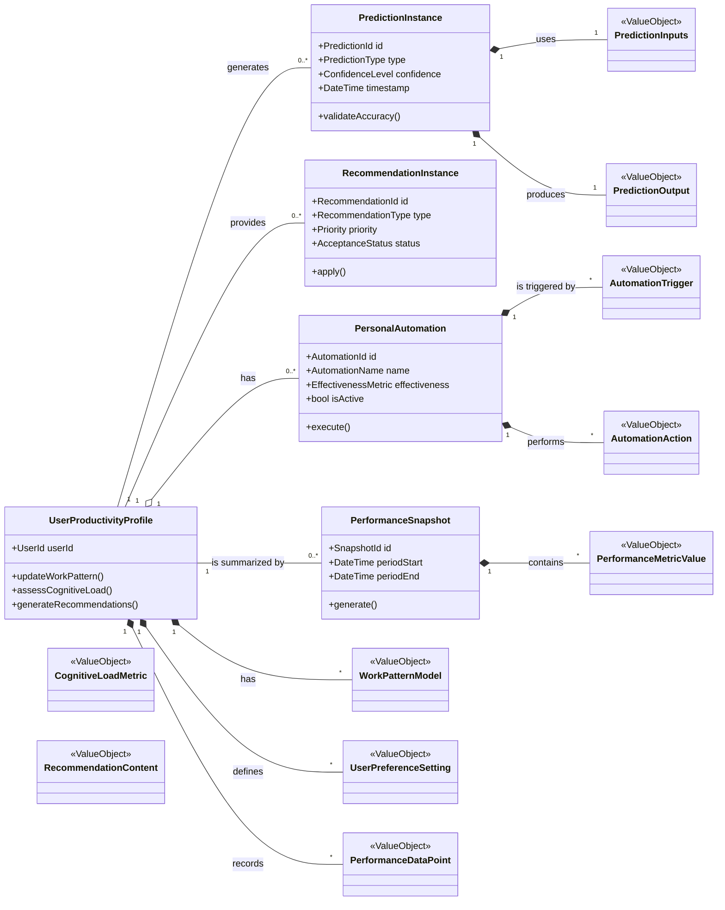
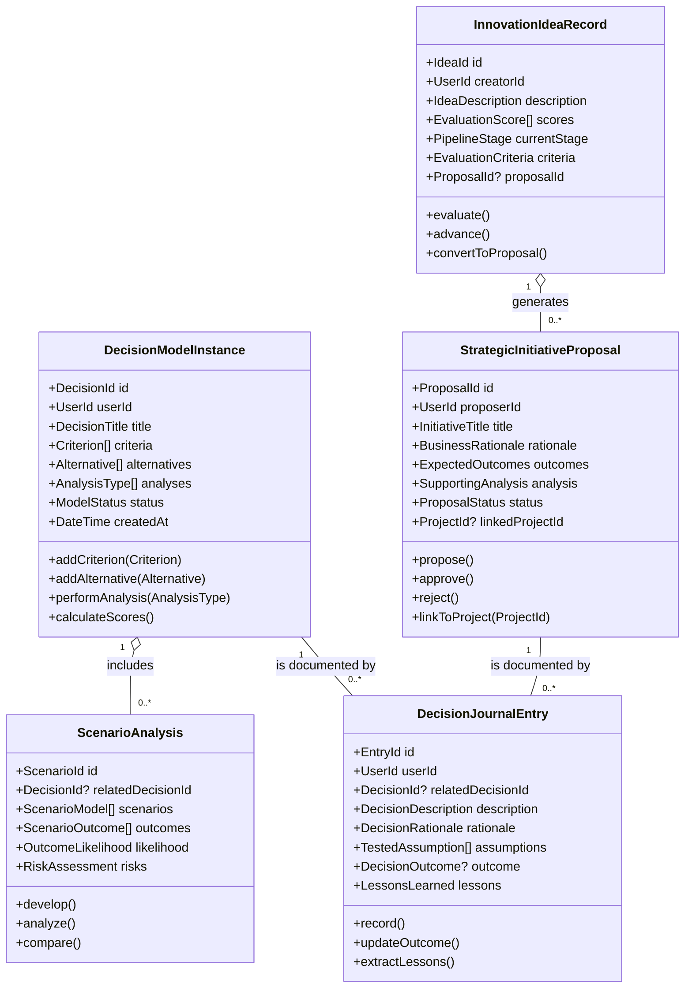
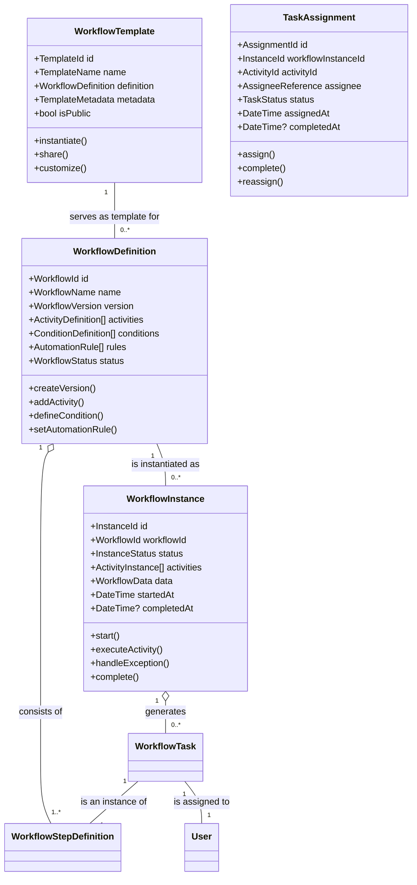
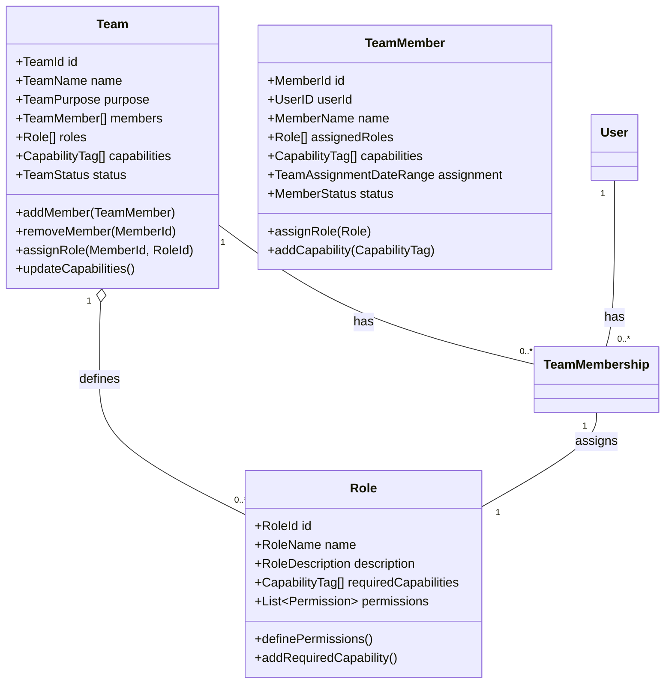
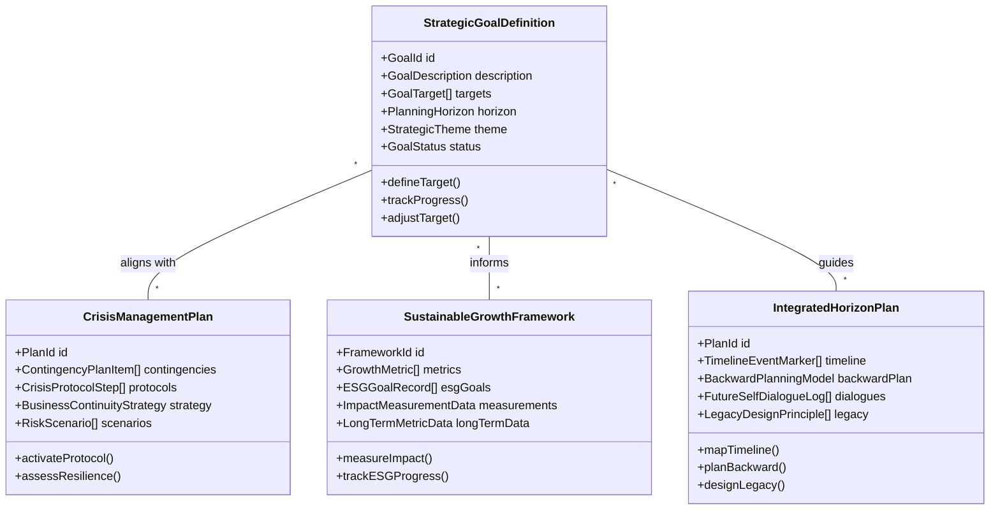
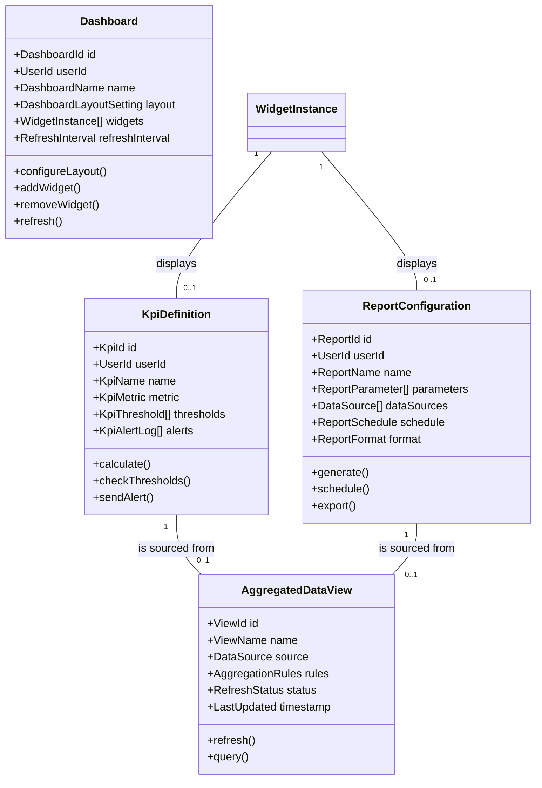
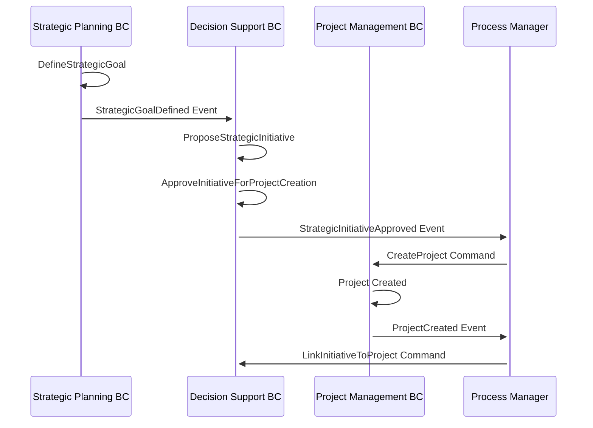
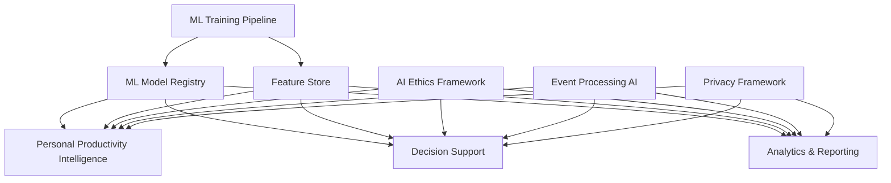

# Intelligence & Strategic Management Platform Domain-Driven Design Architecture Specification
## Intelligence & Strategic Management Extensions

---

## Table of Contents

1. [Executive Summary](#1-executive-summary)
2. [Domain Architecture Overview](#2-domain-architecture-overview)
3. [Bounded Context Catalog](#3-bounded-context-catalog)
4. [Bounded Context Specifications](#4-bounded-context-specifications)
5. [Integration Patterns](#5-integration-patterns)
6. [Implementation Guidelines](#6-implementation-guidelines)
7. [Cross-Cutting Concerns](#7-cross-cutting-concerns)
8. [Dependency Matrix](#8-dependency-matrix)

---

## 1. Executive Summary

### 1.1 System Purpose
An intelligent productivity platform extension that leverages AI, strategic planning, and advanced analytics to provide personalized productivity optimization, decision support, workflow automation, and strategic alignment capabilities integrated with the core productivity management platform.

### 1.2 Architecture Approach
- **Pattern**: Domain-Driven Design with CQRS, Event Sourcing, and AI/ML Integration
- **Framework**: ABP Framework (.NET) with AI/ML microservices
- **Integration**: Event-driven architecture with intelligent event processing
- **Scalability**: AI-ready microservices with elastic scaling for ML workloads

### 1.3 Core Domain Classification
- **Core Domains**: Personal Productivity Intelligence, Decision Support, Strategic Planning
- **Supporting Domains**: Workflow Engine, Team Management, Analytics & Reporting
- **Generic Domains**: AI/ML Infrastructure, Data Processing Pipeline

---

## 2. Domain Architecture Overview

### 2.1 Context Map

```
┌─────────────────┐    ┌─────────────────┐    ┌─────────────────┐
│Personal Prod.   │────│Decision Support │────│Strategic Planning│
│Intelligence     │    │      (Core)     │    │     (Core)      │
│    (Core)       │    │                 │    │                 │
└─────────────────┘    └─────────────────┘    └─────────────────┘
         │                       │                       │
         │                       │                       │
┌─────────────────┐    ┌─────────────────┐    ┌─────────────────┐
│Workflow Engine  │    │     Team        │    │Analytics &      │
│  (Supporting)   │    │  (Supporting)   │    │Reporting        │
│                 │    │                 │    │ (Supporting)    │
└─────────────────┘    └─────────────────┘    └─────────────────┘
         │                       │                       │
         └───────────────────────┼───────────────────────┘
                                 │
        ┌────────────────────────┼────────────────────────┐
        │                       │                        │
┌─────────────────┐    ┌─────────────────┐    ┌─────────────────┐
│   Core Platform │    │   AI/ML         │    │   External      │
│   Integration   │    │ Infrastructure  │    │  Integrations   │
│   (Generic)     │    │   (Generic)     │    │   (Generic)     │
└─────────────────┘    └─────────────────┘    └─────────────────┘
```

### 2.2 Strategic Design Principles

1. **AI-First Design**: Intelligence capabilities built into the core domain logic
2. **Strategic Alignment**: All domains support long-term strategic thinking
3. **Adaptive Learning**: System improves based on user behavior and outcomes
4. **Context Awareness**: Cross-domain intelligence for better recommendations
5. **Human-AI Collaboration**: Augment human decision-making, don't replace it

---

## 3. Bounded Context Catalog

| Context | Type | Priority | Complexity | Team Size | AI/ML Focus |
|---------|------|----------|------------|-----------|-------------|
| Personal Productivity Intelligence | Core | Critical | High | 4-5 | High |
| Decision Support | Core | Critical | High | 3-4 | Medium |
| Strategic Planning | Core | High | Medium | 2-3 | Low |
| Workflow Engine | Supporting | Medium | Medium | 2-3 | Low |
| Team Management | Supporting | Medium | Low | 1-2 | None |
| Analytics & Reporting | Supporting | High | Medium | 2-3 | Medium |

---

## 4. Bounded Context Specifications

### 4.1 Personal Productivity Intelligence Bounded Context

#### 4.1.1 Context Overview
**Responsibility**: Enhances individual user productivity and well-being via AI, including predictions, recommendations, cognitive modeling, automation, pattern recognition, performance tracking, NLP for tasks, and feedback loops.

**Strategic Classification**: Core Domain - Strategic

**Subdomains**:
- AI Personalization & Prediction: Core predictive analytics and personalization
- Performance Tracking: Supporting user performance monitoring
- Cognitive Modeling: User cognitive state and capacity assessment
- Natural Language Processing: Task and content understanding

#### 4.1.2 Core Domain Model



#### 4.1.3 Aggregates Specification

##### UserProductivityProfile Aggregate Root
**Purpose**: Central repository for a user's patterns, preferences, cognitive state, and performance history

**Entities**:
- `WorkPatternModel`: Learned patterns of user work behavior
- `CognitiveLoadMetric`: Current and historical cognitive capacity measurements
- `UserPreferenceSetting`: Personal preferences and customizations
- `PerformanceDataPoint`: Individual performance measurements

**Value Objects**:
- `TimeEstimate`: AI-generated time predictions
- `RiskProbability`: Likelihood of task/project risks
- `CognitiveLoadLevel`: Enum (Low, Medium, High, Overload)
- `WorkloadOptimizationSuggestion`: Recommended workload adjustments
- `TaskContext`: Contextual information for task execution
- `PriorityScore`: AI-calculated priority values
- `MotivationalNudgeContent`: Personalized motivational messages
- `BehaviorPatternDescription`: Identified behavioral patterns
- `ExternalContextRef`: References to projects, teams, etc.

**Business Invariants**:
- User profile must exist before generating predictions
- Cognitive load cannot exceed maximum sustainable threshold
- Performance data must be time-ordered
- Recommendations must have explainable rationale

##### PredictionInstance Aggregate Root
**Purpose**: Represents a specific prediction with its inputs, output, confidence, and explainability factors

**Entities**:
- `PredictionModelMetadata`: Information about the ML model used
- `FeatureImportance`: Importance weights of input features

**Value Objects**:
- `PredictionType`: TaskDuration, RiskAssessment, OptimalScheduling
- `PredictionInputs`: Input feature vector
- `PredictionOutput`: Predicted value or classification
- `ConfidenceLevel`: Statistical confidence in prediction
- `ExplainabilityFactors`: Human-readable explanation of prediction

##### RecommendationInstance Aggregate Root
**Purpose**: Represents a specific suggestion with rationale and tracking

**Entities**:
- `RecommendationRule`: Business rule that generated the recommendation

**Value Objects**:
- `RecommendationType`: TaskSuggestion, ScheduleOptimization, WorkloadAdjustment
- `RecommendationContent`: The actual recommendation text
- `Rationale`: Explanation of why this recommendation was made
- `AcceptanceStatus`: Pending, Accepted, Rejected, PartiallyAccepted

##### PersonalAutomation Aggregate Root
**Purpose**: Defines and tracks user-specific automated tasks/workflows

**Entities**:
- `AutomationTrigger`: Conditions that activate automation
- `AutomationAction`: Actions performed when triggered

**Value Objects**:
- `AutomationEffectivenessMetric`: Measurement of automation success
- `TriggerCondition`: Boolean logic for automation activation
- `ActionParameters`: Configuration for automated actions

##### PerformanceSnapshot Aggregate Root
**Purpose**: Represents a periodic or generated performance report

**Entities**:
- `PerformanceMetricValue`: Individual metric measurements
- `BenchmarkData`: Comparison data points

**Value Objects**:
- `InsightText`: AI-generated insights about performance
- `RecommendedAction`: Suggested improvements
- `TrendAnalysis`: Performance trend indicators

#### 4.1.4 Commands & Queries (CQRS)

##### Commands
**Profile Management**:
```csharp
public record UpdateWorkPatternModel(
    UserId UserId,
    WorkPatternData PatternData,
    DateTime EffectiveDate
);

public record AssessCognitiveLoad(
    UserId UserId,
    CognitiveLoadInputs Inputs,
    DateTime AssessmentTime
);

public record ApplyUserPreference(
    UserId UserId,
    PreferenceType Type,
    PreferenceValue Value
);
```

**AI Predictions & Recommendations**:
```csharp
public record GenerateTaskRecommendations(
    UserId UserId,
    TaskContext Context,
    int MaxRecommendations = 5
);

public record PredictTaskCompletionTime(
    UserId UserId,
    TaskId TaskId,
    TaskComplexity Complexity,
    List<string> Tags
);

public record OptimizeUserSchedule(
    UserId UserId,
    DateTime StartDate,
    DateTime EndDate,
    OptimizationCriteria Criteria
);
```

**Automation Management**:
```csharp
public record DefinePersonalAutomation(
    UserId UserId,
    string Name,
    List<AutomationTrigger> Triggers,
    List<AutomationAction> Actions
);

public record MonitorAutomationEffectiveness(
    AutomationId AutomationId,
    EffectivenessMetrics Metrics
);
```

**Performance Tracking**:
```csharp
public record RecordUserPerformance(
    UserId UserId,
    PerformanceMetricType Type,
    decimal Value,
    DateTime RecordedAt,
    string? Context
);

public record GeneratePerformanceReport(
    UserId UserId,
    DateTime StartDate,
    DateTime EndDate,
    ReportType Type
);
```

##### Queries
**Profile Queries**:
```csharp
public record GetUserProductivityProfile(UserId UserId);
public record GetCognitiveLoad(UserId UserId, DateTime? AsOf = null);
public record GetLearnedPreferences(UserId UserId, PreferenceCategory? Category = null);
```

**Prediction & Recommendation Queries**:
```csharp
public record GetRecommendedTasks(UserId UserId, TaskContext? Context = null);
public record GetOptimizedSchedule(UserId UserId, DateTime Date);
public record GetPrediction(PredictionId PredictionId);
public record GetRecommendationExplanation(RecommendationId RecommendationId);
```

**Performance Queries**:
```csharp
public record GetPerformanceReport(UserId UserId, DateTime StartDate, DateTime EndDate);
public record GetPerformanceTrends(UserId UserId, TrendPeriod Period);
public record GetPersonalAutomations(UserId UserId, bool? ActiveOnly = true);
```

#### 4.1.5 Events & Integration

##### Domain Events
```csharp
public class WorkPatternDetected : DomainEvent
{
    public UserId UserId { get; }
    public WorkPatternType PatternType { get; }
    public PatternConfidence Confidence { get; }
    public PatternDetails Details { get; }
    public DateTime DetectedAt { get; }
}

public class CognitiveLoadThresholdReached : DomainEvent
{
    public UserId UserId { get; }
    public CognitiveLoadLevel CurrentLevel { get; }
    public CognitiveLoadLevel ThresholdLevel { get; }
    public RecommendedActions SuggestedActions { get; }
    public DateTime OccurredAt { get; }
}

public class RecommendationGenerated : DomainEvent
{
    public RecommendationId RecommendationId { get; }
    public UserId UserId { get; }
    public RecommendationType Type { get; }
    public RecommendationContent Content { get; }
    public ConfidenceLevel Confidence { get; }
    public DateTime GeneratedAt { get; }
}

public class PredictionMade : DomainEvent
{
    public PredictionId PredictionId { get; }
    public UserId UserId { get; }
    public PredictionType Type { get; }
    public PredictionOutput Output { get; }
    public ConfidenceLevel Confidence { get; }
    public DateTime MadeAt { get; }
}

public class PersonalAutomationTriggered : DomainEvent
{
    public AutomationId AutomationId { get; }
    public UserId UserId { get; }
    public List<TriggerCondition> FulfilledConditions { get; }
    public List<AutomationAction> ExecutedActions { get; }
    public DateTime TriggeredAt { get; }
}

public class PerformanceMetricUpdated : DomainEvent
{
    public UserId UserId { get; }
    public PerformanceMetricType Type { get; }
    public decimal PreviousValue { get; }
    public decimal NewValue { get; }
    public decimal ChangePercentage { get; }
    public DateTime UpdatedAt { get; }
}
```

#### 4.1.6 Business Rules & Policies

##### Cognitive Load Management Policy
```csharp
public class CognitiveLoadManagementPolicy
{
    public async Task<CognitiveLoadAssessment> AssessCurrentLoad(
        UserId userId,
        CurrentWorkContext context)
    {
        var profile = await GetUserProfile(userId);
        var currentTasks = await GetActiveTasks(userId);
        var recentMetrics = await GetRecentCognitiveMetrics(userId);
        
        var baseLoad = CalculateBaseLoad(currentTasks);
        var contextualAdjustment = CalculateContextualAdjustment(context, profile);
        var personalFactors = CalculatePersonalFactors(profile, recentMetrics);
        
        var totalLoad = baseLoad + contextualAdjustment + personalFactors;
        
        return new CognitiveLoadAssessment
        {
            CurrentLevel = MapToLevel(totalLoad),
            Capacity = profile.MaxCognitiveCapacity,
            Utilization = totalLoad / profile.MaxCognitiveCapacity,
            Recommendations = GenerateLoadRecommendations(totalLoad, profile)
        };
    }
}
```

##### Recommendation Generation Policy
```csharp
public class RecommendationGenerationPolicy
{
    public async Task<List<RecommendationInstance>> GenerateRecommendations(
        UserId userId,
        RecommendationContext context)
    {
        var profile = await GetUserProfile(userId);
        var cognitiveLoad = await GetCurrentCognitiveLoad(userId);
        var workPatterns = await GetUserWorkPatterns(userId);
        var externalContext = await GetExternalContext(userId);
        
        var recommendations = new List<RecommendationInstance>();
        
        // Task prioritization recommendations
        if (context.IncludeTaskRecommendations)
        {
            recommendations.AddRange(await GenerateTaskRecommendations(
                profile, cognitiveLoad, workPatterns, externalContext));
        }
        
        // Schedule optimization recommendations
        if (context.IncludeScheduleOptimization)
        {
            recommendations.AddRange(await GenerateScheduleRecommendations(
                profile, cognitiveLoad, workPatterns));
        }
        
        // Workload adjustment recommendations
        if (cognitiveLoad.Level >= CognitiveLoadLevel.High)
        {
            recommendations.AddRange(await GenerateWorkloadRecommendations(
                profile, cognitiveLoad));
        }
        
        // Filter and rank recommendations
        return FilterAndRankRecommendations(recommendations, profile.Preferences);
    }
}
```

#### 4.1.7 Technical Considerations

##### AI/ML Integration
- **Model Management**: Versioned ML models with A/B testing capabilities
- **Feature Engineering**: Real-time feature extraction from user behavior
- **Prediction Serving**: Low-latency prediction APIs with caching
- **Model Training**: Automated retraining pipelines based on feedback

##### Privacy & Ethics
- **Data Minimization**: Only collect necessary data for AI processing
- **Explainable AI**: All predictions must be explainable to users
- **User Control**: Users can opt-out of specific AI features
- **Bias Detection**: Regular monitoring for algorithmic bias

---

### 4.2 Decision Support Bounded Context

#### 4.2.1 Context Overview
**Responsibility**: Providing structured tools and intelligence for making better decisions, including modeling, analysis (SWOT, ROI, Risk), prioritization, scenario planning, journaling, assumption testing, and managing innovation ideas through strategic initiative proposals.

**Strategic Classification**: Core Domain - Strategic

**Subdomains**:
- Advanced Decision Augmentation: Core decision modeling and analysis
- Basic Decision Modeling: Supporting decision structures
- Innovation Idea Management: Supporting idea pipeline management

#### 4.2.2 Core Domain Model



#### 4.2.3 Aggregates Specification

##### DecisionModelInstance Aggregate Root
**Purpose**: Central entity managing decision lifecycle and ensuring decision modeling integrity

**Entities**:
- `Criterion`: Decision evaluation criteria with weights
- `Alternative`: Possible choices being evaluated
- `QualitativeAnalysis`: SWOT, Risk assessments
- `QuantitativeAnalysis`: ROI, Cost-benefit calculations
- `PrioritizationFrameworkUsage`: Applied frameworks (Eisenhower, MoSCoW)

**Value Objects**:
- `Weight`: Criterion importance (0-1)
- `Score`: Alternative rating for criterion
- `Impact`: Expected impact level
- `Probability`: Likelihood of outcomes
- `SwotItem`: Individual SWOT elements
- `CostValue`: Financial cost estimates
- `BenefitValue`: Expected benefits
- `RoiValue`: Return on investment calculations

**Business Invariants**:
- Decision must have at least one criterion and two alternatives
- Weights must sum to 1.0 across all criteria
- Scores must be within defined range (e.g., 1-10)
- Cost-benefit analysis requires quantified values

##### StrategicInitiativeProposal Aggregate Root
**Purpose**: Represents a proposed initiative derived from strategic goals or decisions

**Entities**:
- `SupportingAnalysis`: Linked decision models and analyses
- `ExpectedOutcome`: Projected results and metrics
- `ApprovalWorkflow`: Approval process tracking

**Value Objects**:
- `ProposalStatus`: Enum (Proposed, UnderReview, Approved, Rejected)
- `BusinessRationale`: Justification for the initiative
- `ProjectID`: Reference to linked project (if approved)
- `ApprovalComments`: Feedback from reviewers

**Business Invariants**:
- Proposal must have clear business rationale
- Expected outcomes must be measurable
- Only approved proposals can be linked to projects
- Proposal cannot be modified after approval

##### ScenarioAnalysis Aggregate Root
**Purpose**: Holds different scenario models and their projected outcomes

**Entities**:
- `ScenarioModel`: Individual scenario definition
- `ScenarioOutcome`: Projected results for each scenario
- `RiskAssessment`: Associated risks and mitigations

**Value Objects**:
- `ScenarioDescription`: Narrative description of scenario
- `OutcomeLikelihood`: Probability of scenario occurring
- `ImpactAssessment`: Potential impact if scenario occurs

##### DecisionJournalEntry Aggregate Root
**Purpose**: Records decisions, rationale, assumptions, and eventual outcomes

**Entities**:
- `TestedAssumption`: Assumptions and their validation status
- `DecisionOutcome`: Actual results of the decision
- `LessonsLearned`: Insights gained from the decision

**Value Objects**:
- `DecisionRationale`: Why the decision was made
- `AssumptionConfidence`: Confidence level in assumptions
- `OutcomeVariance`: Difference between expected and actual results

##### InnovationIdeaRecord Aggregate Root
**Purpose**: Tracks ideas from capture through evaluation and potential promotion to proposals

**Entities**:
- `IdeaEvaluationCriteria`: Criteria used to assess ideas
- `EvaluationScore`: Scores against evaluation criteria

**Value Objects**:
- `IdeaDescription`: Detailed idea description
- `PipelineStage`: Current stage in innovation pipeline
- `EvaluationScore`: Quantified assessment score

#### 4.2.4 Commands & Queries (CQRS)

##### Commands
**Decision Modeling**:
```csharp
public record CreateDecisionModel(
    string Title,
    string Description,
    DecisionType Type,
    UserId CreatedBy
);

public record DefineCriterion(
    DecisionId DecisionId,
    string Name,
    string Description,
    decimal Weight,
    CriterionType Type
);

public record AddAlternative(
    DecisionId DecisionId,
    string Name,
    string Description,
    Dictionary<CriterionId, decimal> Scores
);
```

**Analysis Commands**:
```csharp
public record PerformSwotAnalysis(
    DecisionId DecisionId,
    AlternativeId? AlternativeId,
    List<SwotItem> Strengths,
    List<SwotItem> Weaknesses,
    List<SwotItem> Opportunities,
    List<SwotItem> Threats
);

public record CalculateCostBenefitAnalysis(
    DecisionId DecisionId,
    AlternativeId AlternativeId,
    List<CostItem> Costs,
    List<BenefitItem> Benefits,
    TimeSpan EvaluationPeriod
);

public record ApplyPrioritizationFramework(
    DecisionId DecisionId,
    PrioritizationFramework Framework,
    FrameworkParameters Parameters
);
```

**Strategic Initiative Commands**:
```csharp
public record ProposeStrategicInitiative(
    string Title,
    BusinessRationale Rationale,
    List<ExpectedOutcome> Outcomes,
    List<SupportingAnalysisId> SupportingAnalyses,
    UserId ProposedBy
);

public record ApproveInitiativeForProjectCreation(
    ProposalId ProposalId,
    ApprovalComments Comments,
    ProjectCreationParameters ProjectParams,
    UserId ApprovedBy
);

public record RejectInitiativeProposal(
    ProposalId ProposalId,
    RejectionReason Reason,
    string Comments,
    UserId RejectedBy
);
```

**Innovation Management Commands**:
```csharp
public record CaptureInnovationIdea(
    string Description,
    IdeaCategory Category,
    List<string> Tags,
    UserId CreatedBy
);

public record EvaluateIdea(
    IdeaId IdeaId,
    List<EvaluationCriterion> Criteria,
    Dictionary<CriterionId, decimal> Scores,
    UserId EvaluatedBy
);

public record ConvertIdeaToProposal(
    IdeaId IdeaId,
    BusinessRationale Rationale,
    List<ExpectedOutcome> Outcomes,
    UserId ConvertedBy
);
```

##### Queries
**Decision Queries**:
```csharp
public record GetDecisionModel(DecisionId DecisionId);
public record CompareAlternatives(DecisionId DecisionId, ComparisonCriteria Criteria);
public record GetDecisionAnalyses(DecisionId DecisionId, AnalysisType? Type = null);
```

**Strategic Initiative Queries**:
```csharp
public record GetStrategicInitiativeProposal(ProposalId ProposalId);
public record ListPendingProposals(UserId? FilterByProposer = null);
public record GetApprovedInitiatives(DateTime? SinceDate = null);
```

**Innovation Pipeline Queries**:
```csharp
public record ListInnovationIdeas(PipelineStage? Stage = null, IdeaCategory? Category = null);
public record GetInnovationPipeline(UserId? FilterByCreator = null);
public record GetIdeaEvaluation(IdeaId IdeaId);
```

#### 4.2.5 Events & Integration

##### Domain Events
```csharp
public class DecisionModelCreated : DomainEvent
{
    public DecisionId DecisionId { get; }
    public string Title { get; }
    public DecisionType Type { get; }
    public UserId CreatedBy { get; }
    public DateTime CreatedAt { get; }
}

public class StrategicInitiativeProposed : DomainEvent
{
    public ProposalId ProposalId { get; }
    public string Title { get; }
    public BusinessRationale Rationale { get; }
    public List<ExpectedOutcome> Outcomes { get; }
    public UserId ProposedBy { get; }
    public DateTime ProposedAt { get; }
}

public class StrategicInitiativeApproved : DomainEvent
{
    public ProposalId ProposalId { get; }
    public string Title { get; }
    public ProjectCreationParameters ProjectParams { get; }
    public UserId ApprovedBy { get; }
    public DateTime ApprovedAt { get; }
}

public class AnalysisCompleted : DomainEvent
{
    public DecisionId DecisionId { get; }
    public AnalysisType Type { get; }
    public AnalysisResults Results { get; }
    public UserId PerformedBy { get; }
    public DateTime CompletedAt { get; }
}

public class IdeaCaptured : DomainEvent
{
    public IdeaId IdeaId { get; }
    public string Description { get; }
    public IdeaCategory Category { get; }
    public UserId CreatedBy { get; }
    public DateTime CapturedAt { get; }
}
```

#### 4.2.6 Business Rules & Policies

##### Strategic Initiative Approval Policy
```csharp
public class StrategicInitiativeApprovalPolicy
{
    public async Task<ApprovalResult> EvaluateForApproval(
        StrategicInitiativeProposal proposal,
        ApprovalContext context)
    {
        var evaluationResults = new List<EvaluationCriterion>();
        
        // Check strategic alignment
        var strategicAlignment = await CheckStrategicAlignment(proposal);
        evaluationResults.Add(new EvaluationCriterion("Strategic Alignment", strategicAlignment));
        
        // Assess resource requirements
        var resourceFeasibility = await AssessResourceFeasibility(proposal);
        evaluationResults.Add(new EvaluationCriterion("Resource Feasibility", resourceFeasibility));
        
        // Validate expected outcomes
        var outcomeRealism = await ValidateExpectedOutcomes(proposal);
        evaluationResults.Add(new EvaluationCriterion("Outcome Realism", outcomeRealism));
        
        // Calculate overall score
        var overallScore = evaluationResults.Average(e => e.Score);
        
        return new ApprovalResult
        {
            IsApproved = overallScore >= context.ApprovalThreshold,
            Score = overallScore,
            Evaluations = evaluationResults,
            Recommendations = GenerateRecommendations(evaluationResults)
        };
    }
}
```

---

### 4.3 Workflow Engine Bounded Context

#### 4.3.1 Context Overview
**Responsibility**: Designing, executing, and managing automated or semi-automated business processes using potentially standard notations (like BPMN) via underlying engine adapters. Assigns tasks potentially to users or teams defined in other BCs.

**Strategic Classification**: Supporting Domain

**Subdomains**:
- Workflow Automation: Supporting workflow design and execution
- BPMN Engine Interface: Generic engine integration layer

#### 4.3.2 Core Domain Model



#### 4.3.3 Aggregates Specification

##### WorkflowDefinition Aggregate Root
**Purpose**: The blueprint of a workflow, including versions, activities, conditions, and automation rules

**Entities**:
- `WorkflowVersion`: Version control for workflow changes
- `ActivityDefinition`: Individual workflow steps
- `ConditionDefinition`: Decision points and branching logic
- `AutomationRule`: Automated actions and triggers

**Value Objects**:
- `VersionIdentifier`: Semantic versioning for workflows
- `ActivityType`: Manual, Automated, Decision, Parallel, Sequential
- `ConditionExpression`: Boolean logic for workflow branching
- `RuleTrigger`: Event or condition that activates automation
- `RuleAction`: Action performed by automation rule

**Business Invariants**:
- Workflow must have at least one activity
- All activities must be reachable from start node
- Conditional branches must have valid expressions
- Automation rules must have valid triggers and actions

##### WorkflowInstance Aggregate Root
**Purpose**: A live or completed execution of a workflow definition

**Entities**:
- `ActivityInstance`: Runtime instance of workflow activity
- `WorkflowExecutionLog`: Audit trail of workflow execution
- `WorkflowExceptionRecord`: Errors and exception handling

**Value Objects**:
- `InstanceStatus`: Running, Completed, Failed, Paused, Waiting
- `ExecutionTimestamp`: Activity execution timing
- `ExceptionDetails`: Error information and context
- `WorkflowData`: Runtime data passed between activities

**Business Invariants**:
- Instance must be based on valid workflow definition
- Activity instances must follow defined sequence
- Exception handling must follow defined procedures
- Workflow data must maintain consistency

##### WorkflowTemplate Aggregate Root
**Purpose**: A reusable workflow definition with metadata

**Value Objects**:
- `TemplateMetadata`: Description, tags, usage statistics
- `VisibilityScope`: Private, Team, Organization, Public
- `CustomizationOptions`: Configurable parameters

##### TaskAssignment Aggregate Root
**Purpose**: Assignment of workflow tasks to users or teams

**Value Objects**:
- `AssigneeReference`: UserID, TeamID, RoleID reference
- `TaskStatus`: Assigned, InProgress, Completed, Cancelled
- `TaskDependency`: Dependencies on other tasks

#### 4.3.4 Commands & Queries (CQRS)

##### Commands
**Workflow Design**:
```csharp
public record DesignWorkflow(
    string Name,
    string Description,
    WorkflowType Type,
    UserId DesignedBy
);

public record DefineActivity(
    WorkflowId WorkflowId,
    string ActivityName,
    ActivityType Type,
    ActivityConfiguration Configuration
);

public record SetCondition(
    WorkflowId WorkflowId,
    ActivityId FromActivity,
    ActivityId ToActivity,
    ConditionExpression Condition
);

public record DefineAutomationRule(
    WorkflowId WorkflowId,
    RuleTrigger Trigger,
    RuleAction Action,
    RuleConditions Conditions
);
```

**Workflow Execution**:
```csharp
public record ExecuteWorkflowInstance(
    WorkflowId WorkflowId,
    WorkflowInputData InputData,
    UserId StartedBy
);

public record AssignWorkflowTask(
    InstanceId InstanceId,
    ActivityId ActivityId,
    AssigneeReference Assignee,
    DateTime? DueDate,
    UserId AssignedBy
);

public record UpdateTaskStatus(
    AssignmentId AssignmentId,
    TaskStatus NewStatus,
    string? Comments,
    UserId UpdatedBy
);

public record HandleWorkflowException(
    InstanceId InstanceId,
    ExceptionType Type,
    ExceptionHandlingStrategy Strategy,
    UserId HandledBy
);
```

**Template Management**:
```csharp
public record CreateWorkflowTemplate(
    WorkflowId SourceWorkflowId,
    string TemplateName,
    TemplateMetadata Metadata,
    UserId CreatedBy
);

public record ShareWorkflowTemplate(
    TemplateId TemplateId,
    SharingScope Scope,
    List<UserId>? SpecificUsers,
    UserId SharedBy
);
```

##### Queries
**Workflow Queries**:
```csharp
public record GetWorkflowDefinition(WorkflowId WorkflowId);
public record GetWorkflowVersionHistory(WorkflowId WorkflowId);
public record ListWorkflowTemplates(UserId? FilterByCreator = null, WorkflowCategory? Category = null);
```

**Instance Queries**:
```csharp
public record GetWorkflowInstanceStatus(InstanceId InstanceId);
public record GetWorkflowExecutionLogs(InstanceId InstanceId);
public record GetAssignedTasks(UserId? AssigneeId = null, TaskStatus? Status = null);
```

**Performance Queries**:
```csharp
public record GetWorkflowPerformanceAnalytics(WorkflowId WorkflowId, DateTime StartDate, DateTime EndDate);
public record GetWorkflowBottlenecks(WorkflowId WorkflowId);
public record GetWorkflowEfficiencyMetrics(WorkflowId WorkflowId);
```

#### 4.3.5 Events & Integration

##### Domain Events
```csharp
public class WorkflowInstanceStarted : DomainEvent
{
    public InstanceId InstanceId { get; }
    public WorkflowId WorkflowId { get; }
    public WorkflowInputData InputData { get; }
    public UserId StartedBy { get; }
    public DateTime StartedAt { get; }
}

public class WorkflowActivityCompleted : DomainEvent
{
    public InstanceId InstanceId { get; }
    public ActivityId ActivityId { get; }
    public ActivityOutputData OutputData { get; }
    public TimeSpan Duration { get; }
    public UserId CompletedBy { get; }
    public DateTime CompletedAt { get; }
}

public class TaskAssigned : DomainEvent
{
    public AssignmentId AssignmentId { get; }
    public InstanceId InstanceId { get; }
    public ActivityId ActivityId { get; }
    public AssigneeReference Assignee { get; }
    public DateTime? DueDate { get; }
    public UserId AssignedBy { get; }
    public DateTime AssignedAt { get; }
}

public class WorkflowInstanceCompleted : DomainEvent
{
    public InstanceId InstanceId { get; }
    public WorkflowId WorkflowId { get; }
    public WorkflowOutputData OutputData { get; }
    public TimeSpan TotalDuration { get; }
    public DateTime CompletedAt { get; }
}

public class WorkflowExceptionOccurred : DomainEvent
{
    public InstanceId InstanceId { get; }
    public ActivityId? ActivityId { get; }
    public ExceptionType Type { get; }
    public ExceptionDetails Details { get; }
    public DateTime OccurredAt { get; }
}
```

---

### 4.4 Team Management Bounded Context

#### 4.4.1 Context Overview
**Responsibility**: Defining and managing team structures, memberships, roles, capabilities, and team-level availability or allocation.

**Strategic Classification**: Supporting Domain

**Subdomains**:
- Team & Role Management: Core team structure management
- Capability Mapping: Supporting skill and capability tracking

#### 4.4.2 Core Domain Model



#### 4.4.3 Aggregates Specification

##### Team Aggregate Root
**Purpose**: Represents a team, its members, purpose, and associated roles

**Entities**:
- `TeamMember`: Individual team member with roles and capabilities
- `Role`: Role definitions within the team

**Value Objects**:
- `TeamID`: Unique team identifier
- `TeamName`: Human-readable team name
- `TeamPurpose`: Mission/purpose statement
- `MemberID`: Reference to user (likely UserID from IAM)
- `RoleID`: Unique role identifier
- `CapabilityTag`: Skill or capability identifier
- `TeamAssignmentDateRange`: Membership period

**Business Invariants**:
- Team must have at least one member
- Team must have at least one member with admin/lead role
- Members cannot have conflicting roles
- Role assignments must match capability requirements

#### 4.4.4 Commands & Queries (CQRS)

##### Commands
**Team Management**:
```csharp
public record CreateTeam(
    string Name,
    string Purpose,
    TeamType Type,
    UserId CreatedBy
);

public record UpdateTeamDetails(
    TeamId TeamId,
    string? Name,
    string? Purpose,
    TeamType? Type,
    UserId UpdatedBy
);

public record DisbandTeam(
    TeamId TeamId,
    string Reason,
    DateTime EffectiveDate,
    UserId DisbandedBy
);
```

**Membership Management**:
```csharp
public record AddMemberToTeam(
    TeamId TeamId,
    UserId MemberId,
    DateTime StartDate,
    DateTime? EndDate,
    UserId AddedBy
);

public record RemoveMemberFromTeam(
    TeamId TeamId,
    UserId MemberId,
    DateTime EffectiveDate,
    string? Reason,
    UserId RemovedBy
);
```

**Role Management**:
```csharp
public record DefineRole(
    TeamId TeamId,
    string RoleName,
    string Description,
    List<CapabilityTag> RequiredCapabilities,
    List<Permission> Permissions,
    UserId DefinedBy
);

public record AssignRoleToMember(
    TeamId TeamId,
    UserId MemberId,
    RoleId RoleId,
    DateTime EffectiveDate,
    UserId AssignedBy
);

public record RevokeRoleFromMember(
    TeamId TeamId,
    UserId MemberId,
    RoleId RoleId,
    DateTime EffectiveDate,
    string? Reason,
    UserId RevokedBy
);
```

##### Queries
**Team Queries**:
```csharp
public record GetTeamDetails(TeamId TeamId);
public record GetTeamMembers(TeamId TeamId, bool? ActiveOnly = true);
public record GetTeamsForMember(UserId MemberId);
public record FindTeamsByCapability(CapabilityTag Capability);
```

**Role Queries**:
```csharp
public record GetMemberRoles(TeamId TeamId, UserId MemberId);
public record GetMembersInRole(TeamId TeamId, RoleId RoleId);
public record GetRoleDefinition(RoleId RoleId);
public record GetMemberCapabilities(UserId MemberId, TeamId? TeamFilter = null);
```

#### 4.4.5 Events & Integration

##### Domain Events
```csharp
public class TeamCreated : DomainEvent
{
    public TeamId TeamId { get; }
    public string Name { get; }
    public string Purpose { get; }
    public TeamType Type { get; }
    public UserId CreatedBy { get; }
    public DateTime CreatedAt { get; }
}

public class MemberAddedToTeam : DomainEvent
{
    public TeamId TeamId { get; }
    public UserId MemberId { get; }
    public DateTime StartDate { get; }
    public DateTime? EndDate { get; }
    public UserId AddedBy { get; }
    public DateTime AddedAt { get; }
}

public class RoleAssignedToMember : DomainEvent
{
    public TeamId TeamId { get; }
    public UserId MemberId { get; }
    public RoleId RoleId { get; }
    public string RoleName { get; }
    public DateTime EffectiveDate { get; }
    public UserId AssignedBy { get; }
}
```

---

### 4.5 Strategic Planning Bounded Context

#### 4.5.1 Context Overview
**Responsibility**: Supporting long-term, high-level planning and strategy formulation, including strategic goals, future roadmaps, crisis management, sustainable growth, and major transitions.

**Strategic Classification**: Core Domain - Strategic

**Subdomains**:
- Strategic & Future Planning: Core strategic planning capabilities

#### 4.5.2 Core Domain Model



#### 4.5.3 Aggregates Specification

##### StrategicGoalDefinition Aggregate Root
**Purpose**: Defines high-level strategic goals with measurable targets

**Entities**:
- `GoalTarget`: Specific measurable targets for the goal

**Value Objects**:
- `GoalDescription`: Clear statement of the strategic goal
- `TargetMetric`: Measurable metric for target
- `TargetValue`: Specific target value and timeframe
- `PlanningHorizon`: H1/H2/H3 planning timeframes
- `StrategicTheme`: Category or theme of the goal

##### CrisisManagementPlan Aggregate Root
**Purpose**: Holds contingency plans, protocols, and resilience assessments

**Entities**:
- `ContingencyPlanItem`: Specific contingency actions
- `CrisisProtocolStep`: Steps in crisis response protocol
- `ResilienceAssessmentRecord`: Organizational resilience evaluations

**Value Objects**:
- `RiskScenario`: Potential crisis scenarios
- `EmergencyProcedure`: Step-by-step emergency procedures
- `VulnerabilityRating`: Assessment of organizational vulnerabilities

##### SustainableGrowthFramework Aggregate Root
**Purpose**: Tracks ESG goals, impact measurements, and long-term metrics

**Entities**:
- `GrowthMetric`: Metrics for measuring sustainable growth
- `ESGGoalRecord`: Environmental, Social, Governance goals
- `ImpactMeasurementData`: Impact assessment data

**Value Objects**:
- `BalancedGrowthMetric`: Metrics balancing multiple growth factors
- `EsgTargetValue`: Specific ESG target values
- `MetricTimescale`: Timeframe for metric measurement

#### 4.5.4 Commands & Queries (CQRS)

##### Commands
**Strategic Goal Management**:
```csharp
public record DefineStrategicGoal(
    string Description,
    StrategicTheme Theme,
    PlanningHorizon Horizon,
    List<GoalTarget> Targets,
    UserId DefinedBy
);

public record SetGoalTarget(
    GoalId GoalId,
    TargetMetric Metric,
    TargetValue Value,
    DateTime TargetDate,
    UserId SetBy
);

public record TrackGoalProgress(
    GoalId GoalId,
    TargetMetric Metric,
    decimal CurrentValue,
    DateTime MeasuredAt,
    UserId TrackedBy
);
```

**Crisis Management**:
```csharp
public record DefineContingencyPlan(
    string PlanName,
    RiskScenario Scenario,
    List<ContingencyAction> Actions,
    UserId DefinedBy
);

public record CreateCrisisProtocol(
    string ProtocolName,
    CrisisType Type,
    List<ProtocolStep> Steps,
    UserId CreatedBy
);

public record AssessResilience(
    List<RiskFactor> RiskFactors,
    ResilienceArea Area,
    UserId AssessedBy
);
```

**Sustainable Growth**:
```csharp
public record EstablishGrowthFramework(
    string FrameworkName,
    List<GrowthMetric> Metrics,
    SustainabilityPrinciples Principles,
    UserId EstablishedBy
);

public record SetESGGoal(
    ESGCategory Category,
    string GoalDescription,
    TargetValue Target,
    DateTime TargetDate,
    UserId SetBy
);

public record MeasureImpact(
    ImpactCategory Category,
    ImpactMetric Metric,
    decimal Value,
    DateTime MeasuredAt,
    UserId MeasuredBy
);
```

##### Queries
**Strategic Goal Queries**:
```csharp
public record GetStrategicGoalDefinition(GoalId GoalId);
public record GetGoalTargets(GoalId GoalId);
public record GetGoalProgress(GoalId GoalId, DateTime? AsOf = null);
public record ListStrategicGoals(StrategicTheme? Theme = null, PlanningHorizon? Horizon = null);
```

**Crisis Management Queries**:
```csharp
public record GetContingencyPlan(PlanId PlanId);
public record GetCrisisProtocol(ProtocolId ProtocolId);
public record GetResilienceAssessment(AssessmentId AssessmentId);
```

**Growth Framework Queries**:
```csharp
public record GetGrowthFrameworkMetrics(FrameworkId FrameworkId);
public record GetESGGoals(ESGCategory? Category = null);
public record GetImpactMeasurements(ImpactCategory Category, DateTime StartDate, DateTime EndDate);
```

#### 4.5.5 Events & Integration

##### Domain Events
```csharp
public class StrategicGoalDefined : DomainEvent
{
    public GoalId GoalId { get; }
    public string Description { get; }
    public StrategicTheme Theme { get; }
    public PlanningHorizon Horizon { get; }
    public List<GoalTarget> Targets { get; }
    public UserId DefinedBy { get; }
    public DateTime DefinedAt { get; }
}

public class GoalTargetSet : DomainEvent
{
    public GoalId GoalId { get; }
    public TargetMetric Metric { get; }
    public TargetValue Value { get; }
    public DateTime TargetDate { get; }
    public UserId SetBy { get; }
}

public class ContingencyPlanDefined : DomainEvent
{
    public PlanId PlanId { get; }
    public string PlanName { get; }
    public RiskScenario Scenario { get; }
    public List<ContingencyAction> Actions { get; }
    public UserId DefinedBy { get; }
}

public class ESGGoalProgressed : DomainEvent
{
    public GoalId GoalId { get; }
    public ESGCategory Category { get; }
    public decimal PreviousValue { get; }
    public decimal NewValue { get; }
    public decimal ProgressPercentage { get; }
    public DateTime MeasuredAt { get; }
}
```

---

### 4.6 Analytics & Reporting Bounded Context

#### 4.6.1 Context Overview
**Responsibility**: Consolidating data (primarily by subscribing to events from other BCs), allowing user configuration of dashboards/reports/KPIs, and visualizing information. Serves as the primary source for historical and aggregated status/progress reporting.

**Strategic Classification**: Supporting Domain

**Subdomains**:
- Standard Reporting: Supporting dashboard and report generation
- Visualization Libraries: Generic chart and visualization components
- Data Connectors: Generic event processing and data integration

#### 4.6.2 Core Domain Model



#### 4.6.3 Aggregates Specification

##### Dashboard Aggregate Root
**Purpose**: A user-defined dashboard configuration, including layout and widgets

**Entities**:
- `DashboardLayoutSetting`: Layout configuration and positioning
- `WidgetInstance`: Individual dashboard widgets
- `DashboardTemplate`: Reusable dashboard configurations

**Value Objects**:
- `WidgetType`: Chart, Table, Metric, Text, Image
- `WidgetSettings`: Widget-specific configuration
- `RefreshInterval`: How often to update widget data
- `ChartType`: Bar, Line, Pie, Scatter, etc.
- `VisualizationConfiguration`: Chart styling and options

##### ReportConfiguration Aggregate Root
**Purpose**: Defines parameters, data sources, scheduling, and format for a specific report

**Entities**:
- `ReportParameter`: User-configurable report parameters
- `ReportSchedule`: Automated report generation schedule
- `ReportGenerationLog`: History of report generation

**Value Objects**:
- `ReportFormat`: PDF, CSV, Excel, HTML
- `ScheduleTiming`: Frequency and timing configuration
- `DataSourceCredentials`: Encrypted connection information
- `ExportSettings`: Export-specific configurations

##### KpiDefinition Aggregate Root
**Purpose**: Defines a Key Performance Indicator, its calculation, tracking, and associated alerts

**Entities**:
- `KpiThreshold`: Alert thresholds and conditions
- `KpiAlertLog`: History of triggered alerts

**Value Objects**:
- `KpiValue`: Current and historical KPI values
- `KpiStatus`: OK, Warning, Critical
- `AlertConditionLogic`: Logic for triggering alerts
- `KpiCalculationFormula`: Formula for KPI calculation

#### 4.6.4 Commands & Queries (CQRS)

##### Commands
**Dashboard Management**:
```csharp
public record CreateDashboard(
    string Name,
    DashboardType Type,
    LayoutConfiguration Layout,
    UserId CreatedBy
);

public record AddWidgetToDashboard(
    DashboardId DashboardId,
    WidgetType Type,
    WidgetConfiguration Configuration,
    PositionInfo Position,
    UserId AddedBy
);

public record ConfigureWidgetDataSource(
    DashboardId DashboardId,
    WidgetId WidgetId,
    DataSourceConfiguration DataSource,
    UserId ConfiguredBy
);
```

**Report Management**:
```csharp
public record DefineReport(
    string Name,
    ReportType Type,
    List<ReportParameter> Parameters,
    List<DataSourceConfiguration> DataSources,
    ReportFormat Format,
    UserId DefinedBy
);

public record ScheduleReportGeneration(
    ReportId ReportId,
    ScheduleTiming Schedule,
    List<UserId> Recipients,
    UserId ScheduledBy
);

public record GenerateReport(
    ReportId ReportId,
    Dictionary<string, object> ParameterValues,
    ReportFormat? FormatOverride,
    UserId GeneratedBy
);
```

**KPI Management**:
```csharp
public record DefineKpi(
    string Name,
    string Description,
    KpiCalculationFormula Formula,
    List<DataSourceConfiguration> DataSources,
    UserId DefinedBy
);

public record SetKpiAlert(
    KpiId KpiId,
    KpiThreshold Threshold,
    AlertConfiguration AlertConfig,
    UserId SetBy
);

public record ConfigureEventDataSource(
    string DataSourceName,
    List<EventType> SubscribedEvents,
    DataTransformationRules TransformationRules,
    UserId ConfiguredBy
);
```

##### Queries
**Dashboard Queries**:
```csharp
public record GetDashboard(DashboardId DashboardId);
public record GetWidgetData(DashboardId DashboardId, WidgetId WidgetId, DateTime? AsOf = null);
public record ListDashboardTemplates(DashboardCategory? Category = null);
```

**Report Queries**:
```csharp
public record GetReportDefinition(ReportId ReportId);
public record GetGeneratedReport(ReportGenerationId GenerationId);
public record ListScheduledReports(UserId? FilterByUser = null);
```

**KPI Queries**:
```csharp
public record GetKpiDefinition(KpiId KpiId);
public record GetKpiValue(KpiId KpiId, DateTime? AsOf = null);
public record GetKpiAlerts(KpiId KpiId, DateTime? SinceDate = null);
```

**Cross-Context Queries**:
```csharp
public record GetProjectProgressReport(ProjectId ProjectId, DateTime StartDate, DateTime EndDate);
public record GetWorkflowPerformanceTrends(WorkflowId WorkflowId, TrendPeriod Period);
public record GetTeamCapacityOverview(TeamId TeamId, DateTime StartDate, DateTime EndDate);
```

#### 4.6.5 Events & Integration

##### Domain Events
```csharp
public class DashboardCreated : DomainEvent
{
    public DashboardId DashboardId { get; }
    public string Name { get; }
    public DashboardType Type { get; }
    public UserId CreatedBy { get; }
    public DateTime CreatedAt { get; }
}

public class ReportGenerated : DomainEvent
{
    public ReportGenerationId GenerationId { get; }
    public ReportId ReportId { get; }
    public ReportFormat Format { get; }
    public long FileSizeBytes { get; }
    public TimeSpan GenerationDuration { get; }
    public UserId GeneratedBy { get; }
    public DateTime GeneratedAt { get; }
}

public class KpiThresholdBreached : DomainEvent
{
    public KpiId KpiId { get; }
    public string KpiName { get; }
    public KpiValue CurrentValue { get; }
    public KpiThreshold BreachedThreshold { get; }
    public KpiStatus NewStatus { get; }
    public DateTime BreachedAt { get; }
}

public class EventDataProcessed : DomainEvent
{
    public string DataSourceName { get; }
    public EventType ProcessedEventType { get; }
    public int ProcessedCount { get; }
    public DateTime ProcessingTimestamp { get; }
}
```

---

## 5. Integration Patterns

### 5.1 AI-Enhanced Event Processing

#### 5.1.1 Intelligent Event Classification
```csharp
public class IntelligentEventProcessor
{
    private readonly IEventClassificationService _classificationService;
    private readonly IPersonalProductivityService _productivityService;
    
    public async Task ProcessEvent(DomainEvent domainEvent)
    {
        // Classify event importance using AI
        var classification = await _classificationService.ClassifyEvent(domainEvent);
        
        // Route to appropriate intelligence processing
        switch (classification.Category)
        {
            case EventCategory.ProductivityRelevant:
                await _productivityService.ProcessProductivityEvent(domainEvent);
                break;
            case EventCategory.DecisionRelevant:
                await _decisionSupportService.ProcessDecisionEvent(domainEvent);
                break;
            case EventCategory.PerformanceMetric:
                await _analyticsService.ProcessPerformanceEvent(domainEvent);
                break;
        }
    }
}
```

### 5.2 Strategic Alignment Integration

#### 5.2.1 Strategic Goal to Project Initiation Flow


### 5.3 Cross-Context Intelligence Sharing

#### 5.3.1 AI Context Enrichment Pattern
```csharp
public class AIContextEnrichmentService
{
    public async Task<EnrichedContext> EnrichDecisionContext(
        DecisionContext baseContext,
        UserId userId)
    {
        // Get productivity intelligence
        var productivityData = await _productivityService.GetUserContext(userId);
        
        // Get team context
        var teamData = await _teamService.GetUserTeamContext(userId);
        
        // Get strategic context
        var strategicData = await _strategicService.GetRelevantGoals(userId);
        
        return new EnrichedContext
        {
            BaseContext = baseContext,
            CognitiveLoad = productivityData.CognitiveLoad,
            TeamCapacity = teamData.CurrentCapacity,
            StrategicAlignment = strategicData.AlignmentScore,
            RecommendationWeight = CalculateWeight(productivityData, teamData, strategicData)
        };
    }
}
```

### 5.4 Workflow-AI Integration

#### 5.4.1 AI-Powered Task Assignment
```csharp
public class IntelligentWorkflowTaskAssignment
{
    public async Task<AssignmentRecommendation> RecommendTaskAssignment(
        WorkflowTaskRequirements requirements,
        TeamId teamId)
    {
        // Get team capabilities
        var teamMembers = await _teamService.GetTeamMembersWithCapabilities(teamId);
        
        // Get productivity insights for each member
        var memberProductivity = await Task.WhenAll(
            teamMembers.Select(async member => new
            {
                Member = member,
                Productivity = await _productivityService.GetUserProductivityProfile(member.UserId),
                CognitiveLoad = await _productivityService.GetCurrentCognitiveLoad(member.UserId)
            })
        );
        
        // Use AI to recommend best assignment
        var recommendation = await _aiService.RecommendAssignment(
            requirements,
            memberProductivity.ToList()
        );
        
        return recommendation;
    }
}
```

---

## 6. Implementation Guidelines

### 6.1 AI/ML Integration Architecture

#### 6.1.1 ML Model Management
```csharp
public interface IModelRegistry
{
    Task<ModelMetadata> RegisterModel(string modelName, string version, ModelArtifacts artifacts);
    Task<ModelMetadata> GetLatestModel(string modelName);
    Task<bool> PromoteModel(string modelName, string version, ModelStage targetStage);
    Task<PredictionResult> Predict(string modelName, FeatureVector features);
}

public class ModelRegistry : IModelRegistry
{
    private readonly IModelStorage _storage;
    private readonly IModelVersioning _versioning;
    private readonly IFeatureStore _featureStore;
    
    public async Task<PredictionResult> Predict(string modelName, FeatureVector features)
    {
        var model = await GetLatestModel(modelName);
        
        // Load model if not in cache
        var loadedModel = await _storage.LoadModel(model.ArtifactPath);
        
        // Make prediction
        var prediction = await loadedModel.PredictAsync(features);
        
        // Log prediction for monitoring
        await LogPrediction(modelName, features, prediction);
        
        return prediction;
    }
}
```

#### 6.1.2 Feature Store Integration
```csharp
public class ProductivityFeatureStore
{
    public async Task<FeatureVector> BuildUserFeatureVector(UserId userId, DateTime asOf)
    {
        var features = new Dictionary<string, object>();
        
        // Task completion patterns
        var taskHistory = await GetUserTaskHistory(userId, asOf.AddDays(-30), asOf);
        features["avg_task_completion_time"] = taskHistory.AverageCompletionTime;
        features["task_completion_variance"] = taskHistory.CompletionTimeVariance;
        features["overdue_task_ratio"] = taskHistory.OverdueRatio;
        
        // Work patterns
        var workPatterns = await GetUserWorkPatterns(userId, asOf);
        features["peak_productivity_hour"] = workPatterns.PeakHour;
        features["work_session_length_avg"] = workPatterns.AverageSessionLength;
        features["break_frequency"] = workPatterns.BreakFrequency;
        
        // Cognitive load indicators
        var cognitiveMetrics = await GetCognitiveMetrics(userId, asOf);
        features["cognitive_load_avg"] = cognitiveMetrics.AverageLoad;
        features["cognitive_load_trend"] = cognitiveMetrics.Trend;
        
        // Context features
        var contextData = await GetContextualFeatures(userId, asOf);
        features["active_project_count"] = contextData.ActiveProjects;
        features["team_workload"] = contextData.TeamWorkload;
        features["deadline_pressure"] = contextData.DeadlinePressure;
        
        return new FeatureVector(features);
    }
}
```

### 6.2 Event-Driven AI Processing

#### 6.2.1 Real-Time Intelligence Pipeline
```csharp
public class RealTimeIntelligencePipeline
{
    private readonly IEventProcessor[] _processors;
    
    public async Task ProcessEvent(DomainEvent domainEvent)
    {
        var processingTasks = _processors.Select(processor => 
            ProcessWithProcessor(processor, domainEvent));
            
        await Task.WhenAll(processingTasks);
    }
    
    private async Task ProcessWithProcessor(IEventProcessor processor, DomainEvent domainEvent)
    {
        try
        {
            if (processor.CanProcess(domainEvent))
            {
                await processor.ProcessAsync(domainEvent);
            }
        }
        catch (Exception ex)
        {
            // Log and continue with other processors
            _logger.LogError(ex, "Error processing event {EventType} with processor {ProcessorType}", 
                domainEvent.GetType().Name, processor.GetType().Name);
        }
    }
}

public class TaskCompletionIntelligenceProcessor : IEventProcessor
{
    public bool CanProcess(DomainEvent domainEvent) => domainEvent is TaskCompleted;
    
    public async Task ProcessAsync(DomainEvent domainEvent)
    {
        if (domainEvent is TaskCompleted taskCompleted)
        {
            // Update user productivity model
            await UpdateUserProductivityModel(taskCompleted);
            
            // Generate new predictions
            await GenerateUpdatedPredictions(taskCompleted.CompletedBy);
            
            // Check for pattern changes
            await AnalyzePatternChanges(taskCompleted.CompletedBy);
            
            // Update cognitive load assessment
            await UpdateCognitiveLoadAssessment(taskCompleted.CompletedBy);
        }
    }
}
```

### 6.3 Privacy-First AI Implementation

#### 6.3.1 Differential Privacy for User Data
```csharp
public class PrivacyPreservingAnalytics
{
    private readonly IDifferentialPrivacyEngine _dpEngine;
    
    public async Task<AggregatedInsights> GenerateTeamInsights(TeamId teamId, double epsilon = 1.0)
    {
        var teamMembers = await _teamService.GetTeamMembers(teamId);
        
        // Collect individual metrics with noise
        var noisyMetrics = new List<NoisyMetric>();
        foreach (var member in teamMembers)
        {
            var rawMetrics = await GetUserMetrics(member.UserId);
            var noisyMetric = _dpEngine.AddNoise(rawMetrics, epsilon / teamMembers.Count);
            noisyMetrics.Add(noisyMetric);
        }
        
        // Aggregate noisy metrics
        return new AggregatedInsights
        {
            TeamId = teamId,
            AverageProductivity = noisyMetrics.Average(m => m.ProductivityScore),
            ProductivityTrend = CalculateTrend(noisyMetrics),
            PrivacyBudgetUsed = epsilon
        };
    }
}
```

### 6.4 Explainable AI Framework

#### 6.4.1 Prediction Explanation Service
```csharp
public class ExplainablePredictionService
{
    public async Task<PredictionExplanation> ExplainPrediction(
        PredictionInstance prediction,
        ExplanationDetail detail = ExplanationDetail.Summary)
    {
        var explanation = new PredictionExplanation
        {
            PredictionId = prediction.Id,
            PredictedValue = prediction.Output,
            Confidence = prediction.Confidence
        };
        
        // Feature importance
        var featureImportances = await CalculateFeatureImportances(prediction);
        explanation.TopFeatures = featureImportances
            .OrderByDescending(f => f.Importance)
            .Take(5)
            .ToList();
        
        // Natural language explanation
        explanation.Summary = await GenerateNaturalLanguageExplanation(
            prediction, featureImportances);
        
        if (detail == ExplanationDetail.Detailed)
        {
            // SHAP values for detailed explanation
            explanation.ShapValues = await CalculateShapValues(prediction);
            
            // Counterfactual examples
            explanation.Counterfactuals = await GenerateCounterfactuals(prediction);
        }
        
        return explanation;
    }
    
    private async Task<string> GenerateNaturalLanguageExplanation(
        PredictionInstance prediction,
        List<FeatureImportance> features)
    {
        var template = await GetExplanationTemplate(prediction.Type);
        
        return template
            .Replace("{predicted_value}", prediction.Output.ToString())
            .Replace("{top_feature}", features.First().FeatureName)
            .Replace("{top_feature_value}", features.First().Value.ToString())
            .Replace("{confidence}", (prediction.Confidence * 100).ToString("F0"));
    }
}
```

---

## 7. Cross-Cutting Concerns

### 7.1 AI Ethics and Governance

#### 7.1.1 Algorithmic Bias Detection
```csharp
public class BiasDetectionService
{
    public async Task<BiasAssessmentReport> AssessBias(
        string modelName,
        List<BiasDetectionCriteria> criteria)
    {
        var report = new BiasAssessmentReport
        {
            ModelName = modelName,
            AssessmentDate = DateTime.UtcNow,
            Criteria = criteria
        };
        
        foreach (var criterion in criteria)
        {
            var assessment = await AssessCriterion(modelName, criterion);
            report.Assessments.Add(assessment);
            
            if (assessment.BiasScore > criterion.Threshold)
            {
                report.BiasDetected = true;
                await TriggerBiasAlert(modelName, criterion, assessment);
            }
        }
        
        return report;
    }
    
    private async Task<CriterionAssessment> AssessCriterion(
        string modelName,
        BiasDetectionCriteria criterion)
    {
        // Get model predictions for different groups
        var predictions = await GetModelPredictionsForGroups(modelName, criterion.Groups);
        
        // Calculate bias metrics (e.g., demographic parity, equalized odds)
        var biasScore = criterion.BiasMetric switch
        {
            BiasMetric.DemographicParity => CalculateDemographicParity(predictions),
            BiasMetric.EqualizedOdds => CalculateEqualizedOdds(predictions),
            BiasMetric.CalibrationGap => CalculateCalibrationGap(predictions),
            _ => throw new ArgumentException($"Unknown bias metric: {criterion.BiasMetric}")
        };
        
        return new CriterionAssessment
        {
            Criterion = criterion,
            BiasScore = biasScore,
            IsBiased = biasScore > criterion.Threshold,
            Details = predictions
        };
    }
}
```

#### 7.1.2 AI Consent and Control Framework
```csharp
public class AIConsentService
{
    public async Task<UserAIConsent> GetUserConsent(UserId userId)
    {
        var consent = await _consentRepository.GetByUserIdAsync(userId);
        
        if (consent == null)
        {
            // Create default consent with opt-in required
            consent = new UserAIConsent
            {
                UserId = userId,
                PredictiveAnalytics = ConsentStatus.NotProvided,
                PersonalizedRecommendations = ConsentStatus.NotProvided,
                DataProcessingForAI = ConsentStatus.NotProvided,
                ModelTraining = ConsentStatus.NotProvided,
                CreatedAt = DateTime.UtcNow
            };
            
            await _consentRepository.SaveAsync(consent);
        }
        
        return consent;
    }
    
    public async Task<bool> CanProcessForAI(UserId userId, AIProcessingType type)
    {
        var consent = await GetUserConsent(userId);
        
        return type switch
        {
            AIProcessingType.PredictiveAnalytics => consent.PredictiveAnalytics == ConsentStatus.Granted,
            AIProcessingType.Recommendations => consent.PersonalizedRecommendations == ConsentStatus.Granted,
            AIProcessingType.DataProcessing => consent.DataProcessingForAI == ConsentStatus.Granted,
            AIProcessingType.ModelTraining => consent.ModelTraining == ConsentStatus.Granted,
            _ => false
        };
    }
}
```

### 7.2 Intelligent Monitoring and Alerting

#### 7.2.1 AI-Powered System Health Monitoring
```csharp
public class IntelligentSystemMonitor
{
    private readonly IAnomalyDetectionService _anomalyService;
    private readonly IAlertingService _alertService;
    
    public async Task MonitorSystemHealth()
    {
        // Collect system metrics
        var metrics = await CollectSystemMetrics();
        
        // Detect anomalies using AI
        var anomalies = await _anomalyService.DetectAnomalies(metrics);
        
        foreach (var anomaly in anomalies)
        {
            await ProcessAnomaly(anomaly);
        }
    }
    
    private async Task ProcessAnomaly(SystemAnomaly anomaly)
    {
        // Classify anomaly severity using ML
        var severity = await _anomalyService.ClassifySeverity(anomaly);
        
        // Generate context-aware alert
        var alert = new IntelligentAlert
        {
            Anomaly = anomaly,
            Severity = severity,
            Context = await GenerateContext(anomaly),
            RecommendedActions = await GenerateRecommendations(anomaly),
            AffectedUsers = await IdentifyAffectedUsers(anomaly)
        };
        
        await _alertService.SendAlert(alert);
        
        // Auto-remediation for low-severity issues
        if (severity == AnomalySeverity.Low && anomaly.CanAutoRemediate)
        {
            await AutoRemediate(anomaly);
        }
    }
}
```

### 7.3 Data Governance for AI

#### 7.3.1 Data Lineage and Quality Monitoring
```csharp
public class AIDataGovernanceService
{
    public async Task<DataLineageReport> TraceDataLineage(PredictionInstance prediction)
    {
        var lineage = new DataLineageReport
        {
            PredictionId = prediction.Id,
            TraceTimestamp = DateTime.UtcNow
        };
        
        // Trace back through feature pipeline
        var features = await GetPredictionFeatures(prediction.Id);
        foreach (var feature in features)
        {
            var source = await TraceFeatureSource(feature);
            lineage.DataSources.Add(source);
        }
        
        // Validate data quality
        foreach (var source in lineage.DataSources)
        {
            var qualityReport = await AssessDataQuality(source);
            lineage.QualityReports.Add(qualityReport);
        }
        
        return lineage;
    }
    
    public async Task<DataQualityReport> AssessDataQuality(DataSource source)
    {
        var report = new DataQualityReport
        {
            DataSource = source,
            AssessmentDate = DateTime.UtcNow
        };
        
        // Completeness check
        report.Completeness = await CalculateCompleteness(source);
        
        // Accuracy validation
        report.Accuracy = await ValidateAccuracy(source);
        
        // Consistency check
        report.Consistency = await CheckConsistency(source);
        
        // Timeliness assessment
        report.Timeliness = await AssessTimeliness(source);
        
        // Overall quality score
        report.OverallQuality = CalculateOverallQuality(
            report.Completeness, 
            report.Accuracy, 
            report.Consistency, 
            report.Timeliness);
        
        return report;
    }
}
```

---

## 8. Dependency Matrix

### 8.1 Bounded Context Dependencies

| From Context | To Context | Dependency Type | Purpose | Coupling Level | AI/ML Integration |
|--------------|------------|-----------------|---------|----------------|-------------------|
| Personal Productivity Intelligence | All Core BCs | Event Subscription | Learning user patterns | Loose | High |
| Personal Productivity Intelligence | Team Management | Query Service | Team context for personalization | Medium | Medium |
| Decision Support | Personal Productivity Intelligence | Query Service | Cognitive state for decisions | Medium | High |
| Decision Support | Strategic Planning | Event Subscription | Strategic goal alignment | Loose | Low |
| Decision Support | Project Management | Command Service | Initiative to project creation | Medium | Low |
| Workflow Engine | Team Management | Query Service | Task assignment recommendations | Medium | Medium |
| Workflow Engine | Personal Productivity Intelligence | Query Service | AI-powered task routing | Medium | High |
| Analytics & Reporting | All BCs | Event Subscription | Data aggregation and insights | Loose | Medium |
| Strategic Planning | Decision Support | Event Publishing | Goal-driven decision context | Loose | Low |
| Team Management | Personal Productivity Intelligence | Event Publishing | Team changes for personalization | Loose | Low |

### 8.2 AI/ML Infrastructure Dependencies



### 8.3 Intelligence Data Flow

**AI Training Flow**:
1. Events → Feature Store → Model Training → Model Registry → Prediction Services
2. User Feedback → Model Evaluation → Model Updates → A/B Testing → Production Deployment

**Real-Time Intelligence Flow**:
1. Domain Events → AI Event Processor → Feature Extraction → Prediction Services → Intelligence Updates
2. User Interactions → Context Enrichment → Personalized Recommendations → User Experience

**Strategic Intelligence Flow**:
1. Strategic Goals → Decision Context → AI-Enhanced Analysis → Recommendations → Strategic Initiatives
2. Performance Data → Pattern Recognition → Strategic Insights → Goal Adjustments
