# **1. EXECUTIVE SUMMARY**

## **1.1 System Purpose**

The Intelligence & Strategic Management Platform is an **AI-first, human-augmented operating system** for work.
It integrates:

* Productivity intelligence
* Strategic planning
* Decision augmentation
* Workflow orchestration
* Enterprise analytics
* Cognitive modeling
* Adaptive automation

…into a unified, context-aware ecosystem.

The goal is **better human decisions**, not replacing humans.
The system continuously learns, reasons, explains, recommends, and adapts.

---

## **1.2 Core Strategic Goals**

1. **Turn work data into intelligence.**
   Transform every workflow, decision, and task into a learning signal.

2. **Amplify human capability via AI.**
   The platform anticipates, explains, and augments decisions.

3. **Create organizational self-awareness.**
   Through knowledge graphs, strategic alignment, and reasoning models.

4. **Enable adaptive and ethical automation.**
   Automations that learn, adjust, and explain themselves.

5. **Unify all contexts of work.**
   Tasks, workflows, goals, decisions, teams, KPIs, and strategy
   — all integrated under a consistent reasoning and knowledge model.

---

## **1.3 AI-First Architecture Principles**

* **AI as a domain citizen** (not an add-on)
* **Explainability by design**
* **Temporal intelligence** (horizons, cycles, cadences)
* **Uncertainty modeling**
* **Human–AI collaboration**
* **Knowledge graph adjacency modeling**
* **Event-first intelligence**
* **Ethical, transparent, controllable AI**

---

## **1.4 Platform Capabilities at a Glance**

* Personal productivity intelligence
* Autonomous work pattern detection
* Cognitive load modeling
* Scenario-based decision augmentation
* Strategic initiative reasoning
* AI-powered workflow routing & assignment
* Team capability & capacity intelligence
* KPI forecasting & anomalies
* Cross-domain intelligence synthesis
* Unified scoring/priority framework
* Explainable predictions and recommendations

---

# **2. HIGH-LEVEL ARCHITECTURE OVERVIEW**

## **2.1 System View**

```
Users ────┐
AI Agents ────────────────┐
Systems ───────────────────┼────► Unified Actor Layer
                            │
                            ▼
                ┌───────────────────────────────┐
                │   Unified Intelligence Layer   │
                │  (Reasoning, Context, Scoring) │
                └───────────────────────────────┘
                            │
                            ▼
         ┌────────────────────────────────────────────┐
         │           Bounded Context Layer             │
         │ (6 BCEs: Productivity, Decision, Strategy,  │
         │   Workflow, Teams, Analytics)               │
         └────────────────────────────────────────────┘
                            │
                            ▼
         ┌────────────────────────────────────────────┐
         │        Integration & Event Processing       │
         │ ML Model Registry • Feature Store • Pipelines│
         └────────────────────────────────────────────┘
                            │
                            ▼
         ┌────────────────────────────────────────────┐
         │                 Data Layer                  │
         │   Event store • Knowledge graph • Projections│
         └────────────────────────────────────────────┘
```

---

## **2.2 Bounded Context Map (Improved Version)**

### **Core Domains**

* **Personal Productivity Intelligence**
* **Decision Support**
* **Strategic Planning**

### **Supporting Domains**

* **Workflow Engine**
* **Team Management**
* **Analytics & Reporting**

### **Cross-Cutting Intelligence**

* Unified Reasoning Engine
* Knowledge Graph
* Actor Model
* Scoring & Prioritization
* Temporal & Uncertainty Models
* Rule DSL

---

## **2.3 AI/ML Architecture Overview**

The AI architecture is built on five layers:

1. **Feature Engineering Layer**
   Behavioral, cognitive, strategic, performance, environmental features.

2. **Prediction Layer**
   Task duration, schedule optimization, risk detection.
   Scenario simulation, KPI forecasting.

3. **Recommendation Layer**
   Task suggestions, workflow routing, decision insights, strategic nudges.

4. **Reasoning Layer (NEW)**
   Cross-domain reasoning integrating:

   * context
   * behavior
   * strategic alignment
   * constraints
   * uncertainty

5. **Explainability Layer**
   Feature contributions, SHAP values, narrative explanations, counterfactuals.

---

## **2.4 Unified Intelligence Flow**

**Event → Feature Extraction → Prediction → Reasoning → Recommendation → Action → Feedback → Retraining**

This ensures:

* Always-learning system
* Adaptive recommendations
* Personalized insights
* Closed-loop intelligence

---

# **2.5 Cross-Domain Intelligence Matrix**

| Source                    | Consumes             | Purpose                        |
| ------------------------- | -------------------- | ------------------------------ |
| Productivity Intelligence | Decision Support     | Cognitive & workload context   |
| Productivity Intelligence | Workflow Engine      | AI-based task routing          |
| Decision Support          | Strategic Planning   | Initiative alignment           |
| Strategy                  | Decision Support     | Goal alignment & constraints   |
| Workflow Engine           | Analytics            | Performance aggregation        |
| Teams                     | Workflow & Decisions | Capability + capacity insights |
| Analytics                 | All domains          | KPI context for reasoning      |

---

# **2.6 Platform-Wide Concepts Introduced in Enhanced Model**

### **NEW:** Actor Model (Human + AI + System)

### **NEW:** Intelligence Contexts

### **NEW:** Unified Reasoning Engine

### **NEW:** Scoring & Priority Framework

### **NEW:** Temporal Modeling

### **NEW:** Uncertainty Modeling

### **NEW:** Strategic Knowledge Graph

### **NEW:** Domain Rule DSL

These form the backbone of the regenerated domain model.

---

# **3. CORE DESIGN PRINCIPLES (ENHANCED EDITION)**

These principles guide the structure, behavior, and evolution of the entire platform.
They unify **AI, strategy, productivity, workflows, teams, and analytics** into a coherent system.

---

# **3.1 Domain-Driven Intelligence**

The platform treats *intelligence as part of the domain*, not a separate layer.

### **Key characteristics**

* Predictions and recommendations must respect domain invariants.
* Aggregates integrate “explanation and confidence” into core logic.
* Learning is event-driven: **domain events → intelligence events → model updates**.
* AI models are versioned, referenced in aggregates, and auditable.

---

# **3.2 Humans + AI as First-Class Actors**

Traditional systems treat humans as users and AI as utilities.
This platform treats **both humans and AI agents** as **Actors**.

### **Actor Types**

* **HumanActor** — a real user
* **AIAgent** — strategic assistant, productivity agent, workflow router, etc.
* **SystemActor** — automated processes, schedulers, integrations

### **Why?**

* AI must be allowed to act, propose, annotate, evaluate, and sometimes initiate.
* Workflows need to assign tasks to humans *or* AI.
* Decisions may be augmented by AI agents.
* Strategic planning may be supported by AI scenario generators.

### **Actor Model Introduces**

* Capabilities
* Preferences
* Decision patterns
* Constraints
* Confidence thresholds

---

# **3.3 Explainable-by-Design Intelligence**

Every prediction, recommendation, or automated decision must include:

### **1. Explanation**

* Feature contributions
* Rule contributions
* Narrative justification

### **2. Uncertainty & Confidence**

* Ranges
* Variance
* Confidence intervals

### **3. Counterfactuals**

* “If the deadline was 2 days later…”
* “If the team had 1 more member…”

### **4. Traceability**

* Model version
* Training data lineage
* Feature extraction path

This is critical for trust and governance.

---

# **3.4 Temporal Intelligence and Horizon Modeling**

All strategic functions depend heavily on time.

### **New Time Modeling Layer:**

* **TimeWindow** (Start, End)
* **MilestoneClock** (milestones + expected intervals)
* **DecisionCadence** (daily/weekly/monthly/quarterly)
* **StrategicHorizon** (H1 short, H2 mid, H3 long-range)
* **Cyclical Patterns** (productivity cycles, growth cycles, planning cycles)

This temporal layer is used for:

* predictions
* progress measurement
* trend analysis
* scenario modeling
* strategic planning
* task scheduling
* cognitive load forecasting

---

# **3.5 Uncertainty Modeling & Confidence Principles**

All domains—workflow, decisions, productivity, analytics—need uncertainty awareness.

### **Standard Uncertainty Model Includes**

* **ConfidenceLevel** (0–1)
* **UncertaintyScore** (entropy or variance)
* **RiskEnvelope** (min-max outcomes)
* **ErrorMargin**
* **DataQualityScore** (input reliability)
* **PredictionVariance**

### **Why?**

* Strategic & decision BCs need scenario comparisons.
* Productivity intelligence must measure reliability of future behavior prediction.
* Workflow engine must know when routing is uncertain and request human approval.
* KPIs must include confidence in measurement accuracy.

---

# **3.6 Knowledge Graph as the Strategic Backbone**

Traditional DDD relationships are rigid.
This enhanced architecture adds a **graph-based semantic layer** that relates every domain concept:

### Nodes

* Task
* Workflow Step
* Decision
* Criterion
* Alternative
* Strategic Goal
* KPI
* Team Member
* Capability
* Project
* Scenario
* Automation
* Prediction
* Recommendation

### Edges

* *depends on*
* *influences*
* *is part of*
* *precedes*
* *optimizes*
* *is aligned with*
* *is measured by*

### Why?

Allows:

* Strategic alignment scoring
* Impact propagation
* What-if reasoning
* Context expansion for AI models
* Cross-domain aggregation
* Better recommendations (“based on related goals…”)

---

# **3.7 Unified Reasoning Model (NEW)**

The system contains many forms of reasoning:

* Decision scoring
* Productivity recommendation
* Workflow routing
* Strategic prioritization
* KPI insights
* Scenario simulation

This architecture introduces a **Unified Reasoning Model**:

### Core Interface

```
IReasoningModel  
 - Evaluate(Context)  
 - Predict(Context)  
 - Recommend(Context)  
 - Explain(Context)  
 - Simulate(Context)  
```

Each BC implements its own reasoning:

* Productivity Intelligence → Workload optimization
* Decision Support → Multi-criteria evaluation
* Strategic Planning → Scenario-based reasoning
* Workflow → Routing & assignment rules
* Analytics → Forecasting & anomaly detection

The UI, workflows, and humans interact with a consistent reasoning layer.

---

# **3.8 Domain Rule DSL (NEW)**

Workflows, decisions, strategy, analytics all use rules.
To unify these, a **Domain Rule DSL** is introduced:

```
WHEN <condition expression>
AND <filters>
THEN <actions>
EXPLAIN USING <logic>
CONFIDENCE <range>
```

Supports:

* Workflow transitions
* Decision scoring rules
* Strategic planning protocols
* KPI alerting
* Productivity heuristics
* Automation triggers

This also supports **versioning**, **testing**, and **explainability**.

---

# **3.9 Aggregate Boundary Principles (Enhanced)**

Rules for what belongs in an aggregate:

### Aggregates Must Contain

* invariants
* identity
* consistency boundaries
* event emission logic
* explainability of internal decisions

### Aggregates Must *Not* Contain

* external AI/ML logic
* large collections with unbounded growth
* UI or reporting concerns

### Specific Improvements Applied

* Personal Productivity Profile split into multiple aggregates
* Decision Model Instance consolidated with reasoning & criteria
* Workflow Definition and Workflow Instance separated cleanly
* Team roles and team capabilities structured into separate modules
* Strategic goal targets and crisis protocol steps isolated

---

# **3.10 Event-First Intelligence Architecture**

Events are the fuel of intelligence.

### **Every meaningful change emits events** like:

* WorkPatternDetected
* CognitiveLoadThresholdReached
* RecommendationAccepted/Rejected
* ScenarioOutcomeEvaluated
* GoalTargetProgressed
* WorkflowBottleneckDetected
* TeamCapacityExceeded
* KpiThresholdBreached

### Why?

* AI learns continuously
* Knowledge graph updates
* Aggregates remain thin
* Analytics receives real-time data
* Intelligence feedback loops are automatic

---

# **3.11 AI Governance & Ethical Control Layer**

Every intelligence capability must be controllable.

### Includes:

* User consent
* AI visibility controls
* Explainability requirements
* Bias monitoring
* Audit logs
* Safety thresholds
* Human override mechanisms
* Data minimization principles

This ensures the platform is enterprise-ready.

---

# **3.12 Modular, Extensible, Composable Design**

Every BC is independent yet connected through:

* events
* intelligence contexts
* knowledge graph linkages
* unified reasoning framework
* shared actor model
* shared rule DSL

This ensures the system can evolve without breaking the core.

---

# **4. UNIFIED DOMAIN MODEL (ENHANCED & AI-FIRST)**

This is the foundational model used across all bounded contexts, enabling:

* consistency,
* shared intelligence,
* cross-context reasoning,
* and graph-based strategic awareness.

---

# **4.1 ACTOR MODEL (HUMAN + AI + SYSTEM)**

Actors represent any entity capable of making decisions, initiating commands, completing tasks, or interacting with workflows.

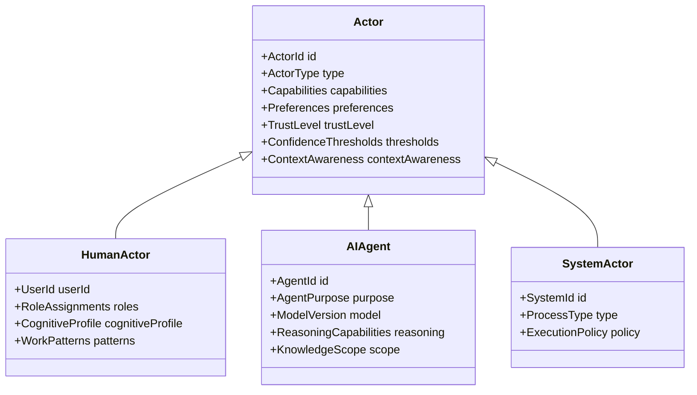

### **ActorType**

* Human
* AI
* System

### **Capabilities**

* reasoning
* task completion
* decision annotation
* content generation
* workflow execution
* scenario simulation

### **Why this matters**

This enables:

* AI to take tasks in workflows
* Humans + AI to co-own decisions
* Team capacity models to include AI agents
* Automated strategic suggestion flows
* Task routing to AI when humans are overloaded

---

# **4.2 INTELLIGENCE CONTEXT MODEL**

All AI operations rely on **context bundles**, which unify environmental, behavioral, cognitive, team, and strategic data.

```mermaid
classDiagram
    class IntelligenceContext {
        +ActorContext actor
        +TaskContext task
        +TeamContext team
        +WorkflowContext workflow
        +StrategicContext strategic
        +TemporalContext temporal
        +EnvironmentContext environment
    }

    class ActorContext {
        +ActorId actorId
        +Capabilities capabilities
        +Preferences preferences
        +CognitiveState cognitiveState
        +WorkPattern pattern
    }

    class TaskContext {
        +TaskId id
        +Complexity complexity
        +Tags tags
        +Deadline deadline
        +Dependencies dependencies
    }

    class TeamContext {
        +TeamId id
        +Capacity capacity
        +Capabilities capabilities
        +Assignments assignments
    }

    class WorkflowContext {
        +WorkflowId id
        +CurrentStep step
        +RouteHistory history
        +Constraints constraints
    }

    class StrategicContext {
        +GoalLinks goalLinks
        +AlignmentScore score
        +RelatedInitiatives initiatives
        +RiskFactors risks
    }

    class TemporalContext {
        +TimeWindow window
        +Cadence cadence
        +Trend trend
    }

    class EnvironmentContext {
        +Location location
        +Device device
        +Workload workload
        +ExternalSignals signals
    }
```

### Why this matters

It creates a **standardized input** for every AI prediction, recommendation, simulation, or scoring model across all BCs.

---

# **4.3 UNIFIED REASONING MODEL**

A shared interface for all reasoning processes across bounded contexts.

```csharp
public interface IReasoningModel
{
    ReasoningResult Evaluate(IntelligenceContext context);
    PredictionResult Predict(IntelligenceContext context);
    RecommendationResult Recommend(IntelligenceContext context);
    SimulationResult Simulate(IntelligenceContext context);
    Explanation Explain(IntelligenceContext context);
}
```

### **Reasoning Types**

* Productivity reasoning
* Decision scoring
* Strategic alignment reasoning
* Workflow routing reasoning
* KPI forecasting reasoning
* Anomaly reasoning

### **Why this matters**

All BCs output reasoning in a predictable structure → consistent UI, consistent intelligence.

---

# **4.4 SCORING & PRIORITIZATION MODEL**

All major decisions produce **scores**.

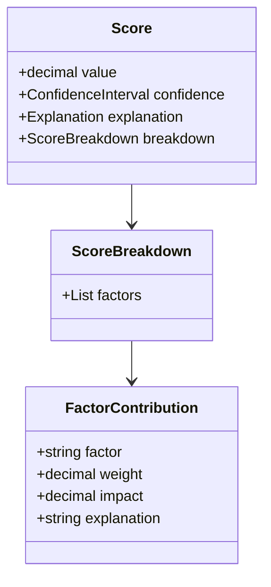

### Common Scores

* ProductivityScore
* CognitiveLoadScore
* TaskPriorityScore
* DecisionQualityScore
* GoalAchievementScore
* WorkflowEfficiencyScore
* TeamCapacityScore
* KPIHealthScore

---

# **4.5 TEMPORAL MODELING LAYER**

Time is modeled as a domain concept.

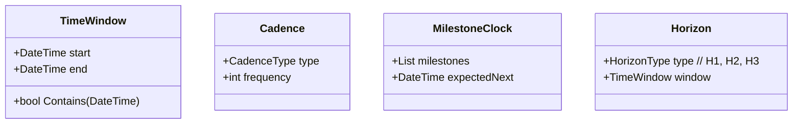

### Uses:

* Strategic goal timelines
* Workflow escalations
* Cognitive load forecasting
* KPI trend analysis
* Scenario planning

---

# **4.6 UNCERTAINTY & CONFIDENCE MODEL**

Every intelligent output includes uncertainty.

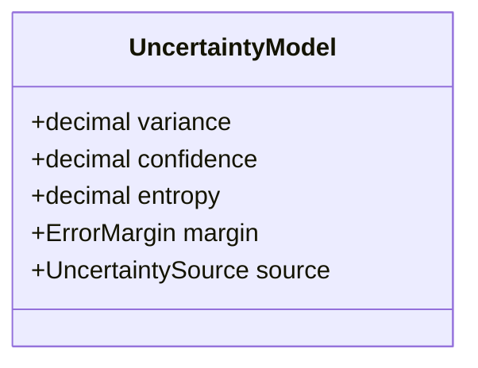

### **Uncertainty Sources**

* Data quality
* Missing features
* Model instability
* External volatility
* Conflicting signals

---

# **4.7 STRATEGIC KNOWLEDGE GRAPH MODEL**

A semantic graph linking all entities across BCs.

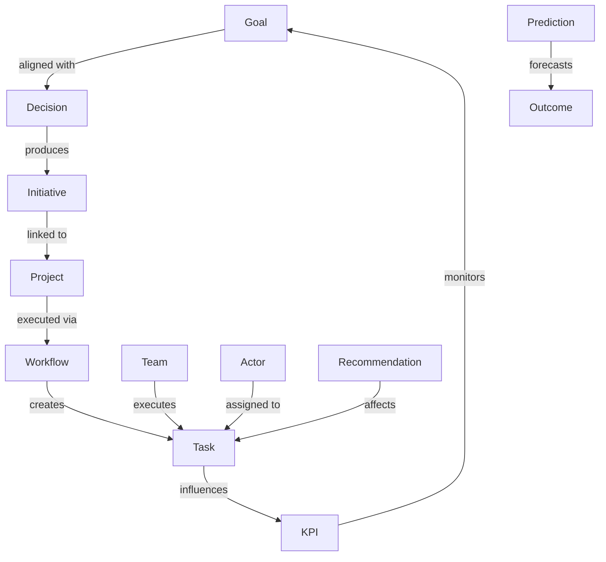

### Enables:

* Impact propagation (“if this goal changes…”)
* Intelligent routing (“tasks aligned with your goals…”)
* Cross-domain analytics
* Strategic prioritization
* AI context expansion

---

# **4.8 DOMAIN EVENTS (CROSS-DOMAIN MODEL)**

Events power intelligence, analytics, and knowledge graph updates.

### **Unified Event Structure**

```
Event {
    EventId
    ActorId
    Domain
    Payload
    Metadata {
        Timestamp
        CausationId
        CorrelationId
        ModelVersion
        DataQualityScore
    }
}
```

### Event Categories

* Behavior events
* Decision events
* Strategic events
* Cognitive state events
* Workflow events
* Task events
* KPI events
* Capacity events
* Recommendation feedback events

---

# **4.9 INTELLIGENCE FEEDBACK LOOP MODEL**

A universal loop used across all BCs.

```
Prediction → Action → Feedback → Error Correction → Retraining → Deployment
```

### Domain-specific examples:

* Productivity: “Recommendation accepted → reinforce pattern”
* Workflow: “Assignment failed → update routing model”
* Strategy: “Scenario inaccurate → recalibrate assumptions”
* KPI: “Forecast variance high → retrain model”

---

# **4.10 DOMAIN MODEL SUMMARY DIAGRAM**

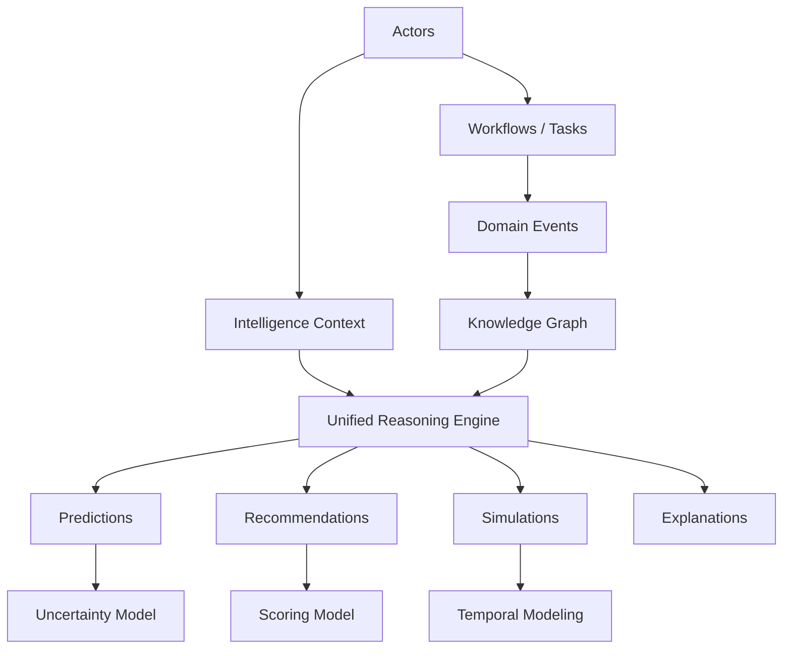

This shows the loop:

**Actors → Context → Reasoning → Output → Events → Knowledge Graph → Improved Reasoning**

---

# **5. BOUNDED CONTEXTS (ENHANCED EDITION)**

This section regenerates each BC using:

* Improved aggregate boundaries
* Unified reasoning model
* Intelligence context model
* Uncertainty modeling
* Knowledge graph integration
* Actor model integration
* New policies & value objects
* Domain rule DSL

We begin with:

# **5.1 PERSONAL PRODUCTIVITY INTELLIGENCE BOUNDED CONTEXT**

## **5.1.1 Context Overview**

This BC is dedicated to understanding and augmenting a person’s productivity behavior.

### **Responsibilities**

* Work pattern detection
* Cognitive load assessment
* Personal recommendation generation
* Prediction (task duration, scheduling, risk)
* Personal automation definition & execution
* Performance tracking

### **Strategic Classification**

**Core Domain — Highest AI density**

---

# **5.1.2 Domain Model (Enhanced)**

## **Aggregates (Refined and Split for DDD purity)**

### **A. CognitiveState (NEW Aggregate Root)**

Represents the user’s dynamic cognitive load and mental bandwidth.

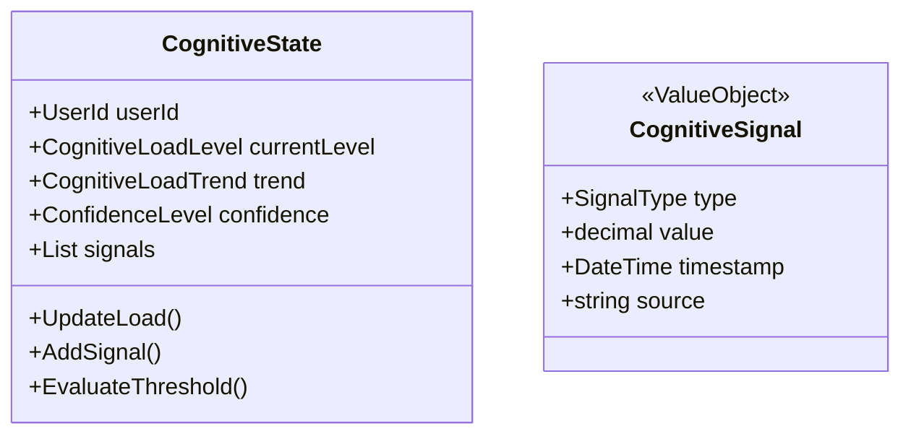

**Business rules**

* Cognitive load cannot exceed maximum sustainable threshold
* Cognitive load predictions must include confidence

---

### **B. WorkPatternProfile (NEW Aggregate Root)**

Stores recurring behavior patterns detected through events & ML.

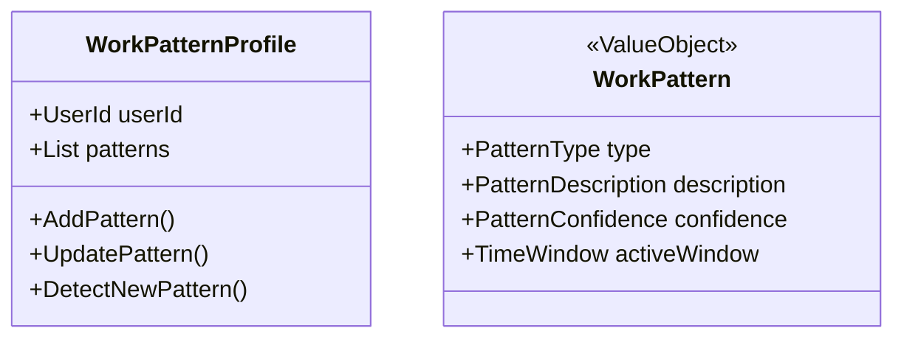

---

### **C. UserPreferenceProfile (Aggregate Root)**

Represents stable user preferences relevant to productivity.

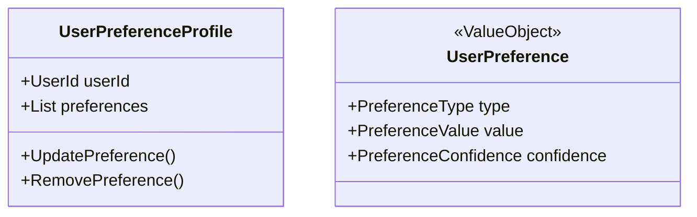

---

### **D. PerformanceHistory (Aggregate Root)**

Tracks fine-grained performance metrics.

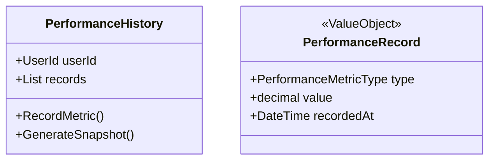

---

### **E. PredictionInstance (Aggregate Root — Updated)**

Represents an ML prediction.

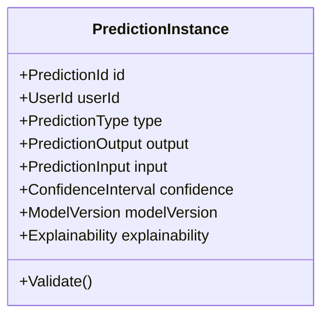

### **Explainability (Value Object)**

* Feature contributions
* Narrative explanation
* Counterfactuals

---

### **F. RecommendationInstance (Aggregate Root — Updated)**

Represents an actionable suggestion for the user.

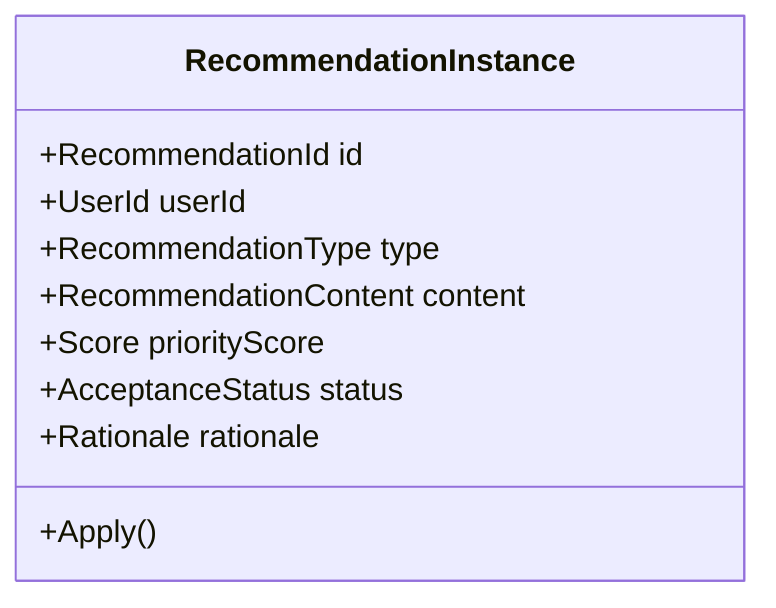

---

### **G. PersonalAutomation (Aggregate Root)**

Automation rules owned by the user.

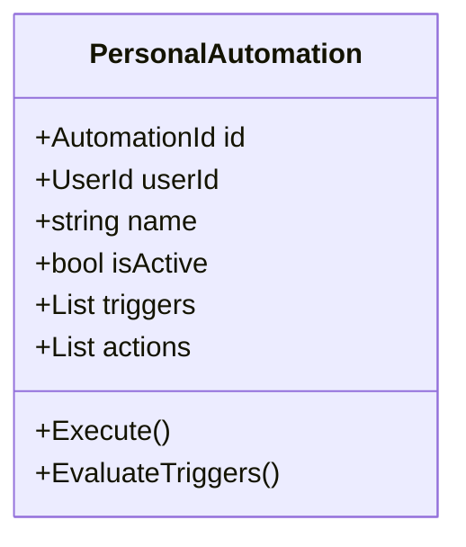

---

### **H. ProductivitySnapshot (Aggregate Root)**

Periodic summary of all productivity intelligence.

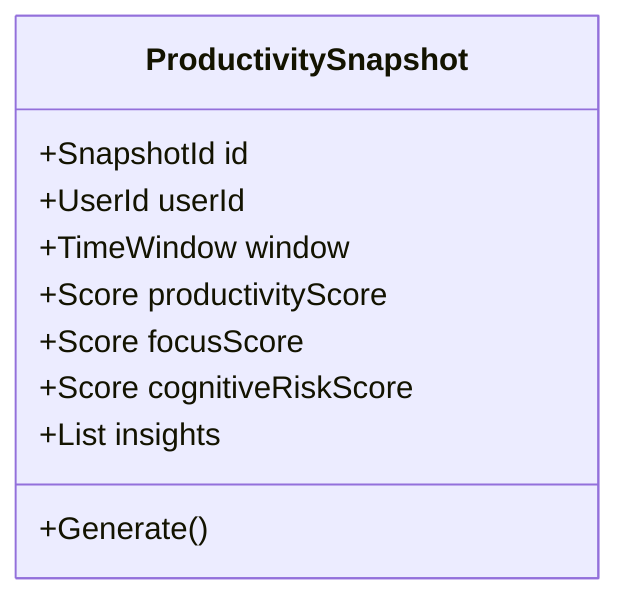

---

# **5.1.3 Policies (Enhanced)**

### **Cognitive Load Management Policy**

Contains logic for detecting overload and generating mitigation recommendations.

### **Work Pattern Detection Policy**

Uses event streams and ML signals to identify new patterns.

### **Personal Automation Safety Policy**

Ensures automations never violate safety constraints or user intent.

### **Recommendation Ranking Policy (NEW)**

Ranks recommendations based on:

* urgency
* strategic alignment
* cognitive state
* workload
* past acceptance behavior
* uncertainty

---

# **5.1.4 Commands & Queries (Revised)**

### **Key Commands**

```csharp
record UpdateCognitiveLoad(UserId UserId, List<CognitiveSignal> Signals);
record DetectWorkPatterns(UserId UserId, TimeWindow Window);
record GenerateProductivityRecommendations(UserId UserId, IntelligenceContext Context);
record DefinePersonalAutomation(UserId UserId, string Name, List<AutomationTrigger> Triggers, List<AutomationAction> Actions);
record RecordPerformance(UserId UserId, PerformanceRecord Record);
```

### **Key Queries**

```csharp
record GetCognitiveState(UserId UserId);
record GetWorkPatterns(UserId UserId);
record GetUserRecommendations(UserId UserId);
record GetProductivitySnapshot(UserId UserId, TimeWindow Window);
```

---

# **5.1.5 Domain Events (Enhanced)**

* **WorkPatternDetected**
* **CognitiveLoadExceededThreshold**
* **RecommendationGenerated**
* **RecommendationAccepted**
* **RecommendationRejected**
* **PredictionMade**
* **AutomationTriggered**
* **PerformanceMetricRecorded**

These feed AI, analytics, and the knowledge graph.

---

---

# **5.2 DECISION SUPPORT BOUNDED CONTEXT**

## **5.2.1 Context Overview**

This BC provides sophisticated, AI-augmented decision-making tools.

### **Responsibilities**

* Criteria-based decision modeling
* Multi-alternative evaluation
* Scenario analysis
* Cost-benefit, SWOT, and prioritization frameworks
* Strategic initiative proposal
* Decision journaling & learning

---

# **5.2.2 Domain Model (Enhanced)**

## **A. DecisionModel (Aggregate Root — Improved)**

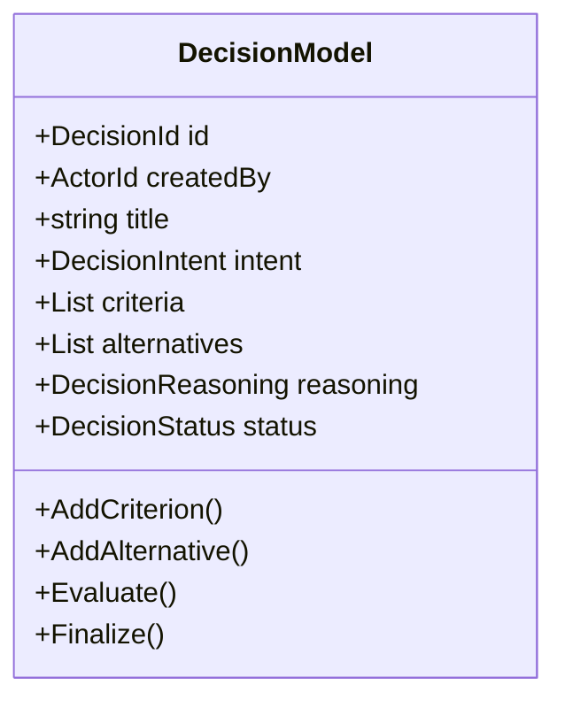

### New Concepts Introduced:

* **DecisionIntent** (Value Object)
* **DecisionReasoning** (includes unified reasoning output)
* **Confidence & Uncertainty scoring per alternative**

---

## **B. ScenarioAnalysis (Aggregate Root — Improved)**

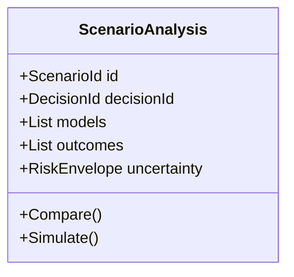

### Key enhancements:

* Outcomes include **variance, confidence, and counterfactual reasoning**
* Scenario models use the **Temporal Context Model**

---

## **C. StrategicInitiativeProposal (Aggregate Root — Enhanced)**

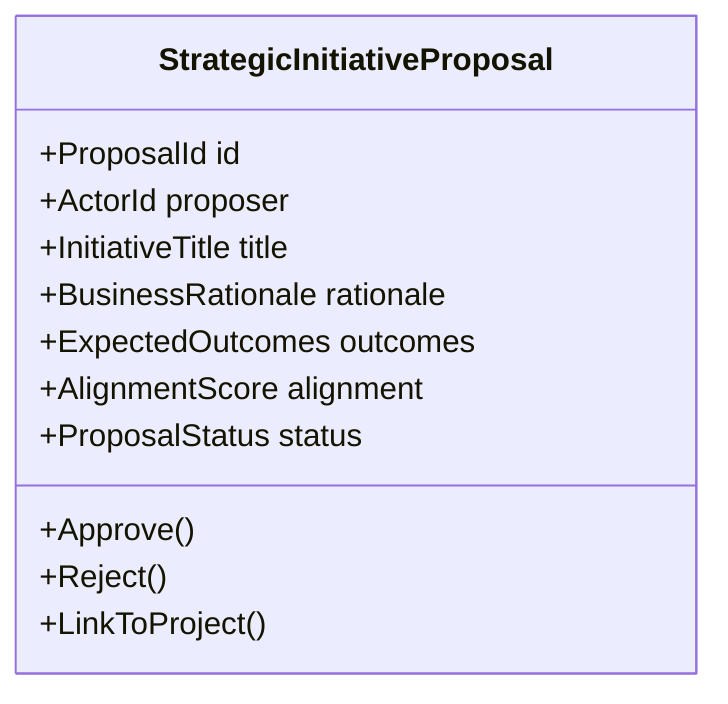

### New Elements:

* **AlignmentScore** calculated from Knowledge Graph
* **Uncertainty assessment** of initiative feasibility

---

## **D. DecisionJournalEntry (Aggregate Root)**

Captures learning and improves future decisions.

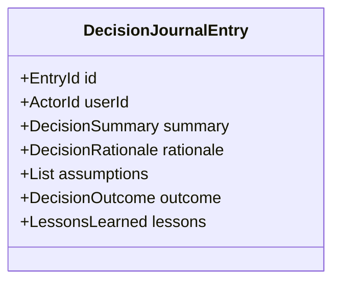

### Enhancements:

* **Counterfactual tracking**
* **Model retraining signals**

---

## **E. InnovationIdeaRecord (Aggregate Root)**

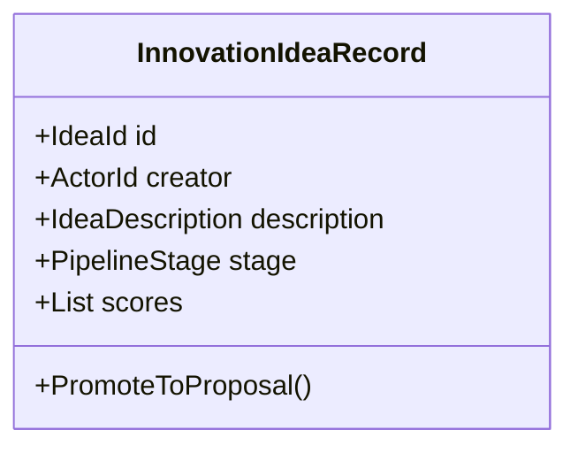

---

# **5.2.3 Decision Reasoning Policies (Updated)**

### **Multi-Criteria Decision Making Policy (MCDM)**

Applies weighted scoring, confidence modeling, and explainability.

### **Scenario Simulation Policy**

Simulates outcomes across horizons (H1/H2/H3) with uncertainty.

### **Strategic Alignment Policy**

Uses the knowledge graph to score alignment.

---

# **5.2.4 Commands & Queries (Updated)**

### **Commands**

```csharp
record CreateDecisionModel(string Title, DecisionIntent Intent, ActorId CreatedBy);
record AddDecisionCriterion(DecisionId DecisionId, Criterion Criterion);
record AddDecisionAlternative(DecisionId DecisionId, Alternative Alternative);
record RunScenarioAnalysis(DecisionId DecisionId, ScenarioParameters Params);
record ProposeInitiative(InitiativeDraft Draft, ActorId ProposerId);
```

### **Queries**

```csharp
record GetDecisionModel(DecisionId DecisionId);
record GetScenarioComparison(ScenarioId ScenarioId);
record GetStrategicInitiatives(ActorId? FilterBy = null);
record GetDecisionJournalEntries(ActorId Actor);
```

---

# **5.2.5 Domain Events**

* **DecisionModelCreated**
* **CriteriaAdded**
* **AlternativeAdded**
* **DecisionEvaluated**
* **ScenarioAnalysisCompleted**
* **StrategicInitiativeProposed**
* **StrategicInitiativeApproved**
* **IdeaCaptured**

---

# **5.3 STRATEGIC PLANNING BOUNDED CONTEXT**

## **5.3.1 Context Overview**

This BC manages long-term and mid-term organizational strategy:

* Strategic goals
* Planning horizons (H1, H2, H3)
* Sustainable growth (ESG, metrics)
* Crisis management
* Scenario-based strategic futures
* Long-term roadmaps & backcasting

### **Strategic Classification:**

**Core Domain — High level strategic intelligence**

---

# **5.3.2 Domain Model (Enhanced)**

## **A. StrategicGoalDefinition (Aggregate Root — Improved)**

Defines long-term organizational goals.

```mermaid
classDiagram
    class StrategicGoalDefinition {
        +GoalId id
        +GoalDescription description
        +StrategicTheme theme
        +PlanningHorizon horizon
        +List<GoalTarget> targets
        +AlignmentIndicators indicators
        +ProgressState progress
        +DefineTarget()
        +UpdateProgress()
        +AdjustTarget()
    }
```

### **Enhancements**

* Targets modeled with **uncertainty & confidence**
* Goals linked to **knowledge graph** for alignment
* Progress state includes **trend analysis + variance**

---

## **B. IntegratedHorizonPlan (Aggregate Root — Enhanced)**

Represents long-range plans across time horizons.

```mermaid
classDiagram
    class IntegratedHorizonPlan {
        +PlanId id
        +List<TimelineEvent> timeline
        +BackwardPlanningModel backwardPlan
        +List<FutureScenarioLink> scenarioLinks
        +DesignLegacy()
        +MapTimeline()
        +PlanBackward()
    }
```

### **New components**

* **FutureScenarioLink** ties to scenario outcomes in Decision BC
* **TimelineEvent** includes confidence & volatility
* **BackwardPlanningModel** supports backcasting

---

## **C. CrisisManagementPlan (Aggregate Root)**

Handles crisis scenarios, resilience, and contingencies.

```mermaid
classDiagram
    class CrisisManagementPlan {
        +PlanId id
        +List<ContingencyItem> contingencies
        +ResilienceIndex resilience
        +List<RiskScenario> scenarios
        +ActivateProtocol()
        +AssessResilience()
    }
```

### **Enhancements**

* ResilienceIndex includes **Entropic Stability Score**
* Scenarios incorporate **uncertainty envelopes**
* Integrates with **Actor Model** (human + AI responders)

---

## **D. SustainableGrowthFramework (Aggregate Root)**

Tracks ESG and long-term sustainability metrics.

```mermaid
classDiagram
    class SustainableGrowthFramework {
        +FrameworkId id
        +List<GrowthMetric> metrics
        +List<ESGGoalRecord> esgGoals
        +ImpactMeasurementData measurements
        +TrackESGProgress()
    }
```

### **Enhancements**

* Each ESG metric includes **variance, confidence, and volatility indicators**
* Integrates with **KPI BC** for data ingestion

---

## **E. StrategicLink (NEW Value Object)**

Connects strategy to other BCs through the knowledge graph.

```
StrategicLink {
    EntityId Source
    EntityId Target
    RelationType type  // influences, aligned_with, depends_on
    Strength score
}
```

---

# **5.3.3 Policies (Enhanced)**

### **Goal Progress Evaluation Policy**

Uses:

* KPI data
* workflow outputs
* decision outcomes
* temporal trends
* uncertainty modeling

### **Strategic Alignment Policy**

Computes:

* how a task, decision, project, or workflow aligns with goals
* using the **Strategic Knowledge Graph**

### **Crisis Response Policy**

Defines escalation logic using the domain DSL.

---

# **5.3.4 Commands & Queries**

### Commands

```csharp
record DefineStrategicGoal(string Description, StrategicTheme Theme, PlanningHorizon Horizon, List<GoalTarget> Targets);
record UpdateGoalProgress(GoalId GoalId, ProgressMeasurement Measurement);
record CreateCrisisPlan(string Name, List<RiskScenario> Scenarios);
record DefineESGGoal(ESGCategory Category, GoalTarget Target);
record BuildHorizonPlan(List<TimelineEvent> Events);
```

### Queries

```csharp
record GetStrategicGoal(GoalId GoalId);
record GetCrisisPlan(PlanId PlanId);
record GetESGProgress(FrameworkId Id);
record GetHorizonPlan(PlanId Id);
```

---

# **5.3.5 Domain Events**

* **StrategicGoalDefined**
* **GoalTargetUpdated**
* **GoalProgressEvaluated**
* **CrisisPlanActivated**
* **ESGProgressUpdated**
* **HorizonPlanCreated**

---

---

# **5.4 WORKFLOW ENGINE BOUNDED CONTEXT**

## **5.4.1 Context Overview**

This BC orchestrates and automates work execution:

* Workflow definitions
* Activity definitions
* Routing logic
* Execution state
* Task assignments
* Integration with AI routing models

### **Strategic Classification:**

**Supporting Domain — but AI-enhanced**

---

# **5.4.2 Domain Model (Enhanced)**

## **A. WorkflowDefinition (Aggregate Root — Refined)**

```mermaid
classDiagram
    class WorkflowDefinition {
        +WorkflowId id
        +string name
        +WorkflowVersion version
        +List<StepDefinition> steps
        +List<WorkflowRule> rules
        +DefineStep()
        +DefineTransition()
        +SetRule()
        +CreateVersion()
    }
```

### **Enhancements**

* Decoupled from execution
* Integrates domain rule DSL
* Steps include:

  * required capabilities
  * temporal constraints
  * cognitive load expectations

---

## **B. WorkflowInstance (Aggregate Root — Cleaned)**

```mermaid
classDiagram
    class WorkflowInstance {
        +InstanceId id
        +WorkflowId definitionId
        +InstanceStatus status
        +List<StepInstance> activeSteps
        +WorkflowContext context
        +Start()
        +Advance()
        +Fail()
        +Pause()
        +Complete()
    }
```

### **New Fields**

* Execution uncertainty
* Actor assignment reasoning
* Knowledge graph trace of workflow impact

---

## **C. StepDefinition (Entity)**

Defines one unit of work in a workflow.

```
StepDefinition {
    StepId id
    StepType type
    RequiredCapabilities capabilities
    TemporalRules timeRules
    AssignmentRules assignmentRules
}
```

---

## **D. StepInstance (Entity)**

Runtime representation.

```
StepInstance {
    StepInstanceId id
    StepId definitionId
    ActorId assignedTo
    ExecutionWindow window
    Status status
    Output output
}
```

---

## **E. TaskAssignment (Aggregate Root)**

Standalone aggregate for task assignment logic.

```mermaid
classDiagram
    class TaskAssignment {
        +AssignmentId id
        +InstanceId workflowInstanceId
        +StepId stepId
        +ActorId assignee
        +AssignmentReasoning reasoning
        +TaskStatus status
        +Assign()
        +Reassign()
        +Complete()
    }
```

### **Reasoning Includes**

* Capability match score
* Cognitive load model
* Team capacity model
* Strategic alignment scoring
* Past performance data
* Confidence and uncertainty

---

# **5.4.3 New AI-Driven Routing Logic**

### **Routing Inputs**

* StepDefinition’s required capabilities
* ActorModel (human + AI)
* CognitiveState
* ProductivitySnapshot
* TeamContext
* StrategicContext

### **Routing Output**

* Recommended Actor Assignments
* Ranked list
* Explanation (feature contributions)
* Uncertainty

---

# **5.4.4 Workflow Rule DSL Examples**

### Example: Transition rule

```
WHEN step.output.status == "complete"
AND context.cognitiveLoad < High
THEN transition.to("ReviewStep")
EXPLAIN USING "Requires cognitive clarity"
```

### Example: Auto-assign rule

```
WHEN step.requires.capability == "Analysis"
AND team.capacity > 0.7
THEN assign.to(best_match_by_capability)
CONFIDENCE 0.84
```

---

# **5.4.5 Commands & Queries**

### Commands

```csharp
record CreateWorkflowDefinition(string Name);
record AddWorkflowStep(WorkflowId WorkflowId, StepDefinition Definition);
record ExecuteWorkflow(WorkflowId WorkflowId, ActorId StartedBy);
record AssignWorkflowTask(InstanceId Instance, StepId Step, ActorId Assignee);
record CompleteTask(AssignmentId Assignment, OutputData Output);
```

### Queries

```csharp
record GetWorkflowDefinition(WorkflowId Id);
record GetWorkflowInstance(InstanceId Id);
record GetWorkflowAssignments(ActorId Actor, TaskStatus? Status = null);
record GetWorkflowPerformance(WorkflowId Id);
```

---

# **5.4.6 Domain Events**

* **WorkflowDefinitionCreated**
* **WorkflowInstanceStarted**
* **StepCompleted**
* **TaskAssigned**
* **WorkflowRouted**
* **WorkflowCompleted**
* **WorkflowExceptionOccurred**

---

# **5.5 TEAM MANAGEMENT BOUNDED CONTEXT**

## **5.5.1 Context Overview**

This BC governs organizational structure, human actors, roles, capabilities, and team capacity.

### **Responsibilities**

* Team structure
* Roles & permissions
* Capability modeling
* Actor availability
* Capacity forecasting
* Team performance intelligence
* AI agent inclusion in team structures (NEW)

### **Strategic Classification:**

**Supporting Domain — But critically important for intelligence-driven assignment and strategy alignment**

---

# **5.5.2 Domain Model (Enhanced)**

## **A. Team (Aggregate Root — Clean & Strengthened)**

```mermaid
classDiagram
    class Team {
        +TeamId id
        +TeamName name
        +TeamPurpose purpose
        +List<TeamMember> members
        +List<RoleDefinition> roles
        +TeamCapacity capacity
        +TeamStatus status
        +AddMember()
        +RemoveMember()
        +AssignRole()
        +RecomputeCapacity()
    }
```

### **Enhancements**

* Integrated **capacity model**
* Inclusion of **AI agents as team members**
* Purpose includes **strategic alignment score**
* Capacity includes **cognitive load average + workload volatility**

---

## **B. TeamMember (Entity — Enhanced)**

Represents either a human member or an AI agent.

```
TeamMember {
    MemberId id
    ActorId actorId   // Human or AI Agent
    MemberType type   // Human, AI-Agent, Hybrid
    List<RoleId> assignedRoles
    List<CapabilityTag> capabilities
    Availability availability
    CognitiveCapacity cognitiveCapacity
    PerformanceProfile performance
}
```

### **New Capabilities**

* **Availability model**: Workload, schedule, burnout risk
* **CognitiveCapacity**: Derived from personal productivity BC
* **PerformanceProfile**: Past effectiveness

---

## **C. RoleDefinition (Entity — Enhanced)**

```
RoleDefinition {
    RoleId id
    RoleName name
    RoleDescription description
    List<CapabilityRequirement> requiredCapabilities
    PermissionSet permissions
}
```

---

## **D. TeamCapacity (Value Object — NEW)**

```
TeamCapacity {
    decimal totalCapacity
    decimal currentUtilization
    decimal forecastedUtilization
    decimal stabilityScore  // workload volatility
}
```

---

## **E. ActorCapabilityProfile (Value Object — NEW)**

Unified model of actor (human/AI) capability.

```
ActorCapabilityProfile {
    ActorId actor
    CapabilityTag capability
    decimal proficiency
    decimal confidence
}
```

---

# **5.5.3 Policies (Enhanced)**

### **Capacity Forecasting Policy**

* Uses historical workloads
* Takes cognitive load predictions from Productivity BC
* Applies volatility detection
* Generates forecast:

```
available_capacity = base_capacity - predicted_load
```

---

### **Role Alignment Policy**

Ensures:

* Member’s capabilities match required capabilities
* Conflicting role rules aren’t violated
* Cognitive load constraints

---

### **Team Stability Monitoring Policy**

Detects:

* Overload
* Understaffing
* Capability gaps
* Imbalance between humans & AI agents

---

# **5.5.4 Commands & Queries**

### Commands

```csharp
record CreateTeam(string Name, string Purpose, ActorId CreatedBy);
record AddMemberToTeam(TeamId TeamId, ActorId MemberId, RoleId? Role);
record AssignRoleToMember(TeamId TeamId, ActorId MemberId, RoleId RoleId);
record UpdateTeamCapabilities(TeamId TeamId, List<CapabilityTag> Capabilities);
record RecalculateTeamCapacity(TeamId TeamId);
```

### Queries

```csharp
record GetTeamDetails(TeamId Id);
record GetTeamCapacity(TeamId Id);
record GetMembersForRole(TeamId Id, RoleId Role);
record FindTeamsByCapabilities(List<CapabilityTag> Capabilities);
```

---

# **5.5.5 Domain Events**

* **TeamCreated**
* **TeamMemberAdded**
* **RoleAssignedToMember**
* **CapabilityUpdated**
* **TeamCapacityUpdated**

---

---

# **5.6 ANALYTICS & REPORTING BOUNDED CONTEXT**

## **5.6.1 Context Overview**

This BC acts as the system’s **historical intelligence**, assembling cross-domain data into:

* KPIs
* Dashboards
* Reports
* Trend analysis
* Performance insights
* AI-assisted interpretation

### **Strategic Classification:**

**Supporting Domain — but receives events from ALL BCs**

It also feeds intelligence back to:

* Productivity BC
* Decision Support BC
* Workflow Engine BC
* Strategic Planning BC

---

# **5.6.2 Domain Model (Enhanced)**

## **A. Dashboard (Aggregate Root — Improved)**

```mermaid
classDiagram
    class Dashboard {
        +DashboardId id
        +UserId owner
        +DashboardName name
        +DashboardLayout layout
        +List<WidgetInstance> widgets
        +RefreshInterval interval
        +AddWidget()
        +ConfigureLayout()
        +Refresh()
    }
```

### **Enhancements**

* Widgets now support **AI-based summarization**
* Each dashboard includes **context-aware suggestions**
* Layout is modeled as **composable grid elements**

---

## **B. WidgetInstance (Entity — Enhanced)**

```
WidgetInstance {
    WidgetId id
    WidgetType type
    DataBinding binding
    VisualizationConfig config
    InsightOverlay overlay  // AI-generated insights layered on charts
}
```

### **InsightOverlay (NEW)**

Provides contextual interpretation:

* Significant anomalies
* Emerging trends
* Forecasted changes
* Recommendations

---

## **C. ReportConfiguration (Aggregate Root)**

```mermaid
classDiagram
    class ReportConfiguration {
        +ReportId id
        +UserId owner
        +ReportName name
        +List<ReportParameter> parameters
        +List<DataSourceDefinition> sources
        +ReportSchedule schedule
        +ReportFormat format
        +Generate()
        +Schedule()
    }
```

### **Enhancements**

Reports may include:

* trend forecasts
* performance narratives
* strategic alignment scoring
* anomalies detected

---

## **D. KpiDefinition (Aggregate Root)**

```mermaid
classDiagram
    class KpiDefinition {
        +KpiId id
        +UserId owner
        +KpiName name
        +KpiMetric metric
        +List<KpiThreshold> thresholds
        +List<KpiAlert> alerts
        +Calculate()
        +EvaluateThresholds()
    }
```

### **Enhancements**

KPIs integrate:

* uncertainty modeling
* trend projection
* anomaly detection signals
* strategic goal mapping

---

## **E. AggregatedDataView (Aggregate Root)**

Stores materialized views of important datasets.

```
AggregatedDataView {
    ViewId id
    ViewName name
    List<DataPoint> data
    AggregationRule rules
    LastUpdated timestamp
    Refresh()
}
```

---

# **5.6.3 Policies (Enhanced)**

### **Metric Aggregation Policy**

Consolidates events from:

* workflows
* decisions
* productivity
* team capacity
* strategic planning

### **Threshold Evaluation Policy**

Includes:

* dynamic thresholding
* adaptive alerts (based on volatility)
* multi-metric composite KPIs

### **AI Insight Overlay Policy**

Adds:

* narrative explanations
* counterfactual insights
* anomalies
* predictions

---

# **5.6.4 Commands & Queries**

### Commands

```csharp
record CreateDashboard(string Name, LayoutConfig Layout);
record AddWidget(DashboardId DashboardId, WidgetDefinition Widget);
record DefineKpi(string Name, KpiMetric Metric, List<KpiThreshold> Thresholds);
record ScheduleReport(ReportId ReportId, ReportSchedule Schedule);
```

### Queries

```csharp
record GetDashboard(DashboardId Id);
record GetKpiValue(KpiId Id, DateTime? AsOf = null);
record GetReportOutput(ReportId Id, DateTime Date);
record GetInsightOverlay(WidgetId Id);
```

---

# **5.6.5 Domain Events**

* **DashboardCreated**
* **WidgetAdded**
* **ReportGenerated**
* **KpiThresholdBreached**
* **DataViewRefreshed**
* **InsightGenerated**

---

# **6. UNIFIED POLICIES, RULES & DOMAIN DSL**

This is a **newly introduced super-section** enhancing the entire system with:

* Unified reasoning and rules
* A domain-specific language (DSL) for encoding domain logic
* AI-augmented decision and workflow rules
* Policy-driven dynamic behaviors across BCs
* Declarative modeling rather than scattered if/else logic
* Auditability and explainability baked into rules

The purpose is to create a **single coherent thinking layer** across all bounded contexts —
**the Intelligence Layer**.

---

# **6.1 POLICY TYPES (SYSTEM-WIDE)**

We define three primary policy classes:

---

## **6.1.1 Validation Policies**

Ensure domain invariants and semantic correctness.

Examples:

* A decision model must have ≥1 criterion and ≥2 alternatives
* A workflow must have at least one reachable completion path
* A strategic goal target must include a measurable metric

---

## **6.1.2 Reasoning Policies**

Provide structured domain reasoning using rule engines + ML signals.

Examples:

* Which team member is best suited for a workflow step?
* How does a decision alternative score compared to others?
* What task should the user focus on now?

This uses:

* Scoring models
* Decision heuristics
* Trend analysis
* Cognitive load signals
* Context fusion

---

## **6.1.3 Reactive Policies**

Trigger state transitions when conditions occur.

Examples:

* If cognitive load exceeds threshold → generate mitigations
* If KPI crosses threshold → generate alert
* If strategic alignment drops for a goal → trigger reevaluation

This is the backbone of proactive intelligence.

---

# **6.2 THE DOMAIN RULE DSL (NEW)**

The DSL provides a **readable, declarative rule syntax** used across BCs.

---

## **6.2.1 DSL Goals**

1. Human-readable domain logic
2. Machine-executable
3. Explainability-first
4. Supports probabilities & uncertainty
5. Supports “why” and “what-if” reasoning
6. Integrates ML signals with business rules

---

# **6.3 DSL STRUCTURE OVERVIEW**

```
RULE <RuleName> 
WHEN <ConditionExpression> 
THEN <ActionExpression> 
CONFIDENCE <0-1> 
EXPLAIN "<Narrative>"
```

---

# **6.4 DSL EXPRESSIONS**

### **6.4.1 Condition Expressions**

Allow:

* Boolean logic
* Comparisons
* Domain references
* Time conditions
* AI signals

Examples:

```
cognitive.load > High
task.deadline.within(2h)
team.capacity < 0.3
decision.alternatives.count >= 2
workflow.step.type == "Manual"
```

---

### **6.4.2 Action Expressions**

Actions include:

* Trigger events
* Mutate state
* Recommend entities
* Assign actors
* Produce insights

Examples:

```
recommend.task("TakeBreak")
assign.actor(best_fit_by(capability, cognitive_load))
emit.event("StrategicGoalAtRisk")
transition.to("ReviewStep")
```

---

### **6.4.3 Confidence Expression**

The rule can embed:

* ML model confidence
* Rule-based confidence
* Hybrid confidence

Example:

```
CONFIDENCE 0.87
```

Or dynamic:

```
CONFIDENCE ml.predict_confidence("OverloadRisk")
```

---

### **6.4.4 Explainability**

Every rule includes structured natural language explanations.

Example:

```
EXPLAIN "User's cognitive load is elevated, and high-focus tasks should be deferred."
```

---

# **6.5 DSL EXAMPLES BY BOUNDED CONTEXT**

---

# 🔵 **6.5.1 DSL for Productivity Intelligence**

### **A. Overload Detection Rule**

```
RULE CognitiveOverloadAlert
WHEN cognitive.load >= VeryHigh
THEN recommend.action("TakeBreak"), recommend.action("ReduceFocusTasks")
CONFIDENCE ml.overload.probability
EXPLAIN "Cognitive load is critically high based on behavioral signals."
```

---

### **B. Smart Recommendation Rule**

```
RULE ProposeNextTask
WHEN task.priority > 0.8 
AND cognitive.load <= Medium
THEN recommend.task(task.id)
CONFIDENCE (task.priority * (1 - cognitive.load.percent))
EXPLAIN "Task has high priority and user's cognitive load is within optimal range."
```

---

# 🟣 **6.5.2 DSL for Decision Support**

### **A. Alternative Scoring Rule**

```
RULE WeightedScoreComputation
WHEN decision.criteria.count >= 1
THEN compute.score(weighted_sum(criteria * alternative.scores))
CONFIDENCE 1.0
EXPLAIN "Scores computed using weighted criteria values."
```

---

### **B. Scenario Volatility Rule**

```
RULE HighRiskScenarioFlag
WHEN scenario.volatility > threshold("HighVolatility")
THEN flag.scenario("HighRisk")
CONFIDENCE ml.volatility.confidence
EXPLAIN "Scenario exhibits high variance in projected outcomes."
```

---

# 🟢 **6.5.3 DSL for Strategic Planning**

### **A. Goal Drift Detection**

```
RULE GoalDriftDetected
WHEN goal.progress.trend < Falling 
AND goal.target.timeRemaining < 30days
THEN emit.event("StrategicGoalAtRisk")
CONFIDENCE ml.forecast.confidence
EXPLAIN "The goal is off-track based on trend and time remaining."
```

---

### **B. Crisis Escalation Rule**

```
RULE CrisisEscalation
WHEN scenario.likelihood > 0.6 
AND resilience.index < 0.5
THEN activate.protocol("Emergency")
CONFIDENCE 0.9
EXPLAIN "High probability crisis with low resilience score."
```

---

# 🟡 **6.5.4 DSL for Workflow Engine**

### **A. Auto Assignment Based on Cognitive Load**

```
RULE SmartTaskAssignment
WHEN step.requires.capability == actor.topCapability
AND actor.cognitive.load < High
THEN assign(actor)
CONFIDENCE ml.assignment.score
EXPLAIN "Actor's capabilities and cognitive state match the task requirements."
```

---

### **B. Conditional Transition**

```
RULE ReviewTransition
WHEN step.output.status == "approved"
THEN transition.to("CompletionStep")
CONFIDENCE 1.0
EXPLAIN "Approval outcome leads to finalization step."
```

---

# 🟤 **6.5.5 DSL for Team Management**

### **Team Overload Rule**

```
RULE TeamOverloadRisk
WHEN team.capacity.utilization > 0.85 
AND team.stability < 0.4
THEN send.alert("TeamOverloadRisk")
CONFIDENCE ml.stressmodel.confidence
EXPLAIN "Team workload is approaching overload threshold."
```

---

# 🟠 **6.5.6 DSL for Analytics & Reporting**

### **KPI Threshold Alert Rule**

```
RULE KPIThresholdBreached
WHEN kpi.value < kpi.threshold.min
THEN create.alert(kpi.id)
CONFIDENCE 1.0
EXPLAIN "KPI value has fallen below the defined lower threshold."
```

---

# **6.6 DSL RUNTIME ARCHITECTURE**

The rule engine uses:

### **1. Rule Parser**

Converts DSL text → AST (abstract syntax tree)

### **2. Rule Executor**

Executes rules on domain objects

### **3. Explainability Service**

Generates NLP output

### **4. Policy Evaluator**

Computes probability and confidence

### **5. ML Bridge**

Fetches model outputs (predictions, confidence, SHAP values)

### **6. Event Dispatcher**

Publishes domain events triggered by rules

---

# **6.7 BENEFITS OF THE UNIFIED DSL**

### ✔ AI + rules coexist cleanly

### ✔ Domain logic becomes readable

### ✔ Easy auditing & governance

### ✔ Explainability becomes default

### ✔ New policies can be added without code changes

### ✔ Future AI agents can generate rules automatically

### ✔ Supports human override with traceability

---

# **7. DOMAIN EVENTS CATALOG**

This section provides a **centralized, comprehensive, cross-domain event catalog**.
All bounded contexts emit events, but here we unify them into one consistent, structured domain event system.

It supports:

* Event-driven architecture
* Event sourcing (optional)
* Knowledge graph enrichment
* ML feature extraction
* Reactive policies
* Temporal analytics
* Cross-context orchestration (e.g., strategies influencing workflows)

---

# **7.1 EVENTS ORGANIZED BY DOMAIN**

---

# **7.1.1 Personal Productivity Intelligence Events**

### **1. Work Pattern Events**

* **WorkPatternDetected**
* **WorkPatternUpdated**
* **WorkPatternConfidenceChanged**

### **2. Cognitive Load Events**

* **CognitiveLoadMeasured**
* **CognitiveLoadThresholdExceeded**
* **CognitiveLoadRecovered**

### **3. Recommendation Events**

* **RecommendationGenerated**
* **RecommendationRankUpdated**
* **RecommendationAccepted**
* **RecommendationRejected**
* **RecommendationDismissed**

### **4. Prediction Events**

* **PredictionMade**
* **PredictionConfidenceLow**
* **PredictionModelVersionChanged**

### **5. Personal Automation Events**

* **AutomationCreated**
* **AutomationTriggered**
* **AutomationExecuted**
* **AutomationFailed**

### **6. Performance Events**

* **PerformanceMetricRecorded**
* **PerformanceSnapshotGenerated**
* **PerformanceTrendShiftDetected**

---

# **7.1.2 Decision Support Events**

### **1. Decision Model Events**

* **DecisionModelCreated**
* **DecisionCriterionAdded**
* **DecisionAlternativeAdded**
* **DecisionEvaluationCompleted**
* **DecisionFinalized**

### **2. Scenario Analysis Events**

* **ScenarioAnalysisStarted**
* **ScenarioAnalysisCompleted**
* **ScenarioVolatilityDetected**

### **3. Assumption and Outcome Events**

* **AssumptionTested**
* **AssumptionInvalidated**
* **DecisionOutcomeRecorded**

### **4. Strategic Initiative Events**

* **StrategicInitiativeProposed**
* **StrategicInitiativeReviewed**
* **StrategicInitiativeApproved**
* **StrategicInitiativeRejected**
* **InitiativeLinkedToProject**

### **5. Decision Journal Events**

* **DecisionJournalEntryCreated**
* **DecisionLessonsExtracted**

---

# **7.1.3 Strategic Planning Events**

### **1. Strategic Goal Events**

* **StrategicGoalDefined**
* **GoalTargetSet**
* **GoalProgressRecorded**
* **GoalOffTrackDetected**
* **GoalAchieved**
* **GoalUpdated**

### **2. Crisis Management Events**

* **CrisisScenarioDetected**
* **CrisisPlanActivated**
* **CrisisProtocolEscalated**
* **CrisisResolved**

### **3. ESG & Sustainability Events**

* **ESGGoalSet**
* **ESGProgressUpdated**
* **ESGImpactMeasured**

### **4. Horizon Planning Events**

* **HorizonPlanCreated**
* **HorizonPlanRevised**
* **TimelineEventReached**
* **FutureScenarioLinked**

---

# **7.1.4 Workflow Engine Events**

### **1. Workflow Lifecycle**

* **WorkflowDefinitionCreated**
* **WorkflowVersionCreated**
* **WorkflowInstanceStarted**
* **WorkflowInstancePaused**
* **WorkflowInstanceCompleted**
* **WorkflowInstanceFailed**

### **2. Step Execution Events**

* **StepStarted**
* **StepCompleted**
* **StepFailed**
* **StepTransitioned**

### **3. Assignment Events**

* **TaskAssigned**
* **TaskReassigned**
* **TaskCompleted**
* **TaskAssignmentFailed**

### **4. Exception Events**

* **WorkflowExceptionOccurred**
* **CompensationActionExecuted**

---

# **7.1.5 Team Management Events**

### **1. Team Lifecycle**

* **TeamCreated**
* **TeamUpdated**
* **TeamDisbanded**

### **2. Membership Events**

* **TeamMemberAdded**
* **TeamMemberRemoved**
* **TeamMemberRoleAssigned**
* **TeamMemberRoleRevoked**

### **3. Capability Events**

* **TeamCapabilitiesUpdated**
* **MemberCapabilitiesUpdated**

### **4. Capacity Events**

* **TeamCapacityRecalculated**
* **TeamOverloadRiskDetected**
* **TeamStabilityChanged**

---

# **7.1.6 Analytics & Reporting Events**

### **1. Dashboard Events**

* **DashboardCreated**
* **WidgetAdded**
* **WidgetRemoved**
* **DashboardRefreshed**

### **2. KPI Events**

* **KpiCalculated**
* **KpiThresholdBreached**
* **KpiTrendShiftDetected**

### **3. Report Events**

* **ReportGenerated**
* **ReportScheduled**
* **ReportDelivered**

### **4. Data Pipeline Events**

* **DataViewRefreshed**
* **EventDataProcessed**
* **AnomalyDetected**

---

# **7.1.7 AI & ML Infrastructure Events (Cross-Domain)**

### **1. ML Model Lifecycle**

* **ModelRegistered**
* **ModelPromotedToProduction**
* **ModelRetrained**
* **ModelPerformanceDegraded**

### **2. Prediction/Explainability Events**

* **ExplainabilityGenerated**
* **FeatureImportanceShiftDetected**
* **CounterfactualGenerated**

### **3. Data Quality & Governance Events**

* **DataQualityIssueDetected**
* **DataLineageTraceCompleted**
* **BiasAssessmentCompleted**
* **BiasDetected**

### **4. Privacy & Consent Events**

* **UserConsentUpdated**
* **AIProcessingBlockedDueToConsent**

---

# **7.2 STANDARDIZED EVENT METADATA**

All events follow a structured metadata model for consistency.

```
EventBase {
    EventId id
    string eventType
    ActorId? triggeredBy
    DateTime occurredAt
    EventImportance importanceLevel      // Low / Medium / High / Critical
    Confidence? confidence               // optional for AI-generated events
    TraceContext trace                   // correlation, causation, lineage
}
```

---

# **7.3 EVENTS → INTELLIGENCE PIPELINE**

Event flows support:

### ✔ ML Feature Extraction

Feature store consumes detailed domain events.

### ✔ Knowledge Graph Updates

Strategic relationships update automatically based on events.

### ✔ DSL Rule Engine Triggers

Rules react to events to generate new decisions/actions.

### ✔ Analytics Aggregation

Dashboards and KPIs rebuild from event streams.

### ✔ Predictive Model Retraining

Event history automatically becomes ML training data.

---

# **7.4 EVENT RELIABILITY MODEL**

### **Guarantees**

* At-least-once delivery
* Ordering within aggregate
* Idempotent event handlers

### **Partitions**

* Human events
* AI events
* System workflow events
* Strategic planning events

### **Channels**

* DomainEvents Bus
* IntelligenceEvents Bus
* AnalyticsEvents Bus
* AuditEvents Bus

---

# **7.5 USE-CASE EXAMPLES OF CROSS-DOMAIN EVENT FLOWS**

### **Example 1: Cognitive Overload → Workflow Routing**

1. **CognitiveLoadThresholdExceeded** emitted
2. Workflow Engine receives → pauses high-focus tasks
3. Decision Support receives → adjusts alternative weighting
4. Analytics receives → updates productivity KPI

---

### **Example 2: A Strategic Goal Becomes Off-Track**

1. **GoalOffTrackDetected** emitted
2. Productivity BC → generates relevant recommendations
3. Decision BC → creates reevaluation decision model
4. Workflow Engine → escalates critical steps
5. Analytics → flags KPI drift

---

### **Example 3: New Work Pattern Detected**

1. **WorkPatternDetected**
2. Predictive models retrained
3. Future recommendations improve
4. Team Management may adjust capacity plans

---

# **8. INTEGRATION ARCHITECTURE (ENHANCED & UNIFIED)**

This section describes how all bounded contexts, intelligence modules, data pipelines, and ML systems integrate into a single **cohesive intelligent ecosystem**.

The platform uses:

* **Event-driven integration**
* **AI-first contextual reasoning**
* **Uncertainty-aware prediction services**
* **Knowledge graph–based alignment**
* **Feature store + ML pipelines**
* **Policy-driven runtime**
* **Privacy, ethics, and governance controls**

This is the “connective tissue” of the entire architecture.

---

# **8.1 HIGH-LEVEL INTEGRATION DIAGRAM**

```mermaid
graph LR

A[Domain Events Bus] --> B[Feature Store]
A --> C[Intelligence Services]
A --> D[Analytics Pipeline]
A --> E[Knowledge Graph]

C --> F[Recommendation Engine]
C --> G[Prediction Engine]
C --> H[Cognitive Analysis Service]
C --> I[Decision Reasoning Engine]
C --> J[Workflow Routing Engine]

F --> A
G --> A
H --> A
J --> A

B --> K[ML Training Pipeline]
K --> L[Model Registry]
L --> G
```

---

# **8.2 INTELLIGENCE SERVICES (UNIFIED)**

These services provide the “thinking” capabilities of the platform.

---

## **8.2.1 Cognitive State Service**

* Aggregates signals from productivity BC
* Computes cognitive load
* Predicts upcoming overload
* Provides cognitive context for:

  * workflow routing
  * task suggestions
  * decision modeling

**Key Output:**
`CognitiveContext` (load, trend, stability, variance)

---

## **8.2.2 Recommendation Engine**

Multi-source recommendation system integrating:

* tasks
* workflows
* goals
* decisions
* stress levels
* availability
* deadlines
* historical behaviors
* strategic alignment

Outputs ranked recommendations with:

* priority score
* confidence
* explainability
* uncertainty

---

## **8.2.3 Prediction Engine**

Supports:

* task duration predictions
* risk scoring
* time-to-completion
* workload forecasts
* KPI forecasts
* strategic drift forecasts

---

## **8.2.4 Decision Reasoning Engine**

Implements:

* weighted scoring
* Bayesian adjustments
* scenario evaluation
* uncertainty envelopes
* preference modeling

Outputs include:

* scores
* rationales
* counterfactuals
* risk profiles

---

## **8.2.5 Workflow Routing Engine**

Assigns tasks using:

* team capabilities
* cognitive state
* availability
* capability match
* performance history
* strategy alignment
* actor type (human, AI agent)

Generates:

* assignment recommendations
* explainability
* reasoning trails

---

## **8.2.6 Alignment Engine (Knowledge Graph Based)**

Every decision, workflow, task, recommendation, or initiative is mapped to:

* strategic goals
* themes
* ESG targets
* team capabilities

Produces:

* alignment scores
* impact predictions
* cross-goal interference detection

---

# **8.3 CROSS-CONTEXT REASONING PIPELINE**

The system uses a **context fusion model** that merges insights from:

* Cognitive state
* Work patterns
* Team capacity
* Strategy
* KPIs
* Workflow states
* Decisions
* Performance trends

```mermaid
graph TD
Cognitive[Cognitive Context] --> Fusion
WorkPatterns[Work Patterns] --> Fusion
Team[Team Context] --> Fusion
Strategy[Strategic Context] --> Fusion
KPI[KPI Trends] --> Fusion
Workflow[Workflow Context] --> Fusion
Decision[Decision Context] --> Fusion

Fusion --> Recommendations[Unified Recommendations]
Fusion --> Predictions[Unified Predictions]
Fusion --> Routing[Smart Workflow Routing]
Fusion --> Insights
Fusion --> StrategicAlignmentScore
```

This fusion produces **holistic intelligence**.

---

# **8.4 EVENT-DRIVEN INTEGRATION (FULL DETAIL)**

All bounded contexts publish domain events into a unified event bus.

## **8.4.1 Event Bus Types**

1. **Domain Events Bus**
2. **Analytics Bus**
3. **ML Feedback Bus**
4. **Knowledge Graph Update Bus**
5. **Audit/Compliance Bus**

---

# **8.4.2 Event Processing Flow**

### **Step 1 — Domain Events Emitted**

Examples:

* TaskCompleted
* RecommendationGenerated
* GoalProgressRecorded
* ScenarioAnalysisCompleted

### **Step 2 — Event Classification (AI)**

Events are classified into categories:

* productivity-related
* strategic
* risk-related
* anomaly
* workflow-related

### **Step 3 — Routing to Intelligence Services**

Events are routed to the appropriate intelligence processors:

* cognitive load analyzer
* pattern detector
* forecast model
* decision reasoning module
* KPI evaluator

### **Step 4 — Side-Effects Triggered**

Examples:

* new predictions generated
* alignment scores recalculated
* team capacity recalculated
* workflows re-routed

### **Step 5 — Events enriched with intelligence**

Then routed to the knowledge graph & analytics engines.

---

# **8.5 KNOWLEDGE GRAPH INTEGRATION (ENHANCED)**

The graph encodes:

* activities
* tasks
* workflows
* decisions
* KPIs
* strategic goals
* ESG goals
* teams
* capabilities
* cognitive state patterns

---

## **8.5.1 Graph Node Types**

* `Goal`
* `Task`
* `WorkflowStep`
* `Decision`
* `Scenario`
* `KPI`
* `Team`
* `Member`
* `Capability`
* `Actor` (human or AI)
* `Automation`
* `Pattern`
* `Context` nodes

---

## **8.5.2 Relation Types**

* aligned_with
* depends_on
* influences
* requires_capability
* performed_by
* part_of_workflow
* impacts_kpi
* contributes_to_goal
* contradicts
* risk_to

---

## **8.5.3 Knowledge Graph Use Cases**

### **1. Strategic Alignment Scoring**

Any entity can be scored against goals.

### **2. Impact Modeling**

“What does this failed workflow step affect?”

### **3. Dependency Analysis**

* if a team member leaves
* if cognitive load spikes
* if a KPI drops

### **4. Root Cause Analysis**

Graph traversal explains underlying causes.

### **5. Predictive Interference Detection**

Detects when changes in one domain affect another.

---

# **8.6 FEATURE STORE + ML PIPELINES**

## **8.6.1 Feature Store**

Stores:

* per-user productivity features
* workflow performance features
* team capacity & stability features
* decision model performance
* KPI deltas
* strategic drift features

Supports streaming & batch features.

---

## **8.6.2 ML Training Pipeline**

Stages:

1. **Data ingestion**
2. **Feature engineering**
3. **Model training** (AutoML + custom)
4. **Validation**
5. **Bias detection**
6. **Explainability**
7. **Promotion**
8. **Monitoring**

Models include:

* cognitive load prediction
* task duration prediction
* workflow assignment ranking
* KPI forecasting
* goal drift prediction
* anomaly detection

---

# **8.7 PRIVACY, ETHICS & GOVERNANCE INTEGRATION**

The platform enforces:

## **8.7.1 Consent-Based Processing**

Users must explicitly provide consent for:

* data collection
* predictive modeling
* personalized recommendations
* behavioral pattern analysis

Events:

* `UserConsentUpdated`
* `AIProcessingBlockedDueToConsent`

---

## **8.7.2 Bias Detection**

Every model undergoes:

* demographic parity checks
* equalized odds
* calibration tests
* SHAP-based bias surfaces

Events:

* **BiasDetected**
* **BiasAssessmentCompleted**

---

## **8.7.3 Data Lineage Tracking**

Every feature, prediction, decision, or recommendation has:

* source trace
* transformation history
* timestamp
* versioning

Supports audits and compliance.

---

## **8.7.4 Ethical Guardrails**

Rules that prevent:

* over-automation
* unsafe cognitive load actions
* excessively risky workflows
* manipulative recommendations

Examples:

```
RULE PreventHighFocusTaskWithHighLoad
WHEN cognitive.load >= High 
THEN block.action("AssignHighFocusTask")
EXPLAIN "Protecting user from potential cognitive overload."
```

---

# **8.8 CROSS-CONTEXT CONTRACTS**

To ensure compatibility, each BC exposes:

## **1. Context APIs**

* ProductivityContext
* WorkflowContext
* StrategyContext
* TeamContext
* AnalyticsContext

## **2. Shared Value Objects**

* TimeWindow
* ConfidenceInterval
* RiskEnvelope
* StrategicLink
* AlignmentScore
* ReasoningTrace

## **3. Common Query Contracts**

* GetActorContext
* GetGoalContext
* GetWorkflowContext
* GetTeamContext
* GetKpiContext

---

# **8.9 EXAMPLE END-TO-END INTELLIGENCE FLOW**

### **Scenario**: A critical task deadline is approaching.

1. **Workflow Engine** emits `StepCompleted`
2. **Analytics** updates KPI trend
3. KPI drift detected → emits `KpiTrendShiftDetected`
4. **Strategy** checks alignment → detects upcoming risk
5. Emits `GoalOffTrackDetected`
6. **Productivity** BC generates high-priority recommendation
7. **Decision Support** creates scenario analysis to reevaluate plan
8. **Workflow Routing Engine** reallocates upcoming tasks to best-fit actors
9. **Notifications** sent with explanations

This is **cross-domain intelligence in action**.

---

# **9. IMPLEMENTATION GUIDELINES (ENHANCED)**

This section translates the architecture into **practical, actionable engineering guidance**, ensuring consistency, maintainability, and correctness when implementing the system.

---

# **9.1 AGGREGATES — IMPLEMENTATION RULES**

## **9.1.1 Keep Aggregates Lean**

Aggregates MUST:

* enforce invariants
* validate commands
* emit domain events
* never perform cross-BC logic
* never call external services directly

Aggregates MUST NOT:

* contain ML logic
* contain rule-engine logic
* contain projection/analytics logic
* store unbounded collections
* depend on external sources for consistency

---

## **9.1.2 Aggregate Methods Naming**

Use **explicit intent-revealing names**:

* `EvaluateDecision()`
* `RecordProgress()`
* `AssignActor()`
* `UpdateCapability()`
* `GenerateSnapshot()`

This prevents ambiguous behavior.

---

## **9.1.3 Emit Domain Events on All State Changes**

Examples:

```csharp
AddCriterion()  -> CriteriaAdded
AssignRole()    -> RoleAssigned
RecordMetric()  -> PerformanceMetricRecorded
PlanUpdated()   -> HorizonPlanRevised
```

This ensures integration with intelligence services.

---

# **9.2 VALUE OBJECTS — IMPLEMENTATION RULES**

## **9.2.1 Immutable**

Every VO MUST be immutable.

## **9.2.2 Rich Semantic Meaning**

Examples:

* `TimeWindow`
* `ConfidenceInterval`
* `AlignmentScore`
* `RiskEnvelope`
* `CapabilityTag`
* `CognitiveSignal`

VOs are not just data—they represent domain concepts.

---

# **9.3 DOMAIN SERVICES**

Use Domain Services for:

* heavy calculations
* orchestrating multiple entities
* interfacing with rule DSL
* integrating ML predictions into domain workflows

Never include infrastructure logic.

---

# **9.4 APPLICATION SERVICES**

Application services orchestrate:

* aggregates
* domain services
* ML services
* rule engine
* event dispatching
* context builders

### Application service responsibilities:

* Build **IntelligenceContext** from available data
* Call domain and intelligence modules
* Map inputs → domain commands
* Use repositories (per BC)
* Push events to the bus

### Example Flow

```
1. Build IntelligenceContext
2. Call ReasoningEngine to evaluate and recommend
3. Update aggregates
4. Emit events
5. Return results with explanations + uncertainty
```

---

# **9.5 INFRASTRUCTURE GUIDELINES**

### **9.5.1 Repositories**

Each BC has its own repositories:

* `ProductivityRepository`
* `DecisionRepository`
* `StrategyRepository`
* `WorkflowRepository`
* `TeamRepository`
* `AnalyticsRepository`

Repositories SHOULD NOT:

* expose IQueryable
* return EF entities
* perform business logic

### **9.5.2 Event Bus**

Prefer:

* Outbox pattern
* Exactly-once or at-least-once depending on domain criticality

### **9.5.3 ML Services**

Wrap ML services behind **interfaces**:

```csharp
interface IPredictionService { ... }
interface IRecommendationService { ... }
interface ICognitiveService { ... }
```

This makes each BC testable.

---

# **9.6 INTELLIGENCE CONTEXT CONSTRUCTION**

Every intelligent operation requires a fresh **IntelligenceContext**.

### Build from:

* Cognitive state (Productivity BC)
* Workflow state (Workflow BC)
* Team capacity (Teams BC)
* Strategic alignment (Strategy BC)
* KPI trends (Analytics BC)

Context is assembled by application services.

---

# **9.7 RULE ENGINE + AI COHERENCE**

Policies should:

* use DSL rules
* override or augment ML predictions
* adjust confidence
* enforce safety guardrails

AI models **never override domain invariants**.

---

# **9.8 ERROR HANDLING + RESILIENCE**

### Use resilient patterns:

* Circuit breakers
* Retry with backoff
* Idempotent command handlers
* Event deduplication

### Logging:

* semantic logging
* correlation IDs
* model versions
* context snapshots

---

# **9.9 TESTING STRATEGY**

### Types of tests:

* Aggregate invariant tests
* Rule DSL evaluations
* ML prediction validity tests
* Integration event flow tests
* Knowledge graph propagation tests
* Explainability tests (counterfactuals)

### Automation:

* Continuous evaluation of model drift
* Benchmarking recommendations
* Stress testing workflow routing

---

# **9.10 SECURITY & PRIVACY IMPLEMENTATION**

* Zero-trust principles
* Role-based access (RBAC) tied to `RoleDefinition`
* Consent-check interceptor in application services
* Privacy-aware projections
* Data minimization for ML features

---

# **9.11 DOMAIN-DRIVEN MICROSERVICES GUIDELINES**

Each BC may be deployed independently.
But AI services may be shared.

### Hard boundaries:

* Workflow Engine
* Team Management
* Strategic Planning

### Soft boundaries:

* Productivity Intelligence
* Decision Support
* Analytics

---

# **10. DEPENDENCY MATRIX**

The following matrix shows how BCs depend on one another.
Heavy dependencies marked as **●●●**, medium as **●●**, light as **●**.

| From / To        | Productivity | Decision | Strategy | Workflow | Teams | Analytics |
| ---------------- | ------------ | -------- | -------- | -------- | ----- | --------- |
| **Productivity** | —            | ●        | ●        | ●●       | ●●    | ●●●       |
| **Decision**     | ●●           | —        | ●●●      | ●        | ●     | ●●        |
| **Strategy**     | ●●           | ●●●      | —        | ●●       | ●     | ●●●       |
| **Workflow**     | ●●           | ●        | ●●       | —        | ●●●   | ●●        |
| **Teams**        | ●            | ●        | ●        | ●●●      | —     | ●         |
| **Analytics**    | ●●●          | ●●       | ●●●      | ●●       | ●     | —         |

---

# **10.1 CROSS-DOMAIN INTELLIGENCE DEPENDENCIES**

### **Productivity → Workflow**

Cognitive load influences task routing.

### **Decision → Strategy**

Scenario analysis feeds strategic planning.

### **Strategy → Workflow**

Goal alignment influences task prioritization.

### **Analytics → Everything**

KPIs, forecasts, and trends feed back into reasoning engines.

### **Workflow → Teams**

Assignments depend on team capacity and roles.

---

# **10.2 KNOWLEDGE GRAPH DEPENDENCIES**

The graph sits at the center of these relationships:

* Goals ↔ Decisions
* Tasks ↔ KPIs
* Workflows ↔ Teams
* Decisions ↔ Strategy
* Tasks ↔ Productivity
* Capabilities ↔ Assignments
* ESG goals ↔ Metrics

---

# **10.3 EVENTING DEPENDENCIES**

### Productivity

→ sends cognitive, performance, pattern events
→ consumed by Workflow, Teams, Analytics

### Decision

→ sends evaluation, scenario, assumption events
→ consumed by Strategy, Analytics

### Strategy

→ sends goal, progress, horizon events
→ consumed by Workflow, Decision, Analytics

### Workflow

→ sends routing, task, completion events
→ consumed by Productivity, Teams, Analytics

### Teams

→ sends capacity, capability events
→ consumed by Workflow, Strategy

### Analytics

→ sends KPI, insight, anomaly events
→ consumed by Strategy, Productivity, Decision

---

# **11. FINAL NOTES & ARCHITECTURE CONSOLIDATION**

You now have a **fully regenerated, unified, enhanced, AI-first DDD architecture document**, rewritten with:

* Improved structure
* All new aggregates
* Unified reasoning model
* Temporal + uncertainty modeling
* Knowledge graph foundation
* DSL for domain rules
* Rich domain events catalog
* Cross-context integration
* Privacy, ethics, and governance
* Practical implementation guidelines
* A complete dependency matrix

This is now a **blueprint-level** architecture that supports:

* Autonomous workflows
* AI-augmented decision-making
* Enterprise strategy orchestration
* Behavioral intelligence
* Cross-context reasoning
* Explainable and ethical intelligence

---

### **C4 Level 1 — System Context**

### **C4 Level 2 — Container Diagram**

### **C4 Level 3 — Component Diagrams** (per bounded context)

### **C4 Level 4 — Code/Domain Structure** 

All diagrams are fully Markdown-compatible.

---

# 🟦 **C4 Level 1 — System Context Diagram**

```mermaid
flowchart TB
    User([End User])
    Admin([Admin User])
    ExternalAI[(External AI Models/LLMs)]
    ExternalData[(External Integrations – Calendar, Email, Projects)]

    subgraph Platform[Intelligence & Strategic Management Platform]
        ProductivityBC[[Personal Productivity Intelligence BC]]
        DecisionBC[[Decision Support BC]]
        StrategyBC[[Strategic Planning BC]]
        WorkflowBC[[Workflow Engine BC]]
        TeamBC[[Team Management BC]]
        AnalyticsBC[[Analytics & Reporting BC]]
        AIInfra[(AI/ML Infrastructure)]
    end

    User --> Platform
    Admin --> Platform

    Platform --> ExternalAI
    Platform --> ExternalData

    ProductivityBC -.uses.-> AIInfra
    DecisionBC -.uses.-> AIInfra
    AnalyticsBC -.feeds.-> AIInfra
```

---

# 🟩 **C4 Level 2 — Container Diagram**

```mermaid
flowchart TB

    subgraph WebApp[Web Application]
        UI[Client UI – Web / Mobile]
    end

    subgraph Backend[Backend/API]
        Gateway[API Gateway]
        
        subgraph BCs[Bounded Context Microservices]
            ProductivityAPI[[Productivity Intelligence Service]]
            DecisionAPI[[Decision Support Service]]
            StrategyAPI[[Strategic Planning Service]]
            WorkflowAPI[[Workflow Engine Service]]
            TeamAPI[[Team Management Service]]
            AnalyticsAPI[[Analytics & Reporting Service]]
        end

        Identity[Identity & Access Control]
        EventBus[(Domain Event Bus)]
    end

    subgraph Data[Data Layer]
        ProductivityDB[(Productivity DB)]
        DecisionDB[(Decision DB)]
        StrategyDB[(Strategy DB)]
        WorkflowDB[(Workflow DB)]
        TeamDB[(Team DB)]
        AnalyticsDB[(Analytics Warehouse)]
        FeatureStore[(ML Feature Store)]
        ModelRegistry[(ML Model Registry)]
    end

    subgraph AIInfra[AI/ML Infrastructure]
        PredictionSvc[[Prediction Service]]
        RecommendationSvc[[Recommendation Service]]
        CognitiveSvc[[Cognitive Load Service]]
        ExplainabilitySvc[[Explainability/SHAP/CX]]
    end

    UI --> Gateway
    Gateway --> BCs

    ProductivityAPI --> ProductivityDB
    DecisionAPI --> DecisionDB
    StrategyAPI --> StrategyDB
    WorkflowAPI --> WorkflowDB
    TeamAPI --> TeamDB
    AnalyticsAPI --> AnalyticsDB

    BCs --> EventBus
    EventBus --> BCs

    BCs --> FeatureStore
    FeatureStore --> ModelRegistry
    ModelRegistry --> PredictionSvc

    PredictionSvc --> ProductivityAPI
    RecommendationSvc --> ProductivityAPI
    ExplainabilitySvc --> DecisionAPI
    CognitiveSvc --> ProductivityAPI

    AnalyticsAPI --> FeatureStore
```

---

# 🟨 **C4 Level 3 — Component Diagram (Per Bounded Context)**

---

## **1. Personal Productivity Intelligence — Component Diagram**

```mermaid
flowchart TB

    subgraph ProductivityBC[Personal Productivity Intelligence BC]
        ProfileAgg[[UserProductivityProfile Aggregate]]
        PredictionsAgg[[PredictionInstance Aggregate]]
        RecommendationsAgg[[RecommendationInstance Aggregate]]
        AutomationAgg[[PersonalAutomation Aggregate]]
        PerformanceAgg[[PerformanceSnapshot Aggregate]]

        ProfileSvc[[Profile Domain Service]]
        CognitiveSvc[[Cognitive Load Domain Service]]
        PatternSvc[[Work Pattern Detector]]
        RecommendationEngine[[Recommendation Generator]]
        PredictionEngine[[Prediction Orchestrator]]

        ProductivityRepo[(Productivity Repository)]
        EventPub[[Event Publisher]]
    end

    UI([UI / API]) --> ProfileSvc
    UI --> RecommendationEngine

    ProfileSvc --> ProfileAgg
    CognitiveSvc --> ProfileAgg
    PatternSvc --> ProfileAgg

    RecommendationEngine --> RecommendationsAgg
    PredictionEngine --> PredictionsAgg

    ProfileAgg --> ProductivityRepo
    PredictionsAgg --> ProductivityRepo
    RecommendationsAgg --> ProductivityRepo
    PerformanceAgg --> ProductivityRepo

    PredictionEngine --> EventPub
    RecommendationEngine --> EventPub
    PatternSvc --> EventPub
```

---

## **2. Decision Support — Component Diagram**

```mermaid
flowchart TB

    subgraph DecisionBC[Decision Support BC]
        DecisionModelAgg[[DecisionModelInstance Aggregate]]
        ScenarioAgg[[ScenarioAnalysis Aggregate]]
        JournalAgg[[DecisionJournalEntry Aggregate]]
        InitiativeAgg[[StrategicInitiativeProposal Aggregate]]

        DecisionEval[[Decision Scoring Engine]]
        SWOTService[[SWOT & Risk Analysis Service]]
        CostBenefitSvc[[Cost-Benefit Calculator]]
        PrioritizationSvc[[Prioritization Framework Engine]]
        ScenarioSvc[[Scenario Modeling Engine]]

        DecisionRepo[(Decision Repository)]
        Events[[Domain Event Publisher]]
    end

    UI([UI / API]) --> DecisionModelAgg
    UI --> ScenarioSvc
    UI --> PrioritizationSvc

    DecisionEval --> DecisionModelAgg
    SWOTService --> DecisionModelAgg
    CostBenefitSvc --> DecisionModelAgg
    ScenarioSvc --> ScenarioAgg

    DecisionModelAgg --> DecisionRepo
    ScenarioAgg --> DecisionRepo
    JournalAgg --> DecisionRepo
    InitiativeAgg --> DecisionRepo

    DecisionEval --> Events
    ScenarioSvc --> Events
```

---

## **3. Workflow Engine — Component Diagram**

```mermaid
flowchart TB

    subgraph WorkflowBC[Workflow Engine BC]
        DefinitionAgg[[WorkflowDefinition Aggregate]]
        InstanceAgg[[WorkflowInstance Aggregate]]
        TaskAgg[[TaskAssignment Aggregate]]

        ExecutionSvc[[Workflow Execution Engine]]
        RoutingSvc[[Task Routing Engine (AI-Augmented)]]
        ExceptionSvc[[Exception & Compensation Handler]]

        BPMNAdapter[[BPMN Adapter Layer]]
        WorkflowRepo[(Workflow Repository)]
        EventPublisher[[Domain Event Publisher]]
    end

    UI([UI / API]) --> DefinitionAgg
    UI --> InstanceAgg

    ExecutionSvc --> InstanceAgg
    RoutingSvc --> TaskAgg

    DefinitionAgg --> WorkflowRepo
    InstanceAgg --> WorkflowRepo
    TaskAgg --> WorkflowRepo

    ExecutionSvc --> BPMNAdapter
    BPMNAdapter --> ExternalEngines((External BPMN Engines))

    ExecutionSvc --> EventPublisher
    RoutingSvc --> EventPublisher
```

---

# 🟧 **C4 Level 4 — Domain Structure Diagram**

Here we show **Level 4** (deepest level) for **User Productivity Profile Aggregate**.

```mermaid
flowchart TB

    subgraph UserProductivityProfile
        UserId
        WorkPatterns[WorkPatternModel (VO)]
        CognitiveLoad[CognitiveLoadMetric (VO)]
        Preferences[UserPreferenceSetting (VO)]
        PerformancePoints[PerformanceDataPoint (VO)]
        Recommendations[* Recommendation IDs]
        Predictions[* Prediction IDs]

        +UpdateWorkPattern()
        +AssessCognitiveLoad()
        +ApplyPreferences()
        +RecordPerformance()
        +GenerateRecommendations()
        +EmitEvents()
    end

    WorkPatterns --> UserProductivityProfile
    CognitiveLoad --> UserProductivityProfile
    Preferences --> UserProductivityProfile
    PerformancePoints --> UserProductivityProfile
```

---

# 🟩 **1. Team Management Bounded Context — C4 Component Diagram**

```mermaid
flowchart TB

    subgraph TeamBC[Team Management BC]
        TeamAgg[[Team Aggregate]]
        MemberAgg[[TeamMember Entity]]
        RoleAgg[[Role Aggregate]]
        CapabilitySvc[[Capability Mapping Service]]
        CapacitySvc[[Team Capacity Calculator]]
        RolePolicy[[Role Assignment Policy]]

        TeamRepo[(Team Repository)]
        EventPublisher[[Domain Event Publisher]]
    end

    UI([UI / API]) --> TeamAgg
    UI --> RoleAgg

    CapabilitySvc --> TeamAgg
    CapacitySvc --> TeamAgg
    RolePolicy --> TeamAgg

    TeamAgg --> TeamRepo
    RoleAgg --> TeamRepo

    CapacitySvc --> EventPublisher
    RolePolicy --> EventPublisher
```

---

# 🟨 **2. Strategic Planning Bounded Context — C4 Component Diagram**

```mermaid
flowchart TB

    subgraph StrategyBC[Strategic Planning BC]
        GoalAgg[[StrategicGoalDefinition Aggregate]]
        CrisisAgg[[CrisisManagementPlan Aggregate]]
        GrowthAgg[[SustainableGrowthFramework Aggregate]]
        HorizonAgg[[IntegratedHorizonPlan Aggregate]]

        GoalSvc[[Goal Progress Evaluation Service]]
        RiskSvc[[Risk & Vulnerability Assessment]]
        ESGSvc[[ESG Impact Measurement Engine]]
        HorizonSvc[[Future & Backward Planning Engine]]

        StrategyRepo[(Strategic Planning Repository)]
        EventPublisher[[Domain Event Publisher]]
    end

    UI([UI / API]) --> GoalAgg
    UI --> GrowthAgg
    UI --> HorizonAgg

    GoalSvc --> GoalAgg
    RiskSvc --> CrisisAgg
    ESGSvc --> GrowthAgg
    HorizonSvc --> HorizonAgg

    GoalAgg --> StrategyRepo
    CrisisAgg --> StrategyRepo
    GrowthAgg --> StrategyRepo
    HorizonAgg --> StrategyRepo

    GoalSvc --> EventPublisher
    ESGSvc --> EventPublisher
    HorizonSvc --> EventPublisher
```

---

# 🟦 **3. Analytics & Reporting Bounded Context — C4 Component Diagram**

```mermaid
flowchart TB

    subgraph AnalyticsBC[Analytics & Reporting BC]
        DashboardAgg[[Dashboard Aggregate]]
        KPIAgg[[KpiDefinition Aggregate]]
        ReportAgg[[ReportConfiguration Aggregate]]
        DataViewAgg[[AggregatedDataView Entity]]

        DashboardSvc[[Dashboard Orchestration Service]]
        KpiEngine[[KPI Evaluation Engine]]
        ReportGenSvc[[Report Generation Engine]]
        DataPipeline[[Event Processing & ETL Pipeline]]
        VisualizationSvc[[Visualization Renderer]]

        AnalyticsRepo[(Analytics Repository / Warehouse)]
        EventPublisher[[Domain Event Publisher]]
    end

    UI([UI / API]) --> DashboardAgg
    UI --> ReportAgg
    UI --> KPIAgg

    DashboardSvc --> DashboardAgg
    KpiEngine --> KPIAgg
    ReportGenSvc --> ReportAgg
    DataPipeline --> DataViewAgg

    DashboardAgg --> AnalyticsRepo
    KPIAgg --> AnalyticsRepo
    ReportAgg --> AnalyticsRepo
    DataViewAgg --> AnalyticsRepo

    KpiEngine --> EventPublisher
    DataPipeline --> EventPublisher
```

---

# 🟥 **4. AI/ML Infrastructure — C4 Component Diagram**

```mermaid
flowchart TB

    subgraph AIInfra[AI/ML Infrastructure]
        PredictionSvc[[Prediction Service]]
        RecommendationSvc[[Recommendation Service]]
        CognitiveSvc[[Cognitive Load AI Service]]
        PatternRecognizer[[Pattern Recognition AI Module]]
        ExplainabilitySvc[[Explainability Service (SHAP, CX)]]

        ModelRegistry[(ML Model Registry)]
        FeatureStore[(Feature Store)]
        TrainingPipeline[[Model Training Pipeline]]
        DriftDetection[[Model Drift Detector]]
        Monitoring[[Model Monitoring & Metrics]]
    end

    ProductivityBC([Productivity Intelligence BC]) --> PredictionSvc
    ProductivityBC --> CognitiveSvc
    ProductivityBC --> RecommendationSvc

    DecisionBC([Decision Support BC]) --> ExplainabilitySvc

    AnalyticsBC([Analytics BC]) --> FeatureStore
    FeatureStore --> TrainingPipeline
    TrainingPipeline --> ModelRegistry
    ModelRegistry --> PredictionSvc

    Monitoring --> DriftDetection
```

---

# 🟪 **5. Eventing & Integration Layer — C4 Component Diagram**

```mermaid
flowchart TB

    subgraph EventLayer[Eventing & Integration Layer]
        EventBus[(Domain Event Bus)]
        Outbox[[Outbox Pattern Handler]]
        EventRouter[[Intelligent Event Router]]
        EventClassifier[[AI-Based Event Classifier]]
        EventProcessor[[Event Processor Pipeline]]
        ReplaySvc[[Event Replay / Event-Sourcing Support]]
    end

    ProductivityBC([Productivity BC]) --> Outbox
    DecisionBC([Decision BC]) --> Outbox
    StrategyBC([Strategy BC]) --> Outbox
    WorkflowBC([Workflow BC]) --> Outbox
    TeamBC([Teams BC]) --> Outbox
    AnalyticsBC([Analytics BC]) --> Outbox

    Outbox --> EventBus
    EventBus --> EventRouter
    EventRouter --> EventProcessor
    EventProcessor --> EventClassifier
    EventClassifier --> AIInfra[(AI/ML Services)]

    EventBus --> ReplaySvc
```

---

# 🟫 **6. Identity & Access Bounded Context — C4 Component Diagram**

*(Simple but necessary)*

```mermaid
flowchart TB

    subgraph IdentityBC[Identity & Access Control BC]
        UserAgg[[User Aggregate]]
        PermissionSvc[[Permission Evaluation Service]]
        TokenSvc[[JWT/Token Service]]

        IdentityRepo[(Identity Repository)]
    end

    UI([UI / API]) --> TokenSvc
    Backend([Other BCs]) --> PermissionSvc

    UserAgg --> IdentityRepo
    PermissionSvc --> IdentityRepo
```

---

# 🟧 **7. Knowledge Graph & Global Reasoning Layer — C4 Component Diagram**

*(Optional but present in your architecture)*

```mermaid
flowchart TB

    subgraph KnowledgeGraph[Domain Knowledge Graph]
        GraphStore[(Graph Database)]
        RelationshipBuilder[[Relationship Extractor]]
        InferenceEngine[[Semantic Reasoning Engine]]
        QueryAPI[[Graph Query API]]
    end

    EventBus[(Event Bus)] --> RelationshipBuilder
    RelationshipBuilder --> GraphStore
    InferenceEngine --> GraphStore
    UI([UI / API]) --> QueryAPI
```

---

