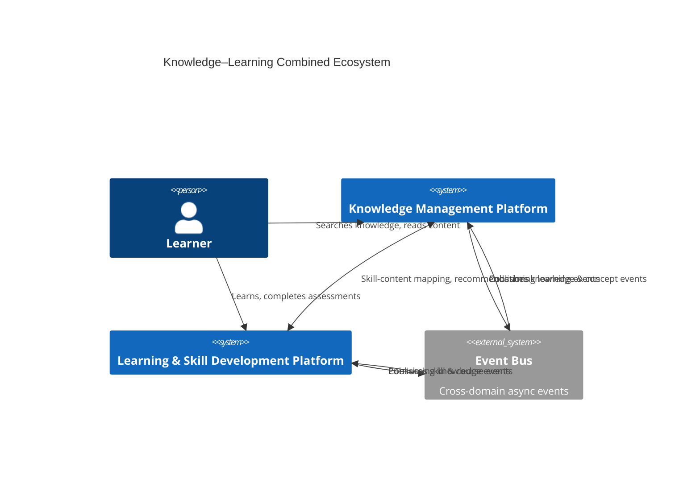
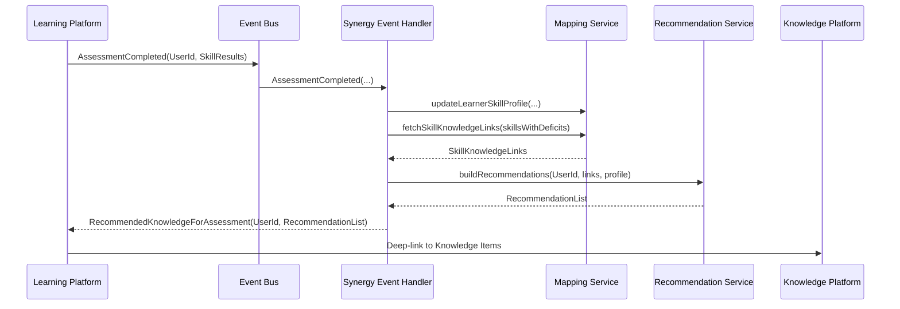

# ✅ 1. The Two Domains Fit Together Naturally

The **Learning & Skill Development Platform** and the **Knowledge Management Platform** are *complementary* domain ecosystems.

Here is their strategic alignment:

| Domain                                    | Purpose                                                                           | Strategic Synergy                                               |
| ----------------------------------------- | --------------------------------------------------------------------------------- | --------------------------------------------------------------- |
| **Knowledge Management Platform**         | Capture, organize, classify, search, curate, and connect organizational knowledge | Supplies content, concepts, and graph relationships             |
| **Learning & Skill Development Platform** | Deliver structured learning, capability frameworks, skills, assessments, courses  | Consumes knowledge, attaches to skills, generates new knowledge |

**They reinforce each other in a flywheel:**

1. **Learning** generates new knowledge → flows into the Knowledge Platform
2. **Knowledge Platform** links relevant knowledge to skills & learning paths
3. **Skills Framework** guides which knowledge content people should consume
4. **Learning activity** updates skill proficiency → feeds back into recommendations
5. **Knowledge Graph** provides automatic semantic linking to skills, topics, competencies

---

# ✅ 2. Recommended Integration Pattern: “KNOWLEDGE–LEARNING SYNERGY LAYER”

Add a new Cross-Domain Context:

### **Learning Integration Context (Cross-Domain Strategic Context)**

**Purpose:** Connect learning entities (Courses, Skills, Assessments, Competencies, Paths) with knowledge entities (Knowledge Items, Concepts, Notes, Documents).

This context handles:

* Automatic **linking knowledge → skills**
* Auto-suggesting **learning → knowledge** gaps
* Mapping **competency models** to knowledge taxonomies
* AI-assisted **learning recommendations** using semantic search
* Skill progression analytics feeding content personalization

This prevents domain leakage across bounded contexts.

---

# ✅ 3. Unifying the Models: What Needs to Be Added

Your Knowledge Platform already includes:

* Knowledge Items
* Concepts
* Knowledge Graph
* Semantic Index
* Cross-content linking
* Recommendation Engine
* Metadata/Taxonomy
* Analytics
* User Personalization

Your Learning & Skill model likely includes:

* Skill Framework
* Competency Models
* Courses / Modules
* Learning Paths
* Assessment Results
* Skill Ratings & Proficiency Levels
* Missions / Challenges
* Learning Objectives
* Learning Activities

To integrate them seamlessly, you need **three enhancements**:

---

## 🔧 Enhancement A — Add Skill/Competency Nodes to the Knowledge Graph

### Add new node types:

* **SkillNode**
* **CompetencyNode**
* **LearningObjectiveNode**
* **CapabilityNode**

### Add relationships:

* `KnowledgeItem -> supports -> SkillNode`
* `KnowledgeItem -> teaches -> CompetencyNode`
* `SkillNode -> requires -> KnowledgeItem`
* `CourseModule -> references -> KnowledgeItem`
* `LearningObjective -> coveredBy -> KnowledgeItem`

### Why?

This enables **graph-powered learning recommendations**, skill gap analysis, and competency mapping.

---

## 🔧 Enhancement B — Extend Semantic Search for Learning Content

Your semantic search already handles:

* Knowledge Items
* Notes
* Documents

Extend it to index:

* Skills (text and metadata)
* Competencies
* Learning Objectives
* Course Material
* Assessment descriptions
* Learning content

Events to index learning content:

* `SkillCreated`
* `CourseUpdated`
* `CompetencyDefined`
* `LearningObjectiveUpdated`

This immediately enables:

* “Show me knowledge that helps build Skill X”
* “Show me documents relevant to Competency Y”
* “Which content helps with this Learning Objective?”

---

## 🔧 Enhancement C — Add Bidirectional Event Contracts

To integrate both domains cleanly, introduce **cross-context events**.

### **Learning → Knowledge events**

* `SkillCreated`
* `SkillUpdated`
* `CompetencyDefined`
* `CoursePublished`
* `LearningObjectiveUpdated`
* `UserSkillProgressUpdated`

The Knowledge Platform consumes these to:

* Create graph nodes
* Link knowledge to skills
* Update recommendations
* Update content quality relevance
* Re-personalize search results

---

### **Knowledge → Learning events**

* `KnowledgeItemCreated`
* `KnowledgeItemUpdated`
* `ConceptExtracted`
* `KnowledgeRelationshipDefined`
* `DocumentUploaded`

The Learning Platform consumes these to:

* Suggest new content for skills
* Auto-generate learning path recommendations
* Update curriculum relevance
* Identify content that supports a competency

---

# ✅ 4. Detailed Integration Architecture (C4 Context-Level Diagram)



---

# ✅ 5. Specific Integration Points (Very Important)

This section shows **exactly how the domain models combine**.

---

## **5.1 Knowledge Item ←→ Skill Link**

Add a new value object in Knowledge Integration:

```csharp
public class SkillReference 
{
    public string SkillId { get; }
    public string SkillName { get; }
    public decimal RelevanceScore { get; }
}
```

And new relationship type:

* `KnowledgeRelationshipType.SkillAlignment`

---

## **5.2 Concept Extraction → Learning Objectives**

Your NLP pipeline extracts:

* Concepts
* Topics
* Entities

Extend the pipeline so that extracted concepts map to **learning objectives**:

Algorithm:

1. Extract concepts from Knowledge Item
2. Compare to Learning Objective vocabulary
3. If similarity > threshold, link item to that objective

---

## **5.3 Personalized Learning Recommendations**

Using existing:

* SemanticIndexEntry
* RecommendationEngine
* Collaborative filtering
* Quality metrics

You can generate:

* Learning Path recommendations
* “Knowledge you should read before taking Course X”
* “Knowledge to help you reach Proficiency Level 3 in Skill Y”

---

## **5.4 Assessment → Knowledge Recommendation**

When a user fails assessment questions:

1. Extract competencies from question
2. Search knowledge items linked to those competencies
3. Recommend the highest-quality content

---

# ✅ 6. Technical Integration (Per Bounded Context)

Below is exactly **what goes where**.

| Learning BC               | Integration Into Knowledge Platform        |
| ------------------------- | ------------------------------------------ |
| **Skill Framework BC**    | Graph Nodes + Semantic Index Entities      |
| **Competency Model BC**   | Ontology + Concept Hierarchy               |
| **Courses BC**            | Search Index + Cross-Content Linking       |
| **Assessments BC**        | Recommendation Engine triggers             |
| **User Skill Profile BC** | Personalized Search + Content Ranking      |
| **Learning Path BC**      | Graph traversal for prerequisite knowledge |

---

# ✅ 7. Integration Inside the Unified Platform Model (Your Professional Spec)

Here is exactly where the Learning Domain plugs into the large unified spec you generated:

| Spec Section                         | Integration Required                               |
| ------------------------------------ | -------------------------------------------------- |
| Part 4 – Unified Content Model       | Add CourseContent, LearningContent as source types |
| Part 5 – Knowledge Graph             | Add Skill, Competency, LearningObjective nodes     |
| Part 6 – Semantic Search             | Index skills, competencies, course descriptions    |
| Part 7 – Cross-Content Linking       | Link KnowledgeItem ↔ Skill                         |
| Part 8 – Ontology/Taxonomy           | Map Skill taxonomy to Concept taxonomy             |
| Part 10 – Curation                   | Apply quality workflows to course materials        |
| Part 12 – Personalization            | Include skill profile in ranking                   |
| Part 14 – Analytics                  | Add skill-learning-content analytics               |
| Part 23 – Integration Infrastructure | Add Learning → Knowledge event streams             |
| Part 25 – Security                   | Apply access control for learning content          |

---

# 🚀 8. Final Recommendation — Add One New Bounded Context

### **Learning Intelligence & Alignment Context (New BC)**

**Responsibilities:**

* Maintain skill–knowledge alignment map
* Map competencies to concepts
* Compute learning relevance for content
* Update learning paths based on new knowledge
* Provide cross-domain recommendations

This prevents either core domain from leaking responsibilities into the other.

---

# 🎯 **Conclusion — How They Integrate**

**The Learning & Skill Development Domain Model integrates into your Unified Knowledge Platform by:**

### **1. Extending Knowledge Graph with Skills/Competencies**

### **2. Extending Semantic Search to index learning data**

### **3. Mapping Learning → Knowledge and Knowledge → Learning automatically**

### **4. Adding cross-domain events and data flows**

### **5. Using existing recommendation engines to drive learning suggestions**

### **6. Adding a new Learning Integration bounded context**

### **7. Creating a unified ontology across both domains**

This produces a tightly integrated, enterprise-grade **Knowledge + Learning Ecosystem** where:

* Knowledge powers learning
* Learning enriches knowledge
* Skills, competencies, and content reinforce each other

---

# Knowledge–Learning Synergy Layer

## Cross-Domain Integration Architecture Specification

---

## 1. Executive Summary

The **Knowledge–Learning Synergy Layer** is a **dedicated bounded context** whose sole responsibility is to:

* Link **skills, competencies, courses, assessments** (Learning domain)
  with
* **Knowledge Items, Documents, Concepts, Notes** (Knowledge domain)

It provides:

* A unified **Skill–Knowledge Graph**
* **Cross-domain recommendations** (“what to learn next”, “what to read next”)
* **Skill-aware knowledge discovery**
* **Knowledge-aware learning path design and adaptation**
* **Feedback loops** from learner performance into content quality & prioritization

This layer is **pure integration logic** – it does *not own* the core learning or knowledge entities; it *maps*, *links*, *scores*, and *orchestrates* them.

---

## 2. Scope & Non-Scope

### 2.1 In Scope

* Mapping **skills/competencies ⇄ knowledge content**
* Maintaining **Skill–Knowledge Link** entities & weights
* Auto-suggesting links via AI / semantic search
* Providing APIs to:

  * Get knowledge for a skill
  * Get skills supported by a knowledge item
  * Recommend knowledge based on assessment gaps
  * Recommend learning based on knowledge usage & interest
* Propagating events between:

  * Learning platform (skills, assessments, courses)
  * Knowledge platform (knowledge items, concepts, graph)
* Projecting cross-domain analytics (skill coverage, gaps, etc.)

### 2.2 Out of Scope

* Defining skill models themselves (belongs to **Learning Platform**)
* Defining content models (belongs to **Knowledge Platform**)
* User authentication & global authorization (Access Control context)
* Low-level LLM orchestration (AI/ML/Recommendation contexts own model training etc.)

The Synergy Layer is a **thin, smart, opinionated bridge**.

---

## 3. Context in Overall Architecture (C4 – System Context)

```mermaid
C4Context
    title Knowledge–Learning Synergy Layer - System Context

    Person(learner, "Learner", "Employee / User")
    Person(manager, "Manager", "People Manager / Coach")
    Person(admin, "Admin", "L&D / Knowledge Admin")

    System(learning, "Learning & Skill Development Platform",
        "Manages skills, courses, paths, assessments, learner profiles")

    System(knowledge, "Unified Knowledge Management Platform",
        "Manages knowledge items, documents, notes, ontology, graph, search")

    System(synergy, "Knowledge–Learning Synergy Layer",
        "Maps skills to knowledge, powers cross-domain recommendations")

    System_Ext(bus, "Event Bus", "Kafka/RabbitMQ", "Cross-context events")

    Rel(learner, learning, "Learns, completes courses & assessments")
    Rel(learner, knowledge, "Searches & consumes knowledge items")

    Rel(manager, synergy, "Requests gap analysis & recommendations")
    Rel(admin, synergy, "Configures mapping rules and thresholds")

    Rel(learning, synergy, "Skill, course, assessment events & queries")
    Rel(knowledge, synergy, "Knowledge item, concept, graph events & queries")

    Rel(learning, bus, "Publish Skill/Assessment/Course events")
    Rel(knowledge, bus, "Publish Knowledge/Concept events")
    Rel(bus, synergy, "Consume cross-domain events")
```

---

## 4. Responsibilities of the Synergy Layer

### 4.1 Core Responsibilities

1. **Skill–Knowledge Mapping**

   * Maintain mappings:

     * `Skill` ⇄ `KnowledgeItem`
     * `Competency` ⇄ `Concept`
     * `LearningObjective` ⇄ `KnowledgeItem` / `Concept`
   * Store relationship **type**, **strength**, and **evidence**.

2. **Gap Detection & Recommendations**

   * Detect **skill gaps** based on assessments.
   * Suggest **knowledge items** to close those gaps.
   * Suggest **courses/paths** based on knowledge behavior (what user reads).

3. **Cross-Domain Analytics & Coverage**

   * Compute:

     * “Skill coverage by knowledge”
     * “Knowledge coverage by skills”
     * Areas with **high learning demand but low content coverage**.

4. **Event Orchestration**

   * Consume:

     * `SkillCreated`, `SkillUpdated`, `AssessmentCompleted`, `CoursePublished`
     * `KnowledgeItemCreated`, `KnowledgeItemUpdated`, `ConceptExtracted`
   * Generate alignment updates, mapping recalculations and recommendations.

5. **APIs for Other Services**

   * `GetKnowledgeForSkill`
   * `GetSkillsSupportedByKnowledge`
   * `RecommendKnowledgeForLearnerSkillProfile`
   * `RecommendLearningPathForLearner`

### 4.2 Non-Responsibilities

* No direct content editing.
* No direct skill framework editing.
* No storing full content bodies (only references).
* No UI responsibility beyond providing APIs to be consumed by Learning / Knowledge UIs.

---

## 5. Ubiquitous Language

Key terms used *within the Synergy Layer*:

* **Skill** – A specific capability defined in the Learning Platform (e.g., “Docker Fundamentals”).
* **Competency** – Cluster of skills / behavior aligned to a role or level.
* **Learning Objective** – A measurable outcome for a course or module.
* **Knowledge Item** – A structured piece of content (KB article, guide, wiki).
* **Document** – File-based knowledge (PDF, PPT, Word, etc.).
* **Skill–Knowledge Link** – A typed, weighted relationship between Skill/Competency and Knowledge Item/Concept.
* **Skill Coverage** – Degree to which skills are supported by knowledge content.
* **Knowledge Support Score** – How well a given knowledge item supports a skill or competency.
* **Learning Gap** – A deficiency in a learner’s skill level, mapped to related knowledge deficits.
* **Learning Signal** – Events such as assessments, completions, time spent that suggest skill changes.
* **Knowledge Signal** – Events such as views, bookmarks, shares on knowledge items.

---

## 6. Key Integration Use Cases

### 6.1 Use Case 1 — “I failed an assessment. What should I read?”

1. Learner fails an assessment question for Skill `S1`.
2. Learning Platform emits `AssessmentCompleted` with **skill-level breakdown**.
3. Synergy Layer:

   * Identifies **Skill S1 deficiencies**.
   * Fetches **Skill–Knowledge Links** for `S1`.
   * Ranks knowledge based on quality, difficulty, recency, and learner history.
4. Returns a list of **targeted knowledge items** to Learning Platform.
5. Learning UI shows: *“Recommended readings to improve Skill X.”*

---

### 6.2 Use Case 2 — “I want to design a new course. Which existing knowledge can I reuse?”

1. L&D / SME drafts new Course with Learning Objectives and target skills.
2. Learning Platform calls Synergy Layer:

   * `GetKnowledgeForSkills([S1, S2, S3])`.
3. Synergy Layer returns:

   * Relevant Knowledge Items, Documents, Examples, FAQs.
4. Course designer reuses / links those into the course.

---

### 6.3 Use Case 3 — “What skills does this knowledge item support?”

1. A Knowledge Item is created or updated.
2. Knowledge Platform emits `KnowledgeItemUpdated` with:

   * Title, sections, extracted concepts.
3. Synergy Layer:

   * Uses embeddings & ontology to compute similarity to Skills/Competencies.
   * Suggests links (e.g., `S3`, `S8`) with confidence scores.
4. A curator / SME can approve or refine these links.

---

### 6.4 Use Case 4 — “Skill coverage analytics”

1. Manager / Admin queries:

   * `GetSkillCoverage(domain: "Cloud Engineering")`.
2. Synergy Layer computes:

   * How many skills have ≥N high-quality knowledge items.
   * Skills with learning demand but poor knowledge support.
3. Surfaces **content gap insights** for content strategy.

---

## 7. Synergy Layer Logical Architecture (C4 – Container View)

```mermaid
C4Container
    title Knowledge–Learning Synergy Layer - Container View

    Container(synergy_api, "Synergy API", ".NET Core",
        "Public API for both Learning and Knowledge platforms")

    Container(mapping_svc, "Skill–Knowledge Mapping Service", "Domain Service",
        "Maintains and scores Skill–Knowledge links")

    Container(reco_svc, "Cross-Domain Recommendation Service", "Python/ML",
        "Generates recommendations for skills, learners and content")

    Container(gap_svc, "Skill Gap & Coverage Service", "Domain Service",
        "Computes gaps, coverage and alignment metrics")

    Container(projection_svc, "Cross-Domain Projections Store", "Read Model",
        "Stores aggregated views for fast queries")

    Container(event_handler, "Synergy Event Handlers", ".NET Workers",
        "Consumes events from Learning & Knowledge domains")

    ContainerDb(synergy_db, "Synergy DB", "Relational/Document DB",
        "Stores mapping aggregates, scores, projections")

    ContainerBus(bus, "Event Bus", "Kafka/RabbitMQ", "Domain integration events")

    Rel(synergy_api, mapping_svc, "Skill–Knowledge APIs")
    Rel(synergy_api, reco_svc, "Recommendation APIs")
    Rel(synergy_api, gap_svc, "Gap analytics APIs")
    Rel(mapping_svc, synergy_db, "Persist links and scores")
    Rel(reco_svc, synergy_db, "Read mapping, scores, signals")
    Rel(gap_svc, synergy_db, "Read projections")
    Rel(event_handler, synergy_db, "Update stores")
    Rel(event_handler, bus, "Consume Learning & Knowledge events")
```

---

## 8. Domain Model – Knowledge–Learning Synergy Layer

### 8.1 Aggregates & Entities (UML)

```mermaid
classDiagram
    class SkillKnowledgeLink {
        +SkillKnowledgeLinkId id
        +SkillRef skill
        +KnowledgeRef knowledge
        +LinkType type
        +decimal baseRelevance
        +decimal effectivenessScore
        +decimal usageBoost
        +decimal overallScore
        +LinkStatus status
        +List~LinkEvidence~ evidence
        +addEvidence(...)
        +recalculateScore(...)
        +markValidated(UserId)
    }

    class SkillRef {
        +string skillId
        +string skillName
        +string frameworkId
        +string level // optional
    }

    class KnowledgeRef {
        +string contentId
        +string contentType // KnowledgeItem, Document, Note
        +string title
        +string domain
    }

    class LinkEvidence {
        +EvidenceType type
        +string sourceEventId
        +decimal weight
        +DateTime timestamp
        +string description
    }

    class LearnerSkillProfileProjection {
        +UserId userId
        +List~SkillProficiency~ skills
    }

    class SkillProficiency {
        +string skillId
        +decimal currentLevel
        +decimal targetLevel
        +DateTime lastUpdated
    }

    class SkillCoverageMetrics {
        +string skillId
        +int knowledgeItemCount
        +decimal avgQualityScore
        +decimal coverageScore
        +decimal demandScore
        +bool isGap
    }

    enum LinkType {
        DirectSupport
        Example
        DeepDive
        Prerequisite
        Supplementary
    }

    enum LinkStatus {
        Proposed
        Validated
        Rejected
        Deprecated
    }

    enum EvidenceType {
        ManualCuratorMapping
        ConceptOverlap
        EmbeddingSimilarity
        AssessmentBacklink
        LearningPathAssociation
    }
```

---

## 9. Event-Driven Integration Model

### 9.1 Events from Learning Platform → Synergy Layer

**Key events:**

* `SkillCreated`
* `SkillUpdated`
* `CompetencyDefined`
* `CoursePublished`
* `CourseUpdated`
* `LearningObjectiveCreated/Updated`
* `AssessmentCompleted`
* `UserSkillProfileUpdated`
* `LearningPathAssigned`

**What Synergy does with them:**

* Create or update `SkillRef` entries.
* Update `LearnerSkillProfileProjection`.
* Add **evidence** to Skill–Knowledge links based on course content.
* Recalculate **skill coverage** and **content gaps**.
* Compute new recommendations for learners with significant gaps.

---

### 9.2 Events from Knowledge Platform → Synergy Layer

**Key events:**

* `KnowledgeItemCreated`
* `KnowledgeItemUpdated`
* `KnowledgeItemPublished`
* `DocumentUploaded`
* `ConceptExtracted`
* `ContentQualityUpdated`
* `ContentLifecycleChanged`

**What Synergy does:**

* Uses `ConceptExtracted` & embeddings to propose new links:

  * Skill ↔ KnowledgeItem
* Updates `SkillCoverageMetrics` when knowledge is added/removed.
* Adjusts `SkillKnowledgeLink.effectivenessScore` when quality changes.
* Marks outdated links when knowledge becomes **Outdated/Archived**.

---

### 9.3 Sequence Example – Assessment → Recommendations



---

## 10. Public APIs of the Synergy Layer

These APIs are **internal platform APIs**, consumed by:

* Learning Platform services
* Knowledge Platform services
* Recommendation, Analytics, and UI Gateways

### 10.1 Query APIs

#### 10.1.1 `GET /skills/{skillId}/knowledge`

Returns knowledge items supporting a skill.

**Response (simplified):**

```json
{
  "skillId": "skill-123",
  "skillName": "Kubernetes Fundamentals",
  "knowledge": [
    {
      "contentId": "ki-101",
      "title": "Kubernetes Basics",
      "overallScore": 0.92,
      "linkType": "DirectSupport"
    },
    {
      "contentId": "doc-455",
      "title": "K8s Cluster Setup Checklist",
      "overallScore": 0.84,
      "linkType": "Example"
    }
  ]
}
```

---

#### 10.1.2 `GET /knowledge/{contentId}/skills`

Returns skills supported by this piece of knowledge.

---

#### 10.1.3 `GET /learners/{userId}/recommendations/knowledge`

Knowledge recommendations based on skill profile and recent learning activity.

---

#### 10.1.4 `GET /skills/coverage`

Returns an array of `SkillCoverageMetrics`:

```json
[
  {
    "skillId": "skill-123",
    "knowledgeItemCount": 5,
    "avgQualityScore": 0.88,
    "coverageScore": 0.91,
    "demandScore": 0.72,
    "isGap": false
  },
  {
    "skillId": "skill-999",
    "knowledgeItemCount": 1,
    "avgQualityScore": 0.65,
    "coverageScore": 0.33,
    "demandScore": 0.89,
    "isGap": true
  }
]
```

---

### 10.2 Command APIs

* `POST /links/skill-knowledge/propose`
* `POST /links/skill-knowledge/validate`
* `POST /links/skill-knowledge/reject`
* `POST /recalculate/skill-coverage`
* `POST /recalculate/recommendations/{userId}`

These are mainly used by background workers, admin UIs, or curation workflows.

---

## 11. Knowledge Graph & Search Integration

### 11.1 Graph Projection from Synergy Layer

The Synergy Layer writes into the Knowledge Graph via the **Knowledge Graph context**, not directly.

**For each validated `SkillKnowledgeLink`:**

* Create or update an edge:

  * `SkillNode -[SUPPORTS_BY]-> KnowledgeItemNode`
  * With properties:

    * `linkType`
    * `overallScore`
    * `source = "SynergyLayer"`
    * `evidenceCount`

Graphs can then be used for:

* Discovering **prerequisite knowledge paths** for skill attainment
* Understanding **which knowledge items are central to multiple skills**
* Visualizing relationships for SMEs and learners

---

### 11.2 Search Integration

The Synergy Layer informs Search:

* Add **Skill IDs / names** as metadata tags on Knowledge Items.
* Add **Concept/Competency tags** based on mappings.
* Search engine can filter or boost by:

  * `skillId`
  * `competencyId`
  * `learningDemandScore`

Example:

> When user searches “Kubernetes deployment” and we know they are focused on **Skill: “Kubernetes Operations”**, search results are re-ranked using Skill–Knowledge links.

---

## 12. Recommendation Integration

The Synergy Layer works **with** the Recommendation Context:

* Provides **feature signals**:

  * Skill gap severity
  * Skill–Knowledge link score
  * Learning path membership
  * Past learning completions

These become **features** in recommendation models.

Typical flows:

* Recommendation service calls:

  * `GetSkillKnowledgeLinksForUser(userId)`
* Synergy returns:

  * List of { contentId, score, skillContext }

The recommender combines:

* Behavior-based scores
* Graph-based scores
* **Skill-based scores (Synergy Layer)**

---

## 13. Storage & Persistence for Synergy Layer

A simple but robust storage stack:

* **Relational DB (PostgreSQL/SQL Server)**:

  * `SkillKnowledgeLink`
  * `SkillCoverageMetrics`
  * `LearnerSkillProfileProjection` (projection only, source remains in Learning)
  * `EvidenceLog`

* **(Optional) Document Store**:

  * If evidence and mapping logs are high-volume & schema-flexible.

Indexes:

* `IX_SkillKnowledgeLink_SkillId`
* `IX_SkillKnowledgeLink_ContentId`
* `IX_LearnerSkillProfile_UserId`
* `IX_SkillCoverage_SkillId`

All entries are **tenant-aware** (TenantId column).

---

## 14. Security & Access Control

* Synergy Layer **never bypasses** Access Control context.
* Before returning knowledge items:

  * It calls Access/Authorization service:

    * `CanUserViewContent(userId, contentId)` for each candidate (or batch).
* Skill-level data:

  * Respects Learning platform’s **privacy & HR policies**.
  * Manager can see team-level aggregates; individuals see their own detailed gaps.

All APIs are:

* Authenticated via platform IAM (JWT / OIDC).
* Authorized via role-based + attribute-based rules.

---

## 15. Observability & Audit

* All cross-domain mappings and recommendation decisions should be auditable:

  * Which evidence created a Skill–Knowledge link?
  * Why was a particular knowledge item recommended?
* Emit structured logs:

  * `SkillKnowledgeLinkCreated`
  * `SkillKnowledgeLinkValidated`
  * `RecommendationIssued`
* Integrated with **Audit Logging & Compliance Context**:

  * For sensitive skills (e.g., compliance, regulatory training).

Metrics:

* Number of skills with good coverage.
* Number of learning gaps.
* Recommendation CTR & follow-through.
* Time-to-close a skill gap after recommendations.

---

## 16. Rollout & Migration Strategy

1. **Phase 1 – Passive Mapping**

   * Consume events from both domains.
   * Build **SkillRef**, **KnowledgeRef**, and initial **SkillKnowledgeLinks** as proposals.
   * No end-user features yet, just analytics.

2. **Phase 2 – SME-Validated Links**

   * Expose SME UI for validating mappings.
   * Provide “proposed mappings” to L&D/Knowledge teams.

3. **Phase 3 – Read-Only Recommendations**

   * Use only **validated links** to provide:

     * “Recommended readings after assessment failure”
     * “Knowledge items for learning path design”.

4. **Phase 4 – Fully Integrated Feedback Loop**

   * Use behavioral signals (views, completions) to refine link scores.
   * Integrate with recommendation engine.
   * Integrate analytics dashboards (skill coverage, gaps, content strategy).

---

## 17. Summary

The **Knowledge–Learning Synergy Layer**:

* Is a **dedicated integration bounded context**.
* Owns **Skill–Knowledge links**, **coverage metrics**, and **cross-domain recommendations**.
* Connects:

  * Skills, competencies, assessments, learning paths
    with
  * Knowledge items, documents, concepts, graph relationships.
* Uses:

  * Event-driven integration,
  * Graph integration,
  * Search metadata enrichment,
  * Recommender feature signals,
  * Cross-domain analytics.

It transforms your **Knowledge Platform** and **Learning Platform** from two independent systems into a **single, self-reinforcing, capability-building ecosystem**.

---
