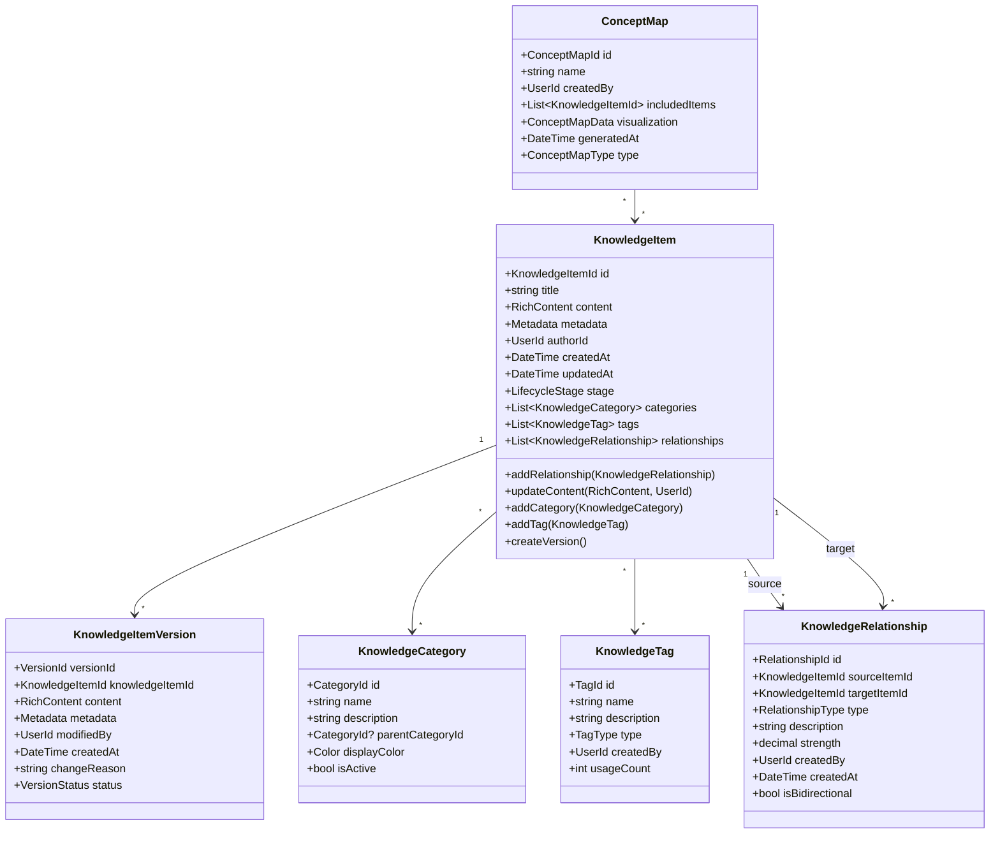
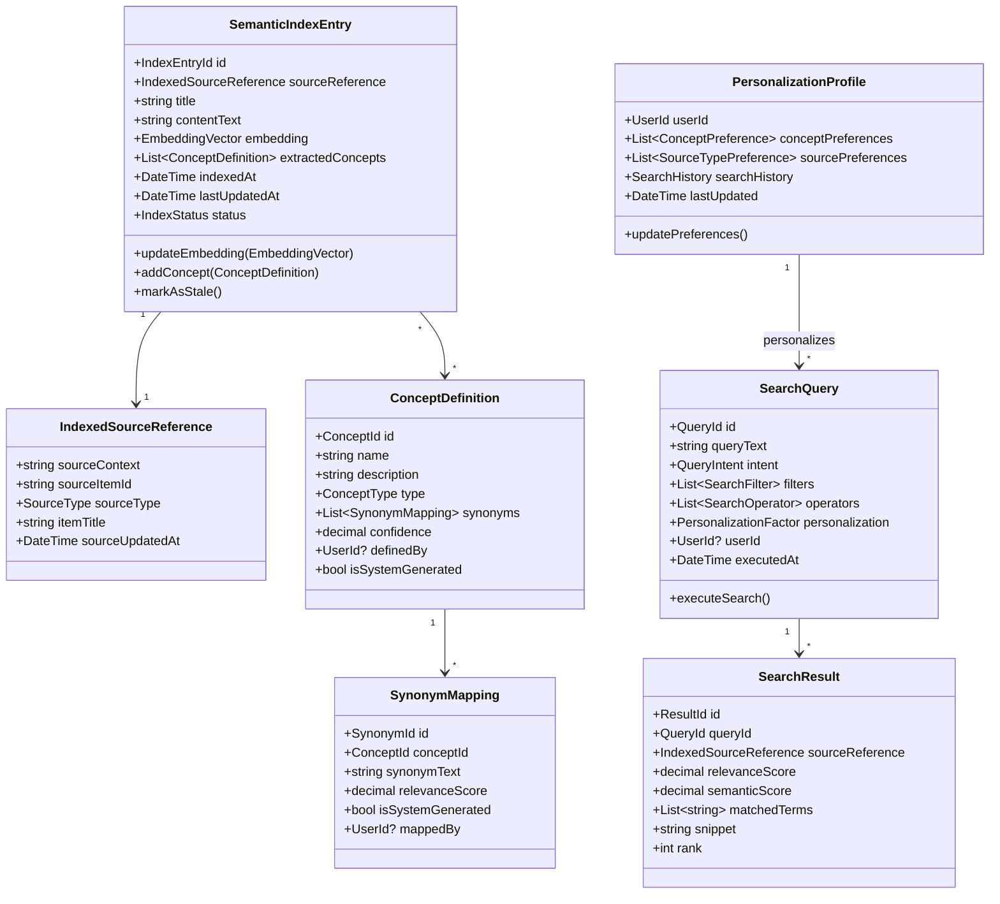
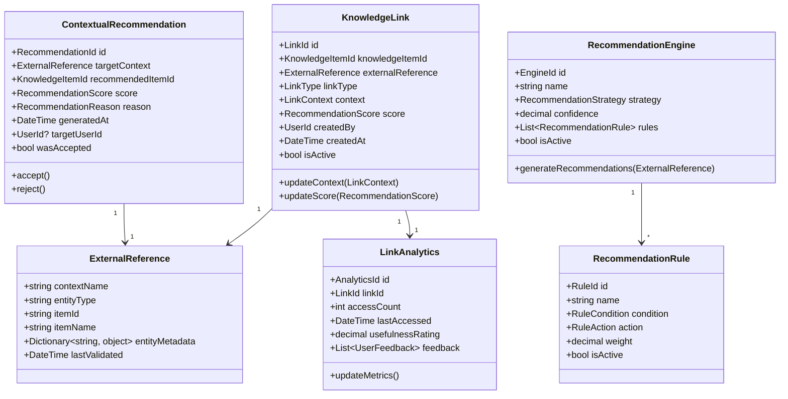
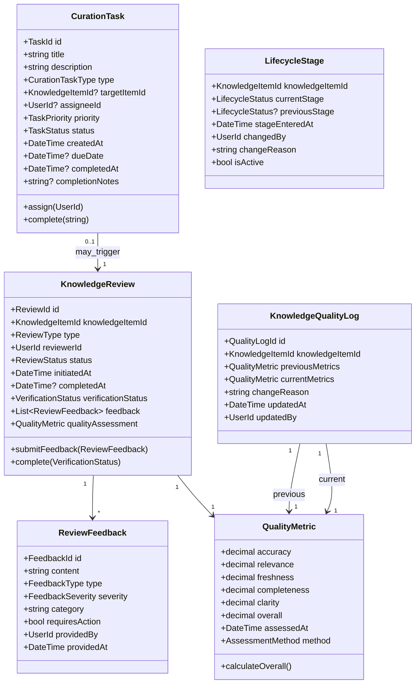
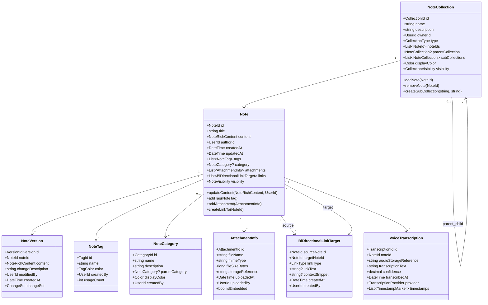
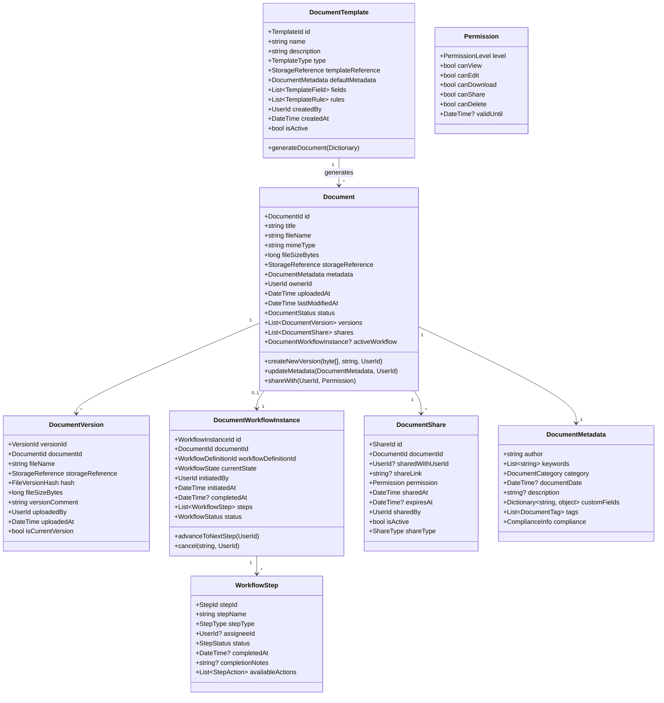
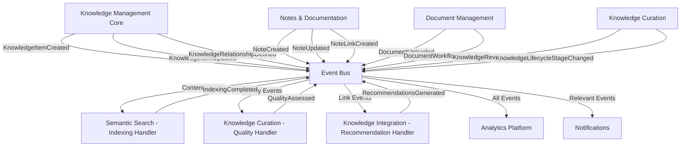
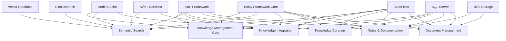

# Knowledge Management Platform Domain-Driven Design Architecture Specification
## Knowledge Management Platform

---

## Table of Contents

1. [Executive Summary](#1-executive-summary)
2. [Domain Architecture Overview](#2-domain-architecture-overview)
3. [Bounded Context Catalog](#3-bounded-context-catalog)
4. [Bounded Context Specifications](#4-bounded-context-specifications)
5. [Integration Patterns](#5-integration-patterns)
6. [Implementation Guidelines](#6-implementation-guidelines)
7. [Cross-Cutting Concerns](#7-cross-cutting-concerns)
8. [Dependency Matrix](#8-dependency-matrix)

---

## 1. Executive Summary

### 1.1 System Purpose
A comprehensive knowledge management platform integrating structured knowledge representation, semantic search capabilities, intelligent curation workflows, note-taking systems, document management, and cross-platform knowledge integration to optimize organizational learning and information accessibility.

### 1.2 Architecture Approach
- **Pattern**: Domain-Driven Design with CQRS and Event Sourcing
- **Framework**: ABP Framework (.NET)
- **Integration**: Event-driven architecture with eventual consistency
- **Scalability**: Microservices-ready bounded contexts with semantic search capabilities

### 1.3 Core Domain Classification
- **Core Domains**: Knowledge Management Core, Semantic Search, Knowledge Integration
- **Supporting Domains**: Knowledge Curation, Notes and Documentation, Document Management
- **Generic Domains**: Identity & Access Management, Notifications, File Storage

---

## 2. Domain Architecture Overview

### 2.1 Context Map

```
┌─────────────────┐    ┌─────────────────┐    ┌─────────────────┐
│Knowledge Mgmt   │────│Semantic Search  │────│Knowledge        │
│Core (Core)      │    │   (Core)        │    │Integration(Core)│
└─────────────────┘    └─────────────────┘    └─────────────────┘
         │                       │                       │
         │                       │                       │
┌─────────────────┐    ┌─────────────────┐    ┌─────────────────┐
│Knowledge        │    │Notes &          │    │Document         │
│Curation         │    │Documentation    │    │Management       │
│(Supporting)     │    │(Supporting)     │    │(Supporting)     │
└─────────────────┘    └─────────────────┘    └─────────────────┘
         │                       │                       │
         └───────────────────────┼───────────────────────┘
                                 │
        ┌────────────────────────┼────────────────────────┐
        │                       │                        │
┌─────────────────┐    ┌─────────────────┐    ┌─────────────────┐
│   Notifications │    │      IAM        │    │  File Storage   │
│    (Generic)    │    │   (Generic)     │    │   (Generic)     │
└─────────────────┘    └─────────────────┘    └─────────────────┘
```

### 2.2 Strategic Design Principles

1. **Knowledge Graph Foundation**: Central knowledge representation with relationship modeling
2. **Unified Search Experience**: Semantic understanding across all content types
3. **Content Lifecycle Management**: Quality control and curation workflows
4. **Cross-Platform Integration**: Linking knowledge to external systems and entities
5. **Event-Driven Consistency**: Eventual consistency for search indexing and recommendations

---

## 3. Bounded Context Catalog

| Context | Type | Priority | Complexity | Team Size |
|---------|------|----------|------------|-----------|
| Knowledge Management Core | Core | Critical | High | 3-4 |
| Semantic Search | Core | Critical | High | 3-4 |
| Knowledge Integration | Core | High | Medium | 2-3 |
| Knowledge Curation | Supporting | Medium | Medium | 2-3 |
| Notes and Documentation | Supporting | Medium | Medium | 2-3 |
| Document Management | Supporting | Medium | High | 3-4 |

---

## 4. Bounded Context Specifications

### 4.1 Knowledge Management Core Bounded Context

#### 4.1.1 Context Overview
**Responsibility**: Central knowledge item management, content versioning, metadata management, categorization, tagging, and knowledge graph relationship modeling for building connected knowledge structures.

**Strategic Classification**: Core Domain - Strategic

**Subdomains**:
- Knowledge Representation: Core knowledge item structure and content
- Knowledge Graph: Relationship modeling and graph structure
- Version Management: Content versioning and history tracking

#### 4.1.2 Core Domain Model



#### 4.1.3 Aggregates Specification

##### KnowledgeItem Aggregate Root
**Purpose**: Central entity managing knowledge content, metadata, categorization, and relationships

**Entities**:
- `KnowledgeItemVersion`: Historical versions of content
- `KnowledgeRelationship`: Directed relationships to other knowledge items

**Value Objects**:
- `KnowledgeItemId`: Unique identifier with validation
- `RichContent`: Rich text, images, attachments, structured data
- `Metadata`: Author, source, creation date, custom fields
- `LifecycleStage`: Draft, Published, Archived, Deprecated
- `RelationshipType`: RelatedTo, DependsOn, Contains, References, Contradicts, Supports
- `ConceptMapData`: Exportable graph representation

**Business Invariants**:
- Knowledge item must have a title and content
- Version history must be maintained for all content changes
- Relationships cannot create circular dependencies for hierarchical types
- At least one active category must be assigned
- Tags must exist before assignment

##### KnowledgeCategory Aggregate Root
**Purpose**: Hierarchical categorization system for knowledge organization

**Value Objects**:
- `CategoryId`: Unique identifier
- `CategoryName`: Required, unique within parent level
- `CategoryDescription`: Optional description
- `ParentCategoryId`: Optional parent reference
- `DisplayColor`: Visual organization aid

**Business Invariants**:
- Category names must be unique within the same parent level
- Cannot delete category with assigned knowledge items
- Cannot create circular parent-child relationships

##### KnowledgeTag Aggregate Root
**Purpose**: Flexible tagging system for cross-cutting knowledge themes

**Value Objects**:
- `TagId`: Unique identifier
- `TagName`: Required, globally unique
- `TagType`: Subject, Method, Domain, Status
- `UsageCount`: Tracked for popularity

**Business Invariants**:
- Tag names must be globally unique
- Usage count must be accurate based on assignments
- Cannot delete tags with active assignments

##### ConceptMap Aggregate Root
**Purpose**: Generated visualization of knowledge relationships and structures

**Value Objects**:
- `ConceptMapId`: Unique identifier
- `ConceptMapName`: User-defined name
- `IncludedItems`: List of knowledge items in the map
- `VisualizationData`: Graph layout and connection data
- `ConceptMapType`: Manual, Generated, Filtered

#### 4.1.4 Commands & Queries (CQRS)

##### Commands
**Knowledge Lifecycle**:
```csharp
public record CreateKnowledgeItem(
    string Title,
    RichContent Content,
    Metadata Metadata,
    List<CategoryId> CategoryIds,
    List<TagId> TagIds,
    UserId AuthorId
);

public record UpdateKnowledgeItemContent(
    KnowledgeItemId ItemId,
    RichContent NewContent,
    string ChangeReason,
    UserId ModifiedBy
);

public record AddMetadataToKnowledgeItem(
    KnowledgeItemId ItemId,
    Dictionary<string, object> MetadataFields,
    UserId ModifiedBy
);

public record DeleteKnowledgeItem(
    KnowledgeItemId ItemId,
    string DeletionReason,
    UserId DeletedBy
);
```

**Categorization and Tagging**:
```csharp
public record CreateKnowledgeCategory(
    string Name,
    string Description,
    CategoryId? ParentCategoryId,
    Color DisplayColor,
    UserId CreatedBy
);

public record AssignCategoryToKnowledgeItem(
    KnowledgeItemId ItemId,
    CategoryId CategoryId,
    UserId AssignedBy
);

public record CreateKnowledgeTag(
    string Name,
    string Description,
    TagType Type,
    UserId CreatedBy
);

public record AssignTagToKnowledgeItem(
    KnowledgeItemId ItemId,
    TagId TagId,
    UserId AssignedBy
);
```

**Relationship Management**:
```csharp
public record DefineKnowledgeRelationship(
    KnowledgeItemId SourceItemId,
    KnowledgeItemId TargetItemId,
    RelationshipType Type,
    string Description,
    decimal Strength,
    bool IsBidirectional,
    UserId CreatedBy
);

public record RemoveKnowledgeRelationship(
    RelationshipId RelationshipId,
    string RemovalReason,
    UserId RemovedBy
);
```

**Concept Mapping**:
```csharp
public record GenerateConceptMap(
    string Name,
    List<KnowledgeItemId> SeedItems,
    int MaxDepth,
    ConceptMapType Type,
    UserId CreatedBy
);
```

##### Queries
**Single Entity**:
```csharp
public record GetKnowledgeItemById(KnowledgeItemId ItemId);
public record GetKnowledgeItemVersionHistory(KnowledgeItemId ItemId);
public record GetKnowledgeItemRelationships(KnowledgeItemId ItemId, RelationshipType? TypeFilter = null);
```

**Collections**:
```csharp
public record ListKnowledgeItemsByCategory(
    CategoryId CategoryId, 
    bool IncludeSubcategories = false,
    int PageNumber = 1,
    int PageSize = 20
);

public record ListKnowledgeItemsByTag(
    TagId TagId,
    int PageNumber = 1,
    int PageSize = 20
);

public record GetRelatedKnowledgeItems(
    KnowledgeItemId ItemId,
    int MaxDepth = 2,
    RelationshipType? TypeFilter = null
);
```

**Graph Queries**:
```csharp
public record GetKnowledgeGraphStructureData(
    List<KnowledgeItemId> SeedItems,
    int MaxDepth = 3
);

public record ExportConceptMap(
    ConceptMapId MapId,
    ExportFormat Format
);
```

#### 4.1.5 Events & Integration

##### Domain Events
```csharp
public class KnowledgeItemCreated : DomainEvent
{
    public KnowledgeItemId ItemId { get; }
    public string Title { get; }
    public RichContent Content { get; }
    public List<CategoryId> CategoryIds { get; }
    public List<TagId> TagIds { get; }
    public UserId AuthorId { get; }
    public DateTime CreatedAt { get; }
}

public class KnowledgeItemUpdated : DomainEvent
{
    public KnowledgeItemId ItemId { get; }
    public string Title { get; }
    public RichContent UpdatedContent { get; }
    public VersionId NewVersionId { get; }
    public UserId ModifiedBy { get; }
    public string ChangeReason { get; }
    public DateTime UpdatedAt { get; }
}

public class KnowledgeItemDeleted : DomainEvent
{
    public KnowledgeItemId ItemId { get; }
    public string Title { get; }
    public string DeletionReason { get; }
    public UserId DeletedBy { get; }
    public DateTime DeletedAt { get; }
}

public class KnowledgeRelationshipDefined : DomainEvent
{
    public RelationshipId RelationshipId { get; }
    public KnowledgeItemId SourceItemId { get; }
    public KnowledgeItemId TargetItemId { get; }
    public RelationshipType Type { get; }
    public bool IsBidirectional { get; }
    public UserId CreatedBy { get; }
}

public class KnowledgeItemCategorized : DomainEvent
{
    public KnowledgeItemId ItemId { get; }
    public CategoryId CategoryId { get; }
    public UserId AssignedBy { get; }
}

public class KnowledgeItemTagged : DomainEvent
{
    public KnowledgeItemId ItemId { get; }
    public TagId TagId { get; }
    public UserId AssignedBy { get; }
}

public class ConceptMapGenerated : DomainEvent
{
    public ConceptMapId MapId { get; }
    public string Name { get; }
    public List<KnowledgeItemId> IncludedItems { get; }
    public UserId CreatedBy { get; }
}
```

##### Event Handlers
**Internal Handlers**:
- `VersionCreationHandler`: Creates version when content is updated
- `RelationshipValidationHandler`: Validates relationship constraints
- `CategoryUsageTrackingHandler`: Updates category usage statistics
- `TagUsageTrackingHandler`: Updates tag usage counts

**External Publishers**:
- **To Semantic Search**: `KnowledgeItemCreated`, `KnowledgeItemUpdated`, `KnowledgeItemDeleted`
- **To Knowledge Curation**: `KnowledgeItemCreated`, `KnowledgeItemUpdated`
- **To Knowledge Integration**: All knowledge item events for link recommendations
- **To Notifications**: `KnowledgeItemCreated`, `KnowledgeRelationshipDefined`

#### 4.1.6 Business Rules & Policies

##### Validation Rules
1. **Content Requirements**: Title required (3-200 chars), content required (min 10 chars)
2. **Categorization**: At least one category required, maximum 5 categories per item
3. **Tagging**: Maximum 10 tags per item, tags must exist before assignment
4. **Relationships**: Cannot create self-relationships, no circular dependencies for hierarchical types
5. **Versioning**: All content changes must create new version with change reason

##### Business Policies
1. **Relationship Integrity**: Bidirectional relationships automatically create reverse relationships
2. **Category Hierarchy**: Deleting parent category requires reassignment of children
3. **Content Lifecycle**: Published items require review before archiving
4. **Version Retention**: Maintain all versions with configurable archival policy
5. **Graph Consistency**: Relationship changes trigger graph recalculation

##### Domain Services
```csharp
public interface IKnowledgeGraphService
{
    Task<bool> ValidateNoCircularDependency(KnowledgeItemId source, KnowledgeItemId target, RelationshipType type);
    Task<List<KnowledgeItemId>> GetConnectedItems(KnowledgeItemId startItem, int maxDepth);
    Task<ConceptMapData> GenerateConceptMapData(List<KnowledgeItemId> items, int maxDepth);
}

public interface IContentVersioningService
{
    Task<VersionId> CreateVersion(KnowledgeItemId itemId, RichContent content, string changeReason, UserId modifiedBy);
    Task<RichContent> GetVersionContent(VersionId versionId);
    Task<List<KnowledgeItemVersion>> GetVersionHistory(KnowledgeItemId itemId);
}
```

#### 4.1.7 Technical Considerations

##### Performance
- **Indexing**: KnowledgeItemId, CategoryId, TagId, AuthorId, CreatedAt, UpdatedAt
- **Graph Queries**: Optimized relationship traversal with depth limits
- **Caching**: Category hierarchies, tag lists, frequently accessed items
- **Search Optimization**: Separate read models for complex queries

##### Scalability
- **Partitioning**: By organization/tenant for multi-tenant scenarios
- **Graph Database**: Consider Neo4j for complex relationship queries
- **Content Storage**: Separate storage for rich content and attachments

##### Security
- **Access Control**: Integration with IAM for knowledge item permissions
- **Content Validation**: Sanitization of rich content for XSS prevention
- **Audit Trail**: Complete audit log for all knowledge operations

---

### 4.2 Semantic Search Bounded Context

#### 4.2.1 Context Overview
**Responsibility**: Advanced semantic understanding and full-text search capabilities across all content sources (Knowledge Items, Notes, Documents) with AI-powered semantic indexing, concept mapping, and personalized search results.

**Strategic Classification**: Core Domain - Strategic

**Subdomains**:
- Semantic Understanding: AI-powered content analysis and embedding generation
- Search Engine: Advanced search with filters, operators, and ranking
- Concept Discovery: Relationship extraction and concept mapping

#### 4.2.2 Core Domain Model



#### 4.2.3 Aggregates Specification

##### SemanticIndexEntry Aggregate Root
**Purpose**: Represents indexed content with semantic understanding and search metadata

**Entities**:
- `ConceptDefinition`: Extracted concepts from content analysis
- `SynonymMapping`: Alternative terms for concepts

**Value Objects**:
- `IndexEntryId`: Unique identifier for index entry
- `IndexedSourceReference`: Reference to original source content
- `EmbeddingVector`: AI-generated semantic embedding
- `SourceType`: KnowledgeItem, Note, Document
- `IndexStatus`: Pending, Indexed, Stale, Failed

**Business Invariants**:
- Source reference must be valid and reachable
- Embedding vector must be valid dimension and normalized
- Content text must be extracted and processed
- Stale entries must be updated or removed

##### SearchQuery Aggregate Root
**Purpose**: Manages search execution with intent analysis and personalization

**Entities**:
- `SearchResult`: Individual search result with ranking

**Value Objects**:
- `QueryId`: Unique identifier
- `QueryIntent`: Information, Navigation, Transactional, Analysis
- `SearchFilter`: Source type, date range, author, category filters
- `SearchOperator`: AND, OR, NOT, NEAR, EXACT
- `PersonalizationFactor`: User preferences and history influence

**Business Invariants**:
- Query text must be provided and non-empty
- Filters must be valid for their respective types
- Results must be ranked by relevance and semantic scores

##### ConceptDefinition Aggregate Root
**Purpose**: Domain-specific concepts with synonyms and relationships

**Value Objects**:
- `ConceptId`: Unique identifier
- `ConceptType`: Entity, Process, Attribute, Relationship
- `Confidence`: AI confidence in concept extraction
- `IsSystemGenerated`: Whether concept was AI-extracted or manually defined

**Business Invariants**:
- Concept names must be unique within type
- Synonyms must be unique within concept
- Confidence scores must be between 0 and 1

##### PersonalizationProfile Aggregate Root
**Purpose**: User-specific search personalization and learning

**Value Objects**:
- `ConceptPreference`: User's interest level in specific concepts
- `SourceTypePreference`: Preferred content sources
- `SearchHistory`: Historical queries and clicked results

#### 4.2.4 Commands & Queries (CQRS)

##### Commands
**Index Management**:
```csharp
public record IndexSourceItem(
    string SourceContext,
    string SourceItemId,
    SourceType SourceType,
    string Title,
    string ContentText,
    Dictionary<string, object> Metadata,
    DateTime SourceUpdatedAt
);

public record UpdateSemanticIndexForItem(
    IndexEntryId IndexEntryId,
    string UpdatedContentText,
    Dictionary<string, object> UpdatedMetadata,
    DateTime SourceUpdatedAt
);

public record RemoveItemFromSemanticIndex(
    string SourceContext,
    string SourceItemId,
    SourceType SourceType
);
```

**Concept Management**:
```csharp
public record DefineConcept(
    string Name,
    string Description,
    ConceptType Type,
    List<string> Synonyms,
    UserId DefinedBy
);

public record MapSynonyms(
    ConceptId ConceptId,
    List<string> SynonymTexts,
    UserId MappedBy
);
```

##### Queries
**Search Operations**:
```csharp
public record FindItemsBySemanticQuery(
    string QueryText,
    UserId? UserId = null,
    List<SourceType> SourceTypeFilter = null,
    int MaxResults = 50
);

public record FindItemsByKeywordAndFilter(
    string KeywordQuery,
    List<SearchFilter> Filters,
    List<SearchOperator> Operators,
    SortCriteria SortBy,
    int PageNumber = 1,
    int PageSize = 20
);

public record GetPersonalizedSearchResults(
    string QueryText,
    UserId UserId,
    PersonalizationLevel Level = PersonalizationLevel.Medium
);
```

**Discovery Operations**:
```csharp
public record GetRelatedConcepts(
    string ConceptName,
    int MaxResults = 10
);

public record ExecuteKnowledgeGraphQuery(
    string GraphQuery,
    Dictionary<string, object> Parameters
);
```

#### 4.2.5 Events & Integration

##### Domain Events
```csharp
public class SourceItemIndexed : DomainEvent
{
    public IndexEntryId IndexEntryId { get; }
    public IndexedSourceReference SourceReference { get; }
    public List<ConceptId> ExtractedConcepts { get; }
    public DateTime IndexedAt { get; }
}

public class SemanticIndexUpdated : DomainEvent
{
    public IndexEntryId IndexEntryId { get; }
    public IndexedSourceReference SourceReference { get; }
    public DateTime UpdatedAt { get; }
    public List<ConceptId> NewConcepts { get; }
    public List<ConceptId> RemovedConcepts { get; }
}

public class ItemRemovedFromSemanticIndex : DomainEvent
{
    public IndexEntryId IndexEntryId { get; }
    public IndexedSourceReference SourceReference { get; }
    public DateTime RemovedAt { get; }
}

public class ConceptDefined : DomainEvent
{
    public ConceptId ConceptId { get; }
    public string Name { get; }
    public ConceptType Type { get; }
    public UserId DefinedBy { get; }
    public bool IsSystemGenerated { get; }
}

public class SynonymMappingCreated : DomainEvent
{
    public SynonymId SynonymId { get; }
    public ConceptId ConceptId { get; }
    public string SynonymText { get; }
    public UserId MappedBy { get; }
}
```

##### Critical Integration Handlers

**Content Indexing Handler**:
```csharp
public class ContentIndexingHandler : 
    IEventHandler<KnowledgeItemCreated>,
    IEventHandler<KnowledgeItemUpdated>,
    IEventHandler<NoteCreated>,
    IEventHandler<NoteUpdated>,
    IEventHandler<DocumentUploaded>
{
    public async Task Handle(KnowledgeItemCreated eventData)
    {
        await IndexNewContent(
            "KnowledgeManagement",
            eventData.ItemId.ToString(),
            SourceType.KnowledgeItem,
            eventData.Title,
            ExtractTextFromRichContent(eventData.Content),
            BuildMetadata(eventData)
        );
    }
    
    private async Task IndexNewContent(string sourceContext, string sourceItemId, 
        SourceType sourceType, string title, string contentText, Dictionary<string, object> metadata)
    {
        // Extract concepts using AI service
        var concepts = await _conceptExtractionService.ExtractConcepts(contentText);
        
        // Generate semantic embedding
        var embedding = await _embeddingService.GenerateEmbedding(contentText);
        
        // Create index entry
        await SendCommand(new IndexSourceItem(
            sourceContext, sourceItemId, sourceType, title, contentText, metadata, DateTime.UtcNow));
    }
}
```

#### 4.2.6 Business Rules & Policies

##### Indexing Policies
```csharp
public class ContentIndexingPolicy
{
    public async Task<bool> ShouldIndexContent(string contentText, SourceType sourceType)
    {
        // Minimum content length requirements
        var minLength = sourceType switch
        {
            SourceType.KnowledgeItem => 50,
            SourceType.Note => 20,
            SourceType.Document => 100,
            _ => 20
        };
        
        if (contentText.Length < minLength)
            return false;
        
        // Content quality checks
        var qualityScore = await _contentQualityService.AssessQuality(contentText);
        return qualityScore >= 0.6m;
    }
    
    public TimeSpan GetReindexingInterval(SourceType sourceType)
    {
        return sourceType switch
        {
            SourceType.KnowledgeItem => TimeSpan.FromHours(1),
            SourceType.Note => TimeSpan.FromMinutes(30),
            SourceType.Document => TimeSpan.FromHours(6),
            _ => TimeSpan.FromHours(2)
        };
    }
}
```

##### Search Relevance Policy
```csharp
public class SearchRelevancePolicy
{
    public decimal CalculateRelevanceScore(SearchQuery query, SemanticIndexEntry entry)
    {
        var keywordScore = CalculateKeywordMatch(query.QueryText, entry.ContentText);
        var semanticScore = CalculateSemanticSimilarity(query.EmbeddingVector, entry.Embedding);
        var conceptScore = CalculateConceptMatch(query.ExtractedConcepts, entry.ExtractedConcepts);
        
        // Weighted combination
        return (keywordScore * 0.3m) + (semanticScore * 0.5m) + (conceptScore * 0.2m);
    }
    
    public decimal ApplyPersonalization(decimal baseScore, PersonalizationProfile profile, 
        SemanticIndexEntry entry)
    {
        var conceptBoost = CalculateConceptPreferenceBoost(profile, entry.ExtractedConcepts);
        var sourceBoost = CalculateSourceTypePreferenceBoost(profile, entry.SourceReference.SourceType);
        
        return baseScore * (1 + conceptBoost + sourceBoost);
    }
}
```

#### 4.2.7 Technical Considerations

##### Performance Optimization
- **Vector Search**: Optimized vector database (e.g., Pinecone, Weaviate) for embedding similarity
- **Full-Text Search**: Elasticsearch integration for keyword and filter-based search
- **Caching**: Cache frequent queries and concept mappings
- **Batch Processing**: Asynchronous indexing for large content updates

##### AI/ML Integration
- **Embedding Models**: Support for multiple embedding models (OpenAI, Sentence-BERT, custom)
- **Concept Extraction**: NLP pipeline for entity and concept recognition
- **Intent Recognition**: Query intent classification for better results
- **Continuous Learning**: Model retraining based on user interactions

---

### 4.3 Knowledge Integration Bounded Context

#### 4.3.1 Context Overview
**Responsibility**: Linking knowledge items to entities in external systems, generating contextual knowledge recommendations, and maintaining cross-platform knowledge relationships for enhanced discoverability and relevance.

**Strategic Classification**: Core Domain - Strategic

**Subdomains**:
- Knowledge Linking: Cross-system entity relationships
- Recommendation Engine: AI-powered knowledge suggestions
- Context Analysis: Understanding external entity context for relevance

#### 4.3.2 Core Domain Model



#### 4.3.3 Aggregates Specification

##### KnowledgeLink Aggregate Root
**Purpose**: Manages relationships between knowledge items and external entities

**Entities**:
- `LinkAnalytics`: Usage and effectiveness tracking

**Value Objects**:
- `LinkId`: Unique identifier
- `KnowledgeItemId`: Reference to knowledge item
- `ExternalReference`: Structured external entity reference
- `LinkType`: Manual, Automatic, Suggested, System
- `LinkContext`: Contextual information about the relationship
- `RecommendationScore`: Relevance and confidence metrics

**Business Invariants**:
- External reference must be valid and accessible
- Knowledge item must exist and be accessible
- Link context must be maintained when external entity changes
- Analytics must accurately reflect usage

##### ContextualRecommendation Aggregate Root
**Purpose**: Manages AI-generated knowledge recommendations for external contexts

**Value Objects**:
- `RecommendationId`: Unique identifier
- `TargetContext`: External entity context
- `RecommendationScore`: Confidence and relevance metrics
- `RecommendationReason`: Explanation for the recommendation
- `WasAccepted`: User feedback on recommendation quality

**Business Invariants**:
- Recommendations must have valid confidence scores
- Target context must be accessible and current
- Accepted recommendations should create knowledge links
- Rejected recommendations should improve future suggestions

##### RecommendationEngine Aggregate Root
**Purpose**: Configurable recommendation generation with rules and strategies

**Entities**:
- `RecommendationRule`: Individual rules for recommendation logic

**Value Objects**:
- `EngineId`: Unique identifier
- `RecommendationStrategy`: ContentBased, Collaborative, Hybrid, SemanticSimilarity
- `RuleCondition`: Criteria for rule activation
- `RuleAction`: Recommendation generation logic

#### 4.3.4 Commands & Queries (CQRS)

##### Commands
**Link Management**:
```csharp
public record CreateKnowledgeLink(
    KnowledgeItemId KnowledgeItemId,
    ExternalReference ExternalReference,
    LinkType LinkType,
    LinkContext Context,
    UserId CreatedBy
);

public record RemoveKnowledgeLink(
    LinkId LinkId,
    string RemovalReason,
    UserId RemovedBy
);

public record UpdateKnowledgeLinkContext(
    LinkId LinkId,
    LinkContext UpdatedContext,
    UserId UpdatedBy
);
```

**Recommendation Management**:
```csharp
public record GenerateKnowledgeRecommendationsForContext(
    ExternalReference ExternalReference,
    UserId? TargetUserId = null,
    int MaxRecommendations = 10
);

public record AcceptRecommendation(
    RecommendationId RecommendationId,
    UserId AcceptedBy
);

public record RejectRecommendation(
    RecommendationId RecommendationId,
    string RejectionReason,
    UserId RejectedBy
);
```

##### Queries
**Link Queries**:
```csharp
public record GetLinksForKnowledgeItem(
    KnowledgeItemId KnowledgeItemId,
    LinkType? TypeFilter = null
);

public record GetLinksToExternalItem(
    ExternalReference ExternalReference
);

public record GetLinkAnalytics(
    LinkId LinkId,
    DateTime? StartDate = null,
    DateTime? EndDate = null
);
```

**Recommendation Queries**:
```csharp
public record GetContextualKnowledgeRecommendations(
    ExternalReference ExternalReference,
    UserId? UserId = null,
    bool OnlyActive = true
);

public record GetRecommendationHistory(
    UserId UserId,
    DateTime? StartDate = null,
    DateTime? EndDate = null
);
```

#### 4.3.5 Events & Integration

##### Domain Events
```csharp
public class KnowledgeLinkCreated : DomainEvent
{
    public LinkId LinkId { get; }
    public KnowledgeItemId KnowledgeItemId { get; }
    public string KnowledgeItemTitle { get; }
    public ExternalReference ExternalReference { get; }
    public LinkType LinkType { get; }
    public UserId CreatedBy { get; }
}

public class KnowledgeLinkRemoved : DomainEvent
{
    public LinkId LinkId { get; }
    public KnowledgeItemId KnowledgeItemId { get; }
    public ExternalReference ExternalReference { get; }
    public string RemovalReason { get; }
    public UserId RemovedBy { get; }
}

public class KnowledgeRecommendationsGenerated : DomainEvent
{
    public List<RecommendationId> RecommendationIds { get; }
    public ExternalReference TargetContext { get; }
    public UserId? TargetUserId { get; }
    public DateTime GeneratedAt { get; }
    public int RecommendationCount { get; }
}

public class RecommendationAccepted : DomainEvent
{
    public RecommendationId RecommendationId { get; }
    public KnowledgeItemId KnowledgeItemId { get; }
    public ExternalReference ExternalReference { get; }
    public UserId AcceptedBy { get; }
    public LinkId? CreatedLinkId { get; }
}
```

##### Critical Integration Handlers

**Cross-Reference Content Handler**:
```csharp
public class CrossReferenceContentHandler : 
    IEventHandler<KnowledgeItemCreated>,
    IEventHandler<NoteCreated>,
    IEventHandler<DocumentUploaded>
{
    public async Task Handle(KnowledgeItemCreated eventData)
    {
        // Extract keywords and concepts from new content
        var keywords = await _contentAnalysisService.ExtractKeywords(eventData.Content);
        
        // Search for related existing content across all sources
        var relatedItems = await _semanticSearchService.FindItemsByKeywordAndFilter(
            string.Join(" ", keywords),
            new List<SearchFilter> { new SourceTypeFilter(SourceType.All) },
            new List<SearchOperator>(),
            SortCriteria.Relevance,
            maxResults: 20
        );
        
        // Generate recommendations for high-relevance matches
        foreach (var relatedItem in relatedItems.Where(r => r.RelevanceScore > 0.7m))
        {
            await SendCommand(new CreateKnowledgeLink(
                eventData.ItemId,
                new ExternalReference(
                    relatedItem.SourceReference.SourceContext,
                    relatedItem.SourceReference.SourceType.ToString(),
                    relatedItem.SourceReference.SourceItemId,
                    relatedItem.Title
                ),
                LinkType.Automatic,
                new LinkContext($"Auto-linked based on content similarity (score: {relatedItem.RelevanceScore})"),
                eventData.AuthorId
            ));
        }
    }
}
```

#### 4.3.6 Business Rules & Policies

##### Link Validation Policy
```csharp
public class LinkValidationPolicy
{
    public async Task<ValidationResult> ValidateKnowledgeLink(
        KnowledgeItemId knowledgeItemId, 
        ExternalReference externalReference)
    {
        // Validate knowledge item exists and is accessible
        var knowledgeItem = await _knowledgeQueryService.GetKnowledgeItemById(knowledgeItemId);
        if (knowledgeItem == null)
            return ValidationResult.Failed("Knowledge item not found");
        
        // Validate external reference is accessible
        var externalEntity = await _externalEntityService.ValidateReference(externalReference);
        if (!externalEntity.IsValid)
            return ValidationResult.Failed("External reference is not valid or accessible");
        
        // Check for duplicate links
        var existingLinks = await _linkRepository.GetLinksForKnowledgeItem(knowledgeItemId);
        if (existingLinks.Any(l => l.ExternalReference.Equals(externalReference)))
            return ValidationResult.Failed("Link already exists");
        
        return ValidationResult.Success();
    }
}
```

##### Recommendation Generation Policy
```csharp
public class RecommendationGenerationPolicy
{
    public async Task<List<ContextualRecommendation>> GenerateRecommendations(
        ExternalReference externalReference, 
        UserId? targetUserId = null)
    {
        var recommendations = new List<ContextualRecommendation>();
        
        // Content-based recommendations
        var contextContent = await ExtractContextContent(externalReference);
        var semanticMatches = await _semanticSearchService.FindItemsBySemanticQuery(
            contextContent, targetUserId, maxResults: 20);
        
        foreach (var match in semanticMatches.Where(m => m.RelevanceScore > 0.6m))
        {
            recommendations.Add(new ContextualRecommendation(
                RecommendationId.New(),
                externalReference,
                KnowledgeItemId.Parse(match.SourceReference.SourceItemId),
                new RecommendationScore(match.RelevanceScore, 0.8m),
                new RecommendationReason($"Content similarity: {match.RelevanceScore:P}"),
                DateTime.UtcNow,
                targetUserId
            ));
        }
        
        // Collaborative filtering recommendations
        if (targetUserId.HasValue)
        {
            var collaborativeRecommendations = await GenerateCollaborativeRecommendations(
                externalReference, targetUserId.Value);
            recommendations.AddRange(collaborativeRecommendations);
        }
        
        // Rank and return top recommendations
        return recommendations
            .OrderByDescending(r => r.Score.Overall)
            .Take(10)
            .ToList();
    }
}
```

#### 4.3.7 Technical Considerations

##### Performance Optimization
- **Caching**: Cache external reference validations and recommendation results
- **Batch Processing**: Batch recommendation generation for multiple contexts
- **Index Optimization**: Optimized queries for link lookups by external reference
- **Async Processing**: Background processing for recommendation generation

##### Integration Patterns
- **External API Integration**: Robust external system connectivity with fallback
- **Event-Driven Updates**: Automatic link context updates when external entities change
- **Circuit Breaker**: Resilient external system calls with degraded functionality

---

### 4.4 Knowledge Curation Bounded Context

#### 4.4.1 Context Overview
**Responsibility**: Managing knowledge quality through review processes, curation workflows, lifecycle management, and quality metrics to ensure knowledge base accuracy, relevance, and currency.

**Strategic Classification**: Supporting Domain

**Subdomains**:
- Quality Management: Review processes and quality metrics
- Lifecycle Management: Content lifecycle stages and transitions
- Curation Workflows: Task assignment and completion tracking

#### 4.4.2 Core Domain Model



#### 4.4.3 Aggregates Specification

##### KnowledgeReview Aggregate Root
**Purpose**: Manages the review process for knowledge items including feedback and quality assessment

**Entities**:
- `ReviewFeedback`: Individual feedback items from reviewers

**Value Objects**:
- `ReviewId`: Unique identifier
- `ReviewType`: Accuracy, Relevance, Completeness, Peer, Expert
- `ReviewStatus`: Pending, InProgress, Completed, Cancelled
- `VerificationStatus`: Verified, NeedsRevision, Rejected, Conditional
- `QualityMetric`: Multi-dimensional quality assessment

**Business Invariants**:
- Review must have a valid knowledge item reference
- Review must have an assigned reviewer
- Quality metrics must be in valid ranges (0-1)
- Feedback must be provided before completion

##### CurationTask Aggregate Root
**Purpose**: Manages curation workflow tasks for knowledge maintenance

**Value Objects**:
- `TaskId`: Unique identifier
- `CurationTaskType`: Update, Merge, Archive, Quality, Link, Categorize
- `TaskPriority`: Critical, High, Medium, Low
- `TaskStatus`: Open, Assigned, InProgress, Completed, Cancelled
- `CompletionNotes`: Documentation of task completion

**Business Invariants**:
- Task must have clear description and type
- Due date must be in the future when set
- Completed tasks must have completion notes
- Cannot reassign completed tasks

##### KnowledgeQualityLog Aggregate Root
**Purpose**: Historical tracking of quality metric changes over time

**Value Objects**:
- `QualityLogId`: Unique identifier
- `ChangeReason`: Review, Update, Feedback, Automated
- `MetricChange`: Calculated difference between assessments

#### 4.4.4 Commands & Queries (CQRS)

##### Commands
**Review Management**:
```csharp
public record InitiateKnowledgeReview(
    KnowledgeItemId KnowledgeItemId,
    ReviewType Type,
    UserId ReviewerId,
    string ReviewReason,
    DateTime? DueDate = null
);

public record SubmitReviewFeedback(
    ReviewId ReviewId,
    List<ReviewFeedback> Feedback,
    QualityMetric QualityAssessment,
    VerificationStatus VerificationStatus,
    UserId ProvidedBy
);

public record CompleteReview(
    ReviewId ReviewId,
    VerificationStatus FinalStatus,
    string CompletionNotes,
    UserId CompletedBy
);
```

**Quality Management**:
```csharp
public record UpdateKnowledgeQualityMetrics(
    KnowledgeItemId KnowledgeItemId,
    QualityMetric NewMetrics,
    string ChangeReason,
    AssessmentMethod Method,
    UserId UpdatedBy
);
```

**Curation Tasks**:
```csharp
public record AssignCurationTask(
    string Title,
    string Description,
    CurationTaskType Type,
    KnowledgeItemId? TargetItemId,
    UserId AssigneeId,
    TaskPriority Priority,
    DateTime? DueDate,
    UserId AssignedBy
);

public record CompleteCurationTask(
    TaskId TaskId,
    string CompletionNotes,
    bool RequiresFollowUp,
    UserId CompletedBy
);
```

**Lifecycle Management**:
```csharp
public record UpdateKnowledgeLifecycleStage(
    KnowledgeItemId KnowledgeItemId,
    LifecycleStatus NewStage,
    string ChangeReason,
    UserId ChangedBy
);
```

##### Queries
**Review Queries**:
```csharp
public record GetPendingReviews(
    UserId? ReviewerId = null,
    ReviewType? TypeFilter = null,
    int PageNumber = 1,
    int PageSize = 20
);

public record GetKnowledgeItemQualityHistory(
    KnowledgeItemId KnowledgeItemId,
    DateTime? StartDate = null,
    DateTime? EndDate = null
);

public record GetReviewDetails(ReviewId ReviewId);
```

**Task Queries**:
```csharp
public record ListCurationTasks(
    UserId? AssigneeFilter = null,
    TaskStatus? StatusFilter = null,
    CurationTaskType? TypeFilter = null,
    int PageNumber = 1,
    int PageSize = 20
);

public record GetCurationTaskById(TaskId TaskId);
```

**Lifecycle Queries**:
```csharp
public record GetKnowledgeItemLifecycleStatus(KnowledgeItemId KnowledgeItemId);
public record GetItemsByLifecycleStage(
    LifecycleStatus Stage,
    DateTime? StageSince = null
);
```

#### 4.4.5 Events & Integration

##### Domain Events
```csharp
public class KnowledgeReviewInitiated : DomainEvent
{
    public ReviewId ReviewId { get; }
    public KnowledgeItemId KnowledgeItemId { get; }
    public string KnowledgeItemTitle { get; }
    public ReviewType Type { get; }
    public UserId ReviewerId { get; }
    public DateTime InitiatedAt { get; }
    public DateTime? DueDate { get; }
}

public class KnowledgeReviewCompleted : DomainEvent
{
    public ReviewId ReviewId { get; }
    public KnowledgeItemId KnowledgeItemId { get; }
    public VerificationStatus FinalStatus { get; }
    public QualityMetric QualityAssessment { get; }
    public List<string> KeyFindings { get; }
    public UserId CompletedBy { get; }
    public DateTime CompletedAt { get; }
}

public class KnowledgeQualityUpdated : DomainEvent
{
    public KnowledgeItemId KnowledgeItemId { get; }
    public QualityMetric PreviousMetrics { get; }
    public QualityMetric CurrentMetrics { get; }
    public string ChangeReason { get; }
    public UserId UpdatedBy { get; }
}

public class CurationTaskAssigned : DomainEvent
{
    public TaskId TaskId { get; }
    public string Title { get; }
    public CurationTaskType Type { get; }
    public KnowledgeItemId? TargetItemId { get; }
    public UserId AssigneeId { get; }
    public TaskPriority Priority { get; }
    public DateTime? DueDate { get; }
    public UserId AssignedBy { get; }
}

public class KnowledgeLifecycleStageChanged : DomainEvent
{
    public KnowledgeItemId KnowledgeItemId { get; }
    public LifecycleStatus PreviousStage { get; }
    public LifecycleStatus NewStage { get; }
    public string ChangeReason { get; }
    public UserId ChangedBy { get; }
    public DateTime ChangedAt { get; }
}
```

##### Critical Integration Handlers

**Quality-Based Lifecycle Handler**:
```csharp
public class QualityBasedLifecycleHandler : IEventHandler<KnowledgeQualityUpdated>
{
    public async Task Handle(KnowledgeQualityUpdated eventData)
    {
        var qualityMetrics = eventData.CurrentMetrics;
        var knowledgeItemId = eventData.KnowledgeItemId;
        
        // Auto-transition based on quality thresholds
        if (qualityMetrics.Overall < 0.4m)
        {
            // Poor quality - consider for archival or major revision
            await SendCommand(new AssignCurationTask(
                $"Quality Review Required: {knowledgeItemId}",
                $"Knowledge item quality dropped to {qualityMetrics.Overall:P}. Review and improve or consider archival.",
                CurationTaskType.Quality,
                knowledgeItemId,
                await GetQualityManagerUserId(),
                TaskPriority.High,
                DateTime.UtcNow.AddDays(3),
                UserId.System
            ));
        }
        else if (qualityMetrics.Overall >= 0.8m && qualityMetrics.Freshness >= 0.9m)
        {
            // High quality and fresh - ensure it's published
            var currentStage = await GetKnowledgeItemLifecycleStage(knowledgeItemId);
            if (currentStage == LifecycleStatus.Draft)
            {
                await SendCommand(new UpdateKnowledgeLifecycleStage(
                    knowledgeItemId,
                    LifecycleStatus.Published,
                    "Auto-promoted due to high quality metrics",
                    eventData.UpdatedBy
                ));
            }
        }
    }
}
```

#### 4.4.6 Business Rules & Policies

##### Review Assignment Policy
```csharp
public class ReviewAssignmentPolicy
{
    public async Task<UserId> AssignOptimalReviewer(
        KnowledgeItemId knowledgeItemId, 
        ReviewType reviewType)
    {
        var knowledgeItem = await _knowledgeQueryService.GetKnowledgeItemById(knowledgeItemId);
        var availableReviewers = await GetAvailableReviewers(reviewType);
        
        // Score reviewers based on expertise and availability
        var reviewerScores = new List<(UserId, decimal)>();
        
        foreach (var reviewer in availableReviewers)
        {
            var expertiseScore = await CalculateExpertiseScore(reviewer, knowledgeItem.Categories);
            var availabilityScore = await CalculateAvailabilityScore(reviewer);
            var workloadScore = await CalculateWorkloadScore(reviewer);
            
            var totalScore = (expertiseScore * 0.5m) + (availabilityScore * 0.3m) + (workloadScore * 0.2m);
            reviewerScores.Add((reviewer, totalScore));
        }
        
        return reviewerScores.OrderByDescending(s => s.Item2).First().Item1;
    }
}
```

##### Quality Assessment Policy
```csharp
public class QualityAssessmentPolicy
{
    public QualityMetric CalculateQualityMetrics(
        KnowledgeItem knowledgeItem,
        List<ReviewFeedback> feedback,
        TimeSpan ageOfContent)
    {
        var accuracy = CalculateAccuracy(feedback);
        var relevance = CalculateRelevance(knowledgeItem, feedback);
        var freshness = CalculateFreshness(ageOfContent, knowledgeItem.Metadata);
        var completeness = CalculateCompleteness(knowledgeItem.Content, feedback);
        var clarity = CalculateClarity(knowledgeItem.Content, feedback);
        
        var overall = (accuracy * 0.25m) + (relevance * 0.2m) + (freshness * 0.2m) + 
                     (completeness * 0.2m) + (clarity * 0.15m);
        
        return new QualityMetric(accuracy, relevance, freshness, completeness, clarity, overall, 
            DateTime.UtcNow, AssessmentMethod.ReviewBased);
    }
    
    private decimal CalculateFreshness(TimeSpan ageOfContent, Metadata metadata)
    {
        // Content freshness decreases over time based on domain
        var domain = metadata.GetDomain();
        var halfLife = GetDomainHalfLife(domain); // e.g., 6 months for tech, 2 years for principles
        
        var freshnessRatio = Math.Exp(-0.693 * ageOfContent.TotalDays / halfLife.TotalDays);
        return Math.Max(0, Math.Min(1, (decimal)freshnessRatio));
    }
}
```

#### 4.4.7 Technical Considerations

##### Performance Optimization
- **Review Queuing**: Efficient assignment and queuing of review tasks
- **Quality Caching**: Cache quality metrics for frequently accessed items
- **Batch Processing**: Batch quality assessments for efficiency
- **Automated Quality Checks**: AI-powered initial quality assessment

##### Analytics Integration
- **Quality Trends**: Track quality metrics over time for insights
- **Reviewer Performance**: Monitor reviewer accuracy and consistency
- **Curation Effectiveness**: Measure impact of curation activities

---

### 4.5 Notes and Documentation Bounded Context

#### 4.5.1 Context Overview
**Responsibility**: User-created rich notes management, organization through collections and folders, internal note linking, version control, and multimedia content support for personal knowledge capture and organization.

**Strategic Classification**: Supporting Domain

**Subdomains**:
- Note Management: Rich content creation and editing
- Organization: Collections, folders, and categorization
- Linking: Internal note connections and references
- Media Support: Attachments, voice transcription, multimedia

#### 4.5.2 Core Domain Model



#### 4.5.3 Aggregates Specification

##### Note Aggregate Root
**Purpose**: Central entity managing note content, metadata, relationships, and attachments

**Entities**:
- `NoteVersion`: Historical versions of note content
- `AttachmentInfo`: File attachments and media
- `VoiceTranscription`: Audio transcription data

**Value Objects**:
- `NoteId`: Unique identifier
- `NoteRichContent`: Rich text with formatting, images, links
- `BiDirectionalLinkTarget`: Links to other notes with context
- `NoteVisibility`: Private, Shared, Public
- `ChangeSet`: Detailed change tracking information

**Business Invariants**:
- Note must have a title (can be auto-generated)
- Content changes must create new versions
- Bidirectional links must be maintained consistently
- Attachments must be valid and accessible
- Tags must exist before assignment

##### NoteCollection Aggregate Root
**Purpose**: Hierarchical organization of notes into collections and folders

**Entities**:
- `SubCollection`: Child collections for hierarchical organization

**Value Objects**:
- `CollectionId`: Unique identifier
- `CollectionType`: Folder, Notebook, Project, Topic
- `CollectionVisibility`: Private, Shared, Collaborative
- `DisplayColor`: Visual organization aid

**Business Invariants**:
- Collection names must be unique within parent level
- Cannot create circular parent-child relationships
- Cannot delete collection with notes unless notes are moved
- Owner must have access to all notes in collection

##### NoteTag Aggregate Root
**Purpose**: Flexible tagging system for cross-cutting note themes

**Value Objects**:
- `TagId`: Unique identifier
- `TagName`: Unique within user scope
- `TagColor`: Visual categorization
- `UsageCount`: Automatically maintained

##### NoteCategory Aggregate Root
**Purpose**: Hierarchical categorization system for note organization

**Value Objects**:
- `CategoryId`: Unique identifier
- `CategoryName`: Unique within parent level
- `ParentCategory`: Optional parent reference

#### 4.5.4 Commands & Queries (CQRS)

##### Commands
**Note Management**:
```csharp
public record CreateNote(
    string Title,
    NoteRichContent Content,
    UserId AuthorId,
    List<TagId> TagIds = null,
    CategoryId? CategoryId = null,
    CollectionId? CollectionId = null
);

public record UpdateNoteContent(
    NoteId NoteId,
    NoteRichContent UpdatedContent,
    string ChangeDescription,
    UserId ModifiedBy
);

public record DeleteNote(
    NoteId NoteId,
    string DeletionReason,
    UserId DeletedBy
);
```

**Organization**:
```csharp
public record AddTagToNote(
    NoteId NoteId,
    TagId TagId,
    UserId TaggedBy
);

public record CategorizeNote(
    NoteId NoteId,
    CategoryId CategoryId,
    UserId CategorizedBy
);

public record CreateNoteCollection(
    string Name,
    string Description,
    CollectionType Type,
    CollectionId? ParentCollectionId,
    UserId OwnerId
);

public record AddNoteToCollection(
    NoteId NoteId,
    CollectionId CollectionId,
    UserId AddedBy
);
```

**Linking and Media**:
```csharp
public record CreateNoteLink(
    NoteId SourceNoteId,
    NoteId TargetNoteId,
    LinkType LinkType,
    string? LinkText,
    UserId CreatedBy
);

public record AttachFileToNote(
    NoteId NoteId,
    string FileName,
    string MimeType,
    byte[] FileData,
    bool IsEmbedded,
    UserId UploadedBy
);

public record TranscribeVoiceToNote(
    NoteId NoteId,
    byte[] AudioData,
    TranscriptionProvider Provider,
    UserId RequestedBy
);
```

**Version Management**:
```csharp
public record RestoreNoteVersion(
    NoteId NoteId,
    VersionId VersionId,
    string RestoreReason,
    UserId RestoredBy
);
```

##### Queries
**Note Retrieval**:
```csharp
public record GetNoteById(NoteId NoteId);
public record GetNoteVersionHistory(NoteId NoteId);
public record CompareNoteVersions(
    NoteId NoteId,
    VersionId Version1,
    VersionId Version2
);
```

**Search and Organization**:
```csharp
public record SearchNotesByMetadata(
    UserId UserId,
    string? TitleFilter = null,
    List<TagId> TagFilter = null,
    CategoryId? CategoryFilter = null,
    DateTime? CreatedAfter = null,
    DateTime? CreatedBefore = null,
    int PageNumber = 1,
    int PageSize = 20
);

public record GetNotesByTag(
    TagId TagId,
    UserId? UserFilter = null
);

public record GetNotesByCategory(
    CategoryId CategoryId,
    bool IncludeSubcategories = false
);
```

**Collections**:
```csharp
public record ListNoteCollections(
    UserId UserId,
    CollectionType? TypeFilter = null
);

public record GetNotesInCollection(
    CollectionId CollectionId,
    bool IncludeSubcollections = false
);
```

#### 4.5.5 Events & Integration

##### Domain Events
```csharp
public class NoteCreated : DomainEvent
{
    public NoteId NoteId { get; }
    public string Title { get; }
    public NoteRichContent Content { get; }
    public UserId AuthorId { get; }
    public List<TagId> TagIds { get; }
    public CategoryId? CategoryId { get; }
    public DateTime CreatedAt { get; }
}

public class NoteUpdated : DomainEvent
{
    public NoteId NoteId { get; }
    public string Title { get; }
    public NoteRichContent UpdatedContent { get; }
    public VersionId NewVersionId { get; }
    public string ChangeDescription { get; }
    public UserId ModifiedBy { get; }
    public DateTime UpdatedAt { get; }
}

public class NoteDeleted : DomainEvent
{
    public NoteId NoteId { get; }
    public string Title { get; }
    public string DeletionReason { get; }
    public UserId DeletedBy { get; }
    public DateTime DeletedAt { get; }
}

public class NoteLinkCreated : DomainEvent
{
    public NoteId SourceNoteId { get; }
    public NoteId TargetNoteId { get; }
    public LinkType LinkType { get; }
    public string? LinkText { get; }
    public UserId CreatedBy { get; }
}

public class FileAttachedToNote : DomainEvent
{
    public NoteId NoteId { get; }
    public AttachmentId AttachmentId { get; }
    public string FileName { get; }
    public string MimeType { get; }
    public bool IsEmbedded { get; }
    public UserId UploadedBy { get; }
}

public class VoiceTranscribedToNote : DomainEvent
{
    public NoteId NoteId { get; }
    public TranscriptionId TranscriptionId { get; }
    public string TranscriptionText { get; }
    public decimal Confidence { get; }
    public UserId RequestedBy { get; }
}

public class NoteCollectionCreated : DomainEvent
{
    public CollectionId CollectionId { get; }
    public string Name { get; }
    public CollectionType Type { get; }
    public CollectionId? ParentCollectionId { get; }
    public UserId OwnerId { get; }
}

public class NoteAddedToCollection : DomainEvent
{
    public NoteId NoteId { get; }
    public CollectionId CollectionId { get; }
    public UserId AddedBy { get; }
}
```

##### Critical Integration Handlers

**Note Indexing Handler**:
```csharp
public class NoteIndexingHandler : 
    IEventHandler<NoteCreated>,
    IEventHandler<NoteUpdated>,
    IEventHandler<NoteDeleted>
{
    public async Task Handle(NoteCreated eventData)
    {
        // Extract plain text from rich content for indexing
        var plainText = ExtractPlainText(eventData.Content);
        
        // Create index entry for semantic search
        await SendCommand(new IndexSourceItem(
            "NotesAndDocumentation",
            eventData.NoteId.ToString(),
            SourceType.Note,
            eventData.Title,
            plainText,
            BuildNoteMetadata(eventData),
            eventData.CreatedAt
        ));
    }
    
    public async Task Handle(NoteUpdated eventData)
    {
        var plainText = ExtractPlainText(eventData.UpdatedContent);
        
        await SendCommand(new UpdateSemanticIndexForItem(
            await GetIndexEntryId(eventData.NoteId),
            plainText,
            BuildNoteMetadata(eventData),
            eventData.UpdatedAt
        ));
    }
    
    public async Task Handle(NoteDeleted eventData)
    {
        await SendCommand(new RemoveItemFromSemanticIndex(
            "NotesAndDocumentation",
            eventData.NoteId.ToString(),
            SourceType.Note
        ));
    }
}
```

#### 4.5.6 Business Rules & Policies

##### Note Versioning Policy
```csharp
public class NoteVersioningPolicy
{
    public async Task<bool> ShouldCreateVersion(
        NoteRichContent currentContent, 
        NoteRichContent newContent)
    {
        // Always create version for significant changes
        var textDifference = CalculateTextDifference(
            ExtractPlainText(currentContent), 
            ExtractPlainText(newContent));
        
        if (textDifference > 0.1m) // 10% difference threshold
            return true;
        
        // Create version for formatting changes in rich content
        var formattingChanged = HasSignificantFormattingChanges(currentContent, newContent);
        if (formattingChanged)
            return true;
        
        return false;
    }
    
    public TimeSpan GetVersionRetentionPeriod(NoteId noteId)
    {
        // Keep all versions for active notes, archive old versions for inactive notes
        return TimeSpan.FromYears(2);
    }
}
```

##### Note Linking Policy
```csharp
public class NoteLinkingPolicy
{
    public async Task<ValidationResult> ValidateNoteLink(
        NoteId sourceNoteId, 
        NoteId targetNoteId, 
        UserId userId)
    {
        // Cannot link note to itself
        if (sourceNoteId.Equals(targetNoteId))
            return ValidationResult.Failed("Cannot link note to itself");
        
        // Both notes must exist and be accessible by user
        var sourceNote = await _noteRepository.GetByIdAsync(sourceNoteId);
        var targetNote = await _noteRepository.GetByIdAsync(targetNoteId);
        
        if (sourceNote == null || targetNote == null)
            return ValidationResult.Failed("One or both notes not found");
        
        if (!await CanUserAccessNote(userId, sourceNote) || !await CanUserAccessNote(userId, targetNote))
            return ValidationResult.Failed("Insufficient permissions to link notes");
        
        // Check for existing link
        var existingLink = await _noteRepository.GetNoteLinkAsync(sourceNoteId, targetNoteId);
        if (existingLink != null)
            return ValidationResult.Failed("Link already exists between these notes");
        
        return ValidationResult.Success();
    }
}
```

#### 4.5.7 Technical Considerations

##### Performance Optimization
- **Content Indexing**: Efficient search indexing for rich content
- **Version Storage**: Optimized storage for version diffs rather than full content
- **Attachment Handling**: Cloud storage integration for large files
- **Caching**: Cache frequently accessed notes and collections

##### Rich Content Support
- **Format Compatibility**: Support for multiple rich text formats
- **Media Processing**: Image resizing, video thumbnail generation
- **Collaborative Editing**: Real-time collaboration support with conflict resolution

---

### 4.6 Document Management Bounded Context

#### 4.6.1 Context Overview
**Responsibility**: Managing discrete files and documents with versioning, metadata, permissions, approval workflows, templates, and enterprise document lifecycle management including compliance and retention policies.

**Strategic Classification**: Supporting Domain

**Subdomains**:
- Document Storage: File upload, versioning, and storage management
- Permission Management: Access control and sharing capabilities
- Workflow Management: Approval processes and business workflows
- Template System: Document templates and automated generation

#### 4.6.2 Core Domain Model



#### 4.6.3 Aggregates Specification

##### Document Aggregate Root
**Purpose**: Central entity managing document content, versions, metadata, and access control

**Entities**:
- `DocumentVersion`: Historical versions with content and metadata
- `DocumentShare`: Sharing permissions and links

**Value Objects**:
- `DocumentId`: Unique identifier
- `StorageReference`: Cloud storage location and access information
- `DocumentMetadata`: Rich metadata including custom fields
- `DocumentStatus`: Draft, Published, Archived, Under Review
- `FileVersionHash`: Content hash for integrity verification

**Business Invariants**:
- Document must have valid file content and storage reference
- At least one version must exist for each document
- Owner must have full permissions on their documents
- Workflow state must be consistent with document status
- Version history must be maintained accurately

##### DocumentTemplate Aggregate Root
**Purpose**: Reusable document templates with field definitions and generation rules

**Entities**:
- `TemplateField`: Dynamic fields for document generation
- `TemplateRule`: Business rules for template usage

**Value Objects**:
- `TemplateId`: Unique identifier
- `TemplateType`: Form, Report, Contract, Proposal
- `TemplateField`: Field definitions for dynamic content
- `GenerationRule`: Rules for automated document creation

**Business Invariants**:
- Template must have valid structure and fields
- Generated documents must inherit template metadata
- Template rules must be consistently applied
- Active templates cannot be deleted if in use

##### DocumentWorkflowInstance Aggregate Root
**Purpose**: Manages approval workflows and business processes for documents

**Entities**:
- `WorkflowStep`: Individual steps in the workflow process

**Value Objects**:
- `WorkflowInstanceId`: Unique identifier
- `WorkflowState`: Current state in the workflow
- `StepType`: Approval, Review, Notification, Action
- `WorkflowStatus`: Active, Completed, Cancelled, Failed

**Business Invariants**:
- Workflow must follow defined process steps
- Steps must be completed in sequence unless parallel
- Cannot advance without completing required steps
- Cancellation must be authorized and documented

#### 4.6.4 Commands & Queries (CQRS)

##### Commands
**Document Management**:
```csharp
public record UploadDocument(
    string Title,
    string FileName,
    string MimeType,
    byte[] FileData,
    DocumentMetadata Metadata,
    UserId UploadedBy
);

public record CreateNewDocumentVersion(
    DocumentId DocumentId,
    byte[] FileData,
    string VersionComment,
    UserId UploadedBy
);

public record UpdateDocumentMetadata(
    DocumentId DocumentId,
    DocumentMetadata UpdatedMetadata,
    UserId UpdatedBy
);

public record DeleteDocument(
    DocumentId DocumentId,
    string DeletionReason,
    UserId DeletedBy
);
```

**Categorization and Organization**:
```csharp
public record CategorizeDocument(
    DocumentId DocumentId,
    DocumentCategory Category,
    UserId CategorizedBy
);

public record TagDocument(
    DocumentId DocumentId,
    List<DocumentTag> Tags,
    UserId TaggedBy
);
```

**Permissions and Sharing**:
```csharp
public record SetDocumentPermissions(
    DocumentId DocumentId,
    UserId TargetUserId,
    Permission Permission,
    UserId GrantedBy
);

public record ShareDocument(
    DocumentId DocumentId,
    UserId? SharedWithUserId,
    Permission Permission,
    DateTime? ExpiresAt,
    UserId SharedBy
);

public record CreateShareLink(
    DocumentId DocumentId,
    Permission Permission,
    DateTime? ExpiresAt,
    string? Password,
    UserId CreatedBy
);

public record RevokeShare(
    ShareId ShareId,
    string RevocationReason,
    UserId RevokedBy
);
```

**Template Management**:
```csharp
public record CreateDocumentFromTemplate(
    TemplateId TemplateId,
    Dictionary<string, object> FieldValues,
    DocumentMetadata? OverrideMetadata,
    UserId CreatedBy
);

public record CreateDocumentTemplate(
    string Name,
    string Description,
    TemplateType Type,
    byte[] TemplateData,
    List<TemplateField> Fields,
    UserId CreatedBy
);
```

**Workflow Management**:
```csharp
public record InitiateDocumentWorkflow(
    DocumentId DocumentId,
    WorkflowDefinitionId WorkflowDefinitionId,
    Dictionary<string, object>? Parameters,
    UserId InitiatedBy
);

public record AdvanceDocumentWorkflowStep(
    WorkflowInstanceId WorkflowInstanceId,
    StepId StepId,
    string? CompletionNotes,
    UserId CompletedBy
);

public record CancelDocumentWorkflow(
    WorkflowInstanceId WorkflowInstanceId,
    string CancellationReason,
    UserId CancelledBy
);
```

##### Queries
**Document Retrieval**:
```csharp
public record GetDocumentById(DocumentId DocumentId);
public record GetDocumentMetadata(DocumentId DocumentId);
public record GetDocumentVersionHistory(DocumentId DocumentId);
public record DownloadDocument(DocumentId DocumentId, VersionId? VersionId = null);
```

**Search and Organization**:
```csharp
public record SearchDocumentsByMetadata(
    string? TitleFilter = null,
    DocumentCategory? CategoryFilter = null,
    List<DocumentTag> TagFilter = null,
    Dictionary<string, object>? CustomFieldFilter = null,
    DateTime? UploadedAfter = null,
    DateTime? UploadedBefore = null,
    int PageNumber = 1,
    int PageSize = 20
);

public record ListDocumentsByCategory(
    DocumentCategory Category,
    bool IncludeSubcategories = false
);

public record ListDocumentsByTag(
    DocumentTag Tag
);
```

**Permissions and Sharing**:
```csharp
public record GetDocumentPermissions(
    DocumentId DocumentId,
    UserId? ForUserId = null
);

public record GetSharedDocumentLinks(
    DocumentId? DocumentFilter = null,
    UserId? SharedByFilter = null,
    bool OnlyActive = true
);

public record GetDocumentsSharedWithUser(
    UserId UserId,
    Permission? MinimumPermission = null
);
```

**Templates and Workflows**:
```csharp
public record ListDocumentTemplates(
    TemplateType? TypeFilter = null,
    bool OnlyActive = true
);

public record GetDocumentWorkflowStatus(
    DocumentId DocumentId
);

public record GetWorkflowHistory(
    DocumentId DocumentId
);
```

#### 4.6.5 Events & Integration

##### Domain Events
```csharp
public class DocumentUploaded : DomainEvent
{
    public DocumentId DocumentId { get; }
    public string Title { get; }
    public string FileName { get; }
    public string MimeType { get; }
    public long FileSizeBytes { get; }
    public DocumentMetadata Metadata { get; }
    public UserId UploadedBy { get; }
    public DateTime UploadedAt { get; }
}

public class DocumentVersionCreated : DomainEvent
{
    public DocumentId DocumentId { get; }
    public VersionId VersionId { get; }
    public string FileName { get; }
    public string VersionComment { get; }
    public UserId UploadedBy { get; }
    public DateTime UploadedAt { get; }
    public bool IsCurrentVersion { get; }
}

public class DocumentMetadataUpdated : DomainEvent
{
    public DocumentId DocumentId { get; }
    public DocumentMetadata PreviousMetadata { get; }
    public DocumentMetadata UpdatedMetadata { get; }
    public UserId UpdatedBy { get; }
    public DateTime UpdatedAt { get; }
}

public class DocumentShared : DomainEvent
{
    public ShareId ShareId { get; }
    public DocumentId DocumentId { get; }
    public string DocumentTitle { get; }
    public UserId? SharedWithUserId { get; }
    public Permission Permission { get; }
    public DateTime? ExpiresAt { get; }
    public UserId SharedBy { get; }
    public ShareType ShareType { get; }
}

public class DocumentWorkflowInitiated : DomainEvent
{
    public WorkflowInstanceId WorkflowInstanceId { get; }
    public DocumentId DocumentId { get; }
    public WorkflowDefinitionId WorkflowDefinitionId { get; }
    public UserId InitiatedBy { get; }
    public DateTime InitiatedAt { get; }
    public List<UserId> InitialAssignees { get; }
}

public class DocumentWorkflowStepCompleted : DomainEvent
{
    public WorkflowInstanceId WorkflowInstanceId { get; }
    public DocumentId DocumentId { get; }
    public StepId CompletedStepId { get; }
    public string StepName { get; }
    public UserId CompletedBy { get; }
    public DateTime CompletedAt { get; }
    public string? CompletionNotes { get; }
    public StepId? NextStepId { get; }
}

public class DocumentWorkflowCompleted : DomainEvent
{
    public WorkflowInstanceId WorkflowInstanceId { get; }
    public DocumentId DocumentId { get; }
    public WorkflowDefinitionId WorkflowDefinitionId { get; }
    public DateTime CompletedAt { get; }
    public WorkflowResult Result { get; }
    public string? FinalNotes { get; }
}
```

##### Critical Integration Handlers

**Document Content Extraction Handler**:
```csharp
public class DocumentContentExtractionHandler : IEventHandler<DocumentUploaded>
{
    public async Task Handle(DocumentUploaded eventData)
    {
        // Extract text content based on MIME type
        var extractedText = await ExtractTextContent(
            eventData.DocumentId, 
            eventData.MimeType);
        
        if (!string.IsNullOrEmpty(extractedText))
        {
            // Index document content for search
            await SendCommand(new IndexSourceItem(
                "DocumentManagement",
                eventData.DocumentId.ToString(),
                SourceType.Document,
                eventData.Title,
                extractedText,
                BuildDocumentMetadata(eventData),
                eventData.UploadedAt
            ));
        }
        
        // Generate document thumbnail if applicable
        if (IsImageDocument(eventData.MimeType) || IsPdfDocument(eventData.MimeType))
        {
            await GenerateDocumentThumbnail(eventData.DocumentId);
        }
    }
    
    private async Task<string> ExtractTextContent(DocumentId documentId, string mimeType)
    {
        return mimeType switch
        {
            "application/pdf" => await _pdfTextExtractor.ExtractText(documentId),
            "application/vnd.openxmlformats-officedocument.wordprocessingml.document" => 
                await _docxTextExtractor.ExtractText(documentId),
            "text/plain" => await _textFileReader.ReadText(documentId),
            _ => string.Empty
        };
    }
}
```

**Workflow State Management Handler**:
```csharp
public class WorkflowStateManagementHandler : 
    IEventHandler<DocumentWorkflowStepCompleted>,
    IEventHandler<DocumentWorkflowCompleted>
{
    public async Task Handle(DocumentWorkflowStepCompleted eventData)
    {
        var workflowInstance = await _workflowRepository.GetByIdAsync(eventData.WorkflowInstanceId);
        
        // Update document status based on workflow step
        var newStatus = DetermineDocumentStatus(workflowInstance.CurrentState);
        if (newStatus.HasValue)
        {
            await SendCommand(new UpdateDocumentStatus(
                eventData.DocumentId,
                newStatus.Value,
                $"Status updated due to workflow step completion: {eventData.StepName}",
                eventData.CompletedBy
            ));
        }
        
        // Notify next assignee if workflow continues
        if (eventData.NextStepId.HasValue)
        {
            var nextStep = workflowInstance.GetStepById(eventData.NextStepId.Value);
            if (nextStep?.AssigneeId.HasValue == true)
            {
                await PublishEvent(new WorkflowTaskAssigned(
                    eventData.WorkflowInstanceId,
                    eventData.DocumentId,
                    nextStep.AssigneeId.Value,
                    nextStep.StepName
                ));
            }
        }
    }
    
    public async Task Handle(DocumentWorkflowCompleted eventData)
    {
        var finalStatus = eventData.Result switch
        {
            WorkflowResult.Approved => DocumentStatus.Published,
            WorkflowResult.Rejected => DocumentStatus.Draft,
            WorkflowResult.RequiresRevision => DocumentStatus.Draft,
            _ => DocumentStatus.Published
        };
        
        await SendCommand(new UpdateDocumentStatus(
            eventData.DocumentId,
            finalStatus,
            $"Workflow completed with result: {eventData.Result}",
            UserId.System
        ));
    }
}
```

#### 4.6.6 Business Rules & Policies

##### Document Access Control Policy
```csharp
public class DocumentAccessControlPolicy
{
    public async Task<bool> CanUserAccessDocument(
        UserId userId, 
        DocumentId documentId, 
        PermissionLevel requiredPermission)
    {
        var document = await _documentRepository.GetByIdAsync(documentId);
        if (document == null)
            return false;
        
        // Owner has full access
        if (document.OwnerId.Equals(userId))
            return true;
        
        // Check explicit shares
        var userShares = await _documentRepository.GetActiveSharesForUser(documentId, userId);
        var hasRequiredPermission = userShares.Any(s => 
            s.Permission.Level >= requiredPermission && 
            (s.ExpiresAt == null || s.ExpiresAt > DateTime.UtcNow));
        
        if (hasRequiredPermission)
            return true;
        
        // Check organizational permissions (if applicable)
        var orgPermissions = await _organizationService.GetUserPermissions(userId, documentId);
        return orgPermissions.Level >= requiredPermission;
    }
    
    public async Task<ValidationResult> ValidateShareRequest(
        DocumentId documentId, 
        UserId sharerUserId, 
        UserId targetUserId, 
        Permission requestedPermission)
    {
        // Sharer must have share permission
        var canShare = await CanUserAccessDocument(sharerUserId, documentId, PermissionLevel.Share);
        if (!canShare)
            return ValidationResult.Failed("Insufficient permissions to share document");
        
        // Cannot grant permissions higher than sharer has
        var sharerPermission = await GetUserPermissionLevel(sharerUserId, documentId);
        if (requestedPermission.Level > sharerPermission)
            return ValidationResult.Failed("Cannot grant permissions higher than your own");
        
        // Check organizational policies
        var orgPolicy = await _organizationService.GetSharingPolicy(documentId);
        if (!orgPolicy.AllowsExternalSharing && !await _organizationService.AreUsersInSameOrg(sharerUserId, targetUserId))
            return ValidationResult.Failed("External sharing not allowed for this document");
        
        return ValidationResult.Success();
    }
}
```

##### Document Workflow Policy
```csharp
public class DocumentWorkflowPolicy
{
    public async Task<List<WorkflowDefinitionId>> GetApplicableWorkflows(
        DocumentId documentId, 
        UserId userId)
    {
        var document = await _documentRepository.GetByIdAsync(documentId);
        var applicableWorkflows = new List<WorkflowDefinitionId>();
        
        // Get workflows based on document type and metadata
        var workflowsByType = await _workflowService.GetWorkflowsByDocumentType(document.Metadata.Category);
        applicableWorkflows.AddRange(workflowsByType);
        
        // Get workflows based on document size/importance
        if (document.FileSizeBytes > 10_000_000) // > 10MB
        {
            var largeFileWorkflows = await _workflowService.GetWorkflowsByTrigger("LargeFile");
            applicableWorkflows.AddRange(largeFileWorkflows);
        }
        
        // Get workflows based on user permissions and role
        var userRoleWorkflows = await _workflowService.GetWorkflowsByUserRole(userId);
        applicableWorkflows.AddRange(userRoleWorkflows);
        
        return applicableWorkflows.Distinct().ToList();
    }
    
    public async Task<bool> CanInitiateWorkflow(
        DocumentId documentId, 
        WorkflowDefinitionId workflowDefinitionId, 
        UserId userId)
    {
        // User must have edit permission on document
        var hasEditPermission = await CanUserAccessDocument(userId, documentId, PermissionLevel.Edit);
        if (!hasEditPermission)
            return false;
        
        // Check if workflow is applicable to this document
        var applicableWorkflows = await GetApplicableWorkflows(documentId, userId);
        if (!applicableWorkflows.Contains(workflowDefinitionId))
            return false;
        
        // Check if document is in correct state for workflow
        var document = await _documentRepository.GetByIdAsync(documentId);
        var workflowDefinition = await _workflowService.GetWorkflowDefinition(workflowDefinitionId);
        
        return workflowDefinition.CanInitiateForDocumentStatus(document.Status);
    }
}
```

#### 4.6.7 Technical Considerations

##### Performance Optimization
- **File Storage**: Cloud storage with CDN for file delivery
- **Version Storage**: Delta storage for efficient version management
- **Metadata Indexing**: Optimized indexes for search and filtering
- **Thumbnail Generation**: Async thumbnail creation with caching

##### Compliance and Security
- **Audit Trail**: Complete audit log for all document operations
- **Retention Policies**: Automated retention and disposal based on metadata
- **Encryption**: At-rest and in-transit encryption for sensitive documents
- **Access Logging**: Detailed logging of all document access and modifications

---

## 5. Integration Patterns

### 5.1 Event-Driven Integration

#### 5.1.1 Event Flow Architecture


#### 5.1.2 Cross-Content Discovery Policy
```csharp
public class CrossContentDiscoveryPolicy : 
    IEventHandler<KnowledgeItemCreated>,
    IEventHandler<NoteCreated>,
    IEventHandler<DocumentUploaded>
{
    public async Task Handle(KnowledgeItemCreated eventData)
    {
        await ProcessNewContentForDiscovery(
            "KnowledgeManagement",
            eventData.ItemId.ToString(),
            SourceType.KnowledgeItem,
            eventData.Title,
            ExtractPlainText(eventData.Content),
            eventData.AuthorId
        );
    }
    
    public async Task Handle(NoteCreated eventData)
    {
        await ProcessNewContentForDiscovery(
            "NotesAndDocumentation",
            eventData.NoteId.ToString(),
            SourceType.Note,
            eventData.Title,
            ExtractPlainText(eventData.Content),
            eventData.AuthorId
        );
    }
    
    public async Task Handle(DocumentUploaded eventData)
    {
        // Wait for text extraction to complete
        await WaitForTextExtraction(eventData.DocumentId);
        
        var extractedText = await GetExtractedText(eventData.DocumentId);
        if (!string.IsNullOrEmpty(extractedText))
        {
            await ProcessNewContentForDiscovery(
                "DocumentManagement",
                eventData.DocumentId.ToString(),
                SourceType.Document,
                eventData.Title,
                extractedText,
                eventData.UploadedBy
            );
        }
    }
    
    private async Task ProcessNewContentForDiscovery(
        string sourceContext,
        string sourceItemId,
        SourceType sourceType,
        string title,
        string content,
        UserId authorId)
    {
        // 1. Index content for search
        await SendCommand(new IndexSourceItem(
            sourceContext, sourceItemId, sourceType, title, content, 
            new Dictionary<string, object>(), DateTime.UtcNow));
        
        // 2. Find related existing content
        var relatedItems = await _semanticSearchService.FindItemsBySemanticQuery(
            content, authorId, maxResults: 10);
        
        // 3. Create knowledge links for highly relevant matches
        foreach (var relatedItem in relatedItems.Where(r => r.RelevanceScore > 0.75m))
        {
            if (relatedItem.SourceReference.SourceType == SourceType.KnowledgeItem)
            {
                await SendCommand(new CreateKnowledgeLink(
                    KnowledgeItemId.Parse(relatedItem.SourceReference.SourceItemId),
                    new ExternalReference(sourceContext, sourceType.ToString(), sourceItemId, title),
                    LinkType.Automatic,
                    new LinkContext($"Auto-linked: {relatedItem.RelevanceScore:P} semantic similarity"),
                    authorId
                ));
            }
        }
        
        // 4. Generate contextual recommendations
        await SendCommand(new GenerateKnowledgeRecommendationsForContext(
            new ExternalReference(sourceContext, sourceType.ToString(), sourceItemId, title),
            authorId
        ));
    }
}
```

### 5.2 Saga Pattern for Complex Workflows

#### 5.2.1 Document Approval Workflow Saga
```csharp
public class DocumentApprovalWorkflowSaga : ISaga<DocumentWorkflowInitiated>
{
    public async Task Handle(DocumentWorkflowInitiated @event)
    {
        var sagaData = new DocumentApprovalSagaData
        {
            DocumentId = @event.DocumentId,
            WorkflowInstanceId = @event.WorkflowInstanceId,
            InitiatedBy = @event.InitiatedBy,
            CurrentStep = 1
        };
        
        // Step 1: Update document status to "Under Review"
        await SendCommand(new UpdateDocumentStatus(
            @event.DocumentId,
            DocumentStatus.UnderReview,
            "Document entered approval workflow",
            @event.InitiatedBy
        ));
        
        // Step 2: Extract and index document content if not already done
        await SendCommand(new EnsureDocumentIndexed(@event.DocumentId));
        
        // Step 3: Generate quality assessment
        await SendCommand(new InitiateKnowledgeReview(
            @event.DocumentId,
            ReviewType.Approval,
            await GetReviewerForDocument(@event.DocumentId),
            "Automated review as part of approval workflow"
        ));
        
        // Step 4: Start first approval step
        await SendCommand(new StartWorkflowStep(
            @event.WorkflowInstanceId,
            sagaData.CurrentStep
        ));
    }
    
    public async Task Handle(DocumentWorkflowStepCompleted @event)
    {
        var sagaData = await GetSagaData(@event.WorkflowInstanceId);
        
        // Check if this is the final step
        var workflowDefinition = await GetWorkflowDefinition(@event.WorkflowInstanceId);
        if (sagaData.CurrentStep >= workflowDefinition.TotalSteps)
        {
            // Final approval - complete workflow
            await SendCommand(new CompleteDocumentWorkflow(
                @event.WorkflowInstanceId,
                WorkflowResult.Approved,
                "All approval steps completed successfully"
            ));
            
            // Update document to published status
            await SendCommand(new UpdateDocumentStatus(
                @event.DocumentId,
                DocumentStatus.Published,
                "Document approved through workflow",
                @event.CompletedBy
            ));
            
            // Generate knowledge recommendations based on approved document
            await SendCommand(new GenerateKnowledgeRecommendationsForContext(
                new ExternalReference("DocumentManagement", "Document", @event.DocumentId.ToString(), 
                    await GetDocumentTitle(@event.DocumentId)),
                @event.CompletedBy
            ));
        }
        else
        {
            // Continue to next step
            sagaData.CurrentStep++;
            await SendCommand(new StartWorkflowStep(
                @event.WorkflowInstanceId,
                sagaData.CurrentStep
            ));
        }
    }
    
    // Handle workflow cancellation or rejection
    public async Task Handle(DocumentWorkflowCancelled @event)
    {
        await SendCommand(new UpdateDocumentStatus(
            @event.DocumentId,
            DocumentStatus.Draft,
            $"Workflow cancelled: {@event.CancellationReason}",
            @event.CancelledBy
        ));
        
        // Clean up any pending tasks
        await SendCommand(new CancelPendingWorkflowTasks(@event.WorkflowInstanceId));
    }
}
```

### 5.3 Anti-Corruption Layer (ACL) Pattern

#### 5.3.1 External System Integration ACL
```csharp
public class ExternalSystemIntegrationService
{
    private readonly IKnowledgeManagementQueryService _knowledgeService;
    private readonly ISemanticSearchQueryService _searchService;
    private readonly IExternalSystemClient _externalClient;
    
    public async Task<ExternalKnowledgeRecommendations> GetRecommendationsForExternalEntity(
        string externalSystemId,
        string entityType,
        string entityId,
        Dictionary<string, object> entityData)
    {
        try
        {
            // Translate external entity data to internal format
            var internalContext = TranslateExternalContext(externalSystemId, entityType, entityId, entityData);
            
            // Generate knowledge recommendations
            var recommendations = await _searchService.FindItemsBySemanticQuery(
                internalContext.ContentForSearch,
                internalContext.UserId,
                maxResults: 20
            );
            
            // Filter and rank recommendations
            var filteredRecommendations = await FilterRecommendationsForExternalSystem(
                recommendations, externalSystemId, entityType);
            
            // Translate back to external format
            return TranslateToExternalFormat(filteredRecommendations, externalSystemId);
        }
        catch (ExternalSystemException ex)
        {
            // Handle external system specific errors
            _logger.LogWarning(ex, "External system {SystemId} integration failed for entity {EntityId}", 
                externalSystemId, entityId);
            
            // Return graceful degradation
            return ExternalKnowledgeRecommendations.Empty();
        }
    }
    
    private InternalContext TranslateExternalContext(
        string externalSystemId, 
        string entityType, 
        string entityId, 
        Dictionary<string, object> entityData)
    {
        return externalSystemId switch
        {
            "CRM" => TranslateCRMEntity(entityType, entityId, entityData),
            "ProjectManagement" => TranslateProjectEntity(entityType, entityId, entityData),
            "TaskManagement" => TranslateTaskEntity(entityType, entityId, entityData),
            _ => throw new UnsupportedExternalSystemException(externalSystemId)
        };
    }
    
    private InternalContext TranslateCRMEntity(string entityType, string entityId, Dictionary<string, object> entityData)
    {
        return entityType switch
        {
            "Customer" => new InternalContext
            {
                ContentForSearch = $"{entityData["Name"]} {entityData["Industry"]} {entityData["Description"]}",
                UserId = GetUserIdFromCRMData(entityData),
                ContextType = "Customer",
                Metadata = new Dictionary<string, object>
                {
                    ["Industry"] = entityData.GetValueOrDefault("Industry"),
                    ["Size"] = entityData.GetValueOrDefault("CompanySize"),
                    ["Location"] = entityData.GetValueOrDefault("Location")
                }
            },
            
            "Opportunity" => new InternalContext
            {
                ContentForSearch = $"{entityData["Title"]} {entityData["Description"]} {entityData["Requirements"]}",
                UserId = GetUserIdFromCRMData(entityData),
                ContextType = "Opportunity",
                Metadata = new Dictionary<string, object>
                {
                    ["Value"] = entityData.GetValueOrDefault("Value"),
                    ["Stage"] = entityData.GetValueOrDefault("Stage"),
                    ["Industry"] = entityData.GetValueOrDefault("Industry")
                }
            },
            
            _ => throw new UnsupportedEntityTypeException(entityType)
        };
    }
}
```

### 5.4 Read Model Synchronization

#### 5.4.1 Cross-Context Search Read Model
```csharp
public class UnifiedSearchReadModel
{
    public string Id { get; set; } // Composite: {SourceContext}:{SourceType}:{SourceItemId}
    public string SourceContext { get; set; }
    public SourceType SourceType { get; set; }
    public string SourceItemId { get; set; }
    public string Title { get; set; }
    public string ContentText { get; set; }
    public string ContentSnippet { get; set; }
    public List<string> Keywords { get; set; }
    public List<string> Tags { get; set; }
    public string Category { get; set; }
    public string AuthorName { get; set; }
    public UserId AuthorId { get; set; }
    public DateTime CreatedAt { get; set; }
    public DateTime UpdatedAt { get; set; }
    public decimal QualityScore { get; set; }
    public int AccessCount { get; set; }
    public Dictionary<string, object> Metadata { get; set; }
}

public class UnifiedSearchProjection : 
    IEventHandler<KnowledgeItemCreated>,
    IEventHandler<KnowledgeItemUpdated>,
    IEventHandler<NoteCreated>,
    IEventHandler<NoteUpdated>,
    IEventHandler<DocumentUploaded>,
    IEventHandler<SourceItemIndexed>
{
    private readonly IUnifiedSearchReadModelRepository _readModelRepository;
    private readonly IUserQueryService _userService;
    
    public async Task Handle(SourceItemIndexed @event)
    {
        // This event comes from Semantic Search BC after indexing
        var readModel = new UnifiedSearchReadModel
        {
            Id = $"{@event.SourceReference.SourceContext}:{@event.SourceReference.SourceType}:{@event.SourceReference.SourceItemId}",
            SourceContext = @event.SourceReference.SourceContext,
            SourceType = @event.SourceReference.SourceType,
            SourceItemId = @event.SourceReference.SourceItemId,
            Title = @event.SourceReference.ItemTitle,
            ContentSnippet = GenerateSnippet(@event.ContentText),
            Keywords = @event.ExtractedKeywords,
            CreatedAt = @event.IndexedAt,
            UpdatedAt = @event.IndexedAt
        };
        
        // Enrich with source-specific data
        await EnrichWithSourceData(readModel);
        
        await _readModelRepository.UpsertAsync(readModel);
    }
    
    public async Task Handle(KnowledgeItemCreated @event)
    {
        // Update read model with knowledge-specific data
        var readModelId = $"KnowledgeManagement:KnowledgeItem:{@event.ItemId}";
        var readModel = await _readModelRepository.GetByIdAsync(readModelId);
        
        if (readModel != null)
        {
            readModel.Tags = @event.TagIds?.Select(t => t.ToString()).ToList() ?? new List<string>();
            readModel.Category = @event.CategoryIds?.FirstOrDefault()?.ToString();
            readModel.AuthorId = @event.AuthorId;
            readModel.AuthorName = await _userService.GetUserNameAsync(@event.AuthorId);
            
            await _readModelRepository.UpdateAsync(readModel);
        }
    }
    
    private async Task EnrichWithSourceData(UnifiedSearchReadModel readModel)
    {
        switch (readModel.SourceType)
        {
            case SourceType.KnowledgeItem:
                await EnrichKnowledgeItemData(readModel);
                break;
            case SourceType.Note:
                await EnrichNoteData(readModel);
                break;
            case SourceType.Document:
                await EnrichDocumentData(readModel);
                break;
        }
    }
    
    private async Task EnrichKnowledgeItemData(UnifiedSearchReadModel readModel)
    {
        var knowledgeItem = await _knowledgeQueryService.GetKnowledgeItemById(
            KnowledgeItemId.Parse(readModel.SourceItemId));
        
        if (knowledgeItem != null)
        {
            readModel.QualityScore = knowledgeItem.QualityMetrics?.Overall ?? 0;
            readModel.Tags = knowledgeItem.Tags?.Select(t => t.Name).ToList() ?? new List<string>();
            readModel.Category = knowledgeItem.Categories?.FirstOrDefault()?.Name;
            readModel.Metadata = knowledgeItem.Metadata.CustomFields;
        }
    }
}
```

---

## 6. Implementation Guidelines

### 6.1 Development Standards

#### 6.1.1 Content Processing Pipeline

```csharp
public interface IContentProcessingPipeline
{
    Task<ProcessingResult> ProcessContentAsync(ContentInput input);
}

public class ContentProcessingPipeline : IContentProcessingPipeline
{
    private readonly List<IContentProcessor> _processors;
    
    public ContentProcessingPipeline(IEnumerable<IContentProcessor> processors)
    {
        _processors = processors.OrderBy(p => p.Order).ToList();
    }
    
    public async Task<ProcessingResult> ProcessContentAsync(ContentInput input)
    {
        var context = new ProcessingContext(input);
        
        foreach (var processor in _processors)
        {
            if (await processor.CanProcessAsync(context))
            {
                await processor.ProcessAsync(context);
            }
        }
        
        return context.Result;
    }
}

// Content processors for different types
public class TextExtractionProcessor : IContentProcessor
{
    public int Order => 1;
    
    public async Task<bool> CanProcessAsync(ProcessingContext context)
    {
        return context.Input.ContentType == ContentType.Document ||
               context.Input.ContentType == ContentType.RichText;
    }
    
    public async Task ProcessAsync(ProcessingContext context)
    {
        var extractedText = await ExtractPlainText(context.Input);
        context.SetProcessedText(extractedText);
    }
}

public class ConceptExtractionProcessor : IContentProcessor
{
    public int Order => 2;
    
    public async Task ProcessAsync(ProcessingContext context)
    {
        if (!string.IsNullOrEmpty(context.ProcessedText))
        {
            var concepts = await _aiService.ExtractConcepts(context.ProcessedText);
            context.AddExtractedConcepts(concepts);
        }
    }
}

public class EmbeddingGenerationProcessor : IContentProcessor
{
    public int Order => 3;
    
    public async Task ProcessAsync(ProcessingContext context)
    {
        if (!string.IsNullOrEmpty(context.ProcessedText))
        {
            var embedding = await _embeddingService.GenerateEmbedding(context.ProcessedText);
            context.SetEmbedding(embedding);
        }
    }
}
```

#### 6.1.2 Search Abstraction Layer

```csharp
public interface IUnifiedSearchService
{
    Task<SearchResults> SearchAsync(SearchRequest request);
    Task<SearchSuggestions> GetSuggestionsAsync(string partialQuery, UserId? userId = null);
    Task<RelatedItems> GetRelatedItemsAsync(string itemId, SourceType sourceType, int maxResults = 10);
}

public class UnifiedSearchService : IUnifiedSearchService
{
    private readonly ISemanticSearchService _semanticSearch;
    private readonly IKeywordSearchService _keywordSearch;
    private readonly IPersonalizationService _personalization;
    
    public async Task<SearchResults> SearchAsync(SearchRequest request)
    {
        var results = new List<SearchResult>();
        
        // Combine semantic and keyword search
        if (request.UseSemanticSearch)
        {
            var semanticResults = await _semanticSearch.FindItemsBySemanticQuery(
                request.Query, request.UserId, request.MaxResults);
            results.AddRange(MapToSearchResults(semanticResults, SearchType.Semantic));
        }
        
        if (request.UseKeywordSearch)
        {
            var keywordResults = await _keywordSearch.SearchWithFilters(
                request.Query, request.Filters, request.MaxResults);
            results.AddRange(MapToSearchResults(keywordResults, SearchType.Keyword));
        }
        
        // Merge and rank results
        var mergedResults = await MergeAndRankResults(results, request);
        
        // Apply personalization
        if (request.UserId.HasValue)
        {
            mergedResults = await _personalization.PersonalizeResults(
                mergedResults, request.UserId.Value);
        }
        
        return new SearchResults(mergedResults, request.Query);
    }
    
    private async Task<List<SearchResult>> MergeAndRankResults(
        List<SearchResult> results, 
        SearchRequest request)
    {
        // Group by item ID to merge results from different search types
        var groupedResults = results
            .GroupBy(r => $"{r.SourceContext}:{r.SourceItemId}")
            .Select(g => new SearchResult
            {
                SourceContext = g.First().SourceContext,
                SourceItemId = g.First().SourceItemId,
                SourceType = g.First().SourceType,
                Title = g.First().Title,
                Snippet = g.First().Snippet,
                // Combine scores from different search types
                RelevanceScore = CalculateCombinedScore(g.ToList()),
                MatchedTerms = g.SelectMany(r => r.MatchedTerms).Distinct().ToList(),
                SearchTypes = g.Select(r => r.SearchType).Distinct().ToList()
            })
            .OrderByDescending(r => r.RelevanceScore)
            .Take(request.MaxResults)
            .ToList();
        
        return groupedResults;
    }
}
```

### 6.2 AI/ML Integration Guidelines

#### 6.2.1 Embedding Service Interface

```csharp
public interface IEmbeddingService
{
    Task<EmbeddingVector> GenerateEmbeddingAsync(string text);
    Task<List<EmbeddingVector>> GenerateBatchEmbeddingsAsync(List<string> texts);
    Task<decimal> CalculateSimilarityAsync(EmbeddingVector vector1, EmbeddingVector vector2);
    Task<List<SimilarityMatch>> FindSimilarAsync(EmbeddingVector queryVector, int maxResults = 10);
}

public class OpenAIEmbeddingService : IEmbeddingService
{
    private readonly OpenAIClient _openAIClient;
    private readonly IConfiguration _configuration;
    
    public async Task<EmbeddingVector> GenerateEmbeddingAsync(string text)
    {
        var request = new EmbeddingRequest
        {
            Model = _configuration["OpenAI:EmbeddingModel"],
            Input = text
        };
        
        var response = await _openAIClient.GetEmbeddingsAsync(request);
        return new EmbeddingVector(response.Data.First().Embedding);
    }
    
    public async Task<decimal> CalculateSimilarityAsync(
        EmbeddingVector vector1, 
        EmbeddingVector vector2)
    {
        // Cosine similarity calculation
        var dotProduct = vector1.Values.Zip(vector2.Values, (a, b) => a * b).Sum();
        var magnitude1 = Math.Sqrt(vector1.Values.Sum(x => x * x));
        var magnitude2 = Math.Sqrt(vector2.Values.Sum(x => x * x));
        
        return (decimal)(dotProduct / (magnitude1 * magnitude2));
    }
}

// Alternative implementation for different providers
public class SentenceBERTEmbeddingService : IEmbeddingService
{
    private readonly HttpClient _httpClient;
    private readonly string _modelEndpoint;
    
    public async Task<EmbeddingVector> GenerateEmbeddingAsync(string text)
    {
        var request = new { text = text };
        var response = await _httpClient.PostAsJsonAsync(_modelEndpoint, request);
        var result = await response.Content.ReadFromJsonAsync<EmbeddingResponse>();
        
        return new EmbeddingVector(result.Embedding);
    }
}
```

#### 6.2.2 Concept Extraction Service

```csharp
public interface IConceptExtractionService
{
    Task<List<ExtractedConcept>> ExtractConceptsAsync(string text);
    Task<List<EntityRelation>> ExtractRelationsAsync(string text);
    Task<ConceptSimilarity> CalculateConceptSimilarityAsync(string concept1, string concept2);
}

public class NLPConceptExtractionService : IConceptExtractionService
{
    private readonly INLPService _nlpService;
    private readonly IConceptRepository _conceptRepository;
    
    public async Task<List<ExtractedConcept>> ExtractConceptsAsync(string text)
    {
        // Use NLP service to extract named entities and key phrases
        var entities = await _nlpService.ExtractEntitiesAsync(text);
        var keyPhrases = await _nlpService.ExtractKeyPhrasesAsync(text);
        
        var concepts = new List<ExtractedConcept>();
        
        // Convert entities to concepts
        foreach (var entity in entities)
        {
            var concept = new ExtractedConcept
            {
                Name = entity.Name,
                Type = MapEntityTypeToConcept(entity.Type),
                Confidence = entity.Confidence,
                Context = entity.Context,
                Position = entity.Position
            };
            
            // Check if concept already exists in knowledge base
            var existingConcept = await _conceptRepository.FindByNameAsync(concept.Name);
            if (existingConcept != null)
            {
                concept.ConceptId = existingConcept.Id;
                concept.IsKnownConcept = true;
            }
            
            concepts.Add(concept);
        }
        
        // Convert key phrases to concepts
        foreach (var phrase in keyPhrases)
        {
            if (phrase.Significance > 0.7m) // Only high-significance phrases
            {
                concepts.Add(new ExtractedConcept
                {
                    Name = phrase.Text,
                    Type = ConceptType.KeyPhrase,
                    Confidence = phrase.Significance,
                    Context = phrase.Context
                });
            }
        }
        
        return concepts.OrderByDescending(c => c.Confidence).ToList();
    }
}
```

### 6.3 Security Implementation

#### 6.3.1 Content Access Control

```csharp
public class KnowledgeAccessControlService
{
    private readonly IAuthorizationService _authorizationService;
    private readonly IUserContextService _userContextService;
    
    public async Task<bool> CanAccessKnowledgeItemAsync(UserId userId, KnowledgeItemId itemId)
    {
        var knowledgeItem = await _knowledgeRepository.GetByIdAsync(itemId);
        if (knowledgeItem == null)
            return false;
        
        // Check direct ownership
        if (knowledgeItem.AuthorId.Equals(userId))
            return true;
        
        // Check lifecycle stage permissions
        if (knowledgeItem.LifecycleStage == LifecycleStage.Draft)
        {
            // Only author and knowledge managers can access drafts
            return await _authorizationService.HasPermissionAsync(userId, "knowledge:manage");
        }
        
        if (knowledgeItem.LifecycleStage == LifecycleStage.Archived)
        {
            // Only knowledge managers can access archived items
            return await _authorizationService.HasPermissionAsync(userId, "knowledge:manage");
        }
        
        // Check category-based permissions
        foreach (var category in knowledgeItem.Categories)
        {
            if (!await CanAccessCategoryAsync(userId, category.Id))
                return false;
        }
        
        // Check organizational permissions
        return await CheckOrganizationalAccess(userId, knowledgeItem);
    }
    
    public async Task<SearchResults> FilterSearchResultsByAccess(
        SearchResults results, 
        UserId userId)
    {
        var accessibleResults = new List<SearchResult>();
        
        foreach (var result in results.Items)
        {
            var hasAccess = result.SourceType switch
            {
                SourceType.KnowledgeItem => await CanAccessKnowledgeItemAsync(
                    userId, KnowledgeItemId.Parse(result.SourceItemId)),
                SourceType.Note => await CanAccessNoteAsync(
                    userId, NoteId.Parse(result.SourceItemId)),
                SourceType.Document => await CanAccessDocumentAsync(
                    userId, DocumentId.Parse(result.SourceItemId)),
                _ => false
            };
            
            if (hasAccess)
            {
                accessibleResults.Add(result);
            }
        }
        
        return new SearchResults(accessibleResults, results.Query);
    }
}
```

#### 6.3.2 Content Sanitization

```csharp
public class ContentSanitizationService
{
    private readonly IHtmlSanitizer _htmlSanitizer;
    private readonly IContentValidator _contentValidator;
    
    public async Task<RichContent> SanitizeRichContentAsync(RichContent content)
    {
        var sanitizedHtml = _htmlSanitizer.Sanitize(content.HtmlContent);
        
        // Validate and sanitize embedded links
        var sanitizedLinks = await SanitizeEmbeddedLinksAsync(content.EmbeddedLinks);
        
        // Validate attachments
        var validatedAttachments = await ValidateAttachmentsAsync(content.Attachments);
        
        return new RichContent
        {
            HtmlContent = sanitizedHtml,
            PlainTextContent = ExtractPlainText(sanitizedHtml),
            EmbeddedLinks = sanitizedLinks,
            Attachments = validatedAttachments,
            Metadata = content.Metadata
        };
    }
    
    private async Task<List<EmbeddedLink>> SanitizeEmbeddedLinksAsync(List<EmbeddedLink> links)
    {
        var sanitizedLinks = new List<EmbeddedLink>();
        
        foreach (var link in links)
        {
            // Validate URL safety
            if (await _contentValidator.IsUrlSafeAsync(link.Url))
            {
                sanitizedLinks.Add(new EmbeddedLink
                {
                    Url = link.Url,
                    Title = HtmlEncoder.Default.Encode(link.Title),
                    Description = HtmlEncoder.Default.Encode(link.Description)
                });
            }
        }
        
        return sanitizedLinks;
    }
}
```

### 6.4 Performance Optimization

#### 6.4.1 Caching Strategy

```csharp
public class KnowledgeCachingService
{
    private readonly IMemoryCache _memoryCache;
    private readonly IDistributedCache _distributedCache;
    private readonly IConfiguration _configuration;
    
    public async Task<T> GetOrSetAsync<T>(
        string cacheKey, 
        Func<Task<T>> getItem, 
        TimeSpan? expiration = null) where T : class
    {
        // Try memory cache first
        if (_memoryCache.TryGetValue(cacheKey, out T cachedItem))
        {
            return cachedItem;
        }
        
        // Try distributed cache
        var distributedValue = await _distributedCache.GetStringAsync(cacheKey);
        if (!string.IsNullOrEmpty(distributedValue))
        {
            var deserializedItem = JsonSerializer.Deserialize<T>(distributedValue);
            
            // Add back to memory cache
            var memoryCacheExpiration = expiration ?? TimeSpan.FromMinutes(5);
            _memoryCache.Set(cacheKey, deserializedItem, memoryCacheExpiration);
            
            return deserializedItem;
        }
        
        // Get from source
        var item = await getItem();
        if (item != null)
        {
            // Cache in both layers
            var distributedCacheExpiration = expiration ?? TimeSpan.FromHours(1);
            var serializedItem = JsonSerializer.Serialize(item);
            
            await _distributedCache.SetStringAsync(cacheKey, serializedItem, new DistributedCacheEntryOptions
            {
                AbsoluteExpirationRelativeToNow = distributedCacheExpiration
            });
            
            var memoryCacheExpiration = TimeSpan.FromMinutes(Math.Min(15, distributedCacheExpiration.TotalMinutes / 4));
            _memoryCache.Set(cacheKey, item, memoryCacheExpiration);
        }
        
        return item;
    }
    
    public async Task InvalidateCacheAsync(string pattern)
    {
        // Invalidate memory cache entries matching pattern
        if (_memoryCache is MemoryCache mc)
        {
            var field = typeof(MemoryCache).GetField("_coherentState", BindingFlags.NonPublic | BindingFlags.Instance);
            var coherentState = field.GetValue(mc);
            var entriesCollection = coherentState.GetType().GetProperty("EntriesCollection", BindingFlags.NonPublic | BindingFlags.Instance);
            var entries = (IDictionary)entriesCollection.GetValue(coherentState);
            
            var keysToRemove = new List<object>();
            foreach (DictionaryEntry entry in entries)
            {
                if (entry.Key.ToString().Contains(pattern))
                {
                    keysToRemove.Add(entry.Key);
                }
            }
            
            foreach (var key in keysToRemove)
            {
                mc.Remove(key);
            }
        }
        
        // For distributed cache, we'd need a more sophisticated approach
        // like maintaining a registry of cache keys or using Redis pattern-based deletion
    }
}

// Cache key generation
public static class CacheKeys
{
    public static string KnowledgeItem(KnowledgeItemId id) => $"knowledge:item:{id}";
    public static string KnowledgeItemsByCategory(CategoryId categoryId) => $"knowledge:category:{categoryId}:items";
    public static string SearchResults(string queryHash, UserId? userId) => 
        $"search:results:{queryHash}:{userId?.ToString() ?? "anonymous"}";
    public static string UserRecommendations(UserId userId) => $"recommendations:user:{userId}";
    public static string ConceptDefinitions() => "concepts:definitions";
}
```

---

## 7. Cross-Cutting Concerns

### 7.1 Logging and Monitoring

#### 7.1.1 Knowledge Operations Logging

```csharp
public class KnowledgeOperationsLogger
{
    private readonly ILogger<KnowledgeOperationsLogger> _logger;
    private readonly IMetricsCollector _metricsCollector;
    
    public void LogKnowledgeItemAccess(KnowledgeItemId itemId, UserId userId, AccessType accessType)
    {
        _logger.LogInformation("Knowledge item {ItemId} accessed by user {UserId} with access type {AccessType}", 
            itemId, userId, accessType);
        
        _metricsCollector.IncrementCounter("knowledge_item_access_total", new[]
        {
            ("item_id", itemId.ToString()),
            ("access_type", accessType.ToString())
        });
    }
    
    public void LogSearchQuery(string query, UserId? userId, int resultCount, TimeSpan duration)
    {
        _logger.LogInformation("Search query '{Query}' by user {UserId} returned {ResultCount} results in {Duration}ms", 
            query, userId, resultCount, duration.TotalMilliseconds);
        
        _metricsCollector.RecordValue("search_duration_ms", duration.TotalMilliseconds, new[]
        {
            ("user_id", userId?.ToString() ?? "anonymous"),
            ("result_count_bucket", GetResultCountBucket(resultCount))
        });
        
        _metricsCollector.IncrementCounter("search_queries_total", new[]
        {
            ("has_results", (resultCount > 0).ToString().ToLower())
        });
    }
    
    public void LogContentProcessing(string contentId, SourceType sourceType, ProcessingStage stage, TimeSpan duration)
    {
        _logger.LogDebug("Content {ContentId} of type {SourceType} completed {Stage} in {Duration}ms", 
            contentId, sourceType, stage, duration.TotalMilliseconds);
        
        _metricsCollector.RecordValue("content_processing_duration_ms", duration.TotalMilliseconds, new[]
        {
            ("source_type", sourceType.ToString()),
            ("processing_stage", stage.ToString())
        });
    }
    
    private string GetResultCountBucket(int count)
    {
        return count switch
        {
            0 => "zero",
            >= 1 and <= 5 => "1-5",
            >= 6 and <= 20 => "6-20",
            >= 21 and <= 100 => "21-100",
            _ => "100+"
        };
    }
}
```

#### 7.1.2 Performance Monitoring

```csharp
public class KnowledgePerformanceMonitor
{
    private readonly IMetricsCollector _metricsCollector;
    private readonly ILogger<KnowledgePerformanceMonitor> _logger;
    
    public async Task<T> MonitorOperationAsync<T>(
        string operationName, 
        Func<Task<T>> operation, 
        Dictionary<string, string> tags = null)
    {
        var stopwatch = Stopwatch.StartNew();
        var operationTags = tags ?? new Dictionary<string, string>();
        operationTags["operation"] = operationName;
        
        try
        {
            var result = await operation();
            
            stopwatch.Stop();
            _metricsCollector.RecordValue("operation_duration_ms", stopwatch.ElapsedMilliseconds, operationTags);
            _metricsCollector.IncrementCounter("operation_total", operationTags.Concat(new[] { 
                ("status", "success") 
            }));
            
            if (stopwatch.ElapsedMilliseconds > 5000) // Log slow operations
            {
                _logger.LogWarning("Slow operation {Operation} completed in {Duration}ms with tags {@Tags}", 
                    operationName, stopwatch.ElapsedMilliseconds, operationTags);
            }
            
            return result;
        }
        catch (Exception ex)
        {
            stopwatch.Stop();
            _metricsCollector.IncrementCounter("operation_total", operationTags.Concat(new[] { 
                ("status", "error"),
                ("error_type", ex.GetType().Name)
            }));
            
            _logger.LogError(ex, "Operation {Operation} failed after {Duration}ms with tags {@Tags}", 
                operationName, stopwatch.ElapsedMilliseconds, operationTags);
            
            throw;
        }
    }
}

// Usage in services
public class KnowledgeItemService
{
    private readonly IKnowledgePerformanceMonitor _performanceMonitor;
    
    public async Task<KnowledgeItem> GetKnowledgeItemAsync(KnowledgeItemId itemId)
    {
        return await _performanceMonitor.MonitorOperationAsync(
            "get_knowledge_item",
            async () => await _repository.GetByIdAsync(itemId),
            new Dictionary<string, string> { ["item_id"] = itemId.ToString() }
        );
    }
}
```

### 7.2 Configuration Management

#### 7.2.1 Knowledge Management Configuration

```csharp
public class KnowledgeManagementOptions
{
    public const string SectionName = "KnowledgeManagement";
    
    public ContentProcessingOptions ContentProcessing { get; set; } = new();
    public SearchOptions Search { get; set; } = new();
    public CurationOptions Curation { get; set; } = new();
    public IntegrationOptions Integration { get; set; } = new();
}

public class ContentProcessingOptions
{
    public bool EnableAutomaticConceptExtraction { get; set; } = true;
    public bool EnableAutomaticLinking { get; set; } = true;
    public int MaxContentSizeForProcessing { get; set; } = 10_000_000; // 10MB
    public TimeSpan ProcessingTimeout { get; set; } = TimeSpan.FromMinutes(5);
    public string EmbeddingModel { get; set; } = "text-embedding-ada-002";
    public int EmbeddingDimensions { get; set; } = 1536;
}

public class SearchOptions
{
    public int DefaultMaxResults { get; set; } = 20;
    public decimal SemanticSearchThreshold { get; set; } = 0.6m;
    public bool EnablePersonalization { get; set; } = true;
    public TimeSpan SearchCacheDuration { get; set; } = TimeSpan.FromMinutes(15);
    public bool EnableAutoComplete { get; set; } = true;
    public int AutoCompleteMaxSuggestions { get; set; } = 8;
}

public class CurationOptions
{
    public bool EnableAutomaticQualityAssessment { get; set; } = true;
    public TimeSpan ReviewReminderInterval { get; set; } = TimeSpan.FromDays(7);
    public decimal MinQualityThresholdForPublication { get; set; } = 0.7m;
    public int MaxReviewersPerItem { get; set; } = 3;
    public TimeSpan ContentFreshnessThreshold { get; set; } = TimeSpan.FromDays(180);
}

public class IntegrationOptions
{
    public bool EnableCrossContextDiscovery { get; set; } = true;
    public decimal AutoLinkingThreshold { get; set; } = 0.8m;
    public int MaxRecommendationsPerContext { get; set; } = 10;
    public TimeSpan RecommendationCacheDuration { get; set; } = TimeSpan.FromHours(2);
}

// Environment-specific configurations
// appsettings.Development.json
{
  "KnowledgeManagement": {
    "ContentProcessing": {
      "EnableAutomaticConceptExtraction": false,
      "ProcessingTimeout": "00:01:00",
      "EmbeddingModel": "mock-embedding-model"
    },
    "Search": {
      "DefaultMaxResults": 10,
      "SearchCacheDuration": "00:05:00"
    },
    "Curation": {
      "EnableAutomaticQualityAssessment": false,
      "ReviewReminderInterval": "00:30:00"
    }
  }
}

// appsettings.Production.json
{
  "KnowledgeManagement": {
    "ContentProcessing": {
      "EnableAutomaticConceptExtraction": true,
      "ProcessingTimeout": "00:05:00",
      "EmbeddingModel": "text-embedding-ada-002"
    },
    "Search": {
      "DefaultMaxResults": 50,
      "SearchCacheDuration": "00:15:00",
      "EnablePersonalization": true
    },
    "Curation": {
      "EnableAutomaticQualityAssessment": true,
      "ReviewReminderInterval": "7.00:00:00"
    }
  }
}
```

---

## 8. Dependency Matrix

### 8.1 Bounded Context Dependencies

| From Context | To Context | Dependency Type | Purpose | Coupling Level |
|--------------|------------|-----------------|---------|----------------|
| Knowledge Management Core | Semantic Search | Event Publishing | Content indexing | Loose |
| Knowledge Management Core | Knowledge Curation | Event Publishing | Quality review triggers | Loose |
| Knowledge Management Core | Knowledge Integration | Event Publishing | Link recommendations | Loose |
| Semantic Search | Knowledge Management Core | Event Subscription | Content indexing | Loose |
| Semantic Search | Notes & Documentation | Event Subscription | Note indexing | Loose |
| Semantic Search | Document Management | Event Subscription | Document indexing | Loose |
| Knowledge Integration | Semantic Search | Query Service | Recommendation generation | Medium |
| Knowledge Integration | Knowledge Management Core | Query Service | Knowledge item validation | Medium |
| Knowledge Curation | Knowledge Management Core | Command Service | Lifecycle updates | Medium |
| Notes & Documentation | Semantic Search | Event Publishing | Note indexing | Loose |
| Document Management | Semantic Search | Event Publishing | Document indexing | Loose |
| All Contexts | IAM | Service Call | Authorization | Medium |
| All Contexts | Notifications | Event Publishing | User notifications | Loose |

### 8.2 Technical Dependencies



### 8.3 Data Flow Dependencies

**Content Creation Flow**:
1. User creates content → Content BC → Content Processing Pipeline
2. Processed content → Event Bus → Semantic Search indexing
3. Indexed content → Cross-reference discovery → Knowledge Integration
4. Quality triggers → Knowledge Curation → Review workflows

**Search Flow**:
1. User search query → Unified Search Service → Multiple search engines
2. Results aggregation → Permission filtering → Personalization
3. Search interactions → Analytics → Recommendation improvements

**Knowledge Discovery Flow**:
1. Content analysis → Concept extraction → Relationship discovery
2. Relationship mapping → Knowledge graph updates → Recommendation generation
3. User interactions → Learning feedback → Model improvements
