# **1. Executive Summary**

## **1.1 Purpose of This Document**
This specification defines the **Unified Knowledge Management Platform (UKMP)** domain architecture. It unifies previously separate domains—Knowledge Management, Notes, Document Management, Semantic Search, Graph Relations, Curation, Quality, Workflows, Metadata, Versioning, Ontology, and Recommendations—into a single cohesive platform based on:

- **Domain-Driven Design (DDD)**
- **Unified Content Entity Model**
- **C4 Architecture**
- **CQRS + Event-Driven Integration**
- **AI-assisted Semantic Indexing + Graph Reasoning**
- **Enterprise content lifecycle governance**

This document serves as the **canonical architectural reference** for engineering, product, data science, and enterprise architecture teams.

---

## **1.2 Strategic Vision**
The Unified Knowledge Platform provides:

### ✔ **Single source of truth for all organizational knowledge**  
Knowledge Items, Notes, Documents, and External Knowledge are unified under a **central content model**.

### ✔ **Semantic understanding across content types**  
Through embeddings, ontology, and contextual relationships.

### ✔ **Enterprise-ready content lifecycle**  
Quality metrics, freshness scoring, curation workflows, compliance, and retention.

### ✔ **Cross-content linking & knowledge graph**  
Bidirectional relationships across content types, systems, and domains.

### ✔ **Personalized discovery & recommendations**  
Behavioral analytics, conceptual similarity, context-based suggestions.

### ✔ **Modular, scalable architecture**  
Designed for microservices while supporting monolithic or hybrid deployment.

---

## **1.3 Key Architectural Enhancements**
This regenerated architecture includes several major enhancements beyond the previous model:

### 🔹 **Unified Content Entity**
A shared base aggregate used by:
- Knowledge Items  
- Notes  
- Documents  
- External Content  

### 🔹 **Knowledge Graph Context (new)**
Dedicated graph domain for:
- Relationships  
- Graph traversals  
- Concept maps  
- Cross-content linking  

### 🔹 **Ontology & Taxonomy (new)**
Formal concept hierarchy + entity types.

### 🔹 **Metadata Registry (new)**
Cross-context metadata schema governance.

### 🔹 **Unified Versioning Service (new)**
Standardized version history, diffing, retention, integrity.

### 🔹 **Content Quality & Lifecycle (new)**
Quality metrics, automated lifecycle transitions, health scoring.

### 🔹 **Behavioral Analytics (new)**
Signals from usage → recommendations + ranking.

### 🔹 **C4 Architecture Coverage**
- System Context  
- Container  
- Component  
- Code-level aggregates (UML)

---

# **2. Unified Platform Architecture Overview**

## **2.1 Unified Platform Domain Map (Enhanced)**

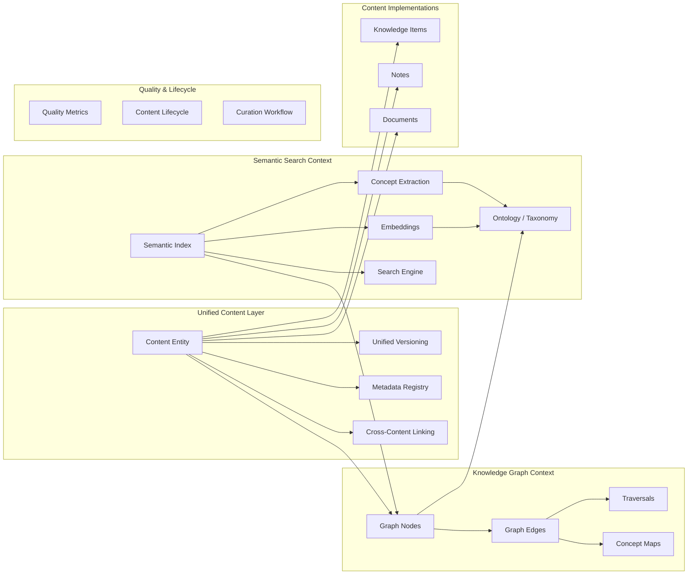

---

# **2.2 High-Level C4 System Context Diagram**

```mermaid
C4Context
    title Unified Knowledge Management Platform - System Context

    Person(user, "End User", "Creates, consumes, and discovers knowledge")
    Person(expert, "Subject Matter Expert", "Reviews content, provides expertise")
    Person(admin, "Administrator", "Manages compliance, metadata schemas, lifecycle")

    System(ukmp, "Unified Knowledge Management Platform", 
        "Unified content repository, semantic search, graph relations, lifecycle, curation, and workflow engine")

    System_Ext(ext_docs, "External Document Sources", "OneDrive, Google Drive, Shared Drives")
    System_Ext(ext_wiki, "External Wikis", "Confluence, Notion, SharePoint")
    System_Ext(ext_tasks, "External Project/Task Systems", "Jira, Azure DevOps, Asana")

    Rel(user, ukmp, "Creates content, searches, reads, contributes")
    Rel(expert, ukmp, "Reviews, validates, curates knowledge")
    Rel(admin, ukmp, "Defines metadata schemas, governs lifecycle")
    Rel(ukmp, ext_docs, "Imports documents, versions, metadata")
    Rel(ukmp, ext_wiki, "Syncs and indexes wiki pages")
    Rel(ukmp, ext_tasks, "Links content to tasks/projects")
```

---

# **2.3 Unified Platform Principles**

### **1. Unified Content Model**
All content types inherit from a single **ContentEntity** abstraction.

### **2. Semantic-first Architecture**
Every piece of content is indexed into:
- Embeddings  
- Concept graph  
- Metadata ontology  

### **3. Relationship-centric Knowledge**
The platform models:
- Hierarchies  
- Dependencies  
- Similarities  
- Contradictions  
- Cross-system references  

### **4. Lifecycle & Quality as Core Domains**
Knowledge health is monitored and acted upon automatically.

### **5. Extensible Metadata Strategy**
Schema-first metadata registry with validation and versioning.

### **6. DDD + Modular Micro-Architecture**
Each domain is clearly isolated but shares unified abstractions.

---

# **2.4 Platform Container Diagram (C4 Level 2)**

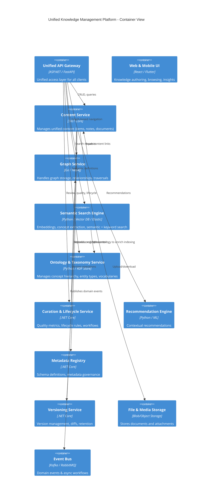

---

# **3. Unified Domain Architecture**

Part 2 introduces the **foundational domain model** upon which all other bounded contexts depend. These foundational domains form the *Shared Kernel* in DDD terms.

This part includes:

1. **Unified Content Model (Core Aggregate)**  
2. **Shared Value Objects**  
3. **Metadata Registry (Enhanced)**  
4. **Unified Versioning Architecture**  
5. **Cross-Content Linking Model**  
6. **Global Domain Invariants**

---

# **3.1 Unified Content Aggregate (ContentEntity)**  
The **ContentEntity** is the **root abstraction** unifying:

- Knowledge Items  
- Notes  
- Documents  
- External Content  
- AI-generated content  
- Synced content (wiki pages, integrations)  

Everything manageable or discoverable in the platform is a concrete subtype of **ContentEntity**.

---

## **3.1.1 Purpose**
To provide:

- Consistent versioning  
- Consistent metadata  
- Consistent security & ownership  
- Standard tags & categories  
- Standard indexing contract  
- Standard lifecycle behavior  
- Standard relationship structure  
- Standard event schema  

---

## **3.1.2 Unified Content Model (UML)**

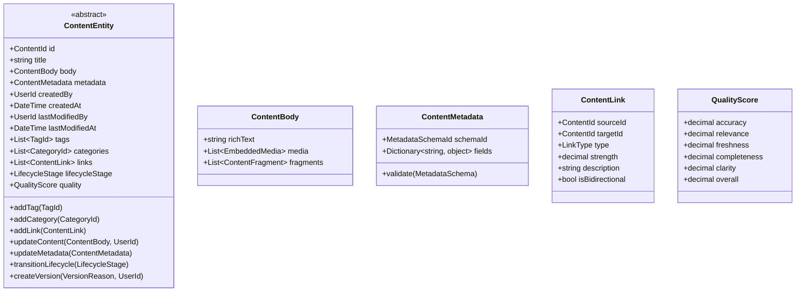

---

## **3.1.3 Key Behaviors**
All content types share:

### **Unified creation flow**
- ​ContentEntity created  
- Version 1 generated  
- Metadata validated  
- Events published  
- Search indexing triggered  
- Graph node created  

### **Unified update flow**
- Automatically produces a new version  
- Metadata revalidated  
- Graph relations re-evaluated (if any)  
- Semantic index updated  
- Quality recalculated  

### **Unified deletion behavior**
- Logically deleted  
- Relationships pruned  
- Search index deactivated  
- Lifecycle moved to Archived  

---

# **3.2 Shared Value Objects**
These value objects are cross-domain and shared across aggregates.

---

## **3.2.1 Identification Value Objects**
- **ContentId**  
- **UserId**  
- **TagId**  
- **CategoryId**  
- **VersionId**  
- **LinkId**  
- **ExternalReferenceId**  
- **MetadataSchemaId**  

Each is a **strict VO guaranteeing format and identity consistency**.

---

## **3.2.2 Content-Specific Value Objects**
### **ContentBody**
Represents the structured rich content, combining:

- Rich text  
- Markdown/HTML  
- Embedded files  
- AI summaries  
- Structured fragments  
- Semantic annotations  

### **ContentFragment**
Supports:
- Code blocks  
- Tables  
- Checklists  
- Transcriptions  
- Inline sub-documents  

---

## **3.2.3 Linking Value Objects**
### **ContentLink**
Represents relationships across content types.

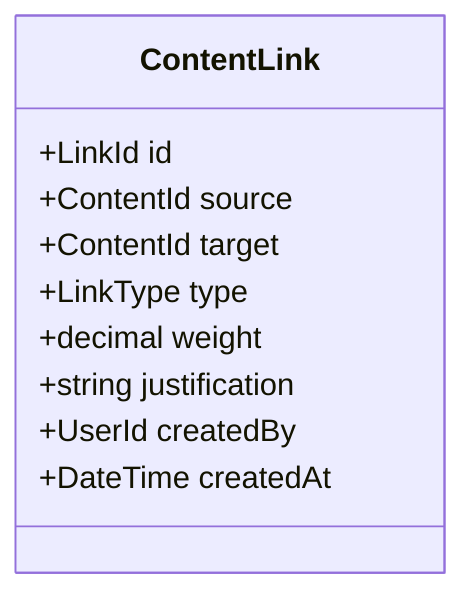

### **LinkType (enum)**
- References  
- Extends  
- RelatesTo  
- DependsOn  
- Contradicts  
- Supports  
- AlternativeTo  
- Cites  
- SystemSuggested  
- UserCurated  

---

## **3.2.4 Quality Score Value Object**
Unified **QualityScore** across the platform:

- Accuracy  
- Relevance  
- Completeness  
- Freshness  
- Clarity  
- Overall score  

All derived using a **Quality Assessment Policy**.

---

# **3.3 Metadata Registry (Unified Metadata Architecture)**

### Why this matters:
Previously, metadata was scattered.  
Now, metadata is centrally governed.

---

## **3.3.1 Metadata Schema Domain Model**

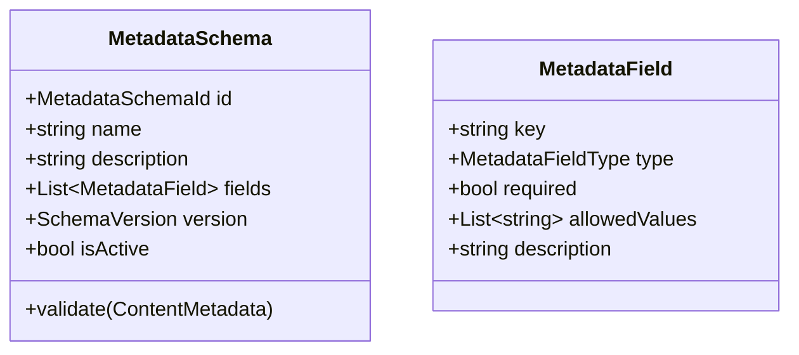

---

## **3.3.2 Metadata Field Types**
- Text  
- Number  
- Enum  
- MultiSelect  
- Url  
- HierarchyReference  
- UserReference  
- Date  
- JSON Schema  

---

## **3.3.3 Metadata Validation**
Runs during:

- Content creation  
- Content updates  
- Version creation  
- Workflow gating  
- Curation evaluation  

Invalid metadata blocks updates.

---

# **3.4 Unified Versioning Architecture**

Every content type uses one consistent versioning model.

---

## **3.4.1 Version Aggregate Root**
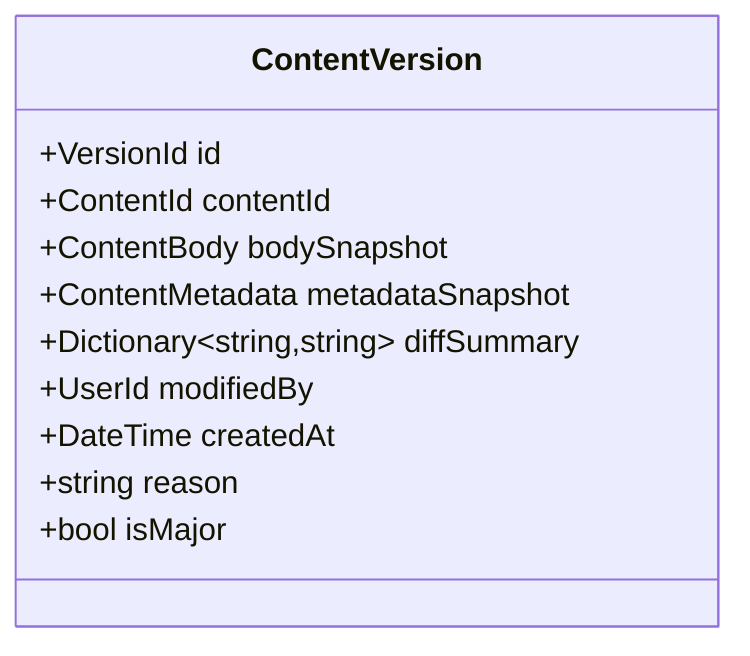

---

## **3.4.2 Versioning Rules**
1. All updates create a version  
2. Large changes create **major versions**  
3. Minor updates create **patch versions**  
4. Diff snapshots stored  
5. Old versions can be restored  
6. Version retention policy is configurable  
7. Version-level integrity is guaranteed by hashing  

---

# **3.5 Cross-Content Linking Model**

This is central to the platform’s knowledge graph.

---

## **3.5.1 Universal Linking Domain**
All content types support incoming/outgoing links.

### **Link Resolution Rules**
- Bidirectionality must be consistent  
- Circular dependency checks  
- Contradiction resolution policies  
- Strength calculation formulas  
- Expiration for system-generated suggestions  

---

## **3.5.2 Cross-Content Linking Diagram**

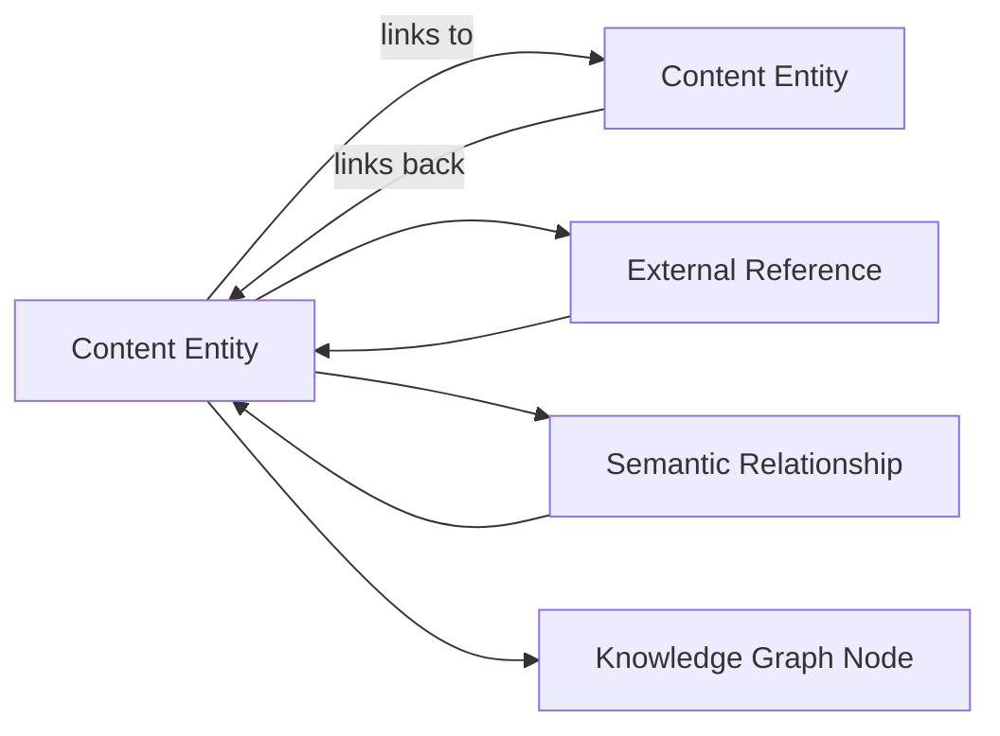

---

# **3.6 Global Domain Invariants**

### 1. **Every content object must have:**
- Title  
- Body  
- Metadata based on schema  
- Owner  
- Version history  

---

### 2. **Every update creates a new version.**

---

### 3. **Relationships must follow graph rules.**

- No broken references  
- No illegal circular edges (depends on type)  
- Contradictions require justification  

---

### 4. **Semantic indexing must be up-to-date.**

---

### 5. **Quality must be recalculated after relevant changes.**

---

### 6. **Lifecycle transitions must follow policy rules.**

---

### 7. **Metadata must match the active schema.**

---

# **4. Knowledge Graph Context**

The **Knowledge Graph Context** is one of the most critical and powerful elements of the unified platform. It transforms the platform from a simple repository of documents into a **semantic, interconnected, relationship-driven knowledge network** capable of:

- Semantic inference  
- Discovery  
- Relationship-based navigation  
- Reasoning  
- Concept extraction  
- Topic clustering  
- Graph-based recommendations  
- Content gap detection  

This context integrates tightly with:

- The Unified Content Model  
- Semantic Search  
- Ontology / Taxonomy  
- Curation & Quality  
- Recommendation Engine  
- Metadata Registry  
- Versioning  
- Cross-Content Linking  

---

# **4.1 Purpose of the Knowledge Graph Context**

The Knowledge Graph Context is responsible for:

### ✔ Representing all content as graph nodes  
(Knowledge Items, Notes, Documents, External Content, Concepts)

### ✔ Modeling all relationships as edges  
(Content links, semantic relations, dependency chains, references)

### ✔ Enforcing graph-level invariants  
(Acyclic rules for hierarchical relationships, bidirectionality, contradiction detection)

### ✔ Providing traversal services  
(Depth-limited, constraint-based, similarity traversal)

### ✔ Generating and maintaining Concept Maps  
(Visualizable knowledge structures)

### ✔ Supporting semantic search with graph signals  
(Graph boosts, relationship-aware ranking)

### ✔ Powering contextual recommendations  
(By analyzing user behavior in graph space)

---

# **4.2 Knowledge Graph Context Overview (C4 Container Diagram)**

```mermaid
C4Container
    title Knowledge Graph Context - Container View

    Container(graph_api, "Graph API", "ASP.NET Core / gRPC",
        "Receives graph queries, manages nodes/edges, validates relationships")

    Container(graph_store, "Graph Database", "Neo4j / ArangoDB",
        "Stores graph nodes, edges, indexes, and traversal structures")

    Container(graph_worker, "Graph Processing Worker", "Go / Python",
        "Processes asynchronous graph updates, recomputes metrics, runs inference")

    Container(semantic_svc, "Semantic Search Service", "Python",
        "Provides embeddings and concept labels")

    Container(ontology_svc, "Ontology Service", "Python",
        "Provides concept hierarchy and entity type rules")

    Container(content_svc, "Content Service", ".NET",
        "Publishes content events and links")

    Container(event_bus, "Event Bus", "Kafka/RabbitMQ",
        "Graph update events")

    Rel(content_svc, graph_api, "Publishes content link events")
    Rel(graph_api, graph_store, "CRUD operations on graph")
    Rel(graph_worker, graph_store, "Batch graph operations")
    Rel(graph_worker, ontology_svc, "Reads concept mapping rules")
    Rel(graph_worker, semantic_svc, "Uses embeddings for similarity edges")
    Rel(graph_api, event_bus, "Publishes/consumes graph events")
```

---

# **4.3 Domain Model of the Knowledge Graph Context**

This domain introduces several new aggregates and value objects.

---

## **4.3.1 Core Aggregates**

### **1. GraphNode (Aggregate Root)**  
Represents one entity in the graph.

Types of nodes:

- Content Nodes (Knowledge Item, Note, Document)  
- Concept Nodes  
- Category Nodes  
- External Entity Nodes (Projects, Tickets, Wiki Pages)  
- User Nodes (optional for behavioral graphs)

---

### **GraphNode UML Model**

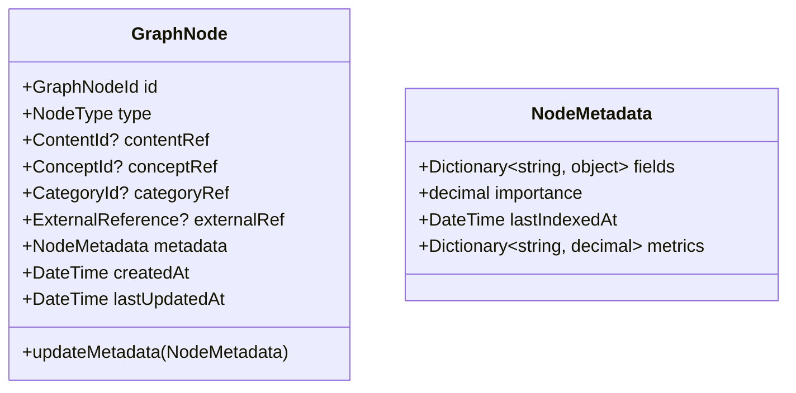

---

### **2. GraphEdge (Aggregate Root)**  
Represents relationships between nodes.

### **GraphEdge UML Model**

```mermaid
classDiagram
    class GraphEdge {
        +GraphEdgeId id
        +GraphNodeId source
        +GraphNodeId target
        +EdgeType type
        +decimal weight
        +string? reason
        +bool bidirectional
        +UserId? createdBy
        +DateTime createdAt
    }

    enum EdgeType {
        RELATED_TO
        REFERENCES
        DEPENDS_ON
        CONTRADICTS
        SUPPORTS
        SIMILAR_TO
        TAGGED_WITH
        BELONGS_TO
        CHILD_OF
        PARENT_OF
        CITES
        CAUSED_BY
        INFERRED_SEMANTIC
        SYSTEM_SUGGESTED
    }
```

---

### **3. ConceptMap (Aggregate Root)**  
Represents a computed or user-created visualization of sections of the graph.

```mermaid
classDiagram
    class ConceptMap {
        +ConceptMapId id
        +string name
        +UserId createdBy
        +List~GraphNodeId~ nodes
        +List~GraphEdgeId~ edges
        +ConceptMapLayout layout
        +ConceptMapType type
        +DateTime generatedAt
        +regenerate()
    }

    class ConceptMapLayout {
        +Dictionary~GraphNodeId, Position~ positions
        +Dictionary~GraphEdgeId, CurvePoints~ lines
    }

    enum ConceptMapType {
        GENERATED
        USER_DEFINED
        FILTERED
    }
```

---

# **4.4 Graph Operations & Domain Services**

## **4.4.1 GraphDomainService**
Provides core graph operations:

- Add/remove node  
- Add/remove edge  
- Validate edge  
- Update node metadata  
- Path discovery (shortest path)  
- Graph traversal (depth-first, breadth-first, hybrid)  
- Semantic similarity expansion  
- Category hierarchy traversal  

---

### **Graph Traversal Policy Example**

```csharp
public interface IGraphTraversalService {
    Task<List<GraphNodeId>> Traverse(
        GraphNodeId startNode,
        int maxDepth,
        TraversalConstraint constraints);
}
```

**Constraints include:**

- Max edge count  
- Edge types allowed  
- Node types allowed  
- Avoiding cycles  
- Avoiding specific nodes  
- Semantic weight thresholds  

---

## **4.4.2 GraphInferenceService**
Responsible for:

- Adding **SIMILAR_TO** edges based on embeddings  
- Enhancing graph with **ontology-based inferred edges**  
- Detecting contradictions  
- Identifying knowledge gaps  
- Computing centrality metrics (PageRank, betweenness)  

---

### **Inference Example Rules**
1. If two nodes have cosine similarity > 0.87 → add **SIMILAR_TO** edge  
2. If content contradicts another → add **CONTRADICTS**  
3. If graph forms a hierarchy → enforce **PARENT/CHILD** consistency  
4. If ontology says:  
   _“Every Concept X implies Concept Y”_  
   then add **INFERRED_SEMANTIC** edges  

---

# **4.5 Graph Events**

Graph context reacts to many events from other bounded contexts.

## **Graph Events Consumed**
- `ContentCreated`
- `ContentUpdated`
- `ContentDeleted`
- `ContentLinked`
- `ContentUnlinked`
- `TagAssigned`
- `CategoryAssigned`
- `ConceptExtracted`
- `EmbeddingGenerated`

## **Graph Events Published**
- `GraphNodeCreated`
- `GraphNodeUpdated`
- `GraphEdgeCreated`
- `GraphEdgeUpdated`
- `GraphEdgeDeleted`
- `ConceptMapGenerated`

---

# **4.6 Graph Domain Policies**

### **4.6.1 Relationship Integrity Policy**
For hierarchies (e.g., PARENT_OF), require acyclic structure.

### **4.6.2 Semantic Drift Policy**
If content’s embedding changes significantly (>0.1 cosine distance):

- Recompute similar edges  
- Trigger reindex  
- Trigger curation task  

### **4.6.3 Contradiction Policy**
Contradicting edges require explanation and reviewer approval.

---

# **4.7 Graph Indexing Strategy**

To optimize performance:

- Node label indexes  
- Relationship type indexes  
- Multiplexed graph projections  
- Precomputed query paths  
- Materialized semantic clusters  
- Incremental rebuild strategy  

---

# **4.8 Knowledge Graph: High-Level Flow**

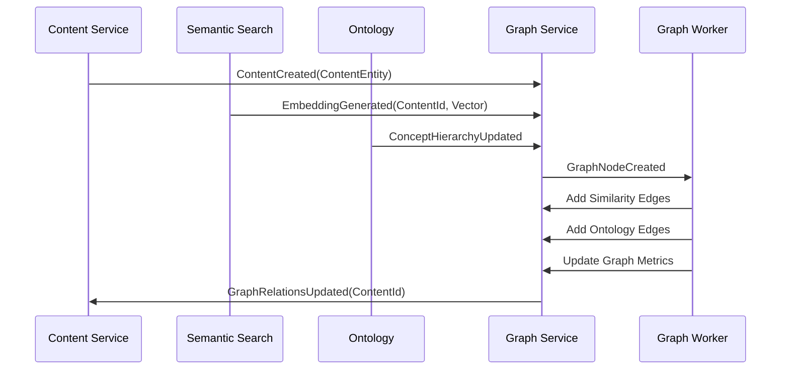

---

# **4.9 Integration With Other Contexts**

### **Semantic Search ↔ Knowledge Graph**
- Adds semantic edges  
- Boosts search ranking  
- Supplies concepts  

### **Ontology ↔ Knowledge Graph**
- Hierarchical reasoning  
- Synonym expansion  
- Concept inference  

### **Curation & Quality ↔ Knowledge Graph**
- Surface clusters for review  
- Identify outdated content clusters  

### **Recommendation Engine ↔ Knowledge Graph**
- Graph traversal for recommendation panes  
- Behavior-influenced ranking  

---

# **4.10 Knowledge Graph Invariants**

1. Every ContentEntity has a corresponding GraphNode  
2. Every link in ContentEntity produces a GraphEdge  
3. Hierarchies must be acyclic  
4. Contradictions require explicit justification  
5. Semantic similarity edges must have valid embeddings  
6. Concept maps must reflect real graph topology  

---

# **5. Semantic Search Context**

The **Semantic Search Context** is a core domain in the Unified Platform. It provides:

### ✔ Hybrid semantic + keyword search  
### ✔ Embedding generation & storage  
### ✔ Concept extraction & enrichment  
### ✔ Query intent detection  
### ✔ Personalized ranking  
### ✔ Graph-enhanced relevance scoring  
### ✔ Multi-source indexing (content, external systems, concepts)  
### ✔ Search analytics & behavioral feedback loops  

This context integrates deeply with:

- **Unified Content Model**
- **Knowledge Graph Context**
- **Ontology & Taxonomy**
- **Metadata Registry**
- **Recommendation Engine**
- **Lifecycle & Quality Signals**

---

# **5.1 Purpose of Semantic Search**

Semantic Search transforms how users discover and understand knowledge by enabling:

- Natural language queries  
- Concept-based retrieval  
- Contextual navigation  
- Semantic clustering  
- Synonym/alias expansion  
- Graph-aware ranking  
- Personalized knowledge discovery  

---

# **5.2 High-Level Architecture (C4 Container Diagram)**

```mermaid
C4Container
    title Semantic Search Context - Container View

    Container(search_api, "Search API", "ASP.NET Core / FastAPI",
        "Handles semantic, hybrid, and personalized search queries")

    Container(embedding_svc, "Embedding Service", "Python + OpenAI/SBERT",
        "Generates embeddings for content and queries")

    Container(index_store, "Semantic Index Store", "Vector DB (Milvus/Pinecone)",
        "Stores embeddings, concept annotations, metadata")

    Container(text_index, "Keyword Index", "Elasticsearch",
        "Full-text search, filters, sorting, keyword relevance")

    Container(concept_svc, "Concept Extraction Engine", "Python NLP + ML",
        "Extracts entities/concepts from content")

    Container(ontology_svc, "Ontology Service", "RDF Store",
        "Provides hierarchical structure of concepts")

    Container(graph_svc, "Knowledge Graph Service", "Neo4j",
        "Graph-based relevance and relationship scoring")

    Container(event_bus, "Event Bus", "Kafka/RabbitMQ")

    Container(content_svc, "Content Service", ".NET",
        "Publishes content lifecycle events")

    Rel(content_svc, search_api, "Triggers indexing")
    Rel(search_api, embedding_svc, "Get embeddings")
    Rel(search_api, text_index, "Keyword search")
    Rel(search_api, index_store, "Vector search")
    Rel(search_api, graph_svc, "Graph-aware ranking")
    Rel(search_api, ontology_svc, "Use concept hierarchies")
    Rel(content_svc, event_bus, "ContentUpdated, ContentCreated")
    Rel(event_bus, search_api, "Reindexing events")
```

---

# **5.3 Domain Model Overview**

Semantic Search domain includes:

- **SemanticIndexEntry (aggregate root)**  
- **Embedding (value object)**  
- **ConceptDefinition (aggregate root)**  
- **KeywordIndexEntry (read model)**  
- **SearchQuery (aggregate root)**  
- **SearchResult (value object)**  
- **PersonalizationProfile (aggregate root)**  

---

# **5.4 SemanticIndexEntry Aggregate**

## **5.4.1 UML Model**

```mermaid
classDiagram
    class SemanticIndexEntry {
        +IndexEntryId id
        +ContentId contentId
        +string title
        +string plainText
        +Embedding embedding
        +List~ConceptTag~ concepts
        +List~MetadataFieldValue~ metadata
        +DateTime indexedAt
        +DateTime updatedAt
        +IndexStatus status
        +updateEmbedding(Embedding)
        +addConcept(ConceptTag)
        +markStale()
    }

    class Embedding {
        +float[] vector
        +string model
        +int dimensions
        +DateTime generatedAt
    }

    enum IndexStatus {
        INDEXED
        STALE
        FAILED
        PENDING
    }
```

---

# **5.5 ConceptDefinition Aggregate**

Represents AI-extracted and human-defined concepts.

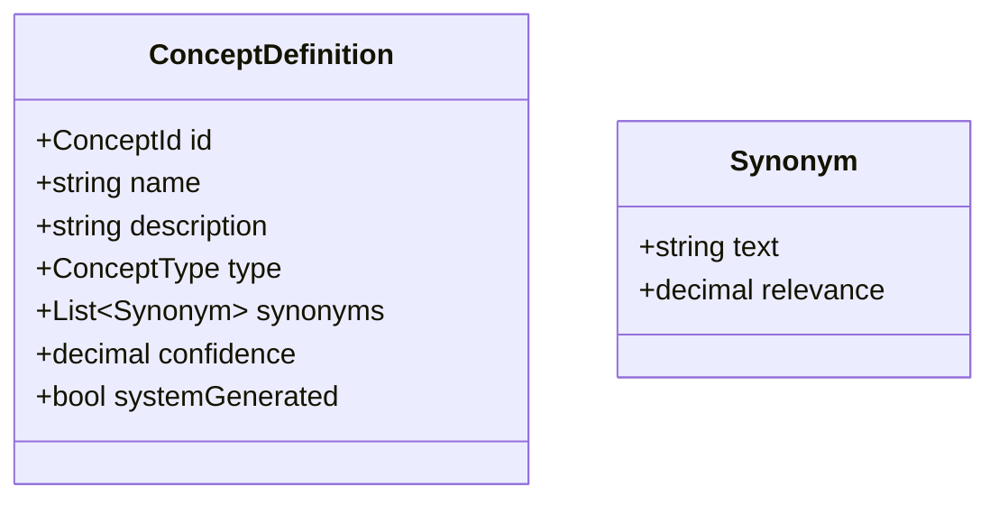

Concept definitions integrate with the **Ontology** and feed into:

- Search relevance  
- Concept clustering  
- Knowledge graph reasoning  

---

# **5.6 SearchQuery Aggregate**

```mermaid
classDiagram
    class SearchQuery {
        +QueryId id
        +string queryText
        +Embedding queryEmbedding
        +QueryIntent intent
        +List~SearchFilter~ filters
        +List~SearchOperator~ operators
        +UserId? userId
        +DateTime executedAt
    }

    enum QueryIntent {
        INFORMATIONAL
        NAVIGATIONAL
        TASK_ORIENTED
        DIAGNOSTIC
        COMPARATIVE
    }
```

---

# **5.7 Search Ranking Model**

Ranking combines **6 independent signals**:

## **1. Vector similarity score**
Cosine similarity of embeddings.

## **2. Keyword score**
BM25 / TF-IDF / exact match proximity.

## **3. Concept match score**
Match between extracted concepts and user query intent.

## **4. Graph relevance score**
Graph features:

- Node centrality  
- Degree strength  
- Relationship distance from query context  
- Knowledge cluster relevance  

## **5. Metadata match**
Field-based ranking:

- Author  
- Category  
- Domain  
- Content type  

## **6. Personalization**
- User topic interest  
- User content consumption patterns  
- Past search behavior  
- Expertise areas  

---

# **5.8 Hybrid Search Pipeline (Sequence Diagram)**

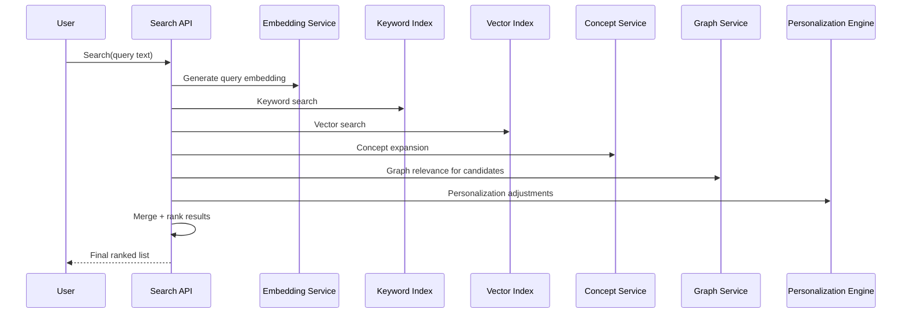

---

# **5.9 Indexing Workflow**

### Triggered on:
- ContentCreated  
- ContentUpdated  
- MetadataUpdated  
- VersionCreated  
- RelationshipUpdated  

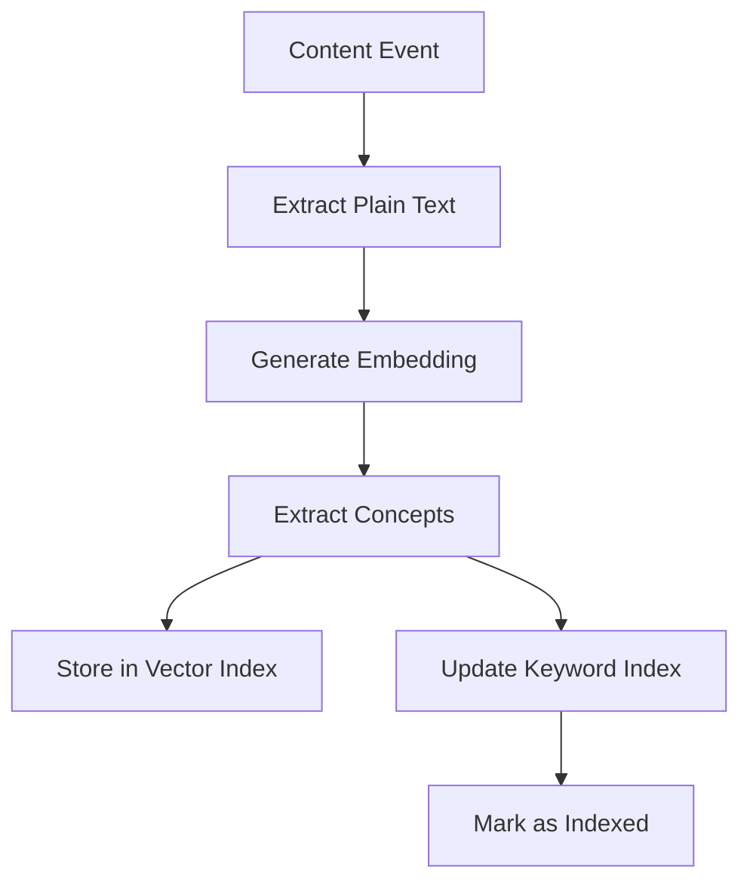

---

# **5.10 Commands**

### **IndexContent**
```csharp
public record IndexContent(
    ContentId ContentId,
    string Title,
    string PlainText,
    ContentMetadata Metadata,
    DateTime UpdatedAt
);
```

### **UpdateSemanticIndex**
```csharp
public record UpdateSemanticIndex(
    IndexEntryId IndexEntryId,
    string UpdatedText,
    Dictionary<string, object> UpdatedMetadata
);
```

### **RemoveFromIndex**
```csharp
public record RemoveFromIndex(ContentId ContentId);
```

### **DefineConcept**
```csharp
public record DefineConcept(string Name, string Description, ConceptType Type);
```

---

# **5.11 Queries**

### **Hybrid Search**
```csharp
public record HybridSearch(
    string QueryText,
    UserId? UserId,
    List<SearchFilter> Filters,
    int Limit
);
```

### **Semantic Suggest**
```csharp
public record SemanticSuggest(
    string PartialText,
    int Limit
);
```

### **Concept Expand**
```csharp
public record ExpandConcept(string Name, int MaxDepth);
```

---

# **5.12 Semantic Search Events**

### Published:
- `ContentIndexed`
- `SemanticIndexUpdated`
- `IndexEntryStale`
- `ConceptExtracted`
- `SearchPerformed`

### Consumed:
- `ContentUpdated`
- `ContentCreated`
- `MetadataChanged`
- `QualityUpdated`
- `GraphRelationsUpdated`
- `OntologyUpdated`

---

# **5.13 Semantic Search Policies**

### **5.13.1 Indexing Policy**

- Minimum text length  
- Quality score threshold  
- Skip drafts if configured  
- Reindex after X days  
- Reindex on major version update  

### **5.13.2 Ranking Policy**

Ranking formula:

```
final_score = 
    (vectorScore * 0.45) +
    (keywordScore * 0.20) +
    (conceptScore * 0.15) +
    (graphScore * 0.10) +
    (personalizationScore * 0.10)
```

Adjustable per organization.

---

# **5.14 Semantic Search Invariants**

1. Every indexed content must have an embedding  
2. Every indexed content must have plain text  
3. Concept extraction must run before indexing completion  
4. Embedding model must be versioned  
5. Embeddings older than threshold mark entry stale  
6. Index entry must map to valid content  
7. Deleted content must be removed from both keyword & vector indexes  

---

# **5.15 Integration With Other Contexts**

### With Knowledge Graph  
- Adds **SIMILAR_TO** edges  
- Enhances search ranking via graph centrality  

### With Ontology  
- Concept expansion  
- Category-based boosting  

### With Content Lifecycle  
- Low-quality or archived content is down-ranked  

### With Behavioral Analytics  
- Click feedback loops  
- Engagement-based ranking adjustments  

---

# **6. Ontology & Taxonomy Context**

The **Ontology & Taxonomy Context** provides the **semantic foundation** of the entire platform.  
It defines *what things are*, *how they relate*, and *how knowledge is semantically organized*, enabling:

- Advanced semantic search  
- Concept-based knowledge navigation  
- Automatic content classification  
- Inference and reasoning  
- Terminology consistency  
- Cross-domain interoperability  
- Enterprise knowledge governance  

---

# **6.1 Purpose of the Ontology Context**

### ✔ Provides a formal, structured representation of organizational concepts  
### ✔ Defines hierarchies, synonyms, aliases, and semantic relations  
### ✔ Enables reasoning and inference in the Knowledge Graph  
### ✔ Enhances semantic search via concept expansion and disambiguation  
### ✔ Allows automated tagging and classification  
### ✔ Serves as a schema for metadata and content classification  
### ✔ Supports versioning, auditing, and governance of domain concepts  

---

# **6.2 Ontology Layered Architecture**

The Ontology Context consists of **four semantic layers**:

### **1. Core Concepts Layer**
The fundamental taxonomy of domains, topics, and knowledge types.

### **2. Semantic Relations Layer**
Relationships between concepts (is-a, part-of, similar-to, influences, etc.).

### **3. Lexical Layer**  
Synonyms, aliases, abbreviations, alternative spellings.

### **4. Inference Layer**
Rules that enable semantic reasoning, such as:

- Concept implication  
- Category inheritance  
- Subsumption  
- Disjoint relationships  
- Domain/property constraints  

---

# **6.3 C4 Container Diagram — Ontology Context**

```mermaid
C4Container
    title Ontology & Taxonomy Service - Container View

    Container(ontology_api, "Ontology API", "Python / RDFLib / FastAPI",
        "Provides concept definitions, hierarchies, and semantic relations")

    Container(ontology_store, "Ontology Store", "RDF Triple Store / Graph DB",
        "Stores ontology triples, schema definitions, and inference rules")

    Container(taxonomy_manager, "Taxonomy Manager", "Web UI",
        "Allows experts to edit, version, and govern ontologies")

    Container(concept_extraction, "Concept Extraction Engine", "NLP / ML",
        "Extracts potential concepts from content")

    Container(search_svc, "Semantic Search", "Python / Milvus",
        "Uses ontology for query expansion and semantic ranking")

    Container(graph_svc, "Knowledge Graph", "Neo4j",
        "Uses ontology to classify graph nodes and infer relationships")

    Container(metadata_svc, "Metadata Registry", ".NET",
        "Defines metadata schemas referencing ontology concepts")

    Rel(ontology_api, ontology_store, "Load/Store Ontology")
    Rel(concept_extraction, ontology_api, "Retrieve concept definitions")
    Rel(search_svc, ontology_api, "Semantic expansion, disambiguation")
    Rel(graph_svc, ontology_api, "Concept-based reasoning")
    Rel(metadata_svc, ontology_api, "Metadata validation rules")
```

---

# **6.4 Ontology Domain Model**

## **6.4.1 ConceptDefinition Aggregate**

```mermaid
classDiagram
    class ConceptDefinition {
        +ConceptId id
        +string name
        +string description
        +ConceptType type
        +List~Synonym~ synonyms
        +List~ConceptRelation~ relations
        +decimal confidence
        +bool systemGenerated
        +OntologyVersion version
        +addRelation(ConceptRelation)
        +addSynonym(Synonym)
    }

    class Synonym {
        +string text
        +SynonymType type
        +decimal weight
    }

    class ConceptRelation {
        +ConceptId source
        +ConceptId target
        +SemanticRelationType type
        +decimal strength
    }
```

---

## **6.4.2 Semantic Relation Types**

### **Hierarchical**
- **IS_A**  
- **SUBCLASS_OF**  
- **PART_OF**  
- **CONTAINS**  

### **Equivalence & Similarity**
- **SYNONYM_OF**  
- **ALIAS_OF**  
- **SIMILAR_TO**  

### **Property / Attribute**
- **HAS_PROPERTY**  
- **HAS_ATTRIBUTE**  

### **Causal**
- **AFFECTS**  
- **INFLUENCES**  
- **CAUSES**  

### **Logical**
- **IMPLIES**  
- **CONTRADICTS**  
- **DISJOINT_WITH**  

These relationships are imported into the **Knowledge Graph** during inference.

---

# **6.5 Taxonomy Model**

Taxonomies are simpler hierarchical structures, used by:

- Content categorization  
- Metadata validation  
- Semantic search facets  
- Knowledge Graph clustering  

```mermaid
classDiagram
    class Taxonomy {
        +TaxonomyId id
        +string name
        +string description
        +List~TaxonomyNode~ nodes
    }

    class TaxonomyNode {
        +TaxonomyNodeId id
        +string label
        +TaxonomyNodeId? parent
        +List~TaxonomyNode~ children
        +ConceptId? mappedConcept
    }
```

---

# **6.6 Ontology Inference Rules**

Ontology drives reasoning in Knowledge Graph:

### **Rule 1: Hierarchy Inference**
If A IS_A B and B IS_A C  
→ Then A IS_A C  

### **Rule 2: Synonym Expansion**
If X SYNONYM_OF Y  
→ Queries for X should retrieve content tagged with Y  

### **Rule 3: Concept Implication**
If A IMPLIES B  
→ Content tagged with A is indirectly relevant to queries for B  

### **Rule 4: Contradiction Detection**
If A CONTRADICTS B  
→ Mark contradictory edges in Knowledge Graph  

### **Rule 5: Disjointness**
If X DISJOINT_WITH Y  
→ A content item cannot be tagged with both X and Y  

---

# **6.7 Ontology Governance & Versioning**

Ontology follows strict governance because it defines enterprise semantics.

## **Governance Components**
- **Ontology Board** (subject matter experts)  
- **Change Requests** (proposing new concepts or modifications)  
- **Review Workflow**  
- **Approval Workflow**  
- **Versioning**  

## **OntologyVersion (Value Object)**

```mermaid
classDiagram
    class OntologyVersion {
        +string major
        +string minor
        +DateTime releasedAt
        +string changelog
    }
```

---

# **6.8 Interaction With Other Bounded Contexts**

### **Semantic Search**
- Concept expansion  
- Disambiguation of user queries  
- Ranking signals  

### **Knowledge Graph**
- Creates inferred edges  
- Maps nodes to concept hierarchy  
- Provides rules for relationship validation  

### **Metadata Registry**
- Metadata fields reference concepts  

### **Content Lifecycle**
- Identifies outdated or misaligned concepts  
- Helps detect content that needs curation  

---

# **6.9 Ontology Commands**

### **DefineNewConcept**
```csharp
public record DefineNewConcept(
    string Name,
    string Description,
    ConceptType Type,
    List<string> Synonyms,
    UserId CreatedBy
);
```

### **AddConceptRelation**
```csharp
public record AddConceptRelation(
    ConceptId Source,
    ConceptId Target,
    SemanticRelationType Type,
    decimal Strength
);
```

### **ProposeOntologyChange**
```csharp
public record ProposeOntologyChange(
    string ProposedChange,
    UserId RequestedBy
);
```

---

# **6.10 Ontology Queries**

### **GetConceptByName**
### **ListConceptRelations**
### **GetOntologyVersion**
### **GetTaxonomyTree**
### **SearchConcepts**

---

# **6.11 Ontology Events**

### Published:
- `ConceptDefined`
- `OntologyUpdated`
- `OntologyVersionReleased`
- `ConceptRelationAdded`
- `ConceptDeprecated`

### Consumed:
- `ContentIndexed`
- `ConceptExtracted`
- `GraphNodeCreated`

---

# **6.12 Ontology Invariants**

1. Concept names must be globally unique  
2. Synonyms cannot overlap with other concept names  
3. Hierarchies must remain acyclic  
4. Disjoint concepts cannot co-exist on the same content  
5. Ontology version updates must be atomic  
6. All relations must reference valid concept nodes  

---

# **6.13 Ontology & Taxonomy Visual Overview**

```mermaid
flowchart LR
    subgraph Ontology
        A[ConceptDefinition] --> B[Hierarchy]
        A --> C[Synonyms]
        A --> D[Semantic Relations]
    end

    subgraph Taxonomy
        X[Taxonomy] --> Y[Taxonomy Nodes]
        Y --> Z[Concept Mapping]
    end

    Ontology -->|Maps to| Taxonomy
    Taxonomy -->|Used for| MetadataRegistry
    Ontology -->|Supports inference| KnowledgeGraph
    Ontology -->|Expands queries| SemanticSearch
```

---

# **7. Unified Versioning & Provenance Context**

The **Versioning & Provenance Context** provides consistent, enterprise-grade version control across all content types:

- Knowledge Items  
- Notes  
- Documents  
- External imported content  
- AI-generated or AI-augmented content  

It ensures:

- Complete version history  
- Reproducibility  
- Integrity  
- Content diffing  
- Governance & audit  
- Rollback capabilities  
- Metadata versioning  
- Provenance tracking  
- Cross-bounded context consistency  

This context centralizes versioning logic, removing duplication across all other bounded contexts.

---

# **7.1 Purpose of the Versioning Context**

### ✔ Provides a unified versioning model across all content  
### ✔ Maintains snapshots of content and metadata  
### ✔ Ensures every update creates an audit-safe version  
### ✔ Supports major/minor versioning  
### ✔ Enables rollback & recovery  
### ✔ Tracks provenance (origin chain)  
### ✔ Ensures compliance with retention rules  
### ✔ Integrates with search, curation, and graph updates  

---

# **7.2 High-Level Architecture (C4 Container Diagram)**

```mermaid
C4Container
    title Unified Versioning & Provenance Context - Container View

    Container(versioning_api, "Versioning API", ".NET / gRPC",
        "Creates and retrieves versions, manages provenance")

    Container(version_store, "Version Store", "SQL / Document Store",
        "Stores version snapshots and diffs")

    Container(diff_engine, "Diff Engine", "Python / Go",
        "Generates structural text diffs and fragment-level comparisons")

    Container(provenance_tracker, "Provenance Service", ".NET",
        "Tracks content origin, lineage, imports, AI transformations")

    Container(content_svc, "Content Service", ".NET",
        "Sends versioning events")

    Container(search_svc, "Semantic Search", "Python",
        "Triggers re-indexing on version changes")

    Container(graph_svc, "Knowledge Graph", "Neo4j",
        "Updates graph nodes and edges when versions change")

    Container(event_bus, "Event Bus", "Kafka/RabbitMQ")

    Rel(content_svc, versioning_api, "CreateVersion")
    Rel(versioning_api, version_store, "Persist version data")
    Rel(versioning_api, diff_engine, "Compute diffs")
    Rel(versioning_api, provenance_tracker, "Update provenance chain")
    Rel(versioning_api, event_bus, "Publish VersionCreated")
    Rel(event_bus, search_svc, "Trigger reindex")
    Rel(event_bus, graph_svc, "Trigger node update")
```

---

# **7.3 Unified Version Aggregate**

## **7.3.1 UML Model**

```mermaid
classDiagram
    class ContentVersion {
        +VersionId id
        +ContentId contentId
        +int major
        +int minor
        +ContentSnapshot snapshot
        +VersionDiff diff
        +VersionReason reason
        +UserId createdBy
        +DateTime createdAt
        +bool isRestorable
        +string integrityHash
        +provenanceChain provenance
    }

    class ContentSnapshot {
        +string title
        +ContentBody body
        +ContentMetadata metadata
        +LifecycleStage lifecycleStage
        +QualityScore qualitySnapshot
    }

    class VersionDiff {
        +Dictionary~string,string~ changes
        +decimal changeMagnitude
    }

    class provenanceChain {
        +List~ProvenanceEvent~ history
    }

    class ProvenanceEvent {
        +ProvenanceType type
        +string description
        +DateTime timestamp
        +UserId? actor
        +ExternalReference? source
    }
```

---

# **7.4 Version Numbering Rules**

### **Major version increments on:**
- Significant content rewrite  
- Structural change in body  
- Metadata schema change  
- Lifecycle transition (Draft → Published)  
- AI regeneration event  
- Bulk content replacement  
- Concept or ontology semantic reclassification  

### **Minor version increments on:**
- Small wording updates  
- Metadata value changes  
- Grammar fixes  
- Layout adjustments  
- Category/tag updates  

---

# **7.5 Version Integrity & Hashing**

Every version carries an integrity hash verifying:

- Title  
- Body  
- Metadata  
- Lifecycle stage  
- Quality snapshot  

### Hash rules:
```
SHA-256(
    title +
    body.richText +
    serializedMetadata +
    lifecycleStage +
    quality.overall
)
```

If integrity deviates, content is flagged for compliance review.

---

# **7.6 Diff Computation**

The **Diff Engine** computes:

### **1. Textual diffs**
- Paragraph-level  
- Sentence-level  
- Token-level  

### **2. Fragment diffs**
- Code block diffs  
- Table diffs  
- Embedded file diffs  

### **3. Metadata diffs**
- Changed fields  
- Removed fields  
- Schema mismatch detection  

### **4. Semantic diffs**
- Changes in concepts  
- Ontology changes  
- Embedding drift  

---

# **7.7 Provenance Chain Model**

The provenance system explains:

### ✔ Where content came from  
### ✔ How it changed over time  
### ✔ Who modified it  
### ✔ Which processes or systems influenced it  

---

## **7.7.1 Provenance Types**

- **USER_CREATED**  
- **USER_EDITED**  
- **IMPORTED** (from external systems)  
- **AI_GENERATED**  
- **AI_ASSISTED_EDIT**  
- **MERGED_VERSION**  
- **RESTORED_VERSION**  
- **ONTOLOGY_UPDATED**  
- **CURATION_ADJUSTMENT**  
- **AUTOMATED_METADATA_UPDATE**  

---

# **7.8 Commands**

### **CreateVersion**
```csharp
public record CreateVersion(
    ContentId ContentId,
    VersionReason Reason,
    UserId UserId
);
```

### **RestoreVersion**
```csharp
public record RestoreVersion(ContentId ContentId, VersionId VersionId, UserId Actor);
```

### **RecordProvenanceEvent**
```csharp
public record RecordProvenanceEvent(
    ContentId ContentId,
    ProvenanceEvent Event
);
```

### **ComputeDiff**
```csharp
public record ComputeDiff(ContentSnapshot OldSnapshot, ContentSnapshot NewSnapshot);
```

---

# **7.9 Queries**

- **GetVersionHistory(ContentId)**  
- **GetVersion(ContentId, VersionId)**  
- **GetCurrentVersion(ContentId)**  
- **SearchVersionsByUser(UserId)**  
- **GetProvenanceChain(ContentId)**  

---

# **7.10 Versioning Events**

### Published:
- `VersionCreated`  
- `VersionRestored`  
- `ProvenanceUpdated`  

### Consumed:
- `ContentUpdated`  
- `MetadataChanged`  
- `OntologyUpdated`  
- `QualityUpdated`  

---

# **7.11 Versioning Policies**

## **7.11.1 Retention Policy**
Configurable:

- Keep all versions  
- Keep last N versions  
- Keep major versions only  
- Auto-delete versions older than X years  

## **7.11.2 Rollback Policy**
Rollback requires:

- No lifecycle violations  
- No metadata conflicts  
- No ontology mismatches  
- No security boundary violations  

## **7.11.3 AI Versioning Policy**
If AI regenerates content:

- Always create a **major version**  
- Add provenance event **AI_GENERATED**  
- Flag for curation if confidence below threshold  

---

# **7.12 Provenance Invariants**

1. Every content update must produce a version  
2. Provenance chain must never be empty  
3. All provenance events must be immutable once logged  
4. Restoring a version creates a *new* version  
5. Snapshots must pass integrity check  
6. Version diff must be reproducible  

---

# **7.13 Integration With Other Contexts**

### **Semantic Search**
- Reindex on version updates  
- Update embeddings  
- Recompute concepts  

### **Knowledge Graph**
- Synchronize graph node metadata  
- Detect semantic drift  

### **Metadata Registry**
- Track schema changes in versions  

### **Lifecycle & Quality**
- Use version history for quality scoring  

### **Curation**
- Provide version comparisons during review  

---

# **7.14 Version Visualization (Concept Map Style)**

```mermaid
flowchart LR
    A["Version 1.0"] --> B["Version 1.1"]
    B --> C["Version 1.2"]
    C --> D["Version 2.0 (Major Rewrite)"]
    D --> E["Version 2.1"]
    D --> F["Restored from 1.2"]
```

---

# **8. Metadata Registry Context**

The **Metadata Registry Context** provides **enterprise-grade metadata governance**, ensuring consistent structure, validation, and semantics across all content types and services in the Unified Knowledge Platform.

It defines **schemas**, **fields**, **validation rules**, **versioning**, and **metadata policies**, ensuring that:

- All content adheres to a defined metadata structure  
- Fields have enforced types and validation  
- Metadata changes are governed and versioned  
- Integrations consume consistent metadata structures  
- Metadata is compatible with ontology concepts  

This prevents fragmentation and aligns content with semantic and organizational standards.

---

# **8.1 Purpose of Metadata Registry**

### ✔ Provide a single source of truth for metadata definitions  
### ✔ Validate metadata against registered schemas  
### ✔ Prevent schema divergence across content types  
### ✔ Provide versioning for evolving metadata models  
### ✔ Align metadata fields with ontology concepts  
### ✔ Support dynamic field definitions without code changes  
### ✔ Enable UI auto-generation and validation  
### ✔ Support compliance and information governance  

---

# **8.2 High-Level Architecture (C4 Container Diagram)**

```mermaid
C4Container
    title Metadata Registry Context - Container View

    Container(metadata_api, "Metadata Registry API", ".NET Core",
        "Defines and validates metadata schemas, provides metadata governance")

    Container(metadata_store, "Metadata Schema Store", "SQL/Document DB",
        "Stores metadata schema definitions, versions, and field rules")

    Container(content_svc, "Content Service", ".NET",
        "Requests metadata validation for content creation/updates")

    Container(ontology_svc, "Ontology Service", "Python",
        "Provides concept mappings for metadata fields")

    Container(schema_ui, "Schema Management UI", "React",
        "Allows admins to define and govern metadata schemas")

    Container(event_bus, "Event Bus", "Kafka/RabbitMQ")

    Rel(content_svc, metadata_api, "Validate metadata")
    Rel(metadata_api, ontology_svc, "Get concept mappings")
    Rel(metadata_api, metadata_store, "Load/Store schemas")
    Rel(metadata_api, event_bus, "Publish MetadataSchemaUpdated")
    Rel(schema_ui, metadata_api, "Create/Update schemas")
```

---

# **8.3 Metadata Schema Domain Model**

The Metadata Registry defines formal schema objects that structure metadata across content.

---

## **8.3.1 UML Model**

```mermaid
classDiagram
    class MetadataSchema {
        +MetadataSchemaId id
        +string name
        +string description
        +List~MetadataField~ fields
        +SchemaVersion version
        +bool isDefault
        +bool isActive
        +DateTime createdAt
        +UserId createdBy
        +validate(ContentMetadata metadata)
        +addField(MetadataField field)
        +updateField(FieldKey key, MetadataField updated)
    }

    class MetadataField {
        +FieldKey key
        +string label
        +MetadataFieldType type
        +bool required
        +List~string~ allowedValues
        +OntologyConceptId? conceptReference
        +string description
        +object defaultValue
        +ValidationRule? validation
    }

    class SchemaVersion {
        +int major
        +int minor
        +string changelog
        +DateTime releasedAt
    }

    class ValidationRule {
        +Regex pattern
        +int? minLength
        +int? maxLength
        +decimal? minValue
        +decimal? maxValue
    }
```

---

# **8.4 Metadata Field Types**

### **Primitive types**
- Text  
- Multiline Text  
- Number  
- Decimal  
- Boolean  
- Date  
- DateTime  

### **Structured types**
- URL  
- Email  
- Phone  
- Enum  
- Multi-Select  
- JSON Schema  

### **Semantic types**
- ConceptReference (linked to Ontology)  
- UserReference  
- CategoryReference  
- EntityReference  

---

# **8.5 Metadata Validation Rules**

Metadata is validated:

- During content creation  
- During content update  
- During versioning  
- Before publication  
- During lifecycle transition  
- During curation review  
- When metadata schemas change  
- During semantic indexing  

### Validation failures include:

- Missing required fields  
- Invalid field type  
- Invalid format (regex mismatch)  
- Reference to non-existent ontology concept  
- Deprecated field usage  
- Schema version mismatch  

---

# **8.6 Metadata Schema Lifecycle**

The schema itself is versioned and governed.

### **Schema States**
- **Draft**  
- **UnderReview**  
- **Active**  
- **Deprecated**  
- **Retired**  

### **Schema Versioning Rules**
- Minor version bump for field modifications  
- Major version bump for field addition/removal  
- Deprecation requires migration path  
- Retirement requires content migration  

---

# **8.7 Metadata Commands**

### **CreateMetadataSchema**
```csharp
public record CreateMetadataSchema(
    string Name,
    string Description,
    List<MetadataField> Fields,
    UserId CreatedBy
);
```

### **UpdateMetadataField**
```csharp
public record UpdateMetadataField(
    MetadataSchemaId SchemaId,
    FieldKey FieldKey,
    MetadataField UpdatedField
);
```

### **DeprecateMetadataSchema**
```csharp
public record DeprecateMetadataSchema(MetadataSchemaId SchemaId, UserId Actor);
```

### **ValidateMetadataForContent**
```csharp
public record ValidateMetadataForContent(
    MetadataSchemaId SchemaId,
    ContentMetadata Metadata
);
```

---

# **8.8 Metadata Queries**

- **GetSchemaById**  
- **ListActiveSchemas**  
- **SearchSchemas**  
- **GetSchemaVersionHistory**  
- **GetFieldsForSchema**  
- **ValidateMetadataPreview**  

---

# **8.9 Metadata Events**

### **Published:**
- `MetadataSchemaCreated`
- `MetadataSchemaUpdated`
- `MetadataSchemaDeprecated`
- `MetadataSchemaVersionIncremented`
- `MetadataValidationFailed`
- `MetadataValidationSucceeded`

### **Consumed:**
- `OntologyUpdated`
- `ContentCreated`
- `ContentUpdated`

---

# **8.10 Metadata Policies**

## **8.10.1 Schema Evolution Policy**
- Backwards compatibility required for minor versions  
- Deprecation must not break existing content  
- Migration path required for field removal  

## **8.10.2 Validation Policy**
- All content must pass metadata validation  
- No content can be published without passing metadata validation  
- Lifecycle transitions blocked if metadata invalid  

## **8.10.3 Ontology Alignment Policy**
- ConceptReference fields must match active ontology version  
- Deprecated ontology concepts cannot be used  
- Concept hierarchy must be respected in category fields  

---

# **8.11 Metadata & Ontology Interaction**

The Metadata Registry integrates deeply with the Ontology Context.

### Mapping includes:
- Fields mapped to concepts  
- Fields inheriting properties from concepts  
- Validation that uses ontology constraints  

### Example:
If a field references concept **“Programming Language”**,  
valid values must map to leaf concepts under that category.

---

# **8.12 Integration With Other Bounded Contexts**

### **Content Service**
- Validates metadata before storing content  
- Rejects invalid metadata at the domain level  

### **Semantic Search**
- Uses metadata as ranking and filtering signals  
- Indexes metadata fields as structured filters  

### **Knowledge Graph**
- Adds metadata as node properties  
- Creates edges based on metadata-concept mapping  

### **Versioning**
- Tracks changes in metadata fields across versions  

### **Curation**
- Uses metadata completeness & compliance signals  

---

# **8.13 Metadata Registry Invariants**

1. **No active schema may contain duplicate field keys**  
2. **Metadata for content must match a valid schema**  
3. **ConceptReference fields must point to existing ontology concepts**  
4. **Deprecated schemas must not be used for new content**  
5. **Schema deletion is prohibited — only deprecation allowed**  
6. **Schema changes must trigger version increments**  
7. **Field updates must maintain backwards compatibility unless major version bump**  

---

# **8.14 Metadata Schema Visualization**

```mermaid
flowchart TD
    A[Metadata Schema] --> B[Field Definitions]
    A --> C[Schema Version]
    B --> D[Semantic Fields]
    B --> E[Primitive Fields]
    D --> F[Ontology Mapping]
```

---

# **8.15 Metadata Registry Benefits**

### ✔ Eliminates metadata inconsistency  
### ✔ Enables governance and compliance  
### ✔ Supports change management & version control  
### ✔ Provides semantic structure for search & graph  
### ✔ Automatically generates UI forms  
### ✔ Enables analytics and reporting  

---

# **9. Content Lifecycle & Quality Context**

The **Content Lifecycle & Quality Context** ensures that all content in the platform remains:

- Accurate  
- Up-to-date  
- Relevant  
- High-quality  
- Compliant  
- Governed  
- Reviewable  
- Measurable  

It provides automated mechanisms to **score, monitor, and maintain** knowledge health across the organization.

---

# **9.1 Purpose of This Context**

### ✔ Define the content lifecycle (Draft → Published → Valid → Outdated → Archived)  
### ✔ Score content quality across multiple dimensions  
### ✔ Auto-detect content that needs review  
### ✔ Enforce compliance rules  
### ✔ Trigger curation workflows  
### ✔ Provide health dashboards for administrators  
### ✔ Integrate with the Knowledge Graph to detect cluster-level decay  
### ✔ Integrate with Semantic Search for quality-aware ranking  

---

# **9.2 Lifecycle & Quality C4 Container Diagram**

```mermaid
C4Container
    title Content Lifecycle & Quality - Container View

    Container(lifecycle_api, "Lifecycle API", ".NET Core",
        "Manages lifecycle transitions, quality scoring, and review tasks")

    Container(quality_engine, "Quality Scoring Engine", "Python",
        "Calculates accuracy, completeness, clarity, freshness, semantic health")

    Container(compliance_svc, "Compliance Rules Engine", ".NET",
        "Validates content against compliance rules and lifecycle constraints")

    Container(curation_svc, "Curation Workflow Service", ".NET + Workflow Engine",
        "Handles review tasks, curator assignments, approval flows")

    Container(event_bus, "Event Bus", "Kafka/RabbitMQ")

    Container(graph_svc, "Knowledge Graph", "Neo4j",
        "Provides graph metrics for quality scoring")

    Container(search_svc, "Semantic Search", "Python",
        "Uses quality signals for ranking")

    Container(versioning_svc, "Versioning Service", ".NET",
        "Provides historical snapshots for quality analysis")

    Rel(lifecycle_api, quality_engine, "CalculateQuality")
    Rel(lifecycle_api, compliance_svc, "ValidateLifecycleTransition")
    Rel(lifecycle_api, graph_svc, "Retrieve graph metrics")
    Rel(lifecycle_api, curation_svc, "Trigger review workflows")
    Rel(lifecycle_api, event_bus, "Publish lifecycle events")
    Rel(lifecycle_api, versioning_svc, "Retrieve version history")
```

---

# **9.3 Lifecycle Model**

The unified content lifecycle defines the allowed states for all content types.

---

## **9.3.1 Lifecycle States**

### **Draft**
- Content being authored  
- Not indexed into search (policy-dependent)  
- Quality scoring optional  

### **In Review**
- Being reviewed by editors / SMEs  
- Review workflows active  

### **Published**
- High-confidence, user-visible content  
- Included in semantic index  
- Part of Knowledge Graph  

### **Valid**
- Verified accurate and up-to-date  
- Passes quality thresholds  

### **Outdated**
- Content expired due to:
  - Freshness score low  
  - Semantic drift  
  - Ontology or dependency changes  
  - Contradiction discovered  
  - Insufficient quality  

### **Archived**
- Retained but hidden  
- Not indexed or surfaced  
- Graph nodes deactivated  

---

## **9.3.2 Lifecycle Transitions**

```mermaid
stateDiagram-v2
    [*] --> Draft
    Draft --> InReview
    InReview --> Published
    Published --> Valid
    Published --> Outdated
    Valid --> Outdated
    Outdated --> InReview
    Outdated --> Archived
    Archived --> [*]
```

---

# **9.4 Quality Model**

The Quality Engine computes a **multi-dimensional score** that measures the health of the content.

---

## **9.4.1 UML Model: QualityScore**

```mermaid
classDiagram
    class QualityScore {
        +decimal accuracy
        +decimal completeness
        +decimal clarity
        +decimal freshness
        +decimal semanticHealth
        +decimal graphCentralityScore
        +decimal overall
        +computeOverall()
    }
```

---

# **9.5 Quality Scoring Dimensions**

### **1. Accuracy**
- SME validation  
- Contradiction detection  
- Provenance chain review  

### **2. Completeness**
- Metadata completeness  
- Required field coverage  
- Concept coverage  

### **3. Clarity**
- Text readability metrics  
- Structural document analysis  
- Spell-check and grammar quality  

### **4. Freshness**
- Time since last update  
- Update relevancy  
- Semantic drift (embedding change over time)  
- Ontology updates  

### **5. Semantic Health**
- Concept mismatch  
- Outdated domain definitions  
- Stale ontology mapping  

### **6. Graph Centrality**
- Node centrality  
- Graph degree  
- Cluster relevance  
- Connectivity degradation  

---

# **9.6 Quality Scoring Policies**

### **Quality Thresholds** (configurable)
- `OverallScore >= 0.85` → Valid  
- `OverallScore >= 0.70` → Published OK  
- `OverallScore < 0.70` → Needs review  
- `OverallScore < 0.50` → Outdated  
- `OverallScore < 0.40` → Auto-candidate for archiving  

---

# **9.7 Curation Workflow Integration**

Content flagged as low-quality or outdated triggers curation tasks.

### Curation triggers:
- Low accuracy score  
- Low freshness score  
- Schema changes invalidate metadata  
- Ontology changes invalidate concepts  
- Contradictions found in graph  
- User feedback or downvotes  
- Regulatory / compliance changes  

### Workflow includes:
- Assign curator  
- Provide review context  
- Compare versions  
- Approve or reject changes  
- Update lifecycle  

---

# **9.8 Compliance Rules Engine**

Compliance rules verify content:

- Lifecycle-compatible structure  
- Security classification  
- Metadata completeness  
- Required fields for publication  
- Required updation frequency  
- Correct ontology mapping  
- Non-use of deprecated concepts  
- Correct referencing of external content  

---

## **9.8.1 Examples of Compliance Rules**

### Rule: Must have "Owner" metadata field
```
IF content.lifecycleStage == Published 
THEN metadata['owner'] must exist
```

### Rule: Must be updated annually
```
IF content.domain == "Policy"
AND lastUpdated > 365 days
THEN mark as Outdated
```

### Rule: Cannot use deprecated concept
```
IF metadata['concept'] is deprecated
THEN validation fails
```

---

# **9.9 Domain Commands**

### **CalculateQuality**
```csharp
public record CalculateQuality(ContentId ContentId);
```

### **TransitionLifecycle**
```csharp
public record TransitionLifecycle(ContentId ContentId, LifecycleStage NextStage, UserId Actor);
```

### **FlagOutdatedContent**
```csharp
public record FlagOutdatedContent(ContentId ContentId, decimal ReasonScore);
```

### **TriggerCurationWorkflow**
```csharp
public record TriggerCurationWorkflow(ContentId ContentId, string Reason);
```

---

# **9.10 Queries**

- **GetLifecycleState(ContentId)**  
- **GetQualityScore(ContentId)**  
- **ListOutdatedContent()**  
- **GetCurationRequiredContent()**  
- **GetComplianceViolations(ContentId)**  
- **GetLifecycleHistory(ContentId)**  

---

# **9.11 Events Published**

- `LifecycleStageChanged`  
- `ContentQualityCalculated`  
- `ContentMarkedOutdated`  
- `ComplianceViolationDetected`  
- `CurationWorkflowTriggered`  
- `ContentValidated`  

---

# **9.12 Integration With Other Bounded Contexts**

### **Semantic Search**
- Boost ranking using freshness & accuracy  
- Filter out archived content  

### **Knowledge Graph**
- Outdated content reduces graph centrality  
- Ontology updates may mark content as stale  

### **Metadata Registry**
- Validates metadata completeness  
- Detects field deprecation issues  

### **Versioning**
- Uses version history for comparison  
- Checks provenance for AI-generated or imported content  

### **Curation**
- Generates tasks for reviewers  
- Updates lifecycle based on approvals  

---

# **9.13 Invariants**

1. Published content must pass metadata validation  
2. Valid content must meet quality threshold  
3. Outdated content cannot return to Published without review  
4. Archived content cannot be modified  
5. All lifecycle transitions must be policy-compliant  
6. Content must undergo quality scoring at least once every X days  
7. Ontology concept deprecation triggers content re-evaluation  

---

# **9.14 Lifecycle Visualization**

```mermaid
flowchart LR
    Draft --> InReview
    InReview --> Published
    Published --> Valid
    Published --> Outdated
    Valid --> Outdated
    Outdated --> InReview
    Outdated --> Archived
```

---

# **9.15 Quality Visualization**

```mermaid
flowchart LR
    A[Content Snapshot] --> B[Quality Engine]
    B --> C[Accuracy Score]
    B --> D[Completeness Score]
    B --> E[Clarity Score]
    B --> F[Freshness Score]
    B --> G[Semantic Score]
    B --> H[Graph Score]
    C & D & E & F & G & H --> I[Overall Score]
```

---

# **10. Curation Workflow Context**

The **Curation Workflow Context** is the platform’s **editorial control system**, ensuring that knowledge remains:

- Accurate  
- Verified  
- Up-to-date  
- Compliant  
- Aligned with ontology  
- Of high quality  

Curation workflows allow:

- SME validation  
- Editorial review  
- Fact-checking  
- Quality remediation  
- Rewriting  
- Content consolidation  
- Compliance enforcement  

---

# **10.1 Purpose of This Context**

### ✔ Provide structured workflows for reviewing content  
### ✔ Assign content to curators or SMEs  
### ✔ Facilitate approvals, rejections, requests for changes  
### ✔ Enforce quality and lifecycle transitions  
### ✔ Manage reviewer permissions and roles  
### ✔ Integrate with versioning & provenance  
### ✔ Ensure compliance with metadata schema  
### ✔ Provide editorial dashboards and workload management  

---

# **10.2 C4 Container Diagram — Curation Context**

```mermaid
C4Container
    title Curation Workflow - Container View

    Container(curation_api, "Curation API", ".NET Core",
        "Manages curation workflows, tasks, approvals, and review states")

    Container(workflow_engine, "Workflow Engine", "Temporal/Zeebe",
        "Executes long-running human-in-the-loop workflows")

    Container(task_store, "Curation Task Store", "SQL",
        "Stores review tasks, assignments, and outcomes")

    Container(content_svc, "Content Service", ".NET",
        "Creates content and receives curation-related updates")

    Container(lifecycle_svc, "Lifecycle Service", ".NET",
        "Transitions content lifecycle stages")

    Container(versioning_svc, "Versioning Service", ".NET",
        "Provides version snapshots for review")

    Container(quality_svc, "Quality Engine", "Python",
        "Provides quality metrics and signals")

    Container(user_svc, "User & Roles Service", "IAM/Keycloak",
        "Provides reviewer permissions and identity")

    Container(event_bus, "Event Bus", "Kafka/RabbitMQ")

    Rel(content_svc, curation_api, "Create/Trigger curation workflows")
    Rel(curation_api, workflow_engine, "Execute workflow steps")
    Rel(workflow_engine, task_store, "Store tasks")
    Rel(curation_api, lifecycle_svc, "Update lifecycle state on approvals")
    Rel(curation_api, versioning_svc, "Fetch version snapshots")
    Rel(curation_api, quality_svc, "Fetch quality scores")
    Rel(curation_api, user_svc, "Validate reviewer roles")
    Rel(curation_api, event_bus, "Publish CurationTaskCompleted")
```

---

# **10.3 Curation Workflow Domain Model**

Curation workflows are structured around **tasks**, **assignments**, and **review decisions**.

---

## **10.3.1 UML Model**

```mermaid
classDiagram
    class CurationWorkflow {
        +WorkflowId id
        +ContentId contentId
        +WorkflowState state
        +List~CurationTask~ tasks
        +UserId initiatedBy
        +DateTime initiatedAt
        +start()
        +complete()
    }

    class CurationTask {
        +TaskId id
        +TaskType type
        +TaskState state
        +UserId? assignedTo
        +DateTime createdAt
        +DateTime? dueAt
        +string instructions
        +submitReview(ReviewDecision decision)
    }

    class ReviewDecision {
        +DecisionType type
        +string comments
        +UserId reviewer
        +DateTime reviewedAt
    }

    enum TaskType {
        QUALITY_REVIEW
        METADATA_REVIEW
        FACT_CHECK
        SME_VALIDATION
        COMPLIANCE_REVIEW
        ONTOLOGY_ALIGNMENT
        CONSOLIDATION
    }

    enum WorkflowState {
        Pending
        Active
        Completed
        Rejected
        Blocked
    }

    enum TaskState {
        Pending
        InProgress
        Completed
        Rejected
        NeedsChanges
    }

    enum DecisionType {
        Approved
        Rejected
        NeedsChanges
        Escalated
    }
```

---

# **10.4 Types of Curation Tasks**

### **1. Quality Review**
Triggered when:
- Freshness score low  
- Accuracy score low  
- Semantic drift detected  

### **2. Metadata Review**
Triggered when:
- Schema updated  
- New metadata required  
- Fields deprecated  

### **3. Fact Check**
Critical for:
- Policies  
- Technical documentation  
- Public-facing materials  

### **4. SME Validation**
Ensures domain correctness.

### **5. Compliance Review**
Checks:
- Security classification  
- Regulatory rules  
- Domain policies  

### **6. Ontology Alignment**
Validates concept mapping:
- Concept deprecation  
- New concept classification  

### **7. Content Consolidation**
For:
- Duplicate content  
- Fragmented content  
- Overlapping content  

---

# **10.5 Workflow Triggers**

Workflows begin automatically or manually.

---

## **10.5.1 Automatic Triggers**

### From Quality Context
- Low freshness  
- Low completeness  
- Low accuracy  
- Low semantic health  

### From Knowledge Graph
- Contradictive edges  
- Deprecated concept mappings  
- Cluster instability  

### From Metadata Registry
- Schema change  
- Required fields missing  

### From Versioning
- Major version change  
- AI-generated content requiring human review  

---

## **10.5.2 Manual Triggers**

- SME request  
- Content owner request  
- Admin request  
- User-reported issue  

---

# **10.6 Workflow States & Transitions**

```mermaid
stateDiagram-v2
    [*] --> Pending
    Pending --> Active
    Active --> Completed
    Active --> Blocked
    Active --> Rejected
    Blocked --> Active
    Completed --> [*]
```

---

# **10.7 Curation Role Model**

### Roles:
- **Curator**  
- **Subject Matter Expert**  
- **Metadata Steward**  
- **Compliance Officer**  
- **Content Owner**  
- **Administrator**  

Each role has specific permissions and task capabilities.

---

# **10.8 Commands**

### **StartCurationWorkflow**
```csharp
public record StartCurationWorkflow(
    ContentId ContentId,
    UserId Initiator,
    List<TaskType> TaskTypes
);
```

### **AssignTask**
```csharp
public record AssignTask(TaskId TaskId, UserId Assignee);
```

### **SubmitReview**
```csharp
public record SubmitReview(
    TaskId TaskId,
    DecisionType Decision,
    string Comments,
    UserId Reviewer
);
```

### **CompleteWorkflow**
```csharp
public record CompleteWorkflow(WorkflowId WorkflowId, UserId Actor);
```

---

# **10.9 Queries**

- **GetWorkflow(ContentId)**  
- **ListTasksForReviewer(UserId)**  
- **ListPendingCuration**  
- **GetTask(TaskId)**  
- **GetWorkflowHistory(ContentId)**  

---

# **10.10 Events Published**

- `CurationWorkflowStarted`  
- `CurationTaskAssigned`  
- `CurationTaskCompleted`  
- `CurationTaskRejected`  
- `CurationWorkflowCompleted`  
- `CurationWorkflowBlocked`  
- `CurationRequested`  

---

# **10.11 Policies**

## **10.11.1 Mandatory Review Policy**
Certain content types **require** curation before publication:
- Policies  
- Knowledge base articles  
- Customer-facing documentation  

## **10.11.2 Review Frequency Policy**
If content falls below freshness threshold, auto-trigger review.

## **10.11.3 Multi-Reviewer Policy**
High-risk content must be reviewed by >1 SME.

## **10.11.4 Ontology Alignment Policy**
If ontology structure changes, affected content must be re-curated.

---

# **10.12 Curation and Lifecycle Integration**

## **Upon approval:**
- Content transitions to **Valid** or **Published**  
- Metadata validated  
- Quality recalculated  
- Version created  
- Search reindexed  

## **Upon rejection:**
- Content returns to **Draft** or **Outdated**  
- Lifecycle blocked  

---

# **10.13 Visualization (Curation Workflow)**

```mermaid
flowchart TD
    A[ContentFlaggedForReview] --> B[Start Workflow]
    B --> C{Task Type}
    C --> D[Quality Review]
    C --> E[Metadata Review]
    C --> F[Compliance Review]
    C --> G[SME Validation]

    D --> H[Submit Decision]
    E --> H
    F --> H
    G --> H

    H --> I{All Tasks Complete?}
    I -->|Yes| J[Complete Workflow]
    I -->|No| C

    J --> K[Lifecycle Update]
    K --> L[Reindex + Graph Update]
```

---

# **10.14 Curation Invariants**

1. No content may be published without passing required curation tasks  
2. Each task must have exactly one final decision  
3. Deprecated concepts must trigger curation automatically  
4. Curation workflows cannot be deleted — only completed or blocked  
5. A workflow may not complete unless all tasks are resolved  
6. SME validation overrides author claims  
7. Content flagged outdated must undergo curation before being republished  

---

# **10.15 Benefits of Curation Context**

### ✔ Ensures long-term accuracy  
### ✔ Improves trust in the knowledge base  
### ✔ Guards against outdated or incorrect information  
### ✔ Strengthens compliance and governance  
### ✔ Distributes workload across SMEs and editors  
### ✔ Powers continuous knowledge quality improvement  

---

# **11. Knowledge Item Context**

The **Knowledge Item Context** defines the concrete domain model for structured, article-style content within the Unified Platform, including:

- Knowledge Base Articles  
- How-To Guides  
- Wiki Pages  
- Technical Documentation  
- Troubleshooting Guides  
- Policies & Procedures  
- Onboarding/Training Content  
- Internal Playbooks  
- FAQ Entries  

Knowledge Items are the **primary structured content type** in the system and must support:

- Structured templates  
- Embedded objects (diagrams, code blocks)  
- Multi-section documents  
- SEO-like metadata  
- Rich authoring workflows  
- Governance and lifecycle rules  
- Integration with Search, Graph, Ontology, Metadata, Versioning, and Curation  

---

# **11.1 Purpose of Knowledge Item Context**

### ✔ Extend the unified ContentEntity with article-specific structure  
### ✔ Provide templates for consistent knowledge authoring  
### ✔ Support structured sections and content fragments  
### ✔ Enable embedded elements (rich media, diagrams, code)  
### ✔ Allow categorization and semantic classification  
### ✔ Enforce strict metadata & lifecycle standards  
### ✔ Integrate with semantic search and the knowledge graph  
### ✔ Act as the canonical user-facing “knowledge object” type  

---

# **11.2 High-Level Architecture (C4 Component Diagram)**

```mermaid
C4Component
    title Knowledge Item Context - Component View

    Component(ki_domain, "Knowledge Item Domain Model", "DDD Aggregate",
        "Implements KnowledgeItem aggregate and domain rules")

    Component(ki_commands, "Knowledge Item Commands Handler", "Application Layer",
        "Handles create/update/publish operations")

    Component(ki_queries, "Knowledge Item Query Handler", "Read Model",
        "Retrieves Knowledge Items and structured views")

    Component(content_svc, "Unified Content Service", ".NET",
        "Stores base ContentEntity fields")

    Component(metadata_svc, "Metadata Registry", ".NET",
        "Validates metadata for Knowledge Items")

    Component(search_svc, "Semantic Search Indexer", "Python",
        "Indexes Knowledge Items into semantic & keyword indexes")

    Component(graph_svc, "Knowledge Graph Engine", "Neo4j",
        "Creates graph nodes and content relationships")

    Component(curation_svc, "Curation Workflow Service", ".NET",
        "Runs review workflows on Knowledge Items")

    Rel(ki_commands, content_svc, "create/update content")
    Rel(ki_commands, metadata_svc, "validate metadata")
    Rel(ki_commands, search_svc, "trigger indexing")
    Rel(ki_commands, graph_svc, "update graph edges")
    Rel(ki_commands, curation_svc, "start review workflows")
    Rel(ki_queries, content_svc, "read structured content")
```

---

# **11.3 Knowledge Item Aggregate**

Knowledge Items extend the base **ContentEntity** and introduce:

- Structured sections  
- Templates  
- Knowledge classifications  
- Embedded fragments  
- Domain-specific rules  
- Rich text with semantic annotations  

---

## **11.3.1 UML Model — Knowledge Item Aggregate**

```mermaid
classDiagram
    class KnowledgeItem {
        +ContentId id
        +string title
        +KnowledgeTemplateId templateId
        +List~KnowledgeSection~ sections
        +KnowledgeClassification classification
        +List~ContentFragment~ fragments
        +List~Attachment~ attachments
        +applyTemplate(KnowledgeTemplate)
        +addSection(KnowledgeSection)
        +updateSection(SectionId, SectionContent)
        +addFragment(ContentFragment)
        +reorderSections(List~SectionId~)
    }

    class KnowledgeSection {
        +SectionId id
        +string heading
        +string body
        +int order
        +List~ContentFragment~ fragments
    }

    class KnowledgeClassification {
        +string domain
        +string subdomain
        +List~ConceptId~ concepts
        +List~TagId~ tags
    }

    class KnowledgeTemplate {
        +KnowledgeTemplateId id
        +string name
        +List~TemplateSection~ structure
    }

    class TemplateSection {
        +string sectionName
        +string description
        +bool required
    }
```

---

# **11.4 Templates for Structured Knowledge**

Knowledge Items often follow predictable structures. Examples:

### **Troubleshooting Guide Template**
- Problem Summary  
- Symptoms  
- Root Cause  
- Resolution Steps  
- Additional Resources  

### **API Documentation Template**
- Overview  
- Endpoint Details  
- Parameters  
- Request/Response  
- Examples  
- Errors  

### **Policy Template**
- Purpose  
- Scope  
- Definitions  
- Policy Rules  
- Responsibilities  

---

# **11.5 Content Fragments in Knowledge Items**

Knowledge Items support rich fragments:

### **Fragment Types**
- Code blocks  
- Diagrams  
- Tables  
- Embedded files  
- Videos  
- Checklists  
- Callouts (note, warning, info)  
- Collapsible sections  
- Inline concept tags  

Fragments are also indexed semantically for improved search.

---

# **11.6 Knowledge Classification Model**

Classification aligns Knowledge Items with:

- Ontology concepts  
- Taxonomies  
- Metadata schema  
- User-defined classifications  

### Classification includes:
- Domain & Subdomain  
- Concepts (from ontology)  
- Categories & tags  
- Complexity level  
- Audience type  

---

# **11.7 Commands**

### **CreateKnowledgeItem**
```csharp
public record CreateKnowledgeItem(
    string Title,
    KnowledgeTemplateId TemplateId,
    KnowledgeClassification Classification,
    UserId CreatedBy
);
```

### **UpdateKnowledgeSection**
```csharp
public record UpdateKnowledgeSection(
    ContentId KnowledgeItemId,
    SectionId SectionId,
    string Heading,
    string Body,
    List<ContentFragment> Fragments,
    UserId ModifiedBy
);
```

### **ApplyTemplate**
```csharp
public record ApplyTemplate(
    ContentId KnowledgeItemId,
    KnowledgeTemplateId TemplateId,
    UserId Actor
);
```

### **PublishKnowledgeItem**
```csharp
public record PublishKnowledgeItem(
    ContentId KnowledgeItemId,
    UserId Actor
);
```

---

# **11.8 Queries**

- **GetKnowledgeItem(ContentId)**  
- **GetKnowledgeItemStructured(ContentId)**  
- **ListKnowledgeItemsByDomain(string domain)**  
- **SearchKnowledgeItemsByTag(TagId)**  
- **GetRecentlyUpdatedKnowledgeItems()**  
- **GetKnowledgeTemplates()**  

---

# **11.9 Events**

### Published:
- `KnowledgeItemCreated`  
- `KnowledgeItemUpdated`  
- `KnowledgeItemPublished`  
- `KnowledgeItemClassified`  
- `KnowledgeItemTemplateApplied`  

### Consumed:
- `MetadataSchemaUpdated`  
- `OntologyUpdated`  
- `ContentQualityCalculated`  
- `CurationWorkflowCompleted`  

---

# **11.10 Domain Policies**

### **Template Enforcement Policy**
Required sections must be present before publication.

### **Classification Policy**
Content must have valid domain/subdomain fields and concepts aligned with ontology.

### **Fragment Validation Policy**
- No broken links  
- No invalid media formats  
- No empty required fragments  

### **Publishing Policy**
Cannot publish unless:
- Metadata valid  
- Quality score above threshold  
- All required sections filled  
- Lifecycle rules satisfied  
- Curation passed if required  

---

# **11.11 Integration With Other Contexts**

### **Metadata Registry**
- Knowledge Items often use richer schemas  
- Ensures fields like “Domain,” “Audience,” etc. match definitions  

### **Semantic Search**
- Section headings = searchable semantic anchors  
- Fragments contribute to embedding  
- Classification boosts search relevance  

### **Knowledge Graph**
- Sections → Graph sub-nodes  
- Concepts → Ontology-linked nodes  
- Cross-section linking allowed  

### **Versioning**
- Each section update = new version  
- Track changes at section-level granularity  

### **Curation**
- Knowledge Items more likely to undergo review  
- Templates trigger specific task types  

---

# **11.12 Invariants**

1. Every Knowledge Item must be based on a valid template  
2. Required template sections must be present  
3. Classification must align with ontology  
4. Content cannot be published without passing metadata validation  
5. Only owners or curators may make structural changes  
6. All section edits must produce versions  
7. Fragment types must be allowed by policy  

---

# **11.13 Visual Overview — Knowledge Item Structure**

```mermaid
flowchart TD
    A[Knowledge Item] --> B[Sections]
    B --> C[Fragments]
    A --> D[Classification]
    A --> E[Template]
    D --> F[Ontology Concepts]
    D --> G[Tags]
    E --> H[Template Sections]
```

---

# **11.14 Why Knowledge Items Matter**

Knowledge Items represent the **highest-value knowledge assets** in the platform.

They are:

- Structured  
- Searchable  
- Graph-linked  
- Template-governed  
- Semantically rich  
- Lifecycle-managed  
- Versioned  
- Curated  
- Analytics-backed  

This makes them the foundation for documentation, knowledge bases, enterprise learning, and organizational memory.

---

# 🚀 Unified Knowledge Management Platform  
## **Professional Architecture Specification**  
### **Part 11 — Notes Context (Lightweight Content Type: Quick Capture, Personal & Team Notes)**

---

# **12. Notes Context**

The **Notes Context** defines a lightweight, flexible content type designed for:

- Quick capture of thoughts  
- Personal and team notes  
- Meeting notes  
- Brainstorming  
- Draft workspaces  
- Intermediate knowledge  
- Rough ideas that later become Knowledge Items or Documents  

Unlike Knowledge Items—which represent **structured, curated, and validated content**—Notes are:

- Fast to create  
- Lower governance  
- Lower lifecycle constraints  
- Easier to collaborate on  
- More flexible in structure  

Notes still participate in:

- Semantic search  
- Knowledge graph  
- Metadata  
- Versioning  
- Linking  
- Tagging  

But with **lighter rules and fewer mandatory constraints**.

---

# **12.1 Purpose of the Notes Context**

### ✔ Provide quick and flexible knowledge capture  
### ✔ Serve as staging/ideation content before promotion to structured content  
### ✔ Allow personal or team-level privacy and sharing  
### ✔ Support inline semantic annotation and linking  
### ✔ Participate in search and graph with lower weight  
### ✔ Enable draft workflows before formal curation  
### ✔ Provide a personal knowledge base for each user  

---

# **12.2 Notes Architecture (C4 Component Diagram)**

```mermaid
C4Component
    title Notes Context - Component View

    Component(notes_domain, "Notes Domain Model", "DDD Aggregate",
        "Implements Note aggregate and lightweight domain rules")

    Component(notes_commands, "Notes Command Handler", "Application Layer",
        "Handles create, edit, share, archive, convert commands")

    Component(notes_queries, "Notes Query Handler", "Read Model",
        "Retrieves Notes, notebooks, and collections")

    Component(content_svc, "Unified Content Service", ".NET",
        "Stores base ContentEntity fields")

    Component(metadata_svc, "Metadata Registry", ".NET",
        "Validates optional metadata for notes")

    Component(search_svc, "Semantic Search Engine", "Python",
        "Indexes notes semantically")

    Component(graph_svc, "Knowledge Graph Service", "Neo4j",
        "Adds node/edge level representation for linking")

    Component(sharing_svc, "Sharing Service", ".NET",
        "Manages user access levels and permissions")

    Rel(notes_commands, content_svc, "create/update note")
    Rel(notes_commands, metadata_svc, "optional metadata validation")
    Rel(notes_commands, search_svc, "trigger indexing")
    Rel(notes_commands, graph_svc, "link relationships")
    Rel(notes_commands, sharing_svc, "manage access")
    Rel(notes_queries, content_svc, "retrieve structured note content")
```

---

# **12.3 Note Aggregate Model**

Notes extend the unified ContentEntity and add:

- Freeform content  
- Optional sections  
- Real-time collaboration  
- Personal and team notebooks  
- Lightweight metadata  
- Inline linking  

---

## **12.3.1 UML Model — Note Aggregate**

```mermaid
classDiagram
    class Note {
        +ContentId id
        +string title
        +RichNoteBody body
        +List~NoteSection~ sections
        +SharingSettings sharing
        +bool isPinned
        +bool isFavorite
        +MoveToNotebook(NotebookId)
        +Pin()
        +Unpin()
        +AddSection(NoteSection)
        +UpdateSection(SectionId, SectionContent)
        +ToggleFavorite()
    }

    class RichNoteBody {
        +string markdownText
        +List~InlineFragment~ inlineFragments
        +List~SemanticAnnotation~ annotations
    }

    class NoteSection {
        +SectionId id
        +string heading
        +string body
    }

    class SharingSettings {
        +List~UserId~ canView
        +List~UserId~ canEdit
        +SharingLevel level
    }

    enum SharingLevel {
        Private
        SharedWithUsers
        SharedWithTeam
        OrganizationWide
    }

    class Notebook {
        +NotebookId id
        +string name
        +UserId owner
        +List~ContentId~ notes
        +addNote
        +removeNote
    }
```

---

# **12.4 Characteristics of Notes**

### **1. Lightweight Structure**
Notes allow:
- Freeform text  
- Lists  
- Bullets  
- Checkboxes  
- Minimal formatting  
- Optional sections  

### **2. Lightweight Metadata**
Notes have:
- Less mandatory metadata  
- Optional fields  
- Simplified validation  

### **3. Flexible Lifecycle**
Notes do *not* require:
- Curation  
- High-quality score  
- Strict compliance  
- Ontology alignment  

### **4. Real-time Collaboration**
Notes support collaborative editing through OT/CRDT sync.

### **5. Promotion Path**
Notes can be converted to:
- Knowledge Items  
- Documents  
- Tasks  
- Workflows  

### **6. Graph Integration**
Note content is still semantically enriched and added to the knowledge graph — just with lower centrality.

---

# **12.5 Note Commands**

### **CreateNote**
```csharp
public record CreateNote(
    string Title,
    string Body,
    UserId CreatedBy,
    NotebookId? Notebook = null
);
```

### **UpdateNoteBody**
```csharp
public record UpdateNoteBody(
    ContentId NoteId,
    string Body,
    UserId ModifiedBy
);
```

### **AddNoteSection**
```csharp
public record AddNoteSection(
    ContentId NoteId,
    string Heading,
    string Body,
    UserId ModifiedBy
);
```

### **ShareNote**
```csharp
public record ShareNote(
    ContentId NoteId,
    List<UserId> CanView,
    List<UserId> CanEdit,
    SharingLevel Level,
    UserId Actor
);
```

### **ConvertNoteToKnowledgeItem**
```csharp
public record ConvertNoteToKnowledgeItem(
    ContentId NoteId,
    KnowledgeTemplateId TemplateId,
    UserId Actor
);
```

---

# **12.6 Note Queries**

- **GetNote(ContentId)**  
- **GetNotesForUser(UserId)**  
- **GetNotebook(NotebookId)**  
- **ListNotesInNotebook(NotebookId)**  
- **SearchNotesByTag(TagId)**  
- **ListSharedNotes(UserId)**  
- **GetRecentlyEditedNotes(UserId)**  

---

# **12.7 Note Events**

### Published:
- `NoteCreated`  
- `NoteUpdated`  
- `NoteSectionAdded`  
- `NoteShared`  
- `NoteConvertedToKnowledgeItem`  
- `NotebookCreated`  
- `NotebookUpdated`  

### Consumed:
- `MetadataSchemaUpdated`  
- `ContentLifecycleChanged`  
- `SemanticIndexUpdated`  
- `GraphNodeCreated`  

---

# **12.8 Note Policies**

### **1. Sharing Policy**
Notes must honor organizational access rules.

### **2. Privacy Policy**
Notes marked **Private** must not appear in search results for other users unless explicitly shared.

### **3. Promotion Policy**
To convert a Note → Knowledge Item:
- Must pass minimal metadata required for Knowledge Items  
- Must be structurally valid (template applied)  

### **4. Collaboration Policy**
Conflicts resolved via CRDT or OT algorithm.

---

# **12.9 Integration With Other Bounded Contexts**

### **Semantic Search**
- Notes indexed semantically  
- Lower weight than Knowledge Items  
- Personal notes appear only to owner  

### **Knowledge Graph**
- Notes create temporary nodes  
- Links are weaker but still contribute  

### **Versioning**
- Every edit creates a version if configured  
- Lightweight diff model for ephemeral content  

### **Curation**
- Notes are typically exempt unless organization config changes  

### **Metadata Registry**
- Supports optional schemas (e.g., Meeting Note, Team Note)  

---

# **12.10 Invariants**

1. A note must have an owner  
2. Private notes must not appear in global search or graph unless explicitly shared  
3. Promotion to Knowledge Item enforces structural constraints  
4. Notebook ownership defines sharing rules if notebook-level sharing is enabled  
5. Notes may not have required template sections  
6. Notes must remain lightweight — cannot exceed configured structural limits  

---

# **12.11 Notes Use-Case Examples**

### **Personal Note**
- Idea capture  
- Research scratchpad  
- Quick reference  

### **Team Note**
- Meeting summaries  
- Sprint retrospectives  
- Brainstorming  

### **Collaborative Note**
- Draft documentation  
- Shared planning  
- Decision log  

### **Staging Content**
- Rough draft before creating Knowledge Items  
- Pre-structured content to be formalized  

---

# **12.12 Visual Overview — Notes Ecosystem**

```mermaid
flowchart LR
    A[Note] --> B[Notebook]
    A --> C[Knowledge Graph Node]
    A --> D[Semantic Index]
    A --> E[Sharing Settings]
    A --> F[Conversion: Knowledge Item]
```

---

# **12.13 Why Notes Matter**

Notes are the **incubation layer** for organizational knowledge.  
They capture early ideas, serve as personal knowledge memory, and feed structured knowledge creation.  
They enable frictionless creation while still integrating with enterprise knowledge systems.

---

# 🚀 Unified Knowledge Management Platform  
## **Professional Architecture Specification**  
### **Part 12 — Documents Context (Files, Attachments, PDFs, Office Docs, Media)**

---

# **13. Documents Context**

The **Documents Context** governs all *file-based content* imported or created within the platform:

- PDFs  
- Word documents  
- PowerPoint presentations  
- Excel sheets  
- Scanned documents  
- Images (diagrams, screenshots)  
- Audio/video transcripts  
- Attachments to Knowledge Items  
- Imported files from external systems  

Documents are fully integrated with the unified content model, semantic search, knowledge graph, and metadata system.

---

# **13.1 Purpose of the Documents Context**

### ✔ Provide consistent handling of all binary documents  
### ✔ Extract text and metadata automatically  
### ✔ Generate previews, thumbnails, and annotations  
### ✔ Integrate with semantic search and concept extraction  
### ✔ Provide rich document metadata (type, size, source, structure)  
### ✔ Support versioning and provenance  
### ✔ Enable internal linking and reference extraction  
### ✔ Support OCR for scanned content  

---

# **13.2 C4 Container Diagram — Documents Context**

```mermaid
C4Container
    title Documents Context - Container View

    Container(doc_api, "Documents API", ".NET Core",
        "Manages documents, metadata, previews, and text extraction")

    Container(storage, "File Storage / Blob Store", "S3 / Azure Blob",
        "Stores raw documents and generated previews")

    Container(text_extractor, "Text Extraction Engine", "Python + Tika/OCR",
        "Extracts plain text, layout, tables, images, and metadata")

    Container(semantic_svc, "Semantic Search", "Python",
        "Embeds extracted text for semantic indexing")

    Container(graph_svc, "Knowledge Graph", "Neo4j",
        "Links extracted references to concepts and other content")

    Container(metadata_svc, "Metadata Registry", ".NET",
        "Validates document metadata schemas")

    Container(versioning_svc, "Versioning Engine", ".NET",
        "Stores version snapshots of documents")

    Container(preview_svc, "Preview Generator", "Go/Python",
        "Generates PDF previews, thumbnails, and page images")

    Container(event_bus, "Event Bus", "Kafka/RabbitMQ")

    Rel(doc_api, storage, "Upload/Download documents")
    Rel(doc_api, text_extractor, "Extract text & metadata")
    Rel(text_extractor, semantic_svc, "Send extracted text for indexing")
    Rel(doc_api, metadata_svc, "Validate document metadata")
    Rel(doc_api, graph_svc, "Link extracted relationships")
    Rel(doc_api, versioning_svc, "Store document versions")
    Rel(doc_api, preview_svc, "Generate previews")
    Rel(doc_api, event_bus, "Publish DocumentCreated/Updated")
```

---

# **13.3 Document Aggregate (Extends ContentEntity)**

Documents represent **binary content** that is wrapped inside the unified content infrastructure.

---

## **13.3.1 UML Model — Document Aggregate**

```mermaid
classDiagram
    class Document {
        +ContentId id
        +string title
        +FileMetadata fileMetadata
        +DocumentTextExtraction extraction
        +List~Attachment~ attachments
        +List~PagePreview~ previews
        +updateFile(FileMetadata)
        +addAttachment(Attachment)
        +generatePreviews()
    }

    class FileMetadata {
        +string fileName
        +long sizeInBytes
        +string mimeType
        +int pageCount
        +string sourceSystem
        +DateTime importedAt
    }

    class DocumentTextExtraction {
        +string extractedText
        +List~TableExtraction~ tables
        +List~ImageExtraction~ images
        +List~LinkExtraction~ links
        +ExtractionQuality quality
    }

    class PagePreview {
        +int pageNumber
        +string previewUrl
        +string thumbnailUrl
    }
```

---

# **13.4 Text Extraction Pipeline**

Documents undergo automated extraction during upload or update.

### **Pipeline Steps**
1. File uploaded to storage  
2. File type detected  
3. Text extracted  
4. Tables detected  
5. Images processed  
6. OCR executed if necessary  
7. Extracted text cleaned  
8. Metadata extracted (author, creation date, etc.)  
9. Semantic embedding generated  
10. Knowledge graph relationships added  

---

# **13.5 Extraction Components**

### **1. Structural Extraction**
- Page boundaries  
- Paragraphs  
- Headings  
- Bulleted lists  
- Tables  
- Footnotes  
- Hyperlinks  

### **2. OCR (if needed)**
- Tesseract or ML-based OCR  
- Supports scanned PDFs  
- Line-by-line extraction  

### **3. Image Extraction**
- Embedded images  
- Screenshots  
- Diagrams  
- Alt-text extraction  

### **4. Table Extraction**
- Row/column structure detection  
- Semantic labeling  

### **5. Link Extraction**
- URLs  
- Document-internal references  
- Cross-document references  

---

# **13.6 Document Metadata Schema**

Typical metadata fields (validated by Metadata Registry):

- DocumentType  
- Source (internal, external, email, import)  
- ConfidentialityLevel  
- RetentionPeriod  
- Author  
- Department  
- Tags  
- Categories  

Additional metadata can be mapped to ontology concepts.

---

# **13.7 Document-Specific Domain Rules**

### **1. File Replace Policy**
Uploading a new version of a document must:
- Create a **major version**  
- Retain old versions  
- Trigger re-indexing  
- Trigger text extraction  
- Trigger graph updates  

### **2. Extraction Required Policy**
Documents **must** undergo extraction unless:
- File type unsupported  
- Extraction disabled by admin  

### **3. Confidential Document Policy**
Confidential documents must:
- Not appear in search for unauthorized users  
- Not appear as graph nodes for unauthorized users  

### **4. Retention Policy**
Based on metadata:
- Documents may auto-archive  
- May auto-delete after X years  
- May trigger compliance workflows  

---

# **13.8 Domain Commands**

### **UploadDocument**
```csharp
public record UploadDocument(
    string FileName,
    Stream FileStream,
    UserId UploadedBy,
    Dictionary<string, object> Metadata
);
```

### **UpdateDocumentMetadata**
```csharp
public record UpdateDocumentMetadata(
    ContentId DocumentId,
    Dictionary<string, object> Metadata,
    UserId ModifiedBy
);
```

### **ExtractDocumentText**
```csharp
public record ExtractDocumentText(ContentId DocumentId);
```

### **GenerateDocumentPreviews**
```csharp
public record GenerateDocumentPreviews(ContentId DocumentId);
```

### **ReplaceDocumentFile**
```csharp
public record ReplaceDocumentFile(
    ContentId DocumentId,
    Stream FileStream,
    UserId Actor
);
```

---

# **13.9 Queries**

- **GetDocument(ContentId)**  
- **GetDocumentPreview(ContentId)**  
- **ListDocumentsByMetadata(Key, Value)**  
- **SearchDocumentsByText(string query)**  
- **GetDocumentVersions(ContentId)**  
- **GetDocumentExtraction(ContentId)**  

---

# **13.10 Events**

### Published:
- `DocumentUploaded`  
- `DocumentExtractionCompleted`  
- `DocumentPreviewGenerated`  
- `DocumentUpdated`  
- `DocumentReplaced`  

### Consumed:
- `MetadataSchemaUpdated`  
- `ContentLifecycleChanged`  
- `OntologyUpdated`  
- `SemanticIndexUpdated`  

---

# **13.11 Integration With Other Bounded Contexts**

### **Semantic Search**
- Extracted text feeds embeddings  
- Semantic indexing uses cleaned text  

### **Knowledge Graph**
- Extracted links → edges  
- Concepts extracted from text  

### **Metadata Registry**
- Validates document metadata  
- Provides document-type-specific rules  

### **Lifecycle & Quality**
- Freshness rules applied  
- Poor extraction quality may lower content score  

### **Versioning**
- Version applied to file & extraction snapshot  

### **Curation**
- Certain document types require SME review  

---

# **13.12 Invariants**

1. A document must never be stored without corresponding metadata  
2. Text extraction must run for every supported file type  
3. Document previews must be regenerated when replacing files  
4. Extracted text must match the file version  
5. Confidential documents must respect permissions  
6. Metadata schema must be valid before upload  
7. Semantic index entry must map to the latest version  

---

# **13.13 Visual Overview — Document Flow**

```mermaid
flowchart TD
    A[Upload Document] --> B[Store in Blob]
    B --> C[Extract Text]
    C --> D[Generate Embeddings]
    C --> E[Extract Links]
    D --> F[Semantic Index]
    E --> G[Knowledge Graph]
    A --> H[Metadata Validation]
    H --> I[Versioning]
```

---

# **13.14 Why Documents Matter**

Documents often contain *existing institutional knowledge* that users want to integrate into a unified platform.

They provide:

- Imported information  
- Legal/regulatory documentation  
- Internal technical docs  
- Research papers  
- Customer-facing assets  

They are a foundational source of knowledge and must be semantically integrated with structured content.

---

# **14. Integration & External Content Context**

The **Integration & External Content Context** governs the ingestion, synchronization, transformation, and normalization of knowledge from external systems.  
It ensures that content from outside sources is seamlessly incorporated into the Unified Platform with consistent:

- Metadata  
- Versioning  
- Structure  
- Semantic representation  
- Graph relationships  

---

# **14.1 Purpose of This Context**

### ✔ Provide a consistent ingestion layer for diverse external sources  
### ✔ Normalize external content into the Unified Content Model  
### ✔ Support both pull-based and push-based integrations  
### ✔ Ensure semantic enrichment during ingestion  
### ✔ Convert external structures into platform-compatible formats  
### ✔ Track provenance and mapping relationships  
### ✔ Enable incremental synchronization for continuous updates  
### ✔ Apply lifecycle policies to imported content  
### ✔ Execute compliance & permission checks  

External content becomes a **first-class citizen** in the unified knowledge graph and semantic search system.

---

# **14.2 Integration Architecture (C4 Container Diagram)**

```mermaid
C4Container
    title Integration & External Content - Container View

    Container(integration_api, "Integration Gateway API", ".NET Core",
        "Manages inbound data, synchronization flows, and external connectors")

    Container(connector_framework, "Connector Framework", "Node/Python",
        "Pluggable connectors for external systems like Confluence, SharePoint, Jira")

    Container(sync_engine, "Synchronization Engine", "Go/.NET",
        "Handles delta syncs, webhooks, and change detection")

    Container(transform_svc, "Content Transformation Service", "Python",
        "Normalizes external content into unified ContentEntity form")

    Container(mapping_svc, "Source-to-Content Mapping Service", ".NET",
        "Maintains mapping between external IDs and internal ContentIds")

    Container(versioning_svc, "Versioning Service", ".NET",
        "Creates new internal versions when external content changes")

    Container(metadata_svc, "Metadata Registry", ".NET",
        "Validates metadata during ingestion")

    Container(search_svc, "Semantic Search", "Python",
        "Indexes normalized content")

    Container(graph_svc, "Knowledge Graph", "Neo4j",
        "Creates graph nodes from external content")

    Container(storage, "Blob Storage", "S3/Azure Blob",
        "Stores attachments and imported files")

    Container(event_bus, "Event Bus", "Kafka/RabbitMQ")

    Rel(integration_api, connector_framework, "Invoke connector")
    Rel(connector_framework, sync_engine, "Send external items")
    Rel(sync_engine, transform_svc, "Transform & normalize")
    Rel(transform_svc, metadata_svc, "Validate metadata")
    Rel(transform_svc, versioning_svc, "Create versions")
    Rel(transform_svc, graph_svc, "Link to graph")
    Rel(transform_svc, search_svc, "Re-index after ingestion")
    Rel(transform_svc, mapping_svc, "Maintain source→internal mapping")
    Rel(transform_svc, storage, "Upload attachments")
    Rel(transform_svc, event_bus, "Publish IngestionCompleted")
```

---

# **14.3 External Content Model**

External content is normalized into the unified content model via the **ExternalContent aggregate**.

---

## **14.3.1 UML Model — ExternalContent Aggregate**

```mermaid
classDiagram
    class ExternalContent {
        +ContentId id
        +ExternalReference externalRef
        +string title
        +ContentBody normalizedBody
        +ContentMetadata metadata
        +SyncStatus syncStatus
        +DateTime lastSyncedAt
        +updateFromSource(ExternalContentPayload)
    }

    class ExternalReference {
        +string sourceSystem
        +string externalId
        +string sourceUrl
        +string externalType
    }

    enum SyncStatus {
        Synced
        Pending
        Failed
        InProgress
        Disabled
    }
```

---

# **14.4 Supported External Systems**

### **Document Repositories**
- SharePoint  
- Google Drive  
- OneDrive  
- Dropbox  
- File servers  

### **Knowledge Bases**
- Confluence  
- Notion  
- SharePoint Wiki  
- Atlassian Questions  

### **Developer Documentation Systems**
- GitHub Wiki  
- GitLab Wiki  
- Markdown repositories  

### **Project Management Tools**
- Jira  
- Azure DevOps  
- Asana  
- Trello  

### **Communication Tools**
- Email  
- Slack / Teams message exports  

---

# **14.5 Normalization Pipeline**

```mermaid
flowchart TD
    A[External System] --> B[Connector]
    B --> C[Sync Engine]
    C --> D[Transformation Service]
    D --> D1[Normalize Text]
    D --> D2[Convert Rich Structure]
    D --> D3[Extract Metadata]
    D --> D4[Extract Links]
    D --> D5[Concept Extraction]
    D --> E[Unified Content Entity]
    E --> F[Versioning]
    E --> G[Semantic Search Index]
    E --> H[Knowledge Graph]
```

---

# **14.6 Transformation Rules**

### **1. Convert external structures → internal sections**
- Headings → sections  
- Text blocks → fragments  
- Attachments → Document aggregates  

### **2. Extract metadata**
- Author  
- Modified by  
- Last updated  
- Source system metadata  
- Type-specific metadata  

### **3. Map external IDs to internal ContentIds**
e.g.,  
Confluence Page ID → ContentId  
Google Drive File ID → ContentId  

### **4. Extract internal & external links**
- Jira tickets  
- Wiki references  
- External URLs  

### **5. Semantic enrichment**
- Embeddings  
- Concept extraction  
- Graph node creation  

---

# **14.7 Synchronization Model**

### **Pull-based Sync**
- Scheduled sync (hourly, daily)  
- Manual sync  
- Delta sync based on timestamps  

### **Push-based Sync**
- Webhooks  
- Change notifications  
- Events from external APIs  

### **Hybrid Sync**
- Initial bulk import  
- Followed by webhook delta sync  

---

# **14.8 Source-to-Internal Mapping**

Mappings ensure **idempotency** and **consistent updates**.

```mermaid
classDiagram
    class SourceMapping {
        +ExternalId externalId
        +ContentId contentId
        +string sourceSystem
        +DateTime firstImportedAt
        +DateTime lastSyncedAt
    }
```

---

# **14.9 Commands**

### **ImportExternalContent**
```csharp
public record ImportExternalContent(
    ExternalReference Reference,
    ExternalContentPayload Payload,
    UserId Actor
);
```

### **SyncExternalContent**
```csharp
public record SyncExternalContent(
    string SourceSystem,
    string ExternalId
);
```

### **DisableSyncForExternalItem**
```csharp
public record DisableSyncForExternalItem(ExternalId ExternalId, UserId Actor);
```

---

# **14.10 Queries**

- **GetExternalContentBySource(string sourceSystem, string externalId)**  
- **ListExternalContentForSource(string sourceSystem)**  
- **GetSyncStatus(ContentId)**  
- **SearchExternalSources(query)**  

---

# **14.11 Events**

### Published:
- `ExternalContentImported`  
- `ExternalContentUpdated`  
- `SyncFailed`  
- `SyncCompleted`  
- `ExternalContentLinked`  

### Consumed:
- `MetadataSchemaUpdated`  
- `OntologyUpdated`  
- `ContentQualityCalculated`  
- `VersionCreated`  

---

# **14.12 Integration With Other Contexts**

### **Semantic Search**
- External content fully indexed  
- Enriched with concept extraction  
- Rank-adjusted based on source trust level  

### **Knowledge Graph**
- External relationships become graph edges  
- External links mapped to internal nodes  

### **Metadata Registry**
- Validates mapped metadata  
- Normalizes metadata into internal schemas  

### **Versioning**
- External updates → new internal versions  

### **Lifecycle & Quality**
- External content may be marked outdated  
- Freshness derived from external timestamps  

---

# **14.13 External Content Invariants**

1. Every external item must map to exactly one internal ContentId  
2. Sync must be idempotent  
3. Normalization rules must produce valid internal content  
4. All external content must be versioned on every update  
5. Metadata must be validated before ingestion  
6. Deleted external items must be handled according to policy  
7. External content cannot bypass curation rules for high-criticality content  

---

# **14.14 External Content Lifecycle**

```mermaid
flowchart LR
    A[Imported] --> B[Synced]
    B --> C[Transformed to Internal Content]
    C --> D[Version Created]
    D --> E[Indexed + Graph Updated]
    E --> F[Stale/Outdated Detection]
```

---

# **14.15 Benefits of Integration & External Content Context**

### ✔ Breaks down knowledge silos  
### ✔ Creates unified enterprise knowledge  
### ✔ Reduces search fragmentation  
### ✔ Ensures semantic consistency across systems  
### ✔ Supports auditing, provenance, and compliance  
### ✔ Enables data-driven migration strategies  
### ✔ Provides visibility into external knowledge health  

---

# **15. Cross-Content Linking Context**

The **Cross-Content Linking Context** governs how content entities (Knowledge Items, Notes, Documents, External Content) connect to each other through meaningful semantic, structural, logical, and contextual relationships.

These links form the foundational edges of the Knowledge Graph.

This context defines the **domain rules** for:

- Link creation  
- Link validation  
- Link types  
- Link directionality  
- Link strength  
- Automatic link generation  
- Link synchronization with graph edges  
- Conflict resolution  
- Contradiction detection  
- Deprecated relationship handling  

---

# **15.1 Purpose of Cross-Content Linking Context**

### ✔ Standardizes linking across all content types  
### ✔ Provides semantic-rich relationship types  
### ✔ Ensures linking integrity and correctness  
### ✔ Enables automatic AI-driven linking  
### ✔ Governs bidirectionality and structural constraints  
### ✔ Enforces relationship rules (e.g., avoid invalid parent-child loops)  
### ✔ Synchronizes domain-level links with the Knowledge Graph  
### ✔ Enables users to manually create curated connections  

---

# **15.2 High-Level Architecture (C4 Component Diagram)**

```mermaid
C4Component
    title Cross-Content Linking - Component View

    Component(link_domain, "Link Domain Model", "DDD Aggregate",
        "Manages content links, validation rules, link creation and deletion")

    Component(link_commands, "Link Command Handler", "Application Layer",
        "Handles create/update/delete links and validation")

    Component(link_queries, "Link Query Handler", "Read Model",
        "Retrieves relationships for content entities")

    Component(content_svc, "Content Service", ".NET",
        "Publishes content events and stores core content data")

    Component(graph_svc, "Knowledge Graph Service", "Neo4j",
        "Stores link relationships as graph edges")

    Component(semantic_svc, "Semantic Search", "Python",
        "Suggests automatic links through similarity and concept extraction")

    Component(ontology_svc, "Ontology Service", "Python",
        "Provides semantic rules and concept relationships")

    Component(curation_svc, "Curation Workflow", ".NET",
        "Validates human-curated links when required")

    Rel(link_commands, graph_svc, "Write graph edges")
    Rel(link_commands, content_svc, "Validate existence of content entities")
    Rel(link_commands, ontology_svc, "Validate semantic correctness")
    Rel(link_commands, semantic_svc, "Consume AI-based link suggestions")
    Rel(link_commands, curation_svc, "Trigger review workflow when needed")
    Rel(link_queries, graph_svc, "Read graph edges for links")
```

---

# **15.3 Cross-Content Link Aggregate**

Each link between content entities is represented by a **ContentLink** value object but managed through a **LinkAggregate** domain object responsible for validation, constraints, and governance.

---

## **15.3.1 UML Model — LinkAggregate**

```mermaid
classDiagram
    class LinkAggregate {
        +LinkId id
        +ContentId source
        +ContentId target
        +LinkType type
        +decimal weight
        +bool bidirectional
        +string justification
        +UserId createdBy
        +UserId? validatedBy
        +DateTime createdAt
        +DateTime? validatedAt
        +validate()
        +approve(UserId)
        +reject(UserId)
        +updateWeight(decimal)
    }
```

---

# **15.4 Link Types (Semantic Relationship Types)**

The platform supports multiple relationship types organized into semantic categories:

---

## **15.4.1 Structural Relationships**
- **ParentOf**  
- **ChildOf**  
- **PartOf**  
- **Contains**  
- **SectionOf**  

Rules:
- Must be **acyclic**  
- Parent cannot link to itself or create descendant loops  

---

## **15.4.2 Semantic Relationships**
- **RelatedTo**  
- **SimilarTo**  
- **Opposes**  
- **Supports**  
- **Refines**  
- **Contradicts**  

Rules:
- Contradictions require justification + SME review  
- SimilarTo requires embedding threshold score  

---

## **15.4.3 Causal Relationships**
- **Causes**  
- **Influences**  
- **ResultsFrom**  

Rules:
- Graph constraints must enforce directional consistency  

---

## **15.4.4 Reference Relationships**
- **Cites**  
- **References**  
- **EvidenceFor**  
- **DependsOn**  

Rules:
- Dependency loops forbidden unless explicitly allowed  

---

## **15.4.5 Alignment Relationships**
- **MappedToConcept**  
- **AlignsWith**  
- **ClassifiedUnder**  

Rules:
- Must map to valid ontology concepts  

---

# **15.5 Link Lifecycle**

A link itself has a lifecycle:

```mermaid
stateDiagram-v2
    [*] --> Proposed
    Proposed --> Validated
    Proposed --> Rejected
    Validated --> Active
    Active --> Deprecated
    Deprecated --> Removed
```

---

### **States Explained**

**Proposed**
- Created by user or AI  
- Requires validation for certain LinkTypes  

**Validated**
- Approved by SME or curator  

**Active**
- Fully integrated into the graph  

**Deprecated**
- Outdated or replaced link  
- May occur during ontology change  

**Removed**
- No longer valid or violated integrity rules  

---

# **15.6 AI-Generated Link Suggestions**

AI proposes links based on:

### **1. Embedding similarity**
If cosine similarity > threshold (e.g., 0.85)

### **2. Concept overlap**
Based on ontology concepts extracted

### **3. Graph proximity**
Content with similar neighbors or clusters

### **4. Structural heuristics**
- Same domain  
- Same metadata fields  
- Shared references  

All AI-suggested links go through:

- Justification  
- Confidence scoring  
- Optional human validation  

---

# **15.7 Rules & Constraints**

The linking domain enforces strict invariants:

## **15.7.1 No invalid bidirectional loops**
If a relationship is inherently directional, such as:
- ParentOf  
- DependsOn  
- Causes  

Then reverse edges are forbidden or auto-blocked.

---

## **15.7.2 Contradiction validation**
If LinkType = **Contradicts**, then:
- Must require SME validation  
- Must add justification  
- Must trigger a curation workflow  

---

## **15.7.3 Ontology governance**
If a link involves concept mapping:
- Concept must exist  
- Must be current version  
- Must not be deprecated  

---

## **15.7.4 Broken link prevention**
Cannot create link between:
- Archived content  
- Unauthorized content  
- Deleted content  
- Cross-tenant content (in multi-tenant mode)  

---

# **15.8 Commands**

### **CreateLink**
```csharp
public record CreateLink(
    ContentId Source,
    ContentId Target,
    LinkType Type,
    string Justification,
    UserId CreatedBy
);
```

### **ValidateLink**
```csharp
public record ValidateLink(LinkId LinkId, UserId Actor);
```

### **RejectLink**
```csharp
public record RejectLink(LinkId LinkId, string Reason, UserId Actor);
```

### **UpdateLinkWeight**
```csharp
public record UpdateLinkWeight(LinkId LinkId, decimal NewWeight);
```

### **RemoveLink**
```csharp
public record RemoveLink(LinkId LinkId, UserId Actor);
```

---

# **15.9 Queries**

- **GetLinksForContent(ContentId)**  
- **GetIncomingLinks(ContentId)**  
- **GetOutgoingLinks(ContentId)**  
- **GetLinkDetails(LinkId)**  
- **SearchLinksByType(LinkType)**  
- **ListProposedLinks()**  

---

# **15.10 Events**

### Published:
- `LinkCreated`  
- `LinkValidated`  
- `LinkRejected`  
- `LinkRemoved`  
- `LinkUpdated`  
- `AIRecommendedLink`  

### Consumed:
- `ContentUpdated`  
- `MetadataSchemaUpdated`  
- `OntologyUpdated`  
- `ContentArchived`  

---

# **15.11 Integration With Other Bounded Contexts**

### **Knowledge Graph**  
- Every validated link creates graph edges  
- Edge types correspond to link types  
- Weight and justification preserved  

### **Semantic Search**  
- Link strength contributes to ranking  
- Structural links boost content hierarchy  

### **Ontology**  
- Concept-linked edges strengthened  
- Deprecated ontology concepts remove related links  

### **Versioning**  
- Link changes stored as version events  

### **Curation**  
- High-risk links (Contradicts, Causal) require review  

---

# **15.12 Invariants**

1. Source and target must exist and be visible to the user  
2. Circular structural relationships are prohibited  
3. Contradiction links require SME approval  
4. Deprecated links must be removed or replaced  
5. AI-suggested links cannot auto-activate without validation if policy requires  
6. Bidirectional links must be consistent  
7. Link types must obey ontology rules  

---

# **15.13 Link Visualization**

```mermaid
flowchart LR
    A[Content A] -- RelatedTo --> B[Content B]
    A -- DependsOn --> C[Content C]
    C -- Contradicts --> D[Content D]
    A -- MappedToConcept --> E[Concept Node]
```

---

# **15.14 Why Cross-Content Linking Matters**

### ✔ Turns isolated documents into a connected knowledge network  
### ✔ Provides structure for reasoning, inference, and navigation  
### ✔ Enables discovery through conceptual and relational exploration  
### ✔ Boosts search relevance  
### ✔ Supports ontological alignment  
### ✔ Provides context and meaning to content relationships  
### ✔ Forms the backbone of the Enterprise Knowledge Graph  

---

# **16. Recommendation & Personalization Context**

The **Recommendation & Personalization Context** delivers automated, intelligent content suggestions across the platform—powered by:

- Graph signals  
- Semantic embeddings  
- Behavioral data  
- Contextual cues  
- Metadata & ontology  
- User preferences and profiles  

This context synthesizes the entire knowledge ecosystem into a personalized discovery layer.

---

# **16.1 Purpose of This Context**

### ✔ Recommend the right content to the right user at the right time  
### ✔ Provide personalized knowledge discovery  
### ✔ Blend semantic and graph-based recommendation algorithms  
### ✔ Support feed-based and context-aware recommendations  
### ✔ Enable team/role/persona-specific knowledge surfacing  
### ✔ Power suggestions for:  
- Knowledge Items  
- Notes  
- Documents  
- Concepts  
- People (experts)  
- Tasks  
- Projects  
- External content  

---

# **16.2 High-Level Architecture (C4 Container Diagram)**

```mermaid
C4Container
    title Recommendation & Personalization - Container View

    Container(recommendation_api, "Recommendation API", ".NET Core",
        "Serves personalized recommendations, rankings, and suggestions")

    Container(embedding_svc, "Embedding Similarity Engine", "Python",
        "Computes semantic similarity between content and users")

    Container(graph_ranker, "Graph Ranking Engine", "Neo4j Algorithms",
        "Computes knowledge graph-based recommendations")

    Container(profile_svc, "User Profile/Preferences Service", ".NET",
        "Stores user preferences, history, skills, interests")

    Container(event_svc, "Behavioral Event Processor", "Kafka Streams",
        "Consumes interaction events and updates behavioral profiles")

    Container(ml_model_svc, "ML Recommender Models", "Python/MLFlow",
        "Produces collaborative filtering and ranking predictions")

    Container(search_svc, "Semantic Search", "Python",
        "Provides semantic signals and content embeddings")

    Container(metadata_svc, "Metadata Registry", ".NET",
        "Provides content metadata for filtering and coarse classification")

    Container(graph_svc, "Knowledge Graph Service", "Neo4j",
        "Provides structural and semantic graph data")

    Rel(recommendation_api, embedding_svc, "Semantic similarity queries")
    Rel(recommendation_api, graph_ranker, "Graph recommendation queries")
    Rel(recommendation_api, profile_svc, "User preference lookup")
    Rel(recommendation_api, ml_model_svc, "Model-based recommendations")
    Rel(event_svc, profile_svc, "Update user signals")
    Rel(embedding_svc, search_svc, "Fetch embeddings")
    Rel(graph_ranker, graph_svc, "Graph structure queries")
    Rel(recommendation_api, metadata_svc, "Filtering rules")
```

---

# **16.3 Recommendation Engine Model**

The system combines multiple recommendation strategies:

### **1. Content-Based Recommendations (Semantic)**
- Embedding similarity  
- Section similarity  
- Concept overlap  
- Metadata alignment  

### **2. Graph-Based Recommendations**
- Personalized PageRank  
- Centrality-based suggestions  
- Neighbor-of-neighbor recommendations  
- Concept and category similarity  

### **3. Behavioral Recommendations**
- Viewed  
- Edited  
- Shared  
- Bookmarked  
- Time spent  
- Click-path analysis  

### **4. Collaborative Filtering**
- Similar users → similar content  
- Matrix factorization for user × content matrix  

### **5. Contextual Recommendations**
Driven by:
- Current item  
- User’s role  
- Active workflow  
- Recently opened items  

### **6. Expertise & People Recommendations**
- Suggest SMEs  
- Suggest frequently editing contributors  
- Suggest subject matter experts based on graph + behavior  

---

# **16.4 Recommendation Feature Model (UML)**

```mermaid
classDiagram
    class RecommendationRequest {
        +UserId user
        +string contextType
        +ContentId? contextContentId
        +List~string~ filters
        +int limit
    }

    class RecommendationResult {
        +List~RecommendedItem~ items
        +string explanation
    }

    class RecommendedItem {
        +ContentId id
        +decimal score
        +string reason
    }

    class UserBehaviorProfile {
        +UserId user
        +List~InteractionEvent~ events
        +List~ContentId~ viewedRecently
        +List~ContentId~ favorites
        +List~string~ interestConcepts
        +List~string~ skillConcepts
    }

    class InteractionEvent {
        +EventType type
        +ContentId? contentId
        +DateTime timestamp
        +int duration
    }
```

---

# **16.5 Recommendation Algorithms**

### **16.5.1 Semantic Similarity**
Cosine similarity on content embeddings:

```
sim(A, B) = dot(A, B) / (||A|| * ||B||)
```

### **16.5.2 Graph Personalized PageRank**
```
PR_personalized(node, user) = α * transition_matrix + (1 - α) * personalization_vector
```

### **16.5.3 Collaborative Filtering**
Matrix factorization:

```
R ≈ U · V^T
```

### **16.5.4 Hybrid Scoring Model**

Final score:
```
score = w1 * semantic_similarity
      + w2 * graph_score
      + w3 * behavior_score
      + w4 * metadata_alignment
      + w5 * model_prediction
```

Weights dynamically learned per organization.

---

# **16.6 Recommendation Types**

### **1. Similar Content**
"What else is like this?"

### **2. Related Content**
"Content connected via graph or concepts."

### **3. Next Step Content**
Guidance based on workflows:
- After a policy → procedures  
- After a troubleshooting step → deeper guide  

### **4. Recently Relevant**
Content updated or trending in the user’s domain.

### **5. Knowledge Gaps**
Based on user’s:
- Role  
- Skills  
- Team  
- Behavior  

### **6. Team Recommendations**
For team collaboration patterns.

### **7. Organization Recommendations**
“Trending in your org.”

---

# **16.7 Personalization Layer**

Personalization uses:

- Role & department  
- Skills & expertise  
- Projects  
- Recently accessed items  
- Tags/concepts user interacts with  
- Behavioral patterns  

### User Profile = Multi-dimensional Feature Set

```mermaid
flowchart LR
    A[User Profile] --> B[Skills]
    A --> C[Behavior]
    A --> D[Concept fingerprints]
    A --> E[Roles]
    A --> F[Team/Org graph position]
```

---

# **16.8 Behavioral Event Model**

Events come from analytics & usage patterns.

### Examples:
- ContentViewed  
- ContentEdited  
- ContentShared  
- ContentSearched  
- ContentBookmarked  
- ContentRated  
- LinkFollowed  

Behavior classified into:
- Engagement  
- Interest  
- Expertise  
- Navigation patterns  

---

# **16.9 Commands**

### **RequestRecommendations**
```csharp
public record RequestRecommendations(
    UserId UserId,
    string ContextType,
    ContentId? ContextContentId,
    int Limit
);
```

### **RecordInteractionEvent**
```csharp
public record RecordInteractionEvent(
    UserId UserId,
    EventType Type,
    ContentId? ContentId,
    DateTime Timestamp,
    int Duration
);
```

---

# **16.10 Queries**

- **GetRecommendedContent(UserId)**  
- **GetSimilarContent(ContentId)**  
- **GetTrendingContent()**  
- **GetExpertRecommendations(UserId)**  
- **GetPersonalizedLandingFeed(UserId)**  

---

# **16.11 Events**

### Published:
- `RecommendationsGenerated`  
- `UserBehaviorProfileUpdated`  
- `ContentEngagementDetected`  
- `TrendingContentUpdated`  

### Consumed:
- `ContentUpdated`  
- `ContentViewed`  
- `ContentBookmarked`  
- `GraphUpdated`  

---

# **16.12 Invariants**

1. Recommendations must respect access control  
2. Personal data must be privacy-compliant  
3. Graph-based recs must avoid cycles within structural families  
4. AI recommendations must include reasoning/explanation when configured  
5. No model prediction may override hard constraints (compliance, permissions)  

---

# **16.13 Visual Overview — Recommendation Flow**

```mermaid
flowchart TD
    A[User Profile] --> F[Recommendation Engine]
    B[Graph Signals] --> F
    C[Semantic Similarity] --> F
    D[Behavioral Data] --> F
    E[Metadata Filters] --> F
    F --> G[Ranked Recommended Items]
```

---

# **16.14 Why Recommendation Context Matters**

### ✔ Converts static knowledge into dynamic discovery  
### ✔ Helps users navigate large knowledge bases  
### ✔ Surfaces critical content proactively  
### ✔ Drives engagement, retention, and learning  
### ✔ Enhances expertise development  
### ✔ Reduces duplicated content creation  
### ✔ Optimizes knowledge reuse and knowledge flow  

---

# **17. Notifications & Activity Stream Context**

The **Notifications & Activity Stream Context** ensures that users are *aware* of important events across the platform, including:

- Workflow events  
- Curation tasks  
- Lifecycle transitions  
- Version updates  
- Recommendations  
- Content activity  
- Collaboration actions  
- System alerts  
- Mentions and shares  

It is responsible for delivering a unified, intelligent, and personalized activity experience.

---

# **17.1 Purpose of This Context**

### ✔ Provide real-time and batched notifications  
### ✔ Maintain a personalized activity feed  
### ✔ Connect to external communication channels  
### ✔ Enforce notification preferences  
### ✔ Support task-driven and event-driven workflows  
### ✔ Integrate with recommendation and curation systems  
### ✔ Provide multi-platform delivery (Web, App, Email, Slack, Teams)  

Notifications complement recommendations, search, and content lifecycle governance.

---

# **17.2 High-Level Architecture (C4 Container Diagram)**

```mermaid
C4Container
    title Notifications & Activity Stream - Container View

    Container(notify_api, "Notifications API", ".NET Core",
        "Creates, stores, and dispatches notifications")

    Container(activity_svc, "Activity Stream Service", ".NET Core",
        "Stores user and content activity events for feed generation")

    Container(preferences_svc, "User Notification Preferences", ".NET",
        "Manages per-user delivery settings, quiet hours, channels")

    Container(template_svc, "Notification Template Service", ".NET",
        "Provides templates for rendering notifications per channel")

    Container(dispatcher, "Notification Dispatcher", "Workers",
        "Sends notifications to Email/Slack/Teams/WebPush")

    Container(event_bus, "Event Bus", "Kafka/RabbitMQ",
        "Receives events from all other bounded contexts")

    Container(email_gateway, "Email Gateway", "SMTP/API")
    Container(slack_gateway, "Slack Integration", "Slack API")
    Container(teams_gateway, "Microsoft Teams Connector", "Graph API")
    Container(web_push, "Web Push Service", "WebPush")

    Rel(event_bus, notify_api, "Inbound domain events")
    Rel(notify_api, activity_svc, "Record activity events")
    Rel(notify_api, preferences_svc, "Check notification settings")
    Rel(notify_api, template_svc, "Render using template")
    Rel(notify_api, dispatcher, "Dispatch notification")
    Rel(dispatcher, email_gateway, "Send")
    Rel(dispatcher, slack_gateway, "Send")
    Rel(dispatcher, teams_gateway, "Send")
    Rel(dispatcher, web_push, "Send")
```

---

# **17.3 Types of Notifications**

### **1. Content Notifications**
- Content created  
- Content updated  
- Content published  
- Content archived  
- Content assigned / shared  

### **2. Curation Notifications**
- Task assigned  
- Review request  
- Review approved  
- Review rejected  
- Workflow completed  

### **3. Lifecycle Notifications**
- Freshness alerts  
- Outdated content  
- Scheduled review needed  

### **4. Versioning Notifications**
- New version published  
- Major revision  
- Rollback events  

### **5. Recommendation Notifications**
- Recommended item  
- Trending in your domain  
- New related content published  

### **6. Collaboration Notifications**
- Mentioned  
- Commented  
- Shared with you  

### **7. System Notifications**
- Schema updates  
- Ontology changes  
- Platform maintenance  

---

# **17.4 Activity Stream Model**

The Activity Stream is distinct from notifications.  
It is a **personalized feed of relevant activity**.

---

## **17.4.1 UML Model — Activity + Notification**

```mermaid
classDiagram
    class Notification {
        +NotificationId id
        +UserId recipient
        +NotificationType type
        +string message
        +string payload
        +bool read
        +bool delivered
        +DateTime createdAt
        +DeliveryChannel channel
    }

    class ActivityEvent {
        +ActivityId id
        +ActivityType type
        +UserId actor
        +ContentId? contentId
        +string description
        +DateTime timestamp
    }

    class NotificationPreferences {
        +UserId user
        +bool emailEnabled
        +bool slackEnabled
        +bool teamsEnabled
        +bool webPushEnabled
        +List~NotificationType~ mutedTypes
        +List~QuietHours~ quietHours
    }
```

---

# **17.5 Notification Delivery Channels**

### ✔ Email  
### ✔ Slack  
### ✔ Microsoft Teams  
### ✔ Web Push  
### ✔ Mobile Push  
### ✔ In-App Feed  
### ✔ SMS (optional)  

Each channel uses its own template, rendering rules, and frequency limits.

---

# **17.6 Notification Templates**

Templates define:

- Title  
- Body  
- Action buttons  
- Priority  
- Target channel  

Example template structure:

```json
{
  "type": "ContentUpdated",
  "title": "Content Updated: {{title}}",
  "body": "{{actor}} updated {{title}}.",
  "actions": [
    { "label": "View", "url": "{{contentUrl}}" }
  ]
}
```

---

# **17.7 Notification Policies**

### **1. Quiet Hours**
No notifications sent during configured hours.

### **2. Frequency Capping**
Limits per user per time-period.

### **3. Priority-Based Escalation**
Critical events bypass caps.

### **4. Grouping**
Similar events are batched:

- “3 items were updated in your domain”  
- “5 new documents were added to your project”  

### **5. Workflow Notifications Must Be Real-Time**
Curation and lifecycle transitions cannot be delayed.

---

# **17.8 Activity Types**

### **User Activity:**
- Viewed content  
- Edited content  
- Shared content  
- Followed a content or concept  
- Bookmarked  

### **Content Activity:**
- Newly published  
- Recently updated  
- Trending  
- Linked or referenced  

### **Graph Activity:**
- Graph cluster changes  
- New concept relationships  
- Deprecated concepts  

### **Search Activity:**
- Common queries  
- Failed searches  
- Emerging topics  

---

# **17.9 Commands**

### **SendNotification**
```csharp
public record SendNotification(
    UserId Recipient,
    NotificationType Type,
    string Message,
    string Payload,
    DeliveryChannel Channel
);
```

### **RecordActivityEvent**
```csharp
public record RecordActivityEvent(
    ActivityType Type,
    UserId Actor,
    ContentId? ContentId,
    string Description
);
```

### **UpdateNotificationPreferences**
```csharp
public record UpdateNotificationPreferences(
    UserId UserId,
    NotificationPreferences Preferences
);
```

---

# **17.10 Queries**

- **GetNotifications(UserId)**  
- **GetUnreadNotifications(UserId)**  
- **GetActivityFeed(UserId)**  
- **GetNotificationPreferences(UserId)**  
- **ListUserActions(UserId)**  

---

# **17.11 Events Published**

### Notification events:
- `NotificationSent`  
- `NotificationDelivered`  
- `NotificationRead`  

### Activity events:
- `ActivityRecorded`  
- `UserMentioned`  
- `ContentShared`  
- `ContentViewed`  

### Inbound domain events from other contexts:
- `ContentUpdated`  
- `VersionCreated`  
- `CurationTaskAssigned`  
- `ContentMarkedOutdated`  
- `SemanticIndexUpdated`  

---

# **17.12 Integration With Other Bounded Contexts**

### **Curation**
- Sends task assignments  
- Sends workflow progress  

### **Lifecycle**
- Sends freshness warnings  
- Outdated content alerts  

### **Versioning**
- Notifications for major changes  

### **Semantic Search**
- Notifies users of relevant content  
- Trending content alerts  

### **Recommendation**
- “Recommended for you” notifications  

### **Metadata Registry**
- Alerts about schema updates affecting content  

---

# **17.13 Invariants**

1. A notification must respect user’s preferences  
2. Quiet hours override low-priority messages  
3. Urgent workflows always bypass quiet hours  
4. Duplicate events within a window must be batched  
5. Read/unread state must be maintained per user  
6. Activity feed must reflect only accessible content  

---

# **17.14 Visual Overview — Notification Flow**

```mermaid
flowchart TD
    A[Domain Event] --> B[Notification API]
    B --> C[Template Service]
    C --> D[Preferences Check]
    D -->|Allowed| E[Dispatch Queue]
    E --> F[Email/Slack/Teams/WebPush]
    A --> G[Activity Stream]
```

---

# **17.15 Why Notifications & Activity Stream Matter**

### ✔ Keeps users informed  
### ✔ Reduces missed tasks and deadlines  
### ✔ Improves engagement  
### ✔ Enables context-aware workflows  
### ✔ Supports personalization  
### ✔ Bridges platform events and user attention  
### ✔ Acts as the “nervous system” of the knowledge platform  

---

# **18. Access Control & Permissions Context**

The **Access Control & Permissions Context** enforces **secure, rule-driven, compliant access to knowledge** across the entire platform.

It supports:

- Role-based access  
- Attribute-based policies  
- Content-level permissions  
- Sharing rules  
- Document-specific security  
- Graph visibility constraints  
- Multi-tenant isolation  
- Workspace/team-level access  
- Hierarchical permission inheritance  
- Zero-trust principles  

This context acts as a *foundation* for every other bounded context.

---

# **18.1 Purpose of This Context**

### ✔ Enforce zero-trust access to knowledge  
### ✔ Provide granular content-level permissions  
### ✔ Support organizations with complex security and compliance requirements  
### ✔ Prevent unauthorized graph traversal  
### ✔ Control visibility of recommendations, search results, notifications  
### ✔ Allow sharing of Notes, Knowledge Items, and Documents  
### ✔ Control access to external content imported from other systems  

---

# **18.2 High-Level Architecture (C4 Container Diagram)**

```mermaid
C4Container
    title Access Control & Permissions - Container View

    Container(authz_api, "Authorization API", ".NET Core",
        "Evaluates permissions for all content operations")

    Container(policies_svc, "Policy Engine", "OPA/Custom Engine",
        "Stores & evaluates fine-grained access policies")

    Container(role_svc, "Role & Group Service", ".NET",
        "Defines roles, groups, teams, and hierarchical assignments")

    Container(access_svc, "Content Access Service", ".NET",
        "Manages per-content permissions and sharing rules")

    Container(user_svc, "IAM/Identity Provider", "Keycloak/Azure AD",
        "Authentication & user attributes")

    Container(content_svc, "Content Service", ".NET", "Validates access on content ops")
    Container(graph_svc, "Knowledge Graph", "Neo4j", "Applies graph access constraints")
    Container(search_svc, "Semantic Search", "Python", "Applies index-level filtering")

    Container(event_bus, "Event Bus", "Kafka/RabbitMQ")

    Rel(content_svc, authz_api, "CheckAccess()")
    Rel(search_svc, authz_api, "Filter search results")
    Rel(graph_svc, authz_api, "Apply graph visibility rules")
    Rel(authz_api, policies_svc, "Evaluate access policy")
    Rel(authz_api, role_svc, "Get role/group info")
    Rel(authz_api, access_svc, "Get per-content permissions")
    Rel(authz_api, user_svc, "Get user identity and attributes")
```

---

# **18.3 Permission Model**

The permission model includes:

- **Role-Based Access Control (RBAC)**  
- **Attribute-Based Access Control (ABAC)**  
- **Rule-Based Policies (Policy Engine)**  
- **Content-Level ACLs**  
- **Implicit Permissions via Ownership**  
- **Team/Workspace Permissions**  
- **Document-Specific Permissions**  
- **Graph Visibility Policies**  
- **Tenant Isolation (Multi-Tenant)**  

---

# **18.4 Permission Types**

### **1. Global Permissions**
- Manage ontology  
- Manage metadata schemas  
- Admin all content  
- Manage users & roles  
- Manage settings  

### **2. Content-Level Permissions**
Per content item (Knowledge Item, Note, Document):

- View  
- Edit  
- Comment  
- Share  
- Delete  
- Classify  
- Link  
- Curate  
- Manage Metadata  

### **3. Lifecycle Permissions**
- Publish  
- Approve  
- Archive  
- Mark outdated  

### **4. Graph Permissions**
- View edges  
- Create links  
- Approve semantic relationships  
- Manage concept mappings  

---

# **18.5 Permissions Hierarchy**

```mermaid
flowchart TD
    A[Global Permissions] --> B[Organization Permissions]
    B --> C[Team/Workspace Permissions]
    C --> D[Content-Level Permissions]
    D --> E[Fragment/Section Permissions]
```

---

# **18.6 Content Access Model (UML)**

```mermaid
classDiagram
    class ContentAccessControl {
        +ContentId contentId
        +UserId owner
        +List~AccessRule~ rules
        +Share(UserId, PermissionSet)
    }

    class AccessRule {
        +Subject subject  // user, group, role
        +PermissionSet permissions
        +InheritanceType inheritance
    }

    class PermissionSet {
        +bool canView
        +bool canEdit
        +bool canShare
        +bool canDelete
        +bool canClassify
        +bool canCurate
    }

    class Subject {
        <<interface>>
        +UserId?
        +GroupId?
        +RoleId?
    }
```

---

# **18.7 Sharing Model**

Users can share content via:

### **Share With User**
Assign specific permissions.

### **Share With Group/Team**
Content inherits group-level access.

### **Organization-Wide Visibility**
Allowed only if policy permits.

### **Public/External Sharing**
Only for specific document types, if enabled.

---

# **18.8 Policy Engine (OPA / custom DSL)**

Policies can be authored in a DSL:

### Example Policy: Confidential Documents
```
deny {
  input.content.metadata.classification == "Confidential"
  not input.user.hasClearance("Confidential")
}
```

### Example Policy: Only owners may delete content
```
allow {
  input.action == "delete"
  input.content.owner == input.user.id
}
```

### Example Policy: Prevent cross-domain visibility
```
deny {
  input.content.domain != input.user.domain
  input.user.role != "Admin"
}
```

---

# **18.9 Graph Visibility Constraints**

Graph traversal must be access-aware.

### Rules:
1. Hidden content produces **no outgoing edges**
2. Hidden target nodes break the path (no partial leakage)
3. Path-based queries must filter invisible nodes
4. Graph algorithms must operate in user-specific view

---

# **18.10 Search Visibility Constraints**

Search results must be filtered **before** ranking:

- No unauthorized results  
- No partially visible content  
- Rich snippets limited by permissions  

---

# **18.11 Commands**

### **SetContentPermissions**
```csharp
public record SetContentPermissions(
    ContentId ContentId,
    List<AccessRule> Rules,
    UserId Actor
);
```

### **ShareContent**
```csharp
public record ShareContent(
    ContentId ContentId,
    PermissionSet Permissions,
    Subject Target,
    UserId Actor
);
```

### **CheckAccess**
```csharp
public record CheckAccess(
    ContentId ContentId,
    UserId UserId,
    PermissionType Type
);
```

---

# **18.12 Queries**

- **GetPermissions(ContentId)**  
- **GetUserEffectivePermissions(UserId, ContentId)**  
- **ListSharedWithUser(UserId)**  
- **ListSharedByUser(UserId)**  
- **GetContentVisibleToUser(UserId)**  

---

# **18.13 Events**

### Published:
- `PermissionsUpdated`  
- `ContentShared`  
- `AccessDeniedLog`  
- `PolicyUpdated`  

### Consumed:
- `ContentCreated`  
- `ContentUpdated`  
- `UserAddedToGroup`  
- `UserRoleChanged`  

---

# **18.14 Security Policies & Rules**

### **1. Zero-Trust by Default**
No access unless explicitly granted.

### **2. Principle of Least Privilege**
Users get minimum required access.

### **3. Tenant Isolation**
No cross-tenant graph traversal.

### **4. Inheritance Rules**
Team-level permissions cascade unless overridden.

### **5. Document Classification Rules**
Confidential documents require clearance attributes.

### **6. Cross-Domain Restrictions**
Used for regulated or sensitive information.

---

# **18.15 Enforcement Points**

Access checks are enforced at:

- API level  
- Search API  
- Graph queries  
- Notification dispatch  
- Recommendation engine  
- Curation workflows  
- Document downloads  
- External integrations  

---

# **18.16 Invariants**

1. Every content item must have an owner  
2. Users must not access content they or their groups do not have access to  
3. All access changes must be logged for audit  
4. Sharing must always assign a bounded PermissionSet  
5. Permissions must never elevate beyond policy rules  
6. Graph outputs must never leak hidden node metadata  

---

# **18.17 Visual Overview — Access Control Flow**

```mermaid
flowchart TD
    A[User Request] --> B[AuthZ API]
    B --> C[Role Service]
    B --> D[Content ACL]
    B --> E[Policy Engine]
    C --> F[Decision]
    D --> F
    E --> F
    F -->|Allow| G[Proceed]
    F -->|Deny| H[Reject Request]
```

---

# **18.18 Why Access Control Context Matters**

### ✔ Ensures security, compliance, and privacy  
### ✔ Protects sensitive knowledge  
### ✔ Enables safe collaboration  
### ✔ Enforces governance  
### ✔ Controls access to all platform features  
### ✔ Ensures multi-tenant isolation  
### ✔ Prevents graph leakage and inference attacks  

---

# **19. Audit Logging & Compliance Context**

The **Audit Logging & Compliance Context** provides a **tamper-proof, immutable, compliant logging mechanism** for all domain events, user actions, system operations, and administrative activity across the Unified Knowledge Platform.

This context guarantees:

- Full traceability  
- Regulatory compliance  
- Security monitoring  
- Forensics readiness  
- Lifecycle traceability  
- Zero-trust verification  
- Governance reporting  
- Data lineage tracking  

It integrates deeply with:

- Versioning  
- Metadata registry  
- Access control  
- External content ingestions  
- Curation workflows  
- Knowledge graph updates  
- Search queries  
- Notifications  
- Recommendation engine interactions  

---

# **19.1 Purpose of Audit & Compliance Context**

### ✔ Provide an immutable audit trail for all actions  
### ✔ Enable forensic visibility into user & system behavior  
### ✔ Support compliance frameworks (ISO 27001, SOC2, HIPAA, GDPR, FINRA, DoD, etc.)  
### ✔ Detect suspicious or anomalous activity  
### ✔ Create timelines for content, users, and events  
### ✔ Provide full transparency into version, lifecycle, and permission changes  
### ✔ Support downstream reporting pipelines  
### ✔ Integrate with SIEM (Security Information & Event Management) systems  

---

# **19.2 High-Level Architecture (C4 Container Diagram)**

```mermaid
C4Container
    title Audit Logging & Compliance - Container View

    Container(audit_api, "Audit Log API", ".NET Core",
        "Writes structured audit events into immutable store")

    Container(audit_store, "Immutable Audit Store", "WORM Storage / Append-Only DB",
        "Stores all audit events with cryptographic integrity")

    Container(compliance_svc, "Compliance Engine", ".NET",
        "Evaluates rules, generates alerts and reports")

    Container(timeline_svc, "Timeline Aggregator", "Workers",
        "Builds user, content, and system-level timelines")

    Container(analytics_svc, "SIEM/Analytics Exporter", "ETL/Streaming",
        "Exports logs to SIEM systems (Splunk/ELK/Azure Sentinel)")

    Container(event_bus, "Event Bus", "Kafka/RabbitMQ",
        "Receives domain events from all contexts")

    Container(access_svc, "Access Control Service", ".NET")
    Container(versioning_svc, "Versioning Service", ".NET")
    Container(curation_svc, "Curation Workflow", ".NET")
    Container(content_svc, "Content Service", ".NET")

    Rel(event_bus, audit_api, "Inbound domain events")
    Rel(audit_api, audit_store, "Write audit records")
    Rel(audit_api, compliance_svc, "Send records for rule evaluation")
    Rel(audit_store, timeline_svc, "Build timelines")
    Rel(audit_store, analytics_svc, "ETL export")
```

---

# **19.3 What Gets Audited? — 100% Domain-Coverage Audit**

Everything important is logged. This includes:

---

## **19.3.1 User Actions**
- View content  
- Edit content  
- Delete content  
- Share content  
- Download document  
- Update metadata  
- Approve/reject curation tasks  
- Follow/unfollow concepts  
- Update preferences  
- Search queries (hash/stats only for privacy)  

---

## **19.3.2 System & AI Actions**
- AI-generated content  
- AI-suggested links  
- Auto-classification  
- Auto-curation triggers  
- Auto-lifecycle transitions (e.g., outdated)  
- Auto-quality scoring  

---

## **19.3.3 Administrative & Security Actions**
- Role changes  
- Permission changes  
- Policy updates  
- Ontology changes  
- Metadata schema updates  
- Multi-tenant boundary changes  

---

## **19.3.4 Content Lifecycle Events**
- Created  
- Updated  
- Published  
- Validated  
- Outdated  
- Archived  
- Deleted  

---

## **19.3.5 Versioning & Provenance Events**
- Version created  
- Version restored  
- Provenance event recorded  
- Diff generated  

---

## **19.3.6 Graph Events**
- Node created  
- Edge created  
- Relationship validated or rejected  
- Graph updates due to concept depreciation  

---

# **19.4 Audit Event Model (UML)**

```mermaid
classDiagram
    class AuditEvent {
        +AuditId id
        +DateTime timestamp
        +UserId? actor
        +string action
        +string entityType
        +string entityId
        +Dictionary~string,object~ metadata
        +string ipAddress
        +string userAgent
        +string fingerprintHash
        +string signature
    }

    class AuditBatch {
        +BatchId id
        +List~AuditEvent~ events
        +string batchHash
        +DateTime createdAt
    }
```

---

# **19.5 Immutable Audit Store**

The system uses a **WORM (Write Once, Read Many)** strategy:

### ✔ Append-only  
### ✔ No updates  
### ✔ No deletes (unless via legal retention policy)  
### ✔ Cryptographically signed  
### ✔ Hash-chained for integrity  

### Hash chain:
```
hash_n = SHA256(event_n + hash_(n-1))
```

If **any** log entry changes → chain breaks → tampering detected.

---

# **19.6 Compliance Engine**

The Compliance Engine evaluates:

### **1. Regulatory Rules**
- Content retention  
- Document access patterns  
- Sensitive data handling  

### **2. Anomaly Detection**
- Suspicious access patterns  
- Unusual volume of reads/writes  
- Off-hours activity  
- Cross-domain leakage  

### **3. Policy Violations**
- Unauthorized access attempts  
- Unauthorized sharing  
- Editing restricted content  

### **4. Content Governance**
- Missing metadata  
- Stale documents  
- Required reviews pending  

### **5. Security Controls**
- Permission escalation  
- Role modifications  

---

# **19.7 Compliance Reports**

### **1. User Activity Report**
Timeline of all user interactions.

### **2. Content Timeline Report**
Lifecycle and version history.

### **3. Data Lineage Report**
All transformations + provenance.

### **4. Regulatory Reports**
- GDPR: Right-to-access logs  
- FINRA: Communications audit  
- HIPAA: PHI access logs  

### **5. Access Violation Report**

### **6. AI Governance Report**
- AI-generated content  
- AI-suggested links  
- SME overrides  
- Confidence scores  

---

# **19.8 Timeline Aggregation**

The system builds multi-level timelines:

- User timeline  
- Content timeline  
- Document timeline  
- Ontology timeline  
- Metadata schema timeline  

Example:

```
2025-03-01 12:33 — Version 4 created
2025-03-01 12:34 — Curation workflow started
2025-03-02 09:12 — Content published
2025-03-02 10:47 — Shared with Team A
```

---

# **19.9 Commands**

### **RecordAuditEvent**
```csharp
public record RecordAuditEvent(
    UserId? Actor,
    string Action,
    string EntityType,
    string EntityId,
    Dictionary<string, object> Metadata,
    string IpAddress,
    string UserAgent
);
```

### **GenerateComplianceReport**
```csharp
public record GenerateComplianceReport(
    ComplianceReportType Type,
    DateRange Range,
    UserId Actor
);
```

---

# **19.10 Queries**

- **GetAuditTrailForEntity(EntityId)**  
- **GetAuditTrailForUser(UserId)**  
- **GetComplianceReport(ReportId)**  
- **GetSecurityAlerts()**  
- **GetAnomalousEvents()**  

---

# **19.11 Events**

### Published:
- `AuditEventRecorded`  
- `ComplianceRuleViolated`  
- `AnomalyDetected`  
- `RetentionPolicyExecuted`  

### Consumed:
- Literally *all* domain events across every bounded context  

---

# **19.12 Retention & Purging Policies**

### **Legal and corporate compliance require retention policies.**

Rules include:

- 7-year retention  
- Auto-delete after retention expiration  
- Hold for legal investigations  
- Redaction for GDPR “Right to Erasure”  

---

# **19.13 Invariants**

1. Audit logs cannot be modified or deleted except by retention policy  
2. All content updates must produce audit events  
3. Access-denied operations must be audited  
4. AI operations must be auditable  
5. All admin actions must be logged  
6. Hash-chains must always be verified  
7. Audit integrity must be provable  

---

# **19.14 Visualization — Audit Event Flow**

```mermaid
flowchart TD
    A[Domain Event Generated] --> B[Audit API]
    B --> C[Immutable Audit Store]
    C --> D[Compliance Engine]
    C --> E[Timeline Builder]
    C --> F[SIEM Export]
```

---

# **19.15 Why Audit & Compliance Matter**

### ✔ Ensures trust & transparency  
### ✔ Provides full accountability  
### ✔ Enables compliance with legal frameworks  
### ✔ Prevents and detects abuse  
### ✔ Supports governance & regulatory audits  
### ✔ Protects sensitive knowledge  
### ✔ Enables enterprise-grade knowledge management  

---

# **20. Localization & Internationalization Context**

This context enables the platform to support:

- Multilingual content  
- Locale-aware metadata  
- Translated content & translated templates  
- Locale-specific formatting rules  
- Multilingual search & semantic indexing  
- Cross-language recommendations  
- Cultural/organizational localization  
- Region-specific compliance and labeling  

Multinational organizations require knowledge to be accessible **in every region**, **in every supported language**, and **with consistent meaning**.

---

# **20.1 Purpose of Localization & Internationalization Context**

### ✔ Provide multi-language content support  
### ✔ Enable translation & translation workflows  
### ✔ Support multiple locale formats (date, number, currency)  
### ✔ Allow metadata schemas to be localized  
### ✔ Enable multilingual search & semantic embeddings  
### ✔ Map content to appropriate regional metadata  
### ✔ Enable region-specific compliance messages  
### ✔ Ensure consistent cross-language meaning  

---

# **20.2 High-Level Architecture (C4 Container Diagram)**

```mermaid
C4Container
    title Localization & Internationalization - Container View

    Container(l10n_api, "Localization API", ".NET Core",
        "Provides translation, localization, and locale-specific formatting")

    Container(translation_svc, "Translation Service", "Python/NLP Models",
        "Machine + human-in-the-loop translation engine")

    Container(locale_svc, "Locale Rules Engine", ".NET",
        "Stores locale-specific formatting, rules, and metadata templates")

    Container(template_svc, "Localized Template Repository", "Document Store",
        "Stores localized versions of document and knowledge templates")

    Container(metadata_svc, "Metadata Registry", ".NET",
        "Provides localized metadata schemas")

    Container(search_svc, "Semantic Search", "Python",
        "Multilingual embeddings & cross-language retrieval")

    Container(graph_svc, "Knowledge Graph", "Neo4j",
        "Maintains semantic equivalence relationships across languages")

    Container(curation_svc, "Curation Workflow", ".NET",
        "Provides translation review workflows")

    Container(event_bus, "Event Bus", "Kafka/RabbitMQ")

    Rel(l10n_api, translation_svc, "Translate request")
    Rel(l10n_api, locale_svc, "Fetch locale rules")
    Rel(l10n_api, template_svc, "Fetch localized templates")
    Rel(l10n_api, metadata_svc, "Resolve localized metadata")
    Rel(translation_svc, curation_svc, "Send human-in-loop tasks")
    Rel(translation_svc, search_svc, "Send translated embeddings")
    Rel(translation_svc, graph_svc, "Send cross-language concept mappings")
    Rel(l10n_api, event_bus, "Publish localization events")
```

---

# **20.3 Multilingual Content Model**

Every piece of content can have **multiple language variants**, all tied to a single canonical ContentId.

---

## **20.3.1 UML Model — LocalizedContent**

```mermaid
classDiagram
    class LocalizedContent {
        +ContentId contentId
        +Locale locale
        +string title
        +ContentBody body
        +LocalizationState state
        +bool isPrimary
        +DateTime lastTranslated
        +UserId? translatedBy
    }

    enum LocalizationState {
        Original
        MachineTranslated
        HumanReviewed
        Outdated
    }

    class TranslationRequest {
        +ContentId contentId
        +Locale targetLocale
        +TranslationMode mode
    }
```

---

# **20.4 Localization States**

### **Original**
Primary authoring language.

### **MachineTranslated**
Machine translation created a variant.

### **HumanReviewed**
Localization approved by human translator or SME.

### **Outdated**
Source language version changed → translation needs update.

---

# **20.5 Translation Modes**

### **1. Machine-only**
Faster, lower cost.

### **2. Human-in-the-loop**
Machine → SME Reviewer → Publish.

### **3. Human-only**
For highly sensitive or regulatory documents.

---

# **20.6 Locale Rules Engine**

Manages locale-specific rules:

- Date formats  
- Number formats  
- Currency  
- Paper size  
- Punctuation rules  
- Right-to-left rendering  
- Localized metadata labels  
- Localized UI strings  

#### Example Rules:
```
en-US: MM/DD/YYYY
en-GB: DD/MM/YYYY
de-DE: DD.MM.YYYY
zh-CN: YYYY/MM/DD
```

---

# **20.7 Localized Metadata Schemas**

Metadata schemas support:

- Localized field labels  
- Localized enumerations  
- Localized descriptions  
- Locale-dependent validation (e.g., address formatting)  

Example:

```
"department": {
  "label": {
    "en-US": "Department",
    "fr-FR": "Département",
    "zh-CN": "部门"
  }
}
```

---

# **20.8 Localized Knowledge Templates**

Templates can differ by language or region:

- Policy templates depend on region’s regulatory environment  
- Product documentation varies by market  
- Compliance annotations differ internationally  

---

# **20.9 Multilingual Semantic Search**

The search engine produces:

- Language-specific embeddings  
- Language-independent embeddings  
- Cross-language retrieval  

Example:

Searching for **“security policy”** in English returns German and Spanish equivalents:

- “Sicherheitsrichtlinie”  
- “Política de seguridad”  

### Cross-language matching uses:

- Shared vector space models  
- Concept alignment in ontology  
- Machine translation fallback  

---

# **20.10 Localization Workflow**

```mermaid
flowchart LR
    A[Source Content Updated] --> B[Translation Needed]
    B --> C[Machine Translation]
    C --> D{Human Review Needed?}
    D -->|Yes| E[SME/Translator Review]
    D -->|No| G[Publish Translation]
    E --> F[Corrections Applied]
    F --> G[Publish Translation]
```

---

# **20.11 Commands**

### **TranslateContent**
```csharp
public record TranslateContent(
    ContentId ContentId,
    Locale TargetLocale,
    TranslationMode Mode,
    UserId RequestedBy
);
```

### **ApproveTranslation**
```csharp
public record ApproveTranslation(
    ContentId ContentId,
    Locale Locale,
    UserId Reviewer
);
```

### **MarkTranslationOutdated**
```csharp
public record MarkTranslationOutdated(ContentId ContentId, Locale Locale);
```

---

# **20.12 Queries**

- **GetLocalizedContent(ContentId, Locale)**  
- **ListAvailableLocales(ContentId)**  
- **GetTranslationStatus(ContentId, Locale)**  
- **SearchLocalizedContent(query, locale)**  
- **GetLocalizedMetadataSchema(schemaId, locale)**  

---

# **20.13 Events**

### Published:
- `TranslationRequested`  
- `TranslationCompleted`  
- `TranslationApproved`  
- `LocalizedContentUpdated`  
- `TranslationOutdated`  

### Consumed:
- `ContentUpdated`  
- `MetadataSchemaUpdated`  
- `OntologyUpdated`  

---

# **20.14 Invariants**

1. Every content item must have one primary language  
2. A translation must never precede the original version  
3. When original content is updated, translations must be marked Outdated  
4. Localized metadata must match original schema structure  
5. Machine translations must not bypass human review if policy requires  
6. Localized templates must maintain semantic equivalence  

---

# **20.15 Knowledge Graph Localization**

To support multilingual knowledge representation:

### Concepts have localized labels
- Name  
- Description  
- Synonyms  

### Cross-language alignment edges:
- EquivalentConcept  
- TranslatedFrom  
- SameMeaningAs  

This ensures all languages converge to unified meaning.

---

# **20.16 Visual Overview — Multilingual Content**

```mermaid
flowchart TD
    A[Original Content] --> B[Machine Translation]
    A --> C[Human Translation]
    B & C --> D[Localized Content]
    D --> E[Semantic Indexing]
    D --> F[Graph Alignment]
```

---

# **20.17 Why Localization & Internationalization Matter**

### ✔ Enables global adoption  
### ✔ Delivers consistent multilingual knowledge  
### ✔ Supports compliance per region  
### ✔ Ensures content accessibility across markets  
### ✔ Boosts user engagement in native languages  
### ✔ Preserves semantic consistency across locales  
### ✔ Allows organizations to operate globally with unified knowledge governance  

---

# **21. Analytics, Insights & Metrics Context**

The **Analytics & Insights Context** is the platform’s intelligence observatory.  
It unifies all forms of telemetry and analytical signals across:

- Content  
- Users  
- Teams  
- Concepts  
- Graph structures  
- Workflows  
- Lifecycle states  
- Integrations  

It produces insights into:

- Knowledge health  
- Knowledge gaps  
- Quality scores  
- Usage patterns  
- Team productivity  
- Adoption & engagement  
- Graph connectivity  
- Content lifecycle risk  
- Organization-wide learning  

This context enables **data-driven decision making** for both knowledge creators and leadership.

---

# **21.1 Purpose of Analytics & Insights Context**

### ✔ Measure how knowledge is created, discovered, used, and maintained  
### ✔ Compute “Knowledge Health” across domains  
### ✔ Detect knowledge gaps, duplicates, redundancies  
### ✔ Provide content quality insights  
### ✔ Analyze user behavior & engagement  
### ✔ Provide graph analytics (clusters, centrality, community detection)  
### ✔ Deliver team and organization-level dashboards  
### ✔ Integrate with BI systems (PowerBI, Tableau, Looker)  
### ✔ Power real-time operations dashboards  

---

# **21.2 High-Level Architecture (C4 Container Diagram)**

```mermaid
C4Container
    title Analytics & Insights - Container View

    Container(telemetry_svc, "Telemetry Collector", "Go/.NET",
        "Collects behavioral, content, and system events")

    Container(metrics_svc, "Metrics Aggregator", "Python/Go",
        "Aggregates raw telemetry into structured metrics")

    Container(analytics_engine, "Analytics Engine", "Python/Spark",
        "Runs batch and real-time analytical models")

    Container(graph_analytics_svc, "Graph Analytics Engine", "Neo4j GDS",
        "Runs graph algorithms (PageRank, community detection)")

    Container(quality_svc, "Content Quality Engine", "Python",
        "Computes quality, freshness, duplication, and risk scores")

    Container(insights_api, "Insights API", ".NET Core",
        "Serves dashboards, analytics endpoints, and insights")

    Container(data_warehouse, "Analytics Warehouse", "BigQuery/Snowflake",
        "Stores historical analytics data")

    Container(event_bus, "Event Bus", "Kafka/RabbitMQ")

    Rel(event_bus, telemetry_svc, "Inbound telemetry events")
    Rel(telemetry_svc, metrics_svc, "Forward processed signals")
    Rel(metrics_svc, analytics_engine, "Provide aggregated metrics")
    Rel(analytics_engine, graph_analytics_svc, "Run graph operations")
    Rel(graph_analytics_svc, analytics_engine, "Graph outputs")
    Rel(analytics_engine, quality_svc, "Compute quality scores")
    Rel(analytics_engine, data_warehouse, "Store historical metrics")
    Rel(insights_api, analytics_engine, "Query analytics")
    Rel(insights_api, data_warehouse, "Query historical datasets")
```

---

# **21.3 Analytics Domains**

Analytics spans multiple knowledge domains:

---

## **21.3.1 Content Analytics**
- Usage frequency  
- Popularity trends  
- Traffic sources  
- Time spent  
- Content freshness trends  
- Content performance scores  
- Version churn  
- Metadata completeness  
- Semantically similar content clusters  

---

## **21.3.2 User & Team Analytics**
- Engagement heatmaps  
- Top contributors  
- Expertise mapping  
- Reading patterns  
- Collaboration networks  
- Content creation velocity  

---

## **21.3.3 Knowledge Health Analytics**
- Knowledge coverage  
- Redundancy/duplication  
- Missing knowledge areas  
- Low-quality content  
- Outdated content risk  
- Smell detection (anti-patterns)  

---

## **21.3.4 Graph Analytics**
Powered by Neo4j Graph Data Science (GDS):

- PageRank (importance)  
- Betweenness centrality  
- Community detection  
- Concept clusters  
- Orphan nodes detection  
- Knowledge islands  
- Highly connected anchors  
- Dependency bottlenecks  
- Graph fragility analysis  

---

## **21.3.5 Lifecycle Analytics**
- Review overdue items  
- Missing review workflows  
- Aging documents  
- Relevance decay curves  

---

## **21.3.6 Search Analytics**
- Failed queries  
- Zero-result searches  
- Query clusters  
- Trending topics  
- Seasonal search patterns  

---

## **21.3.7 Recommendation Analytics**
- Rec efficiency  
- Precision/recall  
- Engagement with recommended items  
- Cold-start performance  

---

# **21.4 Data Model — Metrics & Insights**

```mermaid
classDiagram
    class ContentMetrics {
        +ContentId id
        +int views
        +int edits
        +int shares
        +int versions
        +double avgReadTime
        +double qualityScore
        +double freshnessScore
        +double duplicationScore
    }

    class UserMetrics {
        +UserId user
        +int views
        +int contributions
        +int edits
        +int comments
        +List~string~ domainsEngaged
        +List~ContentId~ favoriteContent
    }

    class KnowledgeHealthMetrics {
        +string domain
        +double coverageScore
        +double redundancyScore
        +double qualityAverage
        +double graphConnectivity
        +double riskScore
    }

    class SearchMetrics {
        +string query
        +int frequency
        +int zeroResultCount
        +List~ContentId~ results
    }
```

---

# **21.5 Content Quality Engine**

The Quality Engine assigns a **Content Quality Score (0–100)** based on:

### **1. Metadata Completeness**  
Missing critical metadata reduces score.

### **2. Freshness**  
Last updated time vs lifecycle rules.

### **3. Structure Quality**  
Clear sections, headings, consistent formatting.

### **4. Graph Connectivity**  
Orphan content lowers score.

### **5. Semantic Density**  
Concept richness and distribution.

### **6. Redundancy Score**  
Similar content reduces quality unless properly linked.

### **7. Engagement Score**  
Usage patterns.

The quality score powers:

- Recommendations  
- Governance dashboards  
- Curation triggers  
- Priority reviews  

---

# **21.6 Graph Analytics Engine (Neo4j GDS)**

Runs large-scale graph algorithms:

### **Centrality Measures**
- PageRank  
- Betweenness  
- Closeness  
- Eigenvector  

### **Community Detection**
- Louvain  
- Label Propagation  
- Connected Components  

### **Similarity Measures**
- Node similarity  
- Concept similarity  
- Link prediction models  

### **Risk Detection**
- Fragile nodes  
- Critical connectors  
- Orphan clusters  
- Unbalanced dependency chains  

---

# **21.7 Knowledge Health Score (KHS)**

Each domain (Marketing, Engineering, HR, etc.) receives a **Knowledge Health Score** based on:

```
KHS = w1*Coverage + w2*Quality + w3*Redundancy + w4*Freshness + w5*Connectivity
```

This gives leadership a measurable way to evaluate:

- How healthy the knowledge base is  
- Where to focus investments  
- What domains have risks  
- What areas need curation  

---

# **21.8 Dashboards Provided**

### **1. Content Performance Dashboard**  
Top-performing content, trends, quality, usage.

### **2. Knowledge Health Dashboard**  
Domain scores, risk zones, freshness map.

### **3. Graph Insights Dashboard**  
Clusters, connectivity, bottlenecks, islands.

### **4. User & Team Analytics Dashboard**  
Activity scores, expertise maps, collaboration networks.

### **5. Search Analytics Dashboard**  
Failed searches, trending topics, search patterns.

### **6. Lifecycle Governance Dashboard**  
Review overdue counts, outdated risks.

### **7. AI/Recommendation Analytics Dashboard**  
Precision, recall, CTR, engagement.

---

# **21.9 Commands**

### **ComputeContentMetrics**
```csharp
public record ComputeContentMetrics(ContentId ContentId);
```

### **ComputeGraphMetrics**
```csharp
public record ComputeGraphMetrics(string Domain);
```

### **ComputeKnowledgeHealth**
```csharp
public record ComputeKnowledgeHealth(string Domain);
```

---

# **21.10 Queries**

- **GetContentInsights(ContentId)**  
- **GetUserAnalytics(UserId)**  
- **GetKnowledgeHealth(string domain)**  
- **GetGraphInsights(string domain)**  
- **GetTrendingContent()**  
- **GetSearchInsights()**  
- **GetOrganizationDashboard()**  

---

# **21.11 Events**

### Published:
- `MetricsCalculated`  
- `KnowledgeHealthUpdated`  
- `GraphClusterUpdated`  
- `ContentQualityUpdated`  
- `TrendingContentUpdated`  

### Consumed:
- `ContentViewed`  
- `ContentUpdated`  
- `ContentDeleted`  
- `ContentShared`  
- `SearchPerformed`  
- `GraphUpdated`  

---

# **21.12 Invariants**

1. Metrics must never expose hidden content  
2. User analytics anonymized when required  
3. Graph analytics must respect access permissions  
4. Health scoring must be reproducible and explainable  
5. Quality scoring must be consistent across runs  
6. Historical analytics must be immutable  
7. Personally identifiable telemetry must be privacy-compliant  

---

# **21.13 Visual Overview — Analytics Flow**

```mermaid
flowchart TD
    A[Telemetry Event] --> B[Telemetry Collector]
    B --> C[Metrics Aggregator]
    C --> D[Analytics Engine]
    D --> E[Graph Analytics]
    D --> F[Quality Engine]
    E --> G[Insights API]
    F --> G
    D --> H[Data Warehouse]
    G --> I[Dashboards]
```

---

# **21.14 Why Analytics & Insights Matter**

### ✔ Turns knowledge into measurable, actionable intelligence  
### ✔ Enables leadership to understand knowledge health  
### ✔ Guides curation and governance decisions  
### ✔ Improves knowledge discoverability  
### ✔ Identifies gaps, redundancies, inefficiencies  
### ✔ Enhances user experience and engagement  
### ✔ Drives continuous improvement of the knowledge ecosystem  

---

# **22. Platform Governance & Configuration Context**

This context provides a **centralized governance layer** responsible for:

- Platform-level configuration  
- Global policies  
- Tenant-specific overrides  
- Feature flags & experimentation  
- Compliance & security rules  
- Domain-specific knowledge governance  
- Master data definitions  
- Operational limits (quotas, thresholds, defaults)  

This context is essential for maintaining consistency across a large, complex, multi-context platform.

---

# **22.1 Purpose of Governance & Configuration Context**

### ✔ Provide centralized platform-wide governance  
### ✔ Control global configuration of all bounded contexts  
### ✔ Support multi-tenant isolation with customizable rules  
### ✔ Manage global metadata & ontology settings  
### ✔ Provide a mechanism for feature rollout and experimentation  
### ✔ Define operational guardrails for performance & safety  
### ✔ Enable domain administrators to configure their knowledge domains  
### ✔ Allow compliance and security teams to enforce rules  

---

# **22.2 High-Level Architecture (C4 Container Diagram)**

```mermaid
C4Container
    title Governance & Configuration - Container View

    Container(govern_svc, "Governance API", ".NET Core",
        "Manages platform settings, global policies, feature flags, and tenant configs")

    Container(policy_svc, "Global Policy Engine", "OPA/Custom",
        "Evaluates platform-wide and tenant policies")

    Container(config_store, "Configuration Store", "Distributed KV Store",
        "Stores configuration values with tenant override support")

    Container(feature_flag_svc, "Feature Flag Service", ".NET",
        "Manages gradual rollout, A/B experiments, kill switches")

    Container(tenant_svc, "Tenant Configuration Service", ".NET",
        "Maintains tenant-level settings and overrides")

    Container(metadata_svc, "Metadata Registry", ".NET")
    Container(ontology_svc, "Ontology Service", "Python")
    Container(access_svc, "Access Control", ".NET")

    Container(event_bus, "Event Bus", "Kafka/RabbitMQ")

    Rel(govern_svc, policy_svc, "Evaluate policies")
    Rel(govern_svc, config_store, "Read/write configs")
    Rel(govern_svc, feature_flag_svc, "Manage flags")
    Rel(govern_svc, tenant_svc, "Get tenant context")
    Rel(govern_svc, metadata_svc, "Update metadata rules")
    Rel(govern_svc, ontology_svc, "Update ontology governance rules")
    Rel(govern_svc, access_svc, "Set permission policies")
```

---

# **22.3 Governance Domains**

The governance engine governs multiple domains:

---

## **22.3.1 Global Platform Governance**
Controls:

- Maximum content sizes  
- Maximum versions  
- Global metadata schemas  
- Global categories  
- Global ontology moderation rules  
- AI feature policies  
- Search ranking rules  

---

## **22.3.2 Tenant-Level Governance**
Each tenant can configure:

- Language defaults  
- Domain structures  
- Lifecycle rules  
- Curation rules  
- Retention policies  
- Allowed integrations  
- Feature availability  

---

## **22.3.3 Feature Flags & Experimentation**
Supports:

- Canary releases  
- A/B testing  
- Kill switches  
- Region-specific experiments  
- Role-specific feature enablement  

---

## **22.3.4 Global Policy Engine**
Global rules enforced across the platform:

- Security  
- Compliance  
- Retention  
- Classification  
- Confidentiality rules  
- Content governance rules  
- Risk policies  

Examples:

```
"Policies: 
  - All content in domain HR must be reviewed every 6 months
  - Machine translations must always undergo human review
  - Ontology edits only allowed for designated roles
"
```

---

# **22.4 Configuration Model (UML)**

```mermaid
classDiagram
    class PlatformSetting {
        +string key
        +string value
        +SettingType type
        +bool isTenantOverrideAllowed
    }

    class TenantSetting {
        +TenantId tenantId
        +string key
        +string overrideValue
    }

    class FeatureFlag {
        +string name
        +bool enabled
        +RolloutStrategy strategy
        +List~string~ targetRoles
        +List~TenantId~ targetTenants
    }

    enum RolloutStrategy {
        Global
        Percentage
        RoleBased
        TenantBased
        Canary
    }
```

---

# **22.5 Categories of Global Configuration**

### **1. Content Configuration**
- Max content length  
- Max attachments  
- Allowed file types  
- Version limit  

### **2. Search Configuration**
- Ranking weights  
- Indexing policies  
- Stopwords per locale  

### **3. Graph Configuration**
- Edge constraints  
- Node type rules  
- Auto-link thresholds  

### **4. Ontology Configuration**
- Editing rules  
- Approval workflows  
- Synonym policies  

### **5. Metadata Configuration**
- Required fields  
- Validation rules  
- Localized labels  

### **6. Lifecycle Configuration**
- Review cycles  
- Freshness thresholds  
- Auto-archive rules  

### **7. Curation Configuration**
- Approval thresholds  
- SME assignments  
- Auto-curation triggers  

### **8. Security & Access**
- Role definitions  
- Access policies  
- Tenant boundary rules  

---

# **22.6 Feature Flag System**

### **Feature flag lifecycle:**
- Draft  
- Enabled for internal users  
- Canary rollout  
- Partial rollout  
- Full rollout  
- Deprecated  
- Removed  

### **Example:**
```
FeatureFlag: 
  Name: "GraphBasedRecommendations"
  Strategy: Percentage: 20%
  TargetTenants: ["acme", "global-corp"]
```

---

# **22.7 Global Policy Engine (OPA / DSL)**

Policies can be expressed as Rego or domain-specific policy DSL.

### Example 1: Restrict ontology edits
```
deny {
    input.action == "ModifyOntology"
    not input.user.role == "OntologyAdmin"
}
```

### Example 2: Auto-archive stale content
```
archive {
    input.content.lastUpdated < now - 365d
}
```

### Example 3: Required Metadata Fields
```
deny {
    input.content.metadata["Owner"] == ""
}
```

---

# **22.8 Tenant Configuration Engine**

Supports hierarchical overrides:

```
If tenant override exists → Use tenant value
Else → Use global value
```

Each tenant can customize:

- Naming conventions  
- Default templates  
- Search ranking weights  
- Lifecycle durations  
- Integration availability  

---

# **22.9 Commands**

### **SetPlatformSetting**
```csharp
public record SetPlatformSetting(
    string Key,
    string Value,
    SettingType Type,
    bool AllowTenantOverride,
    UserId Actor
);
```

### **SetTenantSetting**
```csharp
public record SetTenantSetting(
    TenantId Tenant,
    string Key,
    string Value,
    UserId Actor
);
```

### **ToggleFeatureFlag**
```csharp
public record ToggleFeatureFlag(
    string Name,
    bool Enabled,
    RolloutStrategy Strategy,
    UserId Actor
);
```

---

# **22.10 Queries**

- **GetPlatformSetting(key)**  
- **GetTenantSetting(key, tenantId)**  
- **GetEffectiveSetting(key, tenantId)**  
- **ListFeatureFlags()**  
- **GetFeatureFlag(name)**  
- **GetTenantConfiguration(tenantId)**  

---

# **22.11 Events**

### Published:
- `PlatformSettingUpdated`  
- `TenantSettingUpdated`  
- `FeatureFlagUpdated`  
- `GlobalPolicyUpdated`  

### Consumed:
- `OntologyUpdated`  
- `MetadataSchemaUpdated`  
- `LifecycleRuleChanged`  

---

# **22.12 Invariants**

1. Tenant overrides cannot violate global security policies  
2. Feature flags cannot enable unsafe features  
3. Global settings must be versioned  
4. Policies must be validated before activation  
5. All configuration changes must be audited  
6. No circular dependency between configuration categories  

---

# **22.13 Configuration Flow**

```mermaid
flowchart TD
    A[Admin Updates Setting] --> B[Governance API]
    B --> C[Validate Policy]
    C --> D[Store Config]
    D --> E[Publish Event]
    E --> F[Apply to All Services]
```

---

# **22.14 Why Governance & Configuration Context Matters**

### ✔ Provides global control and safety  
### ✔ Ensures consistent behavior across the platform  
### ✔ Enables multi-tenant customization  
### ✔ Allows controlled feature rollout  
### ✔ Enforces global compliance  
### ✔ Centralizes all operational rules  
### ✔ Provides a scalable foundation for the platform  

---

# **23. System Administration & Operational Monitoring Context**

This context defines the tools, services, and models required to *operate*, *monitor*, *diagnose*, and *optimize* the Unified Knowledge Platform in production, supporting:

- Observability (logs, metrics, traces)  
- Health monitoring  
- Reliability & resiliency  
- Resource management  
- Autoscaling  
- Alerting & incident handling  
- System configuration  
- Operational dashboards  
- Runtime governance  

It supports SRE, DevOps, IT Operations, Compliance, and Platform Engineering teams.

---

# **23.1 Purpose of System Administration & Monitoring Context**

### ✔ Provide a unified, real-time view of platform health  
### ✔ Ensure availability, durability, and reliability  
### ✔ Enable proactive diagnostics and performance tuning  
### ✔ Detect issues before users notice  
### ✔ Provide governance over compute resources  
### ✔ Support autoscaling and load management  
### ✔ Standardize operational logging and metrics  
### ✔ Provide admin tooling for maintenance tasks  
### ✔ Monitor all bounded contexts as a single distributed system  

---

# **23.2 High-Level Architecture (C4 Container Diagram)**

```mermaid
C4Container
    title System Administration & Operational Monitoring - Container View

    Container(admin_api, "Admin API", ".NET Core",
        "Provides system operations, maintenance commands, and admin views")

    Container(health_svc, "Health Monitoring Service", "Go/Python",
        "Runs health checks, synthetic tests, dependency checks")

    Container(metrics_collector, "Metrics Collector", "Prometheus/OTel",
        "Captures system metrics across all services")

    Container(log_agg, "Central Log Aggregator", "ELK/Splunk",
        "Collects logs, traces, and audit trails")

    Container(trace_svc, "Distributed Tracing Service", "OpenTelemetry/Jaeger",
        "Captures cross-service request traces")

    Container(alerting_svc, "Alerting & Incident Service", "AlertManager/PagerDuty",
        "Sends alerts and manages incident lifecycle")

    Container(dashboard_svc, "Ops Dashboard", "Grafana",
        "Provides visual dashboards for operations")

    Container(config_svc, "Runtime System Configuration", ".NET",
        "Applies operational policies, thresholds, resource limits")

    Container(event_bus, "Event Bus", "Kafka/RabbitMQ",
        "Streams monitoring events, errors, and diagnostic data")

    Rel(admin_api, health_svc, "Run health checks")
    Rel(admin_api, metrics_collector, "Query metrics")
    Rel(admin_api, config_svc, "Update operational configs")
    Rel(metrics_collector, dashboard_svc, "Provide metrics")
    Rel(log_agg, dashboard_svc, "Provide log insights")
    Rel(trace_svc, dashboard_svc, "Provide traces")
    Rel(health_svc, alerting_svc, "Send unhealthy signals")
    Rel(event_bus, log_agg, "Stream logs/events")
```

---

# **23.3 Core Observability Pillars**

The platform supports the **three core pillars of modern observability**:

---

## **23.3.1 Logs**
- Application logs  
- Access logs  
- Security logs  
- System logs  
- Ingestion logs  
- Search query logs  
- Audit logs  

All centralized in ELK/Splunk-style aggregation.

---

## **23.3.2 Metrics**
- CPU/RAM  
- Request latency  
- Error rates  
- Indexing speeds  
- Search throughput  
- Graph update frequency  
- Queue backlogs  
- Storage usage  
- Versioning costs  

Collected with Prometheus/OpenTelemetry Metrics.

---

## **23.3.3 Traces**
- Distributed tracing across services  
- Trace spans for each microservice  
- Timeline of bottlenecks  
- Slow queries identified by spans  

Using OpenTelemetry/Jaeger.

---

# **23.4 Operational Health Checks**

### **Types of health checks:**

#### 1. **Basic service health**
- Liveness  
- Readiness  

#### 2. **Dependency health**
- Database  
- Graph DB  
- Embedding store  
- Blob storage  
- Message queue  

#### 3. **Synthetic transactions**
- Test a full search request  
- Test a knowledge item render  
- Test graph traversal  

#### 4. **Data pipeline health**
- ETL failures  
- Stale metrics  
- Indexing delays  

#### 5. **Integration health**
- Slack/Teams tokens  
- External source connectors  
- API rate limits  

---

# **23.5 Operational Dashboards**

Dashboards include:

---

## **23.5.1 Platform Health Dashboard**
- Global uptime  
- Error rates  
- Latency heatmaps  
- Service dependency health  

---

## **23.5.2 Search & Indexing Dashboard**
- Query volumes  
- Indexing status  
- Embedding pipeline metrics  
- Search latency  

---

## **23.5.3 Graph Operations Dashboard**
- Node creation rate  
- Edge creation rate  
- Graph cluster activity  
- GDS job metrics  

---

## **23.5.4 Content Ingestion Dashboard**
- External integration throughput  
- Confluence/SharePoint sync failures  
- OCR jobs  
- Text extraction times  

---

## **23.5.5 Workflow & Curation Dashboard**
- Task queues  
- SLA compliance  
- Aging workflows  

---

## **23.5.6 Notification Dashboard**
- Delivery success rate  
- Channel health  
- Queue length  

---

## **23.5.7 System Resources Dashboard**
- Kubernetes nodes  
- Scaling events  
- CPU/memory pressure  
- Storage capacity  

---

# **23.6 Policy-Based Operational Guardrails**

Policies govern operations such as:

- Maximum number of parallel indexing jobs  
- Maximum allowed graph mutation per minute  
- Queue backlog thresholds  
- Resource pressure triggers  
- Automatic throttling rules  
- API rate limiting  

Example:

```
If error_rate > 5% AND request_latency > 2s 
THEN scale up search service replicas by 2
```

---

# **23.7 Runtime Configuration Settings**

### Categories include:

- API rate limits  
- Max worker concurrency  
- Caching expiration times  
- Search timeout thresholds  
- Graph transaction limits  
- Text extraction pipeline limits  
- Notification queue batch size  
- Autoscaling policies  

---

# **23.8 Incident Management**

The platform supports:

### **Incident Lifecycle:**
1. Incident detected  
2. Alert generated  
3. On-call notified  
4. Incident triage  
5. Root cause analysis  
6. Post-incident review  
7. Resolution workflows  

### **Incident Signals:**
- Error spikes  
- Slow queries  
- Search failures  
- Graph inconsistencies  
- Integration failures  
- Service downtime  

---

# **23.9 Maintenance Operations**

Admins can perform:

- Reindexing content  
- Rebuilding graph indices  
- Purging outdated versions  
- Running integrity scans  
- Resetting connectors  
- Applying policy updates  
- Reloading metadata schemas  

---

# **23.10 Commands**

### **RunHealthCheck**
```csharp
public record RunHealthCheck(string ServiceName);
```

### **UpdateRuntimeConfig**
```csharp
public record UpdateRuntimeConfig(
    string Key,
    string Value,
    UserId Actor
);
```

### **TriggerMaintenanceJob**
```csharp
public record TriggerMaintenanceJob(
    string JobName,
    Dictionary<string, object> Parameters
);
```

---

# **23.11 Queries**

- **GetSystemHealth()**  
- **GetServiceMetrics(service)**  
- **GetLogs(filters)**  
- **GetTraces(traceId)**  
- **GetCurrentRuntimeConfig()**  
- **ListMaintenanceJobs()**  

---

# **23.12 Events**

### Published:
- `ServiceHealthChanged`  
- `MetricThresholdExceeded`  
- `SlowQueryDetected`  
- `GraphAnomalyDetected`  
- `MaintenanceJobCompleted`  

### Consumed:
- `ContentUpdated`  
- `SearchPerformed`  
- `ConnectorSyncFailed`  
- `GraphUpdated`  

---

# **23.13 Invariants**

1. Health checks must not rely on cached data  
2. Log retention rules must follow compliance policies  
3. Metrics must reflect real-time system behavior  
4. Operational settings must not violate governance rules  
5. Observability must not leak sensitive data  
6. Auto-scaling must be safe, reversible, and predictable  
7. Incidents must always be audited in the Audit Context  

---

# **23.14 Visual Overview — Observability Flow**

```mermaid
flowchart TD
    A[Service Logs] --> C[Log Aggregator]
    B[Service Metrics] --> D[Metrics Collector]
    E[Traces] --> F[Tracing Service]
    C & D & F --> G[Ops Dashboards]
    D --> H[Alerting Engine]
    H --> I[On-Call Engineer]
```

---

# **23.15 Why System Administration & Monitoring Matter**

### ✔ Ensures platform reliability  
### ✔ Provides deep observability  
### ✔ Enables proactive issue detection  
### ✔ Supports scaling and performance improvements  
### ✔ Reduces downtime and incidents  
### ✔ Ensures smooth enterprise operations  
### ✔ Provides operational control to administrators  

---

# **24. Integration Infrastructure**

This context defines the infrastructure layer that enables:

- Microservices communication  
- Event-driven architecture  
- ETL/ELT pipelines  
- External integrations  
- API Gateway routing  
- Webhooks  
- Stream processing  
- Data synchronization  
- Ingestion pipelines  
- Long-running asynchronous workflows  

The platform integrates with numerous services (semantic search, graph, AI, document extraction, metadata, etc.), requiring robust, scalable, reliable integration mechanisms.

---

# **24.1 Purpose of Integration Infrastructure**

### ✔ Provide unified communication fabric for all bounded contexts  
### ✔ Enable event-driven workflows across the entire platform  
### ✔ Power ingestion pipelines for external content  
### ✔ Connect platform components with minimal coupling  
### ✔ Support real-time streaming and batch processing  
### ✔ Route all external API traffic via a secure gateway  
### ✔ Allow tenants to bring in data from their own systems  
### ✔ Enable scalable asynchronous workloads (indexing, extraction, graph updates, etc.)  

---

# **24.2 High-Level Architecture (C4 Container Diagram)**

```mermaid
C4Container
    title Integration Infrastructure - Container View

    Container(api_gateway, "API Gateway", "Kong/APIGEE/Azure Gateway",
        "Routes and secures all external HTTP traffic")

    Container(event_bus, "Event Bus", "Kafka/RabbitMQ",
        "Backbone for event-driven inter-service communication")

    Container(stream_processor, "Stream Processor", "Kafka Streams/Flink",
        "Processes real-time event streams and transforms data")

    Container(job_scheduler, "Distributed Job Scheduler", "Argo/Temporal",
        "Manages long-running workflows and scheduled tasks")

    Container(connector_framework, "External Connector Framework", "Node/Python",
        "Hosts plugins/connectors for Confluence, SharePoint, GitHub, Jira, etc.")

    Container(ingestion_pipeline, "ETL/ELT Pipeline", "Airflow/NiFi",
        "Handles batch ingestion, transformation, and loading of data")

    Container(cache, "Caching Layer", "Redis",
        "Stores ephemeral state, locks, queues, rate limits")

    Container(storage, "Blob Storage", "S3/Azure Blob",
        "Stores external files, versions, ingestion artifacts")

    Rel(api_gateway, connector_framework, "Inbound integration traffic")
    Rel(connector_framework, ingestion_pipeline, "Raw data")
    Rel(ingestion_pipeline, event_bus, "Processed events")
    Rel(event_bus, stream_processor, "Consume and process events")
    Rel(stream_processor, job_scheduler, "Trigger workflows")
    Rel(job_scheduler, storage, "Store artifacts")
    Rel(event_bus, cache, "Distributed locks, state updates")
```

---

# **24.3 API Gateway**

The API Gateway handles all inbound calls to platform APIs.

### Responsibilities:
- Authentication  
- Rate limiting  
- Routing  
- Request transformations  
- Multi-tenant routing  
- API key management  
- Edge caching  
- SSL termination  
- Threat protection (WAF)  
- Quota enforcement  

All external requests to:
- Content APIs  
- Knowledge Graph APIs  
- Search APIs  
- Admin APIs  
- Integration APIs  
must pass through the gateway.

---

# **24.4 Event Bus**

The event bus enables asynchronous communication across all bounded contexts.

### Event Bus Capabilities:
- Pub/Sub messaging  
- Reliable delivery  
- Ordering guarantees  
- Partitioning for scale  
- Replayable logs  
- Consumer groups  

### Key events include:
- ContentUpdated  
- VersionCreated  
- LinkCreated  
- ExtractedTextReady  
- GraphUpdated  
- SyncCompleted  
- MetadataSchemaUpdated  

The entire platform behaves as a **reactive knowledge system**.

---

# **24.5 Stream Processor**

Real-time processing of platform events including:

- Index updates  
- Graph updates  
- Content recommendation signals  
- Quality scoring  
- Semantic enrichment  
- Duplicate content detection  
- Behavioral signal transformation  

Stream processors enable **sub-second reactions** such as:

- Search index updates  
- Real-time recommendation ranking  
- Content freshness notifications  
- Graph relationship propagation  

---

# **24.6 Distributed Job Scheduler**

Manages long-running or scheduled workflows:

### **Examples:**
- Nightly graph consistency checks  
- Weekly content freshness scoring  
- External system sync jobs  
- Bulk extraction for new uploads  
- Continuous semantic indexing  
- Batch ETL workloads  
- Large graph computations (PageRank, clustering)  

Supports:

- Retries  
- Idempotency  
- Worker orchestration  
- Parallelism  

Systems used: Temporal, Airflow, Argo, Quartz, Hangfire.

---

# **24.7 External Connector Framework**

Connectors for:

- Confluence  
- SharePoint  
- Notion  
- Google Drive  
- GitHub/GitLab  
- Jira / Azure DevOps  
- Slack / Teams  
- Email  
- Custom Enterprise APIs  

Supports:

- Webhooks  
- Polling  
- Delta sync  
- Bulk ingestion  
- Metadata mapping  

Connectors publish normalized events directly into the event bus.

---

# **24.8 ETL / ELT Pipelines**

The platform includes batch and micro-batch data pipelines to:

- Ingest external files  
- Extract and convert content formats  
- Generate embedding features  
- Compute analytics aggregates  
- Build graph projections  
- Construct domain-level knowledge marts  

Supports architectures like:

- Lambda  
- Kappa  
- Unified batch-streaming processing  

Uses tools such as:

- Apache Airflow  
- Apache NiFi  
- dbt  
- Spark  
- Kafka Connect  

---

# **24.9 Internal Integration Mechanisms**

Several mechanisms help bounded contexts coordinate:

---

## **24.9.1 Outbox Pattern**
Domain services write integration events to an **outbox table**, which is then asynchronously published to the event bus.

Ensures consistency between:

- Content writes  
- Index updates  
- Graph updates  

---

## **24.9.2 Saga-Orchestrated workflows**
Distributed workflows for:

- Multi-document imports  
- External system migrations  
- Ontology rebuilds  
- Graph synchronization  

Transactional multi-step operations handled via Saga orchestrator.

---

## **24.9.3 Circuit Breakers**
Protect the system from:

- Unresponsive connectors  
- Overloaded search service  
- Graph DB outages  

---

## **24.9.4 Rate Limiting & Quotas**
Per-tenant and per-user limits managed via:

- API Gateway  
- Redis  
- Policy Engine  

---

## **24.9.5 Message Idempotency**
Duplicate events avoided via:

- Message IDs  
- Dedup queues  
- Idempotent consumers  

---

# **24.10 Integration Contracts**

Types of integration contracts:

### ✔ REST APIs  
### ✔ GraphQL APIs  
### ✔ Webhooks  
### ✔ Event schemas (Avro/JSON)  
### ✔ File exchange (CSV, XLSX, XML, JSON)  
### ✔ ETL ingestion contracts  
### ✔ Metadata & ontology mapping schemas  

---

# **24.11 Domain Event Schemas**

Events follow:

- Enveloped schema  
- Correlation/causation IDs  
- Payload versioning  
- Backward compatibility  

Example:

```json
{
  "id": "evt-2345",
  "type": "ContentUpdated",
  "timestamp": "2025-10-20T11:12:22Z",
  "tenantId": "acme",
  "metadata": { "trigger": "UserUpdate" },
  "payload": {
    "contentId": "12345",
    "updatedBy": "user-222",
    "version": 6
  }
}
```

---

# **24.12 Integration Security**

All integrations require:

### **Authentication**
- OAuth2  
- API Keys  
- JWT  
- mTLS  

### **Authorization**
- Tenant-scoped permissions  
- API scopes  
- Resource-level filtering  

### **Threat Protection**
- WAF  
- BOT prevention  
- Input sanitization  

### **Compliance**
- Audit trails  
- Consent logging  
- Data retention for integration logs  

---

# **24.13 Commands**

### **PublishIntegrationEvent**
```csharp
public record PublishIntegrationEvent(
    string EventType,
    string Payload,
    UserId Actor
);
```

### **TriggerETLJob**
```csharp
public record TriggerETLJob(
    string JobName,
    Dictionary<string, object> Parameters
);
```

### **RunConnectorSync**
```csharp
public record RunConnectorSync(
    string ConnectorName,
    SyncMode Mode,
    UserId Actor
);
```

---

# **24.14 Queries**

- **GetEventStream(stream, filters)**  
- **GetConnectorHealth()**  
- **ListConnectors()**  
- **GetETLJobStatus(jobName)**  
- **GetRecentIntegrationFailures()**  

---

# **24.15 Events**

### Published:
- `IntegrationEventPublished`  
- `ETLJobCompleted`  
- `ConnectorSyncStarted`  
- `ConnectorSyncFailed`  
- `IngestionBatchCompleted`  

### Consumed:
- `ContentUpdated`  
- `VersionCreated`  
- `GraphUpdated`  
- `MetadataSchemaUpdated`  

---

# **24.16 Invariants**

1. All inter-service communication must use the event bus or API gateway  
2. No direct point-to-point integrations allowed  
3. Event schemas must be versioned backward-compatible  
4. ETL pipelines must be idempotent  
5. Connectors must run inside isolation sandboxes  
6. Ingestion must not exceed per-tenant limits  
7. Every external event must be tied to tenant context  

---

# **24.17 Visual Overview — Integration Flow**

```mermaid
flowchart LR
    A[External System] --> B[Connector]
    B --> C[Event Bus]
    C --> D[Stream Processor]
    D --> E[Bounded Context Services]
    E --> F[Graph/Search Index Updates]
```

---

# **24.18 Why Integration Infrastructure Matters**

### ✔ Enables scalable distributed architecture  
### ✔ Powers real-time updates across search, graph, and metadata  
### ✔ Allows seamless ingestion from external systems  
### ✔ Ensures consistency and reliability  
### ✔ Supports enterprise-grade workloads  
### ✔ Provides observability for all data flows  
### ✔ Enables evolution without service coupling  

---

# **25. Data Storage & Persistence Context**

The **Data Storage & Persistence Context** provides the foundational data architecture for the entire platform.  
It ensures that all bounded contexts have access to:

- The right storage model  
- Correct consistency guarantees  
- Optimal querying patterns  
- Efficient indexing strategies  
- Data integrity & reliability  
- Multi-tenant isolation  
- High availability  
- Strong or eventual consistency where appropriate  
- Versioned and auditable storage  

This context spans relational databases, graph databases, document stores, blob storage, search indexes, and analytic warehouses.

---

# **25.1 Purpose of the Persistence Context**

### ✔ Provide a unified multi-model data architecture  
### ✔ Optimize storage per bounded context  
### ✔ Enforce consistency, durability, & correctness  
### ✔ Enable scalable search, graph traversal, and analytics  
### ✔ Support distributed systems patterns  
### ✔ Ensure multi-tenant security and storage isolation  
### ✔ Provide persistence models for each domain  
### ✔ Support full content versioning and historical state  
### ✔ Provide indexes & projections optimized for reads  

---

# **25.2 High-Level Architecture (C4 Container Diagram)**

```mermaid
C4Container
    title Data Storage & Persistence - Container View

    Container(rdbms, "Relational DB (PostgreSQL/SQLServer)", "ACID",
        "Stores transactional entities: content metadata, ACLs, workflow state, versions")

    Container(graph_db, "Graph DB (Neo4j)", "Property Graph",
        "Stores knowledge graph: nodes, concepts, edges, link metadata")

    Container(doc_store, "Document Store (MongoDB/CosmosDB)", "JSON",
        "Stores content bodies, fragments, notes, extracted text")

    Container(blob_store, "Blob Storage (S3/Azure Blob)", "Binary",
        "Stores documents, attachments, previews, extraction artifacts")

    Container(search_index, "Search Index (Elastic/OpenSearch)", "Inverted Index + Vector Store",
        "Stores semantic embeddings, keyword index, structured fields")

    Container(vector_store, "Vector Database (Pinecone/Weaviate/Qdrant)", "Embeddings",
        "Holds dense semantic vectors used for similarity search")

    Container(cache_store, "Cache Layer (Redis)", "In-memory",
        "Stores ephemeral state, access tokens, session data, rate limits")

    Container(dw, "Analytics Warehouse (Snowflake/BigQuery)", "Columnar",
        "Stores analytical aggregates, historical metrics, usage logs")

    Container(etl_stage, "ETL Staging Area", "Temporary storage",
        "Intermediate staging area for ingestion pipelines")

    Rel(rdbms, graph_db, "Content reference keys")
    Rel(rdbms, doc_store, "Content body references")
    Rel(rdbms, blob_store, "Document file pointers")
    Rel(rdbms, search_index, "Push metadata + keywords")
    Rel(doc_store, search_index, "Push text bodies")
    Rel(doc_store, vector_store, "Push embeddings")
    Rel(graph_db, vector_store, "Graph embeddings for nodes")
    Rel(search_index, dw, "Search logs to analytics")
    Rel(etl_stage, dw, "Batch ETL pipelines")
```

---

# **25.3 Unified Storage Strategy**

The platform uses a **polyglot persistence** strategy.

### Each bounded context uses the optimal storage model.

| Bounded Context | Storage Type | Rationale |
|-----------------|-------------|-----------|
| Unified Content | RDBMS + Document Store | ACID metadata + flexible content bodies |
| Notes | Document Store | Highly flexible, nested structure |
| Documents | Blob Storage + RDBMS | Binary storage + metadata |
| Knowledge Graph | Graph DB | Traversal, relationships, inference |
| Semantic Search | Search Index + Vector DB | Inverted index + embeddings |
| Curation | RDBMS | Strong consistency for workflows |
| Versioning | RDBMS | Snapshot tracking |
| Metadata Registry | RDBMS | Schema definitions |
| Ontology | Graph DB | Concept relations |
| Lifecycle | RDBMS | State transitions |
| Analytics | Data Warehouse | Aggregation, BI workloads |
| Integrations | RDBMS + ETL Staging | Mapping + ingestion flows |

---

# **25.4 Relational Database Schema (PostgreSQL / SQL Server)**

The relational store holds **transactional** and **strong consistency** data:

### **Key Tables:**
- `Content`  
- `ContentMetadata`  
- `ContentVersion`  
- `ContentLifecycle`  
- `CurationTasks`  
- `Permissions`  
- `UserProfiles`  
- `TenantSettings`  
- `MetadataSchemas`  
- `AuditIndex`  

### **ACID guarantees** required for:
- Editing  
- Version creation  
- Permissions changes  
- Curation transitions  

---

# **25.5 Document Store (MongoDB / CosmosDB)**

Stores **unstructured or semi-structured content**:

### Stored collections:
- `Notes`  
- `ContentBody`  
- `Fragments`  
- `ExtractedText`  
- `Annotations`  

### Why document store?  
Because content bodies:

- Vary widely  
- Are deeply nested  
- Require flexible schema  
- May include rich formatting  

Document stores excel at variable structure.

---

# **25.6 Blob Storage**

Binary storage for:

- PDFs  
- Word files  
- Images  
- Media files  
- Thumbnails  
- Page previews  
- OCR outputs  
- File manifests  

Blob storage is:

- Durable  
- Cheap  
- Scalable  
- Integrates with CDN  
- Ideal for large binary objects  

Metadata stored in RDBMS.

---

# **25.7 Knowledge Graph Database (Neo4j / JanusGraph)**

Stores **nodes and edges**:

- Content nodes  
- Concept nodes  
- Document nodes  
- Cross-content links  
- Relationship metadata  
- Ontological hierarchies  

Supports:

- Deep traversal  
- AI reasoning  
- Graph embeddings  
- Link predictions  
- Community detection  

---

# **25.8 Search Index (Elastic / OpenSearch)**

Stores:

- Tokens  
- Lemmas  
- Synonyms  
- N-grams  
- Metadata fields  
- Access-filtered indexes  
- Index-time boosts  

Provides:

- Full-text search  
- Faceted filtering  
- Relevance ranking  
- Real-time indexing  

---

# **25.9 Vector Database**

Semantic embeddings stored in vector DB:

### Used for:
- Semantic search  
- Similarity recommendations  
- Content clustering  
- Duplicate detection  

Supports:

- ANN (Approx. Nearest Neighbor) search  
- HNSW indexing  
- MILVUS/Qdrant/Pinecone/Weaviate  

---

# **25.10 Analytics Warehouse (BigQuery / Snowflake)**

Stores large-scale analytic data:

- Usage logs  
- Version evolution trends  
- Search metrics  
- Knowledge health scores  
- Graph metrics  
- Performance metrics  

Supports BI dashboards and advanced analytics workloads.

---

# **25.11 Indexing Strategies**

Each persistence layer has its own indices.

### RDBMS:
- B-tree primary keys  
- GIN indexes for JSON metadata  
- Composite indexes for ContentId + TenantId  

### Graph DB:
- Node label indexes  
- Relationship property indexes  

### Search:
- Custom analyzers  
- Token filters  
- Synonym dictionaries  

### Vector DB:
- HNSW indexes  
- IVF-Flat indexes  
- PQ compression  

---

# **25.12 Multi-Tenant Storage Model**

### Isolation strategies:
- Separate databases per tenant  
- Shared DB with tenant-level row filtering  
- Dedicated schemas per tenant  
- Tenant-based encryption keys  

### Most platforms use:
**Shared DB + Row-Level Security + Separate vector, blob, and index namespaces.**

---

# **25.13 Data Replication & Partitioning**

### Replication:
- RDBMS: synchronous + async read replicas  
- Graph DB: causal clustering  
- Search: shard replication  
- Blob storage: geo-redundancy  

### Partitioning:
- By tenant  
- By content type  
- By domain  
- By date  

---

# **25.14 Backup & Recovery**

Supports:

- Point-in-time recovery  
- Graph snapshots  
- Blob version retention  
- Warehouse backups  
- Disaster recovery replication  

---

# **25.15 Eventual Consistency Model**

Some operations require eventual consistency:

- Search index updates  
- Graph updates  
- Recommendation propagation  
- Analytics pipelines  

Strong consistency always required for:

- Edits  
- Permissions  
- Version history  
- Metadata  
- Curation workflows  

---

# **25.16 Persistence Commands**

### **SaveContent**
### **SaveDocumentFile**
### **SaveGraphNode**
### **SaveGraphEdge**
### **IndexContent**
### **StoreEmbedding**
### **SaveVersionSnapshot**

---

# **25.17 Queries**

- **GetContentById**  
- **GetGraphNode**  
- **SearchContent**  
- **GetEmbeddingsForContent**  
- **ListVersions**  
- **GetBlobFile**  
- **GetMetricsByDomain**  

---

# **25.18 Invariants**

1. A content item must exist in RDBMS before appearing in any other layer  
2. All blobs must have corresponding metadata  
3. Vector embeddings must match content version  
4. Graph edges must reference valid nodes  
5. Index entries must respect access permissions  
6. Backups must be consistent across layers  
7. Multi-tenant boundaries must be strictly enforced  

---

# **25.19 Visual Overview — Multi-Model Persistence Architecture**

```mermaid
flowchart LR
    A[RDBMS] --> B[Document Store]
    A --> C[Blob Storage]
    A --> D[Graph DB]
    B --> E[Search Index]
    B --> F[Vector DB]
    D --> F
    E --> G[Analytics Warehouse]
    F --> G
```

---

# **25.20 Why the Data Storage & Persistence Context Matters**

### ✔ Ensures durability, safety, and integrity of all enterprise knowledge  
### ✔ Supports advanced capabilities like semantic search and graph intelligence  
### ✔ Enables scalable high-performance workloads  
### ✔ Ensures proper multi-model storage for different domain needs  
### ✔ Provides the foundation for analytics and machine learning  
### ✔ Ensures the platform can grow to millions of documents and relationships  

---

# **26. Security Architecture & Zero-Trust Controls**

The Security Architecture Context defines the entire security foundation for the platform:

- Identity & Access Management (IAM)  
- Zero-Trust Policy Enforcement  
- Encryption (at rest & in transit)  
- API Security  
- Token Management  
- Secrets Management  
- Compliance (GDPR, SOC2, ISO 27001, HIPAA)  
- Threat Detection  
- Data Leakage Prevention  
- Multi-tenant Isolation  
- Zero-Knowledge Search Boundaries  
- Secure Integrations  
- AI/LLM Security Controls  
- Supply-chain security  

This context protects every other bounded context.

---

# **26.1 Purpose of the Security Context**

### ✔ Protect knowledge assets  
### ✔ Enforce strict identity and access control  
### ✔ Provide zero-trust principles across the whole platform  
### ✔ Ensure secure communication between services  
### ✔ Prevent leakage via search, graph, or AI systems  
### ✔ Protect tenant boundaries  
### ✔ Ensure compliance with global standards  

This context is the **trust foundation** of the entire platform.

---

# **26.2 High-Level Architecture (C4 Container Diagram)**

```mermaid
C4Container
    title Security Architecture - Container View

    Container(iam, "Identity & Access Management", "Keycloak/Azure AD",
        "Authentication, SSO, MFA, identity lifecycle")

    Container(authz, "Authorization Service", ".NET Core",
        "Zero-trust access checks across all content and services")

    Container(policy_engine, "Security Policy Engine", "OPA",
        "Evaluates user, tenant, device, and context-aware policies")

    Container(secrets, "Secrets Vault", "HashiCorp Vault",
        "Secure storage for API keys, tokens, credentials")

    Container(token_svc, "Token Authority", "OAuth2/JWT",
        "Issues, rotates, revokes tokens")

    Container(crypto_svc, "Crypto Service", "HSM/KMS",
        "Encryption keys, signing, hashing, envelope encryption")

    Container(waf, "Web Application Firewall", "Cloud WAF",
        "Protects ingress traffic and blocks attacks")

    Container(api_gateway, "API Gateway", "Kong/APIGEE",
        "Validates tokens, enforces rate limits, secures APIs")

    Container(dlp_svc, "Data Loss Prevention Engine", "AI/Regex NLP",
        "Detects and blocks sensitive data leaks")

    Container(activity_monitor, "Security Activity Monitor", "SIEM",
        "Detects anomalies, threats, and intrusion patterns")

    Rel(api_gateway, iam, "SSO / OAuth2 / OIDC")
    Rel(api_gateway, authz, "Check Access")
    Rel(authz, policy_engine, "Evaluate rules")
    Rel(token_svc, iam, "Token rotation")
    Rel(secrets, crypto_svc, "Key retrieval")
    Rel(policy_engine, activity_monitor, "Report policy violations")
    Rel(waf, api_gateway, "Protect incoming traffic")
```

---

# **26.3 Zero-Trust Security Principles**

The platform follows **Google BeyondCorp / NIST Zero-Trust Architecture**:

1. **Never trust — always verify**  
2. **Authenticate and authorize every request**  
3. **Context-aware policy decisions**  
4. **Continuous trust evaluation (not one-time)**  
5. **Device-aware access controls**  
6. **Encrypted communication always**  
7. **Least privilege enforcement**  
8. **Isolation between tenants, domains, and services**  

---

# **26.4 Security Domains**

Security applies across:

### 1. Identity  
### 2. Access control  
### 3. Content security  
### 4. Network & API security  
### 5. Data encryption  
### 6. Secrets management  
### 7. Audit & monitoring  
### 8. Compliance  
### 9. Integrations  
### 10. AI/LLM security  

---

# **26.5 Identity & Access Management (IAM)**

IAM provides:

- Users  
- Service accounts  
- Groups  
- Roles  
- Teams  
- SSO (Azure AD / Google Workspaces / Okta)  
- MFA  
- SCIM user provisioning  
- Lifecycle management  
- Attribute-based profiles (ABAC)  

Each entity gets identity metadata for policy evaluation.

---

# **26.6 Authorization — Zero-Trust Access Service**

Authorization is enforced at:  
**API → Service → Search → Graph → AI → Notifications → Analytics**

### Features:
- Real-time policy enforcement  
- Content-level ACLs  
- Tenant & domain boundaries  
- Context-aware conditions (IP, device, risk score)  
- Query-level permission filtering  
- Graph visibility constraints  
- Search result visibility constraints  
- AI response filtering  

---

# **26.7 Encryption**

### **In Transit:**  
TLS 1.3 everywhere.

### **At Rest:**  
- Content metadata → AES-256  
- Document bodies → Envelope encryption (KMS)  
- Vector embeddings → Encrypted at rest in Vector DB  
- Graph edges → Encrypted Neo4j files  
- Tokens → Signed + optionally encrypted  

### **Key Management:**  
- HSM / Cloud KMS  
- Key rotation  
- Key versioning  
- Audit trails for key access  

---

# **26.8 Secrets Management**

Secrets include:

- API keys  
- Database credentials  
- OAuth tokens  
- Connector credentials  
- Signing keys  
- Webhook secrets  

All stored in the Vault service with:

- Zero plaintext access  
- Auto-rotation  
- Short-lived credentials  
- Access policies  
- Encryption before storage  

---

# **26.9 API Security**

API Gateway enforces:

- JWT/OAuth2 validation  
- Rate limiting  
- Tenant quotas  
- Request size limits  
- Schema validation  
- Threat detection  
- DDoS filtering  
- Abuse/bot protection  

---

# **26.10 Data Leakage Prevention (DLP)**

DLP protects knowledge by detecting:

- Sensitive personal information  
- Financial data  
- Regulated terms  
- Confidential corporate keywords  
- Leaking internal-only documents  
- Accidental sharing  

Using:

- Pattern detection  
- Machine learning  
- NLP entity extraction  

Actions:

- Block  
- Warn  
- Mask  
- Require additional approval  

---

# **26.11 AI/LLM Security Controls**

AI features must have:

### Standard Controls:
- No access to unauthorized content  
- Inputs filtered via Access Service  
- Outputs filtered via DLP  
- No training on private data without consent  
- LLM logs sanitized  
- Prompt injection mitigation  

### Specialized Controls:
- Grounded generation only  
- Secure retrieval plugin  
- Attribution requirements  
- Explainability metadata  
- Confidence estimation  

---

# **26.12 Multi-Tenant Isolation**

Each tenant is fully isolated:

- Tenant IDs embedded in JWT  
- Row-Level Security on RDBMS  
- Graph-level native multi-tenancy  
- Search index namespace per tenant  
- Blob storage prefix isolation  
- Separate vector DB collections  
- Tenant-aware events  

---

# **26.13 Threat Modeling Framework**

Threats modeled using:

- STRIDE  
- PASTA  
- MITRE ATT&CK  
- LLM threat taxonomies  

### Key Threat Classes:
- Unauthorized access  
- Data leakage  
- Privilege escalation  
- Malicious connectors  
- Prompt injection attacks  
- Credential theft  
- Insider threats  
- Supply chain attacks  
- Cross-tenant inference  

---

# **26.14 Security Monitoring**

SIEM/SOC integration:

- Login anomalies  
- Suspicious access  
- Permission escalation  
- Unusual query behavior  
- Graph traversal anomalies  
- DLP events  
- Connector failures  
- API spikes  

---

# **26.15 Commands**

### **RotateKeys**
```csharp
public record RotateKeys(KeyType Type);
```

### **UpdateSecurityPolicy**
```csharp
public record UpdateSecurityPolicy(string PolicyName, string PolicyDocument);
```

### **RevokeToken**
```csharp
public record RevokeToken(string TokenId, UserId Actor);
```

---

# **26.16 Queries**

- **GetSecurityPolicy(policyName)**  
- **GetActiveTokens(userId)**  
- **GetTenantSecurityPosture(tenant)**  
- **GetEncryptionKeyVersions()**  
- **GetRecentSecurityAlerts()**  

---

# **26.17 Events**

### Published:
- `SecurityPolicyUpdated`  
- `TokenRevoked`  
- `SuspiciousActivityDetected`  
- `DLPViolation`  
- `EncryptionKeyRotated`  

### Consumed:
- `UserLoggedIn`  
- `ContentAccessDenied`  
- `ConnectorSyncStarted`  

---

# **26.18 Invariants**

1. All users must authenticate  
2. All requests must be authorized  
3. No plaintext secrets allowed  
4. Tenant boundaries must never be breached  
5. Encryption keys must rotate regularly  
6. AI responses must respect access controls  
7. DLP must intercept sensitive content  
8. All security events must be audited  

---

# **26.19 Visual Overview — Zero-Trust Flow**

```mermaid
flowchart TD
    A[User Request] --> B[API Gateway]
    B --> C[IAM: Authentication]
    C --> D[Authorization Service]
    D --> E[Policy Engine]
    E --> F{Allow?}
    F -->|Yes| G[Proceed]
    F -->|No| H[Blocked + Log Event]
```

---

# **26.20 Why Security Architecture Context Matters**

### ✔ Guarantees trust, safety, and confidentiality  
### ✔ Ensures no unauthorized knowledge leaks  
### ✔ Enables compliance with global standards  
### ✔ Protects from modern threats (AI, graph inference, vector leakage)  
### ✔ Enforces strict tenant boundaries  
### ✔ Ensures the entire platform operates on zero-trust principles  
### ✔ Provides enterprise-grade security required for regulated industries  

---
