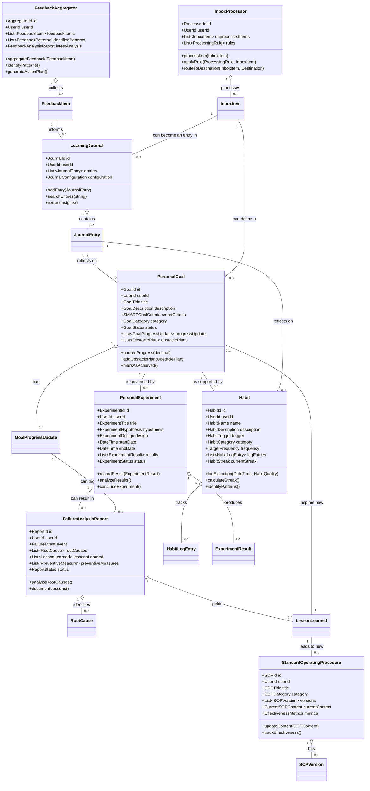
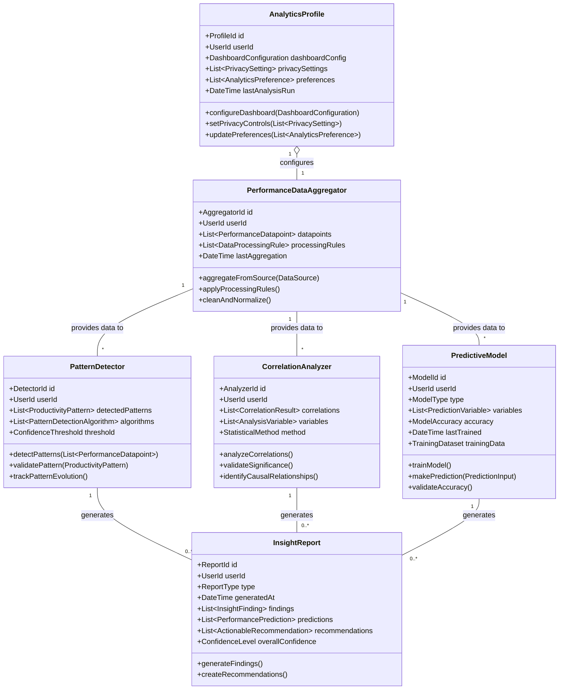
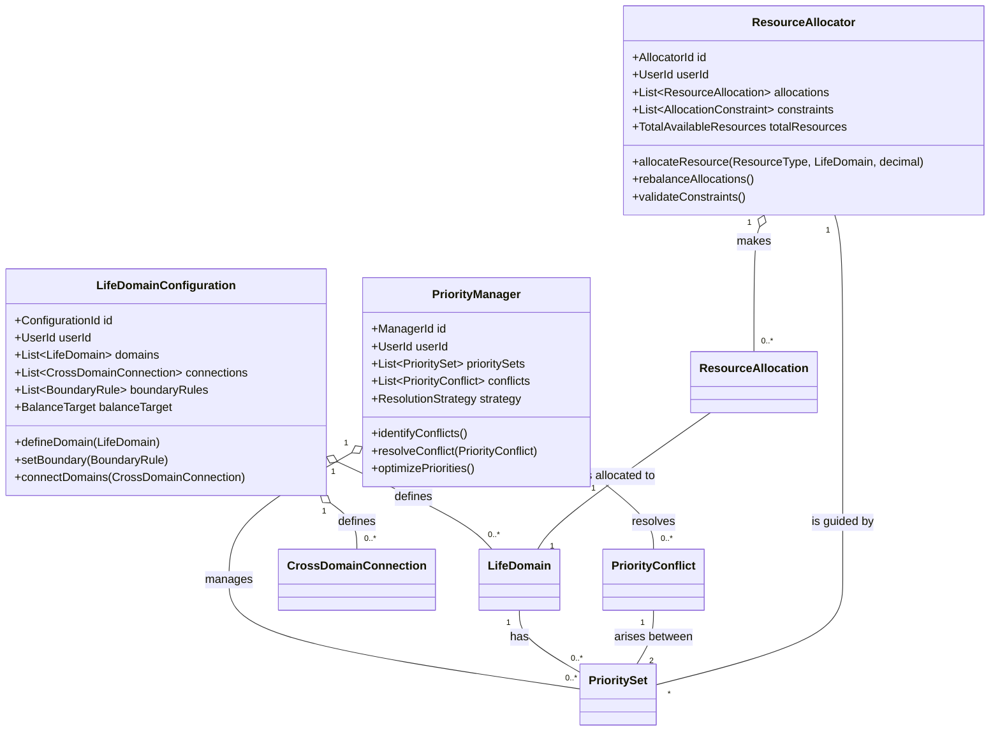
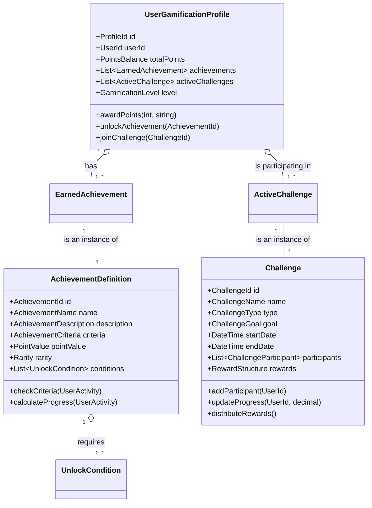
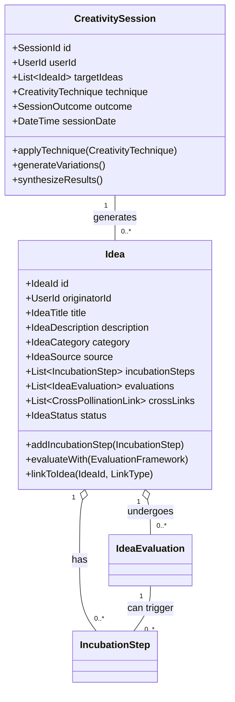
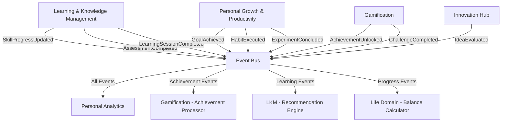
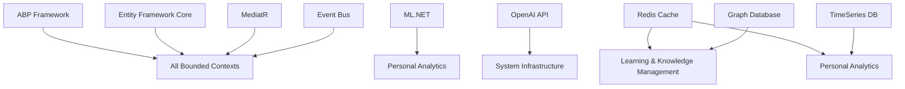

# Learning & Personal Development Platform Domain-Driven Design Architecture Specification
## Learning & Personal Development Platform

---

## Table of Contents

1. [Executive Summary](#1-executive-summary)
2. [Domain Architecture Overview](#2-domain-architecture-overview)
3. [Bounded Context Catalog](#3-bounded-context-catalog)
4. [Bounded Context Specifications](#4-bounded-context-specifications)
5. [Integration Patterns](#5-integration-patterns)
6. [Implementation Guidelines](#6-implementation-guidelines)
7. [Cross-Cutting Concerns](#7-cross-cutting-concerns)
8. [Dependency Matrix](#8-dependency-matrix)

---

## 1. Executive Summary

### 1.1 System Purpose
A comprehensive learning and personal development platform that integrates skill development, knowledge management, personal growth tracking, goal setting, habit formation, life domain balancing, analytics-driven insights, gamification, and innovation management to optimize individual learning and personal development journeys.

### 1.2 Architecture Approach
- **Pattern**: Domain-Driven Design with CQRS and Event Sourcing
- **Framework**: ABP Framework (.NET)
- **Integration**: Event-driven architecture with eventual consistency
- **Scalability**: Microservices-ready bounded contexts
- **AI Integration**: LLM-powered content generation and assessment

### 1.3 Core Domain Classification
- **Core Domains**: Learning & Knowledge Management, Personal Growth & Productivity, Personal Analytics
- **Supporting Domains**: Life Domain & Priority, Gamification, Innovation Hub
- **Generic Domains**: System Infrastructure

---

## 2. Domain Architecture Overview

### 2.1 Context Map

```
┌─────────────────┐    ┌─────────────────┐    ┌─────────────────┐
│Learning & Know. │────│Personal Growth  │────│Life Domain &    │
│  Management     │    │& Productivity   │    │   Priority      │
│   (Core)        │    │    (Core)       │    │  (Supporting)   │
└─────────────────┘    └─────────────────┘    └─────────────────┘
         │                       │                       │
         │                       │                       │
         └───────────────────────┼───────────────────────┘
                                 │
        ┌────────────────────────┼────────────────────────┐
        │                       │                        │
┌─────────────────┐    ┌─────────────────┐    ┌─────────────────┐
│Personal Analytics│    │  Gamification   │    │ Innovation Hub  │
│    (Core)       │    │  (Supporting)   │    │  (Supporting)   │
└─────────────────┘    └─────────────────┘    └─────────────────┘
        │                       │                        │
        └───────────────────────┼────────────────────────┘
                                │
    ┌───────────────────────────┼───────────────────────────┐
    │                           │                           │
┌─────────────────┐    ┌─────────────────┐    ┌─────────────────┐
│     System      │    │                 │    │                 │
│ Infrastructure  │    │                 │    │                 │
│   (Generic)     │    │                 │    │                 │
└─────────────────┘    └─────────────────┘    └─────────────────┘
```

### 2.2 Strategic Design Principles

1. **Learner-Centric Design**: All contexts focus on optimizing individual learning and growth
2. **Data-Driven Insights**: Analytics context aggregates learning from all other contexts
3. **Gamified Engagement**: Motivation through achievement and progression tracking
4. **Holistic Development**: Integration across professional and personal life domains
5. **AI-Enhanced Learning**: LLM integration for assessment generation and personalized content

---

## 3. Bounded Context Catalog

| Context | Type | Priority | Complexity | Team Size |
|---------|------|----------|------------|-----------|
| Learning & Knowledge Management | Core | Critical | High | 4-5 |
| Personal Growth & Productivity | Core | Critical | High | 3-4 |
| Personal Analytics | Core | High | High | 3-4 |
| Life Domain & Priority | Supporting | Medium | Medium | 2-3 |
| Gamification | Supporting | Medium | Low | 2 |
| Innovation Hub | Supporting | Low | Medium | 2-3 |
| System Infrastructure | Generic | Critical | Medium | 2-3 |

---

## 4. Bounded Context Specifications

### 4.1 Learning & Knowledge Management Bounded Context

#### 4.1.1 Context Overview
**Responsibility**: Manages the complete learning lifecycle including skill definitions, learning plans, assessments, knowledge synthesis, and AI-powered content generation for personalized learning experiences.

**Strategic Classification**: Core Domain - Strategic

**Subdomains**:
- Skill Management: Skill definitions, proficiency tracking, and gap analysis
- Learning Planning: Structured learning path creation and milestone tracking
- Assessment & Evaluation: LLM-powered assessment generation and progress evaluation
- Knowledge Synthesis: Knowledge graph creation and relationship mapping
- Learning Intelligence: Adaptive learning strategies and cognitive optimization

#### 4.1.2 Core Domain Model

```mermaid
classDiagram
    direction TB

    class SkillDefinition {
        +SkillId id
        +UserId userId
        +SkillName name
        +SkillDescription description
        +defineProficiencyLevels()
        +addRelationship(SkillRelationship)
    }

    class LearningPlan {
        +PlanId id
        +UserId userId
        +PlanName name
        +PlanStatus status
        +addGoal(LearningPlanGoal)
        +updateProgress()
    }

    class UserSkillProgress {
        +ProgressId id
        +UserId userId
        +DateTime lastUpdated
        +updateProgress(ProficiencyLevel)
        +logAssessment(SkillAssessment)
    }

    class AssessmentTemplate {
        +TemplateId id
        +TemplateName name
        +AssessmentDifficulty difficulty
        +generateQuestions(LearningContent)
    }

    class AssessmentInstance {
        +InstanceId id
        +UserId userId
        +AssessmentScore score
        +AssessmentFeedback feedback
        +calculateScore()
        +generateFeedback()
    }

    class LearningSession {
        +SessionId id
        +UserId userId
        +DateTime startTime
        +DateTime endTime
        +trackCognitiveLoad()
    }

    class KnowledgeItem {
        +ItemId id
        +UserId userId
        +ItemTitle title
        +ItemContent content
        +addRelationship(KnowledgeGraphLink)
    }
    
    class KnowledgePlaybook {
        +PlaybookId id
        +UserId userId
        +PlaybookTitle title
        +addStep(PlaybookStep)
    }

    class ProficiencyLevel { <<ValueObject>> }
    class SkillRelationship { <<AssociationClass>> }
    class AssessmentCriterion { <<ValueObject>> }
    class LearningPlanGoal { <<ValueObject>> }
    class LearningMilestone { <<ValueObject>> }
    class LearningContent { <<DataObject>> }
    class ProgressLogEntry { <<ValueObject>> }
    class SkillAssessment { <<ValueObject>> }
    class AssessmentQuestion { <<ValueObject>> }
    class AssessmentResponse { <<ValueObject>> }
    class CognitiveMetricLog { <<ValueObject>> }
    class InterruptionLog { <<ValueObject>> }
    class KnowledgeGraphLink { <<AssociationClass>> }
    class PlaybookStep { <<ValueObject>> }


    %% --- Relationships --- 

    %% ' SkillDefinition Composition '
    SkillDefinition "1" *-- "*" ProficiencyLevel : defines
    SkillDefinition "1" *-- "*" AssessmentCriterion : has criteria for
    SkillDefinition -- SkillRelationship : relates to

    %% ' LearningPlan Composition & Links '
    LearningPlan "1" *-- "*" LearningPlanGoal : contains
    LearningPlan "1" *-- "*" LearningMilestone : has
    LearningPlan "1" o-- "*" LearningContent : curates
    LearningPlan "1" o-- "0..*" LearningSession : guides
    
    %% ' UserSkillProgress Composition & Links '
    UserSkillProgress "1" *-- "*" ProgressLogEntry : logs
    UserSkillProgress "1" o-- "*" SkillAssessment : records
    
    %% ' Assessment Composition & Links '
    AssessmentTemplate "1" *-- "*" AssessmentQuestion : contains
    AssessmentInstance "1" *-- "*" AssessmentResponse : collects
    
    %% ' KnowledgeItem & Playbook Composition '
    KnowledgePlaybook "1" *-- "*" KnowledgeItem : aggregates
    KnowledgePlaybook "1" *-- "*" PlaybookStep : defines
    KnowledgeItem "1" -- "0..*" KnowledgeGraphLink : has

    %% ' --- Core Entity Relationships --- '
    SkillDefinition "1" -- "0..*" UserSkillProgress : is tracked by
    SkillDefinition "1" -- "0..*" LearningPlan : can be learned via
    SkillDefinition "1" -- "0..*" AssessmentTemplate : can be assessed by
    
    AssessmentTemplate "1" ..> "0..*" AssessmentInstance : is instance of
    UserSkillProgress "1" -- "0..*" AssessmentInstance : is measured by
```



#### 4.1.3 Aggregates Specification

##### SkillDefinition Aggregate Root
**Purpose**: Defines skills with proficiency levels, assessment criteria, and relationships

**Entities**:
- `ProficiencyLevelDefinition`: Structured levels within the skill
- `SkillRelationship`: Dependencies and connections to other skills

**Value Objects**:
- `SkillId`: Unique identifier
- `SkillName`: Required, unique per user
- `SkillDescription`: Detailed skill description
- `SkillCategory`: Technical, Soft, Creative, Physical
- `AssessmentCriterion`: Measurable criteria for evaluation
- `RelationshipType`: Prerequisite, Complementary, Advanced

**Business Invariants**:
- Skill must have at least one proficiency level
- Proficiency levels must be ordered and non-overlapping
- Circular skill relationships are prohibited
- Assessment criteria must be measurable

##### LearningPlan Aggregate Root
**Purpose**: Structures learning journey with goals, content, and milestones

**Entities**:
- `LearningPlanGoal`: Specific objectives within the plan
- `LearningMilestone`: Progress checkpoints
- `LearningContent`: Associated learning materials

**Value Objects**:
- `PlanId`: Unique identifier
- `PlanName`: Required plan name
- `PlanStatus`: Draft, Active, Paused, Completed, Abandoned
- `TimeEstimate`: Expected completion time
- `GoalType`: Knowledge, Skill, Application, Mastery

**Business Invariants**:
- Plan must have at least one goal
- Milestones must be chronologically ordered
- Content must be linked to specific goals
- Cannot complete plan without achieving mandatory goals

##### UserSkillProgress Aggregate Root
**Purpose**: Tracks individual skill development and assessment history

**Entities**:
- `ProgressLogEntry`: Individual progress updates
- `SkillAssessment`: Assessment results and feedback

**Value Objects**:
- `ProgressId`: Unique identifier
- `CurrentProficiencyLevel`: Current skill level
- `ProgressPercentage`: Quantified progress
- `SkillGapAnalysis`: Identification of improvement areas

**Business Invariants**:
- Progress can only increase or remain same (no regression without justification)
- Assessment results must align with proficiency level claims
- Cannot skip proficiency levels without demonstration

##### AssessmentTemplate Aggregate Root
**Purpose**: Manages assessment questions and LLM-generated content

**Entities**:
- `AssessmentQuestion`: Manually created questions
- `GeneratedQuestion`: LLM-generated questions with metadata

**Value Objects**:
- `TemplateId`: Unique identifier
- `QuestionType`: MultipleChoice, ShortAnswer, Essay, Practical
- `DifficultyLevel`: Beginner, Intermediate, Advanced, Expert
- `UnderstandingLevel`: Remember, Understand, Apply, Analyze, Evaluate, Create

**Business Invariants**:
- Template must have questions targeting multiple understanding levels
- Generated questions must be validated before inclusion
- Question difficulty must align with target proficiency level

##### KnowledgeItem Aggregate Root
**Purpose**: Represents discrete pieces of knowledge with relationships

**Entities**:
- `KnowledgeGraphLink`: Relationships between knowledge items

**Value Objects**:
- `ItemId`: Unique identifier
- `KnowledgeItemMetadata`: Tags, categories, source information
- `LinkType`: References, Contradicts, Builds-Upon, Examples
- `ConfidenceLevel`: High, Medium, Low confidence in the knowledge

#### 4.1.4 Commands & Queries (CQRS)

##### Commands
**Skill Management**:
```csharp
public record DefineSkill(
    string Name,
    string Description,
    SkillCategory Category,
    List<ProficiencyLevelDefinition> Levels,
    List<AssessmentCriterion> Criteria,
    UserId CreatedBy
);

public record UpdateSkillProgress(
    SkillId SkillId,
    ProficiencyLevel NewLevel,
    string Evidence,
    ProgressSource Source,
    UserId UpdatedBy
);

public record IdentifySkillGapsForUser(
    UserId UserId,
    List<SkillId> TargetSkills,
    ProficiencyLevel DesiredLevel
);
```

**Learning Planning**:
```csharp
public record CreateLearningPlan(
    string Name,
    SkillId TargetSkillId,
    ProficiencyLevel TargetLevel,
    DateTime TargetDate,
    UserId CreatedBy
);

public record AddGoalToLearningPlan(
    PlanId PlanId,
    string GoalDescription,
    GoalType Type,
    bool IsMandatory,
    DateTime TargetDate
);

public record AddLearningContentToPlan(
    PlanId PlanId,
    LearningContentData Content,
    List<GoalId> LinkedGoals
);
```

**Assessment Management**:
```csharp
public record CreateAssessmentTemplate(
    SkillId SkillId,
    string TemplateName,
    AssessmentDifficulty Difficulty,
    UnderstandingLevel TargetLevel
);

public record GenerateAssessmentQuestions(
    TemplateId TemplateId,
    LearningContent SourceContent,
    int QuestionCount,
    List<UnderstandingLevel> TargetLevels
);

public record StartAssessmentForUser(
    TemplateId TemplateId,
    UserId UserId,
    AssessmentContext Context
);

public record GradeAssessment(
    InstanceId InstanceId,
    List<AssessmentResponse> Responses,
    bool UseAIGrading = true
);
```

**Knowledge Management**:
```csharp
public record CreateKnowledgeItem(
    string Title,
    string Content,
    KnowledgeItemMetadata Metadata,
    ItemSource Source,
    UserId CreatedBy
);

public record DefineKnowledgeRelationship(
    ItemId SourceItemId,
    ItemId TargetItemId,
    LinkType RelationshipType,
    string Description,
    ConfidenceLevel Confidence
);

public record CreateKnowledgePlaybook(
    string Title,
    PlaybookCategory Category,
    List<ItemId> IncludedItems,
    List<PlaybookStep> Steps,
    UserId CreatedBy
);
```

##### Queries
**Skill Queries**:
```csharp
public record GetSkillDefinition(SkillId SkillId);
public record GetUserSkillProgress(UserId UserId, SkillId? SkillFilter = null);
public record FindSkillsByGap(UserId UserId, ProficiencyLevel MinimumGap);
public record GetSkillRelationshipMap(List<SkillId> SkillIds);
```

**Learning Plan Queries**:
```csharp
public record GetLearningPlanDetails(PlanId PlanId);
public record GetActiveLearningPlans(UserId UserId);
public record GetLearningContent(PlanId PlanId, GoalId? GoalFilter = null);
public record GetLearningMilestones(PlanId PlanId, bool CompletedOnly = false);
```

**Assessment Queries**:
```csharp
public record GetAssessmentTemplate(TemplateId TemplateId);
public record GetQuestionsForTemplate(TemplateId TemplateId, UnderstandingLevel? LevelFilter = null);
public record GetUserAssessmentHistory(UserId UserId, SkillId? SkillFilter = null);
public record GetAssessmentFeedback(InstanceId InstanceId);
```

**Knowledge Queries**:
```csharp
public record GetKnowledgeItem(ItemId ItemId);
public record SearchKnowledgeItems(string SearchTerm, KnowledgeItemMetadata? MetadataFilter = null);
public record VisualizeKnowledgeGraph(UserId UserId, int MaxDepth = 3);
public record GetKnowledgePlaybook(PlaybookId PlaybookId);
```

#### 4.1.5 Events & Integration

##### Domain Events
```csharp
public class SkillDefined : DomainEvent
{
    public SkillId SkillId { get; }
    public string Name { get; }
    public SkillCategory Category { get; }
    public UserId CreatedBy { get; }
    public List<ProficiencyLevelDefinition> Levels { get; }
}

public class SkillProgressUpdated : DomainEvent
{
    public UserId UserId { get; }
    public SkillId SkillId { get; }
    public ProficiencyLevel PreviousLevel { get; }
    public ProficiencyLevel NewLevel { get; }
    public string Evidence { get; }
    public ProgressSource Source { get; }
}

public class LearningPlanCreated : DomainEvent
{
    public PlanId PlanId { get; }
    public string Name { get; }
    public SkillId TargetSkillId { get; }
    public UserId CreatedBy { get; }
    public DateTime TargetDate { get; }
}

public class AssessmentQuestionsGenerated : DomainEvent
{
    public TemplateId TemplateId { get; }
    public int QuestionCount { get; }
    public List<UnderstandingLevel> TargetLevels { get; }
    public bool GenerationSuccessful { get; }
    public string? ErrorMessage { get; }
}

public class AssessmentGraded : DomainEvent
{
    public InstanceId InstanceId { get; }
    public UserId UserId { get; }
    public SkillId AssessedSkillId { get; }
    public AssessmentScore Score { get; }
    public List<string> IdentifiedGaps { get; }
    public List<string> Recommendations { get; }
}

public class KnowledgeItemCreated : DomainEvent
{
    public ItemId ItemId { get; }
    public string Title { get; }
    public KnowledgeItemMetadata Metadata { get; }
    public UserId CreatedBy { get; }
}

public class LearningSessionCompleted : DomainEvent
{
    public SessionId SessionId { get; }
    public UserId UserId { get; }
    public TimeSpan Duration { get; }
    public FocusMetric AverageFocus { get; }
    public int InterruptionCount { get; }
    public List<CognitiveMetricLog> CognitiveMetrics { get; }
}
```

#### 4.1.6 Business Rules & Policies

##### Skill Progression Policy
```csharp
public class SkillProgressionPolicy
{
    public bool CanAdvanceToLevel(
        UserSkillProgress progress, 
        ProficiencyLevel targetLevel,
        AssessmentInstance? latestAssessment)
    {
        // Cannot skip levels without demonstration
        if (targetLevel.Level > progress.CurrentLevel.Level + 1)
            return false;
            
        // Must have recent assessment evidence
        if (latestAssessment == null || 
            latestAssessment.CompletedAt < DateTime.UtcNow.AddDays(-30))
            return false;
            
        // Assessment score must meet minimum threshold
        var minimumScore = GetMinimumScoreForLevel(targetLevel);
        return latestAssessment.Score.TotalScore >= minimumScore;
    }
}
```

##### Learning Content Recommendation Policy
```csharp
public class LearningContentRecommendationPolicy
{
    public List<LearningContent> RecommendContent(
        UserSkillProgress progress,
        List<AssessmentInstance> assessments,
        LearningStyleProfile learningStyle)
    {
        var skillGaps = IdentifySkillGaps(assessments);
        var recommendations = new List<LearningContent>();
        
        foreach (var gap in skillGaps)
        {
            var content = FindContentForGap(gap, learningStyle);
            recommendations.AddRange(content);
        }
        
        return PrioritizeRecommendations(recommendations, progress);
    }
}
```

---

### 4.2 Personal Growth & Productivity Bounded Context

#### 4.2.1 Context Overview
**Responsibility**: Manages broader self-improvement including personal goals, habits, journaling, workflow optimization, task management, and continuous improvement through experimentation and feedback analysis.

**Strategic Classification**: Core Domain - Strategic

**Subdomains**:
- Goal Management: SMART goal setting and progress tracking
- Habit Formation: Habit definition, tracking, and streak management
- Reflection & Learning: Journaling, failure analysis, and lesson extraction
- Workflow Optimization: Process improvement and friction identification
- Continuous Improvement: Experimentation and feedback-driven enhancement

#### 4.2.2 Core Domain Model



#### 4.2.3 Aggregates Specification

##### PersonalGoal Aggregate Root
**Purpose**: Manages SMART goal setting, tracking, and achievement

**Entities**:
- `GoalProgressUpdate`: Regular progress tracking entries
- `GoalMilestone`: Key checkpoints toward goal achievement
- `ObstaclePlan`: Strategies for overcoming anticipated obstacles

**Value Objects**:
- `GoalId`: Unique identifier
- `SMARTGoalCriteria`: Specific, Measurable, Achievable, Relevant, Time-bound criteria
- `GoalCategory`: Personal, Professional, Health, Learning, Financial
- `GoalStatus`: Draft, Active, Paused, Achieved, Abandoned
- `ProgressPercentage`: Quantified progress toward goal

**Business Invariants**:
- SMART criteria must be complete before goal activation
- Progress updates must include evidence or measurement
- Cannot mark goal as achieved without meeting success criteria
- Obstacle plans must be actionable and specific

##### Habit Aggregate Root
**Purpose**: Manages habit formation, tracking, and pattern analysis

**Entities**:
- `HabitLogEntry`: Individual habit execution records
- `HabitPattern`: Identified patterns in habit execution

**Value Objects**:
- `HabitId`: Unique identifier
- `HabitTrigger`: Environmental or temporal trigger
- `TargetFrequency`: Daily, Weekly, Monthly frequency targets
- `HabitQuality`: Rating of habit execution quality
- `HabitStreak`: Current and longest streaks
- `HabitCategory`: Health, Productivity, Learning, Mindfulness

**Business Invariants**:
- Habit must have clear trigger and target frequency
- Streak calculation must be consistent with frequency rules
- Cannot log future habit executions
- Quality ratings must align with habit definition

##### FailureAnalysisReport Aggregate Root
**Purpose**: Structured analysis of failures for learning and improvement

**Entities**:
- `RootCause`: Individual root cause with evidence
- `LessonLearned`: Extracted insights from failure
- `PreventiveMeasure`: Actions to prevent recurrence

**Value Objects**:
- `ReportId`: Unique identifier
- `FailureEvent`: Description of what went wrong
- `CauseCategory`: Process, Knowledge, Resource, External
- `LessonType`: Technical, Behavioral, Strategic, Tactical
- `MeasureType`: Prevention, Detection, Mitigation

##### PersonalExperiment Aggregate Root
**Purpose**: Manages structured experimentation for personal improvement

**Entities**:
- `ExperimentResult`: Measured outcomes and observations
- `ExperimentVariable`: Factors being tested or controlled

**Value Objects**:
- `ExperimentId`: Unique identifier
- `ExperimentHypothesis`: Testable prediction
- `ExperimentDesign`: Methodology and controls
- `ResultType`: Quantitative, Qualitative, Behavioral
- `StatisticalSignificance`: Confidence in results

#### 4.2.4 Commands & Queries (CQRS)

##### Commands
**Goal Management**:
```csharp
public record CreatePersonalGoal(
    string Title,
    string Description,
    SMARTGoalCriteria SmartCriteria,
    GoalCategory Category,
    DateTime TargetDate,
    UserId CreatedBy
);

public record UpdateGoalProgress(
    GoalId GoalId,
    decimal ProgressPercentage,
    string Evidence,
    string? Notes,
    UserId UpdatedBy
);

public record AddObstaclePlan(
    GoalId GoalId,
    string ObstacleDescription,
    string MitigationStrategy,
    Priority Priority
);
```

**Habit Management**:
```csharp
public record DefineHabit(
    string Name,
    string Description,
    HabitTrigger Trigger,
    TargetFrequency Frequency,
    HabitCategory Category,
    UserId CreatedBy
);

public record LogHabitExecution(
    HabitId HabitId,
    DateTime ExecutionTime,
    HabitQuality Quality,
    string? Notes,
    UserId LoggedBy
);

public record AnalyzeHabitPatterns(
    HabitId HabitId,
    DateTime StartDate,
    DateTime EndDate
);
```

**Reflection & Analysis**:
```csharp
public record LogJournalEntry(
    string Content,
    List<string> Tags,
    JournalEntryType Type,
    DateTime? EventDate,
    UserId CreatedBy
);

public record DocumentFailureAnalysis(
    string FailureDescription,
    DateTime FailureDate,
    ImpactLevel Impact,
    UserId AnalyzedBy
);

public record AddRootCause(
    ReportId ReportId,
    string CauseDescription,
    CauseCategory Category,
    string Evidence
);
```

**Workflow Optimization**:
```csharp
public record CreateSOP(
    string Title,
    SOPCategory Category,
    SOPContent Content,
    UserId CreatedBy
);

public record UpdateSOP(
    SOPId SOPId,
    SOPContent NewContent,
    string ChangeReason,
    UserId UpdatedBy
);

public record IdentifyWorkflowFriction(
    string WorkflowDescription,
    FrictionType Type,
    ImpactLevel Impact,
    string Suggestion
);
```

**Experimentation**:
```csharp
public record DesignPersonalExperiment(
    string Title,
    ExperimentHypothesis Hypothesis,
    ExperimentDesign Design,
    DateTime StartDate,
    DateTime EndDate,
    UserId CreatedBy
);

public record RecordExperimentResult(
    ExperimentId ExperimentId,
    ExperimentResult Result,
    DateTime ObservationDate,
    UserId RecordedBy
);
```

##### Queries
**Goal & Progress Queries**:
```csharp
public record GetPersonalGoal(GoalId GoalId);
public record GetActiveGoals(UserId UserId);
public record GetGoalProgressHistory(GoalId GoalId);
public record GetGoalsByCategory(UserId UserId, GoalCategory Category);
```

**Habit Queries**:
```csharp
public record GetHabit(HabitId HabitId);
public record GetHabitHistory(HabitId HabitId, int DaysBack = 30);
public record GetHabitStreaks(UserId UserId);
public record GetHabitPatterns(HabitId HabitId);
```

**Journal & Analysis Queries**:
```csharp
public record GetJournalEntries(UserId UserId, DateTime? StartDate = null, DateTime? EndDate = null);
public record SearchJournalEntries(UserId UserId, string SearchTerm);
public record GetFailureAnalysisReports(UserId UserId);
public record GetLessonsLearned(UserId UserId, string? Category = null);
```

#### 4.2.5 Events & Integration

##### Domain Events
```csharp
public class PersonalGoalCreated : DomainEvent
{
    public GoalId GoalId { get; }
    public string Title { get; }
    public GoalCategory Category { get; }
    public DateTime TargetDate { get; }
    public UserId CreatedBy { get; }
}

public class PersonalGoalAchieved : DomainEvent
{
    public GoalId GoalId { get; }
    public string Title { get; }
    public DateTime AchievedDate { get; }
    public TimeSpan TimeToComplete { get; }
    public UserId AchievedBy { get; }
}

public class HabitExecuted : DomainEvent
{
    public HabitId HabitId { get; }
    public string HabitName { get; }
    public DateTime ExecutionTime { get; }
    public HabitQuality Quality { get; }
    public bool StreakExtended { get; }
    public int CurrentStreakLength { get; }
    public UserId ExecutedBy { get; }
}

public class HabitStreakBroken : DomainEvent
{
    public HabitId HabitId { get; }
    public string HabitName { get; }
    public int StreakLength { get; }
    public DateTime LastExecution { get; }
    public UserId UserId { get; }
}

public class FailureAnalysisCompleted : DomainEvent
{
    public ReportId ReportId { get; }
    public string FailureDescription { get; }
    public int RootCauseCount { get; }
    public int LessonsLearnedCount { get; }
    public List<string> KeyInsights { get; }
    public UserId AnalyzedBy { get; }
}

public class PersonalExperimentConcluded : DomainEvent
{
    public ExperimentId ExperimentId { get; }
    public string Title { get; }
    public bool HypothesisSupported { get; }
    public List<string> KeyFindings { get; }
    public List<string> Recommendations { get; }
    public UserId ConcludedBy { get; }
}
```

---

### 4.3 Personal Analytics Bounded Context

#### 4.3.1 Context Overview
**Responsibility**: Aggregates performance data from all other bounded contexts to identify patterns, generate insights, predict future performance, and provide comprehensive analytics dashboards for data-driven personal development.

**Strategic Classification**: Core Domain - Strategic

**Subdomains**:
- Data Aggregation: Collection and normalization of performance data
- Pattern Recognition: AI-powered pattern detection across domains
- Predictive Analytics: Performance prediction and trend analysis
- Insight Generation: Automated insight discovery and recommendation
- Privacy & Control: Data governance and user privacy management

#### 4.3.2 Core Domain Model



#### 4.3.3 Aggregates Specification

##### AnalyticsProfile Aggregate Root
**Purpose**: Manages user's analytics configuration and privacy settings

**Entities**:
- `DashboardWidget`: Individual dashboard components
- `PrivacySetting`: Data access and sharing controls
- `AnalyticsPreference`: User preferences for analysis

**Value Objects**:
- `ProfileId`: Unique identifier
- `DashboardConfiguration`: Layout and widget configuration
- `PrivacyLevel`: Public, Private, Anonymous, Restricted
- `AnalyticsFrequency`: Real-time, Daily, Weekly, Monthly
- `DataRetentionPolicy`: How long to keep analytical data

##### InsightReport Aggregate Root
**Purpose**: Comprehensive analysis report with findings and recommendations

**Entities**:
- `InsightFinding`: Individual analytical discovery
- `ActionableRecommendation`: Specific suggested actions
- `PerformancePrediction`: Future performance forecasts

**Value Objects**:
- `ReportId`: Unique identifier
- `ReportType`: Weekly, Monthly, Quarterly, Annual, Ad-hoc
- `ConfidenceLevel`: Statistical confidence in findings
- `ImpactLevel`: Expected impact of recommendations
- `PredictionHorizon`: Time range for predictions

#### 4.3.4 Commands & Queries (CQRS)

##### Commands
```csharp
public record ConfigureAnalyticsDashboard(
    UserId UserId,
    DashboardConfiguration Configuration,
    List<WidgetConfiguration> Widgets
);

public record SetDataPrivacyControl(
    UserId UserId,
    DataType DataType,
    PrivacyLevel PrivacyLevel,
    List<UserId>? SharedWith = null
);

public record GenerateInsightReport(
    UserId UserId,
    ReportType Type,
    DateTime StartDate,
    DateTime EndDate,
    List<AnalysisType> RequestedAnalyses
);

public record ExportAnalyticsData(
    UserId UserId,
    DataExportFormat Format,
    List<DataType> DataTypes,
    DateTime StartDate,
    DateTime EndDate
);
```

##### Queries
```csharp
public record GetAnalyticsDashboard(UserId UserId);
public record GetInsightReport(ReportId ReportId);
public record RecognizeProductivityPatterns(UserId UserId, int DaysBack = 90);
public record AnalyzeEnvironmentalImpact(UserId UserId, List<EnvironmentalFactor> Factors);
public record DiscoverBehaviorOutcomeCorrelations(UserId UserId, BehaviorType BehaviorType);
public record PredictFuturePerformance(UserId UserId, PerformanceMetric Metric, int DaysAhead = 30);
```

#### 4.3.5 Events & Integration

##### Domain Events
```csharp
public class ProductivityPatternDetected : DomainEvent
{
    public PatternId PatternId { get; }
    public UserId UserId { get; }
    public PatternType Type { get; }
    public string Description { get; }
    public ConfidenceLevel Confidence { get; }
    public List<string> SupportingEvidence { get; }
}

public class PerformancePredicted : DomainEvent
{
    public PredictionId PredictionId { get; }
    public UserId UserId { get; }
    public PerformanceMetric Metric { get; }
    public decimal PredictedValue { get; }
    public ConfidenceInterval ConfidenceInterval { get; }
    public DateTime PredictionDate { get; }
}

public class AnalyticsReportGenerated : DomainEvent
{
    public ReportId ReportId { get; }
    public UserId UserId { get; }
    public ReportType Type { get; }
    public int FindingsCount { get; }
    public int RecommendationsCount { get; }
    public OverallRating PerformanceRating { get; }
}
```

---

### 4.4 Life Domain & Priority Bounded Context

#### 4.4.1 Context Overview
**Responsibility**: Manages life domain configuration, boundary setting, priority management across domains, and resource allocation to ensure balanced personal development across all life areas.

**Strategic Classification**: Supporting Domain

**Subdomains**:
- Domain Configuration: Life domain setup and boundary definition
- Priority Management: Cross-domain priority setting and conflict resolution
- Resource Allocation: Time, energy, and attention allocation across domains
- Balance Optimization: Life balance monitoring and adjustment

#### 4.4.2 Core Domain Model



---

### 4.5 Gamification Bounded Context

#### 4.5.1 Context Overview
**Responsibility**: Manages game mechanics including points, achievements, challenges, and leaderboards to drive user engagement and motivation based on activities across all other bounded contexts.

**Strategic Classification**: Supporting Domain

**Subdomains**:
- Achievement System: Badge and achievement management
- Point System: Point accumulation and spending
- Challenge Management: Personal and group challenges
- Progress Visualization: Leaderboards and progress tracking

#### 4.5.2 Core Domain Model



---

### 4.6 Innovation Hub Bounded Context

#### 4.6.1 Context Overview
**Responsibility**: Manages the complete idea lifecycle from capture to evaluation, including idea incubation, creativity technique application, cross-pollination, and collaborative development.

**Strategic Classification**: Supporting Domain

**Subdomains**:
- Idea Capture: Multi-source idea collection and initial processing
- Idea Incubation: Structured development and refinement processes
- Evaluation Framework: Systematic idea assessment and prioritization
- Collaboration Platform: Shared idea development and feedback

#### 4.6.2 Core Domain Model



---

### 4.7 System Infrastructure Bounded Context

#### 4.7.1 Context Overview
**Responsibility**: Provides system-level services including configuration management, security, data processing, AI integration, and cross-cutting technical concerns for all other bounded contexts.

**Strategic Classification**: Generic Domain

**Subdomains**:
- Configuration Management: System and user configuration
- Security & Privacy: Authentication, authorization, and data protection
- AI Integration: LLM and ML service management
- Data Processing: Background processing and calculation engines
- Integration Management: External service connectivity

---

## 5. Integration Patterns

### 5.1 Event-Driven Integration

#### 5.1.1 Event Flow Architecture


### 5.2 Cross-Context Data Flow

**Learning Progress Integration**:
1. User completes assessment in LKM → `AssessmentCompleted` event
2. Personal Analytics receives event → Updates performance metrics
3. Gamification receives event → Checks achievement criteria
4. Personal Growth receives event → May trigger habit or goal updates

**Goal Achievement Integration**:
1. User achieves personal goal in PGP → `PersonalGoalAchieved` event
2. Gamification awards points and checks achievements
3. Personal Analytics records milestone and updates patterns
4. Life Domain adjusts priority and resource allocation

### 5.3 AI Integration Patterns

**LLM Service Integration**:
```csharp
public interface ILLMIntegrationService
{
    Task<List<GeneratedQuestion>> GenerateAssessmentQuestions(
        SkillId skillId, 
        LearningContent content, 
        List<UnderstandingLevel> targetLevels);
        
    Task<InsightAnalysis> AnalyzeJournalEntries(
        List<JournalEntry> entries, 
        AnalysisType analysisType);
        
    Task<List<LearningRecommendation>> RecommendLearningContent(
        UserSkillProfile profile, 
        List<SkillGap> gaps);
}
```

---

## 6. Implementation Guidelines

### 6.1 Development Standards

#### 6.1.1 Aggregate Design for Learning Domain

```csharp
public class SkillDefinition : AggregateRoot<SkillId>
{
    private readonly List<ProficiencyLevelDefinition> _levels = new();
    private readonly List<SkillRelationship> _relationships = new();
    
    public void AdvanceUserToLevel(
        UserId userId, 
        ProficiencyLevel targetLevel, 
        AssessmentEvidence evidence)
    {
        // Validate progression rules
        var progressionPolicy = new SkillProgressionPolicy();
        if (!progressionPolicy.CanAdvanceToLevel(userId, Id, targetLevel, evidence))
        {
            throw new SkillProgressionException(
                $"User {userId} cannot advance to level {targetLevel} for skill {Id}");
        }
        
        // Update progress and raise event
        var progressUpdate = new SkillProgressUpdate(targetLevel, evidence, DateTime.UtcNow);
        RaiseDomainEvent(new SkillProgressUpdated(userId, Id, targetLevel, evidence));
    }
    
    public List<SkillGap> IdentifyGaps(UserSkillProgress progress, ProficiencyLevel targetLevel)
    {
        var gaps = new List<SkillGap>();
        
        // Analyze current vs target level
        var currentLevel = progress.CurrentLevel;
        if (currentLevel.Level < targetLevel.Level)
        {
            gaps.Add(new SkillGap(Id, currentLevel, targetLevel, GetLevelGapDescription(currentLevel, targetLevel)));
        }
        
        // Check prerequisite skills
        var prerequisites = _relationships.Where(r => r.Type == RelationshipType.Prerequisite);
        foreach (var prereq in prerequisites)
        {
            // Check if prerequisite skills are at required level
            // This would require calling out to get other skill progress
        }
        
        return gaps;
    }
}
```

#### 6.1.2 Event Handler for Cross-Context Integration

```csharp
public class LearningProgressGamificationHandler : 
    IEventHandler<SkillProgressUpdated>,
    IEventHandler<AssessmentCompleted>,
    IEventHandler<LearningSessionCompleted>
{
    private readonly IGamificationCommandService _gamificationService;
    private readonly IUserGamificationProfileRepository _profileRepository;
    
    public async Task Handle(SkillProgressUpdated @event)
    {
        // Award points for skill progression
        var pointsToAward = CalculatePointsForProgression(@event.PreviousLevel, @event.NewLevel);
        
        await _gamificationService.AwardPoints(
            @event.UserId, 
            pointsToAward, 
            $"Skill progression in {@event.SkillId}");
        
        // Check for skill-related achievements
        await _gamificationService.CheckAchievements(
            @event.UserId, 
            AchievementTrigger.SkillProgression, 
            @event);
    }
    
    public async Task Handle(AssessmentCompleted @event)
    {
        // Award points based on assessment score
        var pointsToAward = CalculatePointsForAssessment(@event.Score);
        
        await _gamificationService.AwardPoints(
            @event.UserId, 
            pointsToAward, 
            $"Assessment completed for {@event.SkillId}");
            
        // Check for assessment-related achievements (perfect scores, consistency, etc.)
        await _gamificationService.CheckAchievements(
            @event.UserId, 
            AchievementTrigger.AssessmentCompletion, 
            @event);
    }
    
    private int CalculatePointsForProgression(ProficiencyLevel previous, ProficiencyLevel current)
    {
        // More points for higher levels, exponential growth
        return (int)Math.Pow(current.Level - previous.Level, 2) * 50;
    }
}
```

### 6.2 AI Integration Implementation

#### 6.2.1 LLM-Powered Assessment Generation

```csharp
public class LLMAssessmentGenerationService : IAssessmentGenerationService
{
    private readonly ILLMClient _llmClient;
    private readonly IPromptTemplateRepository _promptRepository;
    
    public async Task<List<GeneratedQuestion>> GenerateQuestions(
        SkillId skillId,
        LearningContent content,
        List<UnderstandingLevel> targetLevels,
        int questionCount)
    {
        var generatedQuestions = new List<GeneratedQuestion>();
        
        foreach (var level in targetLevels)
        {
            var questionsForLevel = questionCount / targetLevels.Count;
            var prompt = await BuildPrompt(skillId, content, level, questionsForLevel);
            
            try
            {
                var response = await _llmClient.GenerateContentAsync(prompt);
                var questions = ParseQuestions(response, level);
                
                generatedQuestions.AddRange(questions);
            }
            catch (LLMGenerationException ex)
            {
                // Log error and possibly fallback to manual questions
                throw new AssessmentGenerationException(
                    $"Failed to generate questions for level {level}", ex);
            }
        }
        
        return generatedQuestions;
    }
    
    private async Task<string> BuildPrompt(
        SkillId skillId, 
        LearningContent content, 
        UnderstandingLevel level, 
        int questionCount)
    {
        var skill = await GetSkillDefinition(skillId);
        var template = await _promptRepository.GetTemplate("assessment_generation");
        
        return template
            .Replace("{SKILL_NAME}", skill.Name)
            .Replace("{SKILL_DESCRIPTION}", skill.Description)
            .Replace("{CONTENT}", content.Text)
            .Replace("{UNDERSTANDING_LEVEL}", level.ToString())
            .Replace("{QUESTION_COUNT}", questionCount.ToString())
            .Replace("{ASSESSMENT_CRITERIA}", string.Join("\n", skill.AssessmentCriteria));
    }
    
    private List<GeneratedQuestion> ParseQuestions(string llmResponse, UnderstandingLevel level)
    {
        // Parse structured response from LLM
        // Implementation would depend on chosen response format (JSON, XML, etc.)
        // Include validation of question quality and appropriateness
        
        var questions = new List<GeneratedQuestion>();
        // ... parsing logic
        return questions;
    }
}
```

### 6.3 Analytics and Pattern Detection

#### 6.3.1 Pattern Detection Implementation

```csharp
public class ProductivityPatternDetector : IPatternDetector
{
    private readonly IMLModelService _mlService;
    private readonly IStatisticalAnalysisService _statsService;
    
    public async Task<List<ProductivityPattern>> DetectPatterns(
        UserId userId, 
        List<PerformanceDatapoint> datapoints)
    {
        var patterns = new List<ProductivityPattern>();
        
        // Time-based patterns
        patterns.AddRange(await DetectTimeBasedPatterns(datapoints));
        
        // Behavioral patterns
        patterns.AddRange(await DetectBehavioralPatterns(datapoints));
        
        // Environmental patterns
        patterns.AddRange(await DetectEnvironmentalPatterns(datapoints));
        
        // Context switching patterns
        patterns.AddRange(await DetectContextSwitchingPatterns(datapoints));
        
        // Filter by confidence threshold
        return patterns.Where(p => p.Confidence >= 0.7).ToList();
    }
    
    private async Task<List<ProductivityPattern>> DetectTimeBasedPatterns(
        List<PerformanceDatapoint> datapoints)
    {
        var patterns = new List<ProductivityPattern>();
        
        // Group by time of day
        var hourlyGroups = datapoints.GroupBy(d => d.Timestamp.Hour);
        
        foreach (var hourGroup in hourlyGroups)
        {
            var hourlyPerformance = hourGroup.Average(d => d.Value);
            var overallAverage = datapoints.Average(d => d.Value);
            
            if (hourlyPerformance > overallAverage * 1.2) // 20% above average
            {
                patterns.Add(new ProductivityPattern(
                    PatternType.HighPerformanceTime,
                    $"High productivity at {hourGroup.Key}:00",
                    CalculateConfidence(hourGroup.ToList()),
                    new Dictionary<string, object> { ["Hour"] = hourGroup.Key }
                ));
            }
        }
        
        return patterns;
    }
    
    private async Task<List<ProductivityPattern>> DetectBehavioralPatterns(
        List<PerformanceDatapoint> datapoints)
    {
        // Analyze correlations between behaviors and outcomes
        var behaviorData = datapoints.Where(d => d.MetricName.StartsWith("behavior_")).ToList();
        var outcomeData = datapoints.Where(d => d.MetricName.StartsWith("outcome_")).ToList();
        
        var correlations = await _statsService.CalculateCorrelations(behaviorData, outcomeData);
        
        return correlations
            .Where(c => Math.Abs(c.Coefficient) > 0.5) // Strong correlation
            .Select(c => new ProductivityPattern(
                PatternType.BehaviorOutcomeCorrelation,
                $"Strong correlation between {c.Variable1} and {c.Variable2}",
                c.Significance,
                new Dictionary<string, object> 
                { 
                    ["Behavior"] = c.Variable1,
                    ["Outcome"] = c.Variable2,
                    ["Coefficient"] = c.Coefficient
                }
            ))
            .ToList();
    }
}
```

---

## 7. Cross-Cutting Concerns

### 7.1 Privacy and Data Protection

#### 7.1.1 Privacy-First Analytics

```csharp
public class PrivacyControlledAnalyticsService : IAnalyticsService
{
    private readonly IDataPrivacyService _privacyService;
    private readonly IEncryptionService _encryptionService;
    
    public async Task<AnalyticsReport> GenerateReport(
        UserId userId, 
        ReportType reportType, 
        DateTime startDate, 
        DateTime endDate)
    {
        // Check privacy settings
        var privacySettings = await _privacyService.GetPrivacySettings(userId);
        
        // Filter data based on privacy settings
        var allowedDataTypes = privacySettings.GetAllowedDataTypes(reportType);
        var rawData = await GetAnalyticsData(userId, startDate, endDate, allowedDataTypes);
        
        // Apply anonymization if required
        if (privacySettings.RequiresAnonymization(reportType))
        {
            rawData = await AnonymizeData(rawData);
        }
        
        // Generate report with privacy-compliant data
        return await GenerateReportFromData(rawData, reportType);
    }
    
    private async Task<List<PerformanceDatapoint>> AnonymizeData(
        List<PerformanceDatapoint> data)
    {
        return data.Select(d => new PerformanceDatapoint(
            d.Timestamp.Date, // Remove time precision
            d.MetricName,
            RoundValue(d.Value), // Reduce precision
            null // Remove context links
        )).ToList();
    }
}
```

### 7.2 Scalability and Performance

#### 7.2.1 Event Sourcing for Analytics

```csharp
public class LearningEventStore : IEventStore
{
    private readonly IEventStoreDatabase _database;
    private readonly IEventProjectionService _projectionService;
    
    public async Task SaveEvents(AggregateId aggregateId, List<DomainEvent> events)
    {
        // Save events with metadata
        foreach (var @event in events)
        {
            var eventData = new EventData(
                aggregateId,
                @event.GetType().Name,
                JsonSerializer.Serialize(@event),
                @event.OccurredAt,
                @event.EventId
            );
            
            await _database.SaveEvent(eventData);
            
            // Trigger projections asynchronously
            await _projectionService.ProjectEvent(eventData);
        }
    }
    
    public async Task<List<DomainEvent>> GetEvents(
        AggregateId aggregateId, 
        int fromVersion = 0)
    {
        var eventData = await _database.GetEvents(aggregateId, fromVersion);
        
        return eventData.Select(ed => DeserializeEvent(ed)).ToList();
    }
    
    private DomainEvent DeserializeEvent(EventData eventData)
    {
        var eventType = Type.GetType($"LearningPlatform.Domain.Events.{eventData.EventType}");
        return (DomainEvent)JsonSerializer.Deserialize(eventData.Data, eventType);
    }
}
```

---

## 8. Dependency Matrix

### 8.1 Bounded Context Dependencies

| From Context | To Context | Dependency Type | Purpose | Coupling Level |
|--------------|------------|-----------------|---------|----------------|
| Learning & Knowledge Management | Personal Analytics | Event Publishing | Learning progress data | Loose |
| Learning & Knowledge Management | Gamification | Event Publishing | Achievement triggers | Loose |
| Learning & Knowledge Management | System Infrastructure | Service Call | LLM integration | Medium |
| Personal Growth & Productivity | Personal Analytics | Event Publishing | Goal and habit data | Loose |
| Personal Growth & Productivity | Gamification | Event Publishing | Achievement triggers | Loose |
| Personal Growth & Productivity | Life Domain & Priority | Event Subscription | Goal completion impacts | Loose |
| Personal Analytics | All Core BCs | Event Subscription | Data aggregation | Loose |
| Gamification | All BCs | Event Subscription | Activity monitoring | Loose |
| Innovation Hub | Learning & Knowledge Management | Query Service | Knowledge integration | Medium |
| System Infrastructure | All BCs | Service Provider | Configuration and AI | High |

### 8.2 Technical Dependencies



### 8.3 Data Flow Dependencies

**Learning Journey Flow**:
1. User defines skill → Learning & Knowledge Management
2. System generates assessment → AI Integration (LLM)
3. User completes assessment → Analytics receives progress data
4. System awards points → Gamification processes achievement
5. Analytics identifies patterns → Recommendations generated

**Personal Development Flow**:
1. User sets goal → Personal Growth & Productivity
2. Goal impacts life domain balance → Life Domain & Priority
3. User builds habits → Progress tracked in Analytics
4. Achievements unlocked → Gamification engagement
5. Insights generated → Continuous improvement cycle
