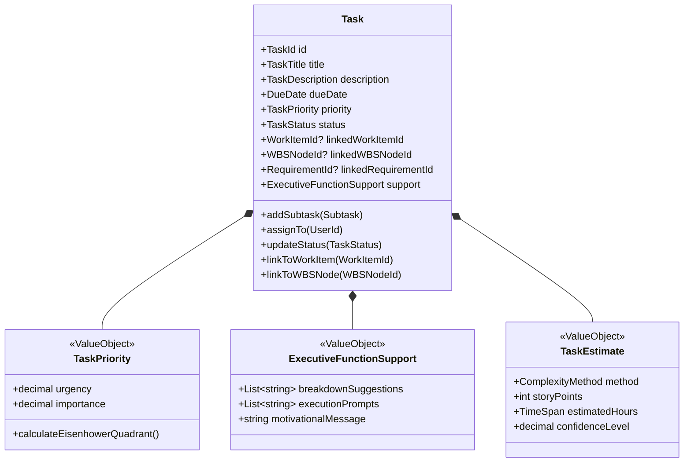
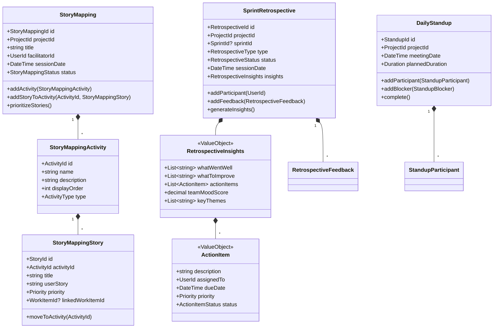
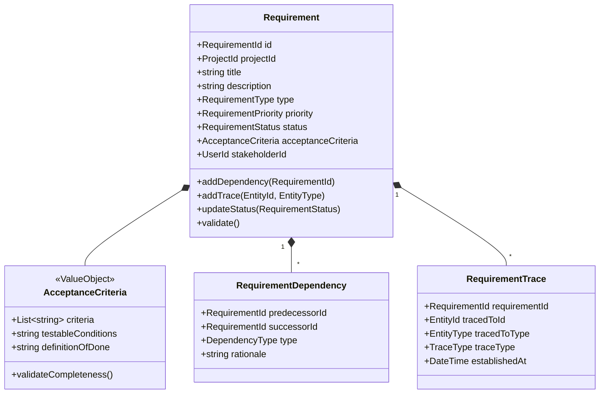
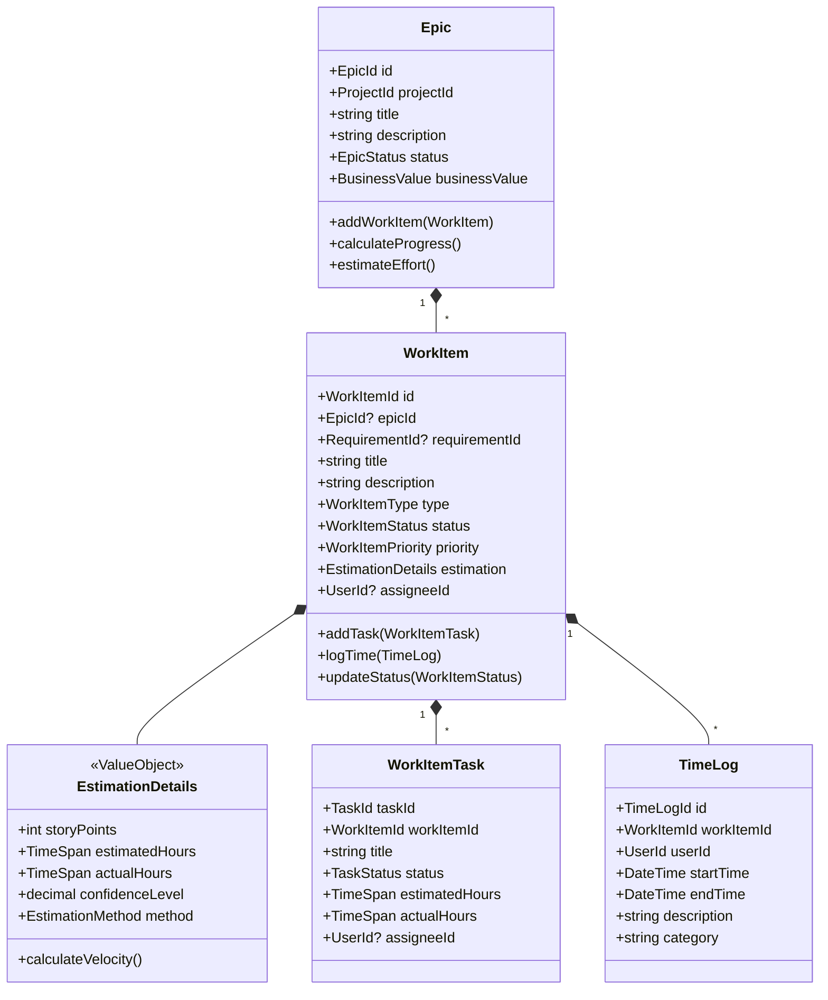
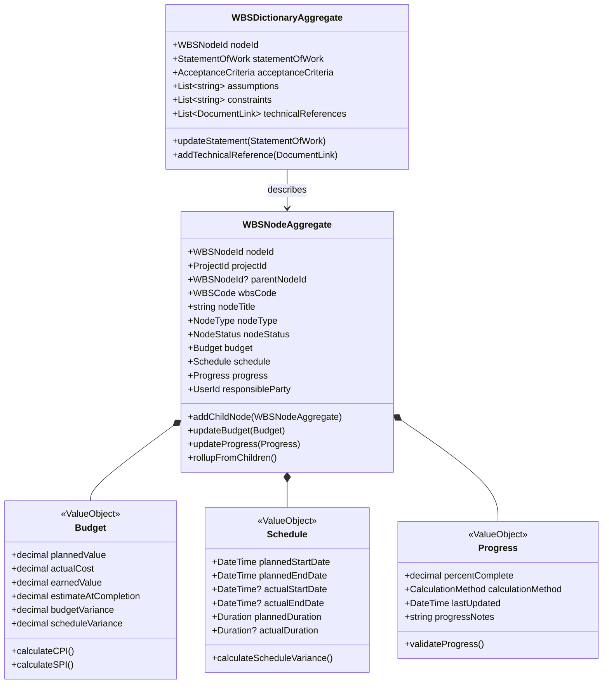
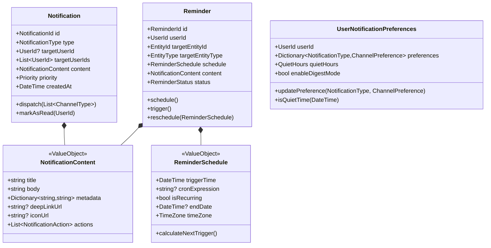
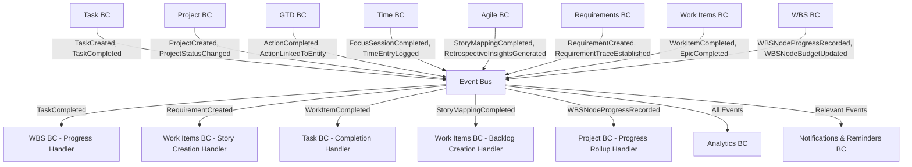
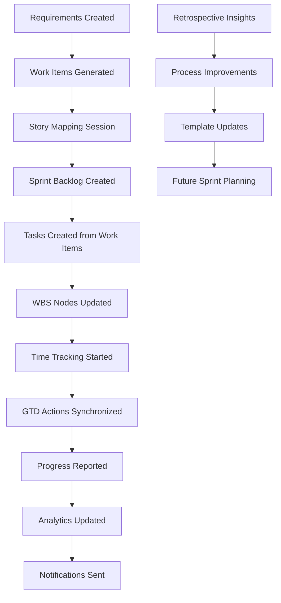

# Domain-Driven Design Architecture Specification

## Productivity Management Platform - Updated

-----

## Table of Contents

1. [Executive Summary](#1-executive-summary)
2. [Domain Architecture Overview](#2-domain-architecture-overview)
3. [Bounded Context Catalog](#3-bounded-context-catalog)
4. [Bounded Context Specifications](#4-bounded-context-specifications)
5. [Integration Patterns](#5-integration-patterns)
6. [Implementation Guidelines](#6-implementation-guidelines)
7. [Cross-Cutting Concerns](#7-cross-cutting-concerns)
8. [Dependency Matrix](#8-dependency-matrix)

-----

## 1. Executive Summary

### 1.1 System Purpose

A comprehensive productivity management platform integrating task management, project coordination, agile methodologies, requirements management, GTD workflow, time management, and AI-powered insights to optimize personal and team productivity across the complete software development lifecycle.

### 1.2 Architecture Approach

- **Pattern**: Domain-Driven Design with CQRS and Event Sourcing
- **Framework**: ABP Framework (.NET)
- **Integration**: Event-driven architecture with eventual consistency
- **Scalability**: Microservices-ready bounded contexts

### 1.3 Core Domain Classification

- **Core Domains**: Task Management, Project Management, Work Management (GTD), Agile Management, Requirements Management
- **Supporting Domains**: Work Items, WBS Management, Time Management, Notifications & Reminders
- **Generic Domains**: Identity & Access Management, Analytics Platform, Learning System

-----

## 2. Domain Architecture Overview

### 2.1 Context Map

```
┌─────────────────┐    ┌─────────────────┐    ┌─────────────────┐
│ Task Management │────│Project Management│────│ WBS Management  │
│     (Core)      │    │     (Core)      │    │  (Supporting)   │
└─────────────────┘    └─────────────────┘    └─────────────────┘
         │                       │                       │
         │                       │                       │
┌─────────────────┐    ┌─────────────────┐    ┌─────────────────┐
│Work Management  │    │ Requirements    │    │   Work Items    │
│  GTD (Core)     │    │     (Core)      │    │  (Supporting)   │
└─────────────────┘    └─────────────────┘    └─────────────────┘
         │                       │                       │
         │                       │                       │
┌─────────────────┐    ┌─────────────────┐    ┌─────────────────┐
│Time Management  │    │Agile Management │    │Notifications &  │
│  (Supporting)   │    │     (Core)      │    │   Reminders     │
└─────────────────┘    └─────────────────┘    │  (Supporting)   │
         │                       │            └─────────────────┘
         │                       │                       │
         └───────────────────────┼───────────────────────┘
                                 │
        ┌────────────────────────┼────────────────────────┐
        │                       │                        │
┌─────────────────┐    ┌─────────────────┐    ┌─────────────────┐
│      IAM        │    │Analytics Platform│    │Learning System  │
│   (Generic)     │    │  (Generic)      │    │   (Generic)     │
└─────────────────┘    └─────────────────┘    └─────────────────┘
```

### 2.2 Strategic Design Principles

1. **Bounded Context Autonomy**: Each context owns its data and business logic
2. **Event-Driven Integration**: Loose coupling through domain events
3. **Eventual Consistency**: Accept temporary inconsistency for scalability
4. **Single Responsibility**: Each context has a clear, focused purpose
5. **Anti-Corruption Layers**: Protect domain integrity at context boundaries

-----

## 3. Bounded Context Catalog

| Context | Type | Priority | Complexity | Team Size |
|---------|------|----------|------------|-----------|
| Task Management | Core | Critical | High | 3-4 |
| Project Management | Core | Critical | High | 3-4 |
| Work Management (GTD) | Core | High | Medium | 2-3 |
| Agile Management | Core | High | Medium | 2-3 |
| Requirements Management | Core | High | Medium | 2-3 |
| Work Items | Supporting | Medium | Medium | 2-3 |
| WBS Management | Supporting | Medium | Medium | 2 |
| Time Management | Supporting | High | High | 3-4 |
| Notifications & Reminders | Supporting | Medium | Medium | 2 |
| Analytics Platform | Generic | Medium | Medium | 2-3 |
| Learning System | Generic | Low | High | 2-3 |
| IAM | Generic | Critical | Medium | 2 |

-----

## 4. Bounded Context Specifications

### 4.1 Task Management Bounded Context

*[Previous Task Management specification remains largely the same, with the following updates]*

#### 4.1.1 Context Overview

**Responsibility**: Manages the complete lifecycle of individual tasks, including creation, modification, assignment, dependencies, and templating. Integrates with Work Items and WBS contexts for comprehensive work tracking.

**Strategic Classification**: Core Domain - Strategic

**New Integration Points**:
- **Work Items BC**: Tasks can be derived from or linked to work items (user stories, bugs)
- **WBS BC**: Tasks can be associated with WBS nodes for project structure
- **Requirements BC**: Tasks can be traced to requirements for compliance

#### 4.1.2 Enhanced Domain Model



#### 4.1.3 Updated Events & Integration

```csharp
// New integration events
public class TaskLinkedToWorkItem : DomainEvent
{
    public TaskId TaskId { get; }
    public WorkItemId WorkItemId { get; }
    public UserId LinkedBy { get; }
    public DateTime LinkedAt { get; }
}

public class TaskLinkedToWBSNode : DomainEvent
{
    public TaskId TaskId { get; }
    public WBSNodeId WBSNodeId { get; }
    public ProjectId ProjectId { get; }
    public UserId LinkedBy { get; }
}

public class TaskLinkedToRequirement : DomainEvent
{
    public TaskId TaskId { get; }
    public RequirementId RequirementId { get; }
    public UserId LinkedBy { get; }
}
```

-----

### 4.2 Agile Management Bounded Context

#### 4.2.1 Context Overview

**Responsibility**: Manages agile development practices including story mapping, sprint retrospectives, daily standups, and agile ceremonies. Provides insights and metrics for continuous improvement.

**Strategic Classification**: Core Domain - Strategic

**Subdomains**:
- Story Mapping: User journey visualization and story prioritization
- Sprint Ceremonies: Retrospectives, standups, and reviews
- Agile Metrics: Velocity, burn-down, team performance

#### 4.2.2 Core Domain Model



#### 4.2.3 Aggregates Specification

##### StoryMapping Aggregate Root

**Purpose**: Manages user story mapping sessions and story prioritization

**Entities**:
- `StoryMappingActivity`: High-level user activities or journey steps
- `StoryMappingStory`: Individual user stories mapped to activities

**Value Objects**:
- `StoryMappingId`: Unique identifier
- `ProjectId`: Link to project context
- `StoryMappingStatus`: Planning, InProgress, Completed
- `ActivityType`: UserJourney, Epic, Feature

**Business Invariants**:
- Must have at least one activity before adding stories
- Stories must be assigned to valid activities
- Cannot complete mapping with unresolved story conflicts

##### SprintRetrospective Aggregate Root

**Purpose**: Manages sprint retrospective sessions and continuous improvement

**Entities**:
- `RetrospectiveParticipant`: Team members participating
- `RetrospectiveFeedback`: Individual feedback items

**Value Objects**:
- `RetrospectiveType`: StartStopContinue, Mad_Sad_Glad, FourLs
- `RetrospectiveInsights`: Generated insights and action items

##### DailyStandup Aggregate Root

**Purpose**: Manages daily standup meetings and team coordination

**Entities**:
- `StandupParticipant`: Team members with their updates
- `StandupBlocker`: Impediments raised during standup

#### 4.2.4 Events & Integration

```csharp
public class StoryMappingCompleted : DomainEvent
{
    public StoryMappingId MappingId { get; }
    public ProjectId ProjectId { get; }
    public List<StoryMappingStory> PrioritizedStories { get; }
    public DateTime CompletedAt { get; }
}

public class RetrospectiveInsightsGenerated : DomainEvent
{
    public RetrospectiveId RetrospectiveId { get; }
    public ProjectId ProjectId { get; }
    public RetrospectiveInsights Insights { get; }
    public List<ActionItem> ActionItems { get; }
}

public class StandupBlockerRaised : DomainEvent
{
    public StandupId StandupId { get; }
    public ProjectId ProjectId { get; }
    public UserId RaisedBy { get; }
    public string BlockerDescription { get; }
    public Priority Severity { get; }
}
```

-----

### 4.3 Requirements Management Bounded Context

#### 4.3.1 Context Overview

**Responsibility**: Manages the complete lifecycle of requirements including elicitation, analysis, specification, validation, and traceability throughout the project.

**Strategic Classification**: Core Domain - Strategic

**Subdomains**:
- Requirements Core: Requirement definition and lifecycle
- Traceability: Links between requirements and implementation
- Validation: Acceptance criteria and verification

#### 4.3.2 Core Domain Model



#### 4.3.3 Aggregates Specification

##### Requirement Aggregate Root

**Purpose**: Central entity for managing requirement lifecycle and traceability

**Entities**:
- `RequirementDependency`: Dependencies between requirements
- `RequirementTrace`: Traceability links to work items, tasks, tests

**Value Objects**:
- `RequirementId`: Unique identifier
- `RequirementType`: Functional, NonFunctional, Business, Technical
- `RequirementPriority`: Critical, High, Medium, Low
- `RequirementStatus`: Draft, Approved, Implemented, Verified, Rejected
- `AcceptanceCriteria`: Structured criteria for requirement acceptance

**Business Invariants**:
- Requirements must have acceptance criteria before approval
- Cannot delete requirement with active traces
- Dependencies cannot create circular references
- Status transitions must follow defined workflow

#### 4.3.4 Events & Integration

```csharp
public class RequirementCreated : DomainEvent
{
    public RequirementId RequirementId { get; }
    public ProjectId ProjectId { get; }
    public string Title { get; }
    public RequirementType Type { get; }
    public UserId CreatedBy { get; }
}

public class RequirementTraceEstablished : DomainEvent
{
    public RequirementId RequirementId { get; }
    public EntityId TracedToId { get; }
    public EntityType TracedToType { get; }
    public TraceType TraceType { get; }
    public UserId EstablishedBy { get; }
}

public class RequirementStatusUpdated : DomainEvent
{
    public RequirementId RequirementId { get; }
    public RequirementStatus PreviousStatus { get; }
    public RequirementStatus NewStatus { get; }
    public string? Reason { get; }
    public UserId UpdatedBy { get; }
}
```

-----

### 4.4 Work Items Bounded Context

#### 4.4.1 Context Overview

**Responsibility**: Manages work items derived from requirements, including user stories, bugs, tasks, and epics. Provides detailed work tracking and progress management.

**Strategic Classification**: Supporting Domain

**Subdomains**:
- Work Item Core: User stories, bugs, tasks, and epic management
- Estimation: Story points, effort estimation, and capacity planning
- Progress Tracking: Work completion and time logging

#### 4.4.2 Core Domain Model



#### 4.4.3 Events & Integration

```csharp
public class WorkItemCreated : DomainEvent
{
    public WorkItemId WorkItemId { get; }
    public EpicId? EpicId { get; }
    public RequirementId? RequirementId { get; }
    public WorkItemType Type { get; }
    public string Title { get; }
    public UserId CreatedBy { get; }
}

public class WorkItemCompleted : DomainEvent
{
    public WorkItemId WorkItemId { get; }
    public EpicId? EpicId { get; }
    public TimeSpan ActualEffort { get; }
    public EstimationDetails FinalEstimation { get; }
    public UserId CompletedBy { get; }
    public DateTime CompletedAt { get; }
}

public class EpicCompleted : DomainEvent
{
    public EpicId EpicId { get; }
    public ProjectId ProjectId { get; }
    public List<WorkItemId> CompletedWorkItems { get; }
    public BusinessValue DeliveredValue { get; }
    public DateTime CompletedAt { get; }
}
```

-----

### 4.5 WBS Management Bounded Context

#### 4.5.1 Context Overview

**Responsibility**: Manages hierarchical Work Breakdown Structure for projects, providing scope definition, cost tracking, and schedule management through decomposition of project work.

**Strategic Classification**: Supporting Domain

**Subdomains**:
- WBS Core Structure: Hierarchical work organization
- WBS Dictionary & Scope: Detailed work descriptions
- WBS Roll-up & Analytics: Progress and cost aggregation

#### 4.5.2 Core Domain Model



#### 4.5.3 Business Rules & Policies

```csharp
public class WBSHierarchyPolicy
{
    public bool CanSetParent(WBSNodeId nodeId, WBSNodeId? newParentId)
    {
        // Prevent circular references
        if (newParentId.HasValue && WouldCreateCircularReference(nodeId, newParentId.Value))
            return false;
            
        // Control accounts can only have work packages as children
        var parentNode = GetNode(newParentId.Value);
        if (parentNode.NodeType == NodeType.ControlAccount)
        {
            var childNode = GetNode(nodeId);
            return childNode.NodeType == NodeType.WorkPackage;
        }
        
        return true;
    }
    
    public bool CanDelete(WBSNodeId nodeId)
    {
        var node = GetNode(nodeId);
        return !HasChildNodes(nodeId) && !HasLinkedTasks(nodeId);
    }
}

public class WBSRollupPolicy
{
    public Budget CalculateRollupBudget(WBSNodeId parentNodeId)
    {
        var childNodes = GetChildNodes(parentNodeId);
        
        return new Budget(
            plannedValue: childNodes.Sum(n => n.Budget.PlannedValue),
            actualCost: childNodes.Sum(n => n.Budget.ActualCost),
            earnedValue: childNodes.Sum(n => n.Budget.EarnedValue),
            estimateAtCompletion: childNodes.Sum(n => n.Budget.EstimateAtCompletion)
        );
    }
}
```

#### 4.5.4 Events & Integration

```csharp
public class WBSNodeCreated : DomainEvent
{
    public WBSNodeId NodeId { get; }
    public ProjectId ProjectId { get; }
    public WBSNodeId? ParentNodeId { get; }
    public WBSCode WBSCode { get; }
    public string NodeTitle { get; }
    public NodeType NodeType { get; }
    public UserId CreatedBy { get; }
}

public class WBSNodeProgressRecorded : DomainEvent
{
    public WBSNodeId NodeId { get; }
    public ProjectId ProjectId { get; }
    public Progress NewProgress { get; }
    public Progress? PreviousProgress { get; }
    public CalculationMethod Method { get; }
    public UserId UpdatedBy { get; }
}

public class WBSNodeBudgetUpdated : DomainEvent
{
    public WBSNodeId NodeId { get; }
    public ProjectId ProjectId { get; }
    public Budget NewBudget { get; }
    public Budget? PreviousBudget { get; }
    public string? UpdateReason { get; }
    public UserId UpdatedBy { get; }
}

// Critical integration handler
public class TaskWBSIntegrationHandler : IEventHandler<TaskCompleted>
{
    public async Task Handle(TaskCompleted eventData)
    {
        if (eventData.WBSNodeId.HasValue)
        {
            // Update WBS node progress based on linked task completion
            var wbsNode = await GetWBSNodeById(eventData.WBSNodeId.Value);
            var linkedTasks = await GetTasksLinkedToWBSNode(eventData.WBSNodeId.Value);
            
            var completedTasks = linkedTasks.Count(t => t.Status == TaskStatus.Completed);
            var progressPercentage = (decimal)completedTasks / linkedTasks.Count * 100;
            
            await UpdateWBSNodeProgress(eventData.WBSNodeId.Value, progressPercentage, CalculationMethod.TaskBased);
        }
    }
}
```

-----

### 4.6 Notifications & Reminders Bounded Context

#### 4.6.1 Context Overview

**Responsibility**: Handles all user-facing notifications and scheduled reminders across the application, with intelligent delivery based on user preferences and context.

**Strategic Classification**: Supporting Domain

**Subdomains**:
- Notification Core: Notification creation and delivery
- Reminder Management: Scheduled and recurring reminders
- Preference Management: User notification preferences

#### 4.6.2 Core Domain Model



#### 4.6.3 Events & Integration

```csharp
public class NotificationDispatched : DomainEvent
{
    public NotificationId NotificationId { get; }
    public NotificationType Type { get; }
    public List<UserId> TargetUsers { get; }
    public List<ChannelType> DeliveryChannels { get; }
    public DateTime DispatchedAt { get; }
}

public class ReminderTriggered : DomainEvent
{
    public ReminderId ReminderId { get; }
    public UserId UserId { get; }
    public EntityId TargetEntityId { get; }
    public EntityType TargetEntityType { get; }
    public DateTime TriggeredAt { get; }
    public DateTime? NextTriggerTime { get; }
}

// Smart notification handler
public class SmartNotificationHandler : 
    IEventHandler<TaskAssigned>,
    IEventHandler<ProjectStatusChanged>,
    IEventHandler<RequirementStatusUpdated>
{
    public async Task Handle(TaskAssigned eventData)
    {
        var preferences = await GetUserNotificationPreferences(eventData.AssigneeId);
        
        if (preferences.ShouldNotify(NotificationType.TaskAssigned, DateTime.Now))
        {
            var notification = new Notification(
                NotificationType.TaskAssigned,
                eventData.AssigneeId,
                new NotificationContent(
                    title: $"New task assigned: {eventData.TaskTitle}",
                    body: $"You have been assigned a new task with priority {eventData.Priority}",
                    deepLinkUrl: $"/tasks/{eventData.TaskId}"
                ),
                Priority.Normal
            );
            
            await notification.Dispatch(preferences.GetPreferredChannels(NotificationType.TaskAssigned));
        }
        
        // Set up due date reminder if task has due date
        if (eventData.DueDate.HasValue)
        {
            var reminder = new Reminder(
                eventData.AssigneeId,
                eventData.TaskId,
                EntityType.Task,
                new ReminderSchedule(eventData.DueDate.Value.AddHours(-24)), // 24h before due
                new NotificationContent(
                    title: "Task due tomorrow",
                    body: $"Task '{eventData.TaskTitle}' is due tomorrow"
                )
            );
            
            await reminder.Schedule();
        }
    }
}
```

-----

## 5. Integration Patterns

### 5.1 Event-Driven Integration - Updated

#### 5.1.1 Enhanced Event Flow Architecture



### 5.2 Cross-Context Workflows

#### 5.2.1 Requirement-to-Delivery Workflow

```csharp
public class RequirementToDeliveryWorkflow : ISaga
{
    public async Task Handle(RequirementCreated @event)
    {
        // Step 1: Create work items from requirement
        if (@event.Type == RequirementType.Functional)
        {
            await CreateUserStoryFromRequirement(@event.RequirementId);
        }
        
        // Step 2: Add to story mapping if project has active mapping
        var activeMapping = await GetActiveStoryMapping(@event.ProjectId);
        if (activeMapping != null)
        {
            await AddRequirementToStoryMapping(activeMapping.Id, @event.RequirementId);
        }
    }
    
    public async Task Handle(WorkItemCreated @event)
    {
        // Step 3: Break down work item into tasks
        if (@event.Type == WorkItemType.UserStory)
        {
            var tasks = await GenerateTasksFromWorkItem(@event.WorkItemId);
            
            // Step 4: Create WBS nodes if project uses WBS
            var project = await GetProject(@event.ProjectId);
            if (project.UsesWBS)
            {
                await CreateWBSNodesForTasks(tasks, @event.ProjectId);
            }
        }
    }
}
```

#### 5.2.2 Agile Sprint Planning Integration

```csharp
public class SprintPlanningIntegrationHandler : IEventHandler<StoryMappingCompleted>
{
    public async Task Handle(StoryMappingCompleted @event)
    {
        // Convert prioritized stories to work items
        foreach (var story in @event.PrioritizedStories.Take(20)) // Top 20 stories
        {
            var workItem = await CreateWorkItemFromMappedStory(story);
            
            // Link back to story mapping
            await LinkWorkItemToStoryMapping(workItem.Id, @event.MappingId);
        }
        
        // Create sprint backlog
        await CreateSprintBacklog(@event.ProjectId, @event.PrioritizedStories);
        
        // Generate sprint retrospective reminder
        await ScheduleSprintRetrospectiveReminder(@event.ProjectId);
    }
}
```

### 5.3 Anti-Corruption Layers - Enhanced

#### 5.3.1 Requirements-Work Items ACL

```csharp
public class RequirementsWorkItemsIntegrationService
{
    public async Task<WorkItemId> CreateWorkItemFromRequirement(RequirementId requirementId)
    {
        var requirement = await _requirementsService.GetRequirementById(requirementId);
        
        // Translate requirement to work item
        var workItemType = TranslateRequirementTypeToWorkItemType(requirement.Type);
        var priority = TranslateRequirementPriorityToWorkItemPriority(requirement.Priority);
        
        var createWorkItemCommand = new CreateWorkItem
        {
            Title = requirement.Title,
            Description = requirement.Description,
            Type = workItemType,
            Priority = priority,
            RequirementId = requirementId,
            AcceptanceCriteria = TranslateAcceptanceCriteria(requirement.AcceptanceCriteria)
        };
        
        var workItemId = await _workItemsService.CreateWorkItem(createWorkItemCommand);
        
        // Establish traceability
        await _requirementsService.AddTrace(requirementId, workItemId, EntityType.WorkItem);
        
        return workItemId;
    }
    
    private WorkItemType TranslateRequirementTypeToWorkItemType(RequirementType reqType)
    {
        return reqType switch
        {
            RequirementType.Functional => WorkItemType.UserStory,
            RequirementType.NonFunctional => WorkItemType.Task,
            RequirementType.Business => WorkItemType.Epic,
            RequirementType.Technical => WorkItemType.TechnicalStory,
            _ => WorkItemType.Task
        };
    }
}
```

-----

## 6. Implementation Guidelines - Updated

### 6.1 Bounded Context Communication Patterns

#### 6.1.1 Synchronous Integration Services

```csharp
// Requirements BC querying Work Items for traceability
public interface IWorkItemsQueryService
{
    Task<List<WorkItemSummary>> GetWorkItemsForRequirement(RequirementId requirementId);
    Task<WorkItemDetails?> GetWorkItemById(WorkItemId workItemId);
    Task<bool> WorkItemExists(WorkItemId workItemId);
}

// Agile BC coordinating with multiple contexts
public interface ISprintPlanningCoordinationService
{
    Task<List<WorkItemSummary>> GetBacklogFromStoryMapping(StoryMappingId mappingId);
    Task<SprintCapacity> CalculateTeamCapacity(ProjectId projectId, DateTime sprintStart, DateTime sprintEnd);
    Task<List<TaskSummary>> GetTasksForSprint(SprintId sprintId);
}

// WBS BC integrating with Task BC
public interface ITaskWBSIntegrationService
{
    Task LinkTaskToWBSNode(TaskId taskId, WBSNodeId wbsNodeId);
    Task<WBSNodeProgress> CalculateProgressFromTasks(WBSNodeId wbsNodeId);
    Task<List<TaskId>> GetTasksLinkedToWBSNode(WBSNodeId wbsNodeId);
}
```

#### 6.1.2 Event-Driven Consistency Management

```csharp
public class CrossContextConsistencyHandler : 
    IEventHandler<RequirementStatusUpdated>,
    IEventHandler<WorkItemCompleted>,
    IEventHandler<TaskCompleted>
{
    public async Task Handle(RequirementStatusUpdated @event)
    {
        if (@event.NewStatus == RequirementStatus.Implemented)
        {
            // Find all work items traced to this requirement
            var workItems = await _workItemsQuery.GetWorkItemsForRequirement(@event.RequirementId);
            
            // Verify all work items are completed
            if (workItems.All(wi => wi.Status == WorkItemStatus.Done))
            {
                // Requirement can be verified
                await _requirementsService.UpdateRequirementStatus(
                    @event.RequirementId, 
                    RequirementStatus.Verified,
                    "All traced work items completed"
                );
            }
        }
    }
    
    public async Task Handle(WorkItemCompleted @event)
    {
        // Update linked requirement progress
        if (@event.RequirementId.HasValue)
        {
            await UpdateRequirementProgress(@event.RequirementId.Value);
        }
        
        // Update epic progress if part of epic
        if (@event.EpicId.HasValue)
        {
            await UpdateEpicProgress(@event.EpicId.Value);
        }
        
        // Complete linked tasks if they exist
        var linkedTasks = await _taskQuery.GetTasksForWorkItem(@event.WorkItemId);
        foreach (var task in linkedTasks.Where(t => t.Status != TaskStatus.Completed))
        {
            await _taskService.CompleteTask(task.TaskId, @event.CompletedBy);
        }
    }
}
```

### 6.2 Domain Service Coordination

#### 6.2.1 Multi-Context Domain Services

```csharp
public class ProjectDeliveryOrchestrationService
{
    private readonly IRequirementsQueryService _requirementsQuery;
    private readonly IWorkItemsQueryService _workItemsQuery;
    private readonly ITaskQueryService _taskQuery;
    private readonly IWBSQueryService _wbsQuery;
    
    public async Task<ProjectDeliveryStatus> CalculateProjectDeliveryStatus(ProjectId projectId)
    {
        // Get all requirements for project
        var requirements = await _requirementsQuery.GetRequirementsForProject(projectId);
        
        // Calculate requirement completion
        var completedRequirements = requirements.Count(r => r.Status == RequirementStatus.Verified);
        var requirementProgress = (decimal)completedRequirements / requirements.Count * 100;
        
        // Get work item completion
        var workItems = await _workItemsQuery.GetWorkItemsForProject(projectId);
        var completedWorkItems = workItems.Count(wi => wi.Status == WorkItemStatus.Done);
        var workItemProgress = (decimal)completedWorkItems / workItems.Count * 100;
        
        // Get task completion
        var tasks = await _taskQuery.GetTasksForProject(projectId);
        var completedTasks = tasks.Count(t => t.Status == TaskStatus.Completed);
        var taskProgress = (decimal)completedTasks / tasks.Count * 100;
        
        // Get WBS progress if project uses WBS
        decimal? wbsProgress = null;
        if (await _wbsQuery.ProjectUsesWBS(projectId))
        {
            var rootNode = await _wbsQuery.GetRootNodeForProject(projectId);
            wbsProgress = rootNode?.Progress.PercentComplete;
        }
        
        return new ProjectDeliveryStatus
        {
            ProjectId = projectId,
            RequirementProgress = requirementProgress,
            WorkItemProgress = workItemProgress,
            TaskProgress = taskProgress,
            WBSProgress = wbsProgress,
            OverallProgress = CalculateOverallProgress(requirementProgress, workItemProgress, taskProgress, wbsProgress),
            LastUpdated = DateTime.UtcNow
        };
    }
    
    private decimal CalculateOverallProgress(decimal reqProgress, decimal wiProgress, decimal taskProgress, decimal? wbsProgress)
    {
        var weights = new List<(decimal progress, decimal weight)>
        {
            (reqProgress, 0.3m),    // Requirements: 30%
            (wiProgress, 0.4m),     // Work Items: 40%
            (taskProgress, 0.3m)    // Tasks: 30%
        };
        
        // Adjust weights if WBS is available
        if (wbsProgress.HasValue)
        {
            weights = new List<(decimal progress, decimal weight)>
            {
                (reqProgress, 0.25m),
                (wiProgress, 0.25m),
                (taskProgress, 0.25m),
                (wbsProgress.Value, 0.25m)
            };
        }
        
        return weights.Sum(w => w.progress * w.weight);
    }
}
```

-----

## 7. Cross-Cutting Concerns - Updated

### 7.1 Distributed Event Management

#### 7.1.1 Event Ordering and Consistency

```csharp
public class EventOrderingService
{
    private readonly IEventStore _eventStore;
    private readonly IEventBus _eventBus;
    
    public async Task PublishOrderedEvents(List<DomainEvent> events, string streamId)
    {
        // Store events in order
        await _eventStore.AppendToStream(streamId, events);
        
        // Publish with sequence numbers
        for (int i = 0; i < events.Count; i++)
        {
            events[i].SequenceNumber = i + 1;
            events[i].StreamId = streamId;
            
            await _eventBus.PublishAsync(events[i]);
        }
    }
}

public class OrderedEventHandler<T> : IEventHandler<T> where T : DomainEvent
{
    private readonly Dictionary<string, long> _lastProcessedSequence = new();
    
    public async Task Handle(T @event)
    {
        // Ensure events are processed in order per stream
        if (@event.StreamId != null)
        {
            var lastSequence = _lastProcessedSequence.GetValueOrDefault(@event.StreamId, 0);
            
            if (@event.SequenceNumber <= lastSequence)
            {
                // Already processed or out of order - ignore
                return;
            }
            
            if (@event.SequenceNumber > lastSequence + 1)
            {
                // Missing events - defer processing
                await DeferProcessing(@event);
                return;
            }
            
            _lastProcessedSequence[@event.StreamId] = @event.SequenceNumber;
        }
        
        await ProcessEvent(@event);
    }
    
    protected abstract Task ProcessEvent(T @event);
    protected abstract Task DeferProcessing(T @event);
}
```

#### 7.1.2 Event Saga Coordination

```csharp
public class ProjectSetupSaga : ISaga<ProjectCreated>
{
    public async Task Handle(ProjectCreated @event)
    {
        var sagaId = Guid.NewGuid();
        var sagaData = new ProjectSetupSagaData
        {
            SagaId = sagaId,
            ProjectId = @event.ProjectId,
            ProjectType = @event.ProjectType,
            UseAgile = @event.UseAgile,
            UseWBS = @event.UseWBS,
            UseRequirements = @event.UseRequirements,
            CompletedSteps = new List<string>()
        };
        
        await SaveSagaData(sagaData);
        
        // Step 1: Set up requirements management if needed
        if (@event.UseRequirements)
        {
            await SendCommand(new InitializeProjectRequirements(@event.ProjectId));
        }
        else
        {
            sagaData.CompletedSteps.Add("Requirements");
        }
        
        // Step 2: Set up agile artifacts if needed
        if (@event.UseAgile)
        {
            await SendCommand(new SetupAgileProject(@event.ProjectId));
        }
        else
        {
            sagaData.CompletedSteps.Add("Agile");
        }
        
        // Step 3: Set up WBS if needed
        if (@event.UseWBS)
        {
            await SendCommand(new CreateProjectWBS(@event.ProjectId));
        }
        else
        {
            sagaData.CompletedSteps.Add("WBS");
        }
        
        await CheckSagaCompletion(sagaId);
    }
    
    public async Task Handle(RequirementsInitialized @event)
    {
        var sagaData = await GetSagaDataByProjectId(@event.ProjectId);
        sagaData.CompletedSteps.Add("Requirements");
        await SaveSagaData(sagaData);
        await CheckSagaCompletion(sagaData.SagaId);
    }
    
    // Similar handlers for AgileProjectSetupCompleted, ProjectWBSCreated
    
    private async Task CheckSagaCompletion(Guid sagaId)
    {
        var sagaData = await GetSagaData(sagaId);
        var requiredSteps = new[] { "Requirements", "Agile", "WBS" };
        
        if (requiredSteps.All(step => sagaData.CompletedSteps.Contains(step)))
        {
            await SendCommand(new CompleteProjectSetup(sagaData.ProjectId));
            await CompleteSaga(sagaId);
        }
    }
}
```

### 7.2 Multi-Context Query Optimization

#### 7.2.1 Cross-Context Read Models

```csharp
public class ProjectDashboardReadModel
{
    public ProjectId ProjectId { get; set; }
    public string ProjectName { get; set; }
    public ProjectStatus Status { get; set; }
    
    // Requirements summary
    public int TotalRequirements { get; set; }
    public int CompletedRequirements { get; set; }
    public decimal RequirementProgress => TotalRequirements > 0 ? (decimal)CompletedRequirements / TotalRequirements * 100 : 0;
    
    // Work items summary
    public int TotalWorkItems { get; set; }
    public int CompletedWorkItems { get; set; }
    public decimal WorkItemProgress => TotalWorkItems > 0 ? (decimal)CompletedWorkItems / TotalWorkItems * 100 : 0;
    
    // Task summary
    public int TotalTasks { get; set; }
    public int CompletedTasks { get; set; }
    public decimal TaskProgress => TotalTasks > 0 ? (decimal)CompletedTasks / TotalTasks * 100 : 0;
    
    // WBS summary (optional)
    public decimal? WBSProgress { get; set; }
    public decimal? BudgetUtilization { get; set; }
    
    // Agile metrics (optional)
    public decimal? SprintVelocity { get; set; }
    public int? ActiveSprintId { get; set; }
    
    public DateTime LastUpdated { get; set; }
}

public class ProjectDashboardProjection : 
    IEventHandler<RequirementStatusUpdated>,
    IEventHandler<WorkItemCompleted>,
    IEventHandler<TaskCompleted>,
    IEventHandler<WBSNodeProgressRecorded>
{
    private readonly IProjectDashboardRepository _repository;
    
    public async Task Handle(RequirementStatusUpdated @event)
    {
        var dashboard = await _repository.GetByProjectId(@event.ProjectId);
        
        if (@event.NewStatus == RequirementStatus.Verified && 
            @event.PreviousStatus != RequirementStatus.Verified)
        {
            dashboard.CompletedRequirements++;
        }
        else if (@event.PreviousStatus == RequirementStatus.Verified && 
                 @event.NewStatus != RequirementStatus.Verified)
        {
            dashboard.CompletedRequirements--;
        }
        
        dashboard.LastUpdated = DateTime.UtcNow;
        await _repository.UpdateAsync(dashboard);
    }
    
    // Similar handlers for other events...
}
```

-----

## 8. Dependency Matrix - Updated

### 8.1 Bounded Context Dependencies

| From Context | To Context | Dependency Type | Purpose | Coupling Level |
|--------------|------------|-----------------|---------|----------------|
| Task Management | Project Management | Event Subscription | Project progress updates | Loose |
| Task Management | Work Items | Event Subscription | Work item completion sync | Loose |
| Task Management | WBS | Event Subscription | WBS progress calculation | Loose |
| Task Management | GTD | Event Publishing | Task lifecycle events | Loose |
| Task Management | Time Management | Event Publishing | Completion for estimation | Loose |
| Task Management | IAM | Service Call | Authorization | Medium |
| Project Management | Requirements | Event Subscription | Requirement changes | Loose |
| Project Management | WBS | Command Service | WBS structure management | Medium |
| Project Management | Agile | Event Subscription | Sprint and story updates | Loose |
| Requirements | Work Items | Command Service | Work item creation | Medium |
| Requirements | Task Management | Event Publishing | Requirement traces | Loose |
| Work Items | Task Management | Command Service | Task creation from stories | Medium |
| Work Items | Requirements | Event Publishing | Implementation progress | Loose |
| Work Items | WBS | Event Publishing | Progress updates | Loose |
| Agile | Work Items | Command Service | Backlog creation | Medium |
| Agile | Project Management | Event Publishing | Sprint metrics | Loose |
| WBS | Task Management | Event Subscription | Task completion updates | Loose |
| WBS | Project Management | Event Publishing | Progress rollup | Loose |
| GTD | Task Management | Command Service | Task creation/linking | Medium |
| GTD | Task Management | Event Subscription | Task status sync | Loose |
| Time Management | Task Management | Event Subscription | Estimation learning | Loose |
| Time Management | Work Items | Event Subscription | Effort tracking | Loose |
| Notifications & Reminders | All Core BCs | Event Subscription | Notification triggers | Loose |
| Analytics | All BCs | Event Subscription | Data aggregation | Loose |
| Learning System | Task, Time, GTD, Agile | Event Subscription | Pattern learning | Loose |

### 8.2 Enhanced Integration Flow



### 8.3 Data Consistency Guarantees

| Integration | Consistency Level | Recovery Strategy |
|-------------|------------------|-------------------|
| Requirement → Work Item | Eventual | Compensating transaction |
| Work Item → Task | Strong | Saga coordination |
| Task → WBS Progress | Eventual | Periodic reconciliation |
| Story Mapping → Backlog | Strong | Atomic operation |
| Sprint → Task Assignment | Eventual | Event replay |
| Task Completion → Multiple BCs | Eventual | Event sourcing |
