# 📘 **WORK MANAGEMENT SYSTEM - COMPREHENSIVE DOMAIN MODEL**
## **Enterprise-Grade, DDD-Based Architecture Specification**

---

# **TABLE OF CONTENTS**

## **VOLUME I - STRATEGIC FOUNDATION**
### Part I - Domain Foundation & Strategic Design
### Part II - Context Mapping & Bounded Context Relationships

## **VOLUME II - CORE DOMAIN CONTEXTS**
### Part III - Approval Domain
### Part IV - Workflow Domain  
### Part V - Project Management Domain
### Part VI - Task Blueprint Domain
### Part VII - Task Instance Domain

## **VOLUME III - SUPPORTING CONTEXTS**
### Part VIII - Organization & Identity Context
### Part IX - Case Management Context
### Part X - Resource & Cost Management Context
### Part XI - Tenancy & Multi-Tenancy Context
### Part XII - Search Context
### Part XIII - Notification & Activity Context
### Part XIV - SLA & Service Level Objectives Context
### Part XV - Import/Export & Migration Context

## **VOLUME IV - SHARED KERNELS**
### Part XVI - Shared Kernel Architecture
### Part XVII - Custom Field Kernel
### Part XVIII - Dependency Kernel
### Part XIX - Timeline & History Kernel
### Part XX - Calendar & Time Kernel
### Part XXI - State Machine Kernel
### Part XXII - Identity & Ownership Kernel

## **VOLUME V - CROSS-CUTTING CONCERNS**
### Part XXIII - Cross-Context Integration Patterns
### Part XXIV - Domain Services & Policy System
### Part XXV - Security, Permissions & Authorization
### Part XXVI - Observability, Analytics & Insights
### Part XXVII - Performance & Scalability Architecture

## **VOLUME VI - IMPLEMENTATION & OPERATIONS**
### Part XXVIII - Infrastructure & Repository Patterns
### Part XXIX - Application Services & Orchestration
### Part XXX - Integration & External Systems
### Part XXXI - Deployment, DevOps & Operations
### Part XXXII - Governance, Compliance & Data Management

## **VOLUME VII - EXTENSIBILITY & FUTURE**
### Part XXXIII - Plugin & Extension Architecture
### Part XXXIV - AI/ML Integration Framework
### Part XXXV - Future Evolution Roadmap

---

# **VOLUME I - STRATEGIC FOUNDATION**

---

# **PART I - DOMAIN FOUNDATION & STRATEGIC DESIGN**

---

## **Chapter 1 - Executive Summary & Vision**

### 1.1 Purpose and Scope

This document specifies a **comprehensive, enterprise-grade Work Management System** designed using Domain-Driven Design (DDD) principles. The system integrates:

- **Task Management** - Runtime execution and lifecycle
- **Project Management** - Planning, tracking, and forecasting
- **Workflow Engine** - Configurable status transitions and automation
- **Approval Workflows** - Multi-step decision processes
- **Dependency Management** - Task and project relationships
- **Custom Field System** - Dynamic schema extension
- **Case Management** - Long-running business processes
- **Resource & Cost Tracking** - Capacity planning and budgeting
- **Multi-Tenant Architecture** - Enterprise SaaS capabilities

### 1.2 Core Domain Vision

> **Enable organizations to plan, execute, track, approve, and complete work with precision, transparency, governance, and intelligence at scale.**

Unlike simple task tools or rigid workflow engines, this platform provides:

✓ Flexible, versioned workflows  
✓ Dynamic approval routing with escalation  
✓ Project-level forecasting and risk detection  
✓ Multi-step task lifecycles with state management  
✓ Formal dependency management with critical path analysis  
✓ Configurable custom fields with validation  
✓ Complete auditability and event sourcing  
✓ AI-augmented intelligence and forecasting  
✓ Enterprise-grade security and compliance  

### 1.3 Target Users and Use Cases

**Primary Users:**
- Knowledge workers and teams
- Project managers and portfolio managers
- Approval authorities and compliance officers
- Business analysts and process owners
- System administrators and tenant managers

**Key Use Cases:**
- Agile software development and DevOps workflows
- Professional services project delivery
- Compliance and approval-driven processes
- Case management (HR, Legal, Support, Procurement)
- Portfolio and program management
- Resource capacity planning

### 1.4 Architectural Philosophy

The system is built on these foundational principles:

**1. Separation of Core and Supporting Domains**  
Each major problem space is isolated into its own bounded context with clear boundaries.

**2. Behavior in Aggregates, Rules in Policies**  
- Aggregates enforce transactional consistency
- Policies regulate behavior and decisions
- Services orchestrate cross-aggregate operations

**3. Event-Driven Integration**  
Contexts communicate via domain events, not direct dependencies.

**4. Aggregate Decomposition**  
High-traffic aggregates (like TaskInstance) are decomposed into focused sub-aggregates to prevent concurrency contention.

**5. Workflow & Approval as First-Class Engines**  
Reusable, versioned kernels power status transitions and decision processes across all contexts.

**6. Configurability With Integrity**  
Workflows, approvals, and custom fields are versioned, validated, and immutable once published.

**7. Extensible Architecture**  
Plugin-based design supports:
- Custom condition evaluators
- Custom action executors
- Custom policies
- Integration adapters
- AI/ML augmentation

---

## **Chapter 2 - Domain Language & Core Concepts**

### 2.1 Ubiquitous Language Foundation

The following terms form the core vocabulary used consistently across all contexts:

**Work Management:**
- **Task** - A unit of work to be completed
- **Project** - A structured initiative containing tasks, dependencies, and goals
- **Case** - A long-running business process with dynamic structure
- **Work Item** - Generic term encompassing tasks, subtasks, and case activities

**Lifecycle & Status:**
- **Status** - Current state in a lifecycle (Todo, InProgress, Done, etc.)
- **Transition** - Movement from one status to another
- **Workflow** - Set of statuses and permitted transitions
- **State Machine** - Engine governing status changes

**Approval & Decision:**
- **Approval Workflow** - Multi-step decision process
- **Approval Step** - Single decision point requiring approver action
- **Approver** - User/role/team authorized to make decisions
- **Decision** - Approve/reject action by an approver
- **Escalation** - Automatic action when approval times out

**Organization & Identity:**
- **Tenant** - Billing and isolation boundary (company/organization)
- **User** - Human or service identity
- **Team** - Stable group with shared responsibility
- **Role** - Named permission set
- **Organizational Unit** - Department, division, or business unit

**Time & Scheduling:**
- **Working Calendar** - Defines business days, hours, and holidays
- **Business Hours** - Valid work time for calculations
- **SLA** - Service Level Agreement with measurable targets
- **Recurrence** - Repeating schedule for automated task creation

**Relationships & Dependencies:**
- **Dependency** - Relationship constraining execution order
- **Finish-to-Start** - Successor starts after predecessor completes
- **Blocking Dependency** - Prevents progress until resolved
- **Critical Path** - Longest dependency chain determining completion date

**Configuration & Templates:**
- **Blueprint** - Reusable template defining structure
- **Task Type** - Classification with workflow and field mappings
- **Workflow Scheme** - Project-level mapping of task types to workflows
- **Custom Field** - User-defined attribute for dynamic extension

### 2.2 Domain Model Layers

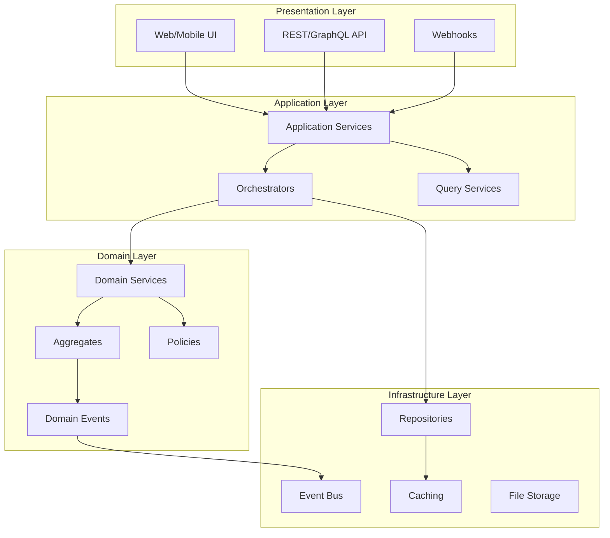

---

## **Chapter 3 - Strategic Context Map**

### 3.1 Complete Bounded Context Overview

The platform comprises **15 bounded contexts** organized into core, supporting, and foundational categories.

**Core Domains (Business Differentiators):**
1. **Approval Context** - Multi-step approval workflows
2. **Workflow Context** - Status lifecycle and transitions
3. **Project Management Context** - Planning, tracking, forecasting
4. **Task Blueprint Context** - Templates and reusable structures
5. **Task Instance Context** - Runtime task execution

**Supporting Domains:**
6. **Organization & Identity Context** - Users, teams, roles
7. **Case Management Context** - Long-running processes
8. **Resource & Cost Context** - Capacity and budget management
9. **Search Context** - Full-text and semantic search
10. **Notification Context** - Alerts and activity feeds
11. **SLA Context** - Service level tracking
12. **Import/Export Context** - Data migration and portability

**Foundational Domains:**
13. **Tenancy Context** - Multi-tenant isolation
14. **Security Context** - Authentication and authorization
15. **Audit Context** - Compliance and history tracking

**Shared Kernels:**
- State Machine Kernel
- Dependency Kernel
- Custom Field Kernel
- Timeline Kernel
- Calendar & Time Kernel
- Identity & Ownership Kernel
- Value Object Kernel

### 3.2 Master Context Map

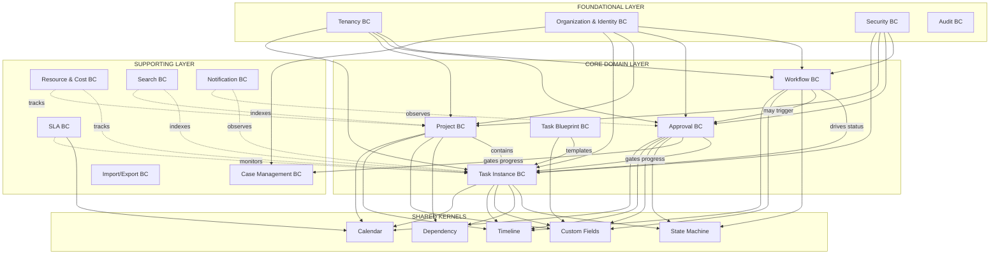

### 3.3 Context Relationship Types

**Shared Kernel (SK):**  
Both contexts depend on and can evolve a shared model (e.g., State Machine, Custom Fields).

**Customer-Supplier (CS):**  
Upstream provides services consumed by downstream (e.g., Organization → Task Instance).

**Conformist (CF):**  
Downstream conforms to upstream's model (e.g., Task Instance ← Workflow).

**Published Language (PL):**  
Communication via well-defined events and contracts (e.g., Domain Events).

**Anti-Corruption Layer (ACL):**  
Downstream protects itself from upstream changes via translation layer (e.g., External Systems → Platform).

### 3.4 Integration Patterns Matrix

| From Context | To Context | Pattern | Mechanism |
|--------------|-----------|---------|-----------|
| Workflow | Task Instance | Conformist | Domain Events + Commands |
| Approval | Task Instance | Customer-Supplier | Domain Events + State Sync |
| Project | Task Instance | Customer-Supplier | Aggregation + Events |
| Organization | All | Shared Kernel | Identity Resolution Services |
| Task Instance | Search | Published Language | Event Projection |
| Task Instance | Notification | Published Language | Event Subscription |
| External Systems | Platform | ACL | Integration Adapters |

---

## **Chapter 4 - Domain Model Principles & Patterns**

### 4.1 Aggregate Design Principles

**1. Transaction Boundary = Aggregate Boundary**  
Each aggregate is a consistency boundary ensuring invariants within a single transaction.

**2. Reference by Identity**  
Aggregates reference each other by ID, not object references, preventing distributed transactions.

**3. Small Aggregates**  
Prefer smaller aggregates to reduce contention and improve scalability.

**4. Eventual Consistency Between Aggregates**  
Cross-aggregate operations use domain events and eventual consistency.

**5. Invariants Within Aggregates**  
Business rules enforced immediately within the aggregate root.

### 4.2 Event-Driven Architecture Principles

**1. Events as First-Class Citizens**  
Domain events capture "what happened" and drive system behavior.

**2. Event Naming Convention**  
Past tense, specific: `TaskCompletedEto`, `ApprovalStepApprovedEto`

**3. Event Immutability**  
Events are immutable facts that cannot be changed.

**4. Idempotent Event Handlers**  
Handlers process events idempotently to support replay and retries.

**5. Event Versioning**  
Events include version metadata for backward compatibility.

### 4.3 Versioning Strategy

**Why Versioning:**
- Configurations change over time
- Running instances need historical definitions
- Audit trails require immutable snapshots
- Upgrades must not break existing data

**What Gets Versioned:**
- Workflow definitions
- Approval workflow definitions
- Task blueprint structures
- Custom field schemas
- Workflow schemes

**Version Pattern:**
1. **Draft State** - Editable, not used by instances
2. **Publish** - Creates immutable version
3. **Activate** - Makes version available for new instances
4. **Deprecate** - Prevents new usage but maintains existing

### 4.4 Policy-Driven Architecture

**Policies** encapsulate business rules that:
- Can change independently of domain logic
- Apply across multiple aggregates
- Require pluggable implementation
- Need external configuration

**Policy Types:**
- **Start Policies** - Control when tasks can begin
- **Completion Policies** - Define completion requirements
- **Transition Policies** - Gate workflow movements
- **Approval Policies** - Determine approval requirements
- **Escalation Policies** - Handle timeout scenarios
- **Security Policies** - Enforce access control

---

# **PART II - CONTEXT MAPPING & BOUNDED CONTEXT RELATIONSHIPS**

---

## **Chapter 5 - Core Domain Interactions**

### 5.1 Workflow ↔ Task Instance Integration

**Relationship Type:** Conformist + Published Language  
**Direction:** Workflow drives Task Instance status changes

**Integration Flow:**
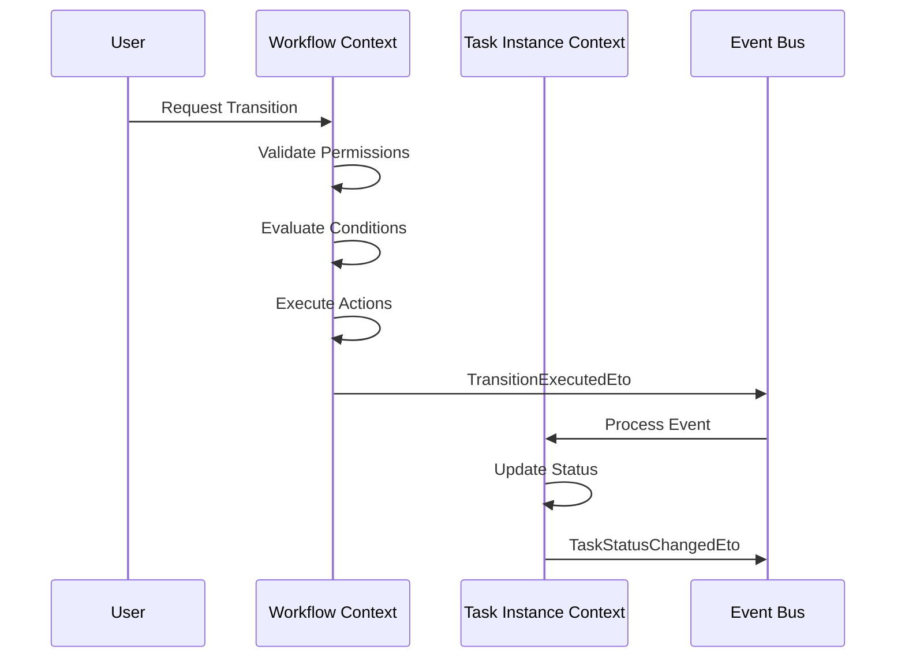

**Key Integration Points:**
- Task Instance references WorkflowVersionId
- Workflow Transitions produce commands for Task updates
- Task respects Workflow as source of truth for status
- Bidirectional events for audit and projection

### 5.2 Approval ↔ Task Instance Integration

**Relationship Type:** Customer-Supplier + Event-Driven  
**Direction:** Bidirectional - Task requests approval, Approval updates Task

**Integration Flow:**
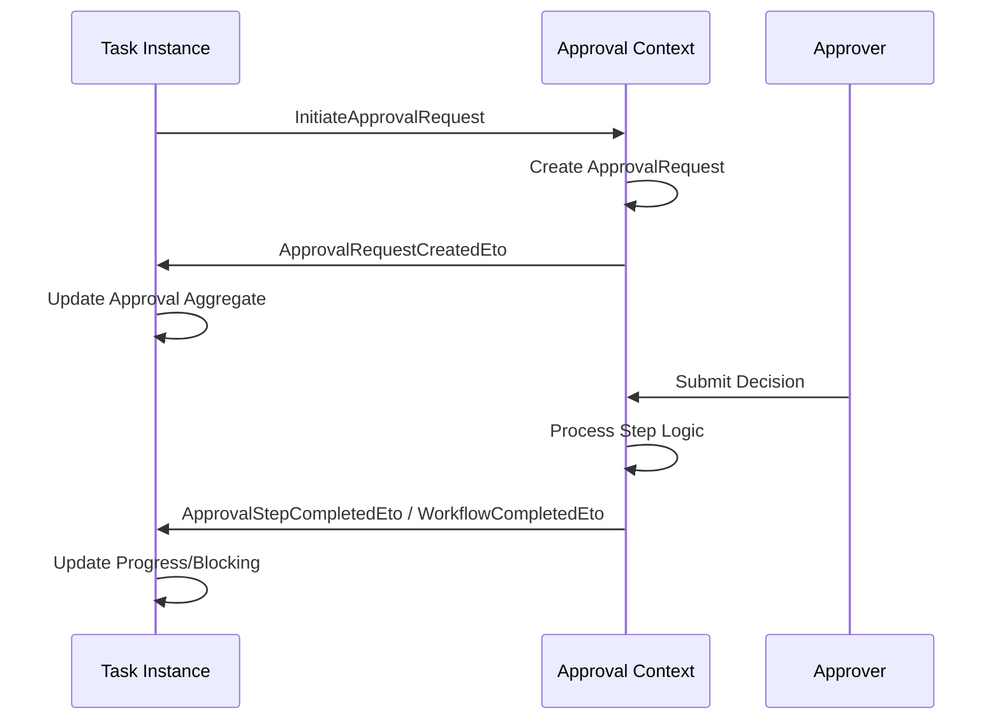

**Key Integration Points:**
- Task Approval Aggregate stores ApprovalRequestId
- Workflow Actions can trigger approval workflows
- Approval completion unblocks task transitions
- Escalations may notify task assignees

### 5.3 Project ↔ Task Instance Integration

**Relationship Type:** Containment + Aggregation  
**Direction:** Project contains Tasks, Tasks report to Project

**Integration Flow:**
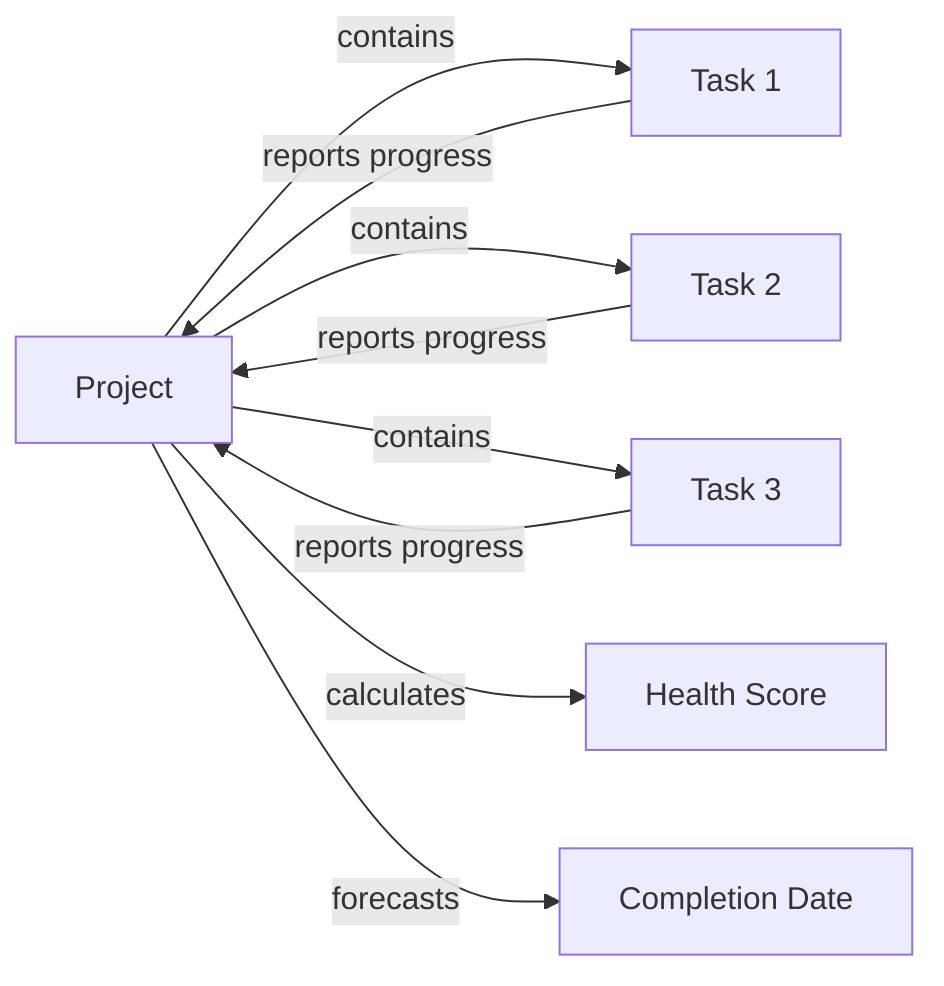

**Key Integration Points:**
- Project owns WorkflowSchemeId determining task workflows
- Task completion updates project progress metrics
- Project dependencies constrain task scheduling
- Project health score aggregates task states

### 5.4 Task Blueprint ↔ Task Instance Integration

**Relationship Type:** Template Pattern + Versioning  
**Direction:** Blueprint defines structure, Instance executes

**Instantiation Flow:**
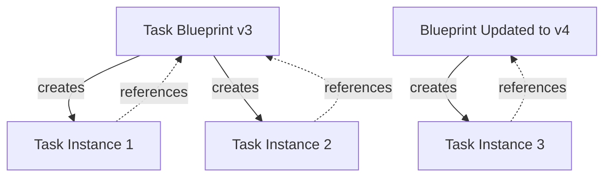

**Key Integration Points:**
- Instance always references specific BlueprintVersionId
- Blueprint provides action steps, criteria, defaults
- Changes to blueprint don't affect existing instances
- Recurrence engine uses blueprint to spawn instances

---

## **Chapter 6 - Supporting Domain Interactions**

### 6.1 Organization ↔ All Contexts

**Relationship Type:** Shared Kernel + Identity Provider  
**Direction:** Organization provides identity, All contexts consume

**Identity Resolution Pattern:**
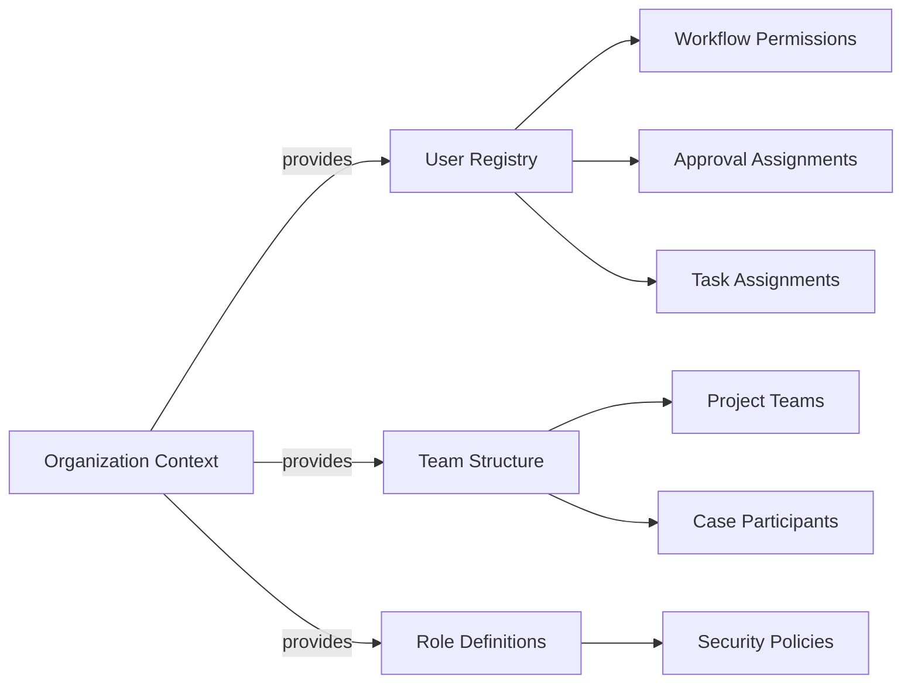

**Key Services:**
- `IUserResolver` - Get user by ID with roles and teams
- `ITeamMembershipService` - Validate team memberships
- `IOrganizationalHierarchy` - Navigate org structure
- `IRolePermissionProvider` - Resolve role permissions

### 6.2 Search ↔ All Contexts

**Relationship Type:** Published Language (Read-Only Projection)  
**Direction:** Contexts publish, Search indexes

**Indexing Architecture:**
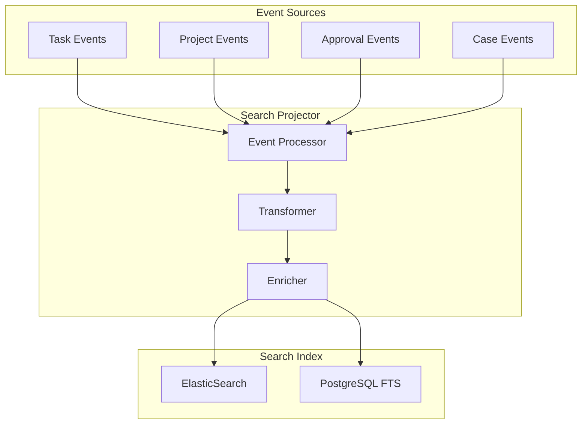

**Indexed Entities:**
- TaskInstance (title, description, comments, custom fields)
- Project (title, description, requirements)
- ApprovalRequest (subject, requestor, current step)
- Case (title, stages, participants)
- Comment threads
- Attachments (filename, content if text)

### 6.3 Notification ↔ All Contexts

**Relationship Type:** Observer Pattern via Events  
**Direction:** Contexts emit, Notification observes and dispatches

**Notification Flow:**
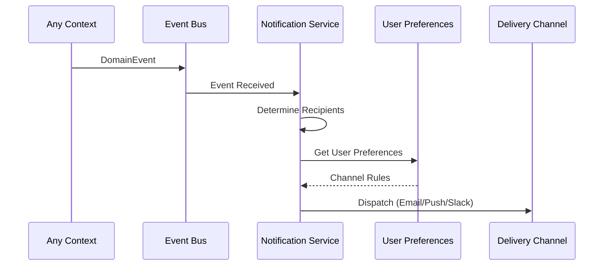

**Notification Types:**
- Task assigned/completed
- Approval requested/decided
- Project milestone reached
- Deadline approaching
- Blocking condition occurred
- Comment mentioned
- Workflow transitioned

### 6.4 SLA ↔ Task/Approval/Case Contexts

**Relationship Type:** Cross-Cutting Monitor  
**Direction:** SLA observes and tracks time-based targets

**SLA Monitoring Architecture:**
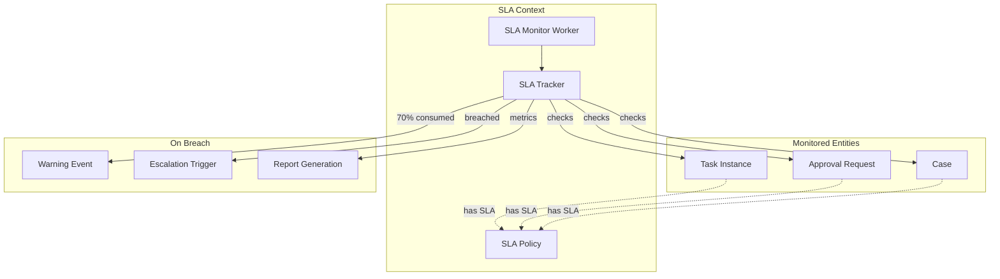

---

## **Chapter 7 - Shared Kernel Dependencies**

### 7.1 State Machine Kernel Usage

**Consumers:**
- Workflow Context (workflow statuses and transitions)
- Approval Context (approval step progression)
- Task Instance Context (task status management)
- Case Context (case stage transitions)

**Shared Components:**
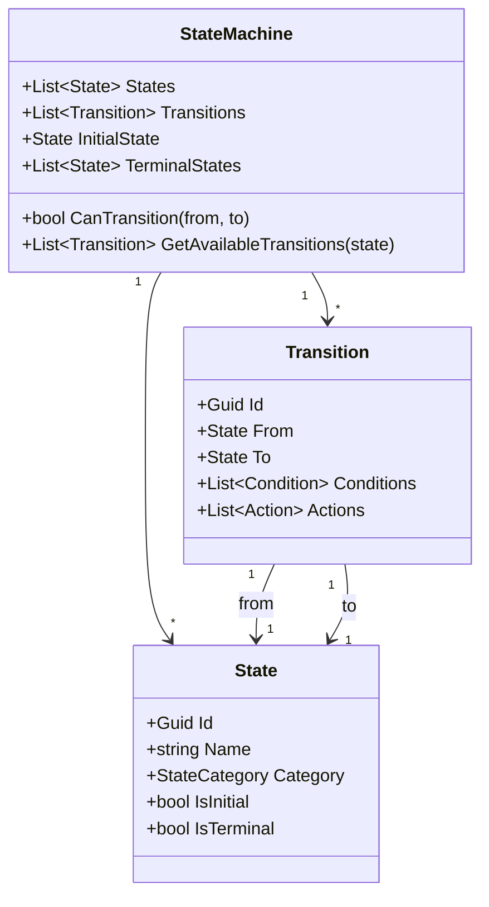

### 7.2 Custom Field Kernel Usage

**Consumers:**
- Task Type (field definitions)
- Task Instance (field values)
- Project (custom attributes)
- Approval Workflow (request metadata)
- Workflow (transition data capture)

**Field Type Support:**
- Text (single/multi-line)
- Number (integer, decimal, currency)
- Date/DateTime
- Boolean (checkbox)
- Select (single/multi)
- User/Team reference
- URL
- Rich text
- File attachment
- JSON (structured data)

### 7.3 Dependency Kernel Usage

**Consumers:**
- Project Context (project dependencies)
- Task Instance Context (task dependencies)
- Case Context (case milestone dependencies)

**Dependency Features:**
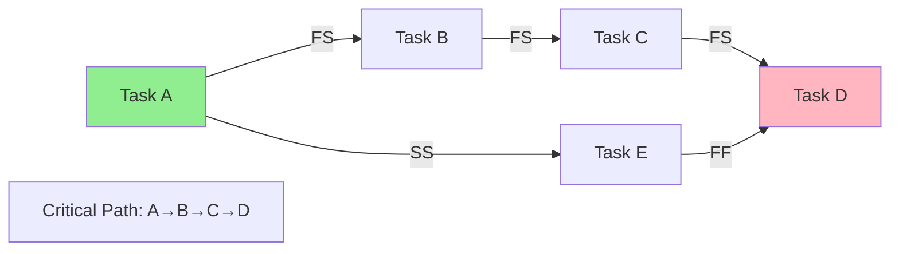

**Capabilities:**
- Circular dependency detection
- Topological sorting
- Critical path calculation
- Earliest/latest start dates
- Slack time computation
- Lag offset support

### 7.4 Timeline Kernel Usage

**Consumers:** All contexts

**Purpose:** Unified audit trail and activity feed across all entities.

**Timeline Entry Structure:**
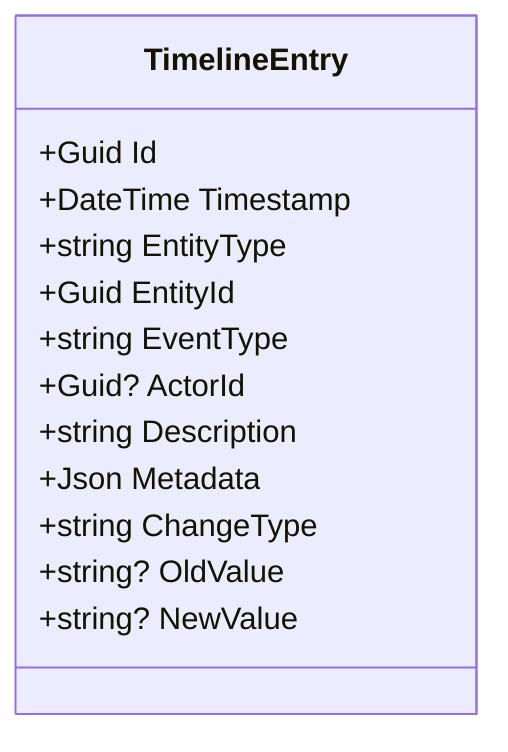

**Event Aggregation:**
- Groups related events into activity streams
- Provides chronological entity history
- Powers "what changed" queries
- Supports compliance audit requirements

### 7.5 Calendar & Time Kernel Usage

**Consumers:**
- Task scheduling
- Approval timeouts
- SLA calculations
- Project forecasting
- Recurrence engine

**Calendar Features:**
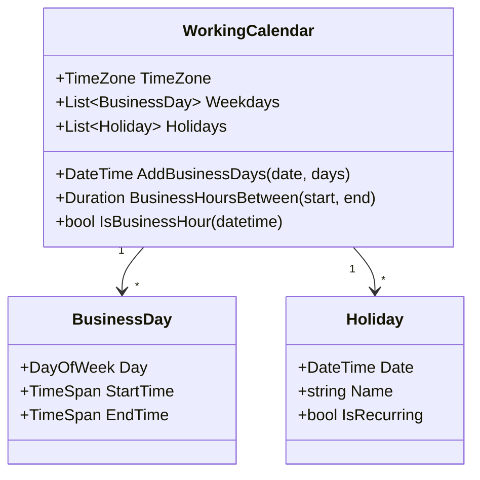

**Calendar Hierarchy:**
1. System Default Calendar
2. Tenant Calendar (overrides default)
3. Project Calendar (overrides tenant)
4. User Personal Calendar (for availability)

---

This reorganized structure provides:

1. **Clear Hierarchy:** Volume → Part → Chapter → Section
2. **Logical Progression:** Foundation → Core → Supporting → Kernels → Implementation
3. **Consistent Formatting:** Uniform heading levels and styles
4. **Enhanced Navigation:** Detailed table of contents
5. **Improved Diagrams:** Mermaid charts for visual clarity
6. **Cross-References:** Clear relationships between contexts

# **VOLUME II - CORE DOMAIN CONTEXTS**

---

# **PART III - APPROVAL DOMAIN**

---

## **Chapter 8 - Approval Domain Overview**

### 8.1 Domain Purpose

The Approval Domain governs **how requests are reviewed, processed, routed, escalated, and decided** in a formal and configurable manner. It provides:

- Multi-step approval workflows with flexible strategies
- Role, team, and user-based approver assignment
- Timeout and escalation policies
- Delegation support with audit trails
- Versioned, immutable workflow definitions
- Integration with task and case workflows

### 8.2 Approval Domain Ubiquitous Language

| Term | Definition |
|------|------------|
| **Approval Workflow** | Structured sequence of approval steps with rules defining decision progression |
| **Approval Step** | Unit of approval within a workflow containing approvers, requirements, and conditions |
| **Approver** | User, role, or team authorized to make decisions at a specific step |
| **Approval Request** | Runtime execution of an approval workflow for a specific entity |
| **Approval Decision** | Individual approval or rejection from a specific approver |
| **Approval Strategy** | Defines evaluation logic: Sequential, Parallel, Majority, Any, Custom |
| **Escalation** | Automatic actions triggered when a step exceeds time limits |
| **Timeout Policy** | Rules defining behavior when a step is not completed in time |
| **Delegation** | Temporary reassignment of approval decision rights |
| **Approval Requirement** | Minimum approvals needed: All, Majority, Any, Specific Count |

### 8.3 Strategic Role in the Platform

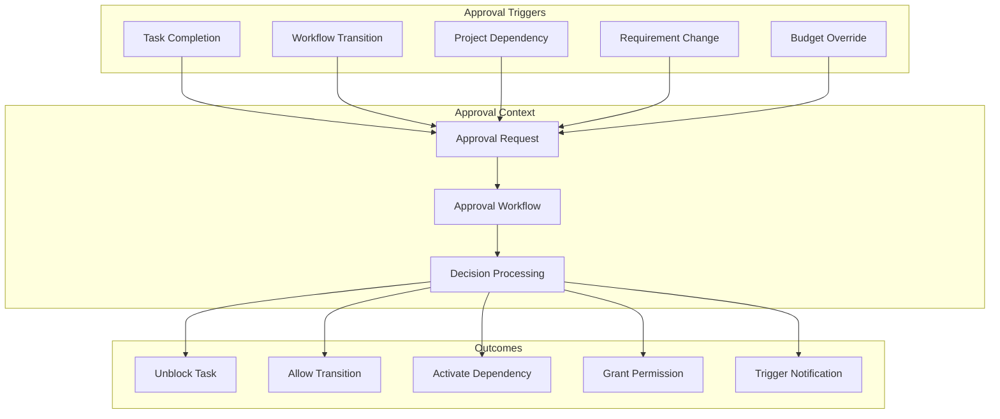

---

## **Chapter 9 - Approval Workflow Aggregate**

### 9.1 Aggregate Structure

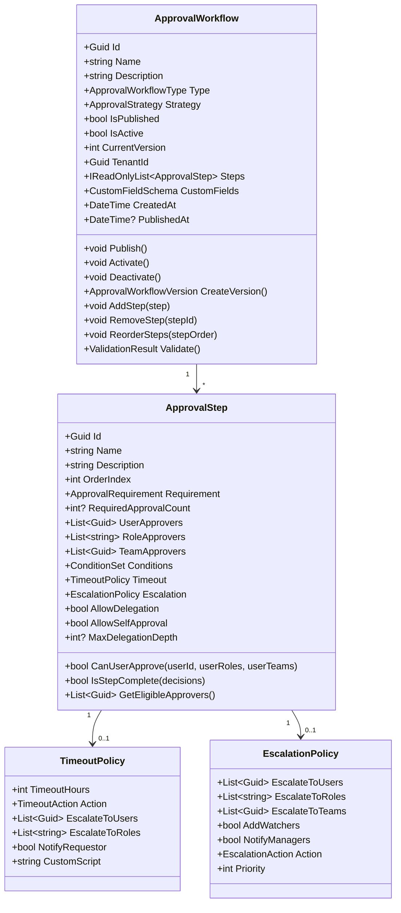

### 9.2 Workflow-Level Invariants

**Structural Invariants:**
- Must have at least 1 step when published
- Step OrderIndex values must be unique and sequential (1, 2, 3...)
- Cannot have gaps in ordering
- Cannot activate an unpublished workflow
- Published workflows are immutable (must create new version)

**Strategy Invariants:**
- Sequential strategy: steps executed in order
- Parallel strategy: all steps executed simultaneously
- Majority strategy: requires ≥2 approvers total
- Any strategy: requires ≥1 approver
- Custom strategy: must reference valid evaluator

**Step Invariants:**
- If Requirement = All → must have ≥1 approver
- If Requirement = Majority → must have ≥2 approvers
- If Requirement = Specific Count → RequiredApprovalCount must be ≤ total approvers
- Timeout hours must be > 0 if policy exists
- Conditions must reference valid fields and operators

### 9.3 Workflow Behaviors

**Publish()**
```
Pre-conditions:
  - Workflow has ≥1 step
  - All steps valid
  - No circular conditions
  - All referenced fields exist

Actions:
  - Set IsPublished = true
  - Set PublishedAt = now
  - Create immutable WorkflowVersion
  - Emit ApprovalWorkflowPublishedEto

Post-conditions:
  - Workflow cannot be edited
  - Version available for use
```

**Activate()**
```
Pre-conditions:
  - Workflow is published
  
Actions:
  - Set IsActive = true
  - Register workflow in tenant registry
  - Emit ApprovalWorkflowActivatedEto

Post-conditions:
  - Available for new requests
```

**AddStep()**
```
Pre-conditions:
  - Workflow is not published
  - OrderIndex not already used
  
Actions:
  - Validate step configuration
  - Assign next OrderIndex if not specified
  - Add to Steps collection
  - Emit StepAddedEto

Post-conditions:
  - Step count increased
```

### 9.4 Workflow Types

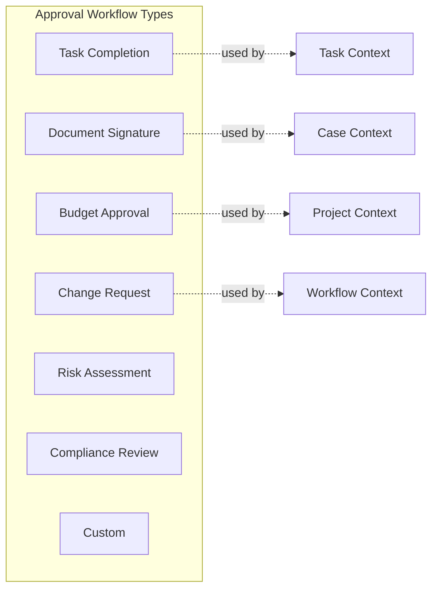

---

## **Chapter 10 - Approval Workflow Version Aggregate**

### 10.1 Purpose and Design

Workflow versioning ensures:
- Historical requests use the workflow definition from their creation time
- Changes don't affect in-flight approvals
- Audit trail maintains accuracy
- Compliance requirements met

### 10.2 Version Aggregate Structure

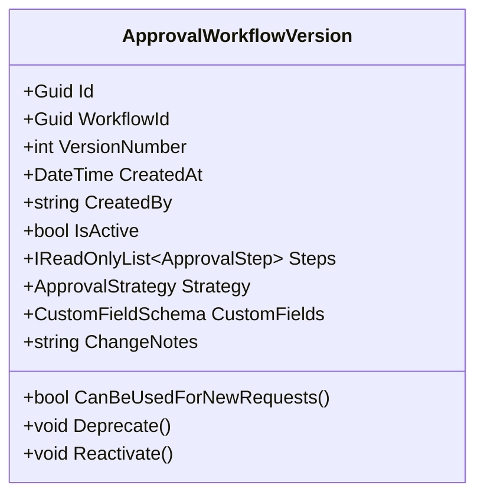

### 10.3 Version Lifecycle

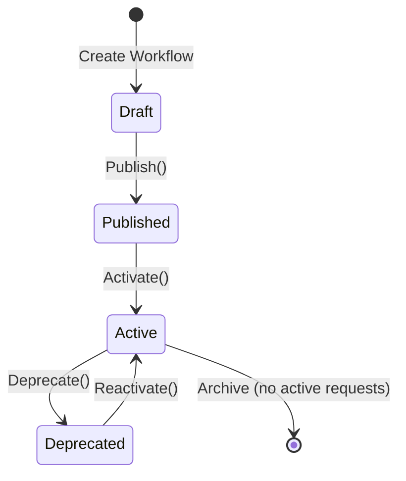

### 10.4 Version Selection Logic

**For New Requests:**
```
IF workflow has ActiveVersionId THEN
    USE ActiveVersionId
ELSE
    USE MAX(VersionNumber WHERE IsActive = true)
END IF
```

**For Existing Requests:**
```
ALWAYS USE request.WorkflowVersionId
(Never change version mid-flight)
```

---

## **Chapter 11 - Approval Step Entity**

### 11.1 Enhanced Step Structure

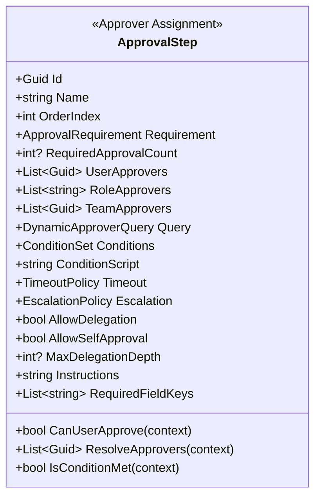

### 11.2 Approver Resolution Strategy

**Priority Order:**
1. **Direct User Assignment** - Explicit user IDs
2. **Role-Based Assignment** - Users with matching roles
3. **Team-Based Assignment** - Members of specified teams
4. **Dynamic Query** - Runtime evaluation (e.g., "task assignee's manager")

**Resolution Example:**
```
STEP: "Department Head Approval"

UserApprovers: []
RoleApprovers: ["DepartmentHead"]
TeamApprovers: [TeamId-456]
Query: "SELECT managerId FROM Users WHERE id = @requesterId"

RESOLVED APPROVERS:
  - User 789 (has role DepartmentHead)
  - User 012 (member of Team 456)
  - User 345 (manager of requestor)
  
ELIGIBLE: [789, 012, 345]
```

### 11.3 Condition Evaluation

**Condition Types:**

1. **Field Value Conditions**
```json
{
  "fieldKey": "Priority",
  "operator": "GreaterThanOrEqual",
  "value": 7
}
```

2. **Role Conditions**
```json
{
  "type": "RequesterHasRole",
  "role": "Manager"
}
```

3. **Custom Script Conditions**
```javascript
// JavaScript/Lua/Python depending on execution engine
return task.EstimatedHours > 40 && task.Budget > 10000;
```

4. **Time-Based Conditions**
```json
{
  "type": "WithinBusinessHours",
  "calendar": "US-Eastern"
}
```

### 11.4 Timeout and Escalation

**Timeout Actions:**
- `AutoApprove` - Automatically approve step
- `AutoReject` - Automatically reject step
- `Escalate` - Move to escalation policy
- `Notify` - Send reminders but wait
- `CustomScript` - Execute custom logic

**Escalation Actions:**
- Reassign to higher authority
- Add additional approvers
- Notify stakeholders
- Increase priority
- Trigger external workflow

**Example Configuration:**
```yaml
timeout:
  hours: 24
  action: Escalate
  
escalation:
  escalateToRoles: ["SeniorManager"]
  addWatchers: true
  notifyManagers: true
  priority: High
```

---

## **Chapter 12 - Approval Request Aggregate**

### 12.1 Runtime Execution Model

The **ApprovalRequest** represents the runtime state of an approval workflow executing for a specific entity (task, project dependency, document, etc.).

### 12.2 Aggregate Structure

```mermaid
classDiagram
    class ApprovalRequest {
        +Guid Id
        +Guid WorkflowVersionId
        +string EntityType
        +Guid EntityId
        +Guid RequestedBy
        +DateTime RequestedAt
        +ApprovalStatus Status
        +Guid? CurrentStepId
        +int Priority
        +DateTime? DueDate
        +RequestMetadata Metadata
        +List~ApprovalDecision~ Decisions
        +Json CustomFieldValues
        
        +void Start()
        +void ProcessDecision(decision)
        +void MoveToNextStep()
        +void Complete(outcome)
        +void Cancel(reason)
        +void Timeout()
        +void Escalate()
        
        +bool IsStepComplete(stepId)
        +List~Guid~ GetPendingApprovers()
        +ApprovalStep GetCurrentStep()
    }
    
    class ApprovalDecision {
        +Guid Id
        +Guid ApprovalRequestId
        +Guid StepId
        +Guid ApproverId
        +ApprovalAction Action
        +string Comments
        +bool IsDelegated
        +Guid? DelegatedFrom
        +DateTime DecidedAt
        +Json Metadata
        +string Signature
        
        +bool IsApproval()
        +bool IsRejection()
        +bool IsAutoDecision()
    }
    
    class RequestMetadata {
        +string Title
        +string Description
        +Dictionary~string,object~ Context
        +List~Guid~ Watchers
        +List~Guid~ NotifiedUsers
    }
    
    ApprovalRequest "1" --> "*" ApprovalDecision
    ApprovalRequest "1" --> "1" RequestMetadata
```

### 12.3 Request Status Lifecycle

```mermaid
stateDiagram-v2
    [*] --> Pending: Start()
    Pending --> InProgress: First Decision
    InProgress --> InProgress: Additional Decisions
    InProgress --> Approved: All Steps Approved
    InProgress --> Rejected: Any Step Rejected
    InProgress --> TimedOut: Timeout Exceeded
    InProgress --> Cancelled: Cancel()
    
    TimedOut --> InProgress: Manual Recovery
    TimedOut --> AutoApproved: Auto-Approval Policy
    TimedOut --> AutoRejected: Auto-Rejection Policy
    
    Approved --> [*]
    Rejected --> [*]
    AutoApproved --> [*]
    AutoRejected --> [*]
    Cancelled --> [*]
```

### 12.4 Decision Processing Logic

**Sequential Strategy:**
```
1. Load current step
2. Validate approver eligibility
3. Record decision
4. Check if step requirement met:
   - All: All approvers must approve
   - Majority: >50% must approve
   - Any: At least one approval
   - Count: Specific number reached
5. IF step complete AND no rejection:
     Move to next step
   ELSE IF rejection:
     Complete request with Rejected status
   ELSE:
     Wait for more decisions
```

**Parallel Strategy:**
```
1. All steps execute simultaneously
2. Record decision for specific step
3. Check if that step complete
4. Check if ALL steps complete:
   - If yes: Determine overall outcome
   - If any rejection: Rejected
   - If all approved: Approved
5. Complete request
```

### 12.5 Runtime Invariants

**Decision Constraints:**
- Cannot approve own request if `AllowSelfApproval = false`
- Cannot make multiple decisions on same step (unless delegation)
- Cannot make decisions on completed/cancelled requests
- Must be eligible approver for the step

**State Constraints:**
- Cannot move backward in sequential workflow
- Cannot skip steps in sequential workflow
- Parallel steps must all complete before overall completion
- Cancelled requests cannot be restarted (must create new)

**Timeout Constraints:**
- Timeout starts when step becomes active
- Pauses when blocked or on hold
- Resumes when unblocked
- Calendar-aware (business hours only if configured)

---

## **Chapter 13 - Approval Decision Entity**

### 13.1 Decision Structure and Metadata

```mermaid
classDiagram
    class ApprovalDecision {
        +Guid Id
        +Guid ApprovalRequestId
        +Guid StepId
        +Guid ApproverId
        +string ApproverName
        +ApprovalAction Action
        +DateTime DecidedAt
        
        <<Content>>
        +string Comments
        +List~Guid~ AttachmentIds
        +Json AdditionalData
        
        <<Delegation>>
        +bool IsDelegated
        +Guid? DelegatedFrom
        +DateTime? DelegatedAt
        +string DelegationReason
        
        <<Audit>>
        +string IPAddress
        +string UserAgent
        +string Signature
        +Json AuditMetadata
        
        <<Classification>>
        +bool IsApproval()
        +bool IsRejection()
        +bool IsAutoDecision()
        +bool IsEscalatedDecision()
        +bool RequiredComment()
    }
```

### 13.2 Decision Actions

| Action | Effect | Description |
|--------|--------|-------------|
| `Approve` | Positive | Step requirement progress |
| `Reject` | Terminal | Stops workflow immediately |
| `Abstain` | Neutral | Counted but doesn't affect outcome |
| `Defer` | Delayed | Postpones decision, may timeout |
| `RequestInfo` | Blocking | Pauses until info provided |

### 13.3 Delegation Chain

**Delegation Flow:**
```mermaid
sequenceDiagram
    participant A1 as Original Approver
    participant A2 as Delegate 1
    participant A3 as Delegate 2
    participant SYS as System
    
    A1->>SYS: Delegate to A2
    SYS->>A2: Delegation Request
    A2->>SYS: Accept Delegation
    A2->>SYS: Delegate to A3 (if MaxDepth allows)
    A3->>SYS: Accept Delegation
    A3->>SYS: Approve
    SYS->>SYS: Record: A3 approved, delegated from A2, delegated from A1
```

**Delegation Rules:**
- Max delegation depth enforced (typically 2-3 levels)
- Delegation requires acceptance (optional)
- Original approver notified of outcome
- Full chain recorded in audit trail
- Delegation can be revoked if decision not yet made

### 13.4 Digital Signatures (Optional)

For compliance-heavy industries:

```json
{
  "decisionId": "guid",
  "approverId": "guid",
  "action": "Approve",
  "timestamp": "2025-01-15T10:30:00Z",
  "signature": {
    "algorithm": "RSA-SHA256",
    "publicKey": "...",
    "signedHash": "...",
    "certificate": "..."
  }
}
```

---

## **Chapter 14 - Approval Domain Services**

### 14.1 Approval Workflow Engine

**Purpose:** Orchestrates the execution of approval workflows from initiation to completion.

**Responsibilities:**
- Create and initialize approval requests
- Process incoming decisions
- Evaluate step completion criteria
- Advance workflow to next steps
- Handle timeouts and escalations
- Emit domain events

**Key Methods:**
```csharp
interface IApprovalWorkflowEngine
{
    Task<ApprovalRequest> InitiateAsync(
        Guid workflowId,
        string entityType,
        Guid entityId,
        Guid requestedBy,
        Dictionary<string, object> customFields
    );
    
    Task<ApprovalRequest> ProcessDecisionAsync(
        Guid requestId,
        Guid stepId,
        Guid approverId,
        ApprovalAction action,
        string comments
    );
    
    Task<List<ApprovalStep>> GetAvailableStepsAsync(
        Guid requestId
    );
    
    Task<bool> CanUserApproveAsync(
        Guid requestId,
        Guid stepId,
        Guid userId
    );
    
    Task HandleTimeoutAsync(Guid requestId);
    Task HandleEscalationAsync(Guid requestId, Guid stepId);
}
```

### 14.2 Approval Rule Engine

**Purpose:** Evaluates conditions and rules determining approval behavior.

**Capabilities:**
- Field value condition evaluation
- Role-based condition checking
- Custom script execution
- Time-based rule evaluation
- Multi-factor condition composition (AND/OR)

**Example Usage:**
```csharp
var ruleEngine = new ApprovalRuleEngine();

var conditions = new ConditionSet
{
    Operator = LogicalOperator.AND,
    Conditions = new List<Condition>
    {
        new FieldCondition("Priority", ">", 7),
        new RoleCondition("RequesterRole", "contains", "Manager"),
        new ScriptCondition("customScript", "return budget > 50000;")
    }
};

bool shouldRequireApproval = await ruleEngine.EvaluateAsync(
    conditions,
    evaluationContext
);
```

### 14.3 Approval Timeout Processor

**Purpose:** Background service monitoring and processing timeouts.

**Architecture:**
```mermaid
flowchart TB
    subgraph Worker ["Timeout Worker (Scheduled)"]
        Scan[Scan Pending Requests]
        Check[Check Timeout Status]
        Calc[Calculate Time Remaining]
        Action[Execute Timeout Action]
    end
    
    subgraph Actions ["Timeout Actions"]
        Auto[Auto Approve/Reject]
        Esc[Escalate]
        Notify[Send Reminders]
        Script[Custom Script]
    end
    
    Scan --> Check
    Check --> Calc
    Calc -->|Exceeded| Action
    Calc -->|Warning 70%| Notify
    
    Action --> Auto
    Action --> Esc
    Action --> Script
```

**Processing Logic:**
```
EVERY 5 MINUTES:
  FOR EACH active approval request:
    IF current step has timeout policy:
      time_elapsed = NOW - step_started_at
      IF time_elapsed >= timeout_hours:
        EXECUTE timeout action
        EMIT TimeoutTriggeredEto
      ELSE IF time_elapsed >= (timeout_hours * 0.7):
        SEND warning notification
```

### 14.4 Approval Simulation Service

**Purpose:** Predict approval outcomes and timelines.

**Inputs:**
- Historical approval data
- Current approver workload
- Average decision time per approver
- Workflow complexity
- Time of day/week patterns

**Outputs:**
```json
{
  "estimatedCompletionTime": "2 business days",
  "confidenceLevel": 0.82,
  "bottleneckStep": "Executive Review",
  "recommendations": [
    "Consider delegating to available VP",
    "Current approver has 8 pending approvals"
  ],
  "historicalMedianTime": "1.5 business days",
  "p90CompletionTime": "3 business days"
}
```

---

## **Chapter 15 - Approval Domain Events**

### 15.1 Event Catalog

**Request Lifecycle Events:**
```mermaid
flowchart LR
    Created[ApprovalRequestCreatedEto]
    Started[ApprovalRequestStartedEto]
    StepActive[ApprovalStepActivatedEto]
    DecisionMade[ApprovalDecisionMadeEto]
    StepComplete[ApprovalStepCompletedEto]
    Complete[ApprovalWorkflowCompletedEto]
    
    Created --> Started
    Started --> StepActive
    StepActive --> DecisionMade
    DecisionMade --> StepComplete
    StepComplete --> Complete
```

**Event Definitions:**

**ApprovalRequestCreatedEto**
```csharp
public class ApprovalRequestCreatedEto
{
    public Guid RequestId { get; set; }
    public Guid WorkflowVersionId { get; set; }
    public string EntityType { get; set; }
    public Guid EntityId { get; set; }
    public Guid RequestedBy { get; set; }
    public DateTime RequestedAt { get; set; }
    public int EstimatedStepCount { get; set; }
}
```

**ApprovalStepCompletedEto**
```csharp
public class ApprovalStepCompletedEto
{
    public Guid RequestId { get; set; }
    public Guid StepId { get; set; }
    public string StepName { get; set; }
    public StepOutcome Outcome { get; set; } // Approved/Rejected
    public int TotalDecisions { get; set; }
    public int ApprovalsCount { get; set; }
    public int RejectionsCount { get; set; }
    public TimeSpan Duration { get; set; }
}
```

**ApprovalStepEscalatedEto** *(New)*
```csharp
public class ApprovalStepEscalatedEto
{
    public Guid RequestId { get; set; }
    public Guid StepId { get; set; }
    public EscalationReason Reason { get; set; }
    public List<Guid> EscalatedToUsers { get; set; }
    public List<string> EscalatedToRoles { get; set; }
    public DateTime EscalatedAt { get; set; }
}
```

**ApprovalAutoApprovedEto** *(New)*
```csharp
public class ApprovalAutoApprovedEto
{
    public Guid RequestId { get; set; }
    public Guid StepId { get; set; }
    public AutoApprovalReason Reason { get; set; }
    public DateTime AutoApprovedAt { get; set; }
}
```

**ApprovalWorkflowCompletedEto**
```csharp
public class ApprovalWorkflowCompletedEto
{
    public Guid RequestId { get; set; }
    public ApprovalOutcome Outcome { get; set; } // Approved/Rejected/TimedOut
    public DateTime CompletedAt { get; set; }
    public TimeSpan TotalDuration { get; set; }
    public int TotalSteps { get; set; }
    public int StepsCompleted { get; set; }
    public string EntityType { get; set; }
    public Guid EntityId { get; set; }
}
```

### 15.2 Event Subscribers

**Internal Subscribers (within Approval Context):**
- Notification service (approval activity feed)
- Timeline projector (audit trail)
- Analytics aggregator (metrics)
- SLA monitor (timeout tracking)

**External Subscribers (other contexts):**
- Task Instance Context → Unblock task on approval
- Workflow Context → Continue transition on approval
- Project Context → Activate dependency on approval
- Notification Context → Send user notifications
- Search Context → Update approval status in index

---

## **Chapter 16 - Approval Integration Patterns**

### 16.1 Task Instance Integration

**Scenario:** Task requires approval before completion.

**Integration Flow:**
```mermaid
sequenceDiagram
    participant TI as Task Instance
    participant WF as Workflow Engine
    participant AP as Approval Context
    participant User as Approver
    
    TI->>WF: Request Transition to "Completed"
    WF->>WF: Check Transition Actions
    WF->>AP: InitiateApproval(taskId, workflowId)
    AP->>AP: Create ApprovalRequest
    AP->>TI: ApprovalRequestCreatedEto
    TI->>TI: Update Approval Aggregate
    TI->>TI: Set Status = "Pending Approval"
    
    User->>AP: Submit Approval Decision
    AP->>AP: Process Workflow
    AP->>TI: ApprovalWorkflowCompletedEto
    TI->>TI: Check Outcome
    
    alt Approved
        TI->>WF: Complete Transition
        WF->>TI: Set Status = "Completed"
    else Rejected
        TI->>TI: Set Status = "In Progress"
        TI->>User: Notify Rejection
    end
```

### 16.2 Project Dependency Integration

**Scenario:** Project dependency requires approval before activation.

**Integration Pattern:**
```mermaid
flowchart LR
    P1[Project A] -->|dependency| P2[Project B]
    P1 -.->|requires approval| AP[Approval Workflow]
    AP -->|approved| P1
    P1 -->|activates| P2
```

**Event Flow:**
1. Project creates dependency with `RequiresApproval = true`
2. System initiates approval request
3. Dependency marked as `PendingApproval`
4. Upon approval, dependency status → `Active`
5. Project B can now proceed

### 16.3 Workflow Transition Integration

**Scenario:** High-risk workflow transition requires approval.

**Configuration:**
```yaml
transition:
  from: "In Progress"
  to: "Production Deployed"
  actions:
    - type: InitiateApproval
      workflowId: "deployment-approval-workflow"
      waitForCompletion: true
      onApproved:
        - CompleteTransition
      onRejected:
        - RollbackToPreviousStatus
        - NotifyTeam
```

---

# **PART IV - WORKFLOW DOMAIN**

---

## **Chapter 17 - Workflow Domain Overview**

### 17.1 Domain Purpose

The Workflow Domain governs **how tasks and entities move between statuses**, ensuring consistent, rule-driven lifecycle management. It provides:

- Configurable status workflows with validation
- Permission-based transition control
- Condition-driven transition logic
- Automated actions on transitions
- Field validation and data capture
- Workflow versioning for stability
- Graph-based workflow analysis

### 17.2 Workflow Domain Ubiquitous Language

| Term | Definition |
|------|------------|
| **Workflow** | Reusable set of statuses and transitions defining lifecycle behavior |
| **Workflow Version** | Immutable snapshot used by entities created under it |
| **Workflow Status** | Discrete lifecycle state (Todo, InProgress, Done, Blocked, etc.) |
| **Status Category** | Classification: Todo, InProgress, Done, Blocked, Cancelled |
| **Transition** | Permissible movement from one status to another |
| **Transition Condition** | Rule evaluated before allowing transition |
| **Transition Action** | Automatic operation performed when transition executes |
| **Transition Validator** | Field requirement checker before transition |
| **Permission Policy** | Rules defining who may perform a transition |
| **Workflow Scheme** | Mapping between Task Types and Workflows per project |
| **Global Transition** | Transition available from any status (e.g., Cancel) |

### 17.3 Workflow as State Machine

```mermaid
stateDiagram-v2
    [*] --> Todo
    Todo --> InProgress: Start
    InProgress --> Done: Complete
    InProgress --> Blocked: Block
    Blocked --> InProgress: Unblock
    InProgress --> Todo: Reopen
    Todo --> Cancelled: Cancel
    InProgress --> Cancelled: Cancel
    Done --> [*]
    Cancelled --> [*]
```

---

## **Chapter 18 - Workflow Aggregate**

### 18.1 Aggregate Structure

```mermaid
classDiagram
    class Workflow {
        +Guid Id
        +string Name
        +string Description
        +Guid TenantId
        +bool IsDefault
        +bool IsActive
        +int CurrentVersion
        +IReadOnlyList~WorkflowStatus~ Statuses
        +IReadOnlyList~WorkflowTransition~ Transitions
        +CustomFieldSchema CustomFields
        +DateTime CreatedAt
        +DateTime? PublishedAt
        
        +WorkflowVersion CreateVersion()
        +void AddStatus(status)
        +void RemoveStatus(statusId)
        +void AddTransition(transition)
        +void RemoveTransition(transitionId)
        +void Publish()
        +void Activate()
        +void Deactivate()
        +void SetAsDefault()
        +ValidationResult ValidateStructure()
        +List~WorkflowStatus~ GetTerminalStatuses()
    }
    
    class WorkflowStatus {
        +Guid Id
        +string Name
        +string Description
        +WorkflowStatusCategory Category
        +string ColorHex
        +int OrderIndex
        +bool IsInitial
        +bool IsTerminal
        +Json Metadata
        
        +bool IsTodo()
        +bool IsInProgress()
        +bool IsDone()
        +bool IsBlocked()
    }
    
    class WorkflowTransition {
        +Guid Id
        +string Name
        +string Description
        +Guid FromStatusId
        +Guid ToStatusId
        +TransitionPurpose Purpose
        +bool RequiresComment
        +bool RequiresResolution
        +bool IsGlobal
        +int OrderIndex
        +List~WorkflowAction~ Actions
        +List~WorkflowCondition~ Conditions
        +Dictionary~string,Validator~ Validators
        
        +bool CanExecute(context)
        +List~string~ GetRequiredFields()
    }
    
    Workflow "1" --> "*" WorkflowStatus
    Workflow "1" --> "*" WorkflowTransition
```

### 18.2 Workflow-Level Invariants

**Structural Invariants:**
- Must have at least 1 status
- Must have exactly 1 initial status (IsInitial = true)
- Must have at least 1 terminal status (IsTerminal = true)
- Cannot remove status if referenced by any transition
- Cannot deactivate if set as default workflow
- Status OrderIndex must be unique per workflow

**Transition Invariants:**
- FromStatusId ≠ ToStatusId (no self-transitions except loops)
- Both FromStatus and ToStatus must exist in workflow
- Cannot have duplicate transitions (same from/to pair with same purpose)
- Global transitions must specify FromStatus = null or special marker

**Version Invariants:**
- Published workflows are immutable
- Active entities always reference specific version
- Deprecating version doesn't affect existing instances

### 18.3 Status Categories

```mermaid
flowchart TB
    subgraph Categories ["Status Categories"]
        TODO[Todo]
        PROG[InProgress]
        DONE[Done]
        BLOCK[Blocked]
        CANC[Cancelled]
    end
    
    subgraph Properties ["Category Properties"]
        TODO -.-> P1[Initial: Often Yes]
        PROG -.-> P2[Active Work State]
        DONE -.-> P3[Terminal: Yes]
        BLOCK -.-> P4[Requires Unblocking]
        CANC -.-> P5[Terminal: Yes]
    end
```

**Category Rules:**
- **Todo**: Typically initial states, work not started
- **InProgress**: Active work states, may have substates
- **Done**: Terminal success states, cannot transition out
- **Blocked**: Work impeded, requires unblocking action
- **Cancelled**: Terminal failure states, work abandoned

---

## **Chapter 19 - Workflow Transition Deep Dive**

### 19.1 Transition Components

```mermaid
flowchart TB
    subgraph Transition ["Workflow Transition"]
        Meta[Metadata: Name, From, To]
        Perm[Permission Policies]
        Cond[Conditions]
        Valid[Validators]
        Act[Actions]
    end
    
    Meta --> Exec[Execution Pipeline]
    Perm --> Exec
    Cond --> Exec
    Valid --> Exec
    Exec --> Act
```

### 19.2 Transition Execution Pipeline

```mermaid
sequenceDiagram
    participant User
    participant TService as TransitionService
    participant Perm as PermissionChecker
    participant Cond as ConditionEvaluator
    participant Valid as FieldValidator
    participant Act as ActionExecutor
    participant Entity as Task/Entity
    
    User->>TService: ExecuteTransition(entityId, transitionId)
    TService->>Perm: CanUserExecute?
    Perm-->>TService: Authorized
    
    TService->>Cond: EvaluateConditions
    Cond-->>TService: Conditions Met
    
    TService->>Valid: ValidateRequiredFields
    Valid-->>TService: Fields Valid
    
    TService->>Act: ExecuteActions (ordered)
    Act-->>TService: Actions Completed
    
    TService->>Entity: Update Status
    Entity-->>TService: StatusUpdated
    
    TService->>TService: Emit TransitionExecutedEto
```

### 19.3 Condition Types

**Field Value Conditions:**
```json
{
  "type": "FieldCondition",
  "field": "Priority",
  "operator": "GreaterThan",
  "value": 5
}
```

**Role-Based Conditions:**
```json
{
  "type": "RoleCondition",
  "requiredRole": "Manager",
  "requireAllRoles": false
}
```

**Time-Based Conditions:**
```json
{
  "type": "TimeCondition",
  "condition": "BusinessHoursOnly",
  "calendar": "US-Eastern"
}
```

**Script Conditions:**
```javascript
{
  "type": "ScriptCondition",
  "language": "javascript",
  "script": `
    // Access to: entity, user, context
    return entity.estimatedHours < 8 && 
           entity.assignee !== null &&
           user.roles.includes('Developer');
  `
}
```

**Aggregate Conditions:**
```json
{
  "type": "CompositeCondition",
  "operator": "AND",
  "conditions": [
    {"type": "FieldCondition", "field": "Priority", "operator": ">=", "value": 7},
    {"type": "RoleCondition", "requiredRole": "Approver"},
    {"type": "TimeCondition", "condition": "BusinessHoursOnly"}
  ]
}
```

### 19.4 Validators

**Purpose:** Ensure required data is present before transition.

**Validator Types:**

| Validator | Purpose | Example |
|-----------|---------|---------|
| RequiredField | Field must have value | Resolution code on "Done" transition |
| RegexMatch | Field must match pattern | Email format validation |
| RangeCheck | Numeric field in range | Estimate between 1-100 hours |
| CustomScript | Complex validation logic | Business rule enforcement |
| ApprovalRequired | Approval must be complete | High-value task completion |

**Example Configuration:**
```yaml
transition:
  from: "In Progress"
  to: "Done"
  validators:
    - field: "ResolutionCode"
      type: Required
      message: "Resolution code must be specified"
    - field: "ActualHours"
      type: RangeCheck
      min: 0.1
      max: 1000
      message: "Actual hours must be between 0.1 and 1000"
    - type: ApprovalRequired
      condition: "Priority >= 8"
      message: "High priority tasks require approval"
```

### 19.5 Actions

**Action Execution Model:**
- Actions execute in OrderIndex sequence
- Synchronous actions block transition until complete
- Asynchronous actions queued for background processing
- ContinueOnError determines failure handling

**Action Types:**

```mermaid
flowchart LR
    subgraph ActionTypes ["Transition Action Types"]
        A1[Assign User]
        A2[Update Field]
        A3[Send Notification]
        A4[Create Subtask]
        A5[Initiate Approval]
        A6[Complete Approval]
        A7[Trigger Webhook]
        A8[Execute Script]
        A9[Update Related Entity]
        A10[Calculate Field]
    end
```

**Assignment Actions:**
```json
{
  "type": "AssignUser",
  "targetUser": "expression:task.createdBy.managerId",
  "notifyUser": true,
  "continueOnError": false
}
```

**Field Update Actions:**
```json
{
  "type": "UpdateField",
  "field": "CompletedDate",
  "value": "expression:DateTime.Now",
  "overwriteExisting": false
}
```

**Notification Actions:**
```json
{
  "type": "SendNotification",
  "template": "TaskTransitioned",
  "recipients": ["expression:task.watchers", "expression:task.assignee"],
  "channels": ["InApp", "Email"]
}
```

**Approval Actions:**
```json
{
  "type": "InitiateApproval",
  "workflowId": "standard-completion-approval",
  "waitForCompletion": true,
  "onApproved": [
    {"type": "UpdateField", "field": "ApprovedBy", "value": "expression:approval.approver"}
  ],
  "onRejected": [
    {"type": "SetStatus", "status": "In Progress"}
  ]
}
```

**Webhook Actions:**
```json
{
  "type": "TriggerWebhook",
  "url": "https://api.external.com/task-completed",
  "method": "POST",
  "headers": {"Authorization": "Bearer {secret:api-key}"},
  "body": "expression:task.toJson()",
  "async": true,
  "retryPolicy": {"maxAttempts": 3, "backoffMs": 1000}
}
```

---

## **Chapter 20 - Workflow Version Aggregate**

### 20.1 Version Immutability

Once published, a workflow version becomes immutable to ensure:
- Existing task instances maintain consistent behavior
- Audit trails remain accurate
- No unexpected behavior changes mid-flight
- Compliance requirements satisfied

### 20.2 Version Structure

```mermaid
classDiagram
    class WorkflowVersion {
        +Guid Id
        +Guid WorkflowId
        +int VersionNumber
        +DateTime PublishedAt
        +string PublishedBy
        +bool IsActive
        +string ChangeNotes
        +List~WorkflowStatus~ Statuses
        +List~WorkflowTransition~ Transitions
        +CustomFieldSchema CustomFields
        
        +bool CanBeUsedForNewEntities()
        +void Deprecate()
        +void Reactivate()
        +Graph BuildTransitionGraph()
    }
```

### 20.3 Version Lifecycle Management

```mermaid
stateDiagram-v2
    [*] --> Created: Publish()
    Created --> Active: Activate()
    Active --> Deprecated: Deprecate()
    Deprecated --> Active: Reactivate()
    Active --> Archived: Archive (no active usage)
    Archived --> [*]
```

**Version Operations:**

**Publish()**
- Creates immutable snapshot of current workflow
- Increments version number
- Records publisher and timestamp
- Validates workflow integrity
- Makes available for activation

**Activate()**
- Sets IsActive = true
- Makes version default for new entities
- Previous active version remains for existing entities

**Deprecate()**
- Sets IsActive = false
- Prevents new entity usage
- Existing entities continue using it
- Typically done when superseded by new version

**Reactivate()**
- Restores IsActive = true
- Allows rollback to previous version if needed

---

## **Chapter 21 - Workflow Scheme Aggregate**

### 21.1 Purpose

Workflow Schemes map **Task Types to Workflow Versions** within a project context, enabling:
- Different workflows for different task types
- Project-specific workflow customization
- Workflow variation without affecting other projects

### 21.2 Scheme Structure

```mermaid
classDiagram
    class WorkflowScheme {
        +Guid Id
        +Guid ProjectId
        +string Name
        +string Description
        +Guid? DefaultWorkflowVersionId
        +bool IsActive
        +bool IsDraft
        +List~WorkflowSchemeMapping~ Mappings
        
        +void Publish()
        +void Activate()
        +Guid GetWorkflowForTaskType(taskTypeId)
        +void SetMapping(taskTypeId, workflowVersionId)
        +void RemoveMapping(taskTypeId)
        +ValidationResult Validate()
    }
    
    class WorkflowSchemeMapping {
        +Guid Id
        +Guid TaskTypeId
        +Guid WorkflowVersionId
        +bool IsActive
        +DateTime CreatedAt
        +DateTime? DeprecatedAt
    }
    
    WorkflowScheme "1" --> "*" WorkflowSchemeMapping
```

### 21.3 Mapping Resolution Logic

```
WHEN creating task instance:
  1. Get ProjectId from task
  2. Load WorkflowScheme for project
  3. Lookup TaskTypeId in Mappings
  4. IF mapping exists:
       Use mapped WorkflowVersionId
     ELSE:
       Use scheme's DefaultWorkflowVersionId
     END IF
  5. IF no default:
       Use tenant's default workflow
     END IF
```

**Example Configuration:**
```yaml
scheme:
  projectId: "proj-123"
  name: "Agile Development Scheme"
  defaultWorkflow: "default-software-workflow-v2"
  mappings:
    - taskType: "Bug"
      workflow: "bug-workflow-v5"
    - taskType: "Feature"
      workflow: "feature-workflow-v3"
    - taskType: "Spike"
      workflow: "research-workflow-v1"
```

---

## **Chapter 22 - Transition Permission Policies**

### 22.1 Policy Purpose

Permission policies control WHO can execute transitions, providing:
- Role-based access control
- User-specific permissions
- Team-based permissions
- Project-level overrides
- Priority-based resolution

### 22.2 Policy Structure

```mermaid
classDiagram
    class TransitionPermissionPolicy {
        +Guid Id
        +PermissionPolicyScope Scope
        +Guid? ProjectId
        +Guid WorkflowId
        +Guid TransitionId
        +int Priority
        +List~string~ AllowedRoles
        +List~Guid~ AllowedUsers
        +List~Guid~ AllowedTeams
        +bool IsActive
        +DateTime CreatedAt
        
        +bool CanUserPerform(userId, userRoles, userTeams)
        +int GetEffectivePriority()
    }
```

### 22.3 Policy Scope Hierarchy

```
1. Project-Specific (Highest Priority)
   - Applies only to transitions in specific project
   
2. Workflow-Specific (Medium Priority)
   - Applies to transitions in specific workflow across projects
   
3. Global (Lowest Priority)
   - Applies to transitions across all workflows
```

### 22.4 Resolution Algorithm

```
FUNCTION CanUserExecuteTransition(userId, transitionId, projectId):
  policies = GetApplicablePolicies(transitionId, projectId)
  
  IF policies.Count == 0:
    RETURN true  // No policy = allow all
  END IF
  
  policies = policies.OrderByDescending(p => p.Priority)
  
  FOR EACH policy IN policies:
    IF policy.IsActive:
      userRoles = GetUserRoles(userId)
      userTeams = GetUserTeams(userId)
      
      IF policy.AllowedUsers.Contains(userId):
        RETURN true
      END IF
      
      IF policy.AllowedRoles.Intersects(userRoles):
        RETURN true
      END IF
      
      IF policy.AllowedTeams.Intersects(userTeams):
        RETURN true
      END IF
      
      // If we reach here, explicit policy exists but user doesn't match
      RETURN false
    END IF
  END FOR
  
  RETURN false
END FUNCTION
```

---

## **Chapter 23 - Workflow Validation & Graph Analysis**

### 23.1 Validation Requirements

Workflows must be validated before publishing to ensure:
- Structural integrity
- Reachability of all states
- No dangling transitions
- Proper terminal state configuration
- Condition syntax validity

### 23.2 Validation Checks

```mermaid
flowchart TB
    Start[Start Validation] --> C1{Has Initial Status?}
    C1 -->|No| Fail1[FAIL: No initial status]
    C1 -->|Yes| C2{Has Terminal Status?}
    C2 -->|No| Fail2[FAIL: No terminal status]
    C2 -->|Yes| C3{All Statuses Reachable?}
    C3 -->|No| Fail3[FAIL: Unreachable statuses]
    C3 -->|Yes| C4{Valid Transitions?}
    C4 -->|No| Fail4[FAIL: Invalid transition references]
    C4 -->|Yes| C5{Conditions Parseable?}
    C5 -->|No| Fail5[FAIL: Invalid condition syntax]
    C5 -->|Yes| C6{Actions Valid?}
    C6 -->|No| Fail6[FAIL: Invalid action configuration]
    C6 -->|Yes| Pass[PASS: Workflow Valid]
```

### 23.3 Graph Analysis

**Reachability Analysis:**
```
ALGORITHM: CheckReachability(workflow)
  graph = BuildDirectedGraph(workflow.Statuses, workflow.Transitions)
  initialStatus = workflow.Statuses.Single(s => s.IsInitial)
  
  reachable = DepthFirstSearch(graph, initialStatus)
  unreachable = workflow.Statuses.Except(reachable)
  
  IF unreachable.Count > 0:
    RETURN Invalid("Unreachable statuses: " + unreachable.Names)
  END IF
  
  RETURN Valid
END ALGORITHM
```

**Critical Path Identification:**
```mermaid
graph LR
    Init[Initial] -->|t1| A[Status A]
    A -->|t2| B[Status B]
    B -->|t3| Term[Terminal]
    Init -->|t4| C[Status C]
    C -->|t5| Term
    
    style Init fill:#90EE90
    style Term fill:#FFB6C1
    linkStyle 0,1,2 stroke:#ff0000,stroke-width:3px
```

**Dead-End Detection:**
```
ALGORITHM: DetectDeadEnds(workflow)
  terminalStatuses = workflow.Statuses.Where(s => s.IsTerminal)
  
  FOR EACH status IN workflow.Statuses:
    IF status.IsTerminal:
      CONTINUE
    END IF
    
    canReachTerminal = CanReach(status, terminalStatuses)
    IF NOT canReachTerminal:
      RETURN Invalid("Dead-end status: " + status.Name)
    END IF
  END FOR
  
  RETURN Valid
END ALGORITHM
```

---

## **Chapter 24 - Workflow Domain Services**

### 24.1 Workflow Transition Service

**Core orchestrator for transition execution.**

```csharp
public interface IWorkflowTransitionService
{
    Task<TransitionResult> ExecuteTransitionAsync(
        Guid entityId,
        string entityType,
        Guid transitionId,
        Guid userId,
        Dictionary<string, object> fieldValues,
        string comment
    );
    
    Task<List<AvailableTransition>> GetAvailableTransitionsAsync(
        Guid entityId,
        string entityType,
        Guid userId
    );
    
    Task<TransitionValidationResult> ValidateTransitionAsync(
        Guid entityId,
        string entityType,
        Guid transitionId,
        Guid userId
    );
}
```

**Execution Flow:**
```mermaid
sequenceDiagram
    participant Caller
    participant TS as TransitionService
    participant PC as PermissionChecker
    participant CE as ConditionEvaluator
    participant FV as FieldValidator
    participant AE as ActionExecutor
    participant Repo as Repository
    
    Caller->>TS: ExecuteTransition(...)
    TS->>PC: CheckPermission
    PC-->>TS: Authorized
    
    TS->>CE: EvaluateConditions
    CE-->>TS: Met
    
    TS->>FV: ValidateFields
    FV-->>TS: Valid
    
    TS->>AE: ExecuteActions
    AE-->>TS: Completed
    
    TS->>Repo: UpdateEntity
    Repo-->>TS: Saved
    
    TS->>TS: EmitTransitionExecutedEto
    TS-->>Caller: Success
```

### 24.2 Workflow Condition Evaluator Service

**Evaluates complex condition logic.**

```csharp
public interface IWorkflowConditionEvaluator
{
    Task<bool> EvaluateAsync(
        ConditionSet conditions,
        EvaluationContext context
    );
    
    Task<ConditionEvaluationResult> EvaluateWithDetailAsync(
        ConditionSet conditions,
        EvaluationContext context
    );
}

public class EvaluationContext
{
    public object Entity { get; set; }
    public Guid UserId { get; set; }
    public List<string> UserRoles { get; set; }
    public List<Guid> UserTeams { get; set; }
    public DateTime Timestamp { get; set; }
    public Dictionary<string, object> AdditionalData { get; set; }
}
```

**Condition Evaluator Strategy Pattern:**
```mermaid
classDiagram
    class IConditionEvaluator {
        <<interface>>
        +EvaluatorType Type
        +Evaluate(condition, context) bool
    }
    
    class FieldConditionEvaluator {
        +Type = FieldCondition
        +Evaluate(condition, context) bool
    }
    
    class RoleConditionEvaluator {
        +Type = RoleCondition
        +Evaluate(condition, context) bool
    }
    
    class ScriptConditionEvaluator {
        +Type = ScriptCondition
        +Evaluate(condition, context) bool
    }
    
    class TimeConditionEvaluator {
        +Type = TimeCondition
        +Evaluate(condition, context) bool
    }
    
    IConditionEvaluator <|-- FieldConditionEvaluator
    IConditionEvaluator <|-- RoleConditionEvaluator
    IConditionEvaluator <|-- ScriptConditionEvaluator
    IConditionEvaluator <|-- TimeConditionEvaluator
```

### 24.3 Workflow Action Executor Service

**Executes transition actions in order.**

```csharp
public interface IWorkflowActionExecutor
{
    Task<ActionExecutionResult> ExecuteActionsAsync(
        List<WorkflowAction> actions,
        ActionExecutionContext context
    );
    
    Task<ActionExecutionResult> ExecuteSingleActionAsync(
        WorkflowAction action,
        ActionExecutionContext context
    );
}
```

**Action Execution Pipeline:**
```
1. Load all actions for transition
2. Filter: IsEnabled = true
3. Sort by OrderIndex ASC
4. FOR EACH action:
     a. Select appropriate executor strategy
     b. Execute action (sync or async)
     c. Capture result
     d. IF error AND ContinueOnError = false:
          ABORT and rollback
     e. IF error AND ContinueOnError = true:
          LOG error and continue
5. Aggregate results
6. Emit ActionExecutedEto events
```

### 24.4 Workflow Validation Service

**Performs comprehensive workflow validation.**

```csharp
public interface IWorkflowValidationService
{
    WorkflowValidationResult ValidateStructure(Workflow workflow);
    WorkflowValidationResult ValidateGraph(Workflow workflow);
    WorkflowValidationResult ValidateConditions(Workflow workflow);
    WorkflowValidationResult ValidateActions(Workflow workflow);
    WorkflowValidationResult ValidateComplete(Workflow workflow);
}

public class WorkflowValidationResult
{
    public bool IsValid { get; set; }
    public List<ValidationError> Errors { get; set; }
    public List<ValidationWarning> Warnings { get; set; }
    public ValidationSeverity HighestSeverity { get; set; }
}
```

---

## **Chapter 25 - Workflow Domain Events**

### 25.1 Event Catalog

**Configuration Events:**
- `WorkflowCreatedEto`
- `WorkflowPublishedEto`
- `WorkflowVersionActivatedEto`
- `WorkflowVersionDeprecatedEto`
- `WorkflowSchemePublishedEto`

**Runtime Events:**
- `WorkflowTransitionExecutedEto`
- `WorkflowTransitionDeniedEto`
- `WorkflowStatusChangedEto`
- `WorkflowActionExecutedEto`
- `WorkflowConditionFailedEto`

### 25.2 Key Event Definitions

**WorkflowTransitionExecutedEto:**
```csharp
public class WorkflowTransitionExecutedEto
{
    public Guid EntityId { get; set; }
    public string EntityType { get; set; }
    public Guid TransitionId { get; set; }
    public string TransitionName { get; set; }
    public Guid FromStatusId { get; set; }
    public string FromStatusName { get; set; }
    public Guid ToStatusId { get; set; }
    public string ToStatusName { get; set; }
    public Guid ExecutedBy { get; set; }
    public DateTime ExecutedAt { get; set; }
    public TimeSpan ExecutionDuration { get; set; }
    public int ActionsExecuted { get; set; }
    public string Comment { get; set; }
    public Dictionary<string, object> FieldChanges { get; set; }
}
```

**WorkflowTransitionDeniedEto:**
```csharp
public class WorkflowTransitionDeniedEto
{
    public Guid EntityId { get; set; }
    public string EntityType { get; set; }
    public Guid TransitionId { get; set; }
    public Guid UserId { get; set; }
    public DenialReason Reason { get; set; }
    public string ReasonDetails { get; set; }
    public DateTime AttemptedAt { get; set; }
    public List<string> FailedConditions { get; set; }
    public List<string> MissingPermissions { get; set; }
    public List<string> MissingFields { get; set; }
}

public enum DenialReason
{
    InsufficientPermissions,
    ConditionsNotMet,
    RequiredFieldsMissing,
    ValidationFailed,
    ApprovalRequired,
    EntityLocked,
    Custom
}
```

---

## **Chapter 26 - Workflow Integration Patterns**

### 26.1 Integration with Task Instance

**Conformist Pattern:** Task Instance conforms to Workflow as authority on status.

```mermaid
sequenceDiagram
    participant TI as Task Instance
    participant WF as Workflow Context
    participant Events as Event Bus
    
    TI->>WF: Request Transition
    WF->>WF: Validate & Execute
    WF->>Events: TransitionExecutedEto
    Events->>TI: Process Event
    TI->>TI: Update Status Aggregate
    TI->>Events: TaskStatusChangedEto
```

### 26.2 Integration with Approval

**Bidirectional Event Flow:**

```mermaid
flowchart LR
    WF[Workflow] -->|action: InitiateApproval| AP[Approval]
    AP -->|ApprovalCompletedEto| WF
    WF -->|continues transition| Task[Task]
```

### 26.3 Integration with Project

**Workflow Scheme Resolution:**

```mermaid
flowchart TB
    Task[New Task Created] --> Project[Get ProjectId]
    Project --> Scheme[Load WorkflowScheme]
    Scheme --> Type[Get TaskTypeId]
    Type --> Lookup[Lookup Mapping]
    Lookup --> WorkflowVer[WorkflowVersion]
    WorkflowVer --> Task
```

---

# **PART V - PROJECT MANAGEMENT DOMAIN**

---

## **Chapter 27 - Project Domain Overview**

### 27.1 Domain Purpose

The Project Management Domain governs **planning, execution, tracking, forecasting, and risk evaluation** of work at the project level. It provides:

- Project lifecycle management with goals and timelines
- Sprint-based iteration planning
- Requirement tracking and validation
- Success criteria measurement
- Dependency management with critical path analysis
- Health scoring and risk detection
- Forecasting and predictive analytics
- Portfolio-level aggregation

### 27.2 Project Domain Ubiquitous Language

| Term | Definition |
|------|------------|
| **Project** | Structured unit of work containing goals, timelines, tasks, and success criteria |
| **Sprint** | Time-boxed iteration with goals, start/end dates, and story points |
| **Project Requirement** | Functional or non-functional requirement tied to project lifecycle |
| **Success Criterion** | Measurable indicator tracking project outcome alignment |
| **Project Dependency** | Relationship between projects constraining execution order |
| **Critical Path** | Longest dependency chain determining earliest completion date |
| **Health Score** | Risk indicator: OnTrack, AtRisk, Behind, Critical, Completed |
| **Project Portfolio** | Aggregated view of multiple projects for prioritization |
| **Milestone** | Significant project checkpoint or deliverable |
| **Velocity** | Rate of work completion (story points per sprint) |
| **Burndown** | Remaining work over time visualization |
| **Scope Creep** | Uncontrolled expansion of project requirements |

### 27.3 Strategic Positioning

```mermaid
flowchart TB
    subgraph Planning ["Planning Phase"]
        P1[Create Project]
        P2[Define Requirements]
        P3[Set Success Criteria]
        P4[Establish Dependencies]
        P5[Create Sprints]
    end
    
    subgraph Execution ["Execution Phase"]
        E1[Create Tasks]
        E2[Track Progress]
        E3[Monitor Health]
        E4[Manage Dependencies]
        E5[Complete Sprints]
    end
    
    subgraph Analysis ["Analysis Phase"]
        A1[Calculate Health Score]
        A2[Forecast Completion]
        A3[Identify Risks]
        A4[Generate Reports]
    end
    
    P1 --> P2 --> P3 --> P4 --> P5
    P5 --> E1 --> E2 --> E3 --> E4 --> E5
    E2 --> A1
    E3 --> A2
    E4 --> A3
    A1 --> A4
    A2 --> A4
    A3 --> A4
```

---

## **Chapter 28 - Project Aggregate**

### 28.1 Aggregate Structure

```mermaid
classDiagram
    class Project {
        +Guid Id
        +Guid TenantId
        +Guid OwnerId
        +string Title
        +string Description
        +ProjectStatus Status
        +bool IsArchived
        +double Importance
        +double Urgency
        +EisenhowerQuadrant Quadrant
        
        <<Scheduling>>
        +DateTime? StartDate
        +DateTime? DueDate
        +DateTime? ActualCompletionDate
        +double ProgressPercentage
        
        <<Configuration>>
        +Guid? WorkflowSchemeId
        +Guid? WorkingCalendarId
        +ProjectType Type
        
        <<Relationships>>
        +List~ProjectSuccessCriterion~ SuccessCriteria
        +List~ProjectDependency~ Dependencies
        +List~ProjectMilestone~ Milestones
        +List~Guid~ CollaboratingTeams
        +List~Guid~ CollaboratingUsers
        
        <<Custom Fields>>
        +Dictionary~string,object~ CustomFields
        
        +void Start()
        +void Complete()
        +void Cancel()
        +void Pause()
        +void Resume()
        +void Archive()
        +void UpdateProgress()
        +ProjectHealthReport CalculateHealth()
        +void AddDependency(dependency)
        +void RemoveDependency(dependencyId)
        +void AddSuccessCriterion(criterion)
    }
    
    class ProjectSuccessCriterion {
        +Guid Id
        +string Title
        +string Description
        +SuccessCriterionType Type
        +string MeasurementMethod
        +double? TargetNumeric
        +double? ActualNumeric
        +string TargetText
        +string ActualText
        +double Weight
        +bool IsMet
        +DateTime? DueDate
        +DateTime? AchievedDate
        +List~Evidence~ Evidence
        
        +double CalculateAchievementPercentage()
        +bool IsOverdue()
        +void MarkAsMet()
    }
    
    class ProjectDependency {
        +Guid Id
        +Guid DependsOnProjectId
        +ProjectDependencyType Type
        +int LagDays
        +bool IsBlocking
        +DependencyStatus Status
        +Guid? ApprovalRequestId
        +string Description
        +DateTime CreatedAt
        
        +bool RequiresApproval()
        +bool IsResolved()
        +DateTime CalculateEarliestStart()
    }
    
    class ProjectMilestone {
        +Guid Id
        +string Name
        +string Description
        +DateTime PlannedDate
        +DateTime? ActualDate
        +MilestoneStatus Status
        +List~Guid~ RequiredTaskIds
        +bool IsKeyMilestone
        
        +bool IsAchieved()
        +bool IsOverdue()
    }
    
    Project "1" --> "*" ProjectSuccessCriterion
    Project "1" --> "*" ProjectDependency
    Project "1" --> "*" ProjectMilestone
```

### 28.2 Project-Level Invariants

**Status Transition Rules:**
- Cannot start a Cancelled or Completed project
- Cannot cancel a Completed project
- Cannot complete without meeting required success criteria
- Cannot archive an Active project (must complete or cancel first)
- Cannot move from Completed to Active

**Date Constraints:**
- DueDate must be > StartDate if both exist
- ActualCompletionDate must be ≥ StartDate
- Sprint dates must fall within project dates

**Success Criteria Rules:**
- Maximum 20 criteria per project
- Total weight of all criteria = 100% (recommended)
- Individual criterion weight: 0-100
- At least 1 criterion recommended for measurability

**Dependency Rules:**
- Cannot create circular dependencies
- Project cannot depend on itself
- Dependency lag must be ≥ 0 days
- Blocking dependencies must be resolved before completion

**Team Collaboration:**
- Must have at least 1 team or owner
- Owner must be active user
- Teams must be active and within same tenant

### 28.3 Project Lifecycle

```mermaid
stateDiagram-v2
    [*] --> Draft: Create
    Draft --> Planning: Start Planning
    Planning --> Active: Start Execution
    Active --> OnHold: Pause
    OnHold --> Active: Resume
    Active --> Completed: Complete
    Active --> Cancelled: Cancel
    Planning --> Cancelled: Cancel
    Draft --> Cancelled: Cancel
    Completed --> Archived: Archive (after retention)
    Cancelled --> Archived: Archive (after retention)
    Archived --> [*]
    
    note right of Active
        Most work happens here:
        - Tasks created/completed
        - Sprints executed
        - Progress tracked
    end note
```

### 28.4 Core Project Behaviors

**Start()**
```
Pre-conditions:
  - Status = Draft or Planning
  - Has at least 1 success criterion (recommended)
  - No blocking unresolved dependencies
  - Owner is active
  
Actions:
  - Set Status = Active
  - Set StartDate = NOW (if null)
  - Calculate initial health score
  - Emit ProjectStartedEto
  
Post-conditions:
  - Tasks can be created
  - Sprints can be started
  - Progress tracking begins
```

**Complete()**
```
Pre-conditions:
  - Status = Active
  - All required success criteria met (if configured)
  - All blocking tasks completed (if configured)
  - No active sprints
  
Actions:
  - Set Status = Completed
  - Set ActualCompletionDate = NOW
  - Set ProgressPercentage = 100
  - Calculate final health score
  - Archive related data (optional)
  - Emit ProjectCompletedEto
  
Post-conditions:
  - No new tasks can be created
  - Project becomes read-only (except archival)
  - Dependent projects can proceed
```

**UpdateProgress()**
```
ALGORITHM:
  taskProgress = (CompletedTasks / TotalTasks) * 100
  criteriaProgress = SUM(criterion.AchievementPercentage * criterion.Weight)
  
  ProgressPercentage = (taskProgress * 0.6) + (criteriaProgress * 0.4)
  
  EMIT ProjectProgressUpdatedEto
```

**CalculateHealth()**
```
INPUTS:
  - ProgressPercentage
  - TimeElapsed / TotalTime
  - Success criteria progress
  - Overdue status
  - Blocking dependencies count
  - Sprint velocity trends
  - Risk indicators
  
ALGORITHM:
  expectedProgress = (TimeElapsed / TotalTime) * 100
  progressVariance = ProgressPercentage - expectedProgress
  
  IF progressVariance >= 10:
    baseHealth = OnTrack
  ELSE IF progressVariance >= -5:
    baseHealth = AtRisk
  ELSE IF progressVariance >= -15:
    baseHealth = Behind
  ELSE:
    baseHealth = Critical
  
  // Adjust for other factors
  IF HasOverdueTasks():
    baseHealth = Downgrade(baseHealth)
  
  IF HasBlockingDependencies():
    baseHealth = Downgrade(baseHealth)
  
  IF VelocityDecreasing():
    baseHealth = Downgrade(baseHealth)
  
  RETURN baseHealth
```

---

## **Chapter 29 - Success Criteria Entity**

### 29.1 Purpose and Types

Success criteria define **what "done" means** for the project beyond task completion.

**Criterion Types:**

```mermaid
flowchart TB
    subgraph Types ["Success Criterion Types"]
        T1[Quantitative<br/>Numeric measurement]
        T2[Qualitative<br/>Subjective assessment]
        T3[Binary<br/>Yes/No achievement]
        T4[Evidence-Based<br/>Documentation required]
        T5[Time-Bound<br/>Deadline critical]
    end
```

### 29.2 Criterion Structure

```mermaid
classDiagram
    class ProjectSuccessCriterion {
        +Guid Id
        +string Title
        +string Description
        +SuccessCriterionType Type
        
        <<Measurement>>
        +string MeasurementMethod
        +double? TargetNumeric
        +double? ActualNumeric
        +string TargetText
        +string ActualText
        +string Unit
        
        <<Weighting>>
        +double Weight
        +bool IsRequired
        +int Priority
        
        <<Status>>
        +bool IsMet
        +DateTime? DueDate
        +DateTime? AchievedDate
        +CriterionStatus Status
        
        <<Evidence>>
        +List~Evidence~ Evidence
        +bool RequiresEvidence
        +int MinimumEvidenceCount
        
        +double CalculateAchievementPercentage()
        +bool IsOverdue()
        +void MarkAsMet(evidence)
        +void Update(actual)
    }
    
    class Evidence {
        +Guid Id
        +string Title
        +string Description
        +EvidenceType Type
        +string Url
        +Guid? AttachmentId
        +DateTime ProvidedAt
        +Guid ProvidedBy
    }
    
    ProjectSuccessCriterion "1" --> "*" Evidence
```

### 29.3 Criterion Examples

**Quantitative Criterion:**
```yaml
criterion:
  title: "Achieve 95% Customer Satisfaction"
  type: Quantitative
  measurementMethod: "Post-launch survey"
  targetNumeric: 95
  actualNumeric: 92  # Updated as measured
  unit: "%"
  weight: 20
  isMet: false  # 92 < 95
```

**Binary Criterion:**
```yaml
criterion:
  title: "Pass Security Audit"
  type: Binary
  measurementMethod: "Third-party audit"
  isMet: true
  weight: 30
  evidence:
    - title: "Audit Report"
      type: Document
      attachmentId: "guid-123"
```

**Evidence-Based Criterion:**
```yaml
criterion:
  title: "Deploy to Production"
  type: EvidenceBased
  requiresEvidence: true
  minimumEvidenceCount: 2
  evidence:
    - title: "Deployment Log"
    - title: "Health Check Screenshot"
  isMet: true
```

### 29.4 Achievement Calculation

**For Quantitative:**
```
IF Type = Quantitative:
  achievementPct = (ActualNumeric / TargetNumeric) * 100
  achievementPct = MIN(achievementPct, 100)  // Cap at 100%
END IF
```

**For Binary:**
```
IF Type = Binary:
  achievementPct = IsMet ? 100 : 0
END IF
```

**For Evidence-Based:**
```
IF Type = EvidenceBased:
  providedEvidence = Evidence.Count
  requiredEvidence = MinimumEvidenceCount
  achievementPct = (providedEvidence / requiredEvidence) * 100
  achievementPct = MIN(achievementPct, 100)
END IF
```

---

## **Chapter 30 - Project Sprint Aggregate**

### 30.1 Sprint Purpose

Sprints enable **time-boxed iteration** with defined goals, capacity, and velocity tracking.

### 30.2 Sprint Structure

```mermaid
classDiagram
    class ProjectSprint {
        +Guid Id
        +Guid ProjectId
        +string Name
        +string Goal
        +DateTime StartDate
        +DateTime EndDate
        +int PlannedPoints
        +int CompletedPoints
        +int AddedPoints
        +SprintStatus Status
        
        <<Metrics>>
        +double Velocity
        +double CompletionRate
        +int TasksPlanned
        +int TasksCompleted
        +int TasksCarriedOver
        
        <<Retrospective>>
        +string Retrospective
        +List~string~ WhatWentWell
        +List~string~ WhatToImprove
        +List~string~ ActionItems
        
        +void Start()
        +void Complete()
        +void UpdatePoints(taskId, points)
        +SprintHealth CalculateHealth()
        +BurndownData GetBurndown()
    }
```

### 30.3 Sprint Invariants

**Duration Constraints:**
- Minimum duration: 7 days
- Maximum duration: 30 days
- Typical duration: 14 days (2 weeks)

**Point Constraints:**
- CompletedPoints ≤ PlannedPoints + AddedPoints
- PlannedPoints must be > 0
- Points cannot be negative

**Status Constraints:**
- Cannot modify completed sprint
- Cannot start sprint before previous ends (if sequential)
- Cannot complete sprint before EndDate (early completion allowed with approval)

**Task Constraints:**
- Tasks assigned to sprint must belong to same project
- Completed sprint cannot have tasks reassigned

### 30.4 Sprint Lifecycle

```mermaid
stateDiagram-v2
    [*] --> Planned: Create Sprint
    Planned --> Active: Start
    Active --> Completed: Complete
    Active --> Cancelled: Cancel
    Completed --> [*]
    Cancelled --> [*]
    
    note right of Active
        Tasks worked on
        Daily standup
        Progress tracked
        Burndown monitored
    end note
    
    note right of Completed
        Retrospective held
        Velocity calculated
        Carry-over identified
    end note
```

### 30.5 Velocity Calculation

**Velocity** = Rate of work completion per sprint

```
Velocity = CompletedPoints / DurationInDays

Example:
  Sprint: 14 days
  Completed: 56 story points
  Velocity = 56 / 14 = 4 points/day
  
Team Velocity (average over last N sprints):
  TeamVelocity = AVG(lastNSprints.Velocity)
```

**Usage in Forecasting:**
```
Remaining Work = 200 story points
Team Velocity = 4 points/day
Estimated Days = 200 / 4 = 50 days
Estimated Completion = Today + 50 days
```

### 30.6 Burndown Chart Data

```mermaid
graph LR
    subgraph BurndownChart ["Sprint Burndown"]
        Day0[Day 0: 56 pts]
        Day3[Day 3: 48 pts]
        Day7[Day 7: 35 pts]
        Day10[Day 10: 22 pts]
        Day14[Day 14: 0 pts]
        
        Day0 --> Day3
        Day3 --> Day7
        Day7 --> Day10
        Day10 --> Day14
        
        Ideal[Ideal Line]
        Day0 -.->|linear| Day14
    end
```

**Data Structure:**
```csharp
public class BurndownData
{
    public int PlannedPoints { get; set; }
    public List<BurndownPoint> ActualBurndown { get; set; }
    public List<BurndownPoint> IdealBurndown { get; set; }
    public double PercentComplete { get; set; }
    public double PercentTimeElapsed { get; set; }
    public bool IsOnTrack => PercentComplete >= PercentTimeElapsed - 5;
}

public class BurndownPoint
{
    public DateTime Date { get; set; }
    public int RemainingPoints { get; set; }
}
```

---

## **Chapter 31 - Project Dependency Entity**

### 31.1 Dependency Types

```mermaid
flowchart LR
    subgraph DependencyTypes ["Project Dependency Types"]
        FS[Finish-to-Start<br/>Most common]
        SS[Start-to-Start<br/>Parallel start]
        FF[Finish-to-Finish<br/>Parallel completion]
        SF[Start-to-Finish<br/>Rare]
        DEL[Deliverable<br/>Output required]
        RES[Resource<br/>Shared resources]
        APP[Approval<br/>Requires approval]
        INFO[Informational<br/>FYI only]
    end
```

### 31.2 Dependency Structure

```mermaid
classDiagram
    class ProjectDependency {
        +Guid Id
        +Guid ProjectId
        +Guid DependsOnProjectId
        +ProjectDependencyType Type
        +int LagDays
        +bool IsBlocking
        +DependencyStatus Status
        
        <<Approval Integration>>
        +Guid? ApprovalRequestId
        +bool RequiresApproval
        
        <<Metadata>>
        +string Description
        +DateTime CreatedAt
        +Guid CreatedBy
        +DateTime? ResolvedAt
        
        +DateTime CalculateEarliestStart()
        +bool IsResolved()
        +void MarkAsResolved()
    }
```

### 31.3 Dependency Examples

**Finish-to-Start (FS):**
```yaml
dependency:
  type: FinishToStart
  dependsOn: "Database Migration Project"
  lagDays: 2  # 2 days after predecessor completes
  description: "Application deployment requires completed DB migration"
  isBlocking: true
  
Calculation:
  earliestStart = predecessor.CompletionDate + lagDays
  IF predecessor not complete:
    cannotStart = true
```

**Start-to-Start (SS):**
```yaml
dependency:
  type: StartToStart
  dependsOn: "UI Design Project"
  lagDays: 5
  description: "Backend API can start 5 days after UI design starts"
  isBlocking: false
```

**Deliverable Dependency:**
```yaml
dependency:
  type: Deliverable
  dependsOn: "Requirements Analysis"
  description: "Need approved requirements document"
  requiresApproval: true
  deliverable: "Requirements Document v2.0"
```

### 31.4 Dependency Graph and Critical Path

**Graph Representation:**
```mermaid
graph LR
    P1[Project A] -->|FS, 0 days| P2[Project B]
    P1 -->|SS, 10 days| P3[Project C]
    P2 -->|FS, 5 days| P4[Project D]
    P3 -->|FS, 3 days| P4
    P4 -->|FS, 0 days| P5[Project E]
    
    style P1 fill:#90EE90
    style P5 fill:#FFB6C1
    linkStyle 0,3,4 stroke:#ff0000,stroke-width:3px
```

**Critical Path:** P1 → P2 → P4 → P5 (longest path)

**Critical Path Algorithm:**
```
FUNCTION CalculateCriticalPath(projects):
  graph = BuildDependencyGraph(projects)
  
  // Forward pass: Calculate earliest start/finish
  FOR EACH project IN TopologicalOrder(graph):
    project.EarliestStart = MAX(predecessor.EarliestFinish + lag)
    project.EarliestFinish = EarliestStart + Duration
  END FOR
  
  // Backward pass: Calculate latest start/finish
  FOR EACH project IN ReverseTopologicalOrder(graph):
    project.LatestFinish = MIN(successor.LatestStart - lag)
    project.LatestStart = LatestFinish - Duration
  END FOR
  
  // Identify critical path (zero slack)
  criticalPath = []
  FOR EACH project:
    slack = LatestStart - EarliestStart
    IF slack = 0:
      criticalPath.Add(project)
    END IF
  END FOR
  
  RETURN criticalPath
END FUNCTION
```

---

## **Chapter 32 - Project Requirement Entity**

### 32.1 Requirement Purpose

Requirements define **what the project must deliver** with formal tracking and approval workflows.

### 32.2 Requirement Structure

```mermaid
classDiagram
    class ProjectRequirement {
        +Guid Id
        +Guid ProjectId
        +string Title
        +string Description
        +RequirementType Type
        +RequirementPriority Priority
        +RequirementStatus Status
        
        <<Classification>>
        +RequirementCategory Category
        +bool IsHighRisk
        +string Source
        
        <<Sizing>>
        +int? StoryPoints
        +int? BusinessValue
        +double? EstimatedHours
        
        <<Acceptance>>
        +List~AcceptanceCriterion~ AcceptanceCriteria
        +bool AllCriteriaMet
        
        <<Traceability>>
        +List~Guid~ LinkedTaskIds
        +Guid? ParentRequirementId
        +Guid? ApprovalRequestId
        
        +void Approve()
        +void Reject(reason)
        +void Implement()
        +void Verify()
    }
```

### 32.3 Requirement Lifecycle

```mermaid
stateDiagram-v2
    [*] --> Proposed: Create
    Proposed --> UnderReview: Submit for Review
    UnderReview --> Approved: Approve
    UnderReview --> Rejected: Reject
    Approved --> InProgress: Start Implementation
    InProgress --> Implemented: Complete
    Implemented --> Verified: Verify
    Verified --> [*]
    
    Rejected --> [*]
    
    note right of UnderReview
        High-risk requirements
        may require approval workflow
    end note
```

### 32.4 Requirement Types

| Type | Description | Example |
|------|-------------|---------|
| Functional | System behavior | "User can reset password" |
| NonFunctional | Quality attributes | "Page load < 2 seconds" |
| Constraint | Limitation or restriction | "Must use AWS infrastructure" |
| Assumption | Expected condition | "Users have modern browsers" |
| Risk | Potential problem | "Third-party API may be unstable" |

### 32.5 Acceptance Criteria

**Given-When-Then Format:**
```yaml
requirement:
  title: "User Login"
  acceptanceCriteria:
    - given: "User is on login page"
      when: "User enters valid credentials"
      then: "User is redirected to dashboard"
      
    - given: "User is on login page"
      when: "User enters invalid credentials"
      then: "Error message is displayed"
      
    - given: "User fails login 3 times"
      when: "User attempts 4th login"
      then: "Account is temporarily locked"
```

---

## **Chapter 33 - Project Health Calculation Service**

### 33.1 Health Scoring Inputs

```mermaid
flowchart TB
    subgraph Inputs ["Health Score Inputs"]
        I1[Progress vs Time]
        I2[Success Criteria Progress]
        I3[Overdue Status]
        I4[Critical Blockers]
        I5[Sprint Performance]
        I6[Workload Forecast]
        I7[Risk Indicators]
        I8[Velocity Trends]
        I9[Dependency Status]
        I10[Budget Variance]
    end
    
    subgraph Calculation ["Health Calculation Engine"]
        W1[Weighted Scoring]
        W2[Threshold Evaluation]
        W3[Trend Analysis]
    end
    
    subgraph Output ["Health Report"]
        O1[Overall Health Score]
        O2[Risk Level]
        O3[Recommendations]
        O4[Forecast]
    end
    
    I1 --> W1
    I2 --> W1
    I3 --> W2
    I4 --> W2
    I5 --> W3
    I6 --> W3
    I7 --> W2
    I8 --> W3
    I9 --> W2
    I10 --> W1
    
    W1 --> O1
    W2 --> O2
    W3 --> O4
    O1 --> O3
    O2 --> O3
    O4 --> O3
```

### 33.2 Health Score Algorithm

```csharp
public class ProjectHealthCalculationService
{
    public ProjectHealthReport CalculateHealth(Project project)
    {
        var report = new ProjectHealthReport();
        
        // 1. Base health from progress vs time
        var progressHealth = CalculateProgressHealth(project);
        
        // 2. Success criteria health
        var criteriaHealth = CalculateSuccessCriteriaHealth(project);
        
        // 3. Schedule health
        var scheduleHealth = CalculateScheduleHealth(project);
        
        // 4. Dependency health
        var dependencyHealth = CalculateDependencyHealth(project);
        
        // 5. Velocity health (if sprints exist)
        var velocityHealth = CalculateVelocityHealth(project);
        
        // Weighted average
        report.BaseHealth = (
            progressHealth * 0.30 +
            criteriaHealth * 0.25 +
            scheduleHealth * 0.20 +
            dependencyHealth * 0.15 +
            velocityHealth * 0.10
        );
        
        // Apply penalties
        report.BaseHealth -= GetBlockerPenalty(project);
        report.BaseHealth -= GetRiskPenalty(project);
        
        // Determine overall health category
        report.OverallHealth = CategorizeHealth(report.BaseHealth);
        
        // Generate recommendations
        report.Recommendations = GenerateRecommendations(project, report);
        
        return report;
    }
    
    private double CalculateProgressHealth(Project project)
    {
        var timeElapsed = (DateTime.Now - project.StartDate).TotalDays;
        var totalTime = (project.DueDate - project.StartDate)?.TotalDays ?? 0;
        
        if (totalTime <= 0) return 100;
        
        var expectedProgress = (timeElapsed / totalTime) * 100;
        var actualProgress = project.ProgressPercentage;
        var variance = actualProgress - expectedProgress;
        
        // Convert variance to health score (0-100)
        if (variance >= 10) return 100;      // Ahead of schedule
        if (variance >= 0) return 90;        // On track
        if (variance >= -10) return 70;      // Slightly behind
        if (variance >= -20) return 50;      // Behind
        if (variance >= -30) return 30;      // Significantly behind
        return 10;                            // Critical
    }
    
    private double CalculateSuccessCriteriaHealth(Project project)
    {
        if (!project.SuccessCriteria.Any()) return 100;
        
        var weightedSum = project.SuccessCriteria
            .Sum(c => c.CalculateAchievementPercentage() * c.Weight);
        var totalWeight = project.SuccessCriteria.Sum(c => c.Weight);
        
        return totalWeight > 0 ? weightedSum / totalWeight : 100;
    }
}
```

### 33.3 Health Report Structure

```csharp
public class ProjectHealthReport
{
    public double BaseHealth { get; set; }
    public ProjectHealth OverallHealth { get; set; }
    public double RiskScore { get; set; }
    public double ScheduleVariance { get; set; }
    public double BudgetVariance { get; set; }
    
    public int BlockedDependenciesCount { get; set; }
    public int OverdueTasksCount { get; set; }
    public int HighRiskIssuesCount { get; set; }
    
    public List<string> Recommendations { get; set; }
    public List<HealthIndicator> Indicators { get; set; }
    
    public DateTime CalculatedAt { get; set; }
    public DateTime? ForecastedCompletionDate { get; set; }
    public double ConfidenceLevel { get; set; }
}

public enum ProjectHealth
{
    OnTrack,      // Green: Health >= 80
    AtRisk,       // Yellow: Health 60-79
    Behind,       // Orange: Health 40-59
    Critical,     // Red: Health < 40
    Completed     // Checkmark: Status = Completed
}
```

---

## **Chapter 34 - Project Forecasting Service**

### 34.1 Forecasting Purpose

Predict project outcomes using:
- Historical velocity data
- Current progress rates
- Dependency analysis
- Resource availability
- Risk factors

### 34.2 Forecasting Inputs and Outputs

```mermaid
flowchart LR
    subgraph Inputs ["Forecasting Inputs"]
        I1[Sprint Velocities]
        I2[Task Completion Rates]
        I3[Requirement Changes]
        I4[Dependency Delays]
        I5[Approval Wait Times]
        I6[Resource Allocation]
        I7[Historical Data]
    end
    
    subgraph Models ["Forecasting Models"]
        M1[Linear Regression]
        M2[Monte Carlo Simulation]
        M3[Critical Path Method]
        M4[Earned Value Management]
    end
    
    subgraph Outputs ["Forecast Results"]
        O1[Expected Completion Date]
        O2[Probability Distribution]
        O3[Risk Analysis]
        O4[Resource Forecast]
        O5[Budget Forecast]
    end
    
    I1 --> M1
    I2 --> M1
    I3 --> M2
    I4 --> M3
    I5 --> M2
    I6 --> M4
    I7 --> M1
    
    M1 --> O1
    M2 --> O2
    M3 --> O1
    M4 --> O5
    
    O1 --> O3
    O2 --> O3
```

### 34.3 Completion Date Forecast

**Simple Velocity-Based Forecast:**
```csharp
public DateTime ForecastCompletionDate(Project project)
{
    // Get remaining work
    var totalPoints = project.GetTotalStoryPoints();
    var completedPoints = project.GetCompletedStoryPoints();
    var remainingPoints = totalPoints - completedPoints;
    
    // Calculate average velocity from last N sprints
    var recentSprints = project.GetRecentSprints(count: 3);
    var avgVelocity = recentSprints.Average(s => s.Velocity);
    
    if (avgVelocity <= 0) return project.DueDate ?? DateTime.MaxValue;
    
    // Calculate days needed
    var daysNeeded = remainingPoints / avgVelocity;
    
    // Apply working calendar
    var calendar = project.GetWorkingCalendar();
    var forecastDate = calendar.AddBusinessDays(DateTime.Today, (int)daysNeeded);
    
    return forecastDate;
}
```

**Monte Carlo Simulation:**
```csharp
public ForecastDistribution MonteCarloForecast(Project project, int iterations = 10000)
{
    var completionDates = new List<DateTime>();
    
    for (int i = 0; i < iterations; i++)
    {
        // Randomize velocity based on historical variance
        var velocity = RandomizeVelocity(project.GetHistoricalVelocities());
        
        // Randomize scope changes
        var scopeChange = RandomizeScopeChange(project.GetHistoricalScopeChanges());
        
        // Randomize delays
        var delay = RandomizeDelays(project.GetHistoricalDelays());
        
        // Calculate completion date for this iteration
        var completion = SimulateCompletion(velocity, scopeChange, delay);
        completionDates.Add(completion);
    }
    
    return new ForecastDistribution
    {
        P10 = Percentile(completionDates, 0.10),  // Optimistic
        P50 = Percentile(completionDates, 0.50),  // Most likely
        P90 = Percentile(completionDates, 0.90),  // Pessimistic
        Mean = completionDates.Average(d => d.Ticks).ToDateTime(),
        StandardDeviation = CalculateStdDev(completionDates)
    };
}
```

### 34.4 Risk Probability Assessment

```csharp
public class RiskAssessment
{
    public double ProbabilityOfDelay { get; set; }
    public double ProbabilityOfBudgetOverrun { get; set; }
    public double ProbabilityOfScopeCreep { get; set; }
    
    public List<RiskFactor> TopRiskFactors { get; set; }
    public List<string> Mitigations { get; set; }
}

public double CalculateProbabilityOfDelay(Project project)
{
    var factors = new[]
    {
        project.VelocityDecreasing() ? 0.3 : 0.0,
        project.HasBlockingDependencies() ? 0.25 : 0.0,
        project.HighScopeChangeRate() ? 0.2 : 0.0,
        project.ResourceConstrained() ? 0.15 : 0.0,
        project.BehindSchedule() ? 0.4 : 0.0
    };
    
    // Compound probability
    var noDelayProbability = factors.Aggregate(1.0, (p, f) => p * (1 - f));
    return 1 - noDelayProbability;
}
```

---

## **Chapter 35 - Project Domain Services**

### 35.1 Project Dependency Service

**Manages dependency graph and critical path analysis.**

```csharp
public interface IProjectDependencyService
{
    Task<DependencyGraph> BuildDependencyGraphAsync(List<Project> projects);
    Task<List<Project>> GetCriticalPathAsync(List<Project> projects);
    Task<ValidationResult> ValidateNoCyclesAsync(ProjectDependency newDependency);
    Task<DateTime> CalculateEarliestStartDateAsync(Guid projectId);
    Task<List<Project>> GetBlockedProjectsAsync();
}
```

**Circular Dependency Detection:**
```csharp
public async Task<ValidationResult> ValidateNoCyclesAsync(ProjectDependency newDependency)
{
    var graph = await BuildDependencyGraphAsync();
    
    // Add the new dependency temporarily
    graph.AddEdge(newDependency.ProjectId, newDependency.DependsOnProjectId);
    
    // Check for cycles using DFS
    var hasCycle = DetectCycleUsingDFS(graph);
    
    if (hasCycle)
    {
        return ValidationResult.Failure(
            "Adding this dependency would create a circular dependency chain"
        );
    }
    
    return ValidationResult.Success();
}
```

### 35.2 Project Portfolio Service

**Aggregates and analyzes multiple projects.**

```csharp
public interface IProjectPortfolioService
{
    Task<PortfolioOverview> GetPortfolioOverviewAsync(List<Guid> projectIds);
    Task<List<Project>> GetHighRiskProjectsAsync();
    Task<ResourceAllocationReport> GetResourceAllocationAsync();
    Task<PortfolioHealthHeatmap> GetHealthHeatmapAsync();
}

public class PortfolioOverview
{
    public int TotalProjects { get; set; }
    public int OnTrackProjects { get; set; }
    public int AtRiskProjects { get; set; }
    public int BehindProjects { get; set; }
    public int CriticalProjects { get; set; }
    
    public double AverageHealth { get; set; }
    public double AverageProgress { get; set; }
    
    public int TotalTasks { get; set; }
    public int CompletedTasks { get; set; }
    
    public List<ProjectSummary> Projects { get; set; }
    public List<DependencyChain> CrossProjectDependencies { get; set; }
}
```

---

## **Chapter 36 - Project Domain Events**

### 36.1 Project Lifecycle Events

```csharp
// Project creation and status
public class ProjectCreatedEto
{
    public Guid ProjectId { get; set; }
    public string Title { get; set; }
    public Guid OwnerId { get; set; }
    public Guid TenantId { get; set; }
    public DateTime CreatedAt { get; set; }
}

public class ProjectStatusChangedEto
{
    public Guid ProjectId { get; set; }
    public ProjectStatus OldStatus { get; set; }
    public ProjectStatus NewStatus { get; set; }
    public Guid ChangedBy { get; set; }
    public DateTime ChangedAt { get; set; }
    public string Reason { get; set; }
}

public class ProjectCompletedEto
{
    public Guid ProjectId { get; set; }
    public DateTime CompletedAt { get; set; }
    public TimeSpan TotalDuration { get; set; }
    public int TotalTasks { get; set; }
    public int CompletedTasks { get; set; }
    public double FinalHealth { get; set; }
    public List<SuccessCriterionResult> SuccessCriteriaResults { get; set; }
}
```

### 36.2 Sprint Events

```csharp
public class SprintStartedEto
{
    public Guid SprintId { get; set; }
    public Guid ProjectId { get; set; }
    public string SprintName { get; set; }
    public DateTime StartDate { get; set; }
    public DateTime EndDate { get; set; }
    public int PlannedPoints { get; set; }
}

public class SprintCompletedEto
{
    public Guid SprintId { get; set; }
    public Guid ProjectId { get; set; }
    public DateTime CompletedAt { get; set; }
    public int PlannedPoints { get; set; }
    public int CompletedPoints { get; set; }
    public double Velocity { get; set; }
    public double CompletionRate { get; set; }
}
```

### 36.3 Requirement Events

```csharp
public class RequirementApprovedEto
{
    public Guid RequirementId { get; set; }
    public Guid ProjectId { get; set; }
    public string Title { get; set; }
    public Guid ApprovedBy { get; set; }
    public DateTime ApprovedAt { get; set; }
}

public class RequirementRejectedEto
{
    public Guid RequirementId { get; set; }
    public Guid ProjectId { get; set; }
    public string Title { get; set; }
    public Guid RejectedBy { get; set; }
    public string Reason { get; set; }
    public DateTime RejectedAt { get; set; }
}
```

### 36.4 Dependency Events

```csharp
public class ProjectDependencyResolvedEto
{
    public Guid DependencyId { get; set; }
    public Guid ProjectId { get; set; }
    public Guid DependsOnProjectId { get; set; }
    public DateTime ResolvedAt { get; set; }
    public bool WasBlocking { get; set; }
}

public class ProjectDependencyBlockingEto
{
    public Guid DependencyId { get; set; }
    public Guid ProjectId { get; set; }
    public Guid BlockedByProjectId { get; set; }
    public string Reason { get; set; }
    public DateTime BlockedAt { get; set; }
}
```

---

## **Chapter 37 - Project Integration Patterns**

### 37.1 Project → Task Integration

**Relationship:** Project contains and aggregates tasks.

```mermaid
sequenceDiagram
    participant Project
    participant Task
    participant Events
    
    Task->>Events: TaskCompletedEto
    Events->>Project: Handle Event
    Project->>Project: UpdateProgress()
    Project->>Project: CalculateHealth()
    Project->>Events: ProjectProgressUpdatedEto
```

**Progress Aggregation:**
```csharp
public async Task HandleTaskCompletedAsync(TaskCompletedEto evt)
{
    var project = await _projectRepository.GetAsync(evt.ProjectId);
    
    // Recalculate progress
    project.UpdateProgress();
    
    // Recalculate health
    var health = await _healthService.CalculateHealthAsync(project);
    project.UpdateHealth(health);
    
    await _projectRepository.UpdateAsync(project);
    
    // Emit project updated event
    await _eventBus.PublishAsync(new ProjectProgressUpdatedEto
    {
        ProjectId = project.Id,
        NewProgress = project.ProgressPercentage,
        Health = health.OverallHealth
    });
}
```

### 37.2 Project → Workflow Scheme Integration

**Workflow Resolution:**
```mermaid
flowchart TB
    Task[Create Task] --> GetProject[Get Project]
    GetProject --> GetScheme[Load Workflow Scheme]
    GetScheme --> GetType[Get Task Type]
    GetType --> Lookup[Lookup Mapping]
    Lookup --> Workflow[Assign Workflow Version]
    Workflow --> Task
```

### 37.3 Project → Approval Integration

**High-Risk Operations:**
- Requirement approval
- Budget change approval
- Dependency approval
- Milestone approval
- Scope change approval

```yaml
projectApprovalTriggers:
  - event: RequirementAdded
    condition: requirement.IsHighRisk = true
    workflow: "requirement-approval-workflow"
    
  - event: DependencyAdded
    condition: dependency.RequiresApproval = true
    workflow: "dependency-approval-workflow"
    
  - event: BudgetChanged
    condition: budgetChange > 10%
    workflow: "budget-change-approval-workflow"
```

---

# **PART VI - TASK BLUEPRINT DOMAIN**

---

## **Chapter 38 - Task Blueprint Domain Overview**

### 38.1 Domain Purpose

The Task Blueprint Domain defines **reusable templates** for tasks, ensuring consistent structure and standards across the organization. It provides:

- Standardized task templates with default values
- Action step checklists for execution guidance
- Acceptance criteria definitions
- Recurrence rules for automated task generation
- Task type classification and customization
- Version control for template evolution
- Field configuration per task type

### 38.2 Task Blueprint Ubiquitous Language

| Term | Definition |
|------|------------|
| **Task Blueprint (Task)** | Template representing how a task should be structured |
| **Task Blueprint Version** | Immutable historical snapshot of a blueprint |
| **Action Step** | Checklist-style instruction required to complete a task |
| **Acceptance Criterion** | Given-When-Then scenario representing success conditions |
| **Recurrence Rule** | Schedule defining automatic periodic task creation |
| **Task Type** | Classification grouping for workflows, fields, and organization |
| **Task Category** | Higher-level grouping (Bug, Feature, Spike, Epic, etc.) |
| **Template Pack** | Collection of related blueprints for specific use cases |
| **Default Values** | Pre-populated field values when creating from template |

### 38.3 Blueprint Usage Pattern

```mermaid
flowchart TB
    subgraph Creation ["Blueprint Creation"]
        C1[Define Structure]
        C2[Add Action Steps]
        C3[Define Acceptance Criteria]
        C4[Set Default Values]
        C5[Configure Recurrence]
    end
    
    subgraph Publishing ["Publishing"]
        P1[Validate Blueprint]
        P2[Create Version]
        P3[Activate]
    end
    
    subgraph Instantiation ["Task Creation"]
        I1[Select Blueprint]
        I2[Copy Structure]
        I3[Apply Defaults]
        I4[Create Instance]
    end
    
    C1 --> C2 --> C3 --> C4 --> C5
    C5 --> P1 --> P2 --> P3
    P3 --> I1 --> I2 --> I3 --> I4
```

---

## **Chapter 39 - Task Blueprint Aggregate**

### 39.1 Aggregate Structure

```mermaid
classDiagram
    class TaskBlueprint {
        +Guid Id
        +Guid TenantId
        +Guid OwnerId
        +string Title
        +string Description
        +Guid? ProjectId
        +Guid TaskTypeId
        
        <<Default Values>>
        +double DefaultImportance
        +double DefaultUrgency
        +EisenhowerQuadrant DefaultQuadrant
        +int? EstimateMinutes
        +DateTime? DefaultDueDate
        +Guid? DefaultAssigneeId
        +List~string~ DefaultTags
        +Dictionary~string,object~ DefaultCustomFields
        
        <<Recurrence>>
        +bool IsRecurring
        +RecurrenceRule Recurrence
        +DateTime? RecurrenceStartDate
        +DateTime? RecurrenceEndDate
        +int? MaxOccurrences
        
        <<Structure>>
        +List~ActionStep~ ActionSteps
        +List~AcceptanceCriterion~ AcceptanceCriteria
        +List~Guid~ DefaultWatchers
        
        <<Versioning>>
        +bool IsActive
        +int CurrentVersion
        +DateTime CreatedAt
        +DateTime? LastModifiedAt
        
        +TaskBlueprintVersion CreateVersion()
        +void AddActionStep(step)
        +void RemoveActionStep(stepId)
        +void ReorderActionSteps(order)
        +void AddAcceptanceCriterion(criterion)
        +void MakeRecurring(rule)
        +void RemoveRecurrence()
        +void Activate()
        +void Deactivate()
        +ValidationResult Validate()
    }
    
    class ActionStep {
        +Guid Id
        +string Title
        +string Description
        +string Notes
        +bool IsRequired
        +int Sequence
        +int? EstimatedMinutes
        +List~Guid~ RequiredAttachmentTypes
        
        +bool IsComplete(taskInstance)
    }
    
    class AcceptanceCriterion {
        +Guid Id
        +string Description
        +string Given
        +string When
        +string Then
        +int? Priority
        +bool IsRequired
        
        +string GetFormattedGWT()
        +bool IsCritical()
    }
    
    TaskBlueprint "1" --> "*" ActionStep
    TaskBlueprint "1" --> "*" AcceptanceCriterion
```

### 39.2 Blueprint-Level Invariants

**Structural Constraints:**
- Title required and unique within project/tenant
- Maximum 50 action steps per blueprint
- Maximum 20 acceptance criteria per blueprint
- Action step sequence must be continuous (1, 2, 3...)
- At least 1 required action step recommended

**Value Constraints:**
- Importance: 0.0 - 1.0
- Urgency: 0.0 - 1.0
- EstimateMinutes: ≥ 0
- DefaultDueDate: future date if specified

**Recurrence Constraints:**
- If IsRecurring = true → RecurrenceRule must be valid
- RecurrenceEndDate must be > RecurrenceStartDate
- MaxOccurrences must be > 0 if specified
- Cannot have both RecurrenceEndDate AND MaxOccurrences

**Action Step Constraints:**
- Sequence must be unique per blueprint
- No gaps in sequence numbering
- Required steps cannot be removed if instances exist
- Title required, minimum 3 characters

**Acceptance Criteria Constraints:**
- Must have complete Given-When-Then if using BDD format
- Required criteria must be verifiable
- Cannot remove criteria if referenced by completed tasks

### 39.3 Blueprint Behaviors

**AddActionStep()**
```csharp
public void AddActionStep(ActionStep step)
{
    // Validate max steps
    if (ActionSteps.Count >= 50)
        throw new DomainException("Maximum 50 action steps allowed");
    
    // Auto-assign sequence if not provided
    if (step.Sequence == 0)
        step.Sequence = ActionSteps.Max(s => s.Sequence) + 1;
    
    // Validate sequence uniqueness
    if (ActionSteps.Any(s => s.Sequence == step.Sequence))
        throw new DomainException($"Sequence {step.Sequence} already exists");
    
    ActionSteps.Add(step);
    
    AddDomainEvent(new ActionStepAddedEto
    {
        BlueprintId = Id,
        StepId = step.Id,
        Sequence = step.Sequence
    });
}
```

**ReorderActionSteps()**
```csharp
public void ReorderActionSteps(List<(Guid stepId, int newSequence)> reordering)
{
    // Validate continuous sequence
    var sequences = reordering.Select(r => r.newSequence).OrderBy(s => s).ToList();
    for (int i = 0; i < sequences.Count; i++)
    {
        if (sequences[i] != i + 1)
            throw new DomainException("Sequence must be continuous starting from 1");
    }
    
    // Apply reordering
    foreach (var (stepId, newSequence) in reordering)
    {
        var step = ActionSteps.Single(s => s.Id == stepId);
        step.Sequence = newSequence;
    }
    
    ActionSteps = ActionSteps.OrderBy(s => s.Sequence).ToList();
}
```

**MakeRecurring()**
```csharp
public void MakeRecurring(RecurrenceRule rule)
{
    // Validate rule
    var validation = rule.Validate();
    if (!validation.IsValid)
        throw new DomainException($"Invalid recurrence rule: {validation.ErrorMessage}");
    
    IsRecurring = true;
    Recurrence = rule;
    
    AddDomainEvent(new BlueprintMadeRecurringEto
    {
        BlueprintId = Id,
        Rule = rule
    });
}
```

---

## **Chapter 40 - Action Steps Deep Dive**

### 40.1 Action Step Purpose

Action steps provide **structured guidance** for task execution, acting as:
- Execution checklist
- Quality gate
- Knowledge capture
- Training aid

### 40.2 Enhanced Action Step Structure

```mermaid
classDiagram
    class ActionStep {
        +Guid Id
        +string Title
        +string Description
        +string Notes
        +int Sequence
        +bool IsRequired
        
        <<Estimation>>
        +int? EstimatedMinutes
        +StepComplexity Complexity
        
        <<Validation>>
        +List~string~ RequiredFields
        +List~Guid~ RequiredAttachmentTypes
        +ValidationRule CustomValidation
        
        <<Dependencies>>
        +List~Guid~ DependsOnStepIds
        +bool CanBeParallel
        
        <<Guidance>>
        +string HelpUrl
        +List~string~ Tips
        +List~string~ CommonMistakes
        
        +bool CanBeCompleted(context)
        +bool IsComplete(taskInstance)
        +List~ActionStep~ GetPrerequisiteSteps()
    }
```

### 40.3 Step Types and Patterns

**Sequential Steps:**
```yaml
steps:
  - sequence: 1
    title: "Gather Requirements"
    isRequired: true
    estimatedMinutes: 120
    
  - sequence: 2
    title: "Create Design Document"
    isRequired: true
    dependsOn: [step-1]
    estimatedMinutes: 180
    
  - sequence: 3
    title: "Get Design Approval"
    isRequired: true
    dependsOn: [step-2]
    requiredFields: ["DesignApprover"]
```

**Parallel Steps:**
```yaml
steps:
  - sequence: 4
    title: "Write Unit Tests"
    canBeParallel: true
    estimatedMinutes: 90
    
  - sequence: 5
    title: "Implement Feature"
    canBeParallel: true
    estimatedMinutes: 240
    
  - sequence: 6
    title: "Update Documentation"
    canBeParallel: true
    estimatedMinutes: 60
```

**Validation Steps:**
```yaml
steps:
  - sequence: 7
    title: "Submit for Code Review"
    isRequired: true
    dependsOn: [step-4, step-5]
    requiredAttachmentTypes: ["PullRequest"]
    customValidation: "CodeCoverageAbove80Percent"
```

### 40.4 Step Completion Tracking

**In Task Instance:**
```csharp
public class TaskInstance
{
    public List<ActionStepCompletion> StepCompletions { get; set; }
}

public class ActionStepCompletion
{
    public Guid StepId { get; set; }
    public bool IsComplete { get; set; }
    public DateTime? CompletedAt { get; set; }
    public Guid? CompletedBy { get; set; }
    public string Notes { get; set; }
    public List<Guid> AttachmentIds { get; set; }
}
```

**Validation Logic:**
```csharp
public bool CanCompleteTask(TaskInstance task)
{
    var blueprint = task.GetBlueprint();
    var requiredSteps = blueprint.ActionSteps.Where(s => s.IsRequired);
    
    foreach (var step in requiredSteps)
    {
        var completion = task.StepCompletions.SingleOrDefault(c => c.StepId == step.Id);
        if (completion == null || !completion.IsComplete)
            return false;
    }
    
    return true;
}
```

---

## **Chapter 41 - Acceptance Criteria Deep Dive**

### 41.1 Acceptance Criteria Purpose

Acceptance criteria define **"done" conditions** from a user/business perspective, ensuring:
- Shared understanding of requirements
- Testable specifications
- Quality gates
- Stakeholder alignment

### 41.2 BDD Format (Given-When-Then)

**Structure:**
```
GIVEN [context/precondition]
WHEN [action/event]
THEN [expected outcome/postcondition]
```

**Example Set:**
```yaml
acceptanceCriteria:
  - id: ac-1
    description: "User can log in with valid credentials"
    given: "User is on the login page"
    when: "User enters valid username and password"
    then: "User is redirected to the dashboard"
    priority: 1
    isRequired: true
    
  - id: ac-2
    description: "User sees error on invalid credentials"
    given: "User is on the login page"
    when: "User enters invalid username or password"
    then: "Error message 'Invalid credentials' is displayed"
    priority: 1
    isRequired: true
    
  - id: ac-3
    description: "Account locks after 3 failed attempts"
    given: "User has failed login 3 times"
    when: "User attempts to log in again"
    then: "Account is temporarily locked for 15 minutes"
    priority: 2
    isRequired: true
    
  - id: ac-4
    description: "Password reset link works"
    given: "User clicks 'Forgot Password'"
    when: "User enters valid email"
    then: "Password reset link is sent via email"
    priority: 3
    isRequired: false
```

### 41.3 Acceptance Criteria Validation

**At Blueprint Level:**
```csharp
public ValidationResult ValidateAcceptanceCriteria()
{
    var errors = new List<string>();
    
    foreach (var criterion in AcceptanceCriteria)
    {
        // Check BDD format completeness
        if (string.IsNullOrWhiteSpace(criterion.Given))
            errors.Add($"Criterion {criterion.Id}: Missing 'Given' clause");
        
        if (string.IsNullOrWhiteSpace(criterion.When))
            errors.Add($"Criterion {criterion.Id}: Missing 'When' clause");
        
        if (string.IsNullOrWhiteSpace(criterion.Then))
            errors.Add($"Criterion {criterion.Id}: Missing 'Then' clause");
        
        // Check testability
        if (!IsTestable(criterion))
            errors.Add($"Criterion {criterion.Id}: Not testable - lacks measurable outcome");
    }
    
    if (errors.Any())
        return ValidationResult.Failure(errors);
    
    return ValidationResult.Success();
}
```

**At Task Instance Level:**
```csharp
public class TaskInstance
{
    public List<AcceptanceCriterionResult> CriteriaResults { get; set; }
}

public class AcceptanceCriterionResult
{
    public Guid CriterionId { get; set; }
    public bool IsMet { get; set; }
    public string TestEvidence { get; set; }
    public DateTime? VerifiedAt { get; set; }
    public Guid? VerifiedBy { get; set; }
}

public bool AllRequiredCriteriaMet(TaskInstance task)
{
    var blueprint = task.GetBlueprint();
    var requiredCriteria = blueprint.AcceptanceCriteria.Where(c => c.IsRequired);
    
    foreach (var criterion in requiredCriteria)
    {
        var result = task.CriteriaResults.SingleOrDefault(r => r.CriterionId == criterion.Id);
        if (result == null || !result.IsMet)
            return false;
    }
    
    return true;
}
```

---

## **Chapter 42 - Recurrence Rules**

### 42.1 Recurrence Purpose

Recurrence rules enable **automated periodic task creation** for:
- Regular maintenance tasks
- Recurring reports
- Periodic reviews
- Scheduled operations
- Time-based reminders

### 42.2 Recurrence Rule Structure

```mermaid
classDiagram
    class RecurrenceRule {
        +RecurrenceFrequency Frequency
        +int Interval
        +List~DayOfWeek~ DaysOfWeek
        +int? DayOfMonth
        +int? WeekOfMonth
        +DateTime? EndDate
        +int? MaxOccurrences
        +TimeSpan? TimeOfDay
        +Guid? WorkingCalendarId
        
        +DateTime CalculateNextOccurrence(DateTime from)
        +List~DateTime~ GenerateSchedule(DateTime start, DateTime end)
        +ValidationResult Validate()
    }
    
    class RecurrenceFrequency {
        <<enumeration>>
        Daily
        Weekly
        Monthly
        Yearly
        Custom
    }
```

### 42.3 Recurrence Patterns

**Daily Recurrence:**
```yaml
recurrence:
  frequency: Daily
  interval: 1  # Every day
  timeOfDay: "09:00"
  endDate: "2025-12-31"
  
# Example: Daily standup reminder
```

**Weekly Recurrence:**
```yaml
recurrence:
  frequency: Weekly
  interval: 1  # Every week
  daysOfWeek: [Monday, Wednesday, Friday]
  timeOfDay: "14:00"
  maxOccurrences: 24
  
# Example: Code review reminder 3x per week
```

**Monthly Recurrence:**
```yaml
recurrence:
  frequency: Monthly
  interval: 1  # Every month
  dayOfMonth: 1  # First day of month
  timeOfDay: "08:00"
  
# Example: Monthly report generation
```

**Complex Recurrence:**
```yaml
recurrence:
  frequency: Monthly
  interval: 1
  weekOfMonth: 2  # Second week
  daysOfWeek: [Tuesday]  # Second Tuesday
  timeOfDay: "10:00"
  
# Example: Monthly team meeting (second Tuesday)
```

### 42.4 Recurrence Calculation

**Next Occurrence Algorithm:**
```csharp
public DateTime CalculateNextOccurrence(DateTime from)
{
    var calendar = GetWorkingCalendar();
    var candidate = from;
    
    switch (Frequency)
    {
        case RecurrenceFrequency.Daily:
            candidate = calendar.AddBusinessDays(from, Interval);
            break;
            
        case RecurrenceFrequency.Weekly:
            candidate = AddWeeks(from, Interval);
            candidate = GetNextMatchingDayOfWeek(candidate, DaysOfWeek);
            break;
            
        case RecurrenceFrequency.Monthly:
            candidate = from.AddMonths(Interval);
            
            if (DayOfMonth.HasValue)
            {
                candidate = new DateTime(
                    candidate.Year, 
                    candidate.Month, 
                    Math.Min(DayOfMonth.Value, DateTime.DaysInMonth(candidate.Year, candidate.Month))
                );
            }
            else if (WeekOfMonth.HasValue && DaysOfWeek.Any())
            {
                candidate = GetNthDayOfWeekInMonth(
                    candidate.Year, 
                    candidate.Month, 
                    WeekOfMonth.Value, 
                    DaysOfWeek.First()
                );
            }
            break;
            
        case RecurrenceFrequency.Yearly:
            candidate = from.AddYears(Interval);
            break;
    }
    
    // Apply time of day if specified
    if (TimeOfDay.HasValue)
    {
        candidate = candidate.Date + TimeOfDay.Value;
    }
    
    // Check end conditions
    if (EndDate.HasValue && candidate > EndDate.Value)
        return DateTime.MaxValue; // No more occurrences
    
    return candidate;
}
```

### 42.5 Recurrence Worker

**Background Service:**
```csharp
public class RecurringTaskWorker : IBackgroundWorker
{
    public async Task ExecuteAsync(CancellationToken cancellationToken)
    {
        while (!cancellationToken.IsCancellationRequested)
        {
            // Find blueprints with due recurrence
            var blueprints = await _repository.GetRecurringBlueprintsDueAsync();
            
            foreach (var blueprint in blueprints)
            {
                try
                {
                    // Calculate next occurrence
                    var lastCreated = await GetLastCreatedInstanceDateAsync(blueprint.Id);
                    var nextOccurrence = blueprint.Recurrence.CalculateNextOccurrence(lastCreated);
                    
                    // Check if due now
                    if (nextOccurrence <= DateTime.Now)
                    {
                        // Create new task instance
                        await _taskFactory.CreateFromBlueprintAsync(blueprint.Id);
                        
                        // Emit event
                        await _eventBus.PublishAsync(new RecurringTaskGeneratedEto
                        {
                            BlueprintId = blueprint.Id,
                            OccurrenceDate = nextOccurrence
                        });
                    }
                }
                catch (Exception ex)
                {
                    _logger.LogError(ex, "Failed to generate recurring task for blueprint {BlueprintId}", blueprint.Id);
                }
            }
            
            // Wait 5 minutes before next check
            await Task.Delay(TimeSpan.FromMinutes(5), cancellationToken);
        }
    }
}
```

---

## **Chapter 43 - Task Type Aggregate**

### 43.1 Task Type Purpose

Task Types provide **classification and configuration** for tasks, enabling:
- Workflow mapping per type
- Custom field requirements per type
- Visual identification (colors, icons)
- Reporting and filtering
- Type-specific behaviors

### 43.2 Task Type Structure

```mermaid
classDiagram
    class TaskType {
        +Guid Id
        +Guid TenantId
        +string Name
        +string Description
        +string ColorHex
        +string IconName
        +bool IsActive
        +bool IsDefault
        +TaskCategory Category
        +int DisplayOrder
        
        <<Custom Fields>>
        +List~TaskTypeCustomField~ CustomFields
        
        <<Configuration>>
        +bool AllowSubtasks
        +bool RequireEstimate
        +bool RequireDescription
        +int? MaxDescriptionLength
        
        <<Workflow>>
        +Guid? DefaultWorkflowId
        
        +void AddCustomField(fieldDef)
        +void RemoveCustomField(fieldId)
        +void ReorderCustomFields(order)
        +ValidationResult ValidateCustomFieldConfiguration()
    }
    
    class TaskTypeCustomField {
        +Guid CustomFieldDefinitionId
        +bool IsRequired
        +string DefaultValue
        +int DisplayOrder
        +bool IsVisible
        +bool IsReadOnly
        +List~VisibilityRule~ VisibilityRules
        
        +bool IsVisibleInStatus(statusId)
        +bool IsRequiredInStatus(statusId)
    }
    
    TaskType "1" --> "*" TaskTypeCustomField
```

### 43.3 Common Task Types

**Software Development:**
```yaml
taskTypes:
  - name: "Bug"
    color: "#FF0000"
    icon: "bug"
    category: Defect
    customFields:
      - Severity: {required: true, values: [Critical, High, Medium, Low]}
      - ReproductionSteps: {required: true, type: Text}
      - Environment: {required: true}
      
  - name: "Feature"
    color: "#00FF00"
    icon: "star"
    category: Enhancement
    customFields:
      - StoryPoints: {required: true, type: Number}
      - AcceptanceCriteria: {required: true, type: Text}
      
  - name: "Spike"
    color: "#FFA500"
    icon: "flask"
    category: Research
    requireEstimate: true
    customFields:
      - ResearchQuestion: {required: true}
      - Findings: {required: false}
```

**Project Management:**
```yaml
taskTypes:
  - name: "Milestone"
    color: "#800080"
    icon: "flag"
    category: Milestone
    allowSubtasks: true
    
  - name: "Risk"
    color: "#FF4500"
    icon: "warning"
    category: Risk
    customFields:
      - Probability: {required: true, type: Select, values: [Low, Medium, High]}
      - Impact: {required: true, type: Select}
      - Mitigation: {required: true, type: Text}
```

### 43.4 Custom Field Configuration

**Field Visibility Rules:**
```csharp
public class VisibilityRule
{
    public Guid StatusId { get; set; }
    public bool IsVisible { get; set; }
    public bool IsRequired { get; set; }
    public bool IsReadOnly { get; set; }
}

// Example: Priority field behavior
var priorityField = new TaskTypeCustomField
{
    CustomFieldDefinitionId = priorityFieldDefId,
    IsRequired = true,
    VisibilityRules = new List<VisibilityRule>
    {
        // Editable in Todo
        new VisibilityRule { StatusId = todoStatusId, IsVisible = true, IsReadOnly = false },
        
        // Editable in InProgress
        new VisibilityRule { StatusId = inProgressStatusId, IsVisible = true, IsReadOnly = false },
        
        // Read-only in Done
        new VisibilityRule { StatusId = doneStatusId, IsVisible = true, IsReadOnly = true }
    }
};
```

---

## **Chapter 44 - Blueprint Versioning Aggregate**

### 44.1 Version Purpose

Blueprint versioning ensures:
- Task instances maintain original structure
- Changes don't break existing tasks
- Audit trail of template evolution
- Safe experimentation with templates

### 44.2 Version Structure

```mermaid
classDiagram
    class TaskBlueprintVersion {
        +Guid Id
        +Guid BlueprintId
        +int VersionNumber
        +DateTime CreatedAt
        +Guid CreatedBy
        +bool IsActive
        +string ChangeNotes
        
        <<Snapshot Data>>
        +string Title
        +string Description
        +List~ActionStep~ StepsSnapshot
        +List~AcceptanceCriterion~ CriteriaSnapshot
        +Dictionary~string,object~ DefaultValues
        +RecurrenceRule RecurrenceSnapshot
        
        +bool CanBeUsedForNewTasks()
        +void Deprecate()
        +void Reactivate()
    }
```

### 44.3 Versioning Workflow

```mermaid
stateDiagram-v2
    [*] --> Draft: Create Blueprint
    Draft --> Published: PublishVersion()
    Published --> Active: Activate()
    Active --> Deprecated: Deprecate()
    Deprecated --> Active: Reactivate()
    Active --> Archived: Archive (no usage)
    Archived --> [*]
    
    note right of Published
        Version becomes immutable
        Snapshot taken
    end note
```

### 44.4 Version Selection Logic

```csharp
public async Task<TaskBlueprintVersion> GetVersionForNewTaskAsync(Guid blueprintId)
{
    var blueprint = await _repository.GetAsync(blueprintId);
    
    // Use active version
    if (blueprint.IsActive)
    {
        var activeVersion = await _versionRepository.GetActiveVersionAsync(blueprintId);
        return activeVersion;
    }
    
    // Fallback to latest version
    var latestVersion = await _versionRepository.GetLatestVersionAsync(blueprintId);
    return latestVersion;
}
```

---

## **Chapter 45 - Blueprint Domain Services**

### 45.1 Blueprint Factory Service

**Creates blueprints with validation and defaults.**

```csharp
public interface ITaskBlueprintFactory
{
    Task<TaskBlueprint> CreateAsync(CreateBlueprintInput input);
    Task<TaskBlueprint> CreateFromTemplateAsync(Guid templateId, Guid projectId);
    Task<List<TaskBlueprint>> CreateFromTemplatePackAsync(Guid packId, Guid projectId);
}

public class CreateBlueprintInput
{
    public string Title { get; set; }
    public string Description { get; set; }
    public Guid ProjectId { get; set; }
    public Guid TaskTypeId { get; set; }
    public Dictionary<string, object> DefaultValues { get; set; }
    public List<ActionStepInput> ActionSteps { get; set; }
    public List<AcceptanceCriterionInput> AcceptanceCriteria { get; set; }
}
```

### 45.2 Blueprint Validation Service

**Comprehensive validation before publishing.**

```csharp
public interface ITaskBlueprintValidationService
{
    ValidationResult ValidateStructure(TaskBlueprint blueprint);
    ValidationResult ValidateActionSteps(TaskBlueprint blueprint);
    ValidationResult ValidateAcceptanceCriteria(TaskBlueprint blueprint);
    ValidationResult ValidateRecurrence(TaskBlueprint blueprint);
    ValidationResult ValidateComplete(TaskBlueprint blueprint);
}

public ValidationResult ValidateComplete(TaskBlueprint blueprint)
{
    var errors = new List<string>();
    
    // Title required
    if (string.IsNullOrWhiteSpace(blueprint.Title))
        errors.Add("Title is required");
    
    // Action steps validation
    if (blueprint.ActionSteps.Count > 50)
        errors.Add("Maximum 50 action steps allowed");
    
    var sequences = blueprint.ActionSteps.Select(s => s.Sequence).OrderBy(s => s).ToList();
    for (int i = 0; i < sequences.Count; i++)
    {
        if (sequences[i] != i + 1)
            errors.Add($"Action step sequence must be continuous (found {sequences[i]}, expected {i + 1})");
    }
    
    // Acceptance criteria validation
    if (blueprint.AcceptanceCriteria.Count > 20)
        errors.Add("Maximum 20 acceptance criteria allowed");
    
    foreach (var criterion in blueprint.AcceptanceCriteria)
    {
        if (string.IsNullOrWhiteSpace(criterion.Given) || 
            string.IsNullOrWhiteSpace(criterion.When) || 
            string.IsNullOrWhiteSpace(criterion.Then))
        {
            errors.Add($"Criterion '{criterion.Description}' must have complete Given-When-Then");
        }
    }
    
    // Recurrence validation
    if (blueprint.IsRecurring)
    {
        if (blueprint.Recurrence == null)
            errors.Add("Recurrence rule required for recurring blueprint");
        else
        {
            var recurrenceValidation = blueprint.Recurrence.Validate();
            if (!recurrenceValidation.IsValid)
                errors.AddRange(recurrenceValidation.Errors);
        }
    }
    
    if (errors.Any())
        return ValidationResult.Failure(errors);
    
    return ValidationResult.Success();
}
```

### 45.3 Task Recurrence Service

**Manages recurring task generation.**

```csharp
public interface ITaskRecurrenceService
{
    Task<DateTime> CalculateNextOccurrenceAsync(Guid blueprintId);
    Task<List<DateTime>> GenerateScheduleAsync(Guid blueprintId, DateTime start, DateTime end);
    Task<TaskInstance> CreateRecurringInstanceAsync(Guid blueprintId);
    Task<List<TaskInstance>> GetRecurringInstancesAsync(Guid blueprintId);
}

public async Task<TaskInstance> CreateRecurringInstanceAsync(Guid blueprintId)
{
    var blueprint = await _blueprintRepository.GetAsync(blueprintId);
    
    if (!blueprint.IsRecurring)
        throw new DomainException("Blueprint is not configured for recurrence");
    
    // Get active version
    var version = await _versionRepository.GetActiveVersionAsync(blueprintId);
    
    // Calculate due date for this occurrence
    var nextOccurrence = blueprint.Recurrence.CalculateNextOccurrence(DateTime.Now);
    
    // Create task instance
    var task = await _taskFactory.CreateFromBlueprintVersionAsync(
        versionId: version.Id,
        dueDate: nextOccurrence,
        assigneeId: blueprint.DefaultAssigneeId
    );
    
    // Mark as recurring instance
    task.MarkAsRecurringInstance(blueprintId, nextOccurrence);
    
    await _taskRepository.InsertAsync(task);
    
    // Emit event
    await _eventBus.PublishAsync(new RecurringTaskGeneratedEto
    {
        BlueprintId = blueprintId,
        TaskInstanceId = task.Id,
        OccurrenceDate = nextOccurrence
    });
    
    return task;
}
```

### 45.4 Blueprint Versioning Service

**Manages version lifecycle.**

```csharp
public interface ITaskBlueprintVersioningService
{
    Task<TaskBlueprintVersion> PublishVersionAsync(Guid blueprintId, string changeNotes);
    Task ActivateVersionAsync(Guid versionId);
    Task DeprecateVersionAsync(Guid versionId);
    Task<List<TaskBlueprintVersion>> GetVersionHistoryAsync(Guid blueprintId);
}

public async Task<TaskBlueprintVersion> PublishVersionAsync(Guid blueprintId, string changeNotes)
{
    var blueprint = await _blueprintRepository.GetAsync(blueprintId);
    
    // Validate before publishing
    var validation = await _validationService.ValidateComplete(blueprint);
    if (!validation.IsValid)
        throw new DomainException($"Cannot publish invalid blueprint: {string.Join(", ", validation.Errors)}");
    
    // Create version
    var version = blueprint.CreateVersion();
    version.ChangeNotes = changeNotes;
    
    await _versionRepository.InsertAsync(version);
    
    // Emit event
    await _eventBus.PublishAsync(new TaskBlueprintVersionPublishedEto
    {
        BlueprintId = blueprintId,
        VersionId = version.Id,
        VersionNumber = version.VersionNumber
    });
    
    return version;
}
```

---

## **Chapter 46 - Blueprint Domain Events**

### 46.1 Event Catalog

```csharp
// Blueprint lifecycle
public class TaskBlueprintCreatedEto
{
    public Guid BlueprintId { get; set; }
    public string Title { get; set; }
    public Guid TaskTypeId { get; set; }
    public Guid CreatedBy { get; set; }
    public DateTime CreatedAt { get; set; }
}

public class TaskBlueprintUpdatedEto
{
    public Guid BlueprintId { get; set; }
    public List<string> ChangedFields { get; set; }
    public Guid UpdatedBy { get; set; }
    public DateTime UpdatedAt { get; set; }
}

// Version events
public class TaskBlueprintVersionPublishedEto
{
    public Guid BlueprintId { get; set; }
    public Guid VersionId { get; set; }
    public int VersionNumber { get; set; }
    public string ChangeNotes { get; set; }
    public DateTime PublishedAt { get; set; }
}

// Recurrence events
public class RecurringTaskGeneratedEto
{
    public Guid BlueprintId { get; set; }
    public Guid TaskInstanceId { get; set; }
    public DateTime OccurrenceDate { get; set; }
    public DateTime GeneratedAt { get; set; }
}

// Structure events
public class ActionStepAddedEto
{
    public Guid BlueprintId { get; set; }
    public Guid StepId { get; set; }
    public string Title { get; set; }
    public int Sequence { get; set; }
}

public class AcceptanceCriterionAddedEto
{
    public Guid BlueprintId { get; set; }
    public Guid CriterionId { get; set; }
    public string Description { get; set; }
}
```

---

## **Chapter 47 - Blueprint Integration Patterns**

### 47.1 Blueprint → Task Instance Integration

**Template Instantiation:**

```mermaid
sequenceDiagram
    participant User
    participant Factory as TaskFactory
    participant Blueprint as Blueprint Context
    participant Task as Task Instance Context
    
    User->>Factory: CreateTask(blueprintId)
    Factory->>Blueprint: GetActiveVersion(blueprintId)
    Blueprint-->>Factory: BlueprintVersion
    
    Factory->>Factory: Copy ActionSteps
    Factory->>Factory: Copy AcceptanceCriteria
    Factory->>Factory: Apply DefaultValues
    
    Factory->>Task: CreateTaskInstance(data)
    Task-->>Factory: TaskInstance
    Factory-->>User: Created Task
```

**Instantiation Logic:**
```csharp
public async Task<TaskInstance> CreateFromBlueprintAsync(Guid blueprintId, CreateTaskInput input)
{
    // Get active blueprint version
    var version = await _blueprintVersionService.GetActiveVersionAsync(blueprintId);
    
    // Create task instance
    var task = new TaskInstance
    {
        Id = Guid.NewGuid(),
        BlueprintVersionId = version.Id,
        TaskTypeId = input.TaskTypeId ?? version.TaskTypeId,
        ProjectId = input.ProjectId,
        Title = input.Title ?? version.Title,
        Description = input.Description ?? version.Description,
        
        // Copy action steps
        ActionSteps = version.StepsSnapshot.Select(s => new ActionStepCompletion
        {
            StepId = s.Id,
            Title = s.Title,
            IsComplete = false
        }).ToList(),
        
        // Copy acceptance criteria
        AcceptanceCriteria = version.CriteriaSnapshot.Select(c => new AcceptanceCriterionResult
        {
            CriterionId = c.Id,
            Description = c.Description,
            IsMet = false
        }).ToList(),
        
        // Apply default values
        Importance = input.Importance ?? version.DefaultImportance,
        Urgency = input.Urgency ?? version.DefaultUrgency,
        EstimatedMinutes = input.EstimatedMinutes ?? version.EstimateMinutes,
        DueDate = input.DueDate ?? version.DefaultDueDate,
        AssigneeId = input.AssigneeId ?? version.DefaultAssigneeId,
        
        // Copy custom fields
        CustomFields = version.DefaultCustomFields ?? new Dictionary<string, object>()
    };
    
    // Override with input values
    foreach (var (key, value) in input.CustomFields ?? new Dictionary<string, object>())
    {
        task.CustomFields[key] = value;
    }
    
    await _taskRepository.InsertAsync(task);
    
    return task;
}
```

### 47.2 Blueprint → Workflow Integration

**Via Task Type:**
```mermaid
flowchart LR
    Blueprint[Task Blueprint] --> Type[Task Type]
    Type --> Scheme[Workflow Scheme]
    Scheme --> Workflow[Workflow Version]
    Workflow --> Task[Task Instance]
```

### 47.3 Blueprint → Custom Fields Integration

**Field Definition Usage:**
```csharp
public async Task<List<CustomFieldDefinition>> GetApplicableFieldsAsync(Guid blueprintId)
{
    var blueprint = await _blueprintRepository.GetAsync(blueprintId);
    var taskType = await _taskTypeRepository.GetAsync(blueprint.TaskTypeId);
    
    // Get field definitions from task type
    var fieldDefinitions = new List<CustomFieldDefinition>();
    
    foreach (var typeField in taskType.CustomFields)
    {
        var definition = await _customFieldService.GetDefinitionAsync(
            typeField.CustomFieldDefinitionId
        );
        
        fieldDefinitions.Add(definition);
    }
    
    return fieldDefinitions;
}
```

---

# **PART VII - TASK INSTANCE DOMAIN**

---

## **Chapter 48 - Task Instance Domain Overview**

### 48.1 Domain Purpose

The Task Instance Domain is the **operational heart** of the Work Management System, managing runtime task execution including:

- Task lifecycle and status progression
- Assignment and delegation
- Scheduling and time tracking
- Blocking conditions and dependencies
- Discussion threads and collaboration
- Approval integration
- Complete audit history
- Hierarchical relationships (subtasks)

**Key Innovation:** Task Instance is decomposed into **11 specialized aggregates** to prevent the "god object" anti-pattern and enable high scalability.

### 48.2 Task Instance Ubiquitous Language

| Term | Definition |
|------|------------|
| **Task Instance** | Runtime execution of a task blueprint or ad-hoc task |
| **Progress** | Current workflow status and completion percentage |
| **Schedule** | Planned and actual dates for task execution |
| **Assignment** | Current assignee, watchers, and participant roles |
| **Delegation** | Temporary transfer of task responsibility |
| **Blocking** | Condition preventing task progress |
| **Dependency** | Execution ordering constraint with other tasks |
| **Discussion** | Comments, attachments, and collaborative communication |
| **History** | Complete audit trail of all task changes |
| **Hierarchy** | Parent-child relationships between tasks |
| **Approval Status** | State of approval workflow if required |
| **Time Tracking** | Actual time spent working on task |
| **Resolution** | Outcome or reason recorded upon completion |

### 48.3 Why Aggregate Decomposition?

**Problems with Monolithic TaskInstance:**
- High concurrency contention (many users modifying same aggregate)
- Large transaction boundaries causing performance issues
- Complex invariant management across unrelated concerns
- Difficult to scale horizontally
- Unclear responsibility boundaries

**Solution: Decompose into focused aggregates:**
```mermaid
flowchart TB
    Root[TaskInstance Root<br/>Lightweight Orchestrator]
    
    Root --> P[Progress Aggregate]
    Root --> S[Schedule Aggregate]
    Root --> A[Assignment Aggregate]
    Root --> D[Delegation Aggregate]
    Root --> B[Blocking Aggregate]
    Root --> Dep[Dependency Aggregate]
    Root --> Dis[Discussion Aggregate]
    Root --> H[History Aggregate]
    Root --> Hier[Hierarchy Aggregate]
    Root --> App[Approval Aggregate]
    Root --> T[TimeTracking Aggregate]
    
    style Root fill:#FFD700
    style P fill:#90EE90
    style S fill:#87CEEB
    style A fill:#DDA0DD
```

---

## **Chapter 49 - TaskInstance Root Aggregate**

### 49.1 Root Aggregate Responsibility

The TaskInstance root is a **lightweight orchestrator** that:
- Holds identity and core metadata
- References all sub-aggregates
- Coordinates multi-aggregate operations
- Enforces cross-aggregate invariants
- Emits domain events

**It does NOT contain business logic** - that lives in sub-aggregates.

### 49.2 Root Structure

```mermaid
classDiagram
    class TaskInstance {
        +Guid Id
        +Guid TenantId
        +Guid? BlueprintVersionId
        +Guid ProjectId
        +Guid TaskTypeId
        +Guid WorkflowVersionId
        +string Title
        +string Description
        
        <<Core Metadata>>
        +Guid CreatedBy
        +DateTime CreatedAt
        +double Importance
        +double Urgency
        +EisenhowerQuadrant Quadrant
        +List~string~ Tags
        
        <<Sub-Aggregate References>>
        +Progress Progress
        +Schedule Schedule
        +Assignment Assignment
        +Delegation Delegation
        +Blocking Blocking
        +Dependency Dependency
        +Discussion Discussion
        +History History
        +Hierarchy Hierarchy
        +Approval Approval
        +TimeTracking TimeTracking
        
        <<Custom Fields>>
        +Dictionary~string,object~ CustomFields
        
        <<Orchestration Methods>>
        +Task Start()
        +Task Complete(resolution)
        +Task Block(reason)
        +Task Unblock()
        +Task Assign(userId)
        +Task Delegate(toUserId, reason)
        +Task AddComment(comment)
        +Task UpdateSchedule(dates)
    }
```

### 49.3 Root-Level Invariants

**Immutable Identity:**
- Id cannot change after creation
- TenantId cannot change
- BlueprintVersionId cannot change (if set)

**Required References:**
- Must have valid ProjectId
- Must have valid TaskTypeId
- Must have valid WorkflowVersionId
- CreatedBy must be active user

**Cross-Aggregate Consistency:**
- Cannot complete if required action steps incomplete
- Cannot complete if required approval pending
- Cannot delete if has unblocked dependents
- Cannot assign if blocked by approval

### 49.4 Root Behaviors (Orchestration)

**Start() - Multi-Aggregate Coordination:**
```csharp
public async Task Start()
{
    // 1. Check blocking conditions
    if (Blocking.IsBlocked)
        throw new DomainException("Cannot start blocked task");
    
    // 2. Check dependencies
    if (!await Dependency.CanStartAsync())
        throw new DomainException("Cannot start - dependencies not met");
    
    // 3. Update schedule
    Schedule.MarkStarted();
    
    // 4. Update progress via workflow
    await Progress.TransitionToInProgressAsync();
    
    // 5. Record history
    History.AddEntry(new HistoryEntry
    {
        Type = TaskHistoryChangeType.Started,
        ChangedBy = _currentUserId,
        ChangedAt = DateTime.Now
    });
    
    // 6. Emit event
    AddDomainEvent(new TaskStartedEto
    {
        TaskId = Id,
        StartedBy = _currentUserId,
        StartedAt = DateTime.Now
    });
}
```

**Complete() - Complex Orchestration:**
```csharp
public async Task Complete(CompletionInput input)
{
    // 1. Validate completion requirements
    var validationResult = await ValidateCanCompleteAsync();
    if (!validationResult.IsValid)
        throw new DomainException($"Cannot complete: {validationResult.ErrorMessage}");
    
    // 2. Check action steps
    if (!ActionStepsComplete())
        throw new DomainException("All required action steps must be completed");
    
    // 3. Check acceptance criteria
    if (!AcceptanceCriteriaMet())
        throw new DomainException("All required acceptance criteria must be met");
    
    // 4. Check approval requirement
    if (Approval.RequiresApproval && !Approval.IsApproved)
        throw new DomainException("Task requires approval before completion");
    
    // 5. Update schedule
    Schedule.MarkCompleted();
    
    // 6. Update progress
    await Progress.TransitionToCompleteAsync();
    
    // 7. Record resolution
    Progress.SetResolution(input.ResolutionCode, input.ResolutionNotes);
    
    // 8. Update time tracking
    TimeTracking.Finalize();
    
    // 9. Update parent hierarchy
    if (Hierarchy.HasParent)
    {
        await Hierarchy.NotifyParentOfCompletionAsync();
    }
    
    // 10. Record history
    History.AddEntry(new HistoryEntry
    {
        Type = TaskHistoryChangeType.Completed,
        ChangedBy = _currentUserId,
        ChangedAt = DateTime.Now,
        Description = $"Completed with resolution: {input.ResolutionCode}"
    });
    
    // 11. Emit event
    AddDomainEvent(new TaskCompletedEto
    {
        TaskId = Id,
        CompletedBy = _currentUserId,
        CompletedAt = DateTime.Now,
        Resolution = input.ResolutionCode,
        ActualMinutes = TimeTracking.ActualMinutes
    });
}
```

```mermaid
classDiagram
    direction TB

    class TaskInstance {
        +Guid Id
        +Guid TenantId
        +Guid ProjectId
        +Guid BlueprintVersionId
        +Guid WorkflowVersionId
        +Guid CurrentStatusId
        +string Title
        +string? Description
        +Guid AssigneeId
        +List~Guid~ WatcherIds
        +Guid CreatedBy
        +DateTime CreatedAt
        +DateTime? StartedAt
        +DateTime? DueDate
        +DateTime? CompletedAt
        +int Priority (1–10)
        +decimal EstimatedHours
        +decimal ActualHours
        +TaskHealth Health
        +bool IsBlocked
        +string? BlockedReason
        +Guid? ParentTaskId
        +List~Guid~ SubtaskIds
        +CustomFieldValueBag CustomFields
        +Timeline Timeline
        +ApprovalAggregate Approval
        +DependencyCollection Dependencies
        +CommentThread Comments
        +AttachmentCollection Attachments

        +void Start()
        +void Complete()
        +void Reopen()
        +void Assign(Guid userId, Guid assignedBy)
        +void AddWatcher(Guid userId)
        +void UpdateProgress(decimal actualHours)
        +void Block(string reason)
        +void Unblock()
        +void ApplyTransition(Guid transitionId, TransitionContext context)
        +void InitiateApproval(Guid approvalWorkflowId, ApprovalContext context)
        +TaskInstanceSnapshot CreateSnapshot()
    }

    class CustomFieldValueBag {
        +Dictionary~string, object~ Values
        +void SetValue(string key, object value)
        +T GetValue<T>(string key)
        +ValidationResult ValidateAgainstSchema(CustomFieldSchema schema)
    }

    class ApprovalAggregate {
        +Guid? CurrentRequestId
        +ApprovalStatus Status
        +List~Guid~ CompletedRequestIds
        +void LinkRequest(Guid requestId)
        +void UpdateStatus(ApprovalOutcome outcome)
    }

    class DependencyCollection {
        +List~Dependency~ Blocking
        +List~Dependency~ BlockedByMe
        +bool HasBlockingDependencies()
        +bool HasCircularDependency()
        +void AddBlocking(TaskInstance predecessor, DependencyType type, int lagDays)
    }

    class CommentThread {
        +List~Comment~ Comments
        +List~Mention~ Mentions
        +void AddComment(Comment comment)
        +void AddMention(User user)
    }

    class AttachmentCollection {
        +List~Attachment~ Files
        +long TotalSizeBytes
        +void Add(Attachment file)
        +void Remove(Guid attachmentId)
    }

    TaskInstance "1" --> "1" CustomFieldValueBag
    TaskInstance "1" --> "0..1" ApprovalAggregate
    TaskInstance "1" --> "1" DependencyCollection
    TaskInstance "1" --> "1" CommentThread
    TaskInstance "1" --> "1" AttachmentCollection
```

### 1. Aggregate Root: TaskInstance – Invariants & Rules

| Invariant | Enforced When | Failure Result |
|---------|----------------|--------------|
| Title cannot be empty | Create / UpdateTitle | DomainException |
| DueDate ≥ CreatedAt | Any change | DomainException |
| EstimatedHours ≥ 0 | Any change | DomainException |
| Assignee must be active user in tenant | Assign | DomainException |
| Cannot transition if HasBlockingDependencies() and not unblocked | ApplyTransition | TransitionBlockedByDependencyEto |
| Cannot start if CurrentStatus is not a "Todo" category | Start() | InvalidTaskStateTransition |
| Cannot complete if Approval.Status == Pending | Complete() | ApprovalRequiredException |
| Cannot have circular dependency chain | Adding any dependency | CircularDependencyDetectedException |
| Custom field values must pass schema validation | SetValue() | CustomFieldValidationFailed |

### 2. Task Instance Decomposition (To Avoid Gigantic Aggregate)

The TaskInstance root only holds IDs and lightweight value objects. Heavy collections are loaded via Domain Services when needed:

| Sub-Aggregate / Collection | Loaded | Concurrency Strategy |
|----------------------------|------|----------------------|
| Comments | Lazy (via CommentService) | Optimistic concurrency per Comment |
| Attachments | Lazy (via AttachmentService) | Separate aggregate per file |
| Timeline Entries | Event-sourced, read via projection | Immutable events |
| Custom Field Values | Stored in JSONB column on TaskInstance | Version-checked on root |

### 3. Full Domain Event Catalog (TaskInstance Context)

```csharp
// Lifecycle
TaskCreatedEto
TaskStartedEto
TaskCompletedEto
TaskReopenedEto
TaskCancelledEto
TaskDeletedEto (soft)

// Assignment & Collaboration
TaskAssignedEto
TaskUnassignedEto
TaskWatcherAddedEto
TaskMentionedEto

// Progress & Effort
TaskProgressUpdatedEto
TaskEstimatedHoursChangedEto
TaskDueDateChangedEto

// Blocking
TaskBlockedEto
TaskUnblockedEto

// Dependencies
TaskDependencyAddedEto
TaskDependencyRemovedEto
TaskDependencyCompletedEto

// Approval linkage
TaskApprovalRequestedEto
TaskApprovalApprovedEto
TaskApprovalRejectedEto

// Custom Fields
TaskCustomFieldUpdatedEto

// Metadata
TaskTitleChangedEto
TaskPriorityChangedEto
TaskMovedToProjectEto
```

All events include:
- TaskId, TenantId, ProjectId
- ActorId (who triggered)
- Timestamp
- Version (for optimistic concurrency)
- CorrelationId / CausationId

### 4. Concurrency & Optimistic Locking Strategy

```sql
-- PostgreSQL row-level versioning
CREATE TABLE TaskInstances (
    Id UUID PRIMARY KEY,
    TenantId UUID NOT NULL,
    Version BIGINT NOT NULL DEFAULT 1,
    -- other columns...
    CONSTRAINT TaskInstances_Version_Check CHECK (Version > 0)
);
```

- Every command loads TaskInstance with `FOR UPDATE` or checks Version
- On save: `WHERE Id = @Id AND Version = @ExpectedVersion`
- On conflict → ConcurrencyException → client retry with merge UI (last-write-wins with merge screen for comments/fields)

### 5. CQRS Read Models (Finally Specified)

| View | Backed By | Updated Via | Used For |
|------|----------|------------|---------|
| TaskBoardView | task_board_view (Materialized View) | TaskStatusChangedEto, TaskAssignedEto | Kanban boards |
| TaskListView | task_list_view | All task events | My Tasks, Project Task List |
| TaskDetailView | task_detail_projection | All events | Task detail page |
| CalendarView | task_calendar_projection | DueDate/Duration changes | Calendar/Gantt |
| TimelineFeed | timeline_entries | All events | Activity stream |
| SearchIndex | Elasticsearch | All events | Global search |

Example projection (TaskBoardView):

```sql
CREATE MATERIALIZED VIEW task_board_view AS
SELECT 
    t.Id,
    t.ProjectId,
    t.Title,
    t.CurrentStatusId,
    s.Name AS StatusName,
    s.Category,
    t.AssigneeId,
    t.Priority,
    t.DueDate,
    t.Health
FROM TaskInstances t
JOIN WorkflowStatuses s ON t.CurrentStatusId = s.Id;
```

Refreshed in real-time via event handlers.

### 6. State Machine Integration (Shared Kernel)

```csharp
public class TaskStateMachine
{
    private readonly StateMachineKernel _kernel;
    private readonly WorkflowVersion _workflow;

    public bool CanTransition(Guid fromStatusId, Guid toStatusId, TransitionContext context)
    {
        return _kernel.CanTransition(_workflow, fromStatusId, toStatusId, context);
    }

    public async Task<TransitionResult> ExecuteTransitionAsync(
        TaskInstance task,
        Guid transitionId,
        TransitionContext context)
    {
        var result = await _kernel.ExecuteTransitionAsync(
            workflowVersionId: task.WorkflowVersionId,
            entity: task,
            transitionId: transitionId,
            context: context);

        // Auto-actions from workflow
        foreach (var action in result.Actions)
        {
            if (action.Type == "InitiateApproval") task.InitiateApproval(...);
            if (action.Type == "Notify") _notificationService.Send(...);
        }

        return result;
    }
}
```

### 7. Snapshot Strategy (Event Sourcing Hybrid)

- Events stored forever (immutable audit)
- TaskInstance table is a snapshot (current state)
- Snapshot taken every 50 events or every 24h
- Rehydration possible from event store for legal/compliance requests

### 8. Background Jobs & Sagas

| Saga / Job | Trigger | Responsibility |
|-----------|--------|-----------------|
| TaskOverdueJob | Daily | Mark overdue, notify, escalate |
| DependencyUnblockerSaga | TaskCompletedEto | Unblock successors |
| ApprovalTimeoutWatcher | ApprovalRequestCreatedEto | Monitor SLA |
| RecurrenceEngine | Blueprint + Schedule | Create new TaskInstances |

### 9. Final Integration Flow Example (Most Common Path)

```mermaid
sequenceDiagram
    participant User
    participant UI
    participant TaskCmd as Task Command Handler
    participant Task as TaskInstance
    participant WF as Workflow Engine
    participant AP as Approval Context
    participant Proj as Project Context

    User->>UI: Click "Complete Task"
    UI->>TaskCmd: CompleteTaskCommand
    TaskCmd->>Task: Load + Start()
    Task->>WF: CanTransition(To = Done)?
    WF-->>Task: Yes, but requires approval
    Task->>AP: InitiateApproval(ExpenseApprovalWorkflow)
    AP-->>Task: ApprovalRequestCreatedEto
    Task->>Task: Status = PendingApproval
    Task-->>TaskCmd: TaskCompletionBlockedByApprovalEto
    TaskCmd-->>UI: Show "Waiting for approval"
    
    Note over AP,Proj: Later...
    AP-->>Task: ApprovalWorkflowCompletedEto (Approved)
    Task->>Task: Complete()
    Task-->>Proj: TaskCompletedEto
    Proj->>Proj: Recalculate health, critical path
    Task-->>UI: TaskCompletedEto → Refresh UI
```

---

## **Chapter 50 - Progress Aggregate**

### 50.1 Aggregate Purpose

Tracks **status, workflow state, and completion progress** with workflow integration.

### 50.2 Structure

```mermaid
classDiagram
    class Progress {
        +Guid TaskId
        +Guid WorkflowStatusId
        +string StatusName
        +WorkflowStatusCategory Category
        +double PercentComplete
        +bool IsNextAction
        +ResolutionInfo Resolution
        
        <<Action Steps>>
        +List~ActionStepCompletion~ ActionSteps
        +int TotalSteps
        +int CompletedSteps
        
        <<Acceptance Criteria>>
        +List~AcceptanceCriterionResult~ AcceptanceCriteria
        +int TotalCriteria
        +int MetCriteria
        
        +void UpdateStatus(statusId)
        +void UpdateProgress(percent)
        +void MarkStepComplete(stepId)
        +void MarkCriterionMet(criterionId)
        +void SetResolution(code, notes)
        +bool AllRequiredStepsComplete()
        +bool AllRequiredCriteriaMet()
    }
    
    class ActionStepCompletion {
        +Guid StepId
        +string Title
        +bool IsComplete
        +DateTime? CompletedAt
        +Guid? CompletedBy
        +string Notes
        +List~Guid~ AttachmentIds
    }
    
    class AcceptanceCriterionResult {
        +Guid CriterionId
        +string Description
        +bool IsMet
        +string Evidence
        +DateTime? VerifiedAt
        +Guid? VerifiedBy
    }
    
    class ResolutionInfo {
        +string Code
        +string Notes
        +DateTime ResolvedAt
        +Guid ResolvedBy
    }
    
    Progress "1" --> "*" ActionStepCompletion
    Progress "1" --> "*" AcceptanceCriterionResult
    Progress "1" --> "0..1" ResolutionInfo
```

### 50.3 Progress Invariants

**Status Rules:**
- WorkflowStatusId must be valid status from workflow
- Category must match status's category
- Cannot move to terminal status without meeting completion requirements

**Percentage Rules:**
- PercentComplete: 0-100
- Auto-calculated from steps + criteria if available
- Manual override allowed if no steps/criteria defined

**Action Step Rules:**
- Cannot mark non-existent step complete
- Cannot un-complete if task in terminal status
- Required steps must be complete before task completion

**Acceptance Criteria Rules:**
- Required criteria must be met before completion
- Evidence required for evidence-based criteria
- Verification must be by authorized user

### 50.4 Progress Calculation

```csharp
public void RecalculateProgress()
{
    double progress = 0;
    
    // Calculate from action steps (60% weight)
    if (ActionSteps.Any())
    {
        var stepProgress = (double)CompletedSteps / TotalSteps * 100;
        progress += stepProgress * 0.6;
    }
    
    // Calculate from acceptance criteria (40% weight)
    if (AcceptanceCriteria.Any())
    {
        var criteriaProgress = (double)MetCriteria / TotalCriteria * 100;
        progress += criteriaProgress * 0.4;
    }
    
    // If no steps or criteria, use manual percentage
    if (!ActionSteps.Any() && !AcceptanceCriteria.Any())
    {
        // Keep existing manual percentage
        return;
    }
    
    PercentComplete = Math.Round(progress, 2);
}
```

---

## **Chapter 51 - Schedule Aggregate**

### 51.1 Aggregate Purpose

Manages **all temporal aspects** of task execution.

### 51.2 Structure

```mermaid
classDiagram
    class Schedule {
        +Guid TaskId
        
        <<Planned Dates>>
        +DateTime? PlannedStartDate
        +DateTime? PlannedDueDate
        +int? PlannedDurationMinutes
        
        <<Actual Dates>>
        +DateTime? ActualStartDate
        +DateTime? ActualDueDate
        +DateTime? CompletedAt
        +int? ActualDurationMinutes
        
        <<Calendar>>
        +Guid? WorkingCalendarId
        
        <<Derived Properties>>
        +bool IsOverdue
        +TimeSpan? TimeRemaining
        +TimeSpan? TimeElapsed
        +double? ScheduleVariance
        
        +void SetPlannedDates(start, due)
        +void MarkStarted()
        +void MarkCompleted()
        +void Postpone(newDue)
        +DateTime CalculateEarliestStart()
        +bool IsWithinSchedule()
    }
```

### 51.3 Schedule Invariants

**Date Constraints:**
- PlannedDueDate ≥ PlannedStartDate (if both exist)
- ActualStartDate ≤ ActualDueDate (if both exist)
- ActualStartDate ≤ CompletedAt (if both exist)
- Cannot set past dates (except for migration)

**Status Consistency:**
- If ActualStartDate set → task must be in InProgress or later
- If CompletedAt set → task must be in terminal status
- Cannot set CompletedAt twice

**Calendar Awareness:**
- Duration calculations respect working calendar
- Business days only if calendar configured
- Holidays excluded from calculations

### 51.4 Schedule Behaviors

**MarkStarted():**
```csharp
public void MarkStarted()
{
    if (ActualStartDate.HasValue)
        throw new DomainException("Task already started");
    
    ActualStartDate = DateTime.Now;
    
    // If no planned start, set it
    if (!PlannedStartDate.HasValue)
        PlannedStartDate = ActualStartDate;
}
```

**MarkCompleted():**
```csharp
public void MarkCompleted()
{
    if (CompletedAt.HasValue)
        throw new DomainException("Task already completed");
    
    if (!ActualStartDate.HasValue)
        ActualStartDate = DateTime.Now; // Started and completed same time
    
    CompletedAt = DateTime.Now;
    ActualDueDate = CompletedAt;
    
    // Calculate actual duration
    ActualDurationMinutes = (int)(CompletedAt.Value - ActualStartDate.Value).TotalMinutes;
}
```

**Overdue Detection:**
```csharp
public bool IsOverdue
{
    get
    {
        if (CompletedAt.HasValue)
            return false; // Completed tasks not overdue
        
        if (!PlannedDueDate.HasValue)
            return false; // No due date = can't be overdue
        
        return DateTime.Now > PlannedDueDate.Value;
    }
}
```

**Schedule Variance:**
```csharp
public double? CalculateScheduleVariance()
{
    if (!PlannedDurationMinutes.HasValue || !ActualDurationMinutes.HasValue)
        return null;
    
    // Variance = (Actual - Planned) / Planned * 100
    var variance = (ActualDurationMinutes.Value - PlannedDurationMinutes.Value) 
                   / (double)PlannedDurationMinutes.Value * 100;
    
    return Math.Round(variance, 2);
}
```

---

## **Chapter 52 - Assignment Aggregate**

### 52.1 Aggregate Purpose

Manages **who is working on the task** and participation tracking.

### 52.2 Structure

```mermaid
classDiagram
    class Assignment {
        +Guid TaskId
        +Guid? AssigneeId
        +string AssigneeName
        +DateTime? AssignedAt
        +Guid? AssignedBy
        
        <<Watchers>>
        +List~Guid~ Watchers
        +int MaxWatchers
        
        <<Participation>>
        +List~Participant~ Participants
        +int CommentsCount
        +int AttachmentsCount
        
        <<Assignment Rules>>
        +bool AllowReassignment
        +bool NotifyOnAssignment
        
        +void Assign(userId)
        +void Unassign()
        +void AddWatcher(userId)
        +void RemoveWatcher(userId)
        +void AddParticipant(userId, role)
        +bool IsUserAssigned(userId)
        +bool IsUserWatching(userId)
    }
    
    class Participant {
        +Guid UserId
        +ParticipantRole Role
        +DateTime JoinedAt
    }
    
    Assignment "1" --> "*" Participant
```

### 52.3 Assignment Invariants

**Assignee Rules:**
- Only one assignee at a time
- Assignee must be active user in same tenant
- Cannot assign to blocked or deleted task
- Cannot assign if task already assigned (must unassign first, or allow reassignment)

**Watcher Rules:**
- Maximum 50 watchers per task
- Watchers must be unique
- Cannot watch if not in project team (optional constraint)
- Assignee automatically becomes watcher

**Participant Rules:**
- Anyone who comments becomes participant
- Anyone who edits becomes participant
- Roles: Owner, Assignee, Watcher, Contributor, Reviewer

### 52.4 Assignment Behaviors

**Assign():**
```csharp
public void Assign(Guid userId, Guid assignedBy)
{
    if (AssigneeId.HasValue && !AllowReassignment)
        throw new DomainException("Task already assigned. Unassign first or enable reassignment.");
    
    var previousAssignee = AssigneeId;
    
    AssigneeId = userId;
    AssignedAt = DateTime.Now;
    AssignedBy = assignedBy;
    
    // Auto-add as watcher
    AddWatcher(userId);
    
    // Add as participant
    AddParticipant(userId, ParticipantRole.Assignee);
    
    // Emit event
    AddDomainEvent(new TaskAssignedEto
    {
        TaskId = TaskId,
        NewAssigneeId = userId,
        PreviousAssigneeId = previousAssignee,
        AssignedBy = assignedBy,
        AssignedAt = AssignedAt.Value
    });
}
```

**AddWatcher():**
```csharp
public void AddWatcher(Guid userId)
{
    if (Watchers.Count >= MaxWatchers)
        throw new DomainException($"Maximum {MaxWatchers} watchers allowed");
    
    if (Watchers.Contains(userId))
        return; // Already watching
    
    Watchers.Add(userId);
    
    AddDomainEvent(new WatcherAddedEto
    {
        TaskId = TaskId,
        WatcherId = userId,
        AddedAt = DateTime.Now
    });
}
```

---

## **Chapter 53 - Delegation Aggregate**

### 53.1 Aggregate Purpose

Handles **temporary reassignment** with structured state transitions and audit trail.

### 53.2 Structure

```mermaid
classDiagram
    class Delegation {
        +Guid TaskId
        +Guid DelegatedBy
        +Guid DelegatedTo
        +DelegationStatus Status
        +DateTime DelegatedAt
        +DateTime? RespondedAt
        +DateTime? CompletedAt
        +string Reason
        +string ResponseNote
        +bool RequiresAcceptance
        
        +void Delegate(toUserId, reason)
        +void Accept()
        +void Decline(reason)
        +void Revoke()
        +void Complete()
        +bool IsActive
    }
```

### 53.3 Delegation Lifecycle

```mermaid
stateDiagram-v2
    [*] --> Pending: Delegate()
    Pending --> Accepted: Accept()
    Pending --> Declined: Decline()
    Pending --> Revoked: Revoke()
    Accepted --> Completed: Complete Task
    Accepted --> Revoked: Revoke()
    Declined --> [*]
    Revoked --> [*]
    Completed --> [*]
    
    note right of Pending
        Awaiting delegatee response
        if RequiresAcceptance
    end note
```

### 53.4 Delegation Invariants

**Delegation Rules:**
- Cannot delegate to self
- Cannot delegate already delegated task (must revoke first)
- Cannot delegate completed task
- Delegator must have permission to delegate
- Delegatee must be active user

**Status Rules:**
- Pending → Accepted: only by delegatee
- Pending → Declined: only by delegatee
- Any → Revoked: only by delegator
- Accepted → Completed: automatic on task completion

**Response Rules:**
- Decline must include reason
- Cannot accept after declined
- Cannot decline after accepted

### 53.5 Delegation Behaviors

**Delegate():**
```csharp
public void Delegate(Guid fromUserId, Guid toUserId, string reason, bool requiresAcceptance = true)
{
    if (fromUserId == toUserId)
        throw new DomainException("Cannot delegate to self");
    
    if (Status == DelegationStatus.Accepted || Status == DelegationStatus.Pending)
        throw new DomainException("Task already delegated. Revoke first.");
    
    DelegatedBy = fromUserId;
    DelegatedTo = toUserId;
    DelegatedAt = DateTime.Now;
    Reason = reason;
    RequiresAcceptance = requiresAcceptance;
    Status = requiresAcceptance ? DelegationStatus.Pending : DelegationStatus.Accepted;
    
    AddDomainEvent(new TaskDelegatedEto
    {
        TaskId = TaskId,
        DelegatedBy = fromUserId,
        DelegatedTo = toUserId,
        Reason = reason,
        DelegatedAt = DelegatedAt
    });
}
```

**Accept():**
```csharp
public void Accept()
{
    if (Status != DelegationStatus.Pending)
        throw new DomainException("Can only accept pending delegation");
    
    Status = DelegationStatus.Accepted;
    RespondedAt = DateTime.Now;
    
    AddDomainEvent(new DelegationAcceptedEto
    {
        TaskId = TaskId,
        DelegatedTo = DelegatedTo,
        AcceptedAt = RespondedAt.Value
    });
}
```

**Decline():**
```csharp
public void Decline(string reason)
{
    if (Status != DelegationStatus.Pending)
        throw new DomainException("Can only decline pending delegation");
    
    if (string.IsNullOrWhiteSpace(reason))
        throw new DomainException("Decline reason required");
    
    Status = DelegationStatus.Declined;
    RespondedAt = DateTime.Now;
    ResponseNote = reason;
    
    AddDomainEvent(new DelegationDeclinedEto
    {
        TaskId = TaskId,
        DelegatedTo = DelegatedTo,
        Reason = reason,
        DeclinedAt = RespondedAt.Value
    });
}
```

---

## **Chapter 54 - Blocking Aggregate**

### 54.1 Aggregate Purpose

Represents **conditions preventing task progress** with categorization and resolution tracking.

### 54.2 Structure

```mermaid
classDiagram
    class Blocking {
        +Guid TaskId
        +bool IsBlocked
        +BlockingReason Reason
        +string Description
        +DateTime? BlockedAt
        +Guid? BlockedBy
        +DateTime? UnblockedAt
        +Guid? UnblockedBy
        +string UnblockNotes
        
        <<Categorization>>
        +BlockingCategory Category
        +BlockingSeverity Severity
        +Guid? RelatedEntityId
        
        +void Block(reason, description)
        +void Unblock(notes)
        +bool CanUnblock()
        +TimeSpan? BlockedDuration()
    }
```

### 54.3 Blocking Categories

```mermaid
flowchart TB
    subgraph Categories ["Blocking Categories"]
        C1[Dependency<br/>Waiting on other task]
        C2[Approval<br/>Awaiting approval]
        C3[Information<br/>Need clarification]
        C4[Resource<br/>Missing resource]
        C5[Technical<br/>Technical issue]
        C6[External<br/>Third-party blocker]
        C7[Other<br/>Custom reason]
    end
```

### 54.4 Blocking Invariants

**State Rules:**
- Cannot block completed task
- Cannot block twice (must unblock first)
- Reason and description required when blocking
- Cannot unblock without notes (recommended)

**Category Rules:**
- Dependency blocks must reference valid task
- Approval blocks must reference approval request
- Resource blocks should reference resource

**Auto-Unblock Rules:**
- Dependency block auto-unblocks when dependency resolves
- Approval block auto-unblocks when approved
- Other blocks require manual unblock

### 54.5 Blocking Behaviors

**Block():**
```csharp
public void Block(BlockingReason reason, string description, Guid blockedBy, BlockingCategory category = BlockingCategory.Other)
{
    if (IsBlocked)
        throw new DomainException("Task already blocked");
    
    if (string.IsNullOrWhiteSpace(description))
        throw new DomainException("Blocking description required");
    
    IsBlocked = true;
    Reason = reason;
    Description = description;
    Category = category;
    BlockedAt = DateTime.Now;
    BlockedBy = blockedBy;
    
    AddDomainEvent(new TaskBlockedEto
    {
        TaskId = TaskId,
        Reason = reason,
        Description = description,
        BlockedBy = blockedBy,
        BlockedAt = BlockedAt.Value
    });
}
```

**Unblock():**
```csharp
public void Unblock(string notes, Guid unblockedBy)
{
    if (!IsBlocked)
        throw new DomainException("Task not blocked");
    
    IsBlocked = false;
    UnblockedAt = DateTime.Now;
    UnblockedBy = unblockedBy;
    UnblockNotes = notes;
    
    AddDomainEvent(new TaskUnblockedEto
    {
        TaskId = TaskId,
        UnblockedBy = unblockedBy,
        UnblockedAt = UnblockedAt.Value,
        BlockedDuration = BlockedDuration()
    });
}
```

**Auto-Unblock on Approval:**
```csharp
public async Task HandleApprovalCompletedAsync(ApprovalWorkflowCompletedEto evt)
{
    if (Category == BlockingCategory.Approval && 
        RelatedEntityId == evt.RequestId &&
        evt.Outcome == ApprovalOutcome.Approved)
    {
        Unblock(
            notes: $"Automatically unblocked due to approval completion",
            unblockedBy: Guid.Empty // System
        );
    }
}
```

---

## **Chapter 55 - Dependency Aggregate**

### 55.1 Aggregate Purpose

Manages **task-level dependencies** using the shared Dependency Kernel.

### 55.2 Structure

```mermaid
classDiagram
    class Dependency {
        +Guid TaskId
        +List~TaskDependency~ Dependencies
        +DateTime? EarliestStartDate
        +bool HasBlockingDependencies
        +List~Guid~ BlockingTaskIds
        
        +void AddDependency(dependency)
        +void RemoveDependency(dependencyId)
        +bool CanStart()
        +List~TaskDependency~ GetUnresolvedDependencies()
        +void RecalculateEarliestStart()
    }
    
    class TaskDependency {
        +Guid Id
        +Guid DependsOnTaskId
        +DependencyType Type
        +int LagMinutes
        +bool IsBlocking
        +DependencyStatus Status
        
        +bool IsResolved()
        +DateTime CalculateEarliestStart()
    }
    
    Dependency "1" --> "*" TaskDependency
```

### 55.3 Dependency Types

**Finish-to-Start (Most Common):**
```
Task A must complete before Task B can start
A: [====] 
B:         [====]
```

**Start-to-Start:**
```
Task B can start when Task A starts (parallel execution)
A: [========]
B:   [========]
```

**Finish-to-Finish:**
```
Task B must finish when Task A finishes
A: [========]
B:     [========]
```

**Start-to-Finish (Rare):**
```
Task B can finish only when Task A starts
A:     [====]
B: [========]
```

### 55.4 Dependency Invariants

**Graph Rules:**
- No circular dependencies
- Task cannot depend on itself
- Cannot depend on deleted task
- Dependencies must be within same project (optional constraint)

**Status Rules:**
- Blocking dependencies must resolve before task can complete
- Non-blocking dependencies are informational only
- Resolved dependencies remain for audit

**Lag Rules:**
- Lag ≥ 0 minutes
- Lag applies after predecessor event (start/finish)
- Lag respects working calendar

### 55.5 Dependency Behaviors

**AddDependency():**
```csharp
public async Task AddDependency(TaskDependency dependency)
{
    // Check for circular dependency
    var wouldCreateCycle = await _dependencyService.WouldCreateCycleAsync(
        TaskId, 
        dependency.DependsOnTaskId
    );
    
    if (wouldCreateCycle)
        throw new DomainException("Adding this dependency would create a circular dependency");
    
    Dependencies.Add(dependency);
    
    // Recalculate earliest start
    await RecalculateEarliestStartAsync();
    
    AddDomainEvent(new TaskDependencyAddedEto
    {
        TaskId = TaskId,
        DependsOnTaskId = dependency.DependsOnTaskId,
        Type = dependency.Type,
        IsBlocking = dependency.IsBlocking
    });
}
```

**CanStart():**
```csharp
public bool CanStart()
{
    var blockingDependencies = Dependencies.Where(d => d.IsBlocking);
    
    foreach (var dep in blockingDependencies)
    {
        if (!dep.IsResolved())
            return false;
    }
    
    return true;
}
```

**RecalculateEarliestStart():**
```csharp
public async Task RecalculateEarliestStartAsync()
{
    if (!Dependencies.Any())
    {
        EarliestStartDate = null;
        return;
    }
    
    var dependentTasks = await _taskRepository.GetManyAsync(
        Dependencies.Select(d => d.DependsOnTaskId).ToList()
    );
    
    DateTime? latest = null;
    
    foreach (var dep in Dependencies)
    {
        var dependentTask = dependentTasks.Single(t => t.Id == dep.DependsOnTaskId);
        var depDate = dep.CalculateEarliestStart(dependentTask);
        
        if (!latest.HasValue || depDate > latest.Value)
            latest = depDate;
    }
    
    EarliestStartDate = latest;
}
```

---

## **Chapter 56 - Discussion Aggregate**

### 56.1 Aggregate Purpose

Manages **collaborative communication** on tasks including comments, mentions, and attachments.

### 56.2 Structure

```mermaid
classDiagram
    class Discussion {
        +Guid TaskId
        +List~Comment~ Comments
        +List~Attachment~ Attachments
        +int CommentsCount
        +int AttachmentsCount
        +bool IsLocked
        +DateTime? LockedAt
        +Guid? LockedBy
        +string LockReason
        
        +void AddComment(comment)
        +void EditComment(commentId, text)
        +void DeleteComment(commentId)
        +void AddAttachment(attachment)
        +void DeleteAttachment(attachmentId)
        +void Lock(reason)
        +void Unlock()
    }
    
    class Comment {
        +Guid Id
        +Guid AuthorId
        +string AuthorName
        +string Text
        +DateTime CreatedAt
        +DateTime? EditedAt
        +bool IsDeleted
        +Guid? ParentCommentId
        +List~Mention~ Mentions
        +List~Guid~ AttachmentIds
        
        +bool IsReply()
        +List~Comment~ GetReplies()
    }
    
    class Mention {
        +Guid UserId
        +string UserName
        +int Position
    }
    
    class Attachment {
        +Guid Id
        +string FileName
        +long SizeBytes
        +string ContentType
        +string StorageProvider
        +string StoragePath
        +Guid UploadedBy
        +DateTime UploadedAt
        +bool IsVirusScanned
        +bool IsUnderLegalHold
        
        +void ApplyLegalHold()
        +void MarkVirusScanned(clean)
    }
    
    Discussion "1" --> "*" Comment
    Discussion "1" --> "*" Attachment
    Comment "1" --> "*" Mention
```

### 56.3 Discussion Invariants

**Comment Rules:**
- Text required (minimum 1 character)
- Maximum comment length: 10,000 characters
- Cannot edit others' comments (unless admin)
- Cannot delete if locked discussion
- Deleted comments marked as deleted, not removed

**Attachment Rules:**
- Maximum 500 attachments per task
- Maximum 10 GB total per task
- Virus scanning required before access
- Cannot delete if under legal hold
- File types may be restricted by policy

**Locking Rules:**
- Only authorized users can lock/unlock
- Lock reason required
- Cannot add comments/attachments to locked discussion
- Existing content remains readable

**Mention Rules:**
- Mentioned users automatically become watchers
- Mentioned users receive notifications
- Maximum 20 mentions per comment

### 56.4 Discussion Behaviors

**AddComment():**
```csharp
public void AddComment(Comment comment)
{
    if (IsLocked)
        throw new DomainException("Discussion is locked");
    
    if (string.IsNullOrWhiteSpace(comment.Text))
        throw new DomainException("Comment text required");
    
    if (comment.Text.Length > 10000)
        throw new DomainException("Comment exceeds maximum length of 10,000 characters");
    
    // Process mentions
    var mentions = ExtractMentions(comment.Text);
    comment.Mentions = mentions;
    
    Comments.Add(comment);
    CommentsCount++;
    
    // Emit event
    AddDomainEvent(new CommentAddedEto
    {
        TaskId = TaskId,
        CommentId = comment.Id,
        AuthorId = comment.AuthorId,
        Text = comment.Text,
        Mentions = mentions.Select(m => m.UserId).ToList(),
        CreatedAt = comment.CreatedAt
    });
    
    // Emit mention events
    foreach (var mention in mentions)
    {
        AddDomainEvent(new UserMentionedEto
        {
            TaskId = TaskId,
            CommentId = comment.Id,
            MentionedUserId = mention.UserId,
            MentionedBy = comment.AuthorId
        });
    }
}
```

**AddAttachment():**
```csharp
public async Task AddAttachment(Attachment attachment)
{
    if (IsLocked)
        throw new DomainException("Discussion is locked");
    
    // Validate total size
    var totalSize = Attachments.Sum(a => a.SizeBytes) + attachment.SizeBytes;
    if (totalSize > 10_000_000_000) // 10 GB
        throw new DomainException("Total attachment size exceeds 10 GB limit");
    
    // Validate count
    if (Attachments.Count >= 500)
        throw new DomainException("Maximum 500 attachments allowed");
    
    // Queue for virus scanning
    await _virusScanService.QueueForScanAsync(attachment.Id);
    
    Attachments.Add(attachment);
    AttachmentsCount++;
    
    AddDomainEvent(new AttachmentUploadedEto
    {
        TaskId = TaskId,
        AttachmentId = attachment.Id,
        FileName = attachment.FileName,
        SizeBytes = attachment.SizeBytes,
        UploadedBy = attachment.UploadedBy,
        UploadedAt = attachment.UploadedAt
    });
}
```

**Extract Mentions:**
```csharp
private List<Mention> ExtractMentions(string text)
{
    var mentions = new List<Mention>();
    var regex = new Regex(@"@\[([^\]]+)\]\(([a-f0-9-]+)\)");
    var matches = regex.Matches(text);
    
    foreach (Match match in matches)
    {
        var userName = match.Groups[1].Value;
        var userId = Guid.Parse(match.Groups[2].Value);
        var position = match.Index;
        
        mentions.Add(new Mention
        {
            UserId = userId,
            UserName = userName,
            Position = position
        });
    }
    
    return mentions;
}
```

---

## **Chapter 57 - History Aggregate**

### 57.1 Aggregate Purpose

Provides **complete audit trail** of all task changes for compliance and transparency.

### 57.2 Structure

```mermaid
classDiagram
    class History {
        +Guid TaskId
        +List~HistoryEntry~ Entries
        +DateTime FirstEntryAt
        +DateTime LastEntryAt
        
        +void AddEntry(entry)
        +List~HistoryEntry~ GetEntriesByType(type)
        +List~HistoryEntry~ GetEntriesByUser(userId)
        +List~HistoryEntry~ GetEntriesByDateRange(start, end)
    }
    
    class HistoryEntry {
        +Guid Id
        +TaskHistoryChangeType Type
        +Guid? ChangedBy
        +string ChangedByName
        +DateTime ChangedAt
        +string Description
        +string Field
        +string OldValue
        +string NewValue
        +Json Metadata
        
        +string GetDisplayText()
    }
    
    History "1" --> "*" HistoryEntry
```

### 57.3 History Entry Types

```csharp
public enum TaskHistoryChangeType
{
    Created,
    StatusChanged,
    Assigned,
    Unassigned,
    Delegated,
    DelegationAccepted,
    DelegationDeclined,
    Started,
    Completed,
    Cancelled,
    Blocked,
    Unblocked,
    DueDateChanged,
    PriorityChanged,
    DescriptionChanged,
    CommentAdded,
    CommentEdited,
    CommentDeleted,
    AttachmentAdded,
    AttachmentDeleted,
    CustomFieldChanged,
    DependencyAdded,
    DependencyRemoved,
    SubtaskAdded,
    SubtaskRemoved,
    ActionStepCompleted,
    AcceptanceCriterionMet,
    ApprovalRequested,
    ApprovalCompleted,
    TimeTracked,
    WorkflowTransitioned
}
```

### 57.4 History Invariants

**Append-Only:**
- History entries never deleted (soft-delete only)
- Entries never modified after creation
- Order preserved by timestamp

**Attribution:**
- Every entry must have ChangedAt timestamp
- ChangedBy nullable only for system changes
- System changes marked with special flag

**Content:**
- Field changes must include old and new values
- Description should be human-readable
- Metadata can contain structured details

### 57.5 History Behaviors

**AddEntry():**
```csharp
public void AddEntry(HistoryEntry entry)
{
    // Validate entry
    if (entry.ChangedAt == default)
        entry.ChangedAt = DateTime.Now;
    
    if (string.IsNullOrWhiteSpace(entry.Description))
    {
        // Auto-generate description based on type
        entry.Description = GenerateDescription(entry);
    }
    
    Entries.Add(entry);
    
    if (!FirstEntryAt.HasValue || entry.ChangedAt < FirstEntryAt.Value)
        FirstEntryAt = entry.ChangedAt;
    
    if (!LastEntryAt.HasValue || entry.ChangedAt > LastEntryAt.Value)
        LastEntryAt = entry.ChangedAt;
}
```

**Generate Description:**
```csharp
private string GenerateDescription(HistoryEntry entry)
{
    switch (entry.Type)
    {
        case TaskHistoryChangeType.StatusChanged:
            return $"Status changed from '{entry.OldValue}' to '{entry.NewValue}'";
        
        case TaskHistoryChangeType.Assigned:
            return $"Assigned to {entry.NewValue}";
        
        case TaskHistoryChangeType.Completed:
            return "Task completed";
        
        case TaskHistoryChangeType.CommentAdded:
            return $"Comment added by {entry.ChangedByName}";
        
        case TaskHistoryChangeType.CustomFieldChanged:
            return $"Field '{entry.Field}' changed from '{entry.OldValue}' to '{entry.NewValue}'";
        
        default:
            return entry.Type.ToString();
    }
}
```

---

## **Chapter 58 - Hierarchy Aggregate**

### 58.1 Aggregate Purpose

Manages **parent-child relationships** between tasks enabling breakdown of work.

### 58.2 Structure

```mermaid
classDiagram
    class Hierarchy {
        +Guid TaskId
        +Guid? ParentTaskId
        +int Level
        +int OrderInParent
        +List~Guid~ SubtaskIds
        +int SubtaskCount
        +int CompletedSubtasks
        +double SubtasksProgress
        
        +void SetParent(parentId)
        +void RemoveParent()
        +void AddSubtask(subtaskId)
        +void RemoveSubtask(subtaskId)
        +void ReorderSubtasks(order)
        +bool AllSubtasksDone()
        +void UpdateProgress()
    }
```

### 58.3 Hierarchy Invariants

**Structure Rules:**
- Maximum nesting level: 5
- Task cannot be its own parent/child
- Cannot create circular hierarchy
- Parent must exist in same project

**Order Rules:**
- OrderInParent unique among siblings
- OrderInParent continuous (1, 2, 3...)

**Completion Rules:**
- Parent cannot complete if required subtasks incomplete (policy)
- Completing parent auto-completes all subtasks (optional policy)
- Deleting parent orphans or deletes subtasks (configurable)

**Progress Rules:**
- Parent progress auto-calculated from subtasks
- Manual override allowed if no subtasks

### 58.4 Hierarchy Behaviors

**SetParent():**
```csharp
public async Task SetParent(Guid parentId)
{
    if (parentId == TaskId)
        throw new DomainException("Task cannot be its own parent");
    
    if (ParentTaskId.HasValue)
        throw new DomainException("Task already has parent. Remove first.");
    
    // Check for circular reference
    var wouldCreateCycle = await _hierarchyService.WouldCreateCycleAsync(TaskId, parentId);
    if (wouldCreateCycle)
        throw new DomainException("Setting this parent would create circular hierarchy");
    
    // Check depth
    var parentLevel = await _hierarchyService.GetLevelAsync(parentId);
    if (parentLevel >= 4) // Max 5 levels (0-4)
        throw new DomainException("Maximum nesting level (5) would be exceeded");
    
    ParentTaskId = parentId;
    Level = parentLevel + 1;
    
    // Add to parent's subtask list
    await NotifyParentOfNewSubtaskAsync(parentId);
    
    AddDomainEvent(new SubtaskAddedEto
    {
        ParentTaskId = parentId,
        SubtaskId = TaskId,
        Level = Level
    });
}
```

**UpdateProgress():**
```csharp
public void UpdateProgress()
{
    if (SubtaskCount == 0)
        return; // No subtasks, progress set manually
    
    // Calculate from subtasks
    SubtasksProgress = (double)CompletedSubtasks / SubtaskCount * 100;
    
    // Update parent's progress aggregate
    AddDomainEvent(new SubtaskProgressChangedEto
    {
        ParentTaskId = ParentTaskId.Value,
        SubtaskId = TaskId,
        NewProgress = SubtasksProgress
    });
}
```

**AllSubtasksDone():**
```csharp
public bool AllSubtasksDone()
{
    return SubtaskCount > 0 && CompletedSubtasks == SubtaskCount;
}
```

---

## **Chapter 59 - Approval Aggregate**

### 59.1 Aggregate Purpose

Tracks **approval workflow state** within task context.

### 59.2 Structure

```mermaid
classDiagram
    class TaskApproval {
        +Guid TaskId
        +Guid? ApprovalRequestId
        +bool RequiresApproval
        +ApprovalStatus Status
        +DateTime? RequestedAt
        +DateTime? CompletedAt
        +ApprovalOutcome? Outcome
        +string RejectionReason
        
        +void RequireApproval(workflowId)
        +void UpdateStatus(status)
        +void MarkApproved()
        +void MarkRejected(reason)
        +bool IsApproved()
        +bool IsPending()
    }
```

### 59.3 Approval Integration

```mermaid
sequenceDiagram
    participant Task as Task Instance
    participant Approval as Task Approval Aggregate
    participant ApprovalCtx as Approval Context
    
    Task->>Approval: RequireApproval(workflowId)
    Approval->>ApprovalCtx: InitiateApprovalRequest
    ApprovalCtx-->>Approval: ApprovalRequestId
    Approval->>Approval: Status = Pending
    
    Note over ApprovalCtx: Approval process happens
    
    ApprovalCtx->>Approval: ApprovalWorkflowCompletedEto
    Approval->>Approval: MarkApproved() or MarkRejected()
    Approval-->>Task: Approval Complete
```

### 59.4 Approval Behaviors

**RequireApproval():**
```csharp
public async Task RequireApproval(Guid workflowId)
{
    if (RequiresApproval && Status == ApprovalStatus.Pending)
        throw new DomainException("Approval already pending");
    
    RequiresApproval = true;
    Status = ApprovalStatus.Pending;
    RequestedAt = DateTime.Now;
    
    // Initiate approval in Approval Context
    var requestId = await _approvalService.InitiateAsync(
        workflowId: workflowId,
        entityType: "Task",
        entityId: TaskId,
        requestedBy: _currentUserId
    );
    
    ApprovalRequestId = requestId;
    
    AddDomainEvent(new TaskApprovalRequestedEto
    {
        TaskId = TaskId,
        ApprovalRequestId = requestId,
        WorkflowId = workflowId,
        RequestedAt = RequestedAt.Value
    });
}
```

**Handle Approval Completion:**
```csharp
public async Task HandleApprovalCompletedAsync(ApprovalWorkflowCompletedEto evt)
{
    if (evt.RequestId != ApprovalRequestId)
        return; // Not our approval
    
    CompletedAt = evt.CompletedAt;
    Outcome = evt.Outcome;
    
    switch (evt.Outcome)
    {
        case ApprovalOutcome.Approved:
            Status = ApprovalStatus.Approved;
            AddDomainEvent(new TaskApprovedEto
            {
                TaskId = TaskId,
                ApprovedAt = CompletedAt.Value
            });
            break;
        
        case ApprovalOutcome.Rejected:
            Status = ApprovalStatus.Rejected;
            RejectionReason = evt.RejectionReason;
            AddDomainEvent(new TaskRejectedEto
            {
                TaskId = TaskId,
                Reason = RejectionReason,
                RejectedAt = CompletedAt.Value
            });
            break;
        
        case ApprovalOutcome.TimedOut:
            Status = ApprovalStatus.TimedOut;
            break;
    }
}
```

---

## **Chapter 60 - TimeTracking Aggregate**

### 60.1 Aggregate Purpose

Tracks **actual time spent** working on task with start/stop functionality.

### 60.2 Structure

```mermaid
classDiagram
    class TimeTracking {
        +Guid TaskId
        +int TotalMinutes
        +List~TimeEntry~ Entries
        +DateTime? CurrentEntryStart
        +bool IsTracking
        
        +void Start()
        +void Stop()
        +void LogTime(minutes, description)
        +void AdjustTime(entryId, minutes)
        +TimeSpan GetTotalDuration()
        +void Finalize()
    }
    
    class TimeEntry {
        +Guid Id
        +Guid UserId
        +DateTime StartTime
        +DateTime? EndTime
        +int Minutes
        +string Description
        +bool IsBillable
        
        +TimeSpan GetDuration()
    }
    
    TimeTracking "1" --> "*" TimeEntry
```

### 60.3 TimeTracking Invariants

**Tracking Rules:**
- Only one active time entry per user per task
- Cannot start if already tracking
- Cannot stop if not tracking
- Minutes must be > 0

**Entry Rules:**
- EndTime must be > StartTime
- Total minutes ≥ 0
- Cannot modify finalized entries

**Finalization Rules:**
- Finalize when task completes
- Finalized entries immutable
- Stops any active tracking

### 60.4 TimeTracking Behaviors

**Start():**
```csharp
public void Start(Guid userId)
{
    if (IsTracking)
        throw new DomainException("Time tracking already active");
    
    CurrentEntryStart = DateTime.Now;
    IsTracking = true;
    
    AddDomainEvent(new TimeTrackingStartedEto
    {
        TaskId = TaskId,
        UserId = userId,
        StartedAt = CurrentEntryStart.Value
    });
}
```

**Stop():**
```csharp
public void Stop(Guid userId, string description = null)
{
    if (!IsTracking)
        throw new DomainException("Time tracking not active");
    
    var endTime = DateTime.Now;
    var duration = (int)(endTime - CurrentEntryStart.Value).TotalMinutes;
    
    if (duration < 1)
        duration = 1; // Minimum 1 minute
    
    var entry = new TimeEntry
    {
        Id = Guid.NewGuid(),
        UserId = userId,
        StartTime = CurrentEntryStart.Value,
        EndTime = endTime,
        Minutes = duration,
        Description = description
    };
    
    Entries.Add(entry);
    TotalMinutes += duration;
    
    CurrentEntryStart = null;
    IsTracking = false;
    
    AddDomainEvent(new TimeTrackingStoppedEto
    {
        TaskId = TaskId,
        UserId = userId,
        StoppedAt = endTime,
        MinutesTracked = duration
    });
}
```

**LogTime():**
```csharp
public void LogTime(int minutes, Guid userId, string description)
{
    if (minutes <= 0)
        throw new DomainException("Minutes must be greater than 0");
    
    var entry = new TimeEntry
    {
        Id = Guid.NewGuid(),
        UserId = userId,
        StartTime = DateTime.Now,
        Minutes = minutes,
        Description = description
    };
    
    Entries.Add(entry);
    TotalMinutes += minutes;
    
    AddDomainEvent(new TimeLoggedEto
    {
        TaskId = TaskId,
        UserId = userId,
        Minutes = minutes,
        LoggedAt = DateTime.Now
    });
}
```

---

## **Chapter 61 - Task Instance Domain Services**

### 61.1 Task Instance Factory

**Creates task instances from blueprints or ad-hoc.**

```csharp
public interface ITaskInstanceFactory
{
    Task<TaskInstance> CreateFromBlueprintAsync(Guid blueprintVersionId, CreateTaskInput input);
    Task<TaskInstance> CreateAdHocAsync(CreateTaskInput input);
    Task<TaskInstance> CreateSubtaskAsync(Guid parentTaskId, CreateTaskInput input);
    Task<TaskInstance> CreateFromTemplateAsync(Guid templateId, Guid projectId);
}
```

### 61.2 Task Processing Service

**Orchestrates complex multi-aggregate operations.**

```csharp
public interface ITaskProcessingService
{
    Task StartTaskAsync(Guid taskId, Guid userId);
    Task CompleteTaskAsync(Guid taskId, CompletionInput input);
    Task BlockTaskAsync(Guid taskId, BlockingInput input);
    Task UnblockTaskAsync(Guid taskId, Guid userId, string notes);
    Task AssignTaskAsync(Guid taskId, Guid assigneeId, Guid assignedBy);
    Task DelegateTaskAsync(Guid taskId, DelegationInput input);
}
```

### 61.3 Task Dependency Service

**Manages dependency calculations using Dependency Kernel.**

```csharp
public interface ITaskDependencyService
{
    Task<bool> CanStartAsync(Guid taskId);
    Task<DateTime?> CalculateEarliestStartAsync(Guid taskId);
    Task<List<TaskInstance>> GetBlockingTasksAsync(Guid taskId);
    Task<ValidationResult> ValidateNoCyclesAsync(Guid taskId, Guid dependsOnTaskId);
    Task<List<TaskInstance>> GetCriticalPathAsync(Guid projectId);
}
```

### 61.4 Task Transition Orchestrator

**Bridges Workflow and Task Instance contexts.**

```csharp
public interface ITaskTransitionOrchestrator
{
    Task<TransitionResult> ExecuteTransitionAsync(
        Guid taskId,
        Guid transitionId,
        Guid userId,
        Dictionary<string, object> fieldValues,
        string comment
    );
    
    Task<List<AvailableTransition>> GetAvailableTransitionsAsync(
        Guid taskId,
        Guid userId
    );
}

public async Task<TransitionResult> ExecuteTransitionAsync(
    Guid taskId,
    Guid transitionId,
    Guid userId,
    Dictionary<string, object> fieldValues,
    string comment)
{
    // 1. Load task
    var task = await _taskRepository.GetAsync(taskId);
    
    // 2. Validate with workflow
    var canTransition = await _workflowService.ValidateTransitionAsync(
        task.WorkflowVersionId,
        task.Progress.WorkflowStatusId,
        transitionId,
        userId
    );
    
    if (!canTransition.IsValid)
        return TransitionResult.Failure(canTransition.Errors);
    
    // 3. Execute workflow transition
    var transitionResult = await _workflowService.ExecuteTransitionAsync(
        workflowVersionId: task.WorkflowVersionId,
        fromStatusId: task.Progress.WorkflowStatusId,
        transitionId: transitionId,
        context: new TransitionContext
        {
            EntityId = taskId,
            EntityType = "Task",
            UserId = userId,
            FieldValues = fieldValues,
            Comment = comment
        }
    );
    
    // 4. Update task progress
    task.Progress.UpdateStatus(transitionResult.ToStatusId);
    
    // 5. Execute transition actions
    foreach (var action in transitionResult.Actions)
    {
        await _actionExecutor.ExecuteAsync(action, task);
    }
    
    // 6. Save task
    await _taskRepository.UpdateAsync(task);
    
    return TransitionResult.Success(transitionResult);
}
```

---

## **Chapter 62 - Task Instance Domain Events**

### 62.1 Complete Event Catalog

```csharp
// Lifecycle Events
public class TaskInstanceCreatedEto
public class TaskStartedEto
public class TaskCompletedEto
public class TaskCancelledEto
public class TaskDeletedEto

// Status Events
public class TaskStatusChangedEto
public class TaskProgressUpdatedEto

// Assignment Events
public class TaskAssignedEto
public class TaskUnassignedEto
public class TaskReassignedEto

// Delegation Events
public class TaskDelegatedEto
public class DelegationAcceptedEto
public class DelegationDeclinedEto
public class DelegationRevokedEto

// Blocking Events
public class TaskBlockedEto
public class TaskUnblockedEto

// Dependency Events
public class TaskDependencyAddedEto
public class TaskDependencyRemovedEto
public class TaskDependencyResolvedEto

// Discussion Events
public class CommentAddedEto
public class CommentEditedEto
public class UserMentionedEto
public class AttachmentUploadedEto
public class AttachmentDeletedEto

// Hierarchy Events
public class SubtaskAddedEto
public class SubtaskRemovedEto
public class SubtaskCompletedEto

// Approval Events
public class TaskApprovalRequestedEto
public class TaskApprovedEto
public class TaskRejectedEto

// Time Tracking Events
public class TimeTrackingStartedEto
public class TimeTrackingStoppedEto
public class TimeLoggedEto

// Progress Events
public class ActionStepCompletedEto
public class AcceptanceCriterionMetEto
```

---

# **VOLUME III - SUPPORTING CONTEXTS**

---

# **PART VIII - ORGANIZATION & IDENTITY CONTEXT**

---

## **Chapter 63 - Organization & Identity Domain Overview**

### 63.1 Domain Purpose

The Organization & Identity Context provides the **foundational identity and organizational structure** used by all other contexts. It manages:

- User identity and authentication integration
- Team structure and membership
- Organizational units and hierarchy
- Role definitions and assignments
- Manager relationships
- External identity provider integration
- Delegation profiles and permissions
- Historical membership tracking

**Strategic Importance:** This is a **foundational domain** - every other context depends on it for identity resolution, but it remains independent of business workflows.

### 63.2 Why Separate Bounded Context?

**Isolation Benefits:**
- Used by every other context without coupling
- Changes slowly (org structure is relatively stable)
- Requires own consistency rules and lifecycle
- Supports synchronization with enterprise IdPs
- Needs historical tracking for audit compliance
- Different scaling characteristics than workflow domains

**Anti-Pattern to Avoid:**
Embedding organization structure in each domain creates:
- Duplication and inconsistency
- Complex synchronization problems
- Audit trail fragmentation
- Performance bottlenecks

### 63.3 Organization Domain Ubiquitous Language

| Term | Definition |
|------|------------|
| **Tenant** | Billing and isolation boundary (company/organization) |
| **User** | Human or service identity that performs actions |
| **Person** | Real-world individual (may have multiple User accounts) |
| **Team** | Stable group of users with shared responsibility |
| **Organizational Unit (OU)** | Department, division, business unit, or cost center |
| **Role** | Named permission set (Admin, Manager, Approver, etc.) |
| **Membership** | Time-bound link between User and Team/OU |
| **External Identity** | Identity from IdP (Azure AD, Okta, Google, etc.) |
| **Delegation Profile** | User's delegation rights and constraints |
| **Manager Relationship** | Hierarchical reporting structure |
| **Service Account** | Non-human identity for automation |

### 63.4 Context Position in Architecture

```mermaid
flowchart TB
    subgraph External ["External Systems"]
        IdP[Identity Providers<br/>Azure AD, Okta, Google]
        HR[HR Systems<br/>Workday, BambooHR]
    end
    
    subgraph OrgContext ["Organization & Identity Context"]
        User[User Aggregate]
        Team[Team Aggregate]
        OU[Organizational Unit]
        Role[Role Aggregate]
    end
    
    subgraph Consumers ["Consuming Contexts"]
        Approval[Approval Context]
        Workflow[Workflow Context]
        Task[Task Instance Context]
        Project[Project Context]
        Security[Security Context]
    end
    
    IdP -->|sync| User
    HR -->|sync| OU
    
    User --> Approval
    User --> Workflow
    User --> Task
    User --> Project
    
    Team --> Approval
    Team --> Project
    Team --> Security
    
    Role --> Security
    Role --> Workflow
    Role --> Approval
```

---

## **Chapter 64 - Tenant Aggregate**

### 64.1 Tenant Purpose

The Tenant is the **top-level isolation boundary** for multi-tenancy, representing:
- A company or organization
- Billing entity
- Data isolation boundary
- Configuration scope

### 64.2 Tenant Structure

```mermaid
classDiagram
    class Tenant {
        +Guid Id
        +string Name
        +string DisplayName
        +TenantStatus Status
        +TenantTier Tier
        +DateTime CreatedAt
        +DateTime? ActivatedAt
        +DateTime? SuspendedAt
        +DateTime? DeletedAt
        
        <<Configuration>>
        +DataResidencyRegion Region
        +TenantConfiguration Config
        +BrandingInfo Branding
        
        <<Limits>>
        +int MaxUsers
        +long StorageQuotaBytes
        +int MaxProjects
        +int MaxActiveWorkflows
        
        <<Billing>>
        +string BillingEmail
        +string SubscriptionId
        +DateTime? SubscriptionExpiresAt
        
        +void Activate()
        +void Suspend(reason)
        +void Resume()
        +void InitiateDeletion()
        +void CancelDeletion()
        +bool IsActive()
        +bool CanCreateUser()
        +bool IsWithinQuota()
    }
    
    class TenantConfiguration {
        +Dictionary~string,bool~ FeatureFlags
        +RetentionPolicy RetentionPolicy
        +SecurityPolicy SecurityPolicy
        +string DefaultCalendarId
        +string DefaultWorkflowId
        +NotificationSettings Notifications
        +IntegrationSettings Integrations
    }
    
    Tenant "1" --> "1" TenantConfiguration
```

### 64.3 Tenant Tiers

```mermaid
flowchart LR
    subgraph Tiers ["Tenant Tiers"]
        Free[Free<br/>5 users, 1GB storage]
        Starter[Starter<br/>25 users, 10GB]
        Pro[Professional<br/>100 users, 100GB]
        Enterprise[Enterprise<br/>Unlimited, Custom]
    end
    
    Free -->|Upgrade| Starter
    Starter -->|Upgrade| Pro
    Pro -->|Upgrade| Enterprise
```

**Tier Capabilities:**
| Feature | Free | Starter | Pro | Enterprise |
|---------|------|---------|-----|------------|
| Max Users | 5 | 25 | 100 | Unlimited |
| Storage | 1 GB | 10 GB | 100 GB | Custom |
| Projects | 10 | 50 | 500 | Unlimited |
| Custom Workflows | 3 | 10 | 50 | Unlimited |
| API Access | Limited | Standard | Advanced | Full |
| Support | Community | Email | Priority | Dedicated |
| SSO/SAML | ❌ | ❌ | ✅ | ✅ |
| Advanced Security | ❌ | ❌ | ✅ | ✅ |
| Custom Retention | ❌ | ❌ | ❌ | ✅ |

### 64.4 Tenant Lifecycle

```mermaid
stateDiagram-v2
    [*] --> Created: Create Tenant
    Created --> Active: Activate()
    Active --> Suspended: Suspend()
    Suspended --> Active: Resume()
    Active --> PendingDeletion: InitiateDeletion()
    Suspended --> PendingDeletion: InitiateDeletion()
    PendingDeletion --> Active: CancelDeletion()
    PendingDeletion --> Deleted: 30 days elapsed
    Deleted --> [*]
    
    note right of PendingDeletion
        30-day grace period
        Data archived
        Users notified
    end note
```

### 64.5 Tenant Invariants

**Status Rules:**
- Cannot activate deleted tenant
- Cannot suspend tenant with active subscriptions (must cancel first)
- Deletion requires 30-day grace period
- Cannot perform operations on suspended tenant (except resume)

**Quota Rules:**
- Cannot create user if MaxUsers reached
- Cannot upload if StorageQuota exceeded
- Warnings at 80% and 95% usage

**Configuration Rules:**
- FeatureFlags immutable for Free tier (predefined)
- RetentionPolicy minimum 1 year (compliance)
- Region cannot change after activation

### 64.6 Tenant Behaviors

**Suspend():**
```csharp
public void Suspend(string reason, Guid suspendedBy)
{
    if (Status == TenantStatus.Deleted)
        throw new DomainException("Cannot suspend deleted tenant");
    
    if (Status == TenantStatus.Suspended)
        throw new DomainException("Tenant already suspended");
    
    Status = TenantStatus.Suspended;
    SuspendedAt = DateTime.Now;
    
    AddDomainEvent(new TenantSuspendedEto
    {
        TenantId = Id,
        Reason = reason,
        SuspendedBy = suspendedBy,
        SuspendedAt = SuspendedAt.Value
    });
}
```

**InitiateDeletion():**
```csharp
public void InitiateDeletion(Guid requestedBy)
{
    if (Status == TenantStatus.Deleted)
        throw new DomainException("Tenant already deleted");
    
    Status = TenantStatus.PendingDeletion;
    DeletedAt = DateTime.Now.AddDays(30); // Grace period
    
    AddDomainEvent(new TenantDeletionScheduledEto
    {
        TenantId = Id,
        RequestedBy = requestedBy,
        ScheduledDeletionDate = DeletedAt.Value,
        GracePeriodDays = 30
    });
}
```

---

## **Chapter 65 - User Aggregate**

### 65.1 User Purpose

Represents a **human or service identity** that can perform actions in the system.

### 65.2 User Structure

```mermaid
classDiagram
    class User {
        +Guid Id
        +Guid TenantId
        +Guid? PersonId
        +string Email
        +string UserName
        +string DisplayName
        +string FirstName
        +string LastName
        +UserStatus Status
        +UserType Type
        
        <<Identity>>
        +string ExternalId
        +string IdentityProvider
        +DateTime? LastLoginAt
        +DateTime? LastPasswordChangeAt
        
        <<Organization>>
        +Guid? ManagerId
        +Guid? PrimaryTeamId
        +List~Guid~ RoleIds
        +List~TeamMembership~ TeamMemberships
        +List~OUMembership~ OUMemberships
        
        <<Profile>>
        +string JobTitle
        +string Department
        +string Location
        +string TimeZone
        +string PreferredLanguage
        +string AvatarUrl
        
        <<Preferences>>
        +UserPreferences Preferences
        +NotificationSettings NotificationSettings
        
        +void Activate()
        +void Deactivate()
        +void Suspend()
        +void AssignRole(roleId)
        +void RemoveRole(roleId)
        +void SetManager(managerId)
        +void JoinTeam(teamId, role)
        +void LeaveTeam(teamId)
    }
    
    class TeamMembership {
        +Guid TeamId
        +MembershipRole Role
        +DateTime JoinedAt
        +DateTime? LeftAt
        +bool IsActive
    }
    
    class OUMembership {
        +Guid OUId
        +DateTime JoinedAt
        +DateTime? LeftAt
        +bool IsActive
    }
    
    User "1" --> "*" TeamMembership
    User "1" --> "*" OUMembership
```

### 65.3 User Status Lifecycle

```mermaid
stateDiagram-v2
    [*] --> Invited: Create User
    Invited --> Active: Activate()
    Active --> Suspended: Suspend()
    Suspended --> Active: Reactivate()
    Active --> Deactivated: Deactivate()
    Suspended --> Deactivated: Deactivate()
    Deactivated --> Active: Reactivate()
    Deactivated --> Deleted: Hard Delete (rare)
    Deleted --> [*]
    
    note right of Suspended
        Temporary block
        User cannot login
        Data preserved
    end note
    
    note right of Deactivated
        Long-term inactive
        Can be reactivated
        Licenses released
    end note
```

### 65.4 User Invariants

**Identity Rules:**
- Email must be unique within tenant
- UserName must be unique within tenant
- ExternalId must be unique if from IdP
- Must belong to exactly one tenant

**Status Rules:**
- Cannot perform actions if Suspended or Deactivated
- Cannot delete if user has active assignments
- Cannot delete without archiving data first

**Role Rules:**
- Cannot remove last Admin role from tenant
- Cannot assign Enterprise-only roles to Free tier
- Maximum 10 roles per user

**Team Membership Rules:**
- Cannot be member of more than 50 teams
- Cannot leave team if only owner
- Active memberships have LeftAt = null

### 65.5 User Behaviors

**AssignRole():**
```csharp
public void AssignRole(Guid roleId)
{
    if (Status != UserStatus.Active)
        throw new DomainException("Cannot assign role to inactive user");
    
    if (RoleIds.Count >= 10)
        throw new DomainException("Maximum 10 roles per user");
    
    if (RoleIds.Contains(roleId))
        return; // Already has role
    
    RoleIds.Add(roleId);
    
    AddDomainEvent(new UserRoleAssignedEto
    {
        UserId = Id,
        RoleId = roleId,
        AssignedAt = DateTime.Now
    });
}
```

**JoinTeam():**
```csharp
public void JoinTeam(Guid teamId, MembershipRole role)
{
    if (Status != UserStatus.Active)
        throw new DomainException("Cannot join team while inactive");
    
    // Check if already member
    var existing = TeamMemberships.FirstOrDefault(m => m.TeamId == teamId && m.IsActive);
    if (existing != null)
        throw new DomainException("Already a member of this team");
    
    if (TeamMemberships.Count(m => m.IsActive) >= 50)
        throw new DomainException("Maximum 50 team memberships");
    
    var membership = new TeamMembership
    {
        TeamId = teamId,
        Role = role,
        JoinedAt = DateTime.Now,
        IsActive = true
    };
    
    TeamMemberships.Add(membership);
    
    AddDomainEvent(new UserJoinedTeamEto
    {
        UserId = Id,
        TeamId = teamId,
        Role = role,
        JoinedAt = membership.JoinedAt
    });
}
```

**Deactivate():**
```csharp
public void Deactivate(Guid deactivatedBy, string reason)
{
    if (Status == UserStatus.Deactivated)
        throw new DomainException("User already deactivated");
    
    // Check for blocking conditions
    var activeAssignments = await _taskService.GetActiveAssignmentsAsync(Id);
    if (activeAssignments.Any())
        throw new DomainException($"Cannot deactivate user with {activeAssignments.Count} active task assignments");
    
    Status = UserStatus.Deactivated;
    
    // End all active team memberships
    foreach (var membership in TeamMemberships.Where(m => m.IsActive))
    {
        membership.IsActive = false;
        membership.LeftAt = DateTime.Now;
    }
    
    AddDomainEvent(new UserDeactivatedEto
    {
        UserId = Id,
        TenantId = TenantId,
        DeactivatedBy = deactivatedBy,
        Reason = reason,
        DeactivatedAt = DateTime.Now
    });
}
```

---

## **Chapter 66 - Team Aggregate**

### 66.1 Team Purpose

Teams represent **stable groups** of users working together, providing:
- Permission scoping (team-based access)
- Notification grouping
- Workload distribution
- Organizational structure

### 66.2 Team Structure

```mermaid
classDiagram
    class Team {
        +Guid Id
        +Guid TenantId
        +string Name
        +string Description
        +TeamType Type
        +Guid? OwnerId
        +Guid? ParentTeamId
        +bool IsActive
        +DateTime CreatedAt
        
        <<Hierarchy>>
        +int Level
        +List~Guid~ ChildTeamIds
        
        <<Membership>>
        +List~TeamMembership~ Members
        +int MaxMembers
        +bool AllowSelfJoin
        
        <<Permissions>>
        +TeamVisibility Visibility
        +List~Guid~ AllowedProjectIds
        
        +void AddMember(userId, role)
        +void RemoveMember(userId)
        +void PromoteMember(userId, newRole)
        +void SetOwner(userId)
        +void Archive()
        +List~User~ GetActiveMembers()
        +bool IsUserMember(userId)
    }
    
    class TeamMembership {
        +Guid UserId
        +string UserName
        +MembershipRole Role
        +DateTime JoinedAt
        +DateTime? LeftAt
        +bool IsActive
        +bool IsOwner
    }
    
    Team "1" --> "*" TeamMembership
```

### 66.3 Team Types

```mermaid
flowchart TB
    subgraph TeamTypes ["Team Types"]
        T1[Functional<br/>Engineering, Marketing]
        T2[Project-Based<br/>Temporary for project]
        T3[Cross-Functional<br/>Mixed disciplines]
        T4[Virtual<br/>Remote/distributed]
        T5[Department<br/>Organizational unit]
    end
```

### 66.4 Team Hierarchy

```mermaid
graph TD
    Engineering[Engineering Team]
    Engineering --> Backend[Backend Team]
    Engineering --> Frontend[Frontend Team]
    Engineering --> DevOps[DevOps Team]
    
    Backend --> API[API Team]
    Backend --> Services[Services Team]
    
    Frontend --> Web[Web Team]
    Frontend --> Mobile[Mobile Team]
    
    style Engineering fill:#FFD700
    style Backend fill:#87CEEB
    style Frontend fill:#87CEEB
```

**Hierarchy Rules:**
- Maximum nesting: 5 levels
- Child team inherits parent permissions (optional)
- Parent team owners can manage child teams

### 66.5 Membership Roles

```csharp
public enum MembershipRole
{
    Owner,        // Full control, can delete team
    Leader,       // Can manage members, cannot delete
    Member,       // Standard member
    Contributor,  // Limited permissions
    Observer      // Read-only
}
```

### 66.6 Team Invariants

**Membership Rules:**
- Must have at least 1 owner
- Cannot remove last owner (must transfer first)
- Maximum members based on tenant tier (50-500)
- Active members have LeftAt = null

**Hierarchy Rules:**
- Parent team must exist in same tenant
- Cannot create circular hierarchy
- Maximum 5 nesting levels

**Visibility Rules:**
- Private teams require invitation
- Public teams allow self-join if enabled
- Archived teams are read-only

### 66.7 Team Behaviors

**AddMember():**
```csharp
public void AddMember(Guid userId, MembershipRole role, Guid addedBy)
{
    if (!IsActive)
        throw new DomainException("Cannot add members to archived team");
    
    // Check if already member
    var existing = Members.FirstOrDefault(m => m.UserId == userId && m.IsActive);
    if (existing != null)
        throw new DomainException("User already a member");
    
    if (Members.Count(m => m.IsActive) >= MaxMembers)
        throw new DomainException($"Maximum {MaxMembers} members allowed");
    
    var membership = new TeamMembership
    {
        UserId = userId,
        Role = role,
        JoinedAt = DateTime.Now,
        IsActive = true,
        IsOwner = role == MembershipRole.Owner
    };
    
    Members.Add(membership);
    
    AddDomainEvent(new TeamMemberAddedEto
    {
        TeamId = Id,
        UserId = userId,
        Role = role,
        AddedBy = addedBy,
        AddedAt = membership.JoinedAt
    });
}
```

**RemoveMember():**
```csharp
public void RemoveMember(Guid userId, Guid removedBy)
{
    var membership = Members.FirstOrDefault(m => m.UserId == userId && m.IsActive);
    if (membership == null)
        throw new DomainException("User not an active member");
    
    // Check if last owner
    if (membership.IsOwner && Members.Count(m => m.IsActive && m.IsOwner) == 1)
        throw new DomainException("Cannot remove last owner. Transfer ownership first.");
    
    membership.IsActive = false;
    membership.LeftAt = DateTime.Now;
    
    AddDomainEvent(new TeamMemberRemovedEto
    {
        TeamId = Id,
        UserId = userId,
        RemovedBy = removedBy,
        RemovedAt = membership.LeftAt.Value
    });
}
```

---

## **Chapter 67 - Organizational Unit Aggregate**

### 67.1 OU Purpose

Organizational Units represent **formal company structure** for:
- Department hierarchy
- Cost center tracking
- Budget allocation
- Reporting structure
- Policy scoping

### 67.2 OU Structure

```mermaid
classDiagram
    class OrganizationalUnit {
        +Guid Id
        +Guid TenantId
        +string Code
        +string Name
        +string Description
        +OUType Type
        +Guid? ParentId
        +int Level
        +bool IsActive
        
        <<Financial>>
        +string CostCenter
        +Guid? BudgetId
        
        <<Leadership>>
        +Guid? ManagerId
        +List~Guid~ LeaderIds
        
        <<Hierarchy>>
        +List~Guid~ ChildOUIds
        +string FullPath
        
        +void SetParent(parentId)
        +void SetManager(managerId)
        +void Archive()
        +List~User~ GetAllMembers()
        +decimal GetBudgetAllocation()
    }
```

### 67.3 OU Hierarchy Example

```mermaid
graph TD
    Corp[Corporation]
    Corp --> Eng[Engineering]
    Corp --> Sales[Sales]
    Corp --> Ops[Operations]
    
    Eng --> Dev[Development]
    Eng --> QA[Quality Assurance]
    Eng --> DevOps[DevOps]
    
    Sales --> Field[Field Sales]
    Sales --> Inside[Inside Sales]
    
    Ops --> Support[Customer Support]
    Ops --> IT[IT Operations]
    
    style Corp fill:#FFD700
    style Eng fill:#87CEEB
    style Sales fill:#87CEEB
    style Ops fill:#87CEEB
```

### 67.4 OU Types

```csharp
public enum OUType
{
    Department,      // Engineering, Marketing, etc.
    Division,        // Business unit
    CostCenter,      // Financial grouping
    Location,        // Office/region
    Function,        // HR, Finance, Legal
    Project,         // Project-specific temporary OU
    Custom
}
```

---

## **Chapter 68 - Role Aggregate**

### 68.1 Role Purpose

Roles define **named permission sets** that can be assigned to users, providing:
- Centralized permission management
- Consistent access control
- Auditable permission changes
- Role-based authorization

### 68.2 Role Structure

```mermaid
classDiagram
    class Role {
        +Guid Id
        +Guid TenantId
        +string Name
        +string Description
        +RoleScope Scope
        +bool IsSystemRole
        +bool IsActive
        +List~string~ Permissions
        +DateTime CreatedAt
        
        +void AddPermission(permission)
        +void RemovePermission(permission)
        +bool HasPermission(permission)
        +void Archive()
    }
```

### 68.3 System Roles

**Predefined Roles (Cannot Delete):**
```yaml
systemRoles:
  - name: "System Administrator"
    scope: Global
    permissions:
      - "*"  # All permissions
    
  - name: "Tenant Administrator"
    scope: Tenant
    permissions:
      - "Users.Manage"
      - "Teams.Manage"
      - "Projects.Manage"
      - "Workflows.Manage"
      - "Settings.Manage"
    
  - name: "Project Manager"
    scope: Project
    permissions:
      - "Projects.View"
      - "Projects.Update"
      - "Tasks.Manage"
      - "Sprints.Manage"
      - "Reports.View"
    
  - name: "Developer"
    scope: Project
    permissions:
      - "Tasks.View"
      - "Tasks.Update"
      - "Tasks.Comment"
      - "Tasks.Transition"
    
  - name: "Viewer"
    scope: Tenant
    permissions:
      - "*.View"  # All view permissions
```

### 68.4 Permission Hierarchy

```mermaid
flowchart TB
    subgraph Permissions ["Permission Structure"]
        P1[Tasks.Manage<br/>Full control]
        P2[Tasks.Update<br/>Edit tasks]
        P3[Tasks.Comment<br/>Add comments]
        P4[Tasks.View<br/>Read-only]
        
        P1 -->|includes| P2
        P2 -->|includes| P3
        P3 -->|includes| P4
    end
```

**Permission Format:** `<Resource>.<Action>`
- Resources: Tasks, Projects, Workflows, Users, etc.
- Actions: View, Create, Update, Delete, Manage, Approve, etc.
- Wildcards: `Tasks.*` (all task actions), `*.View` (view all)

---

## **Chapter 69 - External Identity Integration**

### 69.1 Identity Provider Support

**Supported Providers:**
- Azure Active Directory (Microsoft Entra ID)
- Okta
- Google Workspace
- OneLogin
- Auth0
- SAML 2.0 (generic)
- OpenID Connect (generic)

### 69.2 Identity Sync Flow

```mermaid
sequenceDiagram
    participant IdP as Identity Provider
    participant Sync as Identity Sync Service
    participant Org as Organization Context
    participant Events as Event Bus
    
    IdP->>Sync: Webhook: User Created
    Sync->>Sync: Map External to Internal
    Sync->>Org: CreateOrUpdateUser
    Org->>Org: Upsert User
    Org->>Events: UserCreatedEto or UserUpdatedEto
    
    IdP->>Sync: Webhook: User Deactivated
    Sync->>Org: DeactivateUser
    Org->>Events: UserDeactivatedEto
```

### 69.3 Identity Mapping

```csharp
public class ExternalIdentityMapping
{
    public Guid UserId { get; set; }
    public string ExternalId { get; set; }
    public string IdentityProvider { get; set; }
    public Dictionary<string, string> Claims { get; set; }
    public DateTime LastSyncAt { get; set; }
    
    // Mapping configuration
    public Dictionary<string, string> AttributeMapping { get; set; }
    
    // Example:
    // "givenName" -> "FirstName"
    // "surname" -> "LastName"
    // "mail" -> "Email"
    // "jobTitle" -> "JobTitle"
    // "department" -> "Department"
}
```

### 69.4 Sync Strategies

**Real-Time Sync (Webhooks):**
- Immediate user provisioning/deprovisioning
- Real-time attribute updates
- Requires webhook configuration in IdP

**Scheduled Sync (Polling):**
- Periodic full sync (hourly, daily)
- Catches missed webhook events
- Reconciles discrepancies

**Just-In-Time (JIT) Provisioning:**
- User created on first login
- Attributes populated from SAML/OIDC claims
- No pre-provisioning needed

---

## **Chapter 70 - Organization Domain Services**

### 70.1 User Resolver Service

**Purpose:** Resolve user details with roles, teams, and permissions.

```csharp
public interface IUserResolverService
{
    Task<UserContext> GetUserContextAsync(Guid userId);
    Task<List<string>> GetUserPermissionsAsync(Guid userId);
    Task<List<Guid>> GetUserTeamsAsync(Guid userId);
    Task<List<string>> GetUserRolesAsync(Guid userId);
    Task<User> GetManagerAsync(Guid userId);
    Task<List<User>> GetDirectReportsAsync(Guid userId);
}

public class UserContext
{
    public Guid UserId { get; set; }
    public Guid TenantId { get; set; }
    public string Email { get; set; }
    public string DisplayName { get; set; }
    public List<string> Roles { get; set; }
    public List<Guid> TeamIds { get; set; }
    public List<Guid> OUIds { get; set; }
    public List<string> Permissions { get; set; }
    public Guid? ManagerId { get; set; }
    public bool IsAdmin { get; set; }
}
```

### 70.2 Team Membership Service

**Purpose:** Validate and query team memberships.

```csharp
public interface ITeamMembershipService
{
    Task<bool> IsUserMemberAsync(Guid userId, Guid teamId);
    Task<MembershipRole?> GetUserRoleInTeamAsync(Guid userId, Guid teamId);
    Task<List<Team>> GetUserTeamsAsync(Guid userId);
    Task<List<User>> GetTeamMembersAsync(Guid teamId);
    Task<List<User>> GetTeamOwnersAsync(Guid teamId);
}
```

### 70.3 Organizational Hierarchy Service

**Purpose:** Navigate org structure.

```csharp
public interface IOrganizationalHierarchyService
{
    Task<List<OrganizationalUnit>> GetHierarchyAsync(Guid rootOUId);
    Task<List<OrganizationalUnit>> GetAncestorsAsync(Guid ouId);
    Task<List<OrganizationalUnit>> GetDescendantsAsync(Guid ouId);
    Task<List<User>> GetOUMembersAsync(Guid ouId, bool includeDescendants);
    Task<OrganizationalUnit> GetCommonParentAsync(Guid ou1Id, Guid ou2Id);
}
```

### 70.4 Role Permission Provider

**Purpose:** Resolve effective permissions.

```csharp
public interface IRolePermissionProvider
{
    Task<List<string>> GetRolePermissionsAsync(Guid roleId);
    Task<bool> HasPermissionAsync(Guid userId, string permission);
    Task<bool> HasPermissionInProjectAsync(Guid userId, string permission, Guid projectId);
    Task<List<string>> GetEffectivePermissionsAsync(Guid userId);
}

// Permission check with inheritance
public async Task<bool> HasPermissionAsync(Guid userId, string permission)
{
    var userContext = await _userResolver.GetUserContextAsync(userId);
    
    // Check direct permissions
    if (userContext.Permissions.Contains(permission))
        return true;
    
    // Check wildcard permissions
    var permissionParts = permission.Split('.');
    if (permissionParts.Length == 2)
    {
        var wildcard = $"{permissionParts[0]}.*";
        if (userContext.Permissions.Contains(wildcard))
            return true;
        
        wildcard = $"*.{permissionParts[1]}";
        if (userContext.Permissions.Contains(wildcard))
            return true;
    }
    
    // Check global wildcard
    if (userContext.Permissions.Contains("*"))
        return true;
    
    return false;
}
```

---

## **Chapter 71 - Organization Domain Events**

### 71.1 User Events

```csharp
public class UserCreatedEto
{
    public Guid UserId { get; set; }
    public Guid TenantId { get; set; }
    public string Email { get; set; }
    public string DisplayName { get; set; }
    public DateTime CreatedAt { get; set; }
}

public class UserDeactivatedEto
{
    public Guid UserId { get; set; }
    public Guid TenantId { get; set; }
    public Guid DeactivatedBy { get; set; }
    public string Reason { get; set; }
    public DateTime DeactivatedAt { get; set; }
}

public class UserRoleChangedEto
{
    public Guid UserId { get; set; }
    public List<Guid> AddedRoles { get; set; }
    public List<Guid> RemovedRoles { get; set; }
    public Guid ChangedBy { get; set; }
    public DateTime ChangedAt { get; set; }
}

public class ManagerChangedEto
{
    public Guid UserId { get; set; }
    public Guid? OldManagerId { get; set; }
    public Guid? NewManagerId { get; set; }
    public DateTime ChangedAt { get; set; }
}
```

### 71.2 Team Events

```csharp
public class TeamCreatedEto
{
    public Guid TeamId { get; set; }
    public Guid TenantId { get; set; }
    public string Name { get; set; }
    public Guid CreatedBy { get; set; }
    public DateTime CreatedAt { get; set; }
}

public class TeamMemberAddedEto
{
    public Guid TeamId { get; set; }
    public Guid UserId { get; set; }
    public MembershipRole Role { get; set; }
    public Guid AddedBy { get; set; }
    public DateTime AddedAt { get; set; }
}

public class TeamMemberRemovedEto
{
    public Guid TeamId { get; set; }
    public Guid UserId { get; set; }
    public Guid RemovedBy { get; set; }
    public DateTime RemovedAt { get; set; }
}
```

### 71.3 External Identity Events

```csharp
public class ExternalIdentityLinkedEto
{
    public Guid UserId { get; set; }
    public string ExternalId { get; set; }
    public string IdentityProvider { get; set; }
    public DateTime LinkedAt { get; set; }
}

public class ExternalIdentitySyncCompletedEto
{
    public Guid TenantId { get; set; }
    public string IdentityProvider { get; set; }
    public int UsersCreated { get; set; }
    public int UsersUpdated { get; set; }
    public int UsersDeactivated { get; set; }
    public DateTime SyncedAt { get; set; }
}
```

---

## **Chapter 72 - Organization Integration Patterns**

### 72.1 Identity Resolution in Other Contexts

**Approval Context - Approver Resolution:**
```mermaid
sequenceDiagram
    participant Approval
    participant Org as Organization Context
    
    Approval->>Org: GetUsersByRole("Approver")
    Org-->>Approval: List<User>
    
    Approval->>Org: GetTeamMembers(teamId)
    Org-->>Approval: List<User>
    
    Approval->>Approval: Aggregate Eligible Approvers
```

**Workflow Context - Permission Check:**
```mermaid
sequenceDiagram
    participant Workflow
    participant Org
    
    Workflow->>Org: GetUserContext(userId)
    Org-->>Workflow: UserContext with Roles & Permissions
    
    Workflow->>Workflow: Check if user has "Tasks.Transition"
```

**Task Instance - Assignment Validation:**
```mermaid
sequenceDiagram
    participant Task
    participant Org
    
    Task->>Org: GetUser(userId)
    Org-->>Task: User or NotFound
    
    Task->>Task: Validate user is Active
    Task->>Org: IsUserInTeam(userId, projectTeamId)
    Org-->>Task: true/false
```

### 72.2 Event Subscribers

**Search Context subscribes to:**
- UserCreatedEto → Index user in search
- UserDeactivatedEto → Remove from search
- TeamCreatedEto → Index team

**Notification Context subscribes to:**
- UserJoinedTeamEto → Send welcome notification
- TeamMemberRemovedEto → Update notification preferences
- ManagerChangedEto → Notify new manager

**Security Context subscribes to:**
- UserRoleChangedEto → Invalidate permission cache
- UserDeactivatedEto → Revoke sessions and tokens

---

# **PART IX - CASE MANAGEMENT CONTEXT**

---

## **Chapter 73 - Case Management Domain Overview**

### 73.1 Domain Purpose

The Case Management Context handles **long-running, dynamic business processes** that don't fit the structured project model. Cases represent:

- Employee onboarding/offboarding
- Incident response and resolution
- Customer support escalations
- Legal matter management
- Procurement processes
- M&A deal tracking
- Compliance investigations
- HR grievances and reviews

**Key Distinction from Projects:**
- Cases are **dynamic** - structure evolves during execution
- Cases are **participant-centric** - focus on roles rather than hierarchy
- Cases span **multiple projects** or exist independently
- Cases have **stages** rather than fixed timelines
- Cases are **event-driven** rather than plan-driven

### 73.2 Case Management Ubiquitous Language

| Term | Definition |
|------|------------|
| **Case** | Long-running business process with dynamic structure |
| **Case Template** | Reusable blueprint for common case types |
| **Case Stage** | Major phase (Initiation → Investigation → Resolution → Closure) |
| **Case Participant** | User or team involved with specific role |
| **Case Task** | Work item spawned by case (linked to Task Instance) |
| **Case Milestone** | Significant achievement or gateway decision |
| **Case Evidence** | Documents, files, or records attached to case |
| **Case Timeline** | Chronological record of all case activities |
| **Case Status** | Current state (Open, InProgress, OnHold, Resolved, Closed) |
| **Case Priority** | Urgency classification (Critical, High, Normal, Low) |
| **Case Category** | Classification (HR, Legal, Support, IT, Compliance) |

### 73.3 Strategic Positioning

```mermaid
flowchart TB
    subgraph Triggers ["Case Triggers"]
        T1[Support Ticket Escalation]
        T2[Security Incident]
        T3[Employee Event]
        T4[Compliance Alert]
        T5[Business Event]
    end
    
    subgraph CaseContext ["Case Management Context"]
        Case[Case Aggregate]
        Stage[Stage Management]
        Participants[Participant Management]
        Tasks[Task Generation]
    end
    
    subgraph Integration ["Integrated Contexts"]
        TaskCtx[Task Instance Context]
        ApprovalCtx[Approval Context]
        TimelineCtx[Timeline Context]
        NotifyCtx[Notification Context]
    end
    
    T1 --> Case
    T2 --> Case
    T3 --> Case
    T4 --> Case
    T5 --> Case
    
    Case --> Stage
    Case --> Participants
    Case --> Tasks
    
    Tasks --> TaskCtx
    Stage --> ApprovalCtx
    Case --> TimelineCtx
    Participants --> NotifyCtx
```

---

## **Chapter 74 - Case Aggregate**

### 74.1 Aggregate Structure

```mermaid
classDiagram
    class Case {
        +Guid Id
        +Guid TenantId
        +Guid? TemplateVersionId
        +string Title
        +string Description
        +CaseCategory Category
        +CaseType Type
        +CaseStatus Status
        +CasePriority Priority
        
        <<Ownership>>
        +Guid OwnerId
        +Guid? AssignedToId
        +DateTime CreatedAt
        +Guid CreatedBy
        
        <<Timeline>>
        +DateTime? StartDate
        +DateTime? DueDate
        +DateTime? ResolvedAt
        +DateTime? ClosedAt
        
        <<Structure>>
        +List~CaseStage~ Stages
        +Guid? CurrentStageId
        +List~CaseParticipant~ Participants
        +List~CaseMilestone~ Milestones
        +List~Guid~ GeneratedTaskIds
        
        <<Evidence>>
        +List~CaseEvidence~ Evidence
        +List~Guid~ AttachmentIds
        
        <<Resolution>>
        +string ResolutionSummary
        +string ResolutionCategory
        +string LessonsLearned
        
        <<Custom Fields>>
        +Dictionary~string,object~ CustomFields
        
        +void Start()
        +void AdvanceToStage(stageId)
        +void AddParticipant(userId, role)
        +void RemoveParticipant(userId)
        +void AddEvidence(evidence)
        +void Resolve(summary)
        +void Close()
        +void Reopen(reason)
        +List~Task~ SpawnTasks()
    }
    
    class CaseStage {
        +Guid Id
        +string Name
        +string Description
        +int Order
        +StageType Type
        +StageCompletionRule Rule
        +List~Guid~ RequiredTaskBlueprintIds
        +List~Guid~ RequiredMilestoneIds
        +DateTime? EnteredAt
        +DateTime? CompletedAt
        +bool IsActive
        
        +bool CanAdvance()
        +bool IsComplete()
    }
    
    class CaseParticipant {
        +Guid Id
        +Guid UserId
        +string UserName
        +ParticipantRole Role
        +DateTime JoinedAt
        +DateTime? LeftAt
        +bool IsActive
        +string Notes
        
        +bool IsOwner()
        +bool IsInvestigator()
        +bool IsReviewer()
    }
    
    class CaseMilestone {
        +Guid Id
        +string Name
        +string Description
        +DateTime? PlannedDate
        +DateTime? ActualDate
        +MilestoneStatus Status
        +bool IsRequired
        +Guid? ApprovalRequestId
        
        +bool IsAchieved()
        +bool IsOverdue()
    }
    
    class CaseEvidence {
        +Guid Id
        +string Title
        +string Description
        +EvidenceType Type
        +Guid? AttachmentId
        +string ExternalUrl
        +Guid CollectedBy
        +DateTime CollectedAt
        +string Chain
        
        +bool IsVerified()
    }
    
    Case "1" --> "*" CaseStage
    Case "1" --> "*" CaseParticipant
    Case "1" --> "*" CaseMilestone
    Case "1" --> "*" CaseEvidence
```

### 74.2 Case Status Lifecycle

```mermaid
stateDiagram-v2
    [*] --> Draft: Create Case
    Draft --> Open: Open Case
    Open --> InProgress: Start Work
    InProgress --> InProgress: Stage Progression
    InProgress --> OnHold: Pause
    OnHold --> InProgress: Resume
    InProgress --> Resolved: Resolve
    Resolved --> Closed: Close
    Resolved --> InProgress: Reopen
    Closed --> InProgress: Reopen
    Closed --> [*]
    
    note right of InProgress
        Main working state
        Move through stages
        Spawn tasks
        Collect evidence
    end note
    
    note right of Resolved
        Issue resolved
        Awaiting final approval
        Documentation complete
    end note
```

### 74.3 Case Categories and Types

**Case Categories:**
```yaml
categories:
  HR:
    - Employee Onboarding
    - Employee Offboarding
    - Performance Review
    - Grievance
    - Disciplinary Action
    
  Legal:
    - Contract Review
    - Litigation Management
    - IP Protection
    - Regulatory Compliance
    
  IT:
    - Security Incident
    - Major Outage
    - Infrastructure Change
    - Access Request
    
  Support:
    - Customer Escalation
    - Product Defect
    - Service Request
    - Complaint Resolution
    
  Compliance:
    - Audit Response
    - Investigation
    - Risk Assessment
    - Policy Violation
    
  Procurement:
    - Vendor Selection
    - Purchase Approval
    - Contract Negotiation
```

### 74.4 Case Invariants

**Status Rules:**
- Cannot close without resolution summary
- Cannot resolve if required milestones not achieved
- Cannot delete case with active tasks
- Can only reopen within retention period

**Stage Rules:**
- Must follow stage order (unless exception approved)
- Cannot skip required stages
- All stage tasks must complete before advancing
- Stage progression may require approval

**Participant Rules:**
- Must have at least 1 owner
- Cannot remove last owner
- Maximum 50 participants per case
- Active participants have LeftAt = null

**Evidence Rules:**
- Evidence immutable after verification
- Chain of custody must be maintained
- Required evidence defined by case type
- Attachments virus-scanned

**Timeline Rules:**
- DueDate must be > StartDate
- ClosedAt must be > ResolvedAt
- All dates must be sequential

### 74.5 Core Case Behaviors

**Start():**
```csharp
public void Start(Guid startedBy)
{
    if (Status != CaseStatus.Open)
        throw new DomainException("Can only start open cases");
    
    Status = CaseStatus.InProgress;
    StartDate = DateTime.Now;
    
    // Activate first stage
    var firstStage = Stages.OrderBy(s => s.Order).First();
    AdvanceToStage(firstStage.Id);
    
    AddDomainEvent(new CaseStartedEto
    {
        CaseId = Id,
        StartedBy = startedBy,
        StartedAt = StartDate.Value
    });
}
```

**AdvanceToStage():**
```csharp
public void AdvanceToStage(Guid stageId)
{
    if (Status != CaseStatus.InProgress)
        throw new DomainException("Case must be in progress to advance stages");
    
    var targetStage = Stages.SingleOrDefault(s => s.Id == stageId);
    if (targetStage == null)
        throw new DomainException("Stage not found");
    
    // Validate current stage completion if not first stage
    if (CurrentStageId.HasValue)
    {
        var currentStage = Stages.Single(s => s.Id == CurrentStageId.Value);
        
        if (!currentStage.CanAdvance())
            throw new DomainException($"Cannot advance: {currentStage.Name} requirements not met");
        
        // Complete current stage
        currentStage.IsActive = false;
        currentStage.CompletedAt = DateTime.Now;
    }
    
    // Activate new stage
    CurrentStageId = stageId;
    targetStage.IsActive = true;
    targetStage.EnteredAt = DateTime.Now;
    
    // Spawn stage tasks
    var tasks = SpawnStageTasks(targetStage);
    GeneratedTaskIds.AddRange(tasks.Select(t => t.Id));
    
    AddDomainEvent(new CaseStageAdvancedEto
    {
        CaseId = Id,
        FromStageId = CurrentStageId,
        ToStageId = stageId,
        AdvancedAt = DateTime.Now
    });
}
```

**Resolve():**
```csharp
public void Resolve(string summary, string category, Guid resolvedBy)
{
    if (Status != CaseStatus.InProgress)
        throw new DomainException("Can only resolve in-progress cases");
    
    if (string.IsNullOrWhiteSpace(summary))
        throw new DomainException("Resolution summary required");
    
    // Check all required milestones achieved
    var unachievedMilestones = Milestones
        .Where(m => m.IsRequired && !m.IsAchieved())
        .ToList();
    
    if (unachievedMilestones.Any())
    {
        var names = string.Join(", ", unachievedMilestones.Select(m => m.Name));
        throw new DomainException($"Cannot resolve: Required milestones not achieved: {names}");
    }
    
    Status = CaseStatus.Resolved;
    ResolvedAt = DateTime.Now;
    ResolutionSummary = summary;
    ResolutionCategory = category;
    
    AddDomainEvent(new CaseResolvedEto
    {
        CaseId = Id,
        ResolvedBy = resolvedBy,
        ResolvedAt = ResolvedAt.Value,
        Summary = summary,
        Category = category
    });
}
```

---

## **Chapter 75 - Case Stage Management**

### 75.1 Stage Types

```mermaid
flowchart LR
    subgraph StageTypes ["Case Stage Types"]
        T1[Initiation<br/>Case opened, assigned]
        T2[Investigation<br/>Gather information]
        T3[Analysis<br/>Review evidence]
        T4[Resolution<br/>Implement solution]
        T5[Validation<br/>Verify resolution]
        T6[Closure<br/>Document & close]
    end
    
    T1 --> T2 --> T3 --> T4 --> T5 --> T6
```

### 75.2 Stage Structure

```mermaid
classDiagram
    class CaseStage {
        +Guid Id
        +string Name
        +string Description
        +int Order
        +StageType Type
        +DateTime? EnteredAt
        +DateTime? CompletedAt
        +bool IsActive
        
        <<Completion Rules>>
        +StageCompletionRule Rule
        +List~Guid~ RequiredTaskBlueprintIds
        +List~Guid~ RequiredMilestoneIds
        +int? MinDurationDays
        +int? MaxDurationDays
        
        <<Approval Integration>>
        +bool RequiresApprovalToAdvance
        +Guid? ApprovalWorkflowId
        +Guid? ApprovalRequestId
        
        <<Automation>>
        +List~AutoAction~ OnEntryActions
        +List~AutoAction~ OnExitActions
        
        +bool CanAdvance()
        +bool IsComplete()
        +TimeSpan GetDuration()
        +bool IsOverdue()
    }
```

### 75.3 Stage Completion Rules

```csharp
public enum StageCompletionRule
{
    AllTasksComplete,        // All spawned tasks must be done
    RequiredTasksComplete,   // Only required tasks must be done
    AllMilestonesAchieved,   // All milestones met
    ManualCompletion,        // User explicitly completes
    TimeElapsed,             // Minimum time passed
    ApprovalGranted,         // Stage approval received
    CustomScript             // Custom completion logic
}
```

**Example Stage Configuration:**
```yaml
stage:
  name: "Investigation"
  order: 2
  type: Investigation
  completionRule: AllTasksComplete
  requiredTaskBlueprints:
    - "Collect Witness Statements"
    - "Gather Documentation"
    - "Review Logs"
  minDurationDays: 3
  maxDurationDays: 14
  requiresApprovalToAdvance: true
  approvalWorkflow: "investigation-completion-approval"
  onEntryActions:
    - type: "AssignInvestigator"
    - type: "SendNotification"
      to: "stakeholders"
```

### 75.4 Stage Advancement Validation

```csharp
public bool CanAdvance()
{
    switch (Rule)
    {
        case StageCompletionRule.AllTasksComplete:
            var tasks = GetStageTasks();
            return tasks.All(t => t.Status == TaskStatus.Completed);
        
        case StageCompletionRule.RequiredTasksComplete:
            var requiredTasks = GetRequiredTasks();
            return requiredTasks.All(t => t.Status == TaskStatus.Completed);
        
        case StageCompletionRule.AllMilestonesAchieved:
            var milestones = GetStageMilestones();
            return milestones.All(m => m.IsAchieved());
        
        case StageCompletionRule.TimeElapsed:
            if (!EnteredAt.HasValue || !MinDurationDays.HasValue)
                return false;
            var duration = DateTime.Now - EnteredAt.Value;
            return duration.TotalDays >= MinDurationDays.Value;
        
        case StageCompletionRule.ApprovalGranted:
            return ApprovalRequestId.HasValue && IsApprovalCompleted();
        
        case StageCompletionRule.ManualCompletion:
            return CompletedAt.HasValue;
        
        default:
            return false;
    }
}
```

---

## **Chapter 76 - Case Participants**

### 76.1 Participant Roles

```mermaid
flowchart TB
    subgraph Roles ["Case Participant Roles"]
        R1[Owner<br/>Full control]
        R2[Investigator<br/>Gather evidence]
        R3[Analyst<br/>Review & analyze]
        R4[Resolver<br/>Implement solution]
        R5[Reviewer<br/>Approve resolution]
        R6[Observer<br/>View-only]
        R7[Stakeholder<br/>Interested party]
        R8[Subject<br/>Case subject]
    end
```

### 76.2 Participant Management

```csharp
public void AddParticipant(Guid userId, ParticipantRole role, Guid addedBy, string notes = null)
{
    if (Participants.Count(p => p.IsActive) >= 50)
        throw new DomainException("Maximum 50 participants allowed");
    
    // Check if already participant
    var existing = Participants.FirstOrDefault(p => p.UserId == userId && p.IsActive);
    if (existing != null)
        throw new DomainException("User already a participant");
    
    var participant = new CaseParticipant
    {
        Id = Guid.NewGuid(),
        UserId = userId,
        Role = role,
        JoinedAt = DateTime.Now,
        IsActive = true,
        Notes = notes
    };
    
    Participants.Add(participant);
    
    // Auto-add as watcher in generated tasks
    foreach (var taskId in GeneratedTaskIds)
    {
        await _taskService.AddWatcherAsync(taskId, userId);
    }
    
    AddDomainEvent(new CaseParticipantAddedEto
    {
        CaseId = Id,
        UserId = userId,
        Role = role,
        AddedBy = addedBy,
        AddedAt = participant.JoinedAt
    });
}
```

### 76.3 Role-Based Permissions

```csharp
public class CaseParticipantPermissions
{
    public static bool CanEditCase(ParticipantRole role)
    {
        return role == ParticipantRole.Owner || 
               role == ParticipantRole.Investigator;
    }
    
    public static bool CanAddEvidence(ParticipantRole role)
    {
        return role == ParticipantRole.Owner ||
               role == ParticipantRole.Investigator ||
               role == ParticipantRole.Analyst;
    }
    
    public static bool CanResolve(ParticipantRole role)
    {
        return role == ParticipantRole.Owner ||
               role == ParticipantRole.Resolver;
    }
    
    public static bool CanApproveStage(ParticipantRole role)
    {
        return role == ParticipantRole.Owner ||
               role == ParticipantRole.Reviewer;
    }
}
```

---

## **Chapter 77 - Case Evidence Management**

### 77.1 Evidence Types

```csharp
public enum EvidenceType
{
    Document,           // PDF, Word, Excel
    Image,              // Screenshot, photo
    Video,              // Recording
    Audio,              // Voice recording
    Email,              // Email thread
    Chat,               // IM conversation
    Log,                // System log
    Testimony,          // Witness statement
    ExternalLink,       // URL reference
    PhysicalItem,       // Tracked physical evidence
    Data                // Database export, JSON
}
```

### 77.2 Evidence Structure

```mermaid
classDiagram
    class CaseEvidence {
        +Guid Id
        +string Title
        +string Description
        +EvidenceType Type
        +Guid? AttachmentId
        +string ExternalUrl
        +Guid CollectedBy
        +DateTime CollectedAt
        
        <<Chain of Custody>>
        +string ChainOfCustody
        +List~CustodyTransfer~ Transfers
        +bool IsVerified
        +Guid? VerifiedBy
        +DateTime? VerifiedAt
        
        <<Classification>>
        +EvidenceCategory Category
        +string Source
        +bool IsConfidential
        +bool IsAdmissible
        
        <<Integrity>>
        +string Hash
        +string Signature
        
        +void Verify(userId)
        +void Transfer(toUserId, reason)
        +bool ValidateIntegrity()
    }
    
    class CustodyTransfer {
        +Guid FromUserId
        +Guid ToUserId
        +DateTime TransferredAt
        +string Reason
        +string Notes
    }
    
    CaseEvidence "1" --> "*" CustodyTransfer
```

### 77.3 Chain of Custody

**Purpose:** Maintain audit trail for evidence handling, critical for legal and compliance cases.

```csharp
public void TransferCustody(Guid toUserId, Guid byUserId, string reason)
{
    if (!IsVerified)
        throw new DomainException("Cannot transfer unverified evidence");
    
    var transfer = new CustodyTransfer
    {
        FromUserId = byUserId,
        ToUserId = toUserId,
        TransferredAt = DateTime.Now,
        Reason = reason
    };
    
    Transfers.Add(transfer);
    
    // Update chain of custody narrative
    ChainOfCustody += $"\n{DateTime.Now:yyyy-MM-dd HH:mm}: Transferred from {byUserId} to {toUserId}. Reason: {reason}";
    
    AddDomainEvent(new EvidenceCustodyTransferredEto
    {
        EvidenceId = Id,
        CaseId = CaseId,
        FromUserId = byUserId,
        ToUserId = toUserId,
        TransferredAt = transfer.TransferredAt
    });
}
```

### 77.4 Evidence Verification

```csharp
public void Verify(Guid verifiedBy)
{
    if (IsVerified)
        throw new DomainException("Evidence already verified");
    
    // Validate integrity if has hash
    if (!string.IsNullOrEmpty(Hash))
    {
        var currentHash = CalculateHash();
        if (currentHash != Hash)
            throw new DomainException("Evidence integrity check failed - hash mismatch");
    }
    
    IsVerified = true;
    VerifiedBy = verifiedBy;
    VerifiedAt = DateTime.Now;
    
    ChainOfCustody += $"\n{DateTime.Now:yyyy-MM-dd HH:mm}: Verified by {verifiedBy}";
    
    AddDomainEvent(new EvidenceVerifiedEto
    {
        EvidenceId = Id,
        CaseId = CaseId,
        VerifiedBy = verifiedBy,
        VerifiedAt = VerifiedAt.Value
    });
}
```

---

## **Chapter 78 - Case Template Aggregate**

### 78.1 Template Purpose

Case Templates provide **reusable structures** for common case types, ensuring consistency and completeness.

### 78.2 Template Structure

```mermaid
classDiagram
    class CaseTemplate {
        +Guid Id
        +Guid TenantId
        +string Name
        +string Description
        +CaseCategory Category
        +bool IsActive
        +int CurrentVersion
        
        <<Structure>>
        +List~StageTemplate~ StageTemplates
        +List~MilestoneTemplate~ MilestoneTemplates
        +List~ParticipantRoleTemplate~ ParticipantRoles
        
        <<Defaults>>
        +CasePriority DefaultPriority
        +int? DefaultDueDays
        +List~Guid~ DefaultTaskBlueprintIds
        +Dictionary~string,object~ DefaultCustomFields
        
        <<Configuration>>
        +CustomFieldSchema CustomFields
        +List~string~ RequiredEvidenceTypes
        
        +CaseTemplateVersion CreateVersion()
        +void AddStageTemplate(stage)
        +void AddMilestoneTemplate(milestone)
        +Case Instantiate(input)
    }
    
    class StageTemplate {
        +Guid Id
        +string Name
        +int Order
        +StageType Type
        +StageCompletionRule Rule
        +List~Guid~ TaskBlueprintIds
        +bool RequiresApproval
    }
    
    CaseTemplate "1" --> "*" StageTemplate
```

### 78.3 Template Examples

**Employee Onboarding Case:**
```yaml
template:
  name: "Employee Onboarding"
  category: HR
  defaultDueDays: 14
  stages:
    - name: "Pre-arrival Setup"
      order: 1
      tasks:
        - "Create User Accounts"
        - "Order Equipment"
        - "Prepare Workspace"
    
    - name: "First Day"
      order: 2
      tasks:
        - "Conduct Orientation"
        - "IT Setup"
        - "Assign Buddy"
    
    - name: "First Week"
      order: 3
      tasks:
        - "Department Introduction"
        - "Training Sessions"
        - "Set 30-day Goals"
    
    - name: "30-Day Review"
      order: 4
      requiresApproval: true
      tasks:
        - "Manager Check-in"
        - "HR Survey"
  
  milestones:
    - name: "All Accounts Created"
      stage: "Pre-arrival Setup"
      isRequired: true
    
    - name: "Equipment Delivered"
      stage: "Pre-arrival Setup"
      isRequired: true
    
    - name: "Training Completed"
      stage: "First Week"
      isRequired: true
  
  participantRoles:
    - role: Owner
      defaultAssignee: "HR Manager"
    - role: Buddy
      required: true
    - role: ITSupport
      required: true
```

**Security Incident Case:**
```yaml
template:
  name: "Security Incident Response"
  category: IT
  defaultPriority: Critical
  stages:
    - name: "Detection & Triage"
      order: 1
      maxDurationHours: 2
      tasks:
        - "Confirm Incident"
        - "Assess Severity"
        - "Initial Containment"
    
    - name: "Investigation"
      order: 2
      tasks:
        - "Analyze Logs"
        - "Identify Root Cause"
        - "Assess Impact"
    
    - name: "Remediation"
      order: 3
      tasks:
        - "Implement Fixes"
        - "Verify Resolution"
        - "Update Security Controls"
    
    - name: "Post-Incident"
      order: 4
      requiresApproval: true
      tasks:
        - "Document Findings"
        - "Conduct Review"
        - "Update Procedures"
  
  requiredEvidence:
    - "System Logs"
    - "Network Traffic Analysis"
    - "Timeline of Events"
    - "Root Cause Analysis"
```

---

## **Chapter 79 - Case Domain Services**

### 79.1 Case Factory Service

```csharp
public interface ICaseFactoryService
{
    Task<Case> CreateFromTemplateAsync(Guid templateId, CreateCaseInput input);
    Task<Case> CreateAdHocAsync(CreateCaseInput input);
    Task<List<TaskInstance>> GenerateStageTasksAsync(Guid caseId, Guid stageId);
}

public async Task<Case> CreateFromTemplateAsync(Guid templateId, CreateCaseInput input)
{
    var template = await _templateRepository.GetAsync(templateId);
    var version = await _versionRepository.GetActiveVersionAsync(templateId);
    
    var caseEntity = new Case
    {
        Id = Guid.NewGuid(),
        TenantId = input.TenantId,
        TemplateVersionId = version.Id,
        Title = input.Title ?? template.Name,
        Description = input.Description,
        Category = template.Category,
        Priority = input.Priority ?? template.DefaultPriority,
        OwnerId = input.OwnerId,
        CreatedBy = input.CreatedBy,
        CreatedAt = DateTime.Now,
        Status = CaseStatus.Draft
    };
    
    // Copy stages from template
    foreach (var stageTemplate in version.StageTemplates)
    {
        var stage = new CaseStage
        {
            Id = Guid.NewGuid(),
            Name = stageTemplate.Name,
            Description = stageTemplate.Description,
            Order = stageTemplate.Order,
            Type = stageTemplate.Type,
            Rule = stageTemplate.Rule,
            RequiredTaskBlueprintIds = stageTemplate.TaskBlueprintIds.ToList(),
            RequiresApprovalToAdvance = stageTemplate.RequiresApproval
        };
        
        caseEntity.Stages.Add(stage);
    }
    
    // Copy milestones
    foreach (var milestoneTemplate in version.MilestoneTemplates)
    {
        var milestone = new CaseMilestone
        {
            Id = Guid.NewGuid(),
            Name = milestoneTemplate.Name,
            Description = milestoneTemplate.Description,
            IsRequired = milestoneTemplate.IsRequired,
            Status = MilestoneStatus.NotStarted
        };
        
        caseEntity.Milestones.Add(milestone);
    }
    
    // Add default participants
    foreach (var roleTemplate in version.ParticipantRoles)
    {
        if (roleTemplate.DefaultAssigneeId.HasValue)
        {
            caseEntity.AddParticipant(
                userId: roleTemplate.DefaultAssigneeId.Value,
                role: roleTemplate.Role,
                addedBy: input.CreatedBy
            );
        }
    }
    
    // Apply custom fields
    caseEntity.CustomFields = template.DefaultCustomFields ?? new Dictionary<string, object>();
    
    // Override with input values
    foreach (var (key, value) in input.CustomFields ?? new Dictionary<string, object>())
    {
        caseEntity.CustomFields[key] = value;
    }
    
    await _caseRepository.InsertAsync(caseEntity);
    
    return caseEntity;
}
```

### 79.2 Case Progression Service

```csharp
public interface ICaseProgressionService
{
    Task<bool> CanAdvanceStageAsync(Guid caseId);
    Task AdvanceStageAsync(Guid caseId, Guid userId);
    Task<List<Case>> GetStalledCasesAsync(int daysStalled);
    Task<CaseHealthReport> CalculateHealthAsync(Guid caseId);
}

public async Task AdvanceStageAsync(Guid caseId, Guid userId)
{
    var caseEntity = await _caseRepository.GetAsync(caseId);
    
    if (!caseEntity.CurrentStageId.HasValue)
        throw new DomainException("No active stage");
    
    var currentStage = caseEntity.Stages.Single(s => s.Id == caseEntity.CurrentStageId.Value);
    
    // Validate can advance
    if (!currentStage.CanAdvance())
        throw new DomainException($"Stage {currentStage.Name} requirements not met");
    
    // Check approval if required
    if (currentStage.RequiresApprovalToAdvance)
    {
        if (!currentStage.ApprovalRequestId.HasValue)
        {
            // Initiate approval
            var approvalId = await _approvalService.InitiateAsync(
                workflowId: currentStage.ApprovalWorkflowId.Value,
                entityType: "CaseStage",
                entityId: currentStage.Id,
                requestedBy: userId
            );
            
            currentStage.ApprovalRequestId = approvalId;
            await _caseRepository.UpdateAsync(caseEntity);
            
            throw new DomainException("Stage advancement requires approval");
        }
        
        var approval = await _approvalService.GetStatusAsync(currentStage.ApprovalRequestId.Value);
        if (approval.Status != ApprovalStatus.Approved)
            throw new DomainException("Stage advancement approval not yet granted");
    }
    
    // Find next stage
    var nextStage = caseEntity.Stages
        .Where(s => s.Order > currentStage.Order)
        .OrderBy(s => s.Order)
        .FirstOrDefault();
    
    if (nextStage == null)
    {
        // No more stages - resolve case
        caseEntity.Resolve(
            summary: "All stages completed",
            category: "Completed",
            resolvedBy: userId
        );
    }
    else
    {
        // Advance to next stage
        caseEntity.AdvanceToStage(nextStage.Id);
    }
    
    await _caseRepository.UpdateAsync(caseEntity);
}
```

### 79.3 Case Task Generation Service

```csharp
public async Task<List<TaskInstance>> GenerateStageTasksAsync(Guid caseId, Guid stageId)
{
    var caseEntity = await _caseRepository.GetAsync(caseId);
    var stage = caseEntity.Stages.Single(s => s.Id == stageId);
    
    var tasks = new List<TaskInstance>();
    
    foreach (var blueprintId in stage.RequiredTaskBlueprintIds)
    {
        var task = await _taskFactory.CreateFromBlueprintAsync(
            blueprintId: blueprintId,
            input: new CreateTaskInput
            {
                ProjectId = caseEntity.ProjectId, // If case linked to project
                Title = $"[Case: {caseEntity.Title}] {stage.Name}",
                AssigneeId = caseEntity.AssignedToId,
                CustomFields = new Dictionary<string, object>
                {
                    ["CaseId"] = caseId.ToString(),
                    ["CaseStageId"] = stageId.ToString()
                }
            }
        );
        
        tasks.Add(task);
        
        // Link task to case
        caseEntity.GeneratedTaskIds.Add(task.Id);
        
        // Add case participants as watchers
        foreach (var participant in caseEntity.Participants.Where(p => p.IsActive))
        {
            await _taskService.AddWatcherAsync(task.Id, participant.UserId);
        }
    }
    
    await _caseRepository.UpdateAsync(caseEntity);
    
    return tasks;
}
```

---

## **Chapter 80 - Case Domain Events**

### 80.1 Case Lifecycle Events

```csharp
public class CaseCreatedEto
{
    public Guid CaseId { get; set; }
    public Guid TenantId { get; set; }
    public string Title { get; set; }
    public CaseCategory Category { get; set; }
    public Guid CreatedBy { get; set; }
    public DateTime CreatedAt { get; set; }
}

public class CaseStartedEto
{
    public Guid CaseId { get; set; }
    public Guid StartedBy { get; set; }
    public DateTime StartedAt { get; set; }
}

public class CaseStageAdvancedEto
{
    public Guid CaseId { get; set; }
    public Guid? FromStageId { get; set; }
    public string FromStageName { get; set; }
    public Guid ToStageId { get; set; }
    public string ToStageName { get; set; }
    public DateTime AdvancedAt { get; set; }
}

public class CaseResolvedEto
{
    public Guid CaseId { get; set; }
    public Guid ResolvedBy { get; set; }
    public DateTime ResolvedAt { get; set; }
    public string Summary { get; set; }
    public string Category { get; set; }
}

public class CaseClosedEto
{
    public Guid CaseId { get; set; }
    public Guid ClosedBy { get; set; }
    public DateTime ClosedAt { get; set; }
    public TimeSpan TotalDuration { get; set; }
}
```

### 80.2 Participant Events

```csharp
public class CaseParticipantAddedEto
{
    public Guid CaseId { get; set; }
    public Guid UserId { get; set; }
    public ParticipantRole Role { get; set; }
    public Guid AddedBy { get; set; }
    public DateTime AddedAt { get; set; }
}

public class CaseParticipantRoleChangedEto
{
    public Guid CaseId { get; set; }
    public Guid UserId { get; set; }
    public ParticipantRole OldRole { get; set; }
    public ParticipantRole NewRole { get; set; }
    public DateTime ChangedAt { get; set; }
}
```

### 80.3 Evidence Events

```csharp
public class CaseEvidenceAddedEto
{
    public Guid CaseId { get; set; }
    public Guid EvidenceId { get; set; }
    public EvidenceType Type { get; set; }
    public Guid CollectedBy { get; set; }
    public DateTime CollectedAt { get; set; }
}

public class EvidenceVerifiedEto
{
    public Guid EvidenceId { get; set; }
    public Guid CaseId { get; set; }
    public Guid VerifiedBy { get; set; }
    public DateTime VerifiedAt { get; set; }
}

public class EvidenceCustodyTransferredEto
{
    public Guid EvidenceId { get; set; }
    public Guid CaseId { get; set; }
    public Guid FromUserId { get; set; }
    public Guid ToUserId { get; set; }
    public DateTime TransferredAt { get; set; }
}
```

---

## **Chapter 81 - Case Integration Patterns**

### 81.1 Case → Task Integration

```mermaid
sequenceDiagram
    participant Case
    participant Stage
    participant TaskFactory
    participant Task
    
    Case->>Stage: AdvanceToStage()
    Stage->>TaskFactory: GenerateStageTasks()
    TaskFactory->>Task: CreateFromBlueprint (multiple)
    Task-->>TaskFactory: TaskInstances
    TaskFactory-->>Stage: Tasks Created
    Stage->>Case: Link TaskIds
    
    Note over Task: Tasks created with CaseId in CustomFields
```

### 81.2 Case → Approval Integration

```mermaid
sequenceDiagram
    participant Case
    participant Stage
    participant Approval
    
    Case->>Stage: CanAdvance()?
    Stage->>Stage: Check Rule
    
    alt Requires Approval
        Stage->>Approval: InitiateApproval
        Approval-->>Stage: ApprovalRequestId
        Stage-->>Case: Wait for Approval
        
        Note over Approval: Approval process
        
        Approval->>Stage: ApprovalCompletedEto
        Stage->>Case: Approval Granted
        Case->>Case: AdvanceToNextStage()
    else No Approval Required
        Stage-->>Case: Can Advance
        Case->>Case: AdvanceToNextStage()
    end
```

### 81.3 Case → Timeline Integration

All case events flow into unified timeline:

```csharp
// Timeline entries for case
public class CaseTimelineProjector : IEventHandler<CaseStartedEto>
{
    public async Task HandleEventAsync(CaseStartedEto evt)
    {
        await _timelineService.AddEntryAsync(new TimelineEntry
        {
            EntityType = "Case",
            EntityId = evt.CaseId,
            EventType = "CaseStarted",
            Description = "Case started",
            ActorId = evt.StartedBy,
            Timestamp = evt.StartedAt
        });
    }
}
```

---

# **PART X - RESOURCE & COST MANAGEMENT CONTEXT**

---

## **Chapter 82 - Resource & Cost Domain Overview**

### 82.1 Domain Purpose

The Resource & Cost Management Context provides **capacity planning, resource allocation, and financial tracking** capabilities essential for:

- Professional services firms (consulting, agencies)
- Project-based organizations
- Resource-constrained environments
- Budget-conscious teams
- Portfolio optimization
- Earned value management

**Key Capabilities:**
- Resource capacity planning
- Allocation management (hard/soft bookings)
- Cost tracking and forecasting
- Budget management
- Utilization analysis
- Rate card management
- Time-and-materials tracking
- Earned value calculations

### 82.2 Resource Domain Ubiquitous Language

| Term | Definition |
|------|------------|
| **Resource** | Human, equipment, or fixed asset available for allocation |
| **Capacity** | Available working time for a resource in a period |
| **Allocation** | Assignment of resource capacity to work (project/task) |
| **Utilization** | Percentage of capacity actually used |
| **Rate Card** | Pricing structure defining hourly/daily costs |
| **Budget** | Financial plan for project or portfolio |
| **Actual Cost** | Real expenses incurred |
| **Earned Value** | Value of work actually completed |
| **Forecast** | Projected cost at completion |
| **Burn Rate** | Rate of budget consumption |
| **Resource Pool** | Group of similar resources (e.g., Java developers) |
| **Conflict** | Overlapping allocation exceeding capacity |

### 82.3 Strategic Positioning

```mermaid
flowchart TB
    subgraph Planning ["Capacity Planning"]
        P1[Define Resources]
        P2[Set Capacity]
        P3[Create Rate Cards]
        P4[Define Budgets]
    end
    
    subgraph Allocation ["Resource Allocation"]
        A1[Request Resource]
        A2[Check Availability]
        A3[Book Resource]
        A4[Track Utilization]
    end
    
    subgraph Tracking ["Cost Tracking"]
        T1[Track Time]
        T2[Calculate Cost]
        T3[Update Actuals]
        T4[Forecast EAC]
    end
    
    subgraph Analysis ["Analysis & Optimization"]
        AN1[Utilization Reports]
        AN2[Budget Variance]
        AN3[Capacity Heatmaps]
        AN4[Recommendations]
    end
    
    P1 --> P2 --> P3 --> P4
    P4 --> A1 --> A2 --> A3 --> A4
    A4 --> T1 --> T2 --> T3 --> T4
    T4 --> AN1 --> AN2 --> AN3 --> AN4
```

---

## **Chapter 83 - Resource Aggregate**

### 83.1 Resource Types

```mermaid
flowchart LR
    subgraph ResourceTypes ["Resource Types"]
        RT1[Human<br/>Users with skills]
        RT2[Equipment<br/>Physical assets]
        RT3[Fixed Asset<br/>Facilities, rooms]
        RT4[Material<br/>Consumables]
        RT5[External<br/>Contractors, vendors]
    end
```

### 83.2 Resource Structure

```mermaid
classDiagram
    class Resource {
        +Guid Id
        +Guid TenantId
        +ResourceType Type
        +string Name
        +Guid? UserId
        +bool IsActive
        
        <<Capacity>>
        +double DailyCapacityHours
        +double WeeklyCapacityHours
        +Guid? WorkingCalendarId
        
        <<Cost>>
        +Guid? RateCardId
        +decimal? StandardHourlyRate
        +decimal? OvertimeHourlyRate
        +CostType CostType
        
        <<Skills & Attributes>>
        +List~string~ Skills
        +List~string~ Certifications
        +ExperienceLevel Level
        +string Department
        +string Location
        
        <<Availability>>
        +DateTime? AvailableFrom
        +DateTime? AvailableUntil
        +List~ResourceAllocation~ Allocations
        +List~TimeOff~ TimeOffPeriods
        
        +double CalculateUtilization(period)
        +double GetAvailableHours(period)
        +bool IsAvailable(startDate, endDate)
        +void AddAllocation(allocation)
        +void RemoveAllocation(allocationId)
        +List~AllocationConflict~ DetectConflicts()
    }
    
    class ResourceAllocation {
        +Guid Id
        +Guid ResourceId
        +Guid? ProjectId
        +Guid? TaskId
        +DateTime StartDate
        +DateTime EndDate
        +double AllocatedHours
        +AllocationType Type
        +AllocationStatus Status
        +string Notes
        
        +bool IsHardBooking()
        +bool IsSoftBooking()
        +bool Overlaps(other)
        +double GetDailyHours()
    }
    
    class TimeOff {
        +Guid Id
        +DateTime StartDate
        +DateTime EndDate
        +TimeOffType Type
        +TimeOffStatus Status
        +double Hours
        
        +bool Overlaps(allocation)
    }
    
    Resource "1" --> "*" ResourceAllocation
    Resource "1" --> "*" TimeOff
```

### 83.3 Resource Capacity Calculation

```csharp
public double GetAvailableHours(DateTime startDate, DateTime endDate)
{
    var calendar = GetWorkingCalendar();
    
    // Calculate total working hours in period
    var totalWorkingHours = calendar.CalculateBusinessHours(startDate, endDate);
    
    // Subtract time off
    var timeOffHours = TimeOffPeriods
        .Where(t => t.Status == TimeOffStatus.Approved && 
                    t.Overlaps(startDate, endDate))
        .Sum(t => t.Hours);
    
    // Subtract existing allocations (hard bookings only)
    var allocatedHours = Allocations
        .Where(a => a.Status == AllocationStatus.Confirmed &&
                    a.Type == AllocationType.Hard &&
                    a.Overlaps(startDate, endDate))
        .Sum(a => a.AllocatedHours);
    
    var availableHours = totalWorkingHours - timeOffHours - allocatedHours;
    
    return Math.Max(0, availableHours);
}
```

### 83.4 Utilization Calculation

```csharp
public double CalculateUtilization(DateTime startDate, DateTime endDate)
{
    var calendar = GetWorkingCalendar();
    
    // Total capacity (working hours minus time off)
    var totalCapacity = calendar.CalculateBusinessHours(startDate, endDate);
    var timeOffHours = TimeOffPeriods
        .Where(t => t.Status == TimeOffStatus.Approved && 
                    t.Overlaps(startDate, endDate))
        .Sum(t => t.Hours);
    
    var netCapacity = totalCapacity - timeOffHours;
    
    if (netCapacity <= 0)
        return 0;
    
    // Actual allocated hours
    var allocatedHours = Allocations
        .Where(a => a.Status == AllocationStatus.Confirmed &&
                    a.Overlaps(startDate, endDate))
        .Sum(a => a.AllocatedHours);
    
    // Utilization = Allocated / Net Capacity * 100
    return (allocatedHours / netCapacity) * 100;
}
```

**Utilization Targets:**
```yaml
utilizationTargets:
  billable:
    target: 75%      # Billable hours target
    warning: 60%     # Below this triggers alert
    overutilized: 95% # Above this indicates overload
  
  nonBillable:
    internal: 15%    # Internal projects/admin
    training: 5%     # Learning & development
    bench: 5%        # Unallocated time
```

### 83.5 Allocation Types

```csharp
public enum AllocationType
{
    Hard,         // Confirmed booking, blocks capacity
    Soft,         // Tentative booking, can be overridden
    Placeholder,  // Generic allocation (e.g., "Any Java Dev")
    Forecast      // Planning-only, doesn't block
}

public enum AllocationStatus
{
    Requested,    // Pending approval
    Confirmed,    // Approved and active
    Completed,    // Work finished
    Cancelled     // Allocation cancelled
}
```

### 83.6 Conflict Detection

```csharp
public List<AllocationConflict> DetectConflicts()
{
    var conflicts = new List<AllocationConflict>();
    
    // Group allocations by date range
    var allocationsByPeriod = Allocations
        .Where(a => a.Status == AllocationStatus.Confirmed)
        .GroupBy(a => (a.StartDate, a.EndDate));
    
    foreach (var group in allocationsByPeriod)
    {
        var (startDate, endDate) = group.Key;
        var allocationsInPeriod = group.ToList();
        
        // Calculate total allocated hours
        var totalAllocated = allocationsInPeriod.Sum(a => a.AllocatedHours);
        
        // Calculate available capacity
        var availableCapacity = GetTotalCapacity(startDate, endDate);
        
        // Check for overallocation
        if (totalAllocated > availableCapacity)
        {
            conflicts.Add(new AllocationConflict
            {
                ResourceId = Id,
                StartDate = startDate,
                EndDate = endDate,
                Capacity = availableCapacity,
                Allocated = totalAllocated,
                Overallocation = totalAllocated - availableCapacity,
                ConflictingAllocations = allocationsInPeriod.Select(a => a.Id).ToList()
            });
        }
    }
    
    return conflicts;
}
```

---

## **Chapter 84 - Rate Card Aggregate**

### 84.1 Rate Card Purpose

Rate Cards define **pricing structures** for resources, supporting:
- Standard hourly/daily rates
- Role-based pricing
- Client-specific rates
- Time-of-day multipliers
- Project type adjustments

### 84.2 Rate Card Structure

```mermaid
classDiagram
    class RateCard {
        +Guid Id
        +Guid TenantId
        +string Name
        +string Description
        +RateCardType Type
        +bool IsActive
        +DateTime EffectiveFrom
        +DateTime? EffectiveTo
        
        <<Standard Rates>>
        +List~RoleRate~ RoleRates
        +List~SkillRate~ SkillRates
        +List~ResourceRate~ ResourceRates
        
        <<Multipliers>>
        +List~RateMultiplier~ Multipliers
        
        <<Client Specific>>
        +Guid? ClientId
        +decimal? DiscountPercent
        
        +decimal CalculateRate(context)
        +decimal GetRoleRate(role)
        +decimal ApplyMultipliers(baseRate, context)
    }
    
    class RoleRate {
        +string Role
        +decimal HourlyRate
        +decimal DailyRate
        +decimal MonthlyRate
        +ExperienceLevel Level
    }
    
    class RateMultiplier {
        +string Name
        +MultiplierType Type
        +decimal Factor
        +MultiplierCondition Condition
        
        +bool Applies(context)
    }
    
    RateCard "1" --> "*" RoleRate
    RateCard "1" --> "*" RateMultiplier
```

### 84.3 Rate Calculation

```csharp
public decimal CalculateRate(RateCalculationContext context)
{
    decimal baseRate = 0;
    
    // 1. Get base rate by priority
    if (context.ResourceId.HasValue)
    {
        var resourceRate = ResourceRates.FirstOrDefault(r => r.ResourceId == context.ResourceId);
        if (resourceRate != null)
            baseRate = resourceRate.HourlyRate;
    }
    
    if (baseRate == 0 && !string.IsNullOrEmpty(context.Skill))
    {
        var skillRate = SkillRates.FirstOrDefault(s => s.Skill == context.Skill);
        if (skillRate != null)
            baseRate = skillRate.HourlyRate;
    }
    
    if (baseRate == 0 && !string.IsNullOrEmpty(context.Role))
    {
        var roleRate = RoleRates.FirstOrDefault(r => r.Role == context.Role && 
                                                      r.Level == context.Level);
        if (roleRate != null)
            baseRate = context.Unit == RateUnit.Hourly ? 
                       roleRate.HourlyRate : 
                       roleRate.DailyRate;
    }
    
    if (baseRate == 0)
        throw new DomainException("No applicable rate found");
    
    // 2. Apply multipliers
    var finalRate = ApplyMultipliers(baseRate, context);
    
    // 3. Apply client discount if applicable
    if (ClientId.HasValue && DiscountPercent.HasValue)
    {
        finalRate *= (1 - DiscountPercent.Value / 100);
    }
    
    return Math.Round(finalRate, 2);
}

private decimal ApplyMultipliers(decimal baseRate, RateCalculationContext context)
{
    var rate = baseRate;
    
    foreach (var multiplier in Multipliers.Where(m => m.Applies(context)))
    {
        rate *= multiplier.Factor;
    }
    
    return rate;
}
```

### 84.4 Rate Multiplier Examples

```yaml
multipliers:
  - name: "Overtime"
    type: TimeOfDay
    factor: 1.5
    condition: "Hour > 18 OR Hour < 8"
  
  - name: "Weekend"
    type: DayOfWeek
    factor: 2.0
    condition: "DayOfWeek = Saturday OR DayOfWeek = Sunday"
  
  - name: "Holiday"
    type: Holiday
    factor: 2.5
    condition: "IsHoliday = true"
  
  - name: "Emergency"
    type: Priority
    factor: 1.75
    condition: "Priority = Critical"
  
  - name: "Senior Multiplier"
    type: Experience
    factor: 1.3
    condition: "Level = Senior OR Level = Principal"
```

---

## **Chapter 85 - Budget Aggregate**

### 85.1 Budget Purpose

Budgets provide **financial planning and control** for projects and portfolios.

### 85.2 Budget Structure

```mermaid
classDiagram
    class Budget {
        +Guid Id
        +Guid TenantId
        +Guid? ProjectId
        +Guid? PortfolioId
        +string Name
        +BudgetType Type
        +BudgetStatus Status
        
        <<Financial>>
        +decimal PlannedCost
        +decimal ActualCost
        +decimal CommittedCost
        +decimal ForecastCost
        +decimal ContingencyReserve
        +Currency Currency
        
        <<Timeline>>
        +DateTime StartDate
        +DateTime EndDate
        +BudgetPeriod Period
        
        <<Categories>>
        +List~BudgetCategory~ Categories
        +List~BudgetLineItem~ LineItems
        
        <<Tracking>>
        +decimal SpentToDate
        +decimal RemainingBudget
        +double BurnRate
        +DateTime? EstimatedDepletionDate
        
        +void AllocateFunds(category, amount)
        +void RecordActual(category, amount)
        +void UpdateForecast(newForecast)
        +BudgetHealth CalculateHealth()
        +decimal CalculateVariance()
        +decimal CalculateCostPerformanceIndex()
    }
    
    class BudgetCategory {
        +Guid Id
        +string Name
        +CategoryType Type
        +decimal PlannedAmount
        +decimal ActualAmount
        +decimal RemainingAmount
        
        +decimal CalculateVariance()
        +double CalculateUtilization()
    }
    
    class BudgetLineItem {
        +Guid Id
        +Guid CategoryId
        +DateTime Date
        +string Description
        +decimal Amount
        +TransactionType Type
        +Guid? RelatedEntityId
        
        +bool IsActual()
        +bool IsCommitment()
    }
    
    Budget "1" --> "*" BudgetCategory
    Budget "1" --> "*" BudgetLineItem
```

### 85.3 Budget Categories

```yaml
budgetCategories:
  labor:
    - "Full-Time Staff"
    - "Contractors"
    - "Overtime"
  
  materials:
    - "Hardware"
    - "Software Licenses"
    - "Consumables"
  
  services:
    - "Professional Services"
    - "Training"
    - "Maintenance"
  
  overhead:
    - "Facilities"
    - "Administrative"
    - "Travel"
  
  contingency:
    - "Risk Reserve"
    - "Management Reserve"
```

### 85.4 Budget Calculations

**Variance Analysis:**
```csharp
public decimal CalculateVariance()
{
    // Cost Variance (CV) = Earned Value - Actual Cost
    var earnedValue = CalculateEarnedValue();
    return earnedValue - ActualCost;
}

public decimal CalculateScheduleVariance()
{
    // Schedule Variance (SV) = Earned Value - Planned Value
    var earnedValue = CalculateEarnedValue();
    var plannedValue = CalculatePlannedValue();
    return earnedValue - plannedValue;
}
```

**Performance Indices:**
```csharp
public double CalculateCostPerformanceIndex()
{
    // CPI = Earned Value / Actual Cost
    if (ActualCost == 0)
        return 1.0;
    
    var earnedValue = CalculateEarnedValue();
    return (double)(earnedValue / ActualCost);
}

public double CalculateSchedulePerformanceIndex()
{
    // SPI = Earned Value / Planned Value
    var plannedValue = CalculatePlannedValue();
    if (plannedValue == 0)
        return 1.0;
    
    var earnedValue = CalculateEarnedValue();
    return (double)(earnedValue / plannedValue);
}
```

**Forecast at Completion:**
```csharp
public decimal CalculateForecastAtCompletion()
{
    // EAC = BAC / CPI (if current performance continues)
    var cpi = CalculateCostPerformanceIndex();
    
    if (cpi == 0)
        return PlannedCost;
    
    var eac = PlannedCost / (decimal)cpi;
    
    // Add contingency
    eac += ContingencyReserve;
    
    return Math.Round(eac, 2);
}
```

**Burn Rate:**
```csharp
public decimal CalculateBurnRate()
{
    // Calculate average daily spending
    var daysElapsed = (DateTime.Now - StartDate).TotalDays;
    
    if (daysElapsed <= 0)
        return 0;
    
    return ActualCost / (decimal)daysElapsed;
}

public DateTime? EstimateDepletionDate()
{
    var burnRate = CalculateBurnRate();
    
    if (burnRate <= 0)
        return null;
    
    var remainingBudget = PlannedCost - ActualCost;
    var daysRemaining = (double)(remainingBudget / burnRate);
    
    return DateTime.Now.AddDays(daysRemaining);
}
```

### 85.5 Budget Health

```csharp
public BudgetHealth CalculateHealth()
{
    var variance = CalculateVariance();
    var cpi = CalculateCostPerformanceIndex();
    var utilizationPercent = (ActualCost / PlannedCost) * 100;
    
    // Determine health based on multiple factors
    if (cpi >= 1.0 && variance >= 0)
        return BudgetHealth.OnTrack;
    
    if (cpi >= 0.9 && variance >= -0.1m * PlannedCost)
        return BudgetHealth.AtRisk;
    
    if (cpi >= 0.8 || ActualCost > PlannedCost)
        return BudgetHealth.OverBudget;
    
    return BudgetHealth.Critical;
}
```

---

## **Chapter 86 - Earned Value Management**

### 86.1 EVM Purpose

Earned Value Management provides **integrated scope, schedule, and cost measurement** for project performance.

### 86.2 EVM Metrics

```mermaid
graph TB
    subgraph Core ["Core EVM Metrics"]
        PV[Planned Value<br/>BAC × Planned % Complete]
        EV[Earned Value<br/>BAC × Actual % Complete]
        AC[Actual Cost<br/>Real expenses]
    end
    
    subgraph Variances ["Variance Metrics"]
        CV[Cost Variance<br/>CV = EV - AC]
        SV[Schedule Variance<br/>SV = EV - PV]
    end
    
    subgraph Indices ["Performance Indices"]
        CPI[Cost Performance Index<br/>CPI = EV / AC]
        SPI[Schedule Performance Index<br/>SPI = EV / PV]
    end
    
    subgraph Forecasts ["Forecasts"]
        EAC[Estimate at Completion<br/>EAC = BAC / CPI]
        ETC[Estimate to Complete<br/>ETC = EAC - AC]
        VAC[Variance at Completion<br/>VAC = BAC - EAC]
    end
    
    PV --> SV
    EV --> CV
    EV --> SV
    AC --> CV
    
    EV --> CPI
    AC --> CPI
    EV --> SPI
    PV --> SPI
    
    CPI --> EAC
    AC --> ETC
    EAC --> VAC
```

### 86.3 EVM Calculations

```csharp
public class EarnedValueCalculator
{
    public EarnedValueMetrics Calculate(Project project, Budget budget)
    {
        // BAC (Budget at Completion)
        var bac = budget.PlannedCost;
        
        // Planned Value (PV) - where we should be
        var plannedProgress = CalculatePlannedProgress(project);
        var pv = bac * (decimal)plannedProgress;
        
        // Earned Value (EV) - where we actually are
        var actualProgress = project.ProgressPercentage / 100;
        var ev = bac * (decimal)actualProgress;
        
        // Actual Cost (AC) - what we've spent
        var ac = budget.ActualCost;
        
        // Cost Variance
        var cv = ev - ac;
        
        // Schedule Variance
        var sv = ev - pv;
        
        // Cost Performance Index
        var cpi = ac > 0 ? (double)(ev / ac) : 1.0;
        
        // Schedule Performance Index
        var spi = pv > 0 ? (double)(ev / pv) : 1.0;
        
        // Estimate at Completion
        var eac = cpi > 0 ? bac / (decimal)cpi : bac;
        
        // Estimate to Complete
        var etc = eac - ac;
        
        // Variance at Completion
        var vac = bac - eac;
        
        // To Complete Performance Index
        var tcpi = (bac - ev) / (bac - ac);
        
        return new EarnedValueMetrics
        {
            BAC = bac,
            PV = pv,
            EV = ev,
            AC = ac,
            CV = cv,
            SV = sv,
            CPI = cpi,
            SPI = spi,
            EAC = eac,
            ETC = etc,
            VAC = vac,
            TCPI = (double)tcpi
        };
    }
}
```

### 86.4 EVM Interpretation

```yaml
interpretation:
  CPI:
    "> 1.0": "Under budget - spending less than planned"
    "= 1.0": "On budget - spending as planned"
    "< 1.0": "Over budget - spending more than planned"
  
  SPI:
    "> 1.0": "Ahead of schedule - progressing faster than planned"
    "= 1.0": "On schedule - progressing as planned"
    "< 1.0": "Behind schedule - progressing slower than planned"
  
  CV:
    "> 0": "Cost savings"
    "= 0": "On budget"
    "< 0": "Cost overrun"
  
  SV:
    "> 0": "Ahead of schedule"
    "= 0": "On schedule"
    "< 0": "Behind schedule"
```

---

## **Chapter 87 - Resource Domain Services**

### 87.1 Resource Allocation Service

```csharp
public interface IResourceAllocationService
{
    Task<AllocationResult> AllocateAsync(AllocationRequest request);
    Task<List<Resource>> FindAvailableResourcesAsync(ResourceQuery query);
    Task<List<AllocationConflict>> DetectConflictsAsync(Guid resourceId);
    Task ResolveConflictAsync(Guid conflictId, ConflictResolution resolution);
    Task<CapacityReport> GetCapacityReportAsync(DateTime startDate, DateTime endDate);
}

public async Task<AllocationResult> AllocateAsync(AllocationRequest request)
{
    // 1. Validate resource exists and is active
    var resource = await _resourceRepository.GetAsync(request.ResourceId);
    if (!resource.IsActive)
        throw new DomainException("Resource is not active");
    
    // 2. Check availability
    var availableHours = resource.GetAvailableHours(request.StartDate, request.EndDate);
    if (availableHours < request.RequiredHours && request.Type == AllocationType.Hard)
    {
        return AllocationResult.Failure($"Insufficient capacity. Available: {availableHours}h, Required: {request.RequiredHours}h");
    }
    
    // 3. Create allocation
    var allocation = new ResourceAllocation
    {
        Id = Guid.NewGuid(),
        ResourceId = request.ResourceId,
        ProjectId = request.ProjectId,
        TaskId = request.TaskId,
        StartDate = request.StartDate,
        EndDate = request.EndDate,
        AllocatedHours = request.RequiredHours,
        Type = request.Type,
        Status = request.Type == AllocationType.Hard ? 
                 AllocationStatus.Confirmed : 
                 AllocationStatus.Requested,
        Notes = request.Notes
    };
    
    resource.AddAllocation(allocation);
    await _resourceRepository.UpdateAsync(resource);
    
    // 4. Emit event
    await _eventBus.PublishAsync(new ResourceAllocatedEto
    {
        ResourceId = resource.Id,
        AllocationId = allocation.Id,
        ProjectId = request.ProjectId,
        AllocatedHours = request.RequiredHours,
        AllocatedAt = DateTime.Now
    });
    
    return AllocationResult.Success(allocation);
}
```

### 87.2 Capacity Planning Service

```csharp
public interface ICapacityPlanningService
{
    Task<CapacityForecast> ForecastCapacityAsync(DateTime startDate, DateTime endDate);
    Task<List<ResourceGap>> IdentifyGapsAsync(List<Guid> projectIds);
    Task<List<ResourceRecommendation>> GetRecommendationsAsync(ResourceDemand demand);
    Task<CapacityHeatmap> GenerateHeatmapAsync(DateTime startDate, DateTime endDate);
}

public class CapacityHeatmap
{
    public DateTime StartDate { get; set; }
    public DateTime EndDate { get; set; }
    public List<ResourceCapacityPoint> Points { get; set; }
}

public class ResourceCapacityPoint
{
    public Guid ResourceId { get; set; }
    public string ResourceName { get; set; }
    public DateTime Date { get; set; }
    public double TotalCapacity { get; set; }
    public double AllocatedCapacity { get; set; }
    public double Utilization { get; set; }
    public CapacityLevel Level { get; set; } // Available, Normal, High, Overallocated
}
```

### 87.3 Cost Calculation Service

```csharp
public interface ICostCalculationService
{
    Task<decimal> CalculateProjectCostAsync(Guid projectId);
    Task<decimal> CalculateTaskCostAsync(Guid taskId);
    Task<CostBreakdown> GetCostBreakdownAsync(Guid projectId);
    Task<decimal> ForecastRemainingCostAsync(Guid projectId);
}

public async Task<decimal> CalculateProjectCostAsync(Guid projectId)
{
    var project = await _projectRepository.GetAsync(projectId);
    var resources = await _resourceRepository.GetProjectResourcesAsync(projectId);
    
    decimal totalCost = 0;
    
    foreach (var resource in resources)
    {
        var allocations = resource.Allocations
            .Where(a => a.ProjectId == projectId && 
                       a.Status == AllocationStatus.Confirmed)
            .ToList();
        
        foreach (var allocation in allocations)
        {
            // Get rate card
            var rateCard = await _rateCardService.GetActiveRateCardAsync(resource.RateCardId);
            
            // Calculate rate
            var rate = rateCard.CalculateRate(new RateCalculationContext
            {
                ResourceId = resource.Id,
                ProjectId = projectId,
                StartDate = allocation.StartDate,
                EndDate = allocation.EndDate
            });
            
            // Calculate cost
            var cost = allocation.AllocatedHours * rate;
            totalCost += cost;
        }
    }
    
    return totalCost;
}
```

### 87.4 Utilization Analysis Service

```csharp
public interface IUtilizationAnalysisService
{
    Task<UtilizationReport> GetUtilizationReportAsync(DateTime startDate, DateTime endDate);
    Task<List<Resource>> GetUnderutilizedResourcesAsync(double threshold);
    Task<List<Resource>> GetOverutilizedResourcesAsync(double threshold);
    Task<BenchReport> GetBenchReportAsync();
}

public class UtilizationReport
{
    public DateTime StartDate { get; set; }
    public DateTime EndDate { get; set; }
    public double AverageUtilization { get; set; }
    public double BillableUtilization { get; set; }
    public double NonBillableUtilization { get; set; }
    public List<ResourceUtilization> ByResource { get; set; }
    public List<SkillUtilization> BySkill { get; set; }
    public List<DepartmentUtilization> ByDepartment { get; set; }
}
```

---

## **Chapter 88 - Resource Domain Events**

### 88.1 Resource Events

```csharp
public class ResourceCreatedEto
{
    public Guid ResourceId { get; set; }
    public ResourceType Type { get; set; }
    public string Name { get; set; }
    public Guid? UserId { get; set; }
    public DateTime CreatedAt { get; set; }
}

public class ResourceAllocatedEto
{
    public Guid ResourceId { get; set; }
    public Guid AllocationId { get; set; }
    public Guid? ProjectId { get; set; }
    public Guid? TaskId { get; set; }
    public double AllocatedHours { get; set; }
    public DateTime StartDate { get; set; }
    public DateTime EndDate { get; set; }
    public AllocationType Type { get; set; }
    public DateTime AllocatedAt { get; set; }
}

public class ResourceAllocationConflictDetectedEto
{
    public Guid ResourceId { get; set; }
    public List<Guid> ConflictingAllocationIds { get; set; }
    public double Overallocation { get; set; }
    public DateTime DetectedAt { get; set; }
}
```

### 88.2 Budget Events

```csharp
public class BudgetCreatedEto
{
    public Guid BudgetId { get; set; }
    public Guid? ProjectId { get; set; }
    public decimal PlannedCost { get; set; }
    public DateTime StartDate { get; set; }
    public DateTime EndDate { get; set; }
}

public class BudgetThresholdExceededEto
{
    public Guid BudgetId { get; set; }
    public string ThresholdType { get; set; } // 75%, 90%, 100%
    public decimal PlannedCost { get; set; }
    public decimal ActualCost { get; set; }
    public double UtilizationPercent { get; set; }
    public DateTime ExceededAt { get; set; }
}

public class BudgetDepletionWarningEto
{
    public Guid BudgetId { get; set; }
    public decimal RemainingBudget { get; set; }
    public DateTime EstimatedDepletionDate { get; set; }
    public int DaysRemaining { get; set; }
}
```

---

## **Chapter 89 - Resource Integration Patterns**

### 89.1 Resource → Task Integration

```mermaid
sequenceDiagram
    participant Task
    participant Resource
    participant Allocation
    participant TimeTracking
    
    Task->>Resource: Request Allocation
    Resource->>Resource: Check Availability
    Resource->>Allocation: Create Allocation
    Allocation-->>Task: Allocation Confirmed
    
    Task->>TimeTracking: Log Time
    TimeTracking->>Resource: Update Actual Hours
    Resource->>Allocation: Update Actuals
    Allocation->>Resource: Calculate Cost
```

### 89.2 Resource → Project Integration

```mermaid
sequenceDiagram
    participant Project
    participant Budget
    participant Resource
    participant Cost
    
    Project->>Budget: Check Budget
    Budget-->>Project: Budget Available
    
    Project->>Resource: Request Resources
    Resource->>Resource: Allocate Team
    Resource-->>Project: Team Allocated
    
    loop Time Tracking
        Resource->>Cost: Calculate Cost
        Cost->>Budget: Update Actual Cost
        Budget->>Project: Cost Update Event
    end
```

### 89.3 Resource → Approval Integration

**High-value allocations may require approval:**
```yaml
allocationApprovalRules:
  - trigger: "AllocatedHours > 160"  # More than 1 month
    workflow: "resource-allocation-approval"
  
  - trigger: "EstimatedCost > 50000"
    workflow: "high-cost-allocation-approval"
  
  - trigger: "Resource.Level = 'Principal' OR Resource.Level = 'Executive'"
    workflow: "senior-resource-approval"
```

---

## **Chapter 90 - Resource Optimization Algorithms**

### 90.1 Resource Leveling

**Purpose:** Smooth resource usage over time to avoid peaks and valleys.

```csharp
public class ResourceLevelingService
{
    public List<AllocationAdjustment> LevelResources(
        List<Resource> resources, 
        List<ResourceAllocation> allocations,
        DateTime startDate,
        DateTime endDate)
    {
        var adjustments = new List<AllocationAdjustment>();
        
        // Calculate daily resource demand
        var dailyDemand = CalculateDailyDemand(allocations, startDate, endDate);
        
        // Identify peaks
        var peaks = dailyDemand.Where(d => d.Demand > d.Capacity).ToList();
        
        // For each peak, try to shift flexible allocations
        foreach (var peak in peaks)
        {
            var flexibleAllocations = allocations
                .Where(a => a.Type == AllocationType.Soft && 
                           a.StartDate <= peak.Date && 
                           a.EndDate >= peak.Date)
                .OrderBy(a => a.Priority)
                .ToList();
            
            foreach (var allocation in flexibleAllocations)
            {
                // Try to shift allocation
                var newStartDate = FindOptimalStartDate(
                    allocation, 
                    dailyDemand,
                    startDate,
                    endDate
                );
                
                if (newStartDate != allocation.StartDate)
                {
                    adjustments.Add(new AllocationAdjustment
                    {
                        AllocationId = allocation.Id,
                        OldStartDate = allocation.StartDate,
                        NewStartDate = newStartDate,
                        Reason = "Resource leveling"
                    });
                    
                    // Update demand calculation
                    dailyDemand = RecalculateDemand(dailyDemand, allocation, newStartDate);
                }
                
                // Stop if peak resolved
                if (dailyDemand[peak.Date].Demand <= dailyDemand[peak.Date].Capacity)
                    break;
            }
        }
        
        return adjustments;
    }
}
```

### 90.2 Resource Matching

**Purpose:** Find best resource match for requirements.

```csharp
public class ResourceMatchingService
{
    public List<ResourceMatch> FindBestMatches(ResourceRequirement requirement)
    {
        var candidates = _resourceRepository
            .Query()
            .Where(r => r.IsActive)
            .Where(r => r.Type == requirement.ResourceType)
            .ToList();
        
        var matches = new List<ResourceMatch>();
        
        foreach (var resource in candidates)
        {
            var score = CalculateMatchScore(resource, requirement);
            
            if (score >= requirement.MinimumScore)
            {
                matches.Add(new ResourceMatch
                {
                    Resource = resource,
                    Score = score,
                    AvailableHours = resource.GetAvailableHours(
                        requirement.StartDate,
                        requirement.EndDate
                    ),
                    EstimatedCost = CalculateEstimatedCost(
                        resource,
                        requirement.RequiredHours
                    )
                });
            }
        }
        
        return matches
            .OrderByDescending(m => m.Score)
            .ThenBy(m => m.EstimatedCost)
            .ToList();
    }
    
    private double CalculateMatchScore(Resource resource, ResourceRequirement requirement)
    {
        double score = 0;
        
        // Skill match (0-40 points)
        var skillMatch = resource.Skills
            .Intersect(requirement.RequiredSkills)
            .Count();
        score += (skillMatch / (double)requirement.RequiredSkills.Count) * 40;
        
        // Experience level match (0-20 points)
        if (resource.Level == requirement.PreferredLevel)
            score += 20;
        else if (resource.Level > requirement.PreferredLevel)
            score += 15; // More experienced is good
        else
            score += 5;  // Less experienced is acceptable
        
        // Availability match (0-20 points)
        var availableHours = resource.GetAvailableHours(
            requirement.StartDate,
            requirement.EndDate
        );
        var availabilityRatio = availableHours / requirement.RequiredHours;
        score += Math.Min(availabilityRatio, 1.0) * 20;
        
        // Location match (0-10 points)
        if (resource.Location == requirement.PreferredLocation)
            score += 10;
        
        // Cost efficiency (0-10 points)
        var rate = resource.StandardHourlyRate ?? 0;
        if (rate <= requirement.MaxHourlyRate)
            score += 10;
        else if (rate <= requirement.MaxHourlyRate * 1.2m)
            score += 5;
        
        return score;
    }
}
```

---

# **PART XI - TENANCY & MULTI-TENANCY CONTEXT**

---

## **Chapter 91 - Tenancy Domain Overview**

### 91.1 Domain Purpose

The Tenancy Context provides the **foundational isolation boundary** for the entire multi-tenant SaaS platform. It ensures:

- Complete data isolation between tenants
- Per-tenant configuration and customization
- Scalable multi-tenant architecture
- Tenant lifecycle management
- Fair resource allocation
- Compliance with data residency requirements
- Tenant-specific feature enablement

**Strategic Importance:** This is the **most foundational domain** - it wraps all other contexts and provides the security and isolation guarantees necessary for SaaS operations.

### 91.2 Tenancy Domain Ubiquitous Language

| Term | Definition |
|------|------------|
| **Tenant** | Isolated customer organization with own data and configuration |
| **Tenant Tier** | Service level (Free, Starter, Professional, Enterprise) |
| **Tenant Status** | Lifecycle state (Created, Active, Suspended, Deleted) |
| **Data Residency** | Geographic location where tenant data is stored |
| **Isolation Strategy** | Method of data separation (shared DB, separate schema, dedicated DB) |
| **Tenant Configuration** | Per-tenant settings, features, and customizations |
| **Cross-Tenant Access** | Strictly prohibited operations across tenant boundaries |
| **Tenant Quota** | Resource limits (users, storage, API calls, etc.) |
| **Tenant Branding** | Custom appearance, logos, colors per tenant |
| **Tenant Deletion** | Soft delete with grace period, then hard purge |

### 91.3 Multi-Tenancy Architecture Patterns

```mermaid
flowchart TB
    subgraph Isolation ["Isolation Strategies"]
        S1[Shared DB<br/>Shared Schema<br/>Lowest Cost]
        S2[Shared DB<br/>Separate Schema<br/>Medium Isolation]
        S3[Dedicated DB<br/>Per Tenant<br/>High Isolation]
        S4[Dedicated Cluster<br/>Per Tenant<br/>Maximum Security]
    end
    
    subgraph UseCases ["Use Case Mapping"]
        U1[SMB Tenants<br/>Free/Starter Tier]
        U2[Mid-Market<br/>Professional Tier]
        U3[Enterprise<br/>Regulated Industries]
        U4[Government<br/>Banks]
    end
    
    S1 --> U1
    S2 --> U2
    S3 --> U3
    S4 --> U4
```

---

## **Chapter 92 - Tenant Aggregate (Enhanced)**

### 92.1 Enhanced Tenant Structure

```mermaid
classDiagram
    class Tenant {
        +Guid Id
        +string Name
        +string DisplayName
        +string Subdomain
        +TenantStatus Status
        +TenantTier Tier
        +DateTime CreatedAt
        +DateTime? ActivatedAt
        +DateTime? SuspendedAt
        +DateTime? DeletedAt
        
        <<Configuration>>
        +TenantConfiguration Configuration
        +BrandingConfiguration Branding
        +SecurityConfiguration Security
        +IntegrationConfiguration Integrations
        
        <<Data Management>>
        +DataResidencyRegion Region
        +IsolationStrategy IsolationStrategy
        +string DatabaseConnectionString
        +string SchemaName
        
        <<Quotas & Limits>>
        +TenantQuotas Quotas
        +TenantUsage CurrentUsage
        
        <<Billing>>
        +string SubscriptionId
        +DateTime? SubscriptionExpiresAt
        +PaymentStatus PaymentStatus
        +string BillingEmail
        
        <<Compliance>>
        +List~string~ ComplianceFrameworks
        +RetentionPolicy RetentionPolicy
        +bool GDPR_Compliant
        +bool HIPAA_Compliant
        
        +void Activate()
        +void Suspend(reason)
        +void Resume()
        +void UpgradeTier(newTier)
        +void DowngradeTier(newTier)
        +void InitiateDeletion()
        +void CancelDeletion()
        +void PurgePermanently()
        +bool IsWithinQuota(quotaType)
        +void UpdateUsage(usageType, amount)
    }
    
    class TenantConfiguration {
        +Dictionary~string,bool~ FeatureFlags
        +string DefaultWorkflowId
        +string DefaultCalendarId
        +string TimeZone
        +string DefaultLanguage
        +NotificationSettings Notifications
        +SecuritySettings Security
        +RetentionSettings Retention
    }
    
    class TenantQuotas {
        +int MaxUsers
        +long MaxStorageBytes
        +int MaxProjects
        +int MaxWorkflows
        +int MaxApiCallsPerHour
        +int MaxApiCallsPerDay
        +bool UnlimitedStorage
        +bool UnlimitedUsers
    }
    
    class TenantUsage {
        +int ActiveUsers
        +long StorageUsedBytes
        +int ActiveProjects
        +int ActiveWorkflows
        +int ApiCallsToday
        +int ApiCallsThisHour
        +DateTime LastUpdated
        
        +bool IsApproachingQuota(quotaType, threshold)
    }
    
    Tenant "1" --> "1" TenantConfiguration
    Tenant "1" --> "1" TenantQuotas
    Tenant "1" --> "1" TenantUsage
```

### 92.2 Tenant Status Lifecycle (Detailed)

```mermaid
stateDiagram-v2
    [*] --> Provisioning: Create Tenant
    Provisioning --> ProvisioningFailed: Error
    ProvisioningFailed --> Provisioning: Retry
    Provisioning --> Active: Activate()
    
    Active --> Suspended: Suspend()
    Active --> PaymentFailed: Payment Issue
    PaymentFailed --> Active: Payment Resolved
    PaymentFailed --> Suspended: 30 days overdue
    
    Suspended --> Active: Resume()
    Suspended --> PendingDeletion: Delete Request
    Active --> PendingDeletion: Delete Request
    
    PendingDeletion --> Active: CancelDeletion()
    PendingDeletion --> SoftDeleted: 30 days grace period
    SoftDeleted --> PermanentlyDeleted: 90 days retention
    PermanentlyDeleted --> [*]
    
    note right of Provisioning
        Database/schema creation
        Initial configuration
        Default data seeding
    end note
    
    note right of PendingDeletion
        30-day grace period
        Data archived
        Users notified daily
        Can cancel deletion
    end note
    
    note right of SoftDeleted
        90-day retention
        Data compressed
        No user access
        Compliance hold respected
    end note
```

### 92.3 Tenant Tier Capabilities Matrix

```yaml
tiers:
  Free:
    price: $0/month
    limits:
      maxUsers: 5
      maxStorage: 1 GB
      maxProjects: 10
      maxWorkflows: 3
      maxApiCallsPerDay: 1000
    features:
      basicWorkflows: true
      basicApprovals: true
      basicReporting: true
      customWorkflows: false
      advancedApprovals: false
      sso: false
      apiAccess: limited
      support: community
      dataRetention: 90 days
  
  Starter:
    price: $29/month
    limits:
      maxUsers: 25
      maxStorage: 10 GB
      maxProjects: 50
      maxWorkflows: 10
      maxApiCallsPerDay: 10000
    features:
      basicWorkflows: true
      basicApprovals: true
      basicReporting: true
      customWorkflows: true
      advancedApprovals: true
      sso: false
      apiAccess: standard
      support: email
      dataRetention: 1 year
  
  Professional:
    price: $99/month
    limits:
      maxUsers: 100
      maxStorage: 100 GB
      maxProjects: 500
      maxWorkflows: 50
      maxApiCallsPerDay: 100000
    features:
      basicWorkflows: true
      basicApprovals: true
      basicReporting: true
      customWorkflows: true
      advancedApprovals: true
      sso: true
      saml: true
      apiAccess: advanced
      webhooks: true
      advancedAnalytics: true
      support: priority
      dataRetention: 3 years
  
  Enterprise:
    price: custom
    limits:
      maxUsers: unlimited
      maxStorage: unlimited
      maxProjects: unlimited
      maxWorkflows: unlimited
      maxApiCallsPerDay: unlimited
    features:
      all: true
      dedicatedSupport: true
      customRetention: true
      onPremiseOption: true
      whiteLabeling: true
      customSLA: true
      dedicatedDatabase: true
      customRegion: true
      advancedSecurity: true
```

### 92.4 Tenant Invariants (Enhanced)

**Lifecycle Invariants:**
- Cannot activate tenant in Provisioning state (must complete provisioning)
- Cannot suspend tenant with active payment (must resolve payment first or force suspend)
- Cannot permanently delete tenant with active legal holds
- Deletion requires 30-day grace period (configurable for Enterprise)
- Soft-deleted tenants retain data for 90 days minimum

**Quota Invariants:**
- Free tier cannot exceed 5 users (hard limit)
- Storage quota enforced at upload time
- API rate limits enforced per hour and per day
- Quota violations trigger notifications at 75%, 90%, 100%
- Enterprise tier can have custom quotas

**Configuration Invariants:**
- Subdomain must be unique globally
- Region cannot change after initial data creation
- Isolation strategy cannot change after provisioning
- Tier downgrades validated against current usage

**Compliance Invariants:**
- GDPR tenants must have EU region or consent
- HIPAA tenants require dedicated database strategy
- Retention policy minimum = 1 year (regulatory)
- Cannot delete tenant with active compliance holds

### 92.5 Tenant Behaviors (Enhanced)

**Activate():**
```csharp
public void Activate(Guid activatedBy)
{
    if (Status != TenantStatus.Provisioning)
        throw new DomainException($"Can only activate tenant in Provisioning state. Current: {Status}");
    
    // Validate provisioning completed
    if (string.IsNullOrEmpty(DatabaseConnectionString) && IsolationStrategy != IsolationStrategy.SharedDatabase)
        throw new DomainException("Database not provisioned");
    
    Status = TenantStatus.Active;
    ActivatedAt = DateTime.Now;
    
    // Initialize default configuration
    Configuration ??= TenantConfiguration.CreateDefault();
    
    // Set initial quotas based on tier
    Quotas = TenantQuotas.ForTier(Tier);
    
    AddDomainEvent(new TenantActivatedEto
    {
        TenantId = Id,
        TenantName = Name,
        Tier = Tier,
        ActivatedBy = activatedBy,
        ActivatedAt = ActivatedAt.Value
    });
}
```

**UpgradeTier():**
```csharp
public void UpgradeTier(TenantTier newTier, Guid upgradedBy)
{
    if (newTier <= Tier)
        throw new DomainException("Can only upgrade to higher tier");
    
    var oldTier = Tier;
    Tier = newTier;
    
    // Update quotas
    Quotas = TenantQuotas.ForTier(newTier);
    
    // Enable new features
    Configuration.EnableFeaturesForTier(newTier);
    
    AddDomainEvent(new TenantTierUpgradedEto
    {
        TenantId = Id,
        OldTier = oldTier,
        NewTier = newTier,
        UpgradedBy = upgradedBy,
        UpgradedAt = DateTime.Now
    });
}
```

**DowngradeTier():**
```csharp
public void DowngradeTier(TenantTier newTier, Guid downgradedBy)
{
    if (newTier >= Tier)
        throw new DomainException("Can only downgrade to lower tier");
    
    // Validate current usage fits in new tier
    var newQuotas = TenantQuotas.ForTier(newTier);
    var validationResult = ValidateUsageAgainstQuotas(newQuotas);
    
    if (!validationResult.IsValid)
    {
        throw new DomainException(
            $"Cannot downgrade: Current usage exceeds new tier limits. {validationResult.ErrorMessage}"
        );
    }
    
    var oldTier = Tier;
    Tier = newTier;
    Quotas = newQuotas;
    
    // Disable features not available in new tier
    Configuration.DisableFeaturesNotInTier(newTier);
    
    AddDomainEvent(new TenantTierDowngradedEto
    {
        TenantId = Id,
        OldTier = oldTier,
        NewTier = newTier,
        DowngradedBy = downgradedBy,
        DowngradedAt = DateTime.Now
    });
}
```

**InitiateDeletion():**
```csharp
public void InitiateDeletion(Guid requestedBy, string reason)
{
    if (Status == TenantStatus.PendingDeletion || Status == TenantStatus.Deleted)
        throw new DomainException("Tenant already scheduled for deletion");
    
    // Check for active legal holds
    if (HasActiveLegalHolds())
        throw new DomainException("Cannot delete tenant with active legal holds");
    
    var previousStatus = Status;
    Status = TenantStatus.PendingDeletion;
    
    // Enterprise gets 90 days, others get 30 days
    var gracePeriodDays = Tier == TenantTier.Enterprise ? 90 : 30;
    DeletedAt = DateTime.Now.AddDays(gracePeriodDays);
    
    // Archive critical data immediately
    AddDomainEvent(new TenantDeletionScheduledEto
    {
        TenantId = Id,
        TenantName = Name,
        RequestedBy = requestedBy,
        Reason = reason,
        ScheduledDeletionDate = DeletedAt.Value,
        GracePeriodDays = gracePeriodDays,
        PreviousStatus = previousStatus
    });
}
```

**UpdateUsage():**
```csharp
public void UpdateUsage(UsageType type, int amount)
{
    CurrentUsage.LastUpdated = DateTime.Now;
    
    switch (type)
    {
        case UsageType.Users:
            CurrentUsage.ActiveUsers = amount;
            if (CurrentUsage.ActiveUsers > Quotas.MaxUsers && !Quotas.UnlimitedUsers)
            {
                AddDomainEvent(new TenantQuotaExceededEto
                {
                    TenantId = Id,
                    QuotaType = "Users",
                    Limit = Quotas.MaxUsers,
                    Current = CurrentUsage.ActiveUsers
                });
            }
            break;
        
        case UsageType.Storage:
            CurrentUsage.StorageUsedBytes += amount;
            var storagePercent = (double)CurrentUsage.StorageUsedBytes / Quotas.MaxStorageBytes * 100;
            
            if (storagePercent >= 75 && storagePercent < 90)
            {
                AddDomainEvent(new TenantQuotaWarningEto
                {
                    TenantId = Id,
                    QuotaType = "Storage",
                    PercentUsed = storagePercent,
                    WarningLevel = "75%"
                });
            }
            else if (storagePercent >= 90 && storagePercent < 100)
            {
                AddDomainEvent(new TenantQuotaWarningEto
                {
                    TenantId = Id,
                    QuotaType = "Storage",
                    PercentUsed = storagePercent,
                    WarningLevel = "90%"
                });
            }
            else if (storagePercent >= 100)
            {
                AddDomainEvent(new TenantQuotaExceededEto
                {
                    TenantId = Id,
                    QuotaType = "Storage",
                    Limit = Quotas.MaxStorageBytes,
                    Current = CurrentUsage.StorageUsedBytes
                });
            }
            break;
        
        case UsageType.ApiCall:
            CurrentUsage.ApiCallsThisHour++;
            CurrentUsage.ApiCallsToday++;
            
            if (CurrentUsage.ApiCallsThisHour > Quotas.MaxApiCallsPerHour)
            {
                throw new QuotaExceededException("API", "Hourly API call limit exceeded");
            }
            break;
    }
}
```

---

## **Chapter 93 - Isolation Strategies**

### 93.1 Strategy Comparison

```mermaid
flowchart TB
    subgraph Strategy1 ["Shared DB + Shared Schema"]
        S1_1[Single Database]
        S1_2[TenantId in every table]
        S1_3[Query filters on TenantId]
        S1_4[Lowest cost, highest density]
        
        S1_1 --> S1_2 --> S1_3 --> S1_4
    end
    
    subgraph Strategy2 ["Shared DB + Separate Schema"]
        S2_1[Single Database]
        S2_2[One schema per tenant]
        S2_3[Connection string with schema]
        S2_4[Medium isolation, moderate cost]
        
        S2_1 --> S2_2 --> S2_3 --> S2_4
    end
    
    subgraph Strategy3 ["Dedicated Database"]
        S3_1[Separate database per tenant]
        S3_2[Complete data isolation]
        S3_3[Dedicated connection pool]
        S3_4[High isolation, higher cost]
        
        S3_1 --> S3_2 --> S3_3 --> S3_4
    end
```

### 93.2 Strategy Selection Logic

```csharp
public class IsolationStrategySelector
{
    public IsolationStrategy SelectStrategy(Tenant tenant)
    {
        // Enterprise tier with compliance requirements
        if (tenant.Tier == TenantTier.Enterprise)
        {
            if (tenant.ComplianceFrameworks.Contains("HIPAA") ||
                tenant.ComplianceFrameworks.Contains("FedRAMP"))
            {
                return IsolationStrategy.DedicatedDatabase;
            }
            
            // Large enterprise without special compliance
            return IsolationStrategy.SeparateSchema;
        }
        
        // Professional tier
        if (tenant.Tier == TenantTier.Professional)
        {
            return IsolationStrategy.SeparateSchema;
        }
        
        // Free and Starter tiers
        return IsolationStrategy.SharedDatabase;
    }
}
```

### 93.3 Shared Database Strategy

**Implementation:**
```csharp
public class SharedDatabaseIsolation : IIsolationStrategy
{
    public void ApplyTenantFilter<T>(IQueryable<T> query, Guid tenantId) 
        where T : IMultiTenant
    {
        // EF Core global query filter applied automatically
        // Configured in DbContext:
        // modelBuilder.Entity<Task>().HasQueryFilter(t => t.TenantId == _currentTenant.Id);
    }
    
    public void ValidateEntity<T>(T entity, Guid tenantId) 
        where T : IMultiTenant
    {
        if (entity.TenantId != tenantId)
            throw new CrossTenantAccessException($"Entity belongs to different tenant");
    }
    
    public async Task ProvisionTenantAsync(Tenant tenant)
    {
        // No database provisioning needed - uses shared database
        tenant.DatabaseConnectionString = _sharedConnectionString;
        tenant.SchemaName = "dbo"; // Shared schema
    }
}
```

**Pros:**
- Maximum tenant density (thousands per database)
- Lowest infrastructure cost
- Simplest to manage
- Easy horizontal scaling

**Cons:**
- Lower isolation
- Noisy neighbor risk
- Harder to provide tenant-specific SLAs
- Query performance can degrade with many tenants

### 93.4 Separate Schema Strategy

**Implementation:**
```csharp
public class SeparateSchemaIsolation : IIsolationStrategy
{
    public async Task ProvisionTenantAsync(Tenant tenant)
    {
        var schemaName = $"tenant_{tenant.Id.ToString("N").Substring(0, 8)}";
        
        // Create schema
        await _database.ExecuteSqlAsync($"CREATE SCHEMA [{schemaName}]");
        
        // Create all tables in tenant schema
        var migrations = _migrationService.GetAllMigrations();
        foreach (var migration in migrations)
        {
            await _database.ExecuteSqlAsync(
                migration.Sql.Replace("[dbo].", $"[{schemaName}].")
            );
        }
        
        // Store schema info
        tenant.SchemaName = schemaName;
        tenant.DatabaseConnectionString = _sharedConnectionString;
    }
    
    public void SetTenantContext(DbContext context, Guid tenantId, string schemaName)
    {
        // Change default schema for this connection
        context.Database.ExecuteSqlRaw($"SET SEARCH_PATH TO {schemaName}");
        // OR for SQL Server:
        // context.Database.ExecuteSqlRaw($"EXEC('USE [{schemaName}]')");
    }
}
```

**Pros:**
- Good isolation (database-level separation)
- Moderate cost
- Easier to provide tenant-specific SLAs
- Easier to backup/restore individual tenants
- Better query performance per tenant

**Cons:**
- More complex than shared database
- Schema limit per database (PostgreSQL: unlimited, SQL Server: ~30k)
- More complex connection management

### 93.5 Dedicated Database Strategy

**Implementation:**
```csharp
public class DedicatedDatabaseIsolation : IIsolationStrategy
{
    public async Task ProvisionTenantAsync(Tenant tenant)
    {
        var dbName = $"tenant_{tenant.Id:N}";
        
        // Create database
        await _database.ExecuteSqlAsync($"CREATE DATABASE [{dbName}]");
        
        // Build connection string
        var connectionString = _connectionStringBuilder.Build(dbName);
        tenant.DatabaseConnectionString = connectionString;
        tenant.SchemaName = "dbo";
        
        // Run migrations on new database
        using (var dbContext = _contextFactory.Create(connectionString))
        {
            await dbContext.Database.MigrateAsync();
        }
        
        // Seed default data
        await _seeder.SeedDefaultDataAsync(tenant.Id);
    }
    
    public async Task DeprovisionTenantAsync(Tenant tenant)
    {
        var dbName = ExtractDatabaseName(tenant.DatabaseConnectionString);
        
        // Backup before deletion
        await BackupDatabaseAsync(dbName);
        
        // Drop database
        await _database.ExecuteSqlAsync($"DROP DATABASE [{dbName}]");
    }
}
```

**Pros:**
- Maximum isolation
- Complete resource isolation (CPU, memory, I/O)
- Easy to backup/restore entire tenant
- Easy to migrate tenant to different server
- Can provide dedicated infrastructure for large tenants
- Best security for regulated industries

**Cons:**
- Highest infrastructure cost
- More complex management (many databases)
- More complex monitoring
- Connection pool per tenant

---

## **Chapter 94 - Tenant Provisioning Service**

### 94.1 Provisioning Workflow

```mermaid
sequenceDiagram
    participant User
    participant API
    participant ProvService as Provisioning Service
    participant Tenant as Tenant Aggregate
    participant DB as Database Service
    participant Queue as Background Queue
    
    User->>API: Create Tenant Request
    API->>ProvService: Provision(request)
    ProvService->>Tenant: Create(data)
    Tenant-->>ProvService: Tenant (Provisioning state)
    
    ProvService->>Queue: Enqueue Provisioning Job
    Queue-->>ProvService: Job Queued
    ProvService-->>API: Tenant Created (Provisioning)
    API-->>User: Provisioning In Progress
    
    Note over Queue: Background Worker
    
    Queue->>DB: Provision Database/Schema
    DB-->>Queue: Provisioned
    
    Queue->>ProvService: Database Ready
    ProvService->>Tenant: Activate()
    Tenant-->>ProvService: Activated
    
    ProvService->>User: Email: Tenant Ready
```

### 94.2 Provisioning Service Implementation

```csharp
public class TenantProvisioningService
{
    private readonly ITenantRepository _tenantRepository;
    private readonly IIsolationStrategyFactory _strategyFactory;
    private readonly IBackgroundJobQueue _jobQueue;
    private readonly IEmailService _emailService;
    
    public async Task<Tenant> ProvisionTenantAsync(ProvisionTenantRequest request)
    {
        // 1. Validate subdomain availability
        var subdomainExists = await _tenantRepository
            .AnyAsync(t => t.Subdomain == request.Subdomain);
        
        if (subdomainExists)
            throw new DomainException($"Subdomain '{request.Subdomain}' already taken");
        
        // 2. Create tenant in Provisioning state
        var tenant = new Tenant
        {
            Id = Guid.NewGuid(),
            Name = request.CompanyName,
            DisplayName = request.CompanyName,
            Subdomain = request.Subdomain,
            Status = TenantStatus.Provisioning,
            Tier = request.Tier,
            Region = request.Region,
            CreatedAt = DateTime.Now,
            BillingEmail = request.Email
        };
        
        // 3. Determine isolation strategy
        var strategySelector = new IsolationStrategySelector();
        tenant.IsolationStrategy = strategySelector.SelectStrategy(tenant);
        
        // 4. Save tenant
        await _tenantRepository.InsertAsync(tenant);
        
        // 5. Queue provisioning job
        await _jobQueue.EnqueueAsync(new ProvisionTenantJob
        {
            TenantId = tenant.Id,
            IsolationStrategy = tenant.IsolationStrategy
        });
        
        // 6. Send provisioning started email
        await _emailService.SendAsync(new Email
        {
            To = request.Email,
            Subject = "Your workspace is being set up",
            Template = "TenantProvisioningStarted",
            Data = new { tenant.Name, tenant.Subdomain }
        });
        
        return tenant;
    }
    
    public async Task CompleteProvisioningAsync(Guid tenantId, Guid activatedBy)
    {
        var tenant = await _tenantRepository.GetAsync(tenantId);
        
        if (tenant.Status != TenantStatus.Provisioning)
            throw new DomainException("Tenant not in provisioning state");
        
        // Activate tenant
        tenant.Activate(activatedBy);
        await _tenantRepository.UpdateAsync(tenant);
        
        // Create default admin user
        await CreateDefaultAdminAsync(tenant);
        
        // Seed default data
        await SeedDefaultDataAsync(tenant);
        
        // Send activation email
        await _emailService.SendAsync(new Email
        {
            To = tenant.BillingEmail,
            Subject = $"Welcome to {tenant.Name}!",
            Template = "TenantActivated",
            Data = new 
            { 
                tenant.Name, 
                tenant.Subdomain,
                LoginUrl = $"https://{tenant.Subdomain}.workmanagement.com"
            }
        });
    }
}
```

### 94.3 Provisioning Background Worker

```csharp
public class TenantProvisioningWorker : BackgroundService
{
    protected override async Task ExecuteAsync(CancellationToken stoppingToken)
    {
        while (!stoppingToken.IsCancellationRequested)
        {
            var job = await _jobQueue.DequeueAsync<ProvisionTenantJob>(stoppingToken);
            
            if (job != null)
            {
                try
                {
                    await ProvisionTenantInfrastructureAsync(job);
                }
                catch (Exception ex)
                {
                    _logger.LogError(ex, "Failed to provision tenant {TenantId}", job.TenantId);
                    
                    // Update tenant status to ProvisioningFailed
                    var tenant = await _tenantRepository.GetAsync(job.TenantId);
                    tenant.Status = TenantStatus.ProvisioningFailed;
                    await _tenantRepository.UpdateAsync(tenant);
                    
                    // Retry logic
                    if (job.RetryCount < 3)
                    {
                        job.RetryCount++;
                        await _jobQueue.EnqueueAsync(job, delay: TimeSpan.FromMinutes(5));
                    }
                }
            }
            
            await Task.Delay(TimeSpan.FromSeconds(1), stoppingToken);
        }
    }
    
    private async Task ProvisionTenantInfrastructureAsync(ProvisionTenantJob job)
    {
        var tenant = await _tenantRepository.GetAsync(job.TenantId);
        
        // Get isolation strategy
        var strategy = _strategyFactory.Create(job.IsolationStrategy);
        
        // Provision database/schema
        await strategy.ProvisionTenantAsync(tenant);
        
        // Update tenant with connection info
        await _tenantRepository.UpdateAsync(tenant);
        
        // Complete provisioning
        await _provisioningService.CompleteProvisioningAsync(
            tenant.Id,
            systemUserId: Guid.Empty
        );
    }
}
```

---

## **Chapter 95 - Tenant Context Resolution**

### 95.1 Current Tenant Provider

**Purpose:** Resolve current tenant from request context.

```csharp
public interface ICurrentTenantProvider
{
    Guid? GetTenantId();
    Task<Tenant> GetTenantAsync();
    void SetTenant(Guid tenantId);
    void ClearTenant();
}

public class HttpCurrentTenantProvider : ICurrentTenantProvider
{
    private readonly IHttpContextAccessor _httpContextAccessor;
    private readonly ITenantRepository _tenantRepository;
    
    public Guid? GetTenantId()
    {
        // Strategy 1: From subdomain
        var subdomain = ExtractSubdomain();
        if (!string.IsNullOrEmpty(subdomain))
        {
            var tenant = _tenantRepository
                .Query()
                .FirstOrDefault(t => t.Subdomain == subdomain);
            
            return tenant?.Id;
        }
        
        // Strategy 2: From header
        var tenantIdHeader = _httpContextAccessor.HttpContext?
            .Request.Headers["X-Tenant-Id"].FirstOrDefault();
        
        if (Guid.TryParse(tenantIdHeader, out var tenantId))
            return tenantId;
        
        // Strategy 3: From JWT claim
        var tenantClaim = _httpContextAccessor.HttpContext?.User
            .FindFirst("tenant_id")?.Value;
        
        if (Guid.TryParse(tenantClaim, out tenantId))
            return tenantId;
        
        return null;
    }
    
    private string ExtractSubdomain()
    {
        var host = _httpContextAccessor.HttpContext?.Request.Host.Host;
        
        if (string.IsNullOrEmpty(host))
            return null;
        
        // Extract subdomain from host
        // Example: acme.workmanagement.com -> "acme"
        var parts = host.Split('.');
        
        if (parts.Length >= 3)
            return parts[0];
        
        return null;
    }
}
```

### 95.2 Tenant Resolution Middleware

```csharp
public class TenantResolutionMiddleware
{
    private readonly RequestDelegate _next;
    
    public async Task InvokeAsync(
        HttpContext context,
        ICurrentTenantProvider tenantProvider,
        ITenantRepository tenantRepository)
    {
        var tenantId = tenantProvider.GetTenantId();
        
        if (tenantId.HasValue)
        {
            // Validate tenant is active
            var tenant = await tenantRepository.GetAsync(tenantId.Value);
            
            if (tenant.Status == TenantStatus.Suspended)
            {
                context.Response.StatusCode = 403;
                await context.Response.WriteAsJsonAsync(new
                {
                    error = "Tenant suspended",
                    message = "Your account has been suspended. Please contact support."
                });
                return;
            }
            
            if (tenant.Status == TenantStatus.Deleted || 
                tenant.Status == TenantStatus.PendingDeletion)
            {
                context.Response.StatusCode = 410;
                await context.Response.WriteAsJsonAsync(new
                {
                    error = "Tenant deleted",
                    message = "This account no longer exists."
                });
                return;
            }
            
            // Set tenant context
            tenantProvider.SetTenant(tenantId.Value);
        }
        
        await _next(context);
        
        // Clear tenant context
        tenantProvider.ClearTenant();
    }
}
```

---

## **Chapter 96 - Tenant Configuration Management**

### 96.1 Feature Flags

```csharp
public class TenantConfiguration
{
    public Dictionary<string, bool> FeatureFlags { get; set; } = new();
    
    public bool IsFeatureEnabled(string featureName)
    {
        return FeatureFlags.TryGetValue(featureName, out var enabled) && enabled;
    }
    
    public void EnableFeature(string featureName)
    {
        FeatureFlags[featureName] = true;
    }
    
    public void DisableFeature(string featureName)
    {
        FeatureFlags[featureName] = false;
    }
    
    public void EnableFeaturesForTier(TenantTier tier)
    {
        var tierFeatures = GetFeaturesForTier(tier);
        foreach (var feature in tierFeatures)
        {
            EnableFeature(feature);
        }
    }
    
    private List<string> GetFeaturesForTier(TenantTier tier)
    {
        var features = new List<string>
        {
            "BasicWorkflows",
            "BasicApprovals",
            "BasicReporting"
        };
        
        if (tier >= TenantTier.Starter)
        {
            features.AddRange(new[]
            {
                "CustomWorkflows",
                "AdvancedApprovals",
                "ApiAccess"
            });
        }
        
        if (tier >= TenantTier.Professional)
        {
            features.AddRange(new[]
            {
                "SSO",
                "SAML",
                "Webhooks",
                "AdvancedAnalytics",
                "CustomFields"
            });
        }
        
        if (tier == TenantTier.Enterprise)
        {
            features.AddRange(new[]
            {
                "WhiteLabeling",
                "CustomRetention",
                "DedicatedSupport",
                "AdvancedSecurity",
                "AuditLogs"
            });
        }
        
        return features;
    }
}
```

### 96.2 Branding Configuration

```csharp
public class BrandingConfiguration
{
    public string LogoUrl { get; set; }
    public string FaviconUrl { get; set; }
    public string PrimaryColor { get; set; }
    public string SecondaryColor { get; set; }
    public string AccentColor { get; set; }
    public string CompanyName { get; set; }
    public string CustomDomain { get; set; }
    public Dictionary<string, string> EmailTemplateOverrides { get; set; }
    
    public static BrandingConfiguration CreateDefault(string companyName)
    {
        return new BrandingConfiguration
        {
            CompanyName = companyName,
            PrimaryColor = "#0066CC",
            SecondaryColor = "#666666",
            AccentColor = "#FF6B6B"
        };
    }
}
```

---

## **Chapter 97 - Tenant Deletion & Data Purging**

### 97.1 Deletion Workflow

```mermaid
sequenceDiagram
    participant Admin
    participant API
    participant Tenant
    participant Archiver
    participant Notifier
    participant Scheduler
    
    Admin->>API: Request Deletion
    API->>Tenant: InitiateDeletion()
    Tenant->>Tenant: Status = PendingDeletion
    Tenant->>Notifier: Send Notifications
    Notifier->>Admin: Deletion Scheduled Email
    
    loop Daily for 30 days
        Scheduler->>Notifier: Send Reminder
        Notifier->>Admin: Days Remaining Email
    end
    
    alt Cancellation
        Admin->>API: Cancel Deletion
        API->>Tenant: CancelDeletion()
        Tenant->>Tenant: Status = Active
    else 30 Days Elapsed
        Scheduler->>Archiver: Archive Data
        Archiver->>Archiver: Compress & Store
        Scheduler->>Tenant: SoftDelete()
        Tenant->>Tenant: Status = SoftDeleted
        
        Note over Tenant: 90-day retention
        
        Scheduler->>Tenant: PurgePermanently()
        Tenant->>Tenant: Status = PermanentlyDeleted
        Archiver->>Archiver: Delete Archives
    end
```

### 97.2 Deletion Service

```csharp
public class TenantDeletionService
{
    public async Task ProcessScheduledDeletionsAsync()
    {
        // Find tenants scheduled for deletion today
        var tenants = await _tenantRepository
            .Query()
            .Where(t => t.Status == TenantStatus.PendingDeletion &&
                       t.DeletedAt <= DateTime.Now)
            .ToListAsync();
        
        foreach (var tenant in tenants)
        {
            await SoftDeleteTenantAsync(tenant.Id);
        }
        
        // Find soft-deleted tenants ready for purge (90 days)
        var tenantsToPurge = await _tenantRepository
            .Query()
            .Where(t => t.Status == TenantStatus.SoftDeleted &&
                       t.DeletedAt.Value.AddDays(90) <= DateTime.Now)
            .ToListAsync();
        
        foreach (var tenant in tenantsToPurge)
        {
            await PurgeTenantPermanentlyAsync(tenant.Id);
        }
    }
    
    private async Task SoftDeleteTenantAsync(Guid tenantId)
    {
        var tenant = await _tenantRepository.GetAsync(tenantId);
        
        // 1. Archive all data
        await _archiveService.ArchiveTenantDataAsync(tenantId);
        
        // 2. Disable all users
        await _userService.DeactivateAllUsersAsync(tenantId);
        
        // 3. Cancel subscriptions
        await _billingService.CancelSubscriptionAsync(tenant.SubscriptionId);
        
        // 4. Update tenant status
        tenant.Status = TenantStatus.SoftDeleted;
        await _tenantRepository.UpdateAsync(tenant);
        
        // 5. Emit event
        await _eventBus.PublishAsync(new TenantSoftDeletedEto
        {
            TenantId = tenantId,
            TenantName = tenant.Name,
            DeletedAt = DateTime.Now
        });
    }
    
    private async Task PurgeTenantPermanentlyAsync(Guid tenantId)
    {
        var tenant = await _tenantRepository.GetAsync(tenantId);
        
        // 1. Delete all tenant data
        await _dataService.DeleteAllTenantDataAsync(tenantId);
        
        // 2. Drop database/schema based on isolation strategy
        var strategy = _strategyFactory.Create(tenant.IsolationStrategy);
        await strategy.DeprovisionTenantAsync(tenant);
        
        // 3. Delete archived data
        await _archiveService.DeleteArchivedDataAsync(tenantId);
        
        // 4. Update tenant status
        tenant.Status = TenantStatus.PermanentlyDeleted;
        await _tenantRepository.UpdateAsync(tenant);
        
        // 5. Emit event
        await _eventBus.PublishAsync(new TenantPermanentlyDeletedEto
        {
            TenantId = tenantId,
            TenantName = tenant.Name,
            PurgedAt = DateTime.Now
        });
    }
}
```

---

## **Chapter 98 - Tenant Domain Events**

```csharp
// Lifecycle events
public class TenantCreatedEto
public class TenantActivatedEto
public class TenantSuspendedEto
public class TenantResumedEto
public class TenantDeletionScheduledEto
public class TenantDeletionCancelledEto
public class TenantSoftDeletedEto
public class TenantPermanentlyDeletedEto

// Tier & Configuration events
public class TenantTierUpgradedEto
public class TenantTierDowngradedEto
public class TenantConfigurationChangedEto
public class TenantFeatureEnabledEto
public class TenantFeatureDisabledEto

// Quota events
public class TenantQuotaWarningEto
public class TenantQuotaExceededEto
public class TenantUsageUpdatedEto

// Billing events
public class TenantPaymentFailedEto
public class TenantPaymentSucceededEto
public class TenantSubscriptionRenewedEto
public class TenantSubscriptionCancelledEto
```

---

# **PART XII - SEARCH CONTEXT**

---

## **Chapter 99 - Search Domain Overview**

### 99.1 Domain Purpose

The Search Context provides **unified, high-performance search** across all entities in the system, enabling:

- Full-text search across tasks, projects, cases, comments
- Faceted navigation and filtering
- Semantic search with AI-powered relevance
- Real-time indexing with minimal latency
- Permission-trimmed results (never leak data)
- Saved searches and custom views
- Search analytics and optimization

**Strategic Importance:** Search is a **cross-cutting supporting domain** that improves user experience and productivity by enabling fast discovery of information across the entire platform.

### 99.2 Search Domain Ubiquitous Language

| Term | Definition |
|------|------------|
| **Search Index** | Denormalized, optimized data structure for fast querying |
| **Searchable Entity** | Entity type that can be searched (Task, Project, Comment, etc.) |
| **Search Query** | User's search request with keywords, filters, and facets |
| **Facet** | Category for filtering results (status, assignee, date range) |
| **Semantic Search** | AI-powered search using meaning, not just keywords |
| **Search Scope** | Boundary of search (All, My Items, Project, Team) |
| **Saved Search** | Named query with filters for reuse |
| **Search Rank** | Relevance score determining result order |
| **Index Projection** | Event-driven update of search index from domain events |
| **Permission Trimming** | Filtering results based on user's access rights |

### 99.3 Search Architecture

```mermaid
flowchart TB
    subgraph Sources ["Event Sources"]
        TE[Task Events]
        PE[Project Events]
        CE[Case Events]
        AE[Approval Events]
        CME[Comment Events]
    end
    
    subgraph Indexing ["Search Indexing Pipeline"]
        EP[Event Processor]
        TR[Transformer]
        EN[Enricher]
        Validator[Validator]
    end
    
    subgraph Storage ["Search Storage"]
        ES[ElasticSearch<br/>Primary]
        PG[PostgreSQL FTS<br/>Fallback]
        Cache[Redis Cache]
    end
    
    subgraph Query ["Query Layer"]
        Parser[Query Parser]
        Executor[Search Executor]
        Permissions[Permission Filter]
        Ranker[Relevance Ranker]
    end
    
    subgraph UI ["User Interface"]
        Search[Search Box]
        Filters[Filter Panel]
        Results[Results Display]
    end
    
    TE --> EP
    PE --> EP
    CE --> EP
    AE --> EP
    CME --> EP
    
    EP --> TR
    TR --> EN
    EN --> Validator
    Validator --> ES
    Validator --> PG
    
    Search --> Parser
    Parser --> Executor
    Executor --> ES
    Executor --> Cache
    Executor --> Permissions
    Permissions --> Ranker
    Ranker --> Results
    
    Filters --> Executor
```

---

## **Chapter 100 - Search Index Structure**

### 100.1 Unified Search Index

```mermaid
classDiagram
    class SearchIndex {
        +Guid Id
        +Guid EntityId
        +string EntityType
        +Guid TenantId
        +DateTime IndexedAt
        +DateTime LastModifiedAt
        
        <<Content>>
        +string Title
        +string Description
        +string BodyText
        +List~string~ Tags
        +Dictionary~string,object~ CustomFields
        
        <<Classification>>
        +string Category
        +string Type
        +string Status
        +int Priority
        
        <<People>>
        +Guid? OwnerId
        +string OwnerName
        +Guid? AssigneeId
        +string AssigneeName
        +List~Guid~ ParticipantIds
        +List~string~ ParticipantNames
        
        <<Hierarchy>>
        +Guid? ProjectId
        +string ProjectName
        +Guid? ParentId
        +List~Guid~ ChildIds
        
        <<Dates>>
        +DateTime CreatedAt
        +DateTime? StartDate
        +DateTime? DueDate
        +DateTime? CompletedAt
        
        <<Security>>
        +List~Guid~ AllowedUsers
        +List~Guid~ AllowedTeams
        +List~string~ AllowedRoles
        +AccessLevel Visibility
        
        <<Search Optimization>>
        +double[] SemanticVector
        +string Ngrams
        +List~string~ Synonyms
        +double BaseRankScore
        
        <<Metadata>>
        +Json AdditionalData
        +int Version
    }
```

### 100.2 Searchable Entity Types

```yaml
searchableEntities:
  TaskInstance:
    fields:
      - title
      - description
      - comments
      - customFields
      - tags
    boost: 1.0
    
  Project:
    fields:
      - title
      - description
      - requirements
      - successCriteria
    boost: 1.2
    
  Case:
    fields:
      - title
      - description
      - evidence
      - resolutionSummary
    boost: 1.1
    
  ApprovalRequest:
    fields:
      - title
      - metadata
      - decisions.comments
    boost: 0.9
    
  Comment:
    fields:
      - text
      - authorName
    boost: 0.7
    
  Attachment:
    fields:
      - fileName
      - extractedText
    boost: 0.6
```

### 100.3 Index Mapping (ElasticSearch)

```json
{
  "mappings": {
    "properties": {
      "entityId": { "type": "keyword" },
      "entityType": { "type": "keyword" },
      "tenantId": { "type": "keyword" },
      "title": {
        "type": "text",
        "analyzer": "standard",
        "fields": {
          "keyword": { "type": "keyword" },
          "ngram": {
            "type": "text",
            "analyzer": "ngram_analyzer"
          }
        }
      },
      "description": {
        "type": "text",
        "analyzer": "standard"
      },
      "bodyText": {
        "type": "text",
        "analyzer": "standard"
      },
      "tags": {
        "type": "keyword"
      },
      "status": { "type": "keyword" },
      "priority": { "type": "integer" },
      "createdAt": { "type": "date" },
      "dueDate": { "type": "date" },
      "ownerId": { "type": "keyword" },
      "assigneeId": { "type": "keyword" },
      "allowedUsers": { "type": "keyword" },
      "allowedTeams": { "type": "keyword" },
      "semanticVector": {
        "type": "dense_vector",
        "dims": 1536,
        "index": true,
        "similarity": "cosine"
      }
    }
  },
  "settings": {
    "analysis": {
      "analyzer": {
        "ngram_analyzer": {
          "type": "custom",
          "tokenizer": "ngram_tokenizer",
          "filter": ["lowercase"]
        }
      },
      "tokenizer": {
        "ngram_tokenizer": {
          "type": "ngram",
          "min_gram": 3,
          "max_gram": 10
        }
      }
    }
  }
}
```

---

## **Chapter 101 - Search Indexing Pipeline**

### 101.1 Event-Driven Indexing

```csharp
public class SearchIndexProjector :
    IEventHandler<TaskInstanceCreatedEto>,
    IEventHandler<TaskInstanceUpdatedEto>,
    IEventHandler<TaskCompletedEto>,
    IEventHandler<CommentAddedEto>,
    IEventHandler<ProjectCreatedEto>,
    IEventHandler<CaseCreatedEto>
{
    private readonly ISearchIndexService _searchService;
    private readonly ISemanticVectorService _vectorService;
    
    public async Task HandleEventAsync(TaskInstanceCreatedEto evt)
    {
        var task = await _taskRepository.GetAsync(evt.TaskId);
        
        // Transform to search document
        var document = await TransformToSearchDocumentAsync(task);
        
        // Index document
        await _searchService.IndexAsync(document);
    }
    
    public async Task HandleEventAsync(TaskInstanceUpdatedEto evt)
    {
        var task = await _taskRepository.GetAsync(evt.TaskId);
        var document = await TransformToSearchDocumentAsync(task);
        
        // Update existing document
        await _searchService.UpdateAsync(document);
    }
    
    public async Task HandleEventAsync(CommentAddedEto evt)
    {
        // Comments are indexed as part of parent entity
        var task = await _taskRepository.GetAsync(evt.TaskId);
        var document = await TransformToSearchDocumentAsync(task);
        
        // Re-index parent with updated comments
        await _searchService.UpdateAsync(document);
    }
    
    private async Task<SearchDocument> TransformToSearchDocumentAsync(TaskInstance task)
    {
        var document = new SearchDocument
        {
            Id = task.Id,
            EntityId = task.Id,
            EntityType = "Task",
            TenantId = task.TenantId,
            
            // Content
            Title = task.Title,
            Description = task.Description,
            BodyText = BuildBodyText(task),
            Tags = task.Tags,
            
            // Classification
            Category = task.TaskType.Category,
            Type = task.TaskType.Name,
            Status = task.Progress.StatusName,
            Priority = CalculatePriority(task),
            
            // People
            OwnerId = task.CreatedBy,
            AssigneeId = task.Assignment.AssigneeId,
            ParticipantIds = task.Assignment.Participants.Select(p => p.UserId).ToList(),
            
            // Hierarchy
            ProjectId = task.ProjectId,
            ParentId = task.Hierarchy.ParentTaskId,
            
            // Dates
            CreatedAt = task.CreatedAt,
            DueDate = task.Schedule.PlannedDueDate,
            CompletedAt = task.Schedule.CompletedAt,
            
            // Custom fields
            CustomFields = task.CustomFields,
            
            // Security
            AllowedUsers = await GetAllowedUsersAsync(task),
            AllowedTeams = await GetAllowedTeamsAsync(task),
            
            IndexedAt = DateTime.Now
        };
        
        // Generate semantic vector for AI-powered search
        document.SemanticVector = await _vectorService.GenerateEmbeddingAsync(
            $"{task.Title} {task.Description}"
        );
        
        return document;
    }
    
    private string BuildBodyText(TaskInstance task)
    {
        var sb = new StringBuilder();
        
        // Title and description
        sb.AppendLine(task.Title);
        sb.AppendLine(task.Description);
        
        // Comments
        foreach (var comment in task.Discussion.Comments)
        {
            sb.AppendLine(comment.Text);
        }
        
        // Action steps
        foreach (var step in task.Progress.ActionSteps)
        {
            sb.AppendLine(step.Title);
        }
        
        // Custom fields
        foreach (var (key, value) in task.CustomFields)
        {
            sb.AppendLine($"{key}: {value}");
        }
        
        return sb.ToString();
    }
}
```

### 101.2 Bulk Indexing

```csharp
public class BulkIndexingService
{
    public async Task ReindexAllAsync(Guid tenantId)
    {
        _logger.LogInformation("Starting full reindex for tenant {TenantId}", tenantId);
        
        // Index tasks
        await ReindexTasksAsync(tenantId);
        
        // Index projects
        await ReindexProjectsAsync(tenantId);
        
        // Index cases
        await ReindexCasesAsync(tenantId);
        
        _logger.LogInformation("Completed full reindex for tenant {TenantId}", tenantId);
    }
    
    private async Task ReindexTasksAsync(Guid tenantId)
    {
        const int batchSize = 1000;
        var offset = 0;
        
        while (true)
        {
            var tasks = await _taskRepository
                .Query()
                .Where(t => t.TenantId == tenantId)
                .OrderBy(t => t.Id)
                .Skip(offset)
                .Take(batchSize)
                .ToListAsync();
            
            if (!tasks.Any())
                break;
            
            // Transform to search documents
            var documents = new List<SearchDocument>();
            foreach (var task in tasks)
            {
                var doc = await _transformer.TransformToSearchDocumentAsync(task);
                documents.Add(doc);
            }
            
            // Bulk index
            await _searchService.BulkIndexAsync(documents);
            
            _logger.LogInformation("Indexed {Count} tasks (offset: {Offset})", tasks.Count, offset);
            
            offset += batchSize;
        }
    }
}
```

---

## **Chapter 102 - Search Query Processing**

### 102.1 Query Parser

```csharp
public class SearchQueryParser
{
    public ParsedSearchQuery Parse(string queryString)
    {
        var query = new ParsedSearchQuery();
        
        // Extract quoted phrases
        var quotedPhrases = ExtractQuotedPhrases(queryString);
        query.ExactPhrases = quotedPhrases;
        queryString = RemoveQuotedPhrases(queryString);
        
        // Extract field-specific searches
        // Example: "title:bug assignee:john status:open"
        var fieldQueries = ExtractFieldQueries(queryString);
        query.FieldQueries = fieldQueries;
        queryString = RemoveFieldQueries(queryString);
        
        // Extract operators
        // Example: "bug AND (priority:high OR priority:critical)"
        query.Operators = ExtractOperators(queryString);
        
        // Remaining terms are general keywords
        query.Keywords = queryString.Split(' ', StringSplitOptions.RemoveEmptyEntries);
        
        return query;
    }
    
    private List<string> ExtractQuotedPhrases(string query)
    {
        var phrases = new List<string>();
        var regex = new Regex("\"([^\"]*)\"");
        var matches = regex.Matches(query);
        
        foreach (Match match in matches)
        {
            phrases.Add(match.Groups[1].Value);
        }
        
        return phrases;
    }
    
    private Dictionary<string, string> ExtractFieldQueries(string query)
    {
        var fieldQueries = new Dictionary<string, string>();
        var regex = new Regex(@"(\w+):(\S+)");
        var matches = regex.Matches(query);
        
        foreach (Match match in matches)
        {
            var field = match.Groups[1].Value;
            var value = match.Groups[2].Value;
            fieldQueries[field] = value;
        }
        
        return fieldQueries;
    }
}
```

### 102.2 Search Executor

```csharp
public class SearchExecutor
{
    public async Task<SearchResults> ExecuteAsync(SearchRequest request)
    {
        // 1. Parse query
        var parsedQuery = _parser.Parse(request.Query);
        
        // 2. Build search query
        var searchQuery = BuildElasticQuery(parsedQuery, request);
        
        // 3. Apply permission filters
        ApplyPermissionFilters(searchQuery, request.UserId);
        
        // 4. Apply facets
        ApplyFacets(searchQuery, request.Facets);
        
        // 5. Execute search
        var response = await _elasticClient.SearchAsync<SearchDocument>(searchQuery);
        
        // 6. Transform results
        var results = new SearchResults
        {
            TotalCount = response.Total,
            Items = response.Documents.Select(d => TransformToSearchResult(d)).ToList(),
            Facets = ExtractFacetResults(response.Aggregations),
            ExecutionTime = response.Took,
            Query = request.Query
        };
        
        // 7. Track search analytics
        await _analyticsService.TrackSearchAsync(request, results);
        
        return results;
    }
    
    private SearchDescriptor<SearchDocument> BuildElasticQuery(
        ParsedSearchQuery parsed,
        SearchRequest request)
    {
        return new SearchDescriptor<SearchDocument>()
            .Index("search_index")
            .From(request.Skip)
            .Size(request.Take)
            .Query(q => q
                .Bool(b => b
                    .Must(BuildMustClauses(parsed))
                    .Filter(BuildFilterClauses(request))
                    .Should(BuildShouldClauses(parsed))
                )
            )
            .Sort(BuildSortClauses(request.SortBy))
            .Highlight(h => h
                .Fields(
                    f => f.Field(d => d.Title),
                    f => f.Field(d => d.Description)
                )
            );
    }
    
    private List<Func<QueryContainerDescriptor<SearchDocument>, QueryContainer>> 
        BuildMustClauses(ParsedSearchQuery parsed)
    {
        var clauses = new List<Func<QueryContainerDescriptor<SearchDocument>, QueryContainer>>();
        
        // Exact phrases
        foreach (var phrase in parsed.ExactPhrases)
        {
            clauses.Add(q => q.MatchPhrase(m => m
                .Field(f => f.BodyText)
                .Query(phrase)
            ));
        }
        
        // Field-specific queries
        foreach (var (field, value) in parsed.FieldQueries)
        {
            clauses.Add(q => q.Match(m => m
                .Field(field)
                .Query(value)
            ));
        }
        
        // General keywords
        if (parsed.Keywords.Any())
        {
            clauses.Add(q => q.MultiMatch(m => m
                .Fields(f => f
                    .Field(d => d.Title, 3.0)      // Boost title
                    .Field(d => d.Description, 2.0) // Boost description
                    .Field(d => d.BodyText, 1.0)
                )
                .Query(string.Join(" ", parsed.Keywords))
                .Type(TextQueryType.BestFields)
            ));
        }
        
        return clauses;
    }
}
```

### 102.3 Permission-Aware Search

```csharp
public class PermissionFilterService
{
    public void ApplyPermissionFilters(
        SearchDescriptor<SearchDocument> query,
        Guid userId)
    {
        // Get user context
        var userContext = _userResolver.GetUserContext(userId);
        
        query.PostFilter(f => f.Bool(b => b
            .Should(
                // Documents where user is explicitly allowed
                s => s.Terms(t => t
                    .Field(d => d.AllowedUsers)
                    .Terms(userId)
                ),
                // Documents where user's team is allowed
                s => s.Terms(t => t
                    .Field(d => d.AllowedTeams)
                    .Terms(userContext.TeamIds)
                ),
                // Documents where user's role is allowed
                s => s.Terms(t => t
                    .Field(d => d.AllowedRoles)
                    .Terms(userContext.Roles)
                ),
                // Public documents
                s => s.Term(t => t
                    .Field(d => d.Visibility)
                    .Value(AccessLevel.Public)
                ),
                // Documents owned by user
                s => s.Term(t => t
                    .Field(d => d.OwnerId)
                    .Value(userId)
                )
            )
            .MinimumShouldMatch(1)
        ));
    }
}
```

---

## **Chapter 103 - Semantic Search with AI**

### 103.1 Vector Embedding Generation

```csharp
public class SemanticVectorService
{
    private readonly IOpenAIClient _openAIClient;
    
    public async Task<double[]> GenerateEmbeddingAsync(string text)
    {
        // Use OpenAI's text-embedding-3-large model
        var response = await _openAIClient.Embeddings.CreateAsync(
            model: "text-embedding-3-large",
            input: text,
            dimensions: 1536
        );
        
        return response.Data[0].Embedding;
    }
    
    public async Task<List<double[]>> GenerateBatchEmbeddingsAsync(List<string> texts)
    {
        var response = await _openAIClient.Embeddings.CreateAsync(
            model: "text-embedding-3-large",
            input: texts,
            dimensions: 1536
        );
        
        return response.Data.Select(d => d.Embedding).ToList();
    }
}
```

### 103.2 Semantic Search Execution

```csharp
public class SemanticSearchService
{
    public async Task<SearchResults> SemanticSearchAsync(string query, Guid userId)
    {
        // 1. Generate query embedding
        var queryVector = await _vectorService.GenerateEmbeddingAsync(query);
        
        // 2. Execute vector similarity search
        var searchQuery = new SearchDescriptor<SearchDocument>()
            .Index("search_index")
            .Size(20)
            .Query(q => q
                .ScriptScore(ss => ss
                    .Query(qq => qq.MatchAll())
                    .Script(s => s
                        .Source($"cosineSimilarity(params.query_vector, 'semanticVector') + 1.0")
                        .Params(p => p.Add("query_vector", queryVector))
                    )
                )
            );
        
        // 3. Apply permission filters
        _permissionFilter.ApplyPermissionFilters(searchQuery, userId);
        
        // 4. Execute
        var response = await _elasticClient.SearchAsync<SearchDocument>(searchQuery);
        
        // 5. Combine with keyword search for hybrid results
        var keywordResults = await _searchExecutor.ExecuteAsync(new SearchRequest
        {
            Query = query,
            UserId = userId,
            Take = 20
        });
        
        // 6. Merge and re-rank
        var mergedResults = MergeResults(response.Documents, keywordResults.Items);
        
        return new SearchResults
        {
            Items = mergedResults,
            TotalCount = mergedResults.Count,
            IsSemanticSearch = true
        };
    }
    
    private List<SearchResultItem> MergeResults(
        IEnumerable<SearchDocument> semanticResults,
        List<SearchResultItem> keywordResults)
    {
        // Hybrid scoring: 70% semantic, 30% keyword
        var merged = new Dictionary<Guid, (SearchResultItem item, double score)>();
        
        var semanticList = semanticResults.ToList();
        for (int i = 0; i < semanticList.Count; i++)
        {
            var doc = semanticList[i];
            var semanticScore = (semanticList.Count - i) / (double)semanticList.Count;
            merged[doc.EntityId] = (TransformToResult(doc), semanticScore * 0.7);
        }
        
        for (int i = 0; i < keywordResults.Count; i++)
        {
            var result = keywordResults[i];
            var keywordScore = (keywordResults.Count - i) / (double)keywordResults.Count;
            
            if (merged.ContainsKey(result.EntityId))
            {
                var existing = merged[result.EntityId];
                merged[result.EntityId] = (existing.item, existing.score + keywordScore * 0.3);
            }
            else
            {
                merged[result.EntityId] = (result, keywordScore * 0.3);
            }
        }
        
        return merged.Values
            .OrderByDescending(v => v.score)
            .Select(v => v.item)
            .ToList();
    }
}
```

---

## **Chapter 104 - Faceted Search**

### 104.1 Facet Configuration

```yaml
facets:
  entityType:
    type: terms
    field: entityType
    label: "Type"
    values:
      - Task
      - Project
      - Case
      - Comment
  
  status:
    type: terms
    field: status
    label: "Status"
    values:
      - Todo
      - InProgress
      - Done
      - Blocked
  
  priority:
    type: range
    field: priority
    label: "Priority"
    ranges:
      - { from: 8, label: "Critical" }
      - { from: 6, to: 7, label: "High" }
      - { from: 3, to: 5, label: "Medium" }
      - { to: 2, label: "Low" }
  
  assignee:
    type: terms
    field: assigneeId
    label: "Assigned To"
    size: 20
  
  project:
    type: terms
    field: projectId
    label: "Project"
    size: 50
  
  dueDate:
    type: dateRange
    field: dueDate
    label: "Due Date"
    ranges:
      - { to: "now", label: "Overdue" }
      - { from: "now", to: "now+7d", label: "Due This Week" }
      - { from: "now+7d", to: "now+30d", label: "Due This Month" }
      - { from: "now+30d", label: "Due Later" }
  
  tags:
    type: terms
    field: tags
    label: "Tags"
    size: 100
```

### 104.2 Facet Aggregation

```csharp
public class FacetService
{
    public void ApplyFacetAggregations(
        SearchDescriptor<SearchDocument> query,
        List<string> requestedFacets)
    {
        foreach (var facetName in requestedFacets)
        {
            var facetConfig = _facetConfig.GetFacet(facetName);
            
            switch (facetConfig.Type)
            {
                case FacetType.Terms:
                    query.Aggregations(a => a
                        .Terms(facetName, t => t
                            .Field(facetConfig.Field)
                            .Size(facetConfig.Size ?? 10)
                        )
                    );
                    break;
                
                case FacetType.Range:
                    query.Aggregations(a => a
                        .Range(facetName, r => r
                            .Field(facetConfig.Field)
                            .Ranges(facetConfig.Ranges.Select(range => 
                                new AggregationRange 
                                { 
                                    From = range.From, 
                                    To = range.To 
                                }
                            ).ToArray())
                        )
                    );
                    break;
                
                case FacetType.DateRange:
                    query.Aggregations(a => a
                        .DateRange(facetName, dr => dr
                            .Field(facetConfig.Field)
                            .Ranges(facetConfig.DateRanges.Select(range =>
                                new DateRangeExpression
                                {
                                    From = range.From,
                                    To = range.To
                                }
                            ).ToArray())
                        )
                    );
                    break;
            }
        }
    }
    
    public Dictionary<string, FacetResult> ExtractFacetResults(
        AggregateDictionary aggregations)
    {
        var results = new Dictionary<string, FacetResult>();
        
        foreach (var (key, aggregation) in aggregations)
        {
            if (aggregation is BucketAggregate bucketAgg)
            {
                results[key] = new FacetResult
                {
                    Name = key,
                    Items = bucketAgg.Items.Select(item => new FacetItem
                    {
                        Value = item.Key,
                        Count = item.DocCount ?? 0
                    }).ToList()
                };
            }
        }
        
        return results;
    }
}
```

---

## **Chapter 105 - Saved Searches**

### 105.1 Saved Search Aggregate

```mermaid
classDiagram
    class SavedSearch {
        +Guid Id
        +Guid TenantId
        +Guid OwnerId
        +string Name
        +string Description
        +SearchQuery Query
        +bool IsPublic
        +bool IsDefault
        +List~Guid~ SharedWithUsers
        +List~Guid~ SharedWithTeams
        +DateTime CreatedAt
        +DateTime LastUsedAt
        +int UsageCount
        
        +void Share(userId)
        +void Unshare(userId)
        +void MakePublic()
        +void MakePrivate()
        +void RecordUsage()
    }
    
    class SearchQuery {
        +string QueryString
        +Dictionary~string,string~ Filters
        +List~string~ SelectedFacets
        +string SortBy
        +SearchScope Scope
    }
    
    SavedSearch "1" --> "1" SearchQuery
```

### 105.2 Saved Search Service

```csharp
public class SavedSearchService
{
    public async Task<SavedSearch> CreateAsync(CreateSavedSearchInput input)
    {
        var savedSearch = new SavedSearch
        {
            Id = Guid.NewGuid(),
            TenantId = input.TenantId,
            OwnerId = input.UserId,
            Name = input.Name,
            Description = input.Description,
            Query = new SearchQuery
            {
                QueryString = input.QueryString,
                Filters = input.Filters,
                SelectedFacets = input.SelectedFacets,
                SortBy = input.SortBy,
                Scope = input.Scope
            },
            IsPublic = input.IsPublic,
            CreatedAt = DateTime.Now
        };
        
        await _repository.InsertAsync(savedSearch);
        
        return savedSearch;
    }
    
    public async Task<SearchResults> ExecuteSavedSearchAsync(Guid savedSearchId, Guid userId)
    {
        var savedSearch = await _repository.GetAsync(savedSearchId);
        
        // Verify access
        if (!CanUserAccessSavedSearch(savedSearch, userId))
            throw new UnauthorizedException("Cannot access this saved search");
        
        // Execute search
        var results = await _searchExecutor.ExecuteAsync(new SearchRequest
        {
            Query = savedSearch.Query.QueryString,
            Filters = savedSearch.Query.Filters,
            UserId = userId,
            Scope = savedSearch.Query.Scope
        });
        
        // Record usage
        savedSearch.RecordUsage();
        await _repository.UpdateAsync(savedSearch);
        
        return results;
    }
}
```

---

## **Chapter 106 - Search Analytics**

### 106.1 Search Analytics Tracking

```csharp
public class SearchAnalyticsService
{
    public async Task TrackSearchAsync(SearchRequest request, SearchResults results)
    {
        var analytics = new SearchAnalytics
        {
            Id = Guid.NewGuid(),
            TenantId = request.TenantId,
            UserId = request.UserId,
            Query = request.Query,
            Filters = request.Filters,
            ResultCount = results.TotalCount,
            ExecutionTime = results.ExecutionTime,
            ClickedResults = new List<Guid>(),
            Timestamp = DateTime.Now
        };
        
        await _analyticsRepository.InsertAsync(analytics);
    }
    
    public async Task TrackClickAsync(Guid searchId, Guid resultId, int position)
    {
        var analytics = await _analyticsRepository.GetAsync(searchId);
        
        analytics.ClickedResults.Add(resultId);
        analytics.ClickThroughRate = CalculateCTR(analytics);
        
        await _analyticsRepository.UpdateAsync(analytics);
    }
    
    public async Task<SearchAnalyticsReport> GetReportAsync(DateTime startDate, DateTime endDate)
    {
        var searches = await _analyticsRepository
            .Query()
            .Where(a => a.Timestamp >= startDate && a.Timestamp <= endDate)
            .ToListAsync();
        
        return new SearchAnalyticsReport
        {
            TotalSearches = searches.Count,
            AverageExecutionTime = searches.Average(s => s.ExecutionTime),
            AverageCTR = searches.Average(s => s.ClickThroughRate),
            TopQueries = GetTopQueries(searches),
            ZeroResultQueries = searches.Where(s => s.ResultCount == 0).ToList(),
            MostClickedResults = GetMostClickedResults(searches)
        };
    }
}
```

### 106.2 Search Optimization

```csharp
public class SearchOptimizationService
{
    public async Task OptimizeIndexAsync()
    {
        // 1. Analyze query patterns
        var queryPatterns = await AnalyzeQueryPatternsAsync();
        
        // 2. Update synonym lists
        await UpdateSynonymsAsync(queryPatterns);
        
        // 3. Adjust field weights
        await AdjustFieldWeightsAsync(queryPatterns);
        
        // 4. Update stop words
        await UpdateStopWordsAsync(queryPatterns);
        
        // 5. Re-index affected documents
        await ReindexAffectedDocumentsAsync();
    }
    
    private async Task UpdateSynonymsAsync(QueryPatternAnalysis patterns)
    {
        var synonyms = new Dictionary<string, List<string>>();
        
        // Extract synonym candidates from search patterns
        foreach (var pattern in patterns.CommonQueryPairs)
        {
            if (pattern.SimilarResults && pattern.EditDistance < 3)
            {
                synonyms.GetOrAdd(pattern.Query1, () => new List<string>())
                    .Add(pattern.Query2);
            }
        }
        
        // Update ElasticSearch synonym filter
        await _elasticClient.Indices.PutSettingsAsync("search_index", s => s
            .IndexSettings(i => i
                .Analysis(a => a
                    .TokenFilters(tf => tf
                        .Synonym("synonym_filter", syn => syn
                            .Synonyms(synonyms.SelectMany(kvp => 
                                kvp.Value.Select(v => $"{kvp.Key}, {v}")
                            ).ToArray())
                        )
                    )
                )
            )
        );
    }
}
```

---

## **Chapter 107 - Search Domain Events**

```csharp
public class SearchIndexedEto
{
    public Guid EntityId { get; set; }
    public string EntityType { get; set; }
    public DateTime IndexedAt { get; set; }
}

public class SearchExecutedEto
{
    public Guid TenantId { get; set; }
    public Guid UserId { get; set; }
    public string Query { get; set; }
    public int ResultCount { get; set; }
    public TimeSpan ExecutionTime { get; set; }
    public DateTime ExecutedAt { get; set; }
}

public class SavedSearchCreatedEto
{
    public Guid SavedSearchId { get; set; }
    public Guid OwnerId { get; set; }
    public string Name { get; set; }
    public bool IsPublic { get; set; }
}
```

---

## **Chapter 108 - Search Integration Patterns**

### 108.1 Real-Time Index Updates

```mermaid
sequenceDiagram
    participant Domain
    participant EventBus
    participant Projector as Search Projector
    participant ES as ElasticSearch
    
    Domain->>EventBus: TaskCreatedEto
    EventBus->>Projector: Receive Event
    Projector->>Projector: Transform to SearchDocument
    Projector->>ES: Index Document
    ES-->>Projector: Indexed (< 1s)
    
    Note over ES: Document searchable immediately
```

### 108.2 Search Result Click Tracking

```mermaid
sequenceDiagram
    participant User
    participant UI
    participant Search
    participant Analytics
    
    User->>UI: Execute Search
    UI->>Search: Search(query)
    Search-->>UI: Results
    UI-->>User: Display Results
    
    User->>UI: Click Result #3
    UI->>Analytics: TrackClick(searchId, resultId, position=3)
    Analytics->>Analytics: Update CTR
    Analytics->>Analytics: Update Result Ranking
```

---

# **PART XIII - NOTIFICATION & ACTIVITY CONTEXT**

---

## **Chapter 109 - Notification Domain Overview**

### 109.1 Domain Purpose

The Notification & Activity Context provides **unified communication and activity tracking** across the entire platform, enabling:

- Multi-channel notifications (email, push, SMS, in-app)
- User-configurable preferences
- Real-time activity streams
- Notification batching and digests
- Template-based messaging
- Delivery tracking and analytics
- Smart notification prioritization
- Do-not-disturb and quiet hours

**Strategic Importance:** This is a **critical supporting domain** that keeps users informed and engaged while respecting their preferences and attention.

### 109.2 Notification Domain Ubiquitous Language

| Term | Definition |
|------|------------|
| **Notification** | Message sent to user about system event or action |
| **Notification Channel** | Delivery method (Email, Push, SMS, In-App) |
| **Notification Template** | Reusable message structure with variables |
| **Notification Preference** | User's channel and frequency settings per event type |
| **Activity** | Timestamped record of user or system action |
| **Activity Stream** | Chronological feed of related activities |
| **Notification Digest** | Batched notifications sent at scheduled intervals |
| **Notification Priority** | Urgency level (Critical, High, Normal, Low) |
| **Delivery Status** | State of notification (Pending, Sent, Delivered, Failed) |
| **Quiet Hours** | Time period when non-critical notifications are suppressed |

### 109.3 Notification Architecture

```mermaid
flowchart TB
    subgraph Events ["Event Sources"]
        TE[Task Events]
        PE[Project Events]
        AE[Approval Events]
        CE[Case Events]
        ME[Mention Events]
    end
    
    subgraph Processing ["Notification Processing"]
        Listener[Event Listeners]
        Builder[Notification Builder]
        Preferences[Preference Filter]
        Priority[Priority Evaluator]
        Batcher[Batch Aggregator]
    end
    
    subgraph Delivery ["Multi-Channel Delivery"]
        Email[Email Service]
        Push[Push Service]
        SMS[SMS Service]
        InApp[In-App Service]
        Webhook[Webhook Service]
    end
    
    subgraph Storage ["Storage & Tracking"]
        NotifDB[(Notification DB)]
        ActivityDB[(Activity DB)]
        DeliveryLog[(Delivery Log)]
    end
    
    TE --> Listener
    PE --> Listener
    AE --> Listener
    CE --> Listener
    ME --> Listener
    
    Listener --> Builder
    Builder --> Preferences
    Preferences --> Priority
    Priority --> Batcher
    
    Batcher --> Email
    Batcher --> Push
    Batcher --> SMS
    Batcher --> InApp
    Batcher --> Webhook
    
    Email --> NotifDB
    Push --> NotifDB
    SMS --> NotifDB
    InApp --> NotifDB
    
    Email --> DeliveryLog
    Push --> DeliveryLog
    SMS --> DeliveryLog
    
    Listener --> ActivityDB
```

---

## **Chapter 110 - Notification Aggregate**

### 110.1 Notification Structure

```mermaid
classDiagram
    class Notification {
        +Guid Id
        +Guid TenantId
        +Guid RecipientId
        +NotificationType Type
        +NotificationPriority Priority
        +NotificationStatus Status
        
        <<Content>>
        +string Title
        +string Body
        +string ActionUrl
        +Dictionary~string,object~ Metadata
        
        <<Source>>
        +string EventType
        +Guid? SourceEntityId
        +string SourceEntityType
        +Guid? ActorId
        +string ActorName
        
        <<Delivery>>
        +List~NotificationChannel~ EnabledChannels
        +DateTime CreatedAt
        +DateTime? ScheduledFor
        +DateTime? SentAt
        +DateTime? ReadAt
        +DateTime? DismissedAt
        
        <<Batching>>
        +Guid? BatchId
        +bool IsBatched
        +int BatchPosition
        
        <<Tracking>>
        +List~DeliveryAttempt~ DeliveryAttempts
        +Dictionary~NotificationChannel,DeliveryStatus~ ChannelStatus
        
        +void MarkAsRead()
        +void Dismiss()
        +void RecordDelivery(channel, status)
        +bool IsDelivered()
        +bool CanBeBatched()
    }
    
    class DeliveryAttempt {
        +Guid Id
        +NotificationChannel Channel
        +DateTime AttemptedAt
        +DeliveryStatus Status
        +string ErrorMessage
        +int RetryCount
    }
    
    Notification "1" --> "*" DeliveryAttempt
```

### 110.2 Notification Types

```yaml
notificationTypes:
  taskAssignment:
    name: "Task Assigned"
    description: "You were assigned to a task"
    priority: Normal
    defaultChannels: [InApp, Email]
    batchable: true
    
  taskDueSoon:
    name: "Task Due Soon"
    description: "Task due within 24 hours"
    priority: High
    defaultChannels: [InApp, Push, Email]
    batchable: false
    
  taskOverdue:
    name: "Task Overdue"
    description: "Task past due date"
    priority: Critical
    defaultChannels: [InApp, Push, Email, SMS]
    batchable: false
    
  approvalRequest:
    name: "Approval Requested"
    description: "Your approval is required"
    priority: High
    defaultChannels: [InApp, Push, Email]
    batchable: false
    
  approvalCompleted:
    name: "Approval Completed"
    description: "Your request was approved/rejected"
    priority: Normal
    defaultChannels: [InApp, Email]
    batchable: true
    
  mention:
    name: "Mentioned in Comment"
    description: "You were mentioned in a comment"
    priority: Normal
    defaultChannels: [InApp, Push]
    batchable: true
    
  projectMilestone:
    name: "Milestone Reached"
    description: "Project milestone achieved"
    priority: Normal
    defaultChannels: [InApp, Email]
    batchable: true
    
  systemAlert:
    name: "System Alert"
    description: "Important system notification"
    priority: Critical
    defaultChannels: [InApp, Push, Email, SMS]
    batchable: false
```

### 110.3 Notification Channels

```csharp
public enum NotificationChannel
{
    InApp,      // In-application notification center
    Email,      // Email delivery
    Push,       // Mobile/web push notification
    SMS,        // Text message
    Webhook,    // HTTP callback
    Slack,      // Slack integration
    Teams       // Microsoft Teams integration
}

public enum NotificationPriority
{
    Critical = 4,   // Immediate delivery, ignore quiet hours
    High = 3,       // High priority, may override some preferences
    Normal = 2,     // Standard priority, respects all preferences
    Low = 1         // Low priority, batch when possible
}

public enum DeliveryStatus
{
    Pending,        // Queued for delivery
    Sent,           // Sent to delivery service
    Delivered,      // Confirmed delivered
    Read,           // User opened/read
    Failed,         // Delivery failed
    Bounced,        // Email bounced
    Suppressed      // User preference prevented delivery
}
```

### 110.4 Notification Behaviors

```csharp
public class Notification
{
    public void MarkAsRead(Guid userId)
    {
        if (RecipientId != userId)
            throw new DomainException("Cannot mark notification for different user");
        
        if (ReadAt.HasValue)
            return; // Already read
        
        ReadAt = DateTime.Now;
        Status = NotificationStatus.Read;
        
        AddDomainEvent(new NotificationReadEto
        {
            NotificationId = Id,
            RecipientId = RecipientId,
            ReadAt = ReadAt.Value
        });
    }
    
    public void RecordDelivery(NotificationChannel channel, DeliveryStatus status, string errorMessage = null)
    {
        var attempt = new DeliveryAttempt
        {
            Id = Guid.NewGuid(),
            Channel = channel,
            AttemptedAt = DateTime.Now,
            Status = status,
            ErrorMessage = errorMessage,
            RetryCount = DeliveryAttempts.Count(a => a.Channel == channel)
        };
        
        DeliveryAttempts.Add(attempt);
        ChannelStatus[channel] = status;
        
        // Update overall status
        if (status == DeliveryStatus.Delivered && !SentAt.HasValue)
        {
            SentAt = DateTime.Now;
            Status = NotificationStatus.Sent;
        }
        
        AddDomainEvent(new NotificationDeliveredEto
        {
            NotificationId = Id,
            Channel = channel,
            Status = status,
            DeliveredAt = attempt.AttemptedAt
        });
    }
    
    public bool CanBeBatched()
    {
        // Critical and High priority notifications are not batched
        if (Priority >= NotificationPriority.High)
            return false;
        
        // Check notification type configuration
        var typeConfig = NotificationTypeConfig.Get(Type);
        return typeConfig.Batchable;
    }
}
```

---

## **Chapter 111 - Notification Preferences**

### 111.1 User Notification Preferences

```mermaid
classDiagram
    class NotificationPreferences {
        +Guid UserId
        +Guid TenantId
        
        <<Global Settings>>
        +bool EmailEnabled
        +bool PushEnabled
        +bool SMSEnabled
        +bool InAppEnabled
        
        <<Quiet Hours>>
        +TimeSpan QuietHoursStart
        +TimeSpan QuietHoursEnd
        +string TimeZone
        +bool EnableQuietHours
        
        <<Digest Settings>>
        +DigestFrequency DigestFrequency
        +TimeSpan DigestDeliveryTime
        +bool ReceiveDailyDigest
        +bool ReceiveWeeklyDigest
        
        <<Type-Specific>>
        +Dictionary~NotificationType,ChannelPreference~ TypePreferences
        
        <<Do Not Disturb>>
        +bool DoNotDisturbEnabled
        +DateTime? DoNotDisturbUntil
        
        +bool ShouldDeliver(notification)
        +List~NotificationChannel~ GetEnabledChannels(type)
        +void SetChannelPreference(type, channel, enabled)
        +bool IsInQuietHours()
    }
    
    class ChannelPreference {
        +NotificationType Type
        +bool EmailEnabled
        +bool PushEnabled
        +bool SMSEnabled
        +bool InAppEnabled
        +DigestOption DigestOption
    }
    
    NotificationPreferences "1" --> "*" ChannelPreference
```

### 111.2 Preference Filtering

```csharp
public class NotificationPreferenceFilter
{
    public async Task<List<NotificationChannel>> GetEnabledChannelsAsync(
        Guid userId,
        NotificationType type,
        NotificationPriority priority)
    {
        var preferences = await _preferencesRepository.GetByUserIdAsync(userId);
        
        // Critical notifications override all preferences
        if (priority == NotificationPriority.Critical)
        {
            return new List<NotificationChannel>
            {
                NotificationChannel.InApp,
                NotificationChannel.Push,
                NotificationChannel.Email,
                NotificationChannel.SMS
            };
        }
        
        // Check Do Not Disturb
        if (preferences.DoNotDisturbEnabled)
        {
            if (priority < NotificationPriority.High)
                return new List<NotificationChannel>(); // Suppress non-urgent notifications
        }
        
        // Check quiet hours
        if (preferences.IsInQuietHours())
        {
            if (priority < NotificationPriority.High)
                return new List<NotificationChannel> { NotificationChannel.InApp }; // In-app only
        }
        
        // Get type-specific preferences
        var channels = new List<NotificationChannel>();
        
        if (preferences.TypePreferences.TryGetValue(type, out var typePrefs))
        {
            if (typePrefs.InAppEnabled)
                channels.Add(NotificationChannel.InApp);
            
            if (typePrefs.EmailEnabled && preferences.EmailEnabled)
                channels.Add(NotificationChannel.Email);
            
            if (typePrefs.PushEnabled && preferences.PushEnabled)
                channels.Add(NotificationChannel.Push);
            
            if (typePrefs.SMSEnabled && preferences.SMSEnabled)
                channels.Add(NotificationChannel.SMS);
        }
        else
        {
            // Use defaults
            var defaultChannels = NotificationTypeConfig.Get(type).DefaultChannels;
            channels.AddRange(defaultChannels.Where(c => IsChannelEnabled(preferences, c)));
        }
        
        return channels;
    }
    
    private bool IsChannelEnabled(NotificationPreferences prefs, NotificationChannel channel)
    {
        return channel switch
        {
            NotificationChannel.InApp => prefs.InAppEnabled,
            NotificationChannel.Email => prefs.EmailEnabled,
            NotificationChannel.Push => prefs.PushEnabled,
            NotificationChannel.SMS => prefs.SMSEnabled,
            _ => false
        };
    }
}
```

### 111.3 Default Preferences

```yaml
defaultPreferences:
  global:
    emailEnabled: true
    pushEnabled: true
    smsEnabled: false
    inAppEnabled: true
  
  quietHours:
    enabled: true
    start: "22:00"
    end: "08:00"
    timezone: "User's timezone"
  
  digest:
    frequency: Daily
    deliveryTime: "09:00"
    includeLowPriority: true
  
  typeDefaults:
    taskAssignment:
      email: true
      push: true
      sms: false
      inApp: true
      digest: false
    
    taskDueSoon:
      email: true
      push: true
      sms: false
      inApp: true
      digest: false
    
    mention:
      email: false
      push: true
      sms: false
      inApp: true
      digest: true
```

---

## **Chapter 112 - Notification Templates**

### 112.1 Template Structure

```mermaid
classDiagram
    class NotificationTemplate {
        +Guid Id
        +Guid TenantId
        +string TemplateKey
        +NotificationChannel Channel
        +string Language
        
        <<Content>>
        +string Subject
        +string BodyText
        +string BodyHtml
        +string PushTitle
        +string PushBody
        +string SMSText
        
        <<Variables>>
        +List~string~ RequiredVariables
        +Dictionary~string,string~ DefaultValues
        
        <<Metadata>>
        +bool IsSystemTemplate
        +DateTime CreatedAt
        +DateTime? UpdatedAt
        
        +string Render(variables)
        +void Validate()
    }
```

### 112.2 Email Template Example

```html
<!-- task-assigned-email.html -->
<!DOCTYPE html>
<html>
<head>
    <style>
        body { font-family: Arial, sans-serif; }
        .container { max-width: 600px; margin: 0 auto; }
        .header { background: #0066CC; color: white; padding: 20px; }
        .content { padding: 20px; }
        .task-card { border: 1px solid #ddd; padding: 15px; margin: 15px 0; }
        .button { background: #0066CC; color: white; padding: 10px 20px; text-decoration: none; }
    </style>
</head>
<body>
    <div class="container">
        <div class="header">
            <h2>{{CompanyName}}</h2>
        </div>
        <div class="content">
            <h3>You've been assigned a new task</h3>
            <p>Hi {{RecipientName}},</p>
            <p>{{ActorName}} assigned you to a task:</p>
            
            <div class="task-card">
                <h4>{{TaskTitle}}</h4>
                <p>{{TaskDescription}}</p>
                <p><strong>Due:</strong> {{DueDate}}</p>
                <p><strong>Priority:</strong> {{Priority}}</p>
                <p><strong>Project:</strong> {{ProjectName}}</p>
            </div>
            
            <p>
                <a href="{{TaskUrl}}" class="button">View Task</a>
            </p>
            
            <hr>
            <p style="font-size: 12px; color: #666;">
                You're receiving this because you're assigned to this task.
                <a href="{{PreferencesUrl}}">Manage notification preferences</a>
            </p>
        </div>
    </div>
</body>
</html>
```

### 112.3 Template Rendering

```csharp
public class NotificationTemplateRenderer
{
    private readonly ITemplateEngine _templateEngine;
    
    public async Task<RenderedNotification> RenderAsync(
        string templateKey,
        NotificationChannel channel,
        Dictionary<string, object> variables)
    {
        var template = await _templateRepository.GetAsync(templateKey, channel);
        
        if (template == null)
            throw new DomainException($"Template not found: {templateKey}");
        
        // Validate required variables
        var missingVars = template.RequiredVariables
            .Where(v => !variables.ContainsKey(v))
            .ToList();
        
        if (missingVars.Any())
            throw new DomainException($"Missing required variables: {string.Join(", ", missingVars)}");
        
        // Add default values for missing optional variables
        foreach (var (key, value) in template.DefaultValues)
        {
            if (!variables.ContainsKey(key))
                variables[key] = value;
        }
        
        // Render based on channel
        return channel switch
        {
            NotificationChannel.Email => new RenderedNotification
            {
                Subject = _templateEngine.Render(template.Subject, variables),
                BodyText = _templateEngine.Render(template.BodyText, variables),
                BodyHtml = _templateEngine.Render(template.BodyHtml, variables)
            },
            
            NotificationChannel.Push => new RenderedNotification
            {
                Title = _templateEngine.Render(template.PushTitle, variables),
                Body = _templateEngine.Render(template.PushBody, variables)
            },
            
            NotificationChannel.SMS => new RenderedNotification
            {
                Body = _templateEngine.Render(template.SMSText, variables)
            },
            
            _ => throw new NotSupportedException($"Channel not supported: {channel}")
        };
    }
}
```

---

## **Chapter 113 - Activity Stream**

### 113.1 Activity Structure

```mermaid
classDiagram
    class Activity {
        +Guid Id
        +Guid TenantId
        +ActivityType Type
        +DateTime Timestamp
        
        <<Actor>>
        +Guid? ActorId
        +string ActorName
        +ActorType ActorType
        
        <<Target>>
        +Guid EntityId
        +string EntityType
        +string EntityTitle
        
        <<Action>>
        +string Action
        +string Description
        +Dictionary~string,object~ Changes
        
        <<Context>>
        +Guid? ProjectId
        +Guid? TaskId
        +Guid? CaseId
        
        <<Visibility>>
        +ActivityVisibility Visibility
        +List~Guid~ VisibleToUsers
        +List~Guid~ VisibleToTeams
        
        <<Metadata>>
        +string IpAddress
        +string UserAgent
        +Dictionary~string,object~ Metadata
    }
```

### 113.2 Activity Types

```yaml
activityTypes:
  task:
    - created
    - updated
    - assigned
    - completed
    - commented
    - statusChanged
    - priorityChanged
    - dueDateChanged
    
  project:
    - created
    - updated
    - archived
    - memberAdded
    - memberRemoved
    - milestoneReached
    
  approval:
    - requested
    - approved
    - rejected
    - recalled
    
  case:
    - created
    - stageAdvanced
    - evidenceAdded
    - resolved
    - closed
    
  user:
    - loggedIn
    - loggedOut
    - profileUpdated
    - passwordChanged
```

### 113.3 Activity Stream Service

```csharp
public class ActivityStreamService
{
    public async Task RecordActivityAsync(Activity activity)
    {
        // Set timestamp
        activity.Timestamp = DateTime.Now;
        
        // Determine visibility
        if (activity.Visibility == ActivityVisibility.Auto)
        {
            activity.Visibility = DetermineVisibility(activity);
            activity.VisibleToUsers = await GetVisibleUsersAsync(activity);
        }
        
        // Save activity
        await _activityRepository.InsertAsync(activity);
        
        // Publish event for real-time updates
        await _eventBus.PublishAsync(new ActivityRecordedEto
        {
            ActivityId = activity.Id,
            EntityType = activity.EntityType,
            EntityId = activity.EntityId,
            ActorId = activity.ActorId,
            Timestamp = activity.Timestamp
        });
    }
    
    public async Task<ActivityStream> GetStreamAsync(
        Guid userId,
        ActivityStreamFilter filter)
    {
        var query = _activityRepository.Query()
            .Where(a => a.TenantId == filter.TenantId);
        
        // Filter by visibility
        query = query.Where(a => 
            a.Visibility == ActivityVisibility.Public ||
            a.VisibleToUsers.Contains(userId) ||
            a.ActorId == userId
        );
        
        // Apply filters
        if (filter.EntityType != null)
            query = query.Where(a => a.EntityType == filter.EntityType);
        
        if (filter.EntityId.HasValue)
            query = query.Where(a => a.EntityId == filter.EntityId);
        
        if (filter.ProjectId.HasValue)
            query = query.Where(a => a.ProjectId == filter.ProjectId);
        
        if (filter.ActorId.HasValue)
            query = query.Where(a => a.ActorId == filter.ActorId);
        
        if (filter.StartDate.HasValue)
            query = query.Where(a => a.Timestamp >= filter.StartDate.Value);
        
        // Order and paginate
        var activities = await query
            .OrderByDescending(a => a.Timestamp)
            .Skip(filter.Skip)
            .Take(filter.Take)
            .ToListAsync();
        
        // Group by time periods
        var grouped = GroupActivitiesByTime(activities);
        
        return new ActivityStream
        {
            Activities = grouped,
            TotalCount = await query.CountAsync()
        };
    }
    
    private List<ActivityGroup> GroupActivitiesByTime(List<Activity> activities)
    {
        var groups = new List<ActivityGroup>();
        var now = DateTime.Now;
        
        // Group: Today, Yesterday, This Week, This Month, Older
        groups.Add(new ActivityGroup
        {
            Label = "Today",
            Activities = activities.Where(a => a.Timestamp.Date == now.Date).ToList()
        });
        
        groups.Add(new ActivityGroup
        {
            Label = "Yesterday",
            Activities = activities.Where(a => a.Timestamp.Date == now.Date.AddDays(-1)).ToList()
        });
        
        var thisWeekStart = now.Date.AddDays(-(int)now.DayOfWeek);
        groups.Add(new ActivityGroup
        {
            Label = "This Week",
            Activities = activities.Where(a => 
                a.Timestamp.Date >= thisWeekStart && 
                a.Timestamp.Date < now.Date.AddDays(-1)
            ).ToList()
        });
        
        return groups.Where(g => g.Activities.Any()).ToList();
    }
}
```

---

## **Chapter 114 - Notification Delivery Service**

### 114.1 Multi-Channel Delivery

```csharp
public class NotificationDeliveryService
{
    public async Task DeliverAsync(Notification notification)
    {
        // Get enabled channels based on user preferences
        var channels = await _preferenceFilter.GetEnabledChannelsAsync(
            notification.RecipientId,
            notification.Type,
            notification.Priority
        );
        
        notification.EnabledChannels = channels;
        
        // Deliver to each channel in parallel
        var deliveryTasks = channels.Select(channel => 
            DeliverToChannelAsync(notification, channel)
        );
        
        await Task.WhenAll(deliveryTasks);
    }
    
    private async Task DeliverToChannelAsync(Notification notification, NotificationChannel channel)
    {
        try
        {
            switch (channel)
            {
                case NotificationChannel.Email:
                    await DeliverEmailAsync(notification);
                    break;
                
                case NotificationChannel.Push:
                    await DeliverPushAsync(notification);
                    break;
                
                case NotificationChannel.SMS:
                    await DeliverSMSAsync(notification);
                    break;
                
                case NotificationChannel.InApp:
                    await DeliverInAppAsync(notification);
                    break;
                
                case NotificationChannel.Webhook:
                    await DeliverWebhookAsync(notification);
                    break;
            }
            
            notification.RecordDelivery(channel, DeliveryStatus.Sent);
        }
        catch (Exception ex)
        {
            _logger.LogError(ex, "Failed to deliver notification {Id} to {Channel}", 
                notification.Id, channel);
            
            notification.RecordDelivery(channel, DeliveryStatus.Failed, ex.Message);
            
            // Retry logic
            if (ShouldRetry(notification, channel))
            {
                await _retryQueue.EnqueueAsync(new RetryDeliveryJob
                {
                    NotificationId = notification.Id,
                    Channel = channel,
                    RetryCount = notification.DeliveryAttempts.Count(a => a.Channel == channel)
                });
            }
        }
    }
}
```

### 114.2 Email Delivery

```csharp
public class EmailNotificationDeliveryService
{
    private readonly IEmailService _emailService;
    private readonly ITemplateRenderer _templateRenderer;
    
    public async Task DeliverAsync(Notification notification)
    {
        var user = await _userRepository.GetAsync(notification.RecipientId);
        
        // Build template variables
        var variables = BuildTemplateVariables(notification, user);
        
        // Render template
        var rendered = await _templateRenderer.RenderAsync(
            templateKey: notification.Type.ToString(),
            channel: NotificationChannel.Email,
            variables: variables
        );
        
        // Send email
        var email = new Email
        {
            To = user.Email,
            ToName = user.DisplayName,
            Subject = rendered.Subject,
            BodyText = rendered.BodyText,
            BodyHtml = rendered.BodyHtml,
            ReplyTo = GetReplyToAddress(notification),
            Headers = new Dictionary<string, string>
            {
                ["X-Notification-Id"] = notification.Id.ToString(),
                ["X-Notification-Type"] = notification.Type.ToString(),
                ["X-Entity-Type"] = notification.SourceEntityType,
                ["X-Entity-Id"] = notification.SourceEntityId?.ToString()
            }
        };
        
        await _emailService.SendAsync(email);
    }
    
    private Dictionary<string, object> BuildTemplateVariables(Notification notification, User user)
    {
        var variables = new Dictionary<string, object>
        {
            ["RecipientName"] = user.DisplayName,
            ["RecipientEmail"] = user.Email,
            ["NotificationTitle"] = notification.Title,
            ["NotificationBody"] = notification.Body,
            ["ActionUrl"] = notification.ActionUrl,
            ["CompanyName"] = _tenant.DisplayName,
            ["PreferencesUrl"] = $"{_baseUrl}/settings/notifications"
        };
        
        // Add metadata
        foreach (var (key, value) in notification.Metadata)
        {
            variables[key] = value;
        }
        
        return variables;
    }
}
```

### 114.3 Push Notification Delivery

```csharp
public class PushNotificationDeliveryService
{
    private readonly IFirebaseService _firebase;
    private readonly IAPNSService _apns;
    
    public async Task DeliverAsync(Notification notification)
    {
        var user = await _userRepository.GetAsync(notification.RecipientId);
        var devices = await _deviceRepository.GetUserDevicesAsync(user.Id);
        
        foreach (var device in devices.Where(d => d.IsActive))
        {
            try
            {
                switch (device.Platform)
                {
                    case DevicePlatform.Android:
                        await DeliverToAndroidAsync(notification, device);
                        break;
                    
                    case DevicePlatform.iOS:
                        await DeliverToiOSAsync(notification, device);
                        break;
                    
                    case DevicePlatform.Web:
                        await DeliverToWebAsync(notification, device);
                        break;
                }
            }
            catch (Exception ex)
            {
                _logger.LogError(ex, "Failed to deliver push to device {DeviceId}", device.Id);
            }
        }
    }
    
    private async Task DeliverToAndroidAsync(Notification notification, Device device)
    {
        var message = new FirebaseMessage
        {
            Token = device.PushToken,
            Notification = new FirebaseNotification
            {
                Title = notification.Title,
                Body = notification.Body
            },
            Data = new Dictionary<string, string>
            {
                ["notificationId"] = notification.Id.ToString(),
                ["type"] = notification.Type.ToString(),
                ["entityType"] = notification.SourceEntityType,
                ["entityId"] = notification.SourceEntityId?.ToString(),
                ["actionUrl"] = notification.ActionUrl
            },
            Android = new AndroidConfig
            {
                Priority = notification.Priority == NotificationPriority.Critical 
                    ? AndroidPriority.High 
                    : AndroidPriority.Normal,
                Notification = new AndroidNotification
                {
                    ClickAction = "OPEN_NOTIFICATION",
                    Sound = "default",
                    Color = "#0066CC"
                }
            }
        };
        
        await _firebase.SendAsync(message);
    }
}
```

---

## **Chapter 115 - Notification Batching & Digests**

### 115.1 Batch Aggregator

```csharp
public class NotificationBatchService
{
    public async Task ProcessBatchingAsync()
    {
        // Get pending notifications eligible for batching
        var pendingNotifications = await _notificationRepository
            .Query()
            .Where(n => n.Status == NotificationStatus.Pending &&
                       n.CanBeBatched() &&
                       !n.IsBatched)
            .ToListAsync();
        
        // Group by recipient
        var byRecipient = pendingNotifications.GroupBy(n => n.RecipientId);
        
        foreach (var group in byRecipient)
        {
            var userId = group.Key;
            var preferences = await _preferencesRepository.GetByUserIdAsync(userId);
            
            // Check if user wants batching
            if (!ShouldBatch(preferences))
                continue;
            
            // Create batch
            var batch = await CreateBatchAsync(group.ToList(), userId);
            
            // Update notifications
            foreach (var notification in group)
            {
                notification.BatchId = batch.Id;
                notification.IsBatched = true;
            }
            
            await _notificationRepository.UpdateManyAsync(group);
        }
    }
    
    private async Task<NotificationBatch> CreateBatchAsync(
        List<Notification> notifications,
        Guid userId)
    {
        var batch = new NotificationBatch
        {
            Id = Guid.NewGuid(),
            UserId = userId,
            NotificationIds = notifications.Select(n => n.Id).ToList(),
            CreatedAt = DateTime.Now,
            Status = BatchStatus.Pending
        };
        
        await _batchRepository.InsertAsync(batch);
        
        return batch;
    }
}
```

### 115.2 Digest Generation

```csharp
public class NotificationDigestService
{
    public async Task GenerateAndSendDigestsAsync()
    {
        var now = DateTime.Now;
        
        // Get users who should receive digests
        var users = await _preferencesRepository
            .Query()
            .Where(p => p.ReceiveDailyDigest &&
                       p.DigestDeliveryTime.Hours == now.Hour &&
                       p.DigestDeliveryTime.Minutes == now.Minute)
            .ToListAsync();
        
        foreach (var userPrefs in users)
        {
            await GenerateUserDigestAsync(userPrefs.UserId);
        }
    }
    
    private async Task GenerateUserDigestAsync(Guid userId)
    {
        // Get unread notifications from last 24 hours
        var since = DateTime.Now.AddDays(-1);
        var notifications = await _notificationRepository
            .Query()
            .Where(n => n.RecipientId == userId &&
                       n.CreatedAt >= since &&
                       !n.ReadAt.HasValue)
            .OrderByDescending(n => n.Priority)
            .ThenByDescending(n => n.CreatedAt)
            .ToListAsync();
        
        if (!notifications.Any())
            return; // No notifications to digest
        
        // Group notifications by category
        var grouped = notifications.GroupBy(n => GetDigestCategory(n.Type));
        
        // Build digest email
        var digest = await BuildDigestEmailAsync(userId, grouped);
        
        // Send digest
        await _emailService.SendAsync(digest);
        
        // Mark notifications as included in digest
        foreach (var notification in notifications)
        {
            notification.IsBatched = true;
            notification.SentAt = DateTime.Now;
        }
        
        await _notificationRepository.UpdateManyAsync(notifications);
    }
    
    private async Task<Email> BuildDigestEmailAsync(
        Guid userId,
        IEnumerable<IGrouping<string, Notification>> groups)
    {
        var user = await _userRepository.GetAsync(userId);
        
        var htmlBuilder = new StringBuilder();
        htmlBuilder.AppendLine("<h2>Your Daily Digest</h2>");
        htmlBuilder.AppendLine($"<p>Hi {user.DisplayName},</p>");
        htmlBuilder.AppendLine($"<p>Here's what happened in the last 24 hours:</p>");
        
        foreach (var group in groups)
        {
            htmlBuilder.AppendLine($"<h3>{group.Key} ({group.Count()})</h3>");
            htmlBuilder.AppendLine("<ul>");
            
            foreach (var notification in group.Take(10)) // Limit to 10 per category
            {
                htmlBuilder.AppendLine($"<li>");
                htmlBuilder.AppendLine($"  <strong>{notification.Title}</strong><br/>");
                htmlBuilder.AppendLine($"  {notification.Body}<br/>");
                htmlBuilder.AppendLine($"  <a href='{notification.ActionUrl}'>View</a>");
                htmlBuilder.AppendLine($"</li>");
            }
            
            if (group.Count() > 10)
            {
                htmlBuilder.AppendLine($"<li>... and {group.Count() - 10} more</li>");
            }
            
            htmlBuilder.AppendLine("</ul>");
        }
        
        return new Email
        {
            To = user.Email,
            Subject = $"Your Daily Digest - {DateTime.Now:MMMM dd, yyyy}",
            BodyHtml = htmlBuilder.ToString()
        };
    }
}
```

---

## **Chapter 116 - Notification Domain Events**

```csharp
public class NotificationCreatedEto
{
    public Guid NotificationId { get; set; }
    public Guid RecipientId { get; set; }
    public NotificationType Type { get; set; }
    public NotificationPriority Priority { get; set; }
    public DateTime CreatedAt { get; set; }
}

public class NotificationDeliveredEto
{
    public Guid NotificationId { get; set; }
    public NotificationChannel Channel { get; set; }
    public DeliveryStatus Status { get; set; }
    public DateTime DeliveredAt { get; set; }
}

public class NotificationReadEto
{
    public Guid NotificationId { get; set; }
    public Guid RecipientId { get; set; }
    public DateTime ReadAt { get; set; }
}

public class ActivityRecordedEto
{
    public Guid ActivityId { get; set; }
    public string EntityType { get; set; }
    public Guid EntityId { get; set; }
    public Guid? ActorId { get; set; }
    public DateTime Timestamp { get; set; }
}
```

---

## **Chapter 117 - Notification Integration Patterns**

### 117.1 Event-to-Notification Flow

```mermaid
sequenceDiagram
    participant Domain
    participant EventBus
    participant NotifListener
    participant NotifService
    participant Preferences
    participant Delivery
    
    Domain->>EventBus: TaskAssignedEto
    EventBus->>NotifListener: Handle Event
    NotifListener->>NotifService: CreateNotification
    NotifService->>Preferences: Get User Preferences
    Preferences-->>NotifService: Enabled Channels
    NotifService->>Delivery: DeliverAsync
    Delivery->>Delivery: Email, Push, In-App
```

### 117.2 Real-Time Notification Updates

```csharp
public class NotificationHub : Hub
{
    public override async Task OnConnectedAsync()
    {
        var userId = Context.User.FindFirst("sub")?.Value;
        if (userId != null)
        {
            await Groups.AddToGroupAsync(Context.ConnectionId, $"user-{userId}");
        }
        await base.OnConnectedAsync();
    }
    
    // Called by notification service when new notification is created
    public async Task SendNotificationToUser(Guid userId, Notification notification)
    {
        await Clients.Group($"user-{userId}")
            .SendAsync("ReceiveNotification", notification);
    }
}
```

---

# **PART XIV - SLA & SERVICE LEVEL OBJECTIVES CONTEXT**

---

## **Chapter 141 - SLA Domain Overview**

### 141.1 Context Purpose

The SLA (Service Level Agreement) Context provides **time-based performance tracking and enforcement** across work items, enabling organizations to:

- Define measurable service level objectives (SLOs)
- Track compliance in real-time
- Automatically escalate breaches
- Report on performance metrics
- Integrate with approval and task contexts

This context is critical for:
- Customer support organizations
- Professional services firms
- Compliance-driven industries
- Operations with contractual commitments
- High-stakes project delivery

### 141.2 Context Position in Architecture

```mermaid
flowchart TB
    subgraph SLA ["SLA Context"]
        Policy[SLA Policy]
        Tracker[SLA Tracker]
        Monitor[SLA Monitor]
        Reporter[SLA Reporter]
    end
    
    subgraph Monitored ["Monitored Contexts"]
        Task[Task Instance]
        Approval[Approval Request]
        Case[Case]
        Project[Project Milestone]
    end
    
    subgraph Shared ["Shared Kernels"]
        Calendar[Calendar Kernel]
        Timeline[Timeline Kernel]
    end
    
    subgraph Actions ["Response Actions"]
        Notify[Notification Service]
        Escalate[Escalation Engine]
        Audit[Audit Log]
    end
    
    Task -.->|has SLA| Policy
    Approval -.->|has SLA| Policy
    Case -.->|has SLA| Policy
    Project -.->|has SLA| Policy
    
    Policy --> Calendar
    Tracker --> Calendar
    Tracker --> Timeline
    
    Monitor -->|checks| Task
    Monitor -->|checks| Approval
    Monitor -->|checks| Case
    
    Monitor -->|breach detected| Notify
    Monitor -->|breach detected| Escalate
    Monitor -->|logs| Audit
```

---

## **Chapter 142 - SLA Ubiquitous Language**

### 142.1 Core Terms

**Service Level Agreement (SLA)**  
A commitment to measurable service standards, typically contractual or policy-based.

**Service Level Objective (SLO)**  
A specific, measurable target within an SLA (e.g., "First Response within 4 hours").

**SLA Policy**  
A reusable definition of SLOs that can be applied to task types, projects, or customers.

**SLA Clock**  
The running timer tracking elapsed time against an SLO target.

**SLA Pause**  
Temporary suspension of the clock (e.g., when task is blocked or awaiting customer response).

**SLA Breach**  
Occurs when actual time exceeds target time.

**SLA Warning**  
Alert triggered when a percentage threshold is reached (e.g., 70% of target consumed).

**Resolution Time**  
Total time from creation to completion of a work item.

**Response Time**  
Time from creation to first meaningful action (e.g., first comment, first transition).

**Working Time**  
Time calculated using business hours and calendar rules.

**Elapsed Time**  
Absolute time including non-business hours.

**Escalation Path**  
Predefined sequence of actions taken on breach or warning.

**SLA Exemption**  
Manual override excluding a work item from SLA tracking.

### 142.2 SLO Types

**Response SLO**  
Measures time to first response or acknowledgment.

**Resolution SLO**  
Measures total time to complete or close.

**Approval SLO**  
Measures time to obtain required approvals.

**Milestone SLO**  
Measures time to reach specific project milestones.

**Stage Transition SLO**  
Measures time to move between workflow stages.

**Custom SLO**  
User-defined measurement based on specific events.

---

## **Chapter 143 - SLA Policy Aggregate**

### 143.1 Aggregate Structure

```mermaid
classDiagram
    class SLAPolicy {
        +Guid Id
        +Guid TenantId
        +string Name
        +string Description
        +SLAPolicyScope Scope
        +Guid? ProjectId
        +Guid? TaskTypeId
        +Guid? CustomerId
        +int Priority
        +bool IsActive
        +List~SLO~ Objectives
        +List~EscalationRule~ OnBreach
        +List~EscalationRule~ OnWarning
        +Guid WorkingCalendarId
        +void AddObjective()
        +void AddEscalationRule()
        +void Activate()
        +void Deactivate()
    }
    
    class SLO {
        +Guid Id
        +string Name
        +SLOType Type
        +Duration TargetDuration
        +SLOMeasurementMode Mode
        +bool PauseWhenBlocked
        +bool PauseWhenAwaitingCustomer
        +List~string~ PauseOnStatuses
        +double WarningThreshold
        +bool IsEnabled
    }
    
    class EscalationRule {
        +Guid Id
        +EscalationTrigger Trigger
        +int Priority
        +List~EscalationAction~ Actions
        +bool IsEnabled
    }
    
    class EscalationAction {
        +EscalationActionType Type
        +Json Configuration
        +int ExecutionOrder
    }
    
    SLAPolicy "1" --> "*" SLO
    SLAPolicy "1" --> "*" EscalationRule
    EscalationRule "1" --> "*" EscalationAction
```

### 143.2 Policy Scope Types

```mermaid
flowchart TB
    Global[Global SLA Policy]
    Global -->|applies to all| AllTasks[All Tasks in Tenant]
    
    Project[Project-Scoped Policy]
    Project -->|overrides global for| ProjTasks[Tasks in Project]
    
    TaskType[Task Type Policy]
    TaskType -->|overrides for| TypeTasks[Specific Task Types]
    
    Customer[Customer-Scoped Policy]
    Customer -->|overrides for| CustTasks[Customer Tasks]
    
    Priority[Priority: Customer > Project > TaskType > Global]
```

### 143.3 SLA Policy Invariants

**Policy-Level Invariants:**
- Must have at least one SLO to be active
- Policy name must be unique within scope
- Priority determines precedence when multiple policies apply
- Cannot delete policy with active SLA trackers
- Working calendar must exist and be valid

**SLO-Level Invariants:**
- Target duration must be positive
- Warning threshold must be between 0.0 and 1.0
- Pause conditions must reference valid statuses
- Response SLO only valid for entities with response concept
- Resolution SLO requires terminal state definition

**Escalation Rule Invariants:**
- Actions must execute in priority order
- Cannot have duplicate triggers in same policy
- Actions must have valid configuration
- Disabled rules ignored during execution

### 143.4 Policy Application Logic

```csharp
public class SLAPolicyResolver
{
    public SLAPolicy ResolvePolicyForTask(TaskInstance task)
    {
        // Priority order: Customer > Project > TaskType > Global
        
        var customerPolicy = GetCustomerPolicy(task.CustomerId);
        if (customerPolicy?.IsActive == true)
            return customerPolicy;
            
        var projectPolicy = GetProjectPolicy(task.ProjectId);
        if (projectPolicy?.IsActive == true)
            return projectPolicy;
            
        var taskTypePolicy = GetTaskTypePolicy(task.TaskTypeId);
        if (taskTypePolicy?.IsActive == true)
            return taskTypePolicy;
            
        return GetGlobalPolicy(task.TenantId);
    }
}
```

---

## **Chapter 144 - SLA Tracker Aggregate**

### 144.1 Runtime Tracking Structure

```mermaid
classDiagram
    class SLATracker {
        +Guid Id
        +Guid PolicyId
        +string EntityType
        +Guid EntityId
        +Guid TenantId
        +SLATrackerStatus Status
        +List~SLOClock~ Clocks
        +DateTime StartedAt
        +DateTime? CompletedAt
        +DateTime? BreachedAt
        +List~SLAPauseRecord~ PauseHistory
        +void StartTracking()
        +void PauseClock(sloId, reason)
        +void ResumeClock(sloId)
        +void Complete()
        +void RegisterBreach(sloId)
    }
    
    class SLOClock {
        +Guid SLOId
        +string SLOName
        +Duration Target
        +Duration Elapsed
        +Duration Remaining
        +SLOClockStatus Status
        +DateTime StartedAt
        +DateTime? StoppedAt
        +DateTime? BreachedAt
        +double CompletionPercentage
        +bool IsWarningTriggered
        +bool IsBreached
    }
    
    class SLAPauseRecord {
        +Guid SLOId
        +string Reason
        +DateTime PausedAt
        +DateTime? ResumedAt
        +Duration PausedDuration
        +Guid? PausedBy
    }
    
    SLATracker "1" --> "*" SLOClock
    SLATracker "1" --> "*" SLAPauseRecord
```

### 144.2 Clock State Machine

```mermaid
stateDiagram-v2
    [*] --> NotStarted
    NotStarted --> Running : Start Tracking
    Running --> Paused : Pause Event
    Running --> WarningTriggered : Threshold Reached
    WarningTriggered --> Breached : Target Exceeded
    Running --> Completed : Entity Completed
    Paused --> Running : Resume Event
    Paused --> Completed : Entity Completed
    WarningTriggered --> Completed : Entity Completed
    Breached --> Completed : Entity Completed
    Completed --> [*]
    Breached --> [*]
```

### 144.3 Tracker Lifecycle

**Creation:**
```mermaid
sequenceDiagram
    participant Entity as Task/Approval/Case
    participant Policy as SLAPolicyResolver
    participant Tracker as SLATracker
    participant Calendar as WorkingCalendar
    
    Entity->>Policy: Entity Created Event
    Policy->>Policy: Resolve Applicable Policy
    Policy->>Tracker: Create Tracker
    Tracker->>Calendar: Initialize Clocks
    Calendar-->>Tracker: Business Time Baseline
    Tracker->>Tracker: Start All Clocks
    Tracker->>Entity: SLATrackingStartedEto
```

**Clock Updates:**
```mermaid
sequenceDiagram
    participant Monitor as SLA Monitor Worker
    participant Tracker as SLATracker
    participant Clock as SLOClock
    participant Calendar as WorkingCalendar
    participant Action as Escalation Engine
    
    Monitor->>Tracker: Check Active Trackers
    Tracker->>Clock: Update Elapsed Time
    Clock->>Calendar: Calculate Business Time
    Calendar-->>Clock: Updated Elapsed
    
    alt Warning Threshold Reached
        Clock->>Action: SLOWarningTriggeredEto
        Action->>Action: Execute Warning Actions
    else Target Exceeded
        Clock->>Action: SLOBreachedEto
        Action->>Action: Execute Breach Actions
    end
```

### 144.4 Pause/Resume Logic

**Automatic Pause Triggers:**
- Task transitioned to "Blocked" status
- Task transitioned to "Awaiting Customer" status
- Task moved to any status in SLO's PauseOnStatuses list
- Approval step delegated
- Case stage marked as customer-dependent

**Automatic Resume Triggers:**
- Task unblocked
- Customer response received
- Task moved out of pause status
- Delegation accepted
- Stage marked as internal-dependent

**Example Configuration:**
```json
{
  "sloId": "guid",
  "pauseWhenBlocked": true,
  "pauseWhenAwaitingCustomer": true,
  "pauseOnStatuses": ["Blocked", "Customer Response", "On Hold"],
  "customPauseConditions": [
    {
      "field": "Priority",
      "operator": "equals",
      "value": "Low",
      "pauseDuration": "P7D"
    }
  ]
}
```

---

## **Chapter 145 - SLA Measurement Modes**

### 145.1 Business Time vs Elapsed Time

**Business Time Mode:**
```mermaid
gantt
    title Business Time SLA Calculation
    dateFormat YYYY-MM-DD HH:mm
    axisFormat %a %H:%M
    
    section Monday
    Work Hours    :active, 2025-01-13 09:00, 8h
    
    section Tuesday  
    Work Hours    :active, 2025-01-14 09:00, 8h
    
    SLA Target = 12 business hours
    Elapsed = Monday 9 AM to Tuesday 1 PM
    Actual Business Time = 12 hours ✓
```

**Elapsed Time Mode:**
```mermaid
gantt
    title Elapsed Time SLA Calculation
    dateFormat YYYY-MM-DD HH:mm
    
    section Timeline
    Created       :milestone, 2025-01-13 09:00, 0h
    Target        :milestone, 2025-01-13 21:00, 0h
    
    SLA Target = 12 elapsed hours
    Includes nights and weekends
```

### 145.2 Calendar Integration

```mermaid
flowchart TB
    Tracker[SLA Tracker]
    Tracker --> Mode{Measurement Mode}
    
    Mode -->|Business Time| Calendar[Working Calendar]
    Mode -->|Elapsed Time| System[System Clock]
    
    Calendar --> Check{Is Business Hour?}
    Check -->|Yes| Count[Count Time]
    Check -->|No| Skip[Skip Time]
    
    System --> Always[Always Count]
```

### 145.3 Multi-Timezone Support

**Scenario:** Global team working on tasks

```mermaid
flowchart LR
    Task[Task Created in NYC]
    Task -->|assigned to| Team1[London Team]
    Task -->|escalated to| Team2[Sydney Team]
    
    Task -.->|uses| Cal1[London Calendar]
    Cal1 -->|GMT Business Hours| 9AM-5PM
    
    Task -.->|escalates to| Cal2[Sydney Calendar]  
    Cal2 -->|AEDT Business Hours| 9AM-5PM
```

**Resolution Rules:**
1. Use assignee's calendar by default
2. Fall back to project calendar
3. Fall back to tenant calendar
4. Use system default calendar

---

## **Chapter 146 - Escalation Engine**

### 146.1 Escalation Trigger Types

```mermaid
classDiagram
    class EscalationTrigger {
        <<enumeration>>
        WarningThresholdReached
        SLOBreached
        MultipleBreaches
        CriticalPriorityBreach
        RepeatBreach
        CustomerFacingBreach
    }
    
    class EscalationActionType {
        <<enumeration>>
        NotifyAssignee
        NotifyManager
        NotifyStakeholders
        EscalateToRole
        EscalateToTeam
        IncreaseTaskPriority
        CreateEscalationTask
        SendWebhook
        ExecuteScript
        AddWatchers
        ChangeAssignee
        AutoApprove
        RequestExemption
    }
```

### 146.2 Escalation Path Configuration

```json
{
  "slaPolicy": {
    "id": "guid",
    "name": "Customer Support P1 Issues",
    "escalationRules": [
      {
        "trigger": "WarningThresholdReached",
        "threshold": 0.7,
        "actions": [
          {
            "type": "NotifyAssignee",
            "config": {
              "channels": ["Email", "Slack"],
              "message": "Task approaching SLA breach - 70% time consumed"
            }
          },
          {
            "type": "NotifyManager",
            "config": {
              "channels": ["Email"],
              "escalateIfNoResponse": true,
              "responseWindow": "PT30M"
            }
          }
        ]
      },
      {
        "trigger": "SLOBreached",
        "actions": [
          {
            "type": "EscalateToRole",
            "config": {
              "roleNames": ["Support Manager", "VP Customer Success"],
              "createEscalationTask": true
            },
            "executionOrder": 1
          },
          {
            "type": "IncreaseTaskPriority",
            "config": {
              "newPriority": "Critical"
            },
            "executionOrder": 2
          },
          {
            "type": "SendWebhook",
            "config": {
              "url": "https://monitoring.company.com/sla-breach",
              "method": "POST",
              "includeContext": true
            },
            "executionOrder": 3
          }
        ]
      },
      {
        "trigger": "RepeatBreach",
        "condition": "BreachCount >= 3 in last 30 days",
        "actions": [
          {
            "type": "CreateEscalationTask",
            "config": {
              "title": "Recurring SLA Breaches - Process Review Required",
              "assignToRole": "Process Improvement Team",
              "priority": "High"
            }
          }
        ]
      }
    ]
  }
}
```

### 146.3 Escalation Execution Flow

```mermaid
sequenceDiagram
    participant Monitor as SLA Monitor
    participant Tracker as SLATracker
    participant Engine as Escalation Engine
    participant Action1 as NotifyAssignee
    participant Action2 as EscalateToRole
    participant Action3 as CreateTask
    
    Monitor->>Tracker: Check SLO Status
    Tracker->>Tracker: Detect Breach
    Tracker->>Engine: SLOBreachedEto
    
    Engine->>Engine: Resolve Escalation Rules
    Engine->>Engine: Filter Active Rules
    Engine->>Engine: Sort by Execution Order
    
    par Parallel Execution
        Engine->>Action1: Execute (Order 1)
        Engine->>Action2: Execute (Order 1)
    and Sequential After
        Engine->>Action3: Execute (Order 2)
    end
    
    Action1-->>Engine: Success
    Action2-->>Engine: Success
    Action3-->>Engine: Success
    
    Engine->>Tracker: EscalationsExecutedEto
```

---

## **Chapter 147 - SLA Domain Services**

### 147.1 SLA Monitor Worker

**Purpose:** Background service that continuously evaluates SLA tracker states.

**Execution Pattern:**
```mermaid
flowchart TB
    Start[Worker Starts]
    Start --> Query[Query Active Trackers]
    Query --> Batch[Batch by Tenant]
    Batch --> Process[Process Batch]
    
    Process --> Update[Update Clock Times]
    Update --> Check[Check Thresholds]
    
    Check -->|Warning| Warn[Emit Warning Event]
    Check -->|Breach| Breach[Emit Breach Event]
    Check -->|OK| Next[Next Tracker]
    
    Warn --> Next
    Breach --> Next
    Next --> More{More Trackers?}
    
    More -->|Yes| Process
    More -->|No| Wait[Wait Interval]
    Wait --> Start
```

**Configuration:**
- Check interval: 1-5 minutes (configurable)
- Batch size: 500-1000 trackers
- Parallel processing: Tenant-level parallelism
- Error handling: Continue on error, log failures

**Optimization Strategies:**
1. **Index on Status + NextCheckTime**
2. **Query only trackers due for check**
3. **Tenant isolation for parallel processing**
4. **Clock update batch commits**
5. **Event buffering for high-volume scenarios**

### 147.2 SLA Calculator Service

**Purpose:** Performs precise time calculations using calendar rules.

```csharp
public class SLACalculatorService
{
    public Duration CalculateElapsedBusinessTime(
        DateTime start,
        DateTime end,
        WorkingCalendar calendar,
        List<SLAPauseRecord> pauses)
    {
        var totalDuration = Duration.Zero;
        var currentTime = start;
        
        while (currentTime < end)
        {
            // Skip if in pause period
            if (IsInPausePeriod(currentTime, pauses))
            {
                currentTime = GetNextResumeTime(currentTime, pauses);
                continue;
            }
            
            // Skip if not business hours
            if (!calendar.IsBusinessHour(currentTime))
            {
                currentTime = calendar.GetNextBusinessHour(currentTime);
                continue;
            }
            
            // Add business hour
            var nextCheckPoint = GetNextCheckPoint(currentTime, end, pauses, calendar);
            totalDuration += CalculateDuration(currentTime, nextCheckPoint);
            currentTime = nextCheckPoint;
        }
        
        return totalDuration;
    }
    
    public DateTime CalculateTargetDateTime(
        DateTime start,
        Duration target,
        WorkingCalendar calendar)
    {
        var remaining = target;
        var currentTime = start;
        
        while (remaining > Duration.Zero)
        {
            if (!calendar.IsBusinessHour(currentTime))
            {
                currentTime = calendar.GetNextBusinessHour(currentTime);
                continue;
            }
            
            var businessHourEnd = calendar.GetBusinessDayEnd(currentTime);
            var availableInDay = businessHourEnd - currentTime;
            
            if (availableInDay >= remaining)
            {
                return currentTime + remaining;
            }
            
            remaining -= availableInDay;
            currentTime = calendar.GetNextBusinessDay(currentTime.Date);
        }
        
        return currentTime;
    }
}
```

### 147.3 SLA Policy Matcher

**Purpose:** Determines which SLA policy applies to an entity.

```mermaid
flowchart TB
    Entity[Entity Created/Updated]
    Entity --> Extract[Extract Attributes]
    Extract --> Attributes{Entity Attributes}
    
    Attributes --> Customer{Has Customer?}
    Customer -->|Yes| CustPolicy[Find Customer Policy]
    CustPolicy --> CustFound{Found?}
    CustFound -->|Yes| Apply[Apply Policy]
    CustFound -->|No| Project
    
    Customer -->|No| Project{Has Project?}
    Project -->|Yes| ProjPolicy[Find Project Policy]
    ProjPolicy --> ProjFound{Found?}
    ProjFound -->|Yes| Apply
    ProjFound -->|No| TaskType
    
    Project -->|No| TaskType{Has TaskType?}
    TaskType -->|Yes| TypePolicy[Find TaskType Policy]
    TypePolicy --> TypeFound{Found?}
    TypeFound -->|Yes| Apply
    TypeFound -->|No| Global
    
    TaskType -->|No| Global[Find Global Policy]
    Global --> GlobalFound{Found?}
    GlobalFound -->|Yes| Apply
    GlobalFound -->|No| NoSLA[No SLA Applied]
    
    Apply --> CreateTracker[Create SLA Tracker]
```

### 147.4 SLA Reporter Service

**Purpose:** Generates compliance and performance reports.

**Report Types:**

**1. Compliance Report:**
```json
{
  "reportId": "guid",
  "period": {
    "start": "2025-01-01",
    "end": "2025-01-31"
  },
  "tenantId": "guid",
  "filters": {
    "projectIds": ["guid1", "guid2"],
    "taskTypes": ["Bug", "Incident"]
  },
  "metrics": {
    "totalTracked": 1523,
    "completed": 1450,
    "breached": 73,
    "complianceRate": 0.952,
    "averageCompletionTime": "PT4H32M",
    "breachByType": {
      "ResponseSLO": 12,
      "ResolutionSLO": 61
    }
  },
  "trends": [
    {
      "week": "2025-W01",
      "complianceRate": 0.96,
      "breachCount": 15
    }
  ]
}
```

**2. Breach Analysis Report:**
```json
{
  "reportId": "guid",
  "breachSummary": {
    "totalBreaches": 73,
    "criticalBreaches": 8,
    "repeatOffenders": [
      {
        "taskTypeId": "guid",
        "taskTypeName": "P1 Incident",
        "breachCount": 23,
        "averageBreachDuration": "PT2H15M"
      }
    ],
    "breachReasons": [
      {
        "reason": "Insufficient staffing",
        "count": 32
      },
      {
        "reason": "Complex issue escalation",
        "count": 18
      }
    ]
  },
  "recommendations": [
    "Increase staff for P1 incidents during peak hours",
    "Review SLA targets for complex escalations",
    "Improve handoff process between teams"
  ]
}
```

**3. Performance Dashboard Metrics:**
- Real-time breach count
- Active trackers by status
- Projected breaches in next 4 hours
- Compliance trend (7/30/90 days)
- Assignee performance ranking
- Project/team comparison

---

## **Chapter 148 - SLA Domain Events**

### 148.1 Event Catalog

```mermaid
classDiagram
    class SLATrackingStartedEto {
        +Guid TrackerId
        +Guid PolicyId
        +string EntityType
        +Guid EntityId
        +DateTime StartedAt
        +List~SLOSnapshot~ Objectives
    }
    
    class SLOWarningTriggeredEto {
        +Guid TrackerId
        +Guid SLOId
        +string SLOName
        +double ThresholdPercent
        +Duration Elapsed
        +Duration Remaining
        +DateTime TriggeredAt
    }
    
    class SLOBreachedEto {
        +Guid TrackerId
        +Guid SLOId
        +string SLOName
        +Duration Target
        +Duration Actual
        +Duration Overrun
        +DateTime BreachedAt
        +string Severity
    }
    
    class SLAClockPausedEto {
        +Guid TrackerId
        +Guid SLOId
        +string Reason
        +DateTime PausedAt
    }
    
    class SLAClockResumedEto {
        +Guid TrackerId
        +Guid SLOId
        +Duration PausedDuration
        +DateTime ResumedAt
    }
    
    class SLATrackingCompletedEto {
        +Guid TrackerId
        +DateTime CompletedAt
        +bool WasBreached
        +List~SLOResult~ Results
    }
    
    class SLAExemptionGrantedEto {
        +Guid TrackerId
        +Guid GrantedBy
        +string Reason
        +DateTime GrantedAt
    }
```

### 148.2 Event Subscription Patterns

**Notification Service:**
```csharp
public class SLANotificationHandler : 
    IEventHandler<SLOWarningTriggeredEto>,
    IEventHandler<SLOBreachedEto>
{
    public async Task HandleAsync(SLOWarningTriggeredEto @event)
    {
        // Notify assignee: "Task ABC approaching SLA breach"
        await _notificationService.NotifyAsync(
            recipientId: @event.AssigneeId,
            type: NotificationType.SLAWarning,
            urgency: NotificationUrgency.High,
            content: BuildWarningMessage(@event)
        );
    }
    
    public async Task HandleAsync(SLOBreachedEto @event)
    {
        // Critical notification to multiple channels
        await _notificationService.BroadcastAsync(
            recipients: GetEscalationRecipients(@event),
            channels: [Channel.Email, Channel.Slack, Channel.SMS],
            type: NotificationType.SLABreach,
            urgency: NotificationUrgency.Critical,
            content: BuildBreachAlert(@event)
        );
        
        // Create incident ticket
        if (@event.Severity == "Critical")
        {
            await _incidentService.CreateAsync(new CreateIncidentInput
            {
                Title = $"Critical SLA Breach - {@event.SLOName}",
                RelatedEntityType = @event.EntityType,
                RelatedEntityId = @event.EntityId
            });
        }
    }
}
```

**Analytics Service:**
```csharp
public class SLAAnalyticsProjector :
    IEventHandler<SLATrackingCompletedEto>,
    IEventHandler<SLOBreachedEto>
{
    public async Task HandleAsync(SLATrackingCompletedEto @event)
    {
        // Update aggregate metrics
        await _metricsRepository.IncrementAsync(
            $"sla.completed.{@event.EntityType}",
            tags: new {
                tenantId = @event.TenantId,
                wasBreached = @event.WasBreached
            }
        );
        
        // Store for historical reporting
        await _analyticsStore.SaveCompletionAsync(@event);
    }
}
```

---

## **Chapter 149 - SLA Integration Patterns**

### 149.1 Task Instance Integration

**Creation Integration:**
```mermaid
sequenceDiagram
    participant UI as User Interface
    participant App as Task App Service
    participant Task as Task Instance
    participant SLA as SLA Context
    
    UI->>App: Create Task
    App->>Task: CreateTaskInstance()
    Task->>Task: TaskCreatedEto
    Task-->>App: Task Created
    
    Note over Task,SLA: Event-driven integration
    
    Task->>SLA: TaskCreatedEto (via Event Bus)
    SLA->>SLA: Resolve SLA Policy
    SLA->>SLA: Create SLA Tracker
    SLA->>SLA: Start Clocks
    SLA->>Task: SLATrackingStartedEto
```

**Status Change Integration:**
```mermaid
sequenceDiagram
    participant WF as Workflow Engine
    participant Task as Task Instance
    participant SLA as SLA Context
    
    WF->>Task: Transition to "Blocked"
    Task->>Task: Update Status
    Task->>SLA: TaskStatusChangedEto
    
    SLA->>SLA: Check SLO Pause Rules
    alt Should Pause
        SLA->>SLA: Pause Applicable Clocks
        SLA->>Task: SLAClockPausedEto
    else Should Resume
        SLA->>SLA: Resume Clocks
        SLA->>Task: SLAClockResumedEto
    end
```

### 149.2 Approval Request Integration

**Approval SLA Tracking:**
```mermaid
sequenceDiagram
    participant Approval as Approval Context
    participant SLA as SLA Context
    participant Escalation as Escalation Engine
    
    Approval->>SLA: ApprovalRequestCreatedEto
    SLA->>SLA: Create Tracker for Approval
    SLA->>SLA: Start Approval SLO Clock
    
    loop Monitor
        SLA->>SLA: Check Clock
        alt Threshold Reached
            SLA->>Escalation: SLOWarningTriggeredEto
            Escalation->>Approval: Notify Approvers
        else Breached
            SLA->>Escalation: SLOBreachedEto
            Escalation->>Approval: Auto-Escalate to Next Level
        end
    end
    
    Approval->>SLA: ApprovalCompletedEto
    SLA->>SLA: Stop Clock
    SLA->>SLA: Calculate Final Metrics
```

### 149.3 Project Milestone Integration

**Milestone SLA Pattern:**
```json
{
  "projectId": "guid",
  "milestones": [
    {
      "id": "guid",
      "name": "Design Phase Complete",
      "targetDate": "2025-02-15",
      "slaPolicy": {
        "type": "MilestoneSLO",
        "target": "P45D",
        "warningThreshold": 0.8,
        "escalationPath": "project-manager-vp"
      }
    }
  ]
}
```

---

## **Chapter 150 - SLA Reporting & Analytics**

### 150.1 Real-Time Dashboard Widgets

**SLA Status Overview Widget:**
```json
{
  "widgetType": "SLAOverview",
  "data": {
    "activeTrackers": 245,
    "atRisk": 32,
    "breached": 8,
    "complianceRate": 0.967,
    "breakdown": {
      "onTrack": 205,
      "warning": 32,
      "breached": 8
    }
  }
}
```

**Breach Heatmap Widget:**
```json
{
  "widgetType": "BreachHeatmap",
  "dimensions": ["hour", "dayOfWeek"],
  "data": [
    {
      "hour": 14,
      "dayOfWeek": "Monday",
      "breachCount": 12,
      "severity": "high"
    }
  ]
}
```

### 150.2 Trend Analysis

```mermaid
graph LR
    subgraph Week1 ["Week 1"]
        W1_Comp[Compliance: 96%]
        W1_Breach[Breaches: 12]
    end
    
    subgraph Week2 ["Week 2"]
        W2_Comp[Compliance: 94%]
        W2_Breach[Breaches: 18]
    end
    
    subgraph Week3 ["Week 3"]
        W3_Comp[Compliance: 97%]
        W3_Breach[Breaches: 9]
    end
    
    subgraph Week4 ["Week 4"]
        W4_Comp[Compliance: 98%]
        W4_Breach[Breaches: 6]
    end
    
    W1_Breach -->|Trend Analysis| Improve[Improvement Action Taken]
    Improve --> W3_Comp
```

### 150.3 Predictive Analytics

**Breach Prediction Model:**
```json
{
  "predictionModel": {
    "type": "BreachLikelihood",
    "inputs": [
      "currentElapsedPercent",
      "assigneeWorkload",
      "taskComplexity",
      "historicalBreachRate",
      "timeOfDay",
      "dayOfWeek"
    ],
    "outputs": {
      "breachProbability": 0.73,
      "expectedCompletionTime": "PT6H45M",
      "confidence": 0.85,
      "recommendation": "Consider reassignment or escalation"
    }
  }
}
```

---

## **Chapter 151 - SLA Performance Optimization**

### 151.1 Indexing Strategy

```sql
-- Core tracking index
CREATE INDEX idx_sla_tracker_active_check
ON SLATracker(TenantId, Status, NextCheckTime)
WHERE Status = 'Active';

-- Breach lookup index
CREATE INDEX idx_sla_tracker_breached
ON SLATracker(TenantId, EntityType, BreachedAt)
WHERE Status = 'Breached';

-- Policy lookup index
CREATE INDEX idx_sla_tracker_policy
ON SLATracker(PolicyId, Status)
INCLUDE (EntityId, EntityType);

-- Clock performance index
CREATE INDEX idx_sla_clock_status
ON SLOClock(TrackerId, Status, SLOId);
```

### 151.2 Caching Strategy

**Policy Caching:**
```csharp
public class SLAPolicyCacheService
{
    private IDistributedCache _cache;
    private TimeSpan _cacheDuration = TimeSpan.FromHours(4);
    
    public async Task<SLAPolicy> GetPolicyAsync(Guid policyId)
    {
        var cacheKey = $"sla:policy:{policyId}";
        
        var cached = await _cache.GetAsync<SLAPolicy>(cacheKey);
        if (cached != null) return cached;
        
        var policy = await _repository.GetAsync(policyId);
        await _cache.SetAsync(cacheKey, policy, _cacheDuration);
        
        return policy;
    }
    
    public async Task InvalidatePolicyCache(Guid policyId)
    {
        await _cache.RemoveAsync($"sla:policy:{policyId}");
    }
}
```

**Calendar Caching:**
```csharp
// Cache working calendars aggressively
// They change infrequently but are used constantly
_cache.Set(
    $"calendar:{calendarId}",
    calendar,
    TimeSpan.FromHours(24)
);
```

### 151.3 Batch Processing Optimization

```csharp
public class OptimizedSLAMonitor
{
    public async Task ProcessBatchAsync()
    {
        var batchSize = 1000;
        var trackers = await GetActiveTrackersForCheck(batchSize);
        
        // Parallel processing by tenant
        var tenantGroups = trackers.GroupBy(t => t.TenantId);
        
        await Parallel.ForEachAsync(
            tenantGroups,
            new ParallelOptions { MaxDegreeOfParallelism = 10 },
            async (group, ct) =>
            {
                await ProcessTenantBatchAsync(group.ToList(), ct);
            }
        );
    }
    
    private async Task ProcessTenantBatchAsync(
        List<SLATracker> trackers,
        CancellationToken ct)
    {
        // Batch load calendars and policies
        var calendarIds = trackers.Select(t => t.CalendarId).Distinct();
        var calendars = await LoadCalendarsBatchAsync(calendarIds);
        
        var updates = new List<SLATracker>();
        var events = new List<DomainEvent>();
        
        foreach (var tracker in trackers)
        {
            var result = UpdateTracker(tracker, calendars);
            updates.Add(result.Tracker);
            events.AddRange(result.Events);
        }
        
        // Batch commit
        await _repository.UpdateManyAsync(updates);
        await _eventBus.PublishManyAsync(events);
    }
}
```

---

## **Chapter 152 - SLA Edge Cases & Special Scenarios**

### 152.1 Timezone Changes

**Scenario:** Task assigned to user in different timezone.

**Resolution:**
- Use assignee's calendar on reassignment
- Recalculate target time using new calendar
- Log timezone change in pause history
- Adjust elapsed time calculation retroactively

### 152.2 Calendar Updates

**Scenario:** Working calendar modified (e.g., new holiday added).

**Resolution:**
- Invalidate cached calendars
- Recalculate all active trackers using that calendar
- Adjust target times if holidays affect period
- Emit CalendarChangedEto for audit

### 152.3 Policy Changes

**Scenario:** SLA policy updated after trackers created.

**Resolution Options:**

**Option 1: Immutable (Recommended)**
- Active trackers continue using original policy
- New trackers use updated policy
- Clear migration path for enterprises

**Option 2: Update Existing**
- Recalculate all active trackers
- Adjust targets and thresholds
- Risk of compliance issues

### 152.4 Retroactive Exemptions

**Scenario:** Task breached SLA but exemption granted afterward.

```csharp
public class SLAExemptionService
{
    public async Task GrantExemptionAsync(Guid trackerId, GrantExemptionInput input)
    {
        var tracker = await _repository.GetAsync(trackerId);
        
        tracker.GrantExemption(
            reason: input.Reason,
            grantedBy: input.UserId,
            grantedAt: _clock.Now
        );
        
        // Update compliance metrics
        await _metricsService.AdjustBreachCountAsync(
            trackerId,
            adjustment: -1
        );
        
        // Audit trail
        await _auditLog.LogAsync(new AuditEntry
        {
            Action = "SLAExemptionGranted",
            EntityId = trackerId,
            PerformedBy = input.UserId,
            Reason = input.Reason
        });
        
        await _eventBus.PublishAsync(new SLAExemptionGrantedEto
        {
            TrackerId = trackerId,
            Reason = input.Reason,
            GrantedBy = input.UserId
        });
    }
}
```

---

# **PART XV - IMPORT/EXPORT & MIGRATION CONTEXT**

---

## **Chapter 153 - Import/Export Domain Overview**

### 153.1 Context Purpose

The Import/Export & Migration Context enables **data portability, system migration, and bulk operations** across the Work Management Platform, providing:

- Bulk import from CSV, Excel, and structured files
- Migration from external systems (Jira, Asana, Azure DevOps, etc.)
- Complete tenant data export
- Legal/compliance data exports (eDiscovery, GDPR)
- Backup and disaster recovery support
- Data transformation and mapping
- Validation and error handling
- Rollback and recovery mechanisms

### 153.2 Strategic Importance

**Business Value:**
- Enables customer onboarding from competing platforms
- Reduces migration friction for enterprise customers
- Supports regulatory compliance (GDPR, CCPA data portability)
- Facilitates backup and disaster recovery
- Enables data analytics via export to warehouses

**Technical Value:**
- Validates domain model completeness
- Tests anti-corruption layer effectiveness
- Exercises full aggregate reconstruction
- Proves event sourcing capabilities

### 153.3 Context Architecture

```mermaid
flowchart TB
    subgraph Sources ["Import Sources"]
        CSV[CSV/Excel Files]
        Jira[Jira API]
        Asana[Asana API]
        Azure[Azure DevOps API]
        Trello[Trello API]
        Monday[Monday.com API]
        API[Generic REST API]
    end
    
    subgraph ImportContext ["Import/Export Context"]
        Parser[File Parser]
        ACL[Anti-Corruption Layer]
        Mapper[Field Mapper]
        Validator[Validator]
        Transform[Transformer]
        Job[Import Job Manager]
        Queue[Job Queue]
    end
    
    subgraph Domain ["Target Domain"]
        Task[Task Context]
        Project[Project Context]
        Approval[Approval Context]
        Workflow[Workflow Context]
        User[Organization Context]
    end
    
    subgraph Export ["Export Formats"]
        JSON[JSON/JSONLines]
        Excel2[Excel Export]
        PDF[PDF Reports]
        ZIP[Archive with Attachments]
        SQL[SQL Dump]
    end
    
    CSV --> Parser
    Jira --> ACL
    Asana --> ACL
    Azure --> ACL
    
    Parser --> Mapper
    ACL --> Mapper
    Mapper --> Validator
    Validator --> Transform
    Transform --> Job
    Job --> Queue
    
    Queue --> Task
    Queue --> Project
    Queue --> Approval
    Queue --> Workflow
    Queue --> User
    
    Task --> JSON
    Project --> Excel2
    Approval --> PDF
    Task --> ZIP
```

---

## **Chapter 154 - Import Ubiquitous Language**

### 154.1 Core Terms

**Import Job**  
A long-running process that brings external data into the platform.

**Import Source**  
The origin system or file format (Jira, CSV, API, etc.).

**Import Mapping**  
Configuration defining how source fields map to platform entities and attributes.

**Anti-Corruption Layer (ACL)**  
Translation component that protects domain model from external schemas.

**Dry Run**  
Validation-only execution that simulates import without persisting data.

**Import Batch**  
Subset of records processed as a transactional unit.

**Import Error**  
Validation or processing failure for a specific record.

**Rollback Point**  
Snapshot enabling partial or complete import reversal.

**Field Transformer**  
Component that converts source data format to platform format.

**Entity Resolver**  
Service that matches external IDs to internal entities.

**Import Template**  
Reusable mapping configuration for common import scenarios.

**Migration Wizard**  
Guided UI workflow for configuring and executing migrations.

**Export Job**  
Process that extracts platform data to external format.

**Export Scope**  
Definition of what data to include (tenant, project, date range, etc.).

**Data Subject Export**  
GDPR-compliant export of all data related to a specific person.

**eDiscovery Export**  
Legal hold export in standardized formats (EDRM XML).

---

## **Chapter 155 - Import Job Aggregate**

### 155.1 Aggregate Structure

```mermaid
classDiagram
    class ImportJob {
        +Guid Id
        +Guid TenantId
        +Guid CreatedBy
        +string Name
        +ImportSource Source
        +ImportJobStatus Status
        +ImportJobType Type
        +Json MappingConfiguration
        +DateTime CreatedAt
        +DateTime? StartedAt
        +DateTime? CompletedAt
        +int TotalRecords
        +int ProcessedRecords
        +int SuccessfulRecords
        +int FailedRecords
        +int SkippedRecords
        +bool IsDryRun
        +bool AllowPartialSuccess
        +List~ImportBatch~ Batches
        +List~ImportError~ Errors
        +ImportProgress Progress
        +void Start()
        +void Pause()
        +void Resume()
        +void Cancel()
        +void Complete()
        +void RecordSuccess()
        +void RecordFailure()
    }
    
    class ImportBatch {
        +Guid Id
        +int BatchNumber
        +int StartIndex
        +int EndIndex
        +BatchStatus Status
        +DateTime? StartedAt
        +DateTime? CompletedAt
        +int SuccessCount
        +int FailureCount
        +List~string~ ProcessedIds
    }
    
    class ImportError {
        +Guid Id
        +int RecordIndex
        +string SourceIdentifier
        +ErrorSeverity Severity
        +string ErrorType
        +string ErrorMessage
        +Json SourceData
        +Json ValidationErrors
        +bool CanRetry
        +int RetryCount
    }
    
    class ImportProgress {
        +double PercentComplete
        +string CurrentPhase
        +int RecordsPerSecond
        +TimeSpan EstimatedTimeRemaining
        +DateTime? LastUpdateAt
    }
    
    ImportJob "1" --> "*" ImportBatch
    ImportJob "1" --> "*" ImportError
    ImportJob "1" --> "1" ImportProgress
```

### 155.2 Import Job State Machine

```mermaid
stateDiagram-v2
    [*] --> Created
    Created --> Validating : Start
    Validating --> ValidationFailed : Errors Found
    Validating --> Ready : Validation Passed
    Ready --> Running : Execute
    Running --> Paused : Pause
    Paused --> Running : Resume
    Running --> Failed : Critical Error
    Running --> PartialSuccess : Some Failures
    Running --> Completed : All Success
    PartialSuccess --> [*]
    Completed --> [*]
    Failed --> [*]
    ValidationFailed --> [*]
    
    note right of Validating
        Dry run execution
        Schema validation
        Mapping verification
    end note
    
    note right of Running
        Batch processing
        Entity creation
        Relationship mapping
    end note
```

### 155.3 Import Job Invariants

**Job-Level Invariants:**
- Cannot start job without valid mapping configuration
- Dry run jobs cannot create actual entities
- Cannot modify mapping after job starts
- Batch size must be between 100 and 5000 records
- Cannot process more than tenant's quota limits
- Must validate required field mappings before execution

**Batch-Level Invariants:**
- Batches must be processed sequentially by default
- Failed batch can be retried independently
- Batch rollback must be atomic
- Cannot skip batches in sequential mode

**Error Handling Invariants:**
- All errors must be logged with source context
- Critical errors (schema mismatch) stop execution
- Non-critical errors (validation) mark record as failed
- Maximum error threshold configurable per job

---

## **Chapter 156 - Import Source Adapters**

### 156.1 Source Adapter Pattern

```mermaid
classDiagram
    class IImportSourceAdapter {
        <<interface>>
        +Task~ImportMetadata~ GetMetadataAsync()
        +IAsyncEnumerable~SourceRecord~ ReadRecordsAsync()
        +Task~ValidationResult~ ValidateConnectionAsync()
        +Task~Schema~ GetSourceSchemaAsync()
        +bool SupportsIncremental()
    }
    
    class CsvImportAdapter {
        +Encoding Encoding
        +string Delimiter
        +bool HasHeader
        +Task~ImportMetadata~ GetMetadataAsync()
        +IAsyncEnumerable~SourceRecord~ ReadRecordsAsync()
    }
    
    class JiraImportAdapter {
        +string ApiUrl
        +string ApiKey
        +JiraQuery Query
        +Task~ImportMetadata~ GetMetadataAsync()
        +IAsyncEnumerable~SourceRecord~ ReadRecordsAsync()
        +Task~JiraSchema~ GetSourceSchemaAsync()
    }
    
    class AsanaImportAdapter {
        +string WorkspaceId
        +string AccessToken
        +Task~ImportMetadata~ GetMetadataAsync()
        +IAsyncEnumerable~SourceRecord~ ReadRecordsAsync()
    }
    
    class AzureDevOpsAdapter {
        +string Organization
        +string Project
        +string PAT
        +Task~ImportMetadata~ GetMetadataAsync()
        +IAsyncEnumerable~SourceRecord~ ReadRecordsAsync()
    }
    
    IImportSourceAdapter <|.. CsvImportAdapter
    IImportSourceAdapter <|.. JiraImportAdapter
    IImportSourceAdapter <|.. AsanaImportAdapter
    IImportSourceAdapter <|.. AzureDevOpsAdapter
```

### 156.2 CSV/Excel Adapter

**Configuration:**
```json
{
  "sourceType": "CSV",
  "file": {
    "path": "tasks.csv",
    "encoding": "UTF-8",
    "delimiter": ",",
    "hasHeader": true,
    "skipRows": 0
  },
  "columns": [
    {
      "index": 0,
      "name": "Task ID",
      "dataType": "string"
    },
    {
      "index": 1,
      "name": "Title",
      "dataType": "string",
      "required": true
    },
    {
      "index": 2,
      "name": "Assignee Email",
      "dataType": "string"
    },
    {
      "index": 3,
      "name": "Due Date",
      "dataType": "datetime",
      "format": "MM/dd/yyyy"
    },
    {
      "index": 4,
      "name": "Priority",
      "dataType": "string",
      "allowedValues": ["Low", "Medium", "High", "Critical"]
    }
  ]
}
```

**Implementation:**
```csharp
public class CsvImportAdapter : IImportSourceAdapter
{
    public async IAsyncEnumerable<SourceRecord> ReadRecordsAsync()
    {
        using var reader = new StreamReader(_filePath, _encoding);
        using var csv = new CsvReader(reader, _config);
        
        // Skip header if configured
        if (_hasHeader)
            await csv.ReadAsync();
        
        int rowIndex = 0;
        while (await csv.ReadAsync())
        {
            var record = new SourceRecord
            {
                SourceId = rowIndex.ToString(),
                RowIndex = rowIndex,
                Fields = new Dictionary<string, object>()
            };
            
            foreach (var column in _columnMappings)
            {
                try
                {
                    var value = csv.GetField(column.Index);
                    record.Fields[column.Name] = ParseValue(value, column);
                }
                catch (Exception ex)
                {
                    record.Errors.Add(new ParseError
                    {
                        Column = column.Name,
                        Message = ex.Message
                    });
                }
            }
            
            rowIndex++;
            yield return record;
        }
    }
    
    private object ParseValue(string value, ColumnMapping column)
    {
        if (string.IsNullOrWhiteSpace(value))
            return null;
            
        return column.DataType switch
        {
            "string" => value,
            "int" => int.Parse(value),
            "decimal" => decimal.Parse(value),
            "datetime" => DateTime.ParseExact(value, column.Format, CultureInfo.InvariantCulture),
            "bool" => bool.Parse(value),
            _ => value
        };
    }
}
```

### 156.3 Jira Import Adapter

**Configuration:**
```json
{
  "sourceType": "Jira",
  "connection": {
    "apiUrl": "https://company.atlassian.net",
    "apiKey": "encrypted_key",
    "email": "integration@company.com"
  },
  "query": {
    "jql": "project = PROJ AND status != Closed",
    "fields": ["summary", "description", "assignee", "priority", "created", "updated"],
    "expand": ["changelog", "comments"]
  },
  "mapping": {
    "includeSubtasks": true,
    "includeLinks": true,
    "includeAttachments": true,
    "maxRecords": 10000
  }
}
```

**Implementation:**
```csharp
public class JiraImportAdapter : IImportSourceAdapter
{
    private readonly JiraClient _client;
    private readonly JiraImportConfig _config;
    
    public async IAsyncEnumerable<SourceRecord> ReadRecordsAsync()
    {
        int startAt = 0;
        const int maxResults = 100;
        bool hasMore = true;
        
        while (hasMore)
        {
            var response = await _client.SearchIssuesAsync(new JiraSearchRequest
            {
                Jql = _config.Query.Jql,
                StartAt = startAt,
                MaxResults = maxResults,
                Fields = _config.Query.Fields,
                Expand = _config.Query.Expand
            });
            
            foreach (var issue in response.Issues)
            {
                yield return MapJiraIssue(issue);
                
                // Include subtasks if configured
                if (_config.Mapping.IncludeSubtasks && issue.Subtasks?.Any() == true)
                {
                    foreach (var subtask in issue.Subtasks)
                    {
                        yield return MapJiraIssue(subtask, parentKey: issue.Key);
                    }
                }
            }
            
            startAt += maxResults;
            hasMore = response.Total > startAt;
        }
    }
    
    private SourceRecord MapJiraIssue(JiraIssue issue, string parentKey = null)
    {
        return new SourceRecord
        {
            SourceId = issue.Key,
            SourceSystem = "Jira",
            Fields = new Dictionary<string, object>
            {
                ["jira_key"] = issue.Key,
                ["jira_id"] = issue.Id,
                ["type"] = issue.Fields.IssueType.Name,
                ["title"] = issue.Fields.Summary,
                ["description"] = issue.Fields.Description,
                ["status"] = issue.Fields.Status.Name,
                ["priority"] = issue.Fields.Priority?.Name,
                ["assignee_email"] = issue.Fields.Assignee?.EmailAddress,
                ["assignee_name"] = issue.Fields.Assignee?.DisplayName,
                ["reporter_email"] = issue.Fields.Reporter?.EmailAddress,
                ["created"] = issue.Fields.Created,
                ["updated"] = issue.Fields.Updated,
                ["due_date"] = issue.Fields.DueDate,
                ["parent_key"] = parentKey,
                ["labels"] = issue.Fields.Labels,
                ["components"] = issue.Fields.Components?.Select(c => c.Name).ToList(),
                ["custom_fields"] = issue.Fields.CustomFields,
                ["comments"] = issue.Fields.Comment?.Comments.Select(MapComment).ToList(),
                ["attachments"] = issue.Fields.Attachment?.Select(MapAttachment).ToList(),
                ["links"] = issue.Fields.IssueLinks?.Select(MapLink).ToList()
            },
            Metadata = new SourceRecordMetadata
            {
                SourceCreatedAt = issue.Fields.Created,
                SourceUpdatedAt = issue.Fields.Updated,
                SourceUrl = $"{_config.Connection.ApiUrl}/browse/{issue.Key}"
            }
        };
    }
}
```

### 156.4 Azure DevOps Adapter

**Key Features:**
- Work item hierarchy import (Epic → Feature → Story → Task)
- Area path and iteration mapping
- Attachment handling
- Link relationship preservation
- Custom field mapping

**Mapping Example:**
```json
{
  "sourceType": "AzureDevOps",
  "fieldMappings": {
    "System.Title": "title",
    "System.Description": "description",
    "System.State": "status",
    "System.AssignedTo": "assignee",
    "System.AreaPath": "project",
    "System.IterationPath": "sprint",
    "Microsoft.VSTS.Common.Priority": "priority",
    "Microsoft.VSTS.Scheduling.StoryPoints": "estimate",
    "Custom.BusinessValue": "custom_field_business_value"
  },
  "hierarchyMapping": {
    "Epic": "project",
    "Feature": "epic_task",
    "User Story": "story_task",
    "Task": "task",
    "Bug": "bug_task"
  }
}
```

---

## **Chapter 157 - Anti-Corruption Layer (ACL)**

### 157.1 ACL Architecture

```mermaid
flowchart TB
    subgraph External ["External System"]
        ExtSchema[External Schema]
        ExtData[External Data]
    end
    
    subgraph ACL ["Anti-Corruption Layer"]
        Validator[Schema Validator]
        Transformer[Data Transformer]
        Mapper[Field Mapper]
        Resolver[Entity Resolver]
        Enricher[Data Enricher]
    end
    
    subgraph Domain ["Platform Domain"]
        DomainModel[Domain Model]
        Aggregates[Aggregates]
    end
    
    ExtSchema --> Validator
    ExtData --> Validator
    Validator -->|validated| Transformer
    Transformer --> Mapper
    Mapper --> Resolver
    Resolver --> Enricher
    Enricher --> DomainModel
    DomainModel --> Aggregates
```

### 157.2 Field Mapping Engine

**Mapping Configuration:**
```json
{
  "mappingId": "jira-to-task",
  "sourceType": "Jira",
  "targetType": "TaskInstance",
  "fieldMappings": [
    {
      "sourcePath": "fields.summary",
      "targetPath": "title",
      "required": true,
      "transform": null
    },
    {
      "sourcePath": "fields.description",
      "targetPath": "description",
      "required": false,
      "transform": "html_to_markdown"
    },
    {
      "sourcePath": "fields.priority.name",
      "targetPath": "priority",
      "required": false,
      "transform": "priority_mapping",
      "transformConfig": {
        "Highest": "Critical",
        "High": "High",
        "Medium": "Medium",
        "Low": "Low",
        "Lowest": "Low"
      }
    },
    {
      "sourcePath": "fields.assignee.emailAddress",
      "targetPath": "assigneeId",
      "required": false,
      "transform": "resolve_user_by_email"
    },
    {
      "sourcePath": "fields.duedate",
      "targetPath": "schedule.plannedDueDate",
      "required": false,
      "transform": "parse_date",
      "transformConfig": {
        "format": "yyyy-MM-dd"
      }
    },
    {
      "sourcePath": "fields.status.name",
      "targetPath": "workflowStatusId",
      "required": true,
      "transform": "resolve_workflow_status",
      "transformConfig": {
        "workflowId": "default_jira_workflow"
      }
    }
  ],
  "complexMappings": [
    {
      "type": "custom_fields",
      "sourcePath": "fields.customfield_*",
      "targetPath": "customFields",
      "mappingRules": [
        {
          "sourceId": "customfield_10100",
          "targetFieldName": "estimated_hours",
          "transform": "story_points_to_hours",
          "multiplier": 8
        }
      ]
    }
  ]
}
```

**Mapping Engine Implementation:**
```csharp
public class FieldMappingEngine
{
    private readonly ITransformerRegistry _transformers;
    private readonly IEntityResolverRegistry _resolvers;
    
    public async Task<ImportedEntity> MapAsync(
        SourceRecord source,
        ImportMapping mapping)
    {
        var entity = new ImportedEntity
        {
            EntityType = mapping.TargetType
        };
        
        foreach (var fieldMapping in mapping.FieldMappings)
        {
            try
            {
                // Extract source value
                var sourceValue = ExtractValue(source, fieldMapping.SourcePath);
                
                // Validate if required
                if (fieldMapping.Required && sourceValue == null)
                {
                    throw new MappingException(
                        $"Required field {fieldMapping.SourcePath} is missing");
                }
                
                // Transform if specified
                object targetValue = sourceValue;
                if (!string.IsNullOrEmpty(fieldMapping.Transform))
                {
                    var transformer = _transformers.Get(fieldMapping.Transform);
                    targetValue = await transformer.TransformAsync(
                        sourceValue,
                        fieldMapping.TransformConfig);
                }
                
                // Set target value
                SetValue(entity, fieldMapping.TargetPath, targetValue);
            }
            catch (Exception ex)
            {
                entity.MappingErrors.Add(new MappingError
                {
                    SourcePath = fieldMapping.SourcePath,
                    TargetPath = fieldMapping.TargetPath,
                    Message = ex.Message
                });
            }
        }
        
        // Handle complex mappings
        foreach (var complexMapping in mapping.ComplexMappings)
        {
            await ApplyComplexMapping(source, entity, complexMapping);
        }
        
        return entity;
    }
}
```

### 157.3 Data Transformers

**Built-in Transformers:**

```csharp
public class HtmlToMarkdownTransformer : IFieldTransformer
{
    public Task<object> TransformAsync(object value, Json config)
    {
        if (value == null) return Task.FromResult<object>(null);
        
        var html = value.ToString();
        var markdown = HtmlToMarkdownConverter.Convert(html);
        return Task.FromResult<object>(markdown);
    }
}

public class UserResolverTransformer : IFieldTransformer
{
    private readonly IUserRepository _userRepo;
    
    public async Task<object> TransformAsync(object value, Json config)
    {
        if (value == null) return null;
        
        var email = value.ToString();
        var user = await _userRepo.FindByEmailAsync(email);
        
        if (user == null)
        {
            // Handle missing user based on config
            var strategy = config["missingUserStrategy"]?.ToString() ?? "skip";
            
            return strategy switch
            {
                "create" => await CreateUserAsync(email, config),
                "assign_default" => config["defaultUserId"],
                "skip" => null,
                _ => throw new TransformException($"User not found: {email}")
            };
        }
        
        return user.Id;
    }
}

public class StatusMappingTransformer : IFieldTransformer
{
    private readonly IWorkflowRepository _workflowRepo;
    
    public async Task<object> TransformAsync(object value, Json config)
    {
        var statusName = value.ToString();
        var workflowId = Guid.Parse(config["workflowId"].ToString());
        
        var workflow = await _workflowRepo.GetAsync(workflowId);
        var status = workflow.Statuses.FirstOrDefault(
            s => s.Name.Equals(statusName, StringComparison.OrdinalIgnoreCase));
        
        if (status == null)
        {
            // Map to closest match or default
            status = MapToClosestStatus(statusName, workflow);
        }
        
        return status.Id;
    }
}
```

### 157.4 Entity Resolver Service

**Purpose:** Match external identifiers to internal entities.

```csharp
public class EntityResolverService
{
    private readonly Dictionary<string, Guid> _resolvedCache = new();
    
    public async Task<Guid?> ResolveUserAsync(string externalIdentifier)
    {
        var cacheKey = $"user:{externalIdentifier}";
        if (_resolvedCache.TryGetValue(cacheKey, out var cached))
            return cached;
        
        // Try email match
        var user = await _userRepo.FindByEmailAsync(externalIdentifier);
        
        if (user == null)
        {
            // Try external ID match
            user = await _userRepo.FindByExternalIdAsync(externalIdentifier);
        }
        
        if (user == null)
        {
            // Try name fuzzy match
            user = await _userRepo.FindByNameFuzzyAsync(externalIdentifier);
        }
        
        if (user != null)
        {
            _resolvedCache[cacheKey] = user.Id;
            return user.Id;
        }
        
        return null;
    }
    
    public async Task<Guid?> ResolveProjectAsync(string externalIdentifier)
    {
        // Similar pattern for projects
        var cacheKey = $"project:{externalIdentifier}";
        if (_resolvedCache.TryGetValue(cacheKey, out var cached))
            return cached;
        
        var project = await _projectRepo.FindByExternalKeyAsync(externalIdentifier);
        
        if (project != null)
        {
            _resolvedCache[cacheKey] = project.Id;
            return project.Id;
        }
        
        return null;
    }
}
```

---

## **Chapter 158 - Import Processing Pipeline**

### 158.1 Processing Architecture

```mermaid
flowchart TB
    Start[Import Job Started]
    Start --> Validate[Validation Phase]
    
    Validate --> PreProcess[Pre-Processing]
    PreProcess --> Batch[Batch Creation]
    
    Batch --> Process[Process Batch]
    Process --> ACL[ACL Transformation]
    ACL --> Map[Field Mapping]
    Map --> Resolve[Entity Resolution]
    Resolve --> Enrich[Data Enrichment]
    Enrich --> Create[Entity Creation]
    
    Create --> Success{Success?}
    Success -->|Yes| Record[Record Success]
    Success -->|No| Error[Record Error]
    
    Record --> More{More Records?}
    Error --> More
    
    More -->|Yes| Process
    More -->|No| PostProcess[Post-Processing]
    
    PostProcess --> Relationships[Resolve Relationships]
    Relationships --> Finalize[Finalize Import]
    Finalize --> Complete[Complete]
```

### 158.2 Validation Phase

**Pre-Import Validation:**
```csharp
public class ImportValidator
{
    public async Task<ValidationResult> ValidateAsync(ImportJob job)
    {
        var result = new ValidationResult();
        
        // 1. Validate source connectivity
        var connectionValid = await ValidateSourceConnection(job);
        if (!connectionValid.IsValid)
        {
            result.AddError("Source connection failed", connectionValid.Error);
            return result; // Fatal error
        }
        
        // 2. Validate mapping configuration
        var mappingValid = ValidateMappingConfiguration(job.MappingConfiguration);
        if (!mappingValid.IsValid)
        {
            result.AddErrors(mappingValid.Errors);
        }
        
        // 3. Validate required fields mapped
        var requiredFields = GetRequiredFields(job.Type);
        foreach (var field in requiredFields)
        {
            if (!IsMapped(field, job.MappingConfiguration))
            {
                result.AddError($"Required field not mapped: {field}");
            }
        }
        
        // 4. Validate target entities exist
        if (job.MappingConfiguration.ProjectId.HasValue)
        {
            var projectExists = await _projectRepo.ExistsAsync(
                job.MappingConfiguration.ProjectId.Value);
            if (!projectExists)
            {
                result.AddError("Target project does not exist");
            }
        }
        
        // 5. Validate workflow compatibility
        if (job.MappingConfiguration.WorkflowId.HasValue)
        {
            var workflowValid = await ValidateWorkflowMapping(
                job.MappingConfiguration.WorkflowId.Value,
                job.MappingConfiguration.StatusMappings);
            result.Merge(workflowValid);
        }
        
        // 6. Dry run validation (sample records)
        if (job.IsDryRun || result.IsValid)
        {
            var sampleValidation = await ValidateSampleRecords(job, sampleSize: 100);
            result.Merge(sampleValidation);
        }
        
        return result;
    }
}
```

### 158.3 Batch Processing

**Batch Processor:**
```csharp
public class ImportBatchProcessor
{
    private const int DefaultBatchSize = 500;
    private const int MaxParallelBatches = 5;
    
    public async Task ProcessBatchAsync(ImportJob job, ImportBatch batch)
    {
        var records = await LoadBatchRecords(job, batch);
        var results = new ConcurrentBag<ProcessingResult>();
        
        // Process records in parallel within batch
        await Parallel.ForEachAsync(
            records,
            new ParallelOptions { MaxDegreeOfParallelism = 10 },
            async (record, ct) =>
            {
                var result = await ProcessRecordAsync(job, record);
                results.Add(result);
            });
        
        // Update batch statistics
        batch.SuccessCount = results.Count(r => r.Success);
        batch.FailureCount = results.Count(r => !r.Success);
        batch.ProcessedIds = results
            .Where(r => r.Success)
            .Select(r => r.EntityId.ToString())
            .ToList();
        
        batch.Complete();
        
        // Commit batch
        await _repository.UpdateAsync(batch);
        
        // Emit batch completed event
        await _eventBus.PublishAsync(new ImportBatchCompletedEto
        {
            JobId = job.Id,
            BatchId = batch.Id,
            SuccessCount = batch.SuccessCount,
            FailureCount = batch.FailureCount
        });
    }
    
    private async Task<ProcessingResult> ProcessRecordAsync(
        ImportJob job,
        SourceRecord record)
    {
        try
        {
            // Step 1: ACL transformation
            var transformed = await _acl.TransformAsync(record, job.Source);
            
            // Step 2: Field mapping
            var mapped = await _mapper.MapAsync(
                transformed,
                job.MappingConfiguration);
            
            // Step 3: Entity resolution
            await _resolver.ResolveReferencesAsync(mapped);
            
            // Step 4: Validation
            var validation = await _validator.ValidateEntityAsync(mapped);
            if (!validation.IsValid)
            {
                return ProcessingResult.Failed(
                    record.SourceId,
                    validation.Errors);
            }
            
            // Step 5: Entity creation
            Guid entityId;
            if (job.Type == ImportJobType.Task)
            {
                entityId = await CreateTaskAsync(mapped, job);
            }
            else if (job.Type == ImportJobType.Project)
            {
                entityId = await CreateProjectAsync(mapped, job);
            }
            else
            {
                throw new NotSupportedException($"Type {job.Type} not supported");
            }
            
            // Step 6: Store source mapping
            await StoreSourceMappingAsync(
                sourceSystem: job.Source.ToString(),
                sourceId: record.SourceId,
                targetId: entityId);
            
            return ProcessingResult.Success(record.SourceId, entityId);
        }
        catch (Exception ex)
        {
            _logger.LogError(ex, "Failed to process record {SourceId}", record.SourceId);
            
            await RecordErrorAsync(job, record, ex);
            
            return ProcessingResult.Failed(
                record.SourceId,
                new[] { ex.Message });
        }
    }
}
```

### 158.4 Relationship Resolution Phase

**Purpose:** Handle cross-entity relationships after all entities created.

```csharp
public class RelationshipResolver
{
    public async Task ResolveRelationshipsAsync(ImportJob job)
    {
        // Step 1: Load all source-to-target mappings
        var mappings = await _mappingRepo.GetByJobAsync(job.Id);
        
        // Step 2: Process parent-child relationships
        await ResolveHierarchyAsync(job, mappings);
        
        // Step 3: Process dependencies
        await ResolveDependenciesAsync(job, mappings);
        
        // Step 4: Process links
        await ResolveLinksAsync(job, mappings);
    }
    
    private async Task ResolveHierarchyAsync(
        ImportJob job,
        List<SourceTargetMapping> mappings)
    {
        // Find all records with parent references
        var childRecords = await _sourceRecordRepo
            .FindWithParentReferenceAsync(job.Id);
        
        foreach (var child in childRecords)
        {
            var parentSourceId = child.Fields["parent_key"]?.ToString();
            if (string.IsNullOrEmpty(parentSourceId))
                continue;
            
            // Find parent's target ID
            var parentMapping = mappings.FirstOrDefault(
                m => m.SourceId == parentSourceId);
            
            if (parentMapping == null)
            {
                _logger.LogWarning(
                    "Parent not found for child {ChildSourceId}: {ParentSourceId}",
                    child.SourceId,
                    parentSourceId);
                continue;
            }
            
            // Set parent relationship
            var childTask = await _taskRepo.GetAsync(child.TargetId);
            childTask.SetParent(parentMapping.TargetId);
            await _taskRepo.UpdateAsync(childTask);
        }
    }
    
    private async Task ResolveDependenciesAsync(
        ImportJob job,
        List<SourceTargetMapping> mappings)
    {
        var dependencyRecords = await _sourceRecordRepo
            .FindWithDependenciesAsync(job.Id);
        
        foreach (var record in dependencyRecords)
        {
            var dependencies = record.Fields["dependencies"] as List<string>;
            if (dependencies?.Any() != true)
                continue;
            
            var task = await _taskRepo.GetAsync(record.TargetId);
            
            foreach (var depSourceId in dependencies)
            {
                var depMapping = mappings.FirstOrDefault(
                    m => m.SourceId == depSourceId);
                
                if (depMapping != null)
                {
                    task.AddDependency(new TaskDependency
                    {
                        DependsOnTaskId = depMapping.TargetId,
                        Type = DependencyType.FinishToStart
                    });
                }
            }
            
            await _taskRepo.UpdateAsync(task);
        }
    }
}
```

---

## **Chapter 159 - Export Domain**

### 159.1 Export Job Aggregate

```mermaid
classDiagram
    class ExportJob {
        +Guid Id
        +Guid TenantId
        +Guid RequestedBy
        +ExportType Type
        +ExportFormat Format
        +ExportScope Scope
        +ExportJobStatus Status
        +DateTime RequestedAt
        +DateTime? StartedAt
        +DateTime? CompletedAt
        +long TotalRecords
        +long ProcessedRecords
        +string OutputPath
        +long OutputSizeBytes
        +DateTime? ExpiresAt
        +bool IncludeAttachments
        +bool IncludeHistory
        +Json FilterCriteria
        +void Start()
        +void Complete()
        +void Fail()
    }
    
    class ExportScope {
        +ExportScopeType Type
        +Guid? ProjectId
        +List~Guid~ TaskIds
        +DateTime? FromDate
        +DateTime? ToDate
        +List~string~ Statuses
        +bool IncludeArchived
    }
    
    class ExportFormat {
        <<enumeration>>
        JSON
        JSONLines
        CSV
        Excel
        PDF
        SQL
        ArchiveZip
    }
    
    ExportJob "1" --> "1" ExportScope
```

### 159.2 Export Types

**1. Full Tenant Export:**
```json
{
  "exportType": "FullTenant",
  "format": "JSONLines",
  "includeAttachments": true,
  "includeHistory": true,
  "entities": [
    "projects",
    "tasks",
    "workflows",
    "approvals",
    "users",
    "teams",
    "custom_fields"
  ],
  "outputStructure": {
    "type": "archive",
    "compression": "gzip",
    "splitSize": "1GB"
  }
}
```

**2. Project Export:**
```json
{
  "exportType": "Project",
  "projectId": "guid",
  "format": "Excel",
  "includeSubprojects": true,
  "sheets": [
    {
      "name": "Tasks",
      "columns": ["id", "title", "status", "assignee", "dueDate", "progress"]
    },
    {
      "name": "Dependencies",
      "columns": ["taskId", "dependsOnTaskId", "type", "lag"]
    }
  ]
}
```

**3. GDPR Data Subject Export:**
```json
{
  "exportType": "DataSubject",
  "subjectUserId": "guid",
  "format": "JSON",
  "includePersonalData": true,
  "includeActivityHistory": true,
  "pseudonymizeOthers": true,
  "legalBasis": "GDPR Article 20 - Right to Data Portability"
}
```

**4. eDiscovery Export:**
```json
{
  "exportType": "eDiscovery",
  "format": "EDRM_XML",
  "legalHoldId": "guid",
  "dateRange": {
    "from": "2024-01-01",
    "to": "2024-12-31"
  },
  "custodians": ["user1-guid", "user2-guid"],
  "includeMetadata": true,
  "includeNativeFiles": true,
  "hashAlgorithm": "SHA256"
}
```

### 159.3 Export Processing

```csharp
public class ExportProcessor
{
    public async Task ProcessExportAsync(ExportJob job)
    {
        job.Start();
        await _repository.UpdateAsync(job);
        
        try
        {
            // Step 1: Query data based on scope
            var data = await QueryDataAsync(job.Scope);
            job.TotalRecords = data.Count();
            
            // Step 2: Create output stream
            using var outputStream = await CreateOutputStreamAsync(job);
            
            // Step 3: Write data in batches
            var writer = CreateWriter(job.Format, outputStream);
            
            await foreach (var batch in data.Batch(1000))
            {
                await writer.WriteBatchAsync(batch);
                job.ProcessedRecords += batch.Count();
                
                // Update progress periodically
                if (job.ProcessedRecords % 10000 == 0)
                {
                    await _repository.UpdateAsync(job);
                }
            }
            
            // Step 4: Finalize output
            await writer.FinalizeAsync();
            job.OutputSizeBytes = outputStream.Length;
            
            // Step 5: Handle attachments if requested
            if (job.IncludeAttachments)
            {
                await ExportAttachmentsAsync(job, data);
            }
            
            // Step 6: Create download link
            var downloadUrl = await _storageService.GetDownloadUrlAsync(
                job.OutputPath,
                expiresIn: TimeSpan.FromDays(7));
            
            job.Complete();
            job.ExpiresAt = DateTime.UtcNow.AddDays(7);
            
            await _repository.UpdateAsync(job);
            
            // Notify requester
            await _notificationService.NotifyAsync(
                job.RequestedBy,
                $"Export completed: {downloadUrl}");
        }
        catch (Exception ex)
        {
            _logger.LogError(ex, "Export failed for job {JobId}", job.Id);
            job.Fail();
            await _repository.UpdateAsync(job);
            throw;
        }
    }
}
```

---

## **Chapter 160 - Migration Wizard**

### 160.1 Wizard Flow

```mermaid
stateDiagram-v2
    [*] --> SelectSource
    SelectSource --> ConfigureConnection
    ConfigureConnection --> TestConnection
    TestConnection --> ConnectionFailed : Test Failed
    ConnectionFailed --> ConfigureConnection
    TestConnection --> DiscoverSchema : Test Passed
    DiscoverSchema --> MapFields
    MapFields --> ConfigureOptions
    ConfigureOptions --> PreviewSample
    PreviewSample --> AdjustMappings : Issues Found
    AdjustMappings --> MapFields
    PreviewSample --> ConfirmMigration : Looks Good
    ConfirmMigration --> ExecuteMigration
    ExecuteMigration --> MonitorProgress
    MonitorProgress --> ReviewResults
    ReviewResults --> [*]
```

### 160.2 Wizard Configuration

**Step 1: Source Selection**
```typescript
interface SourceSelectionStep {
  sourceType: 'Jira' | 'Asana' | 'Azure DevOps' | 'Trello' | 'CSV';
  connectionDetails: {
    apiUrl?: string;
    apiKey?: string;
    email?: string;
    workspace?: string;
    project?: string;
  };
}
```

**Step 2: Schema Discovery**
```typescript
interface SchemaDiscoveryResult {
  totalRecords: number;
  sampleRecords: SourceRecord[];
  detectedFields: FieldDefinition[];
  recommendations: MappingRecommendation[];
}
```

**Step 3: Field Mapping**
```typescript
interface FieldMappingStep {
  mappings: {
    sourceField: string;
    targetField: string;
    transform?: string;
    required: boolean;
    confidence: number; // AI-suggested mapping confidence
  }[];
  unmappedFields: string[];
  customFieldMappings: {
    sourceField: string;
    createNewField: boolean;
    targetFieldDefinition?: CustomFieldDefinition;
  }[];
}
```

**Step 4: Options**
```typescript
interface MigrationOptions {
  importUsers: boolean;
  createUsersIfMissing: boolean;
  importProjects: boolean;
  mapToExistingProject?: Guid;
  importAttachments: boolean;
  importComments: boolean;
  importHistory: boolean;
  preserveCreatedDates: boolean;
  preserveModifiedDates: boolean;
  dryRunFirst: boolean;
}
```

### 160.3 AI-Assisted Mapping

**Auto-Mapping Engine:**
```csharp
public class AutoMappingEngine
{
    public async Task<List<MappingRecommendation>> SuggestMappingsAsync(
        SourceSchema sourceSchema,
        TargetSchema targetSchema)
    {
        var recommendations = new List<MappingRecommendation>();
        
        foreach (var sourceField in sourceSchema.Fields)
        {
            // Exact name match
            var exactMatch = targetSchema.Fields.FirstOrDefault(
                f => f.Name.Equals(sourceField.Name, StringComparison.OrdinalIgnoreCase));
            
            if (exactMatch != null)
            {
                recommendations.Add(new MappingRecommendation
                {
                    SourceField = sourceField.Name,
                    TargetField = exactMatch.Name,
                    Confidence = 1.0,
                    Reason = "Exact name match"
                });
                continue;
            }
            
            // Semantic similarity (using AI embeddings)
            var semanticMatches = await _aiService.FindSemanticMatchesAsync(
                sourceField,
                targetSchema.Fields);
            
            if (semanticMatches.Any())
            {
                var best = semanticMatches.First();
                recommendations.Add(new MappingRecommendation
                {
                    SourceField = sourceField.Name,
                    TargetField = best.Field.Name,
                    Confidence = best.Similarity,
                    Reason = $"Semantic similarity: {best.Similarity:P0}"
                });
                continue;
            }
            
            // Pattern-based matching
            var pattern = DetectFieldPattern(sourceField);
            if (pattern != null)
            {
                var match = FindPatternMatch(pattern, targetSchema.Fields);
                if (match != null)
                {
                    recommendations.Add(new MappingRecommendation
                    {
                        SourceField = sourceField.Name,
                        TargetField = match.Name,
                        Confidence = 0.7,
                        Reason = $"Pattern match: {pattern}"
                    });
                }
            }
        }
        
        return recommendations;
    }
}
```

---

## **Chapter 161 - Import/Export Domain Events**

### 161.1 Event Catalog

```mermaid
classDiagram
    class ImportJobCreatedEto {
        +Guid JobId
        +ImportSource Source
        +Guid TenantId
        +Guid CreatedBy
    }
    
    class ImportJobStartedEto {
        +Guid JobId
        +DateTime StartedAt
        +int TotalRecords
    }
    
    class ImportBatchCompletedEto {
        +Guid JobId
        +Guid BatchId
        +int SuccessCount
        +int FailureCount
    }
    
    class ImportJobCompletedEto {
        +Guid JobId
        +DateTime CompletedAt
        +int TotalProcessed
        +int SuccessCount
        +int FailureCount
        +bool HasErrors
    }
    
    class ImportJobFailedEto {
        +Guid JobId
        +string ErrorMessage
        +DateTime FailedAt
    }
    
    class EntityImportedEto {
        +Guid JobId
        +string EntityType
        +Guid EntityId
        +string SourceSystem
        +string SourceId
    }
    
    class ExportJobCompletedEto {
        +Guid JobId
        +string DownloadUrl
        +DateTime ExpiresAt
        +long FileSizeBytes
    }
```

---

## **Chapter 162 - Performance Optimization**

### 162.1 Bulk Import Optimization

**Strategies:**
1. **Batch Processing** - Process 500-1000 records per batch
2. **Parallel Processing** - Multiple batches concurrently (tenant-isolated)
3. **Bulk Insert** - Use database bulk operations where possible
4. **Deferred Validation** - Validate in parallel with processing
5. **Connection Pooling** - Reuse database connections
6. **Memory Management** - Stream large files instead of loading to memory

**Performance Targets:**
- CSV Import: 5,000-10,000 records/minute
- API Import (Jira): 1,000-2,000 records/minute
- Attachment Import: 100-500 files/minute
- Export: 10,000-20,000 records/minute

### 162.2 Caching Strategy

```csharp
public class ImportCacheManager
{
    // Cache resolved entities to avoid repeated lookups
    private readonly Dictionary<string, Guid> _userCache = new();
    private readonly Dictionary<string, Guid> _projectCache = new();
    private readonly Dictionary<string, Guid> _workflowCache = new();
    
    // Cache mapping configurations
    private readonly IMemoryCache _configCache;
    
    // Batch clear cache after job completion
    public void ClearJobCache(Guid jobId)
    {
        _userCache.Clear();
        _projectCache.Clear();
        _workflowCache.Clear();
    }
}
```

---

# **VOLUME IV - SHARED KERNELS**

---

# **PART XVI - SHARED KERNEL ARCHITECTURE**

---

## **Chapter 163 - Shared Kernel Philosophy**

### 163.1 What Is a Shared Kernel?

A **Shared Kernel** is a bounded context or sub-domain that is **jointly owned and used by multiple bounded contexts** without modification. It represents:

- **Highly stable** building blocks
- **Domain-agnostic** functionality
- **Reusable** across contexts
- **Strongly consistent** models
- **Version-controlled** interfaces

### 163.2 Shared Kernel vs. Other Integration Patterns

```mermaid
flowchart TB
    subgraph Patterns ["Integration Patterns"]
        SK[Shared Kernel<br/>Joint ownership<br/>Direct dependency]
        PL[Published Language<br/>Event contracts<br/>Loose coupling]
        CS[Customer-Supplier<br/>API contracts<br/>Upstream/downstream]
        ACL[Anti-Corruption Layer<br/>Translation<br/>Protection]
    end
    
    subgraph Usage ["When to Use"]
        SK --> U1[Core primitives<br/>Universal patterns<br/>High stability]
        PL --> U2[Cross-context events<br/>Async integration<br/>Autonomy]
        CS --> U3[Service consumption<br/>Clear ownership<br/>Stability]
        ACL --> U4[External systems<br/>Legacy integration<br/>Schema mismatch]
    end
```

### 163.3 Shared Kernel Principles

**1. High Cohesion**  
Shared kernels contain only tightly related concepts that truly belong together.

**2. Stability**  
Changes to shared kernels require coordination across all consumers.

**3. Minimal Surface Area**  
Expose only what's necessary; keep implementation details hidden.

**4. No Business Logic**  
Shared kernels contain structure and patterns, not business rules.

**5. Versioning Strategy**  
Breaking changes require major version bumps and migration paths.

**6. Clear Ownership**  
Despite being shared, there's a designated team responsible for evolution.

**7. Comprehensive Testing**  
Shared kernels require exhaustive test coverage due to wide usage.

### 163.4 Platform Shared Kernel Map

```mermaid
flowchart TB
    subgraph CoreKernels ["Core Shared Kernels"]
        SM[State Machine Kernel]
        CF[Custom Field Kernel]
        DEP[Dependency Kernel]
        TL[Timeline Kernel]
        CAL[Calendar & Time Kernel]
    end
    
    subgraph SupportingKernels ["Supporting Shared Kernels"]
        IO[Identity & Ownership Kernel]
        VO[Value Object Kernel]
        META[Metadata Kernel]
        LOC[Localization Kernel]
        VAL[Validation Kernel]
    end
    
    subgraph Consumers ["Consuming Contexts"]
        WF[Workflow]
        AP[Approval]
        TI[Task Instance]
        PR[Project]
        CS[Case]
    end
    
    SM --> WF
    SM --> AP
    SM --> TI
    
    CF --> WF
    CF --> AP
    CF --> TI
    CF --> PR
    
    DEP --> TI
    DEP --> PR
    
    TL --> WF
    TL --> AP
    TL --> TI
    TL --> PR
    TL --> CS
    
    CAL --> WF
    CAL --> AP
    CAL --> TI
    CAL --> PR
    
    IO --> WF
    IO --> AP
    IO --> TI
    IO --> PR
    IO --> CS
```

---

# **PART XVII - CUSTOM FIELD KERNEL**

---

## **Chapter 164 - Custom Field Kernel Overview**

### 164.1 Purpose and Scope

The Custom Field Kernel provides **universal dynamic schema extension** capabilities, enabling:

- User-defined attributes without database migrations
- Type-safe value storage and validation
- Conditional visibility and requirement rules
- Field-level permissions
- Versioning and change tracking
- Rich field types (text, number, date, lookup, etc.)

**Used By:**
- Task Instance (task custom fields)
- Task Type (type-specific fields)
- Project (project attributes)
- Approval Workflow (request metadata)
- Workflow (transition data capture)
- Case (case-specific attributes)

### 164.2 Core Value Proposition

**Before Custom Fields:**
```sql
-- Schema change required for new attribute
ALTER TABLE Tasks ADD COLUMN EstimatedCost DECIMAL(10,2);
-- Requires deployment, migration, downtime
```

**With Custom Fields:**
```json
{
  "fieldDefinition": {
    "name": "Estimated Cost",
    "type": "Currency",
    "required": false,
    "defaultValue": 0
  }
}
// No schema change, instant availability
```

---

## **Chapter 165 - Custom Field Domain Model**

### 165.1 Aggregate Structure

```mermaid
classDiagram
    class CustomFieldDefinition {
        +Guid Id
        +Guid TenantId
        +string Name
        +string Key
        +CustomFieldType Type
        +string Description
        +bool IsRequired
        +bool IsActive
        +object DefaultValue
        +Json ValidationRules
        +Json DisplayConfig
        +List~string~ ApplicableContexts
        +int SortOrder
        +DateTime CreatedAt
        +DateTime? UpdatedAt
        +void Validate()
        +bool IsValidValue(object value)
    }
    
    class CustomFieldValue {
        +Guid DefinitionId
        +object Value
        +DateTime SetAt
        +Guid? SetBy
        +bool IsValid()
        +void Validate()
    }
    
    class CustomFieldSchema {
        +Guid EntityId
        +string EntityType
        +List~CustomFieldDefinition~ Definitions
        +Dictionary~string, CustomFieldValue~ Values
        +void SetValue(key, value)
        +object GetValue(key)
        +bool HasValue(key)
        +ValidationResult ValidateAll()
    }
    
    class CustomFieldType {
        <<enumeration>>
        Text
        MultilineText
        RichText
        Number
        Decimal
        Currency
        Boolean
        Date
        DateTime
        Time
        Duration
        Select
        MultiSelect
        Radio
        Checkbox
        User
        Team
        UserMulti
        TeamMulti
        Url
        Email
        Phone
        File
        Image
        Json
        Reference
    }
    
    CustomFieldSchema "1" --> "*" CustomFieldDefinition
    CustomFieldSchema "1" --> "*" CustomFieldValue
    CustomFieldDefinition "1" --> "1" CustomFieldType
```

### 165.2 Field Type Specifications

**Text Fields:**
```json
{
  "type": "Text",
  "validationRules": {
    "minLength": 0,
    "maxLength": 255,
    "pattern": "^[A-Za-z0-9\\s]+$",
    "allowedCharacters": null
  },
  "displayConfig": {
    "placeholder": "Enter text...",
    "helpText": "Maximum 255 characters",
    "inputType": "text"
  }
}
```

**Number Fields:**
```json
{
  "type": "Number",
  "validationRules": {
    "min": 0,
    "max": 1000000,
    "precision": 2,
    "allowNegative": false,
    "allowDecimals": true
  },
  "displayConfig": {
    "prefix": "$",
    "suffix": " USD",
    "thousandSeparator": ",",
    "decimalSeparator": "."
  }
}
```

**Date Fields:**
```json
{
  "type": "Date",
  "validationRules": {
    "minDate": "2020-01-01",
    "maxDate": "2030-12-31",
    "allowPastDates": true,
    "allowFutureDates": true,
    "businessDaysOnly": false
  },
  "displayConfig": {
    "format": "MM/DD/YYYY",
    "showTimePicker": false,
    "defaultToToday": false
  }
}
```

**Select Fields:**
```json
{
  "type": "Select",
  "validationRules": {
    "allowedValues": [
      {"value": "low", "label": "Low Priority"},
      {"value": "medium", "label": "Medium Priority"},
      {"value": "high", "label": "High Priority"}
    ],
    "allowCustomValue": false,
    "required": true
  },
  "displayConfig": {
    "displayType": "dropdown",
    "placeholder": "Select priority...",
    "searchable": true
  }
}
```

**User Reference Fields:**
```json
{
  "type": "User",
  "validationRules": {
    "allowedRoles": ["Developer", "Designer"],
    "allowedTeams": ["team-guid-1"],
    "mustBeActive": true,
    "allowExternal": false
  },
  "displayConfig": {
    "displayFormat": "fullName",
    "showAvatar": true,
    "allowMultiple": false
  }
}
```

**File Attachment Fields:**
```json
{
  "type": "File",
  "validationRules": {
    "maxSizeBytes": 10485760,
    "allowedExtensions": [".pdf", ".docx", ".xlsx"],
    "allowedMimeTypes": ["application/pdf", "application/msword"],
    "maxFiles": 5
  },
  "displayConfig": {
    "acceptMultiple": true,
    "showPreview": true,
    "dragAndDrop": true
  }
}
```

### 165.3 Validation Engine

```csharp
public class CustomFieldValidator
{
    public ValidationResult Validate(
        CustomFieldDefinition definition,
        object value)
    {
        var result = new ValidationResult();
        
        // Null check for required fields
        if (definition.IsRequired && value == null)
        {
            result.AddError($"{definition.Name} is required");
            return result;
        }
        
        if (value == null)
            return result; // Optional field, null is valid
        
        // Type-specific validation
        switch (definition.Type)
        {
            case CustomFieldType.Text:
                ValidateText(value, definition.ValidationRules, result);
                break;
                
            case CustomFieldType.Number:
                ValidateNumber(value, definition.ValidationRules, result);
                break;
                
            case CustomFieldType.Date:
                ValidateDate(value, definition.ValidationRules, result);
                break;
                
            case CustomFieldType.Select:
                ValidateSelect(value, definition.ValidationRules, result);
                break;
                
            case CustomFieldType.User:
                ValidateUserReference(value, definition.ValidationRules, result);
                break;
                
            case CustomFieldType.File:
                ValidateFile(value, definition.ValidationRules, result);
                break;
                
            // ... other types
        }
        
        return result;
    }
    
    private void ValidateText(
        object value,
        Json rules,
        ValidationResult result)
    {
        var text = value.ToString();
        
        if (rules.ContainsKey("minLength"))
        {
            var min = rules["minLength"].ToObject<int>();
            if (text.Length < min)
                result.AddError($"Minimum length is {min} characters");
        }
        
        if (rules.ContainsKey("maxLength"))
        {
            var max = rules["maxLength"].ToObject<int>();
            if (text.Length > max)
                result.AddError($"Maximum length is {max} characters");
        }
        
        if (rules.ContainsKey("pattern"))
        {
            var pattern = rules["pattern"].ToString();
            if (!Regex.IsMatch(text, pattern))
                result.AddError($"Value does not match required pattern");
        }
    }
    
    private void ValidateNumber(
        object value,
        Json rules,
        ValidationResult result)
    {
        if (!decimal.TryParse(value.ToString(), out var number))
        {
            result.AddError("Value must be a number");
            return;
        }
        
        if (rules.ContainsKey("min"))
        {
            var min = rules["min"].ToObject<decimal>();
            if (number < min)
                result.AddError($"Value must be at least {min}");
        }
        
        if (rules.ContainsKey("max"))
        {
            var max = rules["max"].ToObject<decimal>();
            if (number > max)
                result.AddError($"Value must be at most {max}");
        }
        
        if (rules.ContainsKey("allowDecimals") && 
            !rules["allowDecimals"].ToObject<bool>())
        {
            if (number % 1 != 0)
                result.AddError("Decimal values are not allowed");
        }
    }
    
    private async Task ValidateUserReference(
        object value,
        Json rules,
        ValidationResult result)
    {
        if (!Guid.TryParse(value.ToString(), out var userId))
        {
            result.AddError("Invalid user reference");
            return;
        }
        
        var user = await _userRepository.GetAsync(userId);
        if (user == null)
        {
            result.AddError("User not found");
            return;
        }
        
        if (rules.ContainsKey("mustBeActive") && 
            rules["mustBeActive"].ToObject<bool>())
        {
            if (!user.IsActive)
                result.AddError("User must be active");
        }
        
        if (rules.ContainsKey("allowedRoles"))
        {
            var allowedRoles = rules["allowedRoles"].ToObject<List<string>>();
            if (!user.Roles.Any(r => allowedRoles.Contains(r)))
                result.AddError($"User must have one of: {string.Join(", ", allowedRoles)}");
        }
    }
}
```

---

## **Chapter 166 - Conditional Visibility & Requirements**

### 166.1 Visibility Rules

**Purpose:** Control when fields are displayed based on context.

```json
{
  "fieldDefinition": {
    "name": "Deployment Environment",
    "type": "Select",
    "visibilityRules": [
      {
        "condition": {
          "field": "TaskType",
          "operator": "equals",
          "value": "Deployment"
        },
        "visible": true
      },
      {
        "condition": {
          "field": "Status",
          "operator": "in",
          "value": ["In Progress", "Ready for Deploy"]
        },
        "visible": true
      }
    ],
    "defaultVisibility": false
  }
}
```

**Evaluation Engine:**
```csharp
public class VisibilityRuleEvaluator
{
    public bool IsVisible(
        CustomFieldDefinition field,
        Dictionary<string, object> context)
    {
        if (field.VisibilityRules == null || !field.VisibilityRules.Any())
            return field.DefaultVisibility;
        
        foreach (var rule in field.VisibilityRules)
        {
            if (EvaluateCondition(rule.Condition, context))
                return rule.Visible;
        }
        
        return field.DefaultVisibility;
    }
    
    private bool EvaluateCondition(
        VisibilityCondition condition,
        Dictionary<string, object> context)
    {
        if (!context.TryGetValue(condition.Field, out var actualValue))
            return false;
        
        return condition.Operator switch
        {
            "equals" => Equals(actualValue, condition.Value),
            "notEquals" => !Equals(actualValue, condition.Value),
            "in" => condition.Value is IList list && list.Contains(actualValue),
            "notIn" => condition.Value is IList list2 && !list2.Contains(actualValue),
            "greaterThan" => Compare(actualValue, condition.Value) > 0,
            "lessThan" => Compare(actualValue, condition.Value) < 0,
            "contains" => actualValue.ToString().Contains(condition.Value.ToString()),
            _ => false
        };
    }
}
```

### 166.2 Dynamic Requirements

**Purpose:** Make fields required based on context.

```json
{
  "fieldDefinition": {
    "name": "Root Cause",
    "type": "MultilineText",
    "requirementRules": [
      {
        "condition": {
          "field": "Status",
          "operator": "equals",
          "value": "Resolved"
        },
        "required": true,
        "message": "Root cause analysis required before resolution"
      },
      {
        "condition": {
          "field": "Severity",
          "operator": "in",
          "value": ["Critical", "High"]
        },
        "required": true,
        "message": "Root cause required for high-severity issues"
      }
    ],
    "defaultRequired": false
  }
}
```

### 166.3 Workflow Integration

**Scenario:** Custom fields required for specific workflow transitions.

```json
{
  "workflowTransition": {
    "id": "guid",
    "name": "Resolve",
    "fromStatus": "In Progress",
    "toStatus": "Resolved",
    "requiredFields": [
      {
        "fieldKey": "root_cause",
        "validationMessage": "Must document root cause"
      },
      {
        "fieldKey": "resolution_notes",
        "validationMessage": "Must provide resolution details"
      }
    ],
    "validators": [
      {
        "type": "CustomFieldPresent",
        "config": {
          "fieldKeys": ["root_cause", "resolution_notes"],
          "allRequired": true
        }
      }
    ]
  }
}
```

---

## **Chapter 167 - Field Permissions**

### 167.1 Permission Model

```mermaid
classDiagram
    class CustomFieldPermission {
        +Guid FieldDefinitionId
        +PermissionLevel ReadLevel
        +PermissionLevel WriteLevel
        +List~string~ AllowedRoles
        +List~Guid~ AllowedUsers
        +List~Guid~ AllowedTeams
        +bool CanRead(userId, roles, teams)
        +bool CanWrite(userId, roles, teams)
    }
    
    class PermissionLevel {
        <<enumeration>>
        Public
        Internal
        ProjectMembers
        TeamMembers
        RoleBased
        UserSpecific
        Owner
        Admin
    }
    
    CustomFieldPermission "1" --> "1" PermissionLevel
```

### 167.2 Permission Rules

```json
{
  "fieldDefinition": {
    "name": "Estimated Budget",
    "type": "Currency",
    "permissions": {
      "read": {
        "level": "RoleBased",
        "allowedRoles": ["Project Manager", "Finance", "Executive"]
      },
      "write": {
        "level": "RoleBased",
        "allowedRoles": ["Project Manager", "Finance"]
      }
    }
  },
  "fieldDefinition2": {
    "name": "Internal Notes",
    "type": "MultilineText",
    "permissions": {
      "read": {
        "level": "TeamMembers",
        "allowedTeams": ["team-guid"]
      },
      "write": {
        "level": "Owner"
      }
    }
  }
}
```

### 167.3 Permission Enforcement

```csharp
public class CustomFieldPermissionService
{
    public async Task<bool> CanReadFieldAsync(
        Guid userId,
        CustomFieldDefinition field)
    {
        var userContext = await _userContextService.GetAsync(userId);
        
        return field.Permissions.ReadLevel switch
        {
            PermissionLevel.Public => true,
            
            PermissionLevel.Internal => userContext.TenantId == field.TenantId,
            
            PermissionLevel.RoleBased => 
                userContext.Roles.Any(r => 
                    field.Permissions.AllowedRoles.Contains(r)),
            
            PermissionLevel.TeamMembers =>
                userContext.Teams.Any(t =>
                    field.Permissions.AllowedTeams.Contains(t)),
            
            PermissionLevel.UserSpecific =>
                field.Permissions.AllowedUsers.Contains(userId),
            
            PermissionLevel.Admin =>
                userContext.IsAdmin,
            
            _ => false
        };
    }
    
    public async Task<bool> CanWriteFieldAsync(
        Guid userId,
        CustomFieldDefinition field,
        Guid entityId)
    {
        if (!await CanReadFieldAsync(userId, field))
            return false; // Cannot write if cannot read
        
        var userContext = await _userContextService.GetAsync(userId);
        
        return field.Permissions.WriteLevel switch
        {
            PermissionLevel.Owner => await IsOwnerAsync(userId, entityId),
            
            PermissionLevel.RoleBased =>
                userContext.Roles.Any(r =>
                    field.Permissions.AllowedRoles.Contains(r)),
            
            PermissionLevel.Admin => userContext.IsAdmin,
            
            _ => false
        };
    }
}
```

---

## **Chapter 168 - Custom Field Storage**

### 168.1 Storage Strategies

**Option 1: JSON Column (Recommended)**
```sql
CREATE TABLE Tasks (
    Id UUID PRIMARY KEY,
    Title VARCHAR(500) NOT NULL,
    -- ... other columns
    CustomFields JSONB,
    CONSTRAINT valid_custom_fields CHECK (
        jsonb_typeof(CustomFields) = 'object'
    )
);

-- Index for efficient querying
CREATE INDEX idx_tasks_custom_fields 
ON Tasks USING GIN (CustomFields);

-- Query example
SELECT * FROM Tasks
WHERE CustomFields->>'priority' = 'High'
  AND (CustomFields->>'estimated_cost')::decimal > 10000;
```

**Option 2: EAV (Entity-Attribute-Value) Pattern**
```sql
CREATE TABLE CustomFieldValues (
    Id UUID PRIMARY KEY,
    EntityId UUID NOT NULL,
    EntityType VARCHAR(50) NOT NULL,
    FieldDefinitionId UUID NOT NULL,
    ValueText TEXT,
    ValueNumber DECIMAL(18,4),
    ValueDate TIMESTAMP,
    ValueBoolean BOOLEAN,
    ValueJson JSONB,
    CreatedAt TIMESTAMP DEFAULT NOW(),
    FOREIGN KEY (FieldDefinitionId) 
        REFERENCES CustomFieldDefinitions(Id)
);

-- Composite index for efficient lookups
CREATE INDEX idx_cfv_entity 
ON CustomFieldValues(EntityId, EntityType, FieldDefinitionId);
```

**Option 3: Hybrid Approach**
- Frequently queried fields → dedicated columns
- Rarely queried fields → JSON column
- Large text/binary → separate table with references

### 168.2 Query Performance

**Optimization Techniques:**

1. **JSON Path Indexes:**
```sql
-- Create index on specific JSON path
CREATE INDEX idx_tasks_cf_priority 
ON Tasks ((CustomFields->>'priority'));

CREATE INDEX idx_tasks_cf_cost
ON Tasks (((CustomFields->>'estimated_cost')::decimal));
```

2. **Materialized Views:**
```sql
CREATE MATERIALIZED VIEW TasksWithPriority AS
SELECT 
    Id,
    Title,
    CustomFields->>'priority' as Priority,
    (CustomFields->>'estimated_cost')::decimal as EstimatedCost
FROM Tasks
WHERE CustomFields IS NOT NULL;

CREATE UNIQUE INDEX ON TasksWithPriority(Id);
```

3. **Computed Columns:**
```sql
ALTER TABLE Tasks 
ADD COLUMN Priority VARCHAR(50) 
GENERATED ALWAYS AS (CustomFields->>'priority') STORED;

CREATE INDEX idx_tasks_priority ON Tasks(Priority);
```

---

## **Chapter 169 - Custom Field Versioning**

### 169.1 Version Model

```mermaid
classDiagram
    class CustomFieldDefinition {
        +Guid Id
        +int Version
        +DateTime CreatedAt
        +DateTime? DeprecatedAt
    }
    
    class CustomFieldVersion {
        +Guid DefinitionId
        +int VersionNumber
        +string Name
        +CustomFieldType Type
        +Json ValidationRules
        +bool IsActive
        +DateTime CreatedAt
        +string ChangeDescription
    }
    
    CustomFieldDefinition "1" --> "*" CustomFieldVersion
```

### 169.2 Breaking vs Non-Breaking Changes

**Non-Breaking Changes (Minor Version):**
- Adding new validation rule (more permissive)
- Updating display configuration
- Changing field description
- Adding new allowed values to select
- Increasing max length
- Making required field optional

**Breaking Changes (Major Version):**
- Changing field type
- Removing allowed values from select
- Making optional field required
- Decreasing max length
- Adding stricter validation rules
- Changing field key/name

### 169.3 Migration Strategy

```csharp
public class CustomFieldMigrationService
{
    public async Task MigrateFieldAsync(
        CustomFieldDefinition field,
        CustomFieldDefinition newVersion)
    {
        // Validate migration is safe
        var validation = ValidateMigration(field, newVersion);
        if (!validation.IsValid)
            throw new InvalidMigrationException(validation.Errors);
        
        // Create new version
        var version = field.CreateVersion(newVersion);
        await _repository.SaveVersionAsync(version);
        
        // Migrate existing values if needed
        if (RequiresDataMigration(field, newVersion))
        {
            await MigrateExistingValuesAsync(field, newVersion);
        }
        
        // Deprecate old version
        field.Deprecate();
        await _repository.UpdateAsync(field);
    }
    
    private async Task MigrateExistingValuesAsync(
        CustomFieldDefinition oldField,
        CustomFieldDefinition newField)
    {
        // Example: Migrating from Text to Select
        if (oldField.Type == CustomFieldType.Text &&
            newField.Type == CustomFieldType.Select)
        {
            var entities = await _entityRepo.GetWithFieldAsync(oldField.Id);
            
            foreach (var entity in entities)
            {
                var oldValue = entity.GetCustomFieldValue(oldField.Key);
                var newValue = MapTextToSelectValue(
                    oldValue,
                    newField.ValidationRules["allowedValues"]);
                
                entity.SetCustomFieldValue(newField.Key, newValue);
                await _entityRepo.UpdateAsync(entity);
            }
        }
    }
}
```

---

## **Chapter 170 - Custom Field Templates**

### 170.1 Template Concept

**Purpose:** Reusable field definition packages for common scenarios.

```json
{
  "templateId": "software-development-fields",
  "name": "Software Development Task Fields",
  "description": "Standard fields for software development tasks",
  "fields": [
    {
      "key": "story_points",
      "name": "Story Points",
      "type": "Number",
      "required": false,
      "validationRules": {
        "min": 0,
        "max": 100,
        "allowDecimals": false
      }
    },
    {
      "key": "sprint",
      "name": "Sprint",
      "type": "Reference",
      "required": false,
      "validationRules": {
        "referenceType": "Sprint"
      }
    },
    {
      "key": "component",
      "name": "Component",
      "type": "Select",
      "required": false,
      "validationRules": {
        "allowedValues": [
          {"value": "frontend", "label": "Frontend"},
          {"value": "backend", "label": "Backend"},
          {"value": "database", "label": "Database"},
          {"value": "infrastructure", "label": "Infrastructure"}
        ]
      }
    },
    {
      "key": "test_coverage",
      "name": "Test Coverage %",
      "type": "Decimal",
      "required": false,
      "validationRules": {
        "min": 0,
        "max": 100,
        "precision": 2
      },
      "displayConfig": {
        "suffix": "%"
      }
    }
  ]
}
```

### 170.2 Template Application

```csharp
public class CustomFieldTemplateService
{
    public async Task ApplyTemplateAsync(
        Guid entityId,
        string templateId)
    {
        var template = await _templateRepo.GetAsync(templateId);
        
        foreach (var fieldDef in template.Fields)
        {
            // Check if field already exists
            var existing = await _fieldRepo.FindByKeyAsync(
                entityId,
                fieldDef.Key);
            
            if (existing != null)
            {
                // Skip or update based on strategy
                continue;
            }
            
            // Create field definition
            var field = new CustomFieldDefinition
            {
                TenantId = _currentTenant.Id,
                Name = fieldDef.Name,
                Key = fieldDef.Key,
                Type = fieldDef.Type,
                IsRequired = fieldDef.Required,
                ValidationRules = fieldDef.ValidationRules,
                DisplayConfig = fieldDef.DisplayConfig,
                ApplicableContexts = new[] { entityId.ToString() }
            };
            
            await _fieldRepo.InsertAsync(field);
        }
    }
}
```

---

## **Chapter 171 - Custom Field Performance**

### 171.1 Caching Strategy

```csharp
public class CustomFieldCacheService
{
    private readonly IDistributedCache _cache;
    private readonly TimeSpan _cacheDuration = TimeSpan.FromHours(4);
    
    public async Task<List<CustomFieldDefinition>> GetFieldsForEntityAsync(
        string entityType)
    {
        var cacheKey = $"custom_fields:{entityType}";
        
        var cached = await _cache.GetAsync<List<CustomFieldDefinition>>(cacheKey);
        if (cached != null)
            return cached;
        
        var fields = await _repository.GetByEntityTypeAsync(entityType);
        
        await _cache.SetAsync(
            cacheKey,
            fields,
            new DistributedCacheEntryOptions
            {
                AbsoluteExpirationRelativeToNow = _cacheDuration
            });
        
        return fields;
    }
    
    public async Task InvalidateCacheAsync(string entityType)
    {
        await _cache.RemoveAsync($"custom_fields:{entityType}");
    }
}
```

### 171.2 Batch Value Operations

```csharp
public class CustomFieldBatchService
{
    public async Task SetValuesAsync(
        Guid entityId,
        Dictionary<string, object> values)
    {
        // Load all field definitions at once
        var fieldKeys = values.Keys.ToList();
        var definitions = await _fieldRepo.GetByKeysAsync(fieldKeys);
        
        // Validate all values
        var validationErrors = new List<ValidationError>();
        var validatedValues = new Dictionary<string, object>();
        
        foreach (var kvp in values)
        {
            var definition = definitions.FirstOrDefault(d => d.Key == kvp.Key);
            if (definition == null)
            {
                validationErrors.Add(new ValidationError(
                    kvp.Key,
                    "Field definition not found"));
                continue;
            }
            
            var validation = _validator.Validate(definition, kvp.Value);
            if (!validation.IsValid)
            {
                validationErrors.AddRange(validation.Errors);
                continue;
            }
            
            validatedValues[kvp.Key] = kvp.Value;
        }
        
        if (validationErrors.Any())
            throw new ValidationException(validationErrors);
        
        // Bulk update
        await _valueRepo.SetManyAsync(entityId, validatedValues);
    }
}
```

---

## **Chapter 172 - Custom Field Events**

### 172.1 Event Catalog

```mermaid
classDiagram
    class CustomFieldDefinitionCreatedEto {
        +Guid FieldId
        +string FieldKey
        +CustomFieldType Type
        +List~string~ ApplicableContexts
    }
    
    class CustomFieldValueChangedEto {
        +Guid EntityId
        +string EntityType
        +string FieldKey
        +object OldValue
        +object NewValue
        +Guid ChangedBy
        +DateTime ChangedAt
    }
    
    class CustomFieldDefinitionUpdatedEto {
        +Guid FieldId
        +int OldVersion
        +int NewVersion
        +string ChangeDescription
    }
    
    class CustomFieldValidationFailedEto {
        +Guid EntityId
        +string FieldKey
        +object AttemptedValue
        +List~string~ Errors
    }
```

### 172.2 Event Handlers

```csharp
public class CustomFieldAnalyticsHandler :
    IEventHandler<CustomFieldValueChangedEto>
{
    public async Task HandleAsync(CustomFieldValueChangedEto @event)
    {
        // Track field usage
        await _analyticsService.TrackFieldUsageAsync(
            @event.FieldKey,
            @event.EntityType);
        
        // Update field value distribution
        await _analyticsService.UpdateValueDistributionAsync(
            @event.FieldKey,
            @event.NewValue);
        
        // Detect anomalies
        if (IsAnomalousChange(@event.OldValue, @event.NewValue))
        {
            await _alertService.NotifyAsync(
                "Anomalous field value change detected",
                @event);
        }
    }
}
```

---

# **PART XVIII - DEPENDENCY KERNEL**

---

## **Chapter 173 - Dependency Kernel Overview**

### 173.1 Purpose and Scope

The Dependency Kernel provides **universal dependency management and graph analysis** capabilities, enabling:

- Dependency relationship modeling
- Circular dependency detection
- Topological sorting
- Critical path calculation
- Earliest/latest start date computation
- Slack time analysis
- Dependency type support (FS, SS, FF, SF)
- Lag and lead time modeling
- Dependency impact analysis

**Used By:**
- Project Context (project-to-project dependencies)
- Task Instance Context (task-to-task dependencies)
- Case Context (milestone dependencies)
- Resource Context (resource dependencies)

### 173.2 Core Value Proposition

**Problem Without Dependency Kernel:**
- Duplicated dependency logic across contexts
- Inconsistent circular detection algorithms
- Different critical path calculations
- Hard to maintain graph algorithms
- No unified dependency queries

**Solution With Dependency Kernel:**
- Single source of truth for dependency logic
- Proven, tested graph algorithms
- Consistent behavior across all contexts
- Reusable graph analysis services
- Unified dependency query language

### 173.3 Dependency Architecture

```mermaid
flowchart TB
    subgraph Consumers ["Consumer Contexts"]
        Project[Project Context]
        Task[Task Instance Context]
        Case[Case Context]
    end
    
    subgraph DependencyKernel ["Dependency Kernel"]
        Graph[Dependency Graph]
        Validator[Circular Detector]
        Analyzer[Critical Path Analyzer]
        Calculator[Date Calculator]
        Sorter[Topological Sorter]
    end
    
    subgraph Algorithms ["Core Algorithms"]
        DFS[Depth-First Search]
        Bellman[Bellman-Ford]
        Kahn[Kahn's Algorithm]
        Floyd[Floyd-Warshall]
    end
    
    Project --> Graph
    Task --> Graph
    Case --> Graph
    
    Graph --> Validator
    Graph --> Analyzer
    Graph --> Calculator
    Graph --> Sorter
    
    Validator --> DFS
    Analyzer --> Bellman
    Sorter --> Kahn
    Calculator --> Floyd
```

---

## **Chapter 174 - Dependency Domain Model**

### 174.1 Core Entities

```mermaid
classDiagram
    class DependencyNode {
        +Guid Id
        +string EntityType
        +Guid EntityId
        +DateTime? PlannedStart
        +DateTime? PlannedEnd
        +DateTime? ActualStart
        +DateTime? ActualEnd
        +Duration EstimatedDuration
        +NodeStatus Status
        +List~DependencyEdge~ OutgoingEdges
        +List~DependencyEdge~ IncomingEdges
        +bool IsComplete()
        +bool IsStartable()
    }
    
    class DependencyEdge {
        +Guid Id
        +Guid FromNodeId
        +Guid ToNodeId
        +DependencyType Type
        +Duration Lag
        +bool IsBlocking
        +bool IsOptional
        +string Description
        +EdgeStatus Status
        +DateTime CreatedAt
        +Guid CreatedBy
    }
    
    class DependencyType {
        <<enumeration>>
        FinishToStart
        StartToStart
        FinishToFinish
        StartToFinish
    }
    
    class DependencyGraph {
        +Guid Id
        +string Context
        +List~DependencyNode~ Nodes
        +List~DependencyEdge~ Edges
        +void AddNode(node)
        +void AddEdge(edge)
        +void RemoveNode(nodeId)
        +void RemoveEdge(edgeId)
        +bool HasCycle()
        +List~Guid~ GetCriticalPath()
        +List~Guid~ TopologicalSort()
    }
    
    DependencyGraph "1" --> "*" DependencyNode
    DependencyGraph "1" --> "*" DependencyEdge
    DependencyNode "1" --> "*" DependencyEdge : outgoing
    DependencyNode "1" --> "*" DependencyEdge : incoming
    DependencyEdge "1" --> "1" DependencyType
```

### 174.2 Dependency Types Explained

**Finish-to-Start (FS) - Most Common:**
```mermaid
gantt
    title Finish-to-Start Dependency
    dateFormat YYYY-MM-DD
    
    Task A :a1, 2025-01-01, 5d
    Task B :a2, after a1, 3d
    
    Note: Task B starts after Task A finishes
```

**Start-to-Start (SS):**
```mermaid
gantt
    title Start-to-Start Dependency
    dateFormat YYYY-MM-DD
    
    Task A :a1, 2025-01-01, 5d
    Task B :a2, 2025-01-01, 7d
    
    Note: Task B starts when Task A starts (possibly with lag)
```

**Finish-to-Finish (FF):**
```mermaid
gantt
    title Finish-to-Finish Dependency
    dateFormat YYYY-MM-DD
    
    Task A :a1, 2025-01-01, 5d
    Task B :a2, 2025-01-01, 5d
    
    Note: Task B finishes when Task A finishes
```

**Start-to-Finish (SF) - Rare:**
```mermaid
gantt
    title Start-to-Finish Dependency
    dateFormat YYYY-MM-DD
    
    Task A :a1, 2025-01-01, 3d
    Task B :a2, 2025-01-04, 2d
    
    Note: Task B finishes when Task A starts
```

### 174.3 Lag Time

**Lag** introduces delay between dependent tasks.

```json
{
  "dependency": {
    "fromTask": "task-a",
    "toTask": "task-b",
    "type": "FinishToStart",
    "lag": "P2D",
    "description": "2 days for concrete to cure"
  }
}
```

**Visual Example:**
```mermaid
gantt
    title Dependency with 2-Day Lag
    dateFormat YYYY-MM-DD
    
    Pour Concrete :a1, 2025-01-01, 1d
    section 2-Day Lag
    Curing Time :milestone, 2025-01-02, 2d
    Frame Walls :a2, 2025-01-04, 3d
```

**Lead Time** (negative lag) allows tasks to overlap:
```json
{
  "dependency": {
    "fromTask": "task-a",
    "toTask": "task-b",
    "type": "FinishToStart",
    "lag": "P-2D",
    "description": "Can start 2 days before completion"
  }
}
```

---

## **Chapter 175 - Circular Dependency Detection**

### 175.1 Detection Algorithm

**Depth-First Search (DFS) Based Detection:**

```csharp
public class CircularDependencyDetector
{
    private enum VisitState { Unvisited, Visiting, Visited }
    
    public CircularDependencyResult DetectCycle(DependencyGraph graph)
    {
        var visitState = new Dictionary<Guid, VisitState>();
        var parent = new Dictionary<Guid, Guid>();
        
        // Initialize all nodes as unvisited
        foreach (var node in graph.Nodes)
        {
            visitState[node.Id] = VisitState.Unvisited;
        }
        
        // DFS from each unvisited node
        foreach (var node in graph.Nodes)
        {
            if (visitState[node.Id] == VisitState.Unvisited)
            {
                var cycle = DFS(node, visitState, parent, graph);
                if (cycle != null)
                {
                    return new CircularDependencyResult
                    {
                        HasCycle = true,
                        CyclePath = cycle,
                        Message = BuildCycleMessage(cycle, graph)
                    };
                }
            }
        }
        
        return new CircularDependencyResult
        {
            HasCycle = false
        };
    }
    
    private List<Guid> DFS(
        DependencyNode node,
        Dictionary<Guid, VisitState> visitState,
        Dictionary<Guid, Guid> parent,
        DependencyGraph graph)
    {
        visitState[node.Id] = VisitState.Visiting;
        
        foreach (var edge in node.OutgoingEdges)
        {
            var neighbor = graph.GetNode(edge.ToNodeId);
            
            if (visitState[neighbor.Id] == VisitState.Visiting)
            {
                // Cycle detected - reconstruct path
                return ReconstructCycle(node.Id, neighbor.Id, parent);
            }
            
            if (visitState[neighbor.Id] == VisitState.Unvisited)
            {
                parent[neighbor.Id] = node.Id;
                var cycle = DFS(neighbor, visitState, parent, graph);
                if (cycle != null)
                    return cycle;
            }
        }
        
        visitState[node.Id] = VisitState.Visited;
        return null;
    }
    
    private List<Guid> ReconstructCycle(
        Guid currentId,
        Guid cycleStartId,
        Dictionary<Guid, Guid> parent)
    {
        var cycle = new List<Guid> { cycleStartId };
        var current = currentId;
        
        while (current != cycleStartId)
        {
            cycle.Insert(0, current);
            current = parent[current];
        }
        
        cycle.Add(cycleStartId); // Complete the cycle
        return cycle;
    }
    
    private string BuildCycleMessage(List<Guid> cycle, DependencyGraph graph)
    {
        var nodeNames = cycle.Select(id => 
            graph.GetNode(id)?.EntityId.ToString() ?? "Unknown").ToList();
        
        return $"Circular dependency detected: {string.Join(" → ", nodeNames)}";
    }
}
```

### 175.2 Validation at Add Time

```csharp
public class DependencyGraphService
{
    public async Task<AddDependencyResult> AddDependencyAsync(
        DependencyGraph graph,
        DependencyEdge newEdge)
    {
        // Temporarily add edge
        graph.AddEdge(newEdge);
        
        // Check for cycles
        var cycleCheck = _circularDetector.DetectCycle(graph);
        
        if (cycleCheck.HasCycle)
        {
            // Remove the edge
            graph.RemoveEdge(newEdge.Id);
            
            return new AddDependencyResult
            {
                Success = false,
                Error = "Cannot add dependency - would create circular dependency",
                CyclePath = cycleCheck.CyclePath
            };
        }
        
        // Persist the change
        await _repository.SaveGraphAsync(graph);
        
        return new AddDependencyResult
        {
            Success = true,
            EdgeId = newEdge.Id
        };
    }
}
```

### 175.3 User-Friendly Error Messages

```csharp
public class CycleMessageBuilder
{
    public string BuildUserMessage(
        List<Guid> cyclePath,
        DependencyGraph graph)
    {
        var nodes = cyclePath.Select(id => graph.GetNode(id)).ToList();
        
        var message = new StringBuilder();
        message.AppendLine("❌ Cannot create dependency - circular reference detected:");
        message.AppendLine();
        
        for (int i = 0; i < nodes.Count - 1; i++)
        {
            var from = nodes[i];
            var to = nodes[i + 1];
            var edge = graph.GetEdge(from.Id, to.Id);
            
            message.AppendLine($"  {i + 1}. {GetNodeDescription(from)}");
            message.AppendLine($"     ↓ {GetEdgeDescription(edge)}");
        }
        
        message.AppendLine($"  {nodes.Count}. {GetNodeDescription(nodes.Last())}");
        message.AppendLine();
        message.AppendLine("💡 To fix: Remove one of the dependencies in this chain.");
        
        return message.ToString();
    }
    
    private string GetNodeDescription(DependencyNode node)
    {
        return node.EntityType switch
        {
            "Task" => $"Task: {GetTaskTitle(node.EntityId)}",
            "Project" => $"Project: {GetProjectTitle(node.EntityId)}",
            _ => $"{node.EntityType} {node.EntityId}"
        };
    }
    
    private string GetEdgeDescription(DependencyEdge edge)
    {
        var type = edge.Type.ToString();
        var lag = edge.Lag != Duration.Zero 
            ? $" (lag: {edge.Lag})" 
            : "";
        return $"{type}{lag}";
    }
}
```

---

## **Chapter 176 - Topological Sorting**

### 176.1 Purpose

Topological sorting provides a linear ordering of nodes such that for every edge (u, v), node u comes before node v. This is essential for:

- Determining execution order
- Scheduling tasks
- Identifying what can be done in parallel
- Validating dependency consistency

### 176.2 Kahn's Algorithm Implementation

```csharp
public class TopologicalSorter
{
    public TopologicalSortResult Sort(DependencyGraph graph)
    {
        // Step 1: Calculate in-degree for each node
        var inDegree = new Dictionary<Guid, int>();
        foreach (var node in graph.Nodes)
        {
            inDegree[node.Id] = node.IncomingEdges.Count;
        }
        
        // Step 2: Queue nodes with zero in-degree
        var queue = new Queue<Guid>();
        foreach (var node in graph.Nodes)
        {
            if (inDegree[node.Id] == 0)
                queue.Enqueue(node.Id);
        }
        
        // Step 3: Process queue
        var sorted = new List<Guid>();
        var levels = new Dictionary<Guid, int>(); // For parallel execution hints
        
        while (queue.Any())
        {
            // All nodes at current queue position can execute in parallel
            var currentLevel = new List<Guid>();
            var levelSize = queue.Count;
            
            for (int i = 0; i < levelSize; i++)
            {
                var nodeId = queue.Dequeue();
                sorted.Add(nodeId);
                currentLevel.Add(nodeId);
                
                var node = graph.GetNode(nodeId);
                
                // Reduce in-degree for neighbors
                foreach (var edge in node.OutgoingEdges)
                {
                    inDegree[edge.ToNodeId]--;
                    
                    if (inDegree[edge.ToNodeId] == 0)
                        queue.Enqueue(edge.ToNodeId);
                }
            }
            
            // Record level for parallel execution
            foreach (var nodeId in currentLevel)
            {
                levels[nodeId] = sorted.Count / levelSize;
            }
        }
        
        // Step 4: Check if all nodes were processed
        if (sorted.Count != graph.Nodes.Count)
        {
            return new TopologicalSortResult
            {
                Success = false,
                Error = "Graph contains a cycle - topological sort impossible",
                PartialOrder = sorted
            };
        }
        
        return new TopologicalSortResult
        {
            Success = true,
            Order = sorted,
            Levels = levels,
            ParallelizationGroups = GroupByLevel(sorted, levels)
        };
    }
    
    private List<List<Guid>> GroupByLevel(
        List<Guid> sorted,
        Dictionary<Guid, int> levels)
    {
        var groups = new List<List<Guid>>();
        
        foreach (var nodeId in sorted)
        {
            var level = levels[nodeId];
            
            while (groups.Count <= level)
                groups.Add(new List<Guid>());
            
            groups[level].Add(nodeId);
        }
        
        return groups;
    }
}
```

### 176.3 Parallelization Hints

```csharp
public class ParallelExecutionPlanner
{
    public ExecutionPlan CreatePlan(TopologicalSortResult sortResult)
    {
        var plan = new ExecutionPlan();
        
        foreach (var group in sortResult.ParallelizationGroups)
        {
            plan.Phases.Add(new ExecutionPhase
            {
                PhaseNumber = plan.Phases.Count + 1,
                ParallelTasks = group,
                CanExecuteInParallel = true,
                Description = $"Phase {plan.Phases.Count + 1}: " +
                             $"{group.Count} tasks can run concurrently"
            });
        }
        
        return plan;
    }
}
```

**Example Output:**
```
Execution Plan:
━━━━━━━━━━━━━━━━━━━━━━━━━━━━━━━━━━━━━━━━━━━━

Phase 1: Start (3 tasks can run in parallel)
  ├─ Task A
  ├─ Task B
  └─ Task C

Phase 2: After Phase 1 completes (2 tasks)
  ├─ Task D (depends on A, B)
  └─ Task E (depends on C)

Phase 3: After Phase 2 completes (1 task)
  └─ Task F (depends on D, E)

Total Phases: 3
Estimated Duration: 15 days
```

---

## **Chapter 177 - Critical Path Analysis**

### 177.1 Critical Path Method (CPM)

The **Critical Path** is the longest sequence of dependent activities that determines the minimum project duration.

**Key Concepts:**
- **ES (Earliest Start):** Earliest time an activity can start
- **EF (Earliest Finish):** Earliest time an activity can finish
- **LS (Latest Start):** Latest time an activity can start without delaying project
- **LF (Latest Finish):** Latest time an activity can finish without delaying project
- **Slack/Float:** LS - ES (or LF - EF) - how much delay is tolerable

### 177.2 Forward Pass (Calculate ES and EF)

```csharp
public class CriticalPathAnalyzer
{
    public CriticalPathResult Analyze(DependencyGraph graph)
    {
        var nodes = graph.Nodes.ToDictionary(n => n.Id, n => n);
        var calculations = new Dictionary<Guid, NodeCalculation>();
        
        // Initialize calculations
        foreach (var node in graph.Nodes)
        {
            calculations[node.Id] = new NodeCalculation
            {
                NodeId = node.Id,
                Duration = node.EstimatedDuration
            };
        }
        
        // Forward Pass: Calculate ES and EF
        var sorted = TopologicalSort(graph);
        
        foreach (var nodeId in sorted)
        {
            var node = nodes[nodeId];
            var calc = calculations[nodeId];
            
            if (node.IncomingEdges.Count == 0)
            {
                // No predecessors - can start immediately
                calc.EarliestStart = TimeSpan.Zero;
            }
            else
            {
                // ES = max(predecessor EF + lag)
                calc.EarliestStart = node.IncomingEdges
                    .Select(edge => 
                    {
                        var predCalc = calculations[edge.FromNodeId];
                        return CalculateDependencyTime(
                            predCalc,
                            edge,
                            isForward: true);
                    })
                    .Max();
            }
            
            calc.EarliestFinish = calc.EarliestStart + calc.Duration;
        }
        
        // Backward Pass: Calculate LS and LF
        var projectDuration = calculations.Values.Max(c => c.EarliestFinish);
        
        foreach (var nodeId in sorted.Reverse<Guid>())
        {
            var node = nodes[nodeId];
            var calc = calculations[nodeId];
            
            if (node.OutgoingEdges.Count == 0)
            {
                // No successors - must finish by project end
                calc.LatestFinish = projectDuration;
            }
            else
            {
                // LF = min(successor LS - lag)
                calc.LatestFinish = node.OutgoingEdges
                    .Select(edge =>
                    {
                        var succCalc = calculations[edge.ToNodeId];
                        return CalculateDependencyTime(
                            succCalc,
                            edge,
                            isForward: false);
                    })
                    .Min();
            }
            
            calc.LatestStart = calc.LatestFinish - calc.Duration;
            calc.TotalSlack = calc.LatestStart - calc.EarliestStart;
            calc.IsCritical = calc.TotalSlack == TimeSpan.Zero;
        }
        
        // Identify critical path
        var criticalPath = FindCriticalPath(graph, calculations);
        
        return new CriticalPathResult
        {
            ProjectDuration = projectDuration,
            CriticalPath = criticalPath,
            Calculations = calculations,
            CriticalPathLength = criticalPath.Count
        };
    }
    
    private TimeSpan CalculateDependencyTime(
        NodeCalculation calculation,
        DependencyEdge edge,
        bool isForward)
    {
        return edge.Type switch
        {
            DependencyType.FinishToStart => 
                isForward 
                    ? calculation.EarliestFinish + edge.Lag
                    : calculation.LatestStart - edge.Lag,
            
            DependencyType.StartToStart =>
                isForward
                    ? calculation.EarliestStart + edge.Lag
                    : calculation.LatestStart - edge.Lag,
            
            DependencyType.FinishToFinish =>
                isForward
                    ? calculation.EarliestFinish + edge.Lag - calculation.Duration
                    : calculation.LatestFinish - edge.Lag,
            
            DependencyType.StartToFinish =>
                isForward
                    ? calculation.EarliestStart + edge.Lag - calculation.Duration
                    : calculation.LatestFinish - edge.Lag,
            
            _ => TimeSpan.Zero
        };
    }
    
    private List<Guid> FindCriticalPath(
        DependencyGraph graph,
        Dictionary<Guid, NodeCalculation> calculations)
    {
        var criticalNodes = calculations
            .Where(kvp => kvp.Value.IsCritical)
            .Select(kvp => kvp.Key)
            .ToList();
        
        // Build path by following critical edges
        var path = new List<Guid>();
        var visited = new HashSet<Guid>();
        
        // Find starting critical node (no predecessors or earliest start = 0)
        var start = criticalNodes
            .Where(id => calculations[id].EarliestStart == TimeSpan.Zero)
            .FirstOrDefault();
        
        if (start != Guid.Empty)
        {
            BuildCriticalPath(start, graph, calculations, path, visited);
        }
        
        return path;
    }
    
    private void BuildCriticalPath(
        Guid nodeId,
        DependencyGraph graph,
        Dictionary<Guid, NodeCalculation> calculations,
        List<Guid> path,
        HashSet<Guid> visited)
    {
        if (visited.Contains(nodeId))
            return;
        
        visited.Add(nodeId);
        path.Add(nodeId);
        
        var node = graph.GetNode(nodeId);
        
        // Find next critical node
        var nextCritical = node.OutgoingEdges
            .Select(edge => edge.ToNodeId)
            .FirstOrDefault(id => 
                calculations[id].IsCritical && 
                !visited.Contains(id));
        
        if (nextCritical != Guid.Empty)
        {
            BuildCriticalPath(nextCritical, graph, calculations, path, visited);
        }
    }
}
```

### 177.3 Visual Critical Path Display

```csharp
public class CriticalPathVisualizer
{
    public string GenerateAsciiChart(
        DependencyGraph graph,
        CriticalPathResult result)
    {
        var sb = new StringBuilder();
        
        sb.AppendLine("╔════════════════════════════════════════════════════════╗");
        sb.AppendLine("║           CRITICAL PATH ANALYSIS                       ║");
        sb.AppendLine("╚════════════════════════════════════════════════════════╝");
        sb.AppendLine();
        
        sb.AppendLine($"Project Duration: {result.ProjectDuration.TotalDays:F1} days");
        sb.AppendLine($"Critical Path Length: {result.CriticalPathLength} activities");
        sb.AppendLine();
        
        sb.AppendLine("Critical Path:");
        sb.AppendLine("━━━━━━━━━━━━━━━━━━━━━━━━━━━━━━━━━━━━━━━━━━━━━━━━━━━━━━━");
        
        foreach (var nodeId in result.CriticalPath)
        {
            var node = graph.GetNode(nodeId);
            var calc = result.Calculations[nodeId];
            
            sb.AppendLine($"📌 {GetNodeName(node)}");
            sb.AppendLine($"   Duration: {calc.Duration.TotalDays:F1} days");
            sb.AppendLine($"   ES: {calc.EarliestStart.TotalDays:F1}  " +
                         $"EF: {calc.EarliestFinish.TotalDays:F1}");
            sb.AppendLine($"   LS: {calc.LatestStart.TotalDays:F1}  " +
                         $"LF: {calc.LatestFinish.TotalDays:F1}");
            sb.AppendLine($"   Slack: {calc.TotalSlack.TotalDays:F1} days ⚠️ CRITICAL");
            sb.AppendLine();
        }
        
        sb.AppendLine("Non-Critical Activities:");
        sb.AppendLine("━━━━━━━━━━━━━━━━━━━━━━━━━━━━━━━━━━━━━━━━━━━━━━━━━━━━━━━");
        
        var nonCritical = result.Calculations
            .Where(kvp => !kvp.Value.IsCritical)
            .OrderBy(kvp => kvp.Value.TotalSlack)
            .Take(5);
        
        foreach (var kvp in nonCritical)
        {
            var node = graph.GetNode(kvp.Key);
            var calc = kvp.Value;
            
            sb.AppendLine($"• {GetNodeName(node)}");
            sb.AppendLine($"  Duration: {calc.Duration.TotalDays:F1} days  " +
                         $"Slack: {calc.TotalSlack.TotalDays:F1} days ✓");
        }
        
        return sb.ToString();
    }
}
```

---

## **Chapter 178 - Date Calculation Service**

### 178.1 Earliest Start Date Calculator

```csharp
public class DependencyDateCalculator
{
    private readonly IWorkingCalendarService _calendarService;
    
    public async Task<DateTime> CalculateEarliestStartAsync(
        DependencyNode node,
        DependencyGraph graph,
        Guid calendarId)
    {
        var calendar = await _calendarService.GetAsync(calendarId);
        
        // If no dependencies, can start immediately
        if (!node.IncomingEdges.Any())
        {
            return node.PlannedStart ?? DateTime.UtcNow;
        }
        
        // Calculate based on predecessor completion
        var earliestStart = DateTime.MinValue;
        
        foreach (var edge in node.IncomingEdges)
        {
            var predecessor = graph.GetNode(edge.FromNodeId);
            
            var dependencyDate = edge.Type switch
            {
                DependencyType.FinishToStart => 
                    await CalculateFinishToStartAsync(
                        predecessor, edge, calendar),
                
                DependencyType.StartToStart =>
                    await CalculateStartToStartAsync(
                        predecessor, edge, calendar),
                
                DependencyType.FinishToFinish =>
                    await CalculateFinishToFinishAsync(
                        predecessor, node, edge, calendar),
                
                DependencyType.StartToFinish =>
                    await CalculateStartToFinishAsync(
                        predecessor, node, edge, calendar),
                
                _ => DateTime.MaxValue
            };
            
            if (dependencyDate > earliestStart)
                earliestStart = dependencyDate;
        }
        
        return earliestStart;
    }
    
    private async Task<DateTime> CalculateFinishToStartAsync(
        DependencyNode predecessor,
        DependencyEdge edge,
        WorkingCalendar calendar)
    {
        // Successor starts after predecessor finishes (+ lag)
        var predecessorEnd = predecessor.PlannedEnd 
            ?? await EstimateEndDateAsync(predecessor, calendar);
        
        if (edge.Lag != Duration.Zero)
        {
            return await calendar.AddBusinessTimeAsync(
                predecessorEnd,
                edge.Lag);
        }
        
        return predecessorEnd;
    }
    
    private async Task<DateTime> CalculateStartToStartAsync(
        DependencyNode predecessor,
        DependencyEdge edge,
        WorkingCalendar calendar)
    {
        // Successor starts when predecessor starts (+ lag)
        var predecessorStart = predecessor.PlannedStart 
            ?? predecessor.ActualStart 
            ?? DateTime.UtcNow;
        
        if (edge.Lag != Duration.Zero)
        {
            return await calendar.AddBusinessTimeAsync(
                predecessorStart,
                edge.Lag);
        }
        
        return predecessorStart;
    }
    
    private async Task<DateTime> CalculateFinishToFinishAsync(
        DependencyNode predecessor,
        DependencyNode successor,
        DependencyEdge edge,
        WorkingCalendar calendar)
    {
        // Successor finishes when predecessor finishes (+ lag)
        // Work backward from finish to find start
        var predecessorEnd = predecessor.PlannedEnd 
            ?? await EstimateEndDateAsync(predecessor, calendar);
        
        var successorEnd = edge.Lag != Duration.Zero
            ? await calendar.AddBusinessTimeAsync(predecessorEnd, edge.Lag)
            : predecessorEnd;
        
        // Calculate start from finish
        return await calendar.SubtractBusinessTimeAsync(
            successorEnd,
            successor.EstimatedDuration);
    }
    
    private async Task<DateTime> EstimateEndDateAsync(
        DependencyNode node,
        WorkingCalendar calendar)
    {
        var start = node.PlannedStart 
            ?? node.ActualStart 
            ?? DateTime.UtcNow;
        
        return await calendar.AddBusinessTimeAsync(
            start,
            node.EstimatedDuration);
    }
}
```

### 178.2 Impact Analysis

**Purpose:** Determine how changes to one task affect dependent tasks.

```csharp
public class DependencyImpactAnalyzer
{
    public async Task<ImpactAnalysisResult> AnalyzeDelayImpactAsync(
        Guid nodeId,
        Duration additionalDelay,
        DependencyGraph graph)
    {
        var result = new ImpactAnalysisResult
        {
            OriginNodeId = nodeId,
            Delay = additionalDelay,
            ImpactedNodes = new List<NodeImpact>()
        };
        
        // Get critical path analysis
        var criticalPath = await _criticalPathAnalyzer.Analyze(graph);
        
        var originNode = graph.GetNode(nodeId);
        var originCalc = criticalPath.Calculations[nodeId];
        
        // If node is not on critical path and has slack, delay may not propagate
        if (!originCalc.IsCritical && 
            originCalc.TotalSlack >= additionalDelay)
        {
            result.ProjectDelayed = false;
            result.Message = "Delay absorbed by slack time - no project impact";
            return result;
        }
        
        // Find all downstream dependencies
        var impacted = await FindImpactedNodesAsync(
            nodeId,
            additionalDelay,
            graph,
            criticalPath);
        
        result.ImpactedNodes = impacted;
        result.ProjectDelayed = impacted.Any(i => i.DelayAmount > TimeSpan.Zero);
        result.TotalProjectDelay = impacted.Max(i => i.DelayAmount);
        
        return result;
    }
    
    private async Task<List<NodeImpact>> FindImpactedNodesAsync(
        Guid originId,
        Duration delay,
        DependencyGraph graph,
        CriticalPathResult criticalPath)
    {
        var impacted = new List<NodeImpact>();
        var visited = new HashSet<Guid>();
        var queue = new Queue<(Guid nodeId, Duration cumulativeDelay)>();
        
        queue.Enqueue((originId, delay));
        
        while (queue.Any())
        {
            var (nodeId, currentDelay) = queue.Dequeue();
            
            if (visited.Contains(nodeId))
                continue;
            
            visited.Add(nodeId);
            
            var node = graph.GetNode(nodeId);
            var calc = criticalPath.Calculations[nodeId];
            
            // Calculate actual impact considering slack
            var actualDelay = currentDelay > calc.TotalSlack
                ? currentDelay - calc.TotalSlack
                : TimeSpan.Zero;
            
            if (actualDelay > TimeSpan.Zero)
            {
                impacted.Add(new NodeImpact
                {
                    NodeId = nodeId,
                    NodeName = GetNodeName(node),
                    OriginalStart = calc.EarliestStart,
                    NewStart = calc.EarliestStart + actualDelay,
                    DelayAmount = actualDelay,
                    IsCritical = calc.IsCritical,
                    AvailableSlack = calc.TotalSlack
                });
                
                // Propagate to successors
                foreach (var edge in node.OutgoingEdges)
                {
                    queue.Enqueue((edge.ToNodeId, actualDelay));
                }
            }
        }
        
        return impacted;
    }
}
```

**Example Output:**
```
╔════════════════════════════════════════════════════════╗
║           DELAY IMPACT ANALYSIS                        ║
╚════════════════════════════════════════════════════════╝

Origin: Task A - Design Phase
Delay: 3 days

Impact Summary:
━━━━━━━━━━━━━━━━━━━━━━━━━━━━━━━━━━━━━━━━━━━━━━━━━━━━━━━
⚠️  PROJECT DELAYED: Yes
⏱️  Total Project Delay: 3 days

Impacted Tasks:
━━━━━━━━━━━━━━━━━━━━━━━━━━━━━━━━━━━━━━━━━━━━━━━━━━━━━━━

🔴 Task B - Development (CRITICAL)
   Original Start: Day 5 → New Start: Day 8
   Delay: 3 days
   Slack Available: 0 days

🟡 Task C - Testing
   Original Start: Day 10 → New Start: Day 11
   Delay: 1 day
   Slack Available: 2 days (absorbed 2 days of delay)

🔴 Task D - Deployment (CRITICAL)
   Original Start: Day 15 → New Start: Day 18
   Delay: 3 days
   Slack Available: 0 days

Recommendations:
━━━━━━━━━━━━━━━━━━━━━━━━━━━━━━━━━━━━━━━━━━━━━━━━━━━━━━━
• Fast-track Task B to recover time
• Consider parallel execution where possible
• Review resource allocation for critical tasks
```

---

## **Chapter 179 - Dependency Constraints & Blocking**

### 179.1 Blocking Dependencies

```csharp
public class DependencyConstraintService
{
    public async Task<bool> CanStartAsync(
        Guid nodeId,
        DependencyGraph graph)
    {
        var node = graph.GetNode(nodeId);
        
        // Check all incoming dependencies
        foreach (var edge in node.IncomingEdges)
        {
            if (!edge.IsBlocking)
                continue; // Optional dependency
            
            var predecessor = graph.GetNode(edge.FromNodeId);
            
            // Check if predecessor constraint is satisfied
            var satisfied = edge.Type switch
            {
                DependencyType.FinishToStart => 
                    predecessor.IsComplete(),
                
                DependencyType.StartToStart =>
                    predecessor.ActualStart.HasValue,
                
                DependencyType.FinishToFinish =>
                    true, // FF doesn't block start
                
                DependencyType.StartToFinish =>
                    true, // SF doesn't block start
                
                _ => false
            };
            
            if (!satisfied)
            {
                return false;
            }
        }
        
        return true;
    }
    
    public async Task<List<BlockingDependency>> GetBlockingDependenciesAsync(
        Guid nodeId,
        DependencyGraph graph)
    {
        var blockers = new List<BlockingDependency>();
        var node = graph.GetNode(nodeId);
        
        foreach (var edge in node.IncomingEdges.Where(e => e.IsBlocking))
        {
            if (!await IsSatisfiedAsync(edge, graph))
            {
                var predecessor = graph.GetNode(edge.FromNodeId);
                
                blockers.Add(new BlockingDependency
                {
                    EdgeId = edge.Id,
                    PredecessorId = predecessor.Id,
                    PredecessorName = GetNodeName(predecessor),
                    Type = edge.Type,
                    Reason = GetBlockingReason(edge, predecessor),
                    EstimatedResolutionDate = await EstimateResolutionAsync(
                        predecessor,
                        edge)
                });
            }
        }
        
        return blockers;
    }
    
    private string GetBlockingReason(
        DependencyEdge edge,
        DependencyNode predecessor)
    {
        return edge.Type switch
        {
            DependencyType.FinishToStart =>
                $"Waiting for '{GetNodeName(predecessor)}' to complete",
            
            DependencyType.StartToStart =>
                $"Waiting for '{GetNodeName(predecessor)}' to start",
            
            _ => "Dependency constraint not satisfied"
        };
    }
}
```

### 179.2 Soft vs Hard Dependencies

```json
{
  "dependency": {
    "fromTask": "task-a",
    "toTask": "task-b",
    "type": "FinishToStart",
    "isBlocking": true,
    "description": "Hard dependency - must wait"
  },
  "dependency2": {
    "fromTask": "task-c",
    "toTask": "task-b",
    "type": "FinishToStart",
    "isBlocking": false,
    "isOptional": true,
    "description": "Soft dependency - recommended but not required"
  }
}
```

---

## **Chapter 180 - Dependency Visualization**

### 180.1 Graph Rendering

```csharp
public class DependencyGraphVisualizer
{
    public string GenerateMermaidDiagram(DependencyGraph graph)
    {
        var sb = new StringBuilder();
        
        sb.AppendLine("```mermaid");
        sb.AppendLine("graph TD");
        
        // Add nodes
        foreach (var node in graph.Nodes)
        {
            var shape = GetNodeShape(node);
            var style = GetNodeStyle(node);
            
            sb.AppendLine($"    {GetNodeId(node)}[\"{GetNodeLabel(node)}\"] {shape}");
            
            if (!string.IsNullOrEmpty(style))
            {
                sb.AppendLine($"    style {GetNodeId(node)} {style}");
            }
        }
        
        // Add edges
        foreach (var edge in graph.Edges)
        {
            var from = GetNodeId(graph.GetNode(edge.FromNodeId));
            var to = GetNodeId(graph.GetNode(edge.ToNodeId));
            var label = GetEdgeLabel(edge);
            var style = GetEdgeStyle(edge);
            
            sb.AppendLine($"    {from} -->{label} {to}");
            
            if (!string.IsNullOrEmpty(style))
            {
                sb.AppendLine($"    linkStyle {style}");
            }
        }
        
        sb.AppendLine("```");
        
        return sb.ToString();
    }
    
    private string GetNodeShape(DependencyNode node)
    {
        if (node.IsComplete())
            return ":::complete";
        
        if (node.Status == NodeStatus.InProgress)
            return ":::inProgress";
        
        if (node.Status == NodeStatus.Blocked)
            return ":::blocked";
        
        return "";
    }
    
    private string GetEdgeLabel(DependencyEdge edge)
    {
        var parts = new List<string>();
        
        parts.Add(GetDependencyTypeAbbreviation(edge.Type));
        
        if (edge.Lag != Duration.Zero)
        {
            parts.Add($"lag:{edge.Lag.TotalDays:F0}d");
        }
        
        if (edge.IsOptional)
        {
            parts.Add("optional");
        }
        
        return $"|{string.Join(",", parts)}|";
    }
}
```

---

## **Chapter 181 - Dependency Domain Events**

### 181.1 Event Catalog

```mermaid
classDiagram
    class DependencyAddedEto {
        +Guid GraphId
        +Guid FromNodeId
        +Guid ToNodeId
        +DependencyType Type
        +Duration Lag
        +bool IsBlocking
    }
    
    class DependencyRemovedEto {
        +Guid GraphId
        +Guid EdgeId
        +string Reason
    }
    
    class CircularDependencyDetectedEto {
        +Guid GraphId
        +List~Guid~ CyclePath
        +string Message
    }
    
    class CriticalPathChangedEto {
        +Guid GraphId
        +List~Guid~ OldPath
        +List~Guid~ NewPath
        +Duration OldDuration
        +Duration NewDuration
    }
    
    class DependencyBlockingStatusChangedEto {
        +Guid NodeId
        +List~BlockingDependency~ Blockers
        +bool IsNowBlocked
    }
```

---

## **Chapter 182 - Performance Optimization**

### 182.1 Graph Caching

```csharp
public class DependencyGraphCacheService
{
    private readonly IDistributedCache _cache;
    
    public async Task<DependencyGraph> GetOrBuildGraphAsync(
        string context,
        Guid contextId)
    {
        var cacheKey = $"dep_graph:{context}:{contextId}";
        
        var cached = await _cache.GetAsync<DependencyGraph>(cacheKey);
        if (cached != null)
            return cached;
        
        // Build graph from database
        var graph = await BuildGraphFromDatabaseAsync(context, contextId);
        
        // Cache for 1 hour
        await _cache.SetAsync(
            cacheKey,
            graph,
            TimeSpan.FromHours(1));
        
        return graph;
    }
    
    public async Task InvalidateGraphAsync(string context, Guid contextId)
    {
        var cacheKey = $"dep_graph:{context}:{contextId}";
        await _cache.RemoveAsync(cacheKey);
    }
}
```

### 182.2 Incremental Updates

```csharp
public class IncrementalGraphUpdater
{
    public async Task UpdateNodeAsync(
        DependencyGraph graph,
        DependencyNode updatedNode)
    {
        // Only recalculate affected paths, not entire graph
        var affectedNodes = FindAffectedNodes(graph, updatedNode.Id);
        
        foreach (var nodeId in affectedNodes)
        {
            await RecalculateNodeAsync(graph, nodeId);
        }
    }
    
    private List<Guid> FindAffectedNodes(
        DependencyGraph graph,
        Guid changedNodeId)
    {
        var affected = new List<Guid>();
        var visited = new HashSet<Guid>();
        var queue = new Queue<Guid>();
        
        queue.Enqueue(changedNodeId);
        
        while (queue.Any())
        {
            var nodeId = queue.Dequeue();
            
            if (visited.Contains(nodeId))
                continue;
            
            visited.Add(nodeId);
            affected.Add(nodeId);
            
            // Add all successors
            var node = graph.GetNode(nodeId);
            foreach (var edge in node.OutgoingEdges)
            {
                queue.Enqueue(edge.ToNodeId);
            }
        }
        
        return affected;
    }
}
```

---

# **PART XIX - TIMELINE & HISTORY KERNEL**

---

## **Chapter 183 - Timeline Kernel Overview**

### 183.1 Purpose and Scope

The Timeline & History Kernel provides **unified event tracking and audit capabilities** across all bounded contexts, enabling:

- Complete audit trail of all entity changes
- Activity stream and feed generation
- Compliance and regulatory reporting
- Event sourcing capabilities
- Change history reconstruction
- User activity tracking
- System-wide timeline queries
- Forensic analysis and debugging

**Used By:**
- All bounded contexts (universal)
- Audit & Compliance systems
- Notification & Activity Feed
- Analytics & Reporting
- Security & Monitoring
- Debugging & Support tools

### 183.2 Core Value Proposition

**Problem Without Timeline Kernel:**
- Scattered audit logs across contexts
- Inconsistent change tracking
- Difficult to answer "what happened?" questions
- No unified activity feed
- Hard to trace causality chains
- Compliance gaps

**Solution With Timeline Kernel:**
- Single source of truth for all changes
- Consistent event schema
- Unified query interface
- Complete causality tracking
- Compliance-ready audit trail
- Rich activity streams

### 183.3 Timeline Architecture

```mermaid
flowchart TB
    subgraph Sources ["Event Sources"]
        Task[Task Events]
        Project[Project Events]
        Workflow[Workflow Events]
        Approval[Approval Events]
        User[User Events]
        Case[Case Events]
    end
    
    subgraph TimelineKernel ["Timeline Kernel"]
        Collector[Event Collector]
        Transform[Event Transformer]
        Enricher[Event Enricher]
        Store[Timeline Store]
        Index[Search Index]
    end
    
    subgraph Consumers ["Timeline Consumers"]
        Audit[Audit Reports]
        Activity[Activity Feed]
        Analytics[Analytics Engine]
        Notification[Notifications]
        Debug[Debug Tools]
    end
    
    Task --> Collector
    Project --> Collector
    Workflow --> Collector
    Approval --> Collector
    User --> Collector
    Case --> Collector
    
    Collector --> Transform
    Transform --> Enricher
    Enricher --> Store
    Enricher --> Index
    
    Store --> Audit
    Store --> Activity
    Index --> Analytics
    Store --> Notification
    Store --> Debug
```

---

## **Chapter 184 - Timeline Entry Domain Model**

### 184.1 Core Entity Structure

```mermaid
classDiagram
    class TimelineEntry {
        +Guid Id
        +Guid TenantId
        +DateTime Timestamp
        +string EntityType
        +Guid EntityId
        +string EventType
        +EventCategory Category
        +Guid? ActorId
        +string ActorType
        +string ActorName
        +string Description
        +Json Metadata
        +Json ChangeSet
        +string CorrelationId
        +string CausationId
        +Guid? ParentEventId
        +int Version
        +string Source
        +IPAddress SourceIP
        +string UserAgent
    }
    
    class ChangeSet {
        +string EntityType
        +Guid EntityId
        +List~FieldChange~ Changes
        +Json BeforeSnapshot
        +Json AfterSnapshot
    }
    
    class FieldChange {
        +string FieldPath
        +object OldValue
        +object NewValue
        +ChangeType Type
        +DateTime ChangedAt
    }
    
    class EventCategory {
        <<enumeration>>
        EntityCreated
        EntityUpdated
        EntityDeleted
        StatusChanged
        AssignmentChanged
        WorkflowTransition
        ApprovalDecision
        CommentAdded
        AttachmentAdded
        RelationshipChanged
        PermissionChanged
        ConfigurationChanged
        SecurityEvent
        SystemEvent
    }
    
    TimelineEntry "1" --> "1" ChangeSet
    ChangeSet "1" --> "*" FieldChange
    TimelineEntry "1" --> "1" EventCategory
```

### 184.2 Timeline Entry Invariants

**Entry-Level Invariants:**
- Timestamp must be valid and not in future
- EntityType and EntityId required
- ActorId required for user-initiated events
- EventType must match Category
- CorrelationId required for tracking related events
- TenantId required for multi-tenancy isolation

**ChangeSet Invariants:**
- At least one field change required for Update events
- BeforeSnapshot and AfterSnapshot must be valid JSON
- Field paths must be valid dot-notation
- OldValue and NewValue types must match field type

**Event Chain Invariants:**
- CausationId must reference existing event if present
- ParentEventId must reference valid parent
- Version must increment sequentially for same entity

---

## **Chapter 185 - Event Categories and Types**

### 185.1 Entity Lifecycle Events

```csharp
public static class EntityLifecycleEvents
{
    // Creation
    public const string TaskCreated = "task.created";
    public const string ProjectCreated = "project.created";
    public const string ApprovalRequestCreated = "approval_request.created";
    public const string CaseCreated = "case.created";
    
    // Updates
    public const string TaskUpdated = "task.updated";
    public const string ProjectUpdated = "project.updated";
    
    // Deletion
    public const string TaskDeleted = "task.deleted";
    public const string ProjectArchived = "project.archived";
    
    // Soft Delete
    public const string TaskSoftDeleted = "task.soft_deleted";
    public const string TaskRestored = "task.restored";
}
```

### 185.2 Status and State Events

```csharp
public static class StateChangeEvents
{
    // Task Status
    public const string TaskStatusChanged = "task.status_changed";
    public const string TaskStarted = "task.started";
    public const string TaskCompleted = "task.completed";
    public const string TaskBlocked = "task.blocked";
    public const string TaskUnblocked = "task.unblocked";
    
    // Project Status
    public const string ProjectStatusChanged = "project.status_changed";
    public const string ProjectStarted = "project.started";
    public const string ProjectCompleted = "project.completed";
    
    // Approval Status
    public const string ApprovalStepCompleted = "approval.step_completed";
    public const string ApprovalApproved = "approval.approved";
    public const string ApprovalRejected = "approval.rejected";
}
```

### 185.3 Assignment and Ownership Events

```csharp
public static class AssignmentEvents
{
    public const string TaskAssigned = "task.assigned";
    public const string TaskUnassigned = "task.unassigned";
    public const string TaskReassigned = "task.reassigned";
    public const string TaskDelegated = "task.delegated";
    public const string DelegationAccepted = "task.delegation_accepted";
    public const string DelegationDeclined = "task.delegation_declined";
    
    public const string WatcherAdded = "task.watcher_added";
    public const string WatcherRemoved = "task.watcher_removed";
    
    public const string ProjectOwnerChanged = "project.owner_changed";
    public const string TeamMemberAdded = "project.team_member_added";
    public const string TeamMemberRemoved = "project.team_member_removed";
}
```

### 185.4 Workflow and Approval Events

```csharp
public static class WorkflowEvents
{
    public const string WorkflowTransitioned = "workflow.transitioned";
    public const string TransitionFailed = "workflow.transition_failed";
    public const string ActionExecuted = "workflow.action_executed";
    public const string ConditionEvaluated = "workflow.condition_evaluated";
    
    public const string ApprovalRequested = "approval.requested";
    public const string ApprovalDecisionMade = "approval.decision_made";
    public const string ApprovalEscalated = "approval.escalated";
    public const string ApprovalTimedOut = "approval.timed_out";
}
```

### 185.5 Collaboration Events

```csharp
public static class CollaborationEvents
{
    public const string CommentAdded = "comment.added";
    public const string CommentEdited = "comment.edited";
    public const string CommentDeleted = "comment.deleted";
    public const string CommentMentioned = "comment.mentioned";
    
    public const string AttachmentAdded = "attachment.added";
    public const string AttachmentRemoved = "attachment.removed";
    public const string AttachmentDownloaded = "attachment.downloaded";
    
    public const string LinkAdded = "link.added";
    public const string LinkRemoved = "link.removed";
}
```

### 185.6 Relationship Events

```csharp
public static class RelationshipEvents
{
    public const string ParentSet = "relationship.parent_set";
    public const string SubtaskAdded = "relationship.subtask_added";
    public const string SubtaskRemoved = "relationship.subtask_removed";
    
    public const string DependencyAdded = "dependency.added";
    public const string DependencyRemoved = "dependency.removed";
    public const string DependencyBlocking = "dependency.blocking";
    public const string DependencyResolved = "dependency.resolved";
    
    public const string RelatedItemLinked = "relationship.linked";
    public const string RelatedItemUnlinked = "relationship.unlinked";
}
```

### 185.7 Security Events

```csharp
public static class SecurityEvents
{
    public const string PermissionGranted = "security.permission_granted";
    public const string PermissionRevoked = "security.permission_revoked";
    public const string AccessDenied = "security.access_denied";
    public const string LoginAttempt = "security.login_attempt";
    public const string LoginSuccess = "security.login_success";
    public const string LoginFailed = "security.login_failed";
    public const string PasswordChanged = "security.password_changed";
    public const string TwoFactorEnabled = "security.2fa_enabled";
}
```

---

## **Chapter 186 - Event Collection and Transformation**

### 186.1 Event Collector Service

```csharp
public class TimelineEventCollector
{
    private readonly IEventBus _eventBus;
    private readonly ITimelineRepository _repository;
    private readonly IEventEnricher _enricher;
    private readonly ICurrentUser _currentUser;
    
    public async Task CollectAsync(DomainEvent domainEvent)
    {
        // Transform domain event to timeline entry
        var entry = await TransformToTimelineEntryAsync(domainEvent);
        
        // Enrich with additional context
        entry = await _enricher.EnrichAsync(entry);
        
        // Persist
        await _repository.InsertAsync(entry);
        
        // Publish to event bus for consumers
        await _eventBus.PublishAsync(new TimelineEntryCreatedEto
        {
            EntryId = entry.Id,
            EntityType = entry.EntityType,
            EntityId = entry.EntityId,
            EventType = entry.EventType,
            Timestamp = entry.Timestamp
        });
    }
    
    private async Task<TimelineEntry> TransformToTimelineEntryAsync(
        DomainEvent domainEvent)
    {
        var entry = new TimelineEntry
        {
            Id = Guid.NewGuid(),
            TenantId = _currentUser.TenantId ?? Guid.Empty,
            Timestamp = domainEvent.OccurredAt,
            EntityType = domainEvent.EntityType,
            EntityId = domainEvent.EntityId,
            EventType = domainEvent.EventName,
            Category = DetermineCategory(domainEvent.EventName),
            ActorId = _currentUser.UserId,
            ActorType = "User",
            ActorName = _currentUser.UserName,
            Source = domainEvent.Source ?? "Application",
            CorrelationId = domainEvent.CorrelationId,
            CausationId = domainEvent.CausationId,
            Metadata = domainEvent.Metadata,
            Version = 1
        };
        
        // Build description
        entry.Description = await BuildDescriptionAsync(domainEvent);
        
        // Extract change set if available
        if (domainEvent is EntityChangedEvent changedEvent)
        {
            entry.ChangeSet = ExtractChangeSet(changedEvent);
        }
        
        return entry;
    }
    
    private EventCategory DetermineCategory(string eventType)
    {
        if (eventType.EndsWith(".created"))
            return EventCategory.EntityCreated;
        
        if (eventType.EndsWith(".updated"))
            return EventCategory.EntityUpdated;
        
        if (eventType.EndsWith(".deleted") || eventType.EndsWith(".archived"))
            return EventCategory.EntityDeleted;
        
        if (eventType.Contains(".status_"))
            return EventCategory.StatusChanged;
        
        if (eventType.Contains(".assigned") || eventType.Contains(".delegated"))
            return EventCategory.AssignmentChanged;
        
        if (eventType.Contains("workflow."))
            return EventCategory.WorkflowTransition;
        
        if (eventType.Contains("approval."))
            return EventCategory.ApprovalDecision;
        
        if (eventType.Contains("comment."))
            return EventCategory.CommentAdded;
        
        if (eventType.Contains("attachment."))
            return EventCategory.AttachmentAdded;
        
        if (eventType.Contains("dependency.") || eventType.Contains("relationship."))
            return EventCategory.RelationshipChanged;
        
        if (eventType.Contains("security."))
            return EventCategory.SecurityEvent;
        
        return EventCategory.SystemEvent;
    }
}
```

### 186.2 Event Enricher

```csharp
public class TimelineEventEnricher : IEventEnricher
{
    private readonly IUserRepository _userRepo;
    private readonly IHttpContextAccessor _httpContext;
    
    public async Task<TimelineEntry> EnrichAsync(TimelineEntry entry)
    {
        // Enrich actor information
        if (entry.ActorId.HasValue)
        {
            var user = await _userRepo.GetAsync(entry.ActorId.Value);
            if (user != null)
            {
                entry.ActorName = user.FullName;
                entry.Metadata["actor_email"] = user.Email;
                entry.Metadata["actor_roles"] = user.Roles;
            }
        }
        
        // Add HTTP context if available
        if (_httpContext.HttpContext != null)
        {
            entry.SourceIP = _httpContext.HttpContext.Connection.RemoteIpAddress?.ToString();
            entry.UserAgent = _httpContext.HttpContext.Request.Headers["User-Agent"].ToString();
            entry.Metadata["request_path"] = _httpContext.HttpContext.Request.Path.ToString();
            entry.Metadata["request_method"] = _httpContext.HttpContext.Request.Method;
        }
        
        // Add entity metadata
        await EnrichEntityMetadataAsync(entry);
        
        // Add correlation chain
        await EnrichCorrelationChainAsync(entry);
        
        return entry;
    }
    
    private async Task EnrichEntityMetadataAsync(TimelineEntry entry)
    {
        // Add entity-specific context
        switch (entry.EntityType)
        {
            case "Task":
                var task = await _taskRepo.GetAsync(entry.EntityId);
                if (task != null)
                {
                    entry.Metadata["task_title"] = task.Title;
                    entry.Metadata["task_status"] = task.Status;
                    entry.Metadata["project_id"] = task.ProjectId;
                }
                break;
                
            case "Project":
                var project = await _projectRepo.GetAsync(entry.EntityId);
                if (project != null)
                {
                    entry.Metadata["project_title"] = project.Title;
                    entry.Metadata["project_status"] = project.Status;
                }
                break;
        }
    }
    
    private async Task EnrichCorrelationChainAsync(TimelineEntry entry)
    {
        if (string.IsNullOrEmpty(entry.CorrelationId))
            return;
        
        // Find root event
        var rootEvent = await _repository.FindRootEventAsync(entry.CorrelationId);
        if (rootEvent != null)
        {
            entry.Metadata["root_event_id"] = rootEvent.Id;
            entry.Metadata["root_event_type"] = rootEvent.EventType;
            entry.Metadata["chain_depth"] = await CalculateChainDepthAsync(entry);
        }
    }
}
```

### 186.3 Description Builder

```csharp
public class TimelineDescriptionBuilder
{
    public async Task<string> BuildDescriptionAsync(DomainEvent domainEvent)
    {
        return domainEvent.EventName switch
        {
            "task.created" => 
                $"Created task '{GetTaskTitle(domainEvent)}'",
            
            "task.assigned" =>
                $"Assigned task to {GetUserName(domainEvent.Metadata["assignee_id"])}",
            
            "task.status_changed" =>
                $"Changed status from {domainEvent.Metadata["old_status"]} " +
                $"to {domainEvent.Metadata["new_status"]}",
            
            "task.completed" =>
                $"Completed task '{GetTaskTitle(domainEvent)}'",
            
            "comment.added" =>
                $"Added comment: \"{TruncateText(domainEvent.Metadata["comment_text"], 100)}\"",
            
            "approval.decision_made" =>
                $"{domainEvent.Metadata["decision"]} approval request",
            
            "workflow.transitioned" =>
                $"Transitioned from {domainEvent.Metadata["from_status"]} " +
                $"to {domainEvent.Metadata["to_status"]} via '{domainEvent.Metadata["transition_name"]}'",
            
            "dependency.added" =>
                $"Added dependency: {GetTaskTitle(domainEvent)} depends on " +
                $"{GetTaskTitle(domainEvent.Metadata["depends_on_task_id"])}",
            
            _ => GenerateDefaultDescription(domainEvent)
        };
    }
    
    private string GenerateDefaultDescription(DomainEvent domainEvent)
    {
        var action = ExtractAction(domainEvent.EventName);
        return $"{action} {domainEvent.EntityType.ToLower()}";
    }
    
    private string ExtractAction(string eventName)
    {
        var parts = eventName.Split('.');
        if (parts.Length > 1)
        {
            return parts[1].Replace("_", " ").Capitalize();
        }
        return eventName;
    }
}
```

---

## **Chapter 187 - Change Tracking and Diffing**

### 187.1 Change Set Extraction

```csharp
public class ChangeSetExtractor
{
    public ChangeSet ExtractChanges(
        object beforeState,
        object afterState,
        string entityType)
    {
        var changeSet = new ChangeSet
        {
            EntityType = entityType,
            Changes = new List<FieldChange>(),
            BeforeSnapshot = JsonSerializer.Serialize(beforeState),
            AfterSnapshot = JsonSerializer.Serialize(afterState)
        };
        
        // Get all properties
        var properties = beforeState.GetType().GetProperties();
        
        foreach (var property in properties)
        {
            var oldValue = property.GetValue(beforeState);
            var newValue = property.GetValue(afterState);
            
            if (!AreEqual(oldValue, newValue))
            {
                changeSet.Changes.Add(new FieldChange
                {
                    FieldPath = property.Name,
                    OldValue = oldValue,
                    NewValue = newValue,
                    Type = DetermineChangeType(oldValue, newValue),
                    ChangedAt = DateTime.UtcNow
                });
            }
        }
        
        return changeSet;
    }
    
    private ChangeType DetermineChangeType(object oldValue, object newValue)
    {
        if (oldValue == null && newValue != null)
            return ChangeType.Added;
        
        if (oldValue != null && newValue == null)
            return ChangeType.Removed;
        
        return ChangeType.Modified;
    }
    
    private bool AreEqual(object obj1, object obj2)
    {
        if (obj1 == null && obj2 == null)
            return true;
        
        if (obj1 == null || obj2 == null)
            return false;
        
        // Handle collections
        if (obj1 is IEnumerable enum1 && obj2 is IEnumerable enum2)
        {
            return CollectionsEqual(enum1, enum2);
        }
        
        return obj1.Equals(obj2);
    }
}
```

### 187.2 Nested Change Tracking

```csharp
public class DeepChangeTracker
{
    public List<FieldChange> TrackDeepChanges(
        object before,
        object after,
        string basePath = "")
    {
        var changes = new List<FieldChange>();
        
        if (before == null && after == null)
            return changes;
        
        var type = (before ?? after).GetType();
        
        foreach (var property in type.GetProperties())
        {
            var oldValue = before != null ? property.GetValue(before) : null;
            var newValue = after != null ? property.GetValue(after) : null;
            
            var fieldPath = string.IsNullOrEmpty(basePath)
                ? property.Name
                : $"{basePath}.{property.Name}";
            
            if (IsComplexType(property.PropertyType))
            {
                // Recursively track nested changes
                var nestedChanges = TrackDeepChanges(oldValue, newValue, fieldPath);
                changes.AddRange(nestedChanges);
            }
            else if (!AreEqual(oldValue, newValue))
            {
                changes.Add(new FieldChange
                {
                    FieldPath = fieldPath,
                    OldValue = oldValue,
                    NewValue = newValue,
                    Type = DetermineChangeType(oldValue, newValue),
                    ChangedAt = DateTime.UtcNow
                });
            }
        }
        
        return changes;
    }
    
    private bool IsComplexType(Type type)
    {
        return !type.IsPrimitive 
            && type != typeof(string) 
            && type != typeof(DateTime)
            && type != typeof(Guid)
            && !type.IsEnum;
    }
}
```

### 187.3 Visual Diff Rendering

```csharp
public class ChangeSetRenderer
{
    public string RenderHtmlDiff(ChangeSet changeSet)
    {
        var sb = new StringBuilder();
        
        sb.AppendLine("<div class='changeset'>");
        sb.AppendLine($"<h3>Changes to {changeSet.EntityType}</h3>");
        
        foreach (var change in changeSet.Changes)
        {
            sb.AppendLine("<div class='field-change'>");
            sb.AppendLine($"<label>{FormatFieldName(change.FieldPath)}</label>");
            
            if (change.Type == ChangeType.Added)
            {
                sb.AppendLine($"<div class='added'>+ {FormatValue(change.NewValue)}</div>");
            }
            else if (change.Type == ChangeType.Removed)
            {
                sb.AppendLine($"<div class='removed'>- {FormatValue(change.OldValue)}</div>");
            }
            else
            {
                sb.AppendLine($"<div class='removed'>- {FormatValue(change.OldValue)}</div>");
                sb.AppendLine($"<div class='added'>+ {FormatValue(change.NewValue)}</div>");
            }
            
            sb.AppendLine("</div>");
        }
        
        sb.AppendLine("</div>");
        
        return sb.ToString();
    }
    
    public string RenderTextDiff(ChangeSet changeSet)
    {
        var sb = new StringBuilder();
        
        sb.AppendLine($"═══ Changes to {changeSet.EntityType} ═══");
        sb.AppendLine();
        
        foreach (var change in changeSet.Changes)
        {
            sb.AppendLine($"• {FormatFieldName(change.FieldPath)}");
            
            if (change.Type == ChangeType.Added)
            {
                sb.AppendLine($"  + {FormatValue(change.NewValue)}");
            }
            else if (change.Type == ChangeType.Removed)
            {
                sb.AppendLine($"  - {FormatValue(change.OldValue)}");
            }
            else
            {
                sb.AppendLine($"  - {FormatValue(change.OldValue)}");
                sb.AppendLine($"  + {FormatValue(change.NewValue)}");
            }
            
            sb.AppendLine();
        }
        
        return sb.ToString();
    }
}
```

---

## **Chapter 188 - Timeline Query Patterns**

### 188.1 Query Service

```csharp
public class TimelineQueryService
{
    private readonly ITimelineRepository _repository;
    
    // Get timeline for specific entity
    public async Task<List<TimelineEntry>> GetEntityTimelineAsync(
        string entityType,
        Guid entityId,
        TimelineQueryOptions options = null)
    {
        options ??= new TimelineQueryOptions();
        
        var query = _repository.Query()
            .Where(e => e.EntityType == entityType && e.EntityId == entityId)
            .OrderByDescending(e => e.Timestamp);
        
        if (options.FromDate.HasValue)
            query = query.Where(e => e.Timestamp >= options.FromDate.Value);
        
        if (options.ToDate.HasValue)
            query = query.Where(e => e.Timestamp <= options.ToDate.Value);
        
        if (options.Categories?.Any() == true)
            query = query.Where(e => options.Categories.Contains(e.Category));
        
        if (options.EventTypes?.Any() == true)
            query = query.Where(e => options.EventTypes.Contains(e.EventType));
        
        if (options.ActorId.HasValue)
            query = query.Where(e => e.ActorId == options.ActorId.Value);
        
        return await query
            .Skip(options.Skip)
            .Take(options.Take)
            .ToListAsync();
    }
    
    // Get activity feed for user
    public async Task<List<TimelineEntry>> GetUserActivityFeedAsync(
        Guid userId,
        TimelineQueryOptions options = null)
    {
        options ??= new TimelineQueryOptions();
        
        // Get user's relevant entities (assigned tasks, projects, etc.)
        var relevantEntityIds = await GetUserRelevantEntitiesAsync(userId);
        
        var query = _repository.Query()
            .Where(e => relevantEntityIds.Contains(e.EntityId) 
                     || e.ActorId == userId
                     || e.Metadata.ContainsKey("mentioned_users") 
                        && e.Metadata["mentioned_users"].Contains(userId))
            .OrderByDescending(e => e.Timestamp);
        
        return await query
            .Skip(options.Skip)
            .Take(options.Take)
            .ToListAsync();
    }
    
    // Get correlation chain
    public async Task<List<TimelineEntry>> GetCorrelationChainAsync(
        string correlationId)
    {
        return await _repository.Query()
            .Where(e => e.CorrelationId == correlationId)
            .OrderBy(e => e.Timestamp)
            .ToListAsync();
    }
    
    // Get causation chain (what caused what)
    public async Task<List<TimelineEntry>> GetCausationChainAsync(
        Guid rootEventId)
    {
        var chain = new List<TimelineEntry>();
        var visited = new HashSet<Guid>();
        
        await BuildCausationChainAsync(rootEventId, chain, visited);
        
        return chain;
    }
    
    private async Task BuildCausationChainAsync(
        Guid eventId,
        List<TimelineEntry> chain,
        HashSet<Guid> visited)
    {
        if (visited.Contains(eventId))
            return;
        
        visited.Add(eventId);
        
        var entry = await _repository.GetAsync(eventId);
        if (entry == null)
            return;
        
        chain.Add(entry);
        
        // Find events caused by this event
        var caused = await _repository.Query()
            .Where(e => e.CausationId == eventId.ToString())
            .ToListAsync();
        
        foreach (var causedEvent in caused)
        {
            await BuildCausationChainAsync(causedEvent.Id, chain, visited);
        }
    }
    
    // Get recent changes to entity
    public async Task<List<FieldChange>> GetRecentChangesAsync(
        string entityType,
        Guid entityId,
        string fieldPath = null,
        int count = 10)
    {
        var entries = await _repository.Query()
            .Where(e => e.EntityType == entityType 
                     && e.EntityId == entityId
                     && e.ChangeSet != null)
            .OrderByDescending(e => e.Timestamp)
            .Take(count)
            .ToListAsync();
        
        var allChanges = entries
            .SelectMany(e => e.ChangeSet.Changes)
            .ToList();
        
        if (!string.IsNullOrEmpty(fieldPath))
        {
            allChanges = allChanges
                .Where(c => c.FieldPath == fieldPath)
                .ToList();
        }
        
        return allChanges;
    }
}
```

### 188.2 Advanced Query Examples

**Find all changes by specific user in date range:**
```csharp
public async Task<List<TimelineEntry>> GetUserChangesAsync(
    Guid userId,
    DateTime fromDate,
    DateTime toDate)
{
    return await _repository.Query()
        .Where(e => e.ActorId == userId 
                 && e.Timestamp >= fromDate
                 && e.Timestamp <= toDate
                 && e.Category == EventCategory.EntityUpdated)
        .OrderByDescending(e => e.Timestamp)
        .ToListAsync();
}
```

**Find all status changes for entity:**
```csharp
public async Task<List<StatusChange>> GetStatusHistoryAsync(
    string entityType,
    Guid entityId)
{
    var entries = await _repository.Query()
        .Where(e => e.EntityType == entityType
                 && e.EntityId == entityId
                 && e.Category == EventCategory.StatusChanged)
        .OrderBy(e => e.Timestamp)
        .ToListAsync();
    
    return entries.Select(e => new StatusChange
    {
        Timestamp = e.Timestamp,
        FromStatus = e.Metadata["old_status"]?.ToString(),
        ToStatus = e.Metadata["new_status"]?.ToString(),
        ChangedBy = e.ActorName,
        Duration = CalculateDuration(e)
    }).ToList();
}
```

**Find who last modified specific field:**
```csharp
public async Task<TimelineEntry> GetLastFieldChangeAsync(
    string entityType,
    Guid entityId,
    string fieldPath)
{
    return await _repository.Query()
        .Where(e => e.EntityType == entityType
                 && e.EntityId == entityId
                 && e.ChangeSet != null
                 && e.ChangeSet.Changes.Any(c => c.FieldPath == fieldPath))
        .OrderByDescending(e => e.Timestamp)
        .FirstOrDefaultAsync();
}
```

---

## **Chapter 189 - Activity Stream Generation**

### 189.1 Activity Feed Builder

```csharp
public class ActivityFeedBuilder
{
    public async Task<ActivityFeed> BuildFeedAsync(
        Guid userId,
        ActivityFeedOptions options)
    {
        var feed = new ActivityFeed
        {
            UserId = userId,
            Items = new List<ActivityItem>()
        };
        
        // Get timeline entries
        var entries = await _timelineQuery.GetUserActivityFeedAsync(
            userId,
            new TimelineQueryOptions
            {
                FromDate = options.FromDate,
                Take = options.PageSize,
                Skip = options.Skip
            });
        
        // Group by time buckets
        var grouped = GroupByTimeBuckets(entries);
        
        foreach (var group in grouped)
        {
            feed.Items.Add(new ActivityItem
            {
                TimeBucket = group.Key,
                Entries = group.Value,
                Summary = GenerateSummary(group.Value)
            });
        }
        
        return feed;
    }
    
    private Dictionary<string, List<TimelineEntry>> GroupByTimeBuckets(
        List<TimelineEntry> entries)
    {
        var grouped = new Dictionary<string, List<TimelineEntry>>();
        var now = DateTime.UtcNow;
        
        foreach (var entry in entries)
        {
            var bucket = GetTimeBucket(entry.Timestamp, now);
            
            if (!grouped.ContainsKey(bucket))
                grouped[bucket] = new List<TimelineEntry>();
            
            grouped[bucket].Add(entry);
        }
        
        return grouped;
    }
    
    private string GetTimeBucket(DateTime timestamp, DateTime now)
    {
        var diff = now - timestamp;
        
        if (diff.TotalMinutes < 5)
            return "Just now";
        
        if (diff.TotalHours < 1)
            return $"{(int)diff.TotalMinutes} minutes ago";
        
        if (diff.TotalHours < 24)
            return $"{(int)diff.TotalHours} hours ago";
        
        if (diff.TotalDays < 7)
            return timestamp.ToString("dddd");
        
        if (diff.TotalDays < 30)
            return $"{(int)diff.TotalDays} days ago";
        
        return timestamp.ToString("MMM d, yyyy");
    }
    
    private string GenerateSummary(List<TimelineEntry> entries)
    {
        if (entries.Count == 1)
            return entries[0].Description;
        
        var groupedByType = entries.GroupBy(e => e.EventType);
        
        var summaryParts = groupedByType
            .Select(g => $"{g.Count()} {GetEventLabel(g.Key)}")
            .ToList();
        
        return string.Join(", ", summaryParts);
    }
}
```

### 189.2 Personalized Feed Filtering

```csharp
public class PersonalizedFeedFilter
{
    public async Task<List<TimelineEntry>> FilterAsync(
        List<TimelineEntry> entries,
        Guid userId)
    {
        var preferences = await _userPreferences.GetAsync(userId);
        
        // Filter by user preferences
        var filtered = entries.Where(e =>
        {
            // Skip muted projects
            if (preferences.MutedProjects.Contains(e.Metadata["project_id"]))
                return false;
            
            // Skip muted users
            if (e.ActorId.HasValue && 
                preferences.MutedUsers.Contains(e.ActorId.Value))
                return false;
            
            // Include only subscribed event types
            if (preferences.SubscribedEventTypes?.Any() == true &&
                !preferences.SubscribedEventTypes.Contains(e.EventType))
                return false;
            
            return true;
        }).ToList();
        
        // Apply relevance scoring
        foreach (var entry in filtered)
        {
            entry.Metadata["relevance_score"] = CalculateRelevance(entry, userId);
        }
        
        // Sort by relevance and recency
        return filtered
            .OrderByDescending(e => e.Metadata["relevance_score"])
            .ThenByDescending(e => e.Timestamp)
            .ToList();
    }
    
    private double CalculateRelevance(TimelineEntry entry, Guid userId)
    {
        double score = 0;
        
        // Direct mentions
        if (entry.Metadata.ContainsKey("mentioned_users") &&
            entry.Metadata["mentioned_users"].Contains(userId))
            score += 10;
        
        // Assigned to user
        if (entry.Metadata["assignee_id"]?.ToString() == userId.ToString())
            score += 8;
        
        // User is watcher
        if (entry.Metadata.ContainsKey("watchers") &&
            entry.Metadata["watchers"].Contains(userId))
            score += 5;
        
        // Recent activity
        var age = DateTime.UtcNow - entry.Timestamp;
        if (age.TotalHours < 1)
            score += 5;
        else if (age.TotalHours < 24)
            score += 3;
        
        // Important event types
        if (entry.Category == EventCategory.ApprovalDecision)
            score += 7;
        
        if (entry.Category == EventCategory.StatusChanged)
            score += 4;
        
        return score;
    }
}
```

---

## **Chapter 190 - Audit Trail and Compliance**

### 190.1 Audit Report Generator

```csharp
public class AuditReportGenerator
{
    public async Task<AuditReport> GenerateComplianceReportAsync(
        AuditReportRequest request)
    {
        var report = new AuditReport
        {
            ReportId = Guid.NewGuid(),
            GeneratedAt = DateTime.UtcNow,
            RequestedBy = request.UserId,
            Period = request.Period,
            Scope = request.Scope
        };
        
        // Gather all relevant timeline entries
        var entries = await GatherAuditEntriesAsync(request);
        
        // Categorize by compliance requirement
        report.Sections = new List<AuditReportSection>
        {
            await GenerateAccessLogSection(entries),
            await GenerateChangeLogSection(entries),
            await GenerateApprovalLogSection(entries),
            await GenerateSecurityEventSection(entries),
            await GenerateDataModificationSection(entries)
        };
        
        // Generate statistics
        report.Statistics = GenerateStatistics(entries);
        
        // Detect anomalies
        report.Anomalies = await DetectAnomaliesAsync(entries);
        
        return report;
    }
    
    private async Task<AuditReportSection> GenerateAccessLogSection(
        List<TimelineEntry> entries)
    {
        var section = new AuditReportSection
        {
            Title = "Access Log",
            Description = "All access attempts and permission changes"
        };
        
        var accessEvents = entries
            .Where(e => e.Category == EventCategory.SecurityEvent)
            .OrderBy(e => e.Timestamp)
            .ToList();
        
        section.Entries = accessEvents.Select(e => new AuditLogEntry
        {
            Timestamp = e.Timestamp,
            User = e.ActorName,
            Action = e.EventType,
            Resource = $"{e.EntityType}:{e.EntityId}",
            Result = e.Metadata.ContainsKey("success") 
                ? (bool)e.Metadata["success"] ? "Success" : "Failed"
                : "Success",
            IPAddress = e.SourceIP
        }).ToList();
        
        return section;
    }
    
    private async Task<AuditReportSection> GenerateChangeLogSection(
        List<TimelineEntry> entries)
    {
        var section = new AuditReportSection
        {
            Title = "Change Log",
            Description = "All modifications to entities"
        };
        
        var changeEvents = entries
            .Where(e => e.Category == EventCategory.EntityUpdated 
                     && e.ChangeSet != null)
            .OrderBy(e => e.Timestamp)
            .ToList();
        
        section.Entries = changeEvents.Select(e => new AuditLogEntry
        {
            Timestamp = e.Timestamp,
            User = e.ActorName,
            Action = "Modified",
            Resource = $"{e.EntityType}:{e.EntityId}",
            Details = FormatChangeSet(e.ChangeSet),
            Before = e.ChangeSet.BeforeSnapshot,
            After = e.ChangeSet.AfterSnapshot
        }).ToList();
        
        return section;
    }
}
```

### 190.2 Compliance Export Formats

**GDPR Data Subject Export:**
```csharp
public async Task<byte[]> ExportGDPRDataAsync(Guid userId)
{
    // Get all timeline entries involving the user
    var entries = await _repository.Query()
        .Where(e => e.ActorId == userId 
                 || e.Metadata.ContainsKey("user_data"))
        .OrderBy(e => e.Timestamp)
        .ToListAsync();
    
    var export = new
    {
        user_id = userId,
        export_date = DateTime.UtcNow,
        legal_basis = "GDPR Article 15 - Right of Access",
        data = new
        {
            activity_log = entries.Select(e => new
            {
                timestamp = e.Timestamp,
                action = e.EventType,
                description = e.Description,
                entity_type = e.EntityType,
                entity_id = e.EntityId
            }),
            modifications = entries
                .Where(e => e.ChangeSet != null)
                .Select(e => new
                {
                    timestamp = e.Timestamp,
                    entity = e.EntityType,
                    changes = e.ChangeSet.Changes
                })
        }
    };
    
    return Encoding.UTF8.GetBytes(
        JsonSerializer.Serialize(export, new JsonSerializerOptions
        {
            WriteIndented = true
        }));
}
```

**eDiscovery Export:**
```csharp
public async Task<byte[]> ExportEDiscoveryDataAsync(
    EDiscoveryRequest request)
{
    var entries = await _repository.Query()
        .Where(e => e.Timestamp >= request.DateFrom
                 && e.Timestamp <= request.DateTo
                 && request.Custodians.Contains(e.ActorId.Value))
        .ToListAsync();
    
    // Format as EDRM XML
    return GenerateEDRMXml(entries, request);
}
```

---

## **Chapter 191 - Performance and Storage Optimization**

### 191.1 Partitioning Strategy

```sql
-- Partition by month for efficient queries and archival
CREATE TABLE TimelineEntries (
    Id UUID NOT NULL,
    TenantId UUID NOT NULL,
    Timestamp TIMESTAMP NOT NULL,
    EntityType VARCHAR(100) NOT NULL,
    EntityId UUID NOT NULL,
    EventType VARCHAR(200) NOT NULL,
    Category VARCHAR(50) NOT NULL,
    ActorId UUID,
    Description TEXT,
    Metadata JSONB,
    ChangeSet JSONB,
    -- ... other columns
    PRIMARY KEY (Id, Timestamp)
) PARTITION BY RANGE (Timestamp);

-- Create monthly partitions
CREATE TABLE TimelineEntries_2025_01 
PARTITION OF TimelineEntries
FOR VALUES FROM ('2025-01-01') TO ('2025-02-01');

CREATE TABLE TimelineEntries_2025_02
PARTITION OF TimelineEntries
FOR VALUES FROM ('2025-02-01') TO ('2025-03-01');

-- Indexes per partition
CREATE INDEX idx_timeline_2025_01_entity 
ON TimelineEntries_2025_01(TenantId, EntityType, EntityId, Timestamp DESC);

CREATE INDEX idx_timeline_2025_01_actor
ON TimelineEntries_2025_01(TenantId, ActorId, Timestamp DESC);
```

### 191.2 Archival Strategy

```csharp
public class TimelineArchivalService
{
    public async Task ArchiveOldEntriesAsync()
    {
        var cutoffDate = DateTime.UtcNow.AddMonths(-6);
        
        // Move to archive storage
        var entriesToArchive = await _repository.Query()
            .Where(e => e.Timestamp < cutoffDate)
            .ToListAsync();
        
        foreach (var batch in entriesToArchive.Batch(10000))
        {
            // Export to cold storage
            await _archiveStorage.WriteAsync(batch);
            
            // Delete from hot storage
            await _repository.DeleteManyAsync(batch.Select(e => e.Id));
        }
    }
}
```

### 191.3 Compression

```csharp
public class TimelineEntryCompressor
{
    public byte[] Compress(TimelineEntry entry)
    {
        var json = JsonSerializer.Serialize(entry);
        var bytes = Encoding.UTF8.GetBytes(json);
        
        using var output = new MemoryStream();
        using var gzip = new GZipStream(output, CompressionMode.Compress);
        
        gzip.Write(bytes, 0, bytes.Length);
        gzip.Close();
        
        return output.ToArray();
    }
    
    public TimelineEntry Decompress(byte[] compressed)
    {
        using var input = new MemoryStream(compressed);
        using var gzip = new GZipStream(input, CompressionMode.Decompress);
        using var reader = new StreamReader(gzip);
        
        var json = reader.ReadToEnd();
        return JsonSerializer.Deserialize<TimelineEntry>(json);
    }
}
```

---

# **PART XX - CALENDAR & TIME KERNEL**

---

## **Chapter 192 - Calendar Kernel Overview**

### 192.1 Purpose and Scope

The Calendar & Time Kernel provides **unified temporal management and scheduling capabilities** across all bounded contexts, enabling:

- Calendar management and event scheduling
- Time zone aware date/time handling
- Business hours and availability management
- Recurring event patterns (RFC 5545 RRULE)
- Meeting scheduling and conflict detection
- Resource booking and capacity management
- Working day calculations
- Holiday and vacation tracking
- Time-based rule evaluation
- Deadline and reminder scheduling

**Used By:**
- Task Management (due dates, scheduling)
- Workflow Engine (time-based triggers)
- Notification System (scheduled reminders)
- Approval System (timeout handling)
- Resource Management (booking, availability)
- Project Planning (timelines, milestones)
- Reporting (period calculations)

### 192.2 Core Value Proposition

**Problem Without Calendar Kernel:**
- Inconsistent time zone handling
- Complex recurring event logic duplicated
- No unified availability checking
- Manual business day calculations
- Conflicting scheduling logic
- Poor meeting coordination

**Solution With Calendar Kernel:**
- Centralized time zone management
- RFC-compliant recurrence rules
- Unified availability service
- Business calendar abstraction
- Smart conflict detection
- Integrated scheduling workflows

### 192.3 Calendar Architecture

```mermaid
flowchart TB
    subgraph Clients ["Calendar Clients"]
        TaskMgmt[Task Management]
        Workflow[Workflow Engine]
        Approval[Approval System]
        Notification[Notifications]
        Resource[Resource Booking]
    end
    
    subgraph CalendarKernel ["Calendar Kernel"]
        CalendarSvc[Calendar Service]
        EventSvc[Event Service]
        RecurrenceSvc[Recurrence Service]
        TimeZoneSvc[Time Zone Service]
        AvailabilitySvc[Availability Service]
        BusinessCalSvc[Business Calendar]
        ConflictSvc[Conflict Detection]
    end
    
    subgraph Storage ["Data Layer"]
        CalendarDB[(Calendar DB)]
        EventDB[(Event DB)]
        AvailDB[(Availability DB)]
        HolidayDB[(Holiday DB)]
    end
    
    TaskMgmt --> CalendarSvc
    Workflow --> EventSvc
    Approval --> RecurrenceSvc
    Notification --> TimeZoneSvc
    Resource --> AvailabilitySvc
    
    CalendarSvc --> CalendarDB
    EventSvc --> EventDB
    AvailabilitySvc --> AvailDB
    BusinessCalSvc --> HolidayDB
    
    EventSvc --> RecurrenceSvc
    EventSvc --> ConflictSvc
    AvailabilitySvc --> BusinessCalSvc
```

---

## **Chapter 193 - Calendar Domain Model**

### 193.1 Core Calendar Entities

```mermaid
classDiagram
    class Calendar {
        +Guid Id
        +Guid TenantId
        +string Name
        +string Description
        +CalendarType Type
        +Guid? OwnerId
        +string TimeZone
        +CalendarColor Color
        +bool IsDefault
        +bool IsVisible
        +CalendarPermissions Permissions
        +CalendarSettings Settings
    }
    
    class CalendarEvent {
        +Guid Id
        +Guid CalendarId
        +string Title
        +string Description
        +DateTime StartTime
        +DateTime EndTime
        +string TimeZone
        +bool IsAllDay
        +EventStatus Status
        +EventVisibility Visibility
        +RecurrenceRule Recurrence
        +List~Attendee~ Attendees
        +Location Location
        +List~Reminder~ Reminders
        +string MeetingUrl
        +Guid? CreatedBy
    }
    
    class RecurrenceRule {
        +RecurrenceFrequency Frequency
        +int Interval
        +List~DayOfWeek~ ByDay
        +List~int~ ByMonthDay
        +List~int~ ByMonth
        +RecurrenceEnd EndCondition
        +string RRule
    }
    
    class Attendee {
        +Guid? UserId
        +string Email
        +string Name
        +AttendeeRole Role
        +AttendeeStatus Status
        +bool IsOptional
        +DateTime? ResponseTime
    }
    
    class Reminder {
        +Guid Id
        +ReminderType Type
        +int MinutesBefore
        +ReminderMethod Method
        +bool IsSent
    }
    
    class Location {
        +string Name
        +string Address
        +decimal? Latitude
        +decimal? Longitude
        +string Room
        +LocationType Type
    }
    
    class AvailabilityBlock {
        +Guid Id
        +Guid UserId
        +DateTime StartTime
        +DateTime EndTime
        +AvailabilityStatus Status
        +string Reason
        +int Priority
    }
    
    class BusinessCalendar {
        +Guid Id
        +Guid TenantId
        +string Name
        +List~WorkingHours~ WorkingHours
        +List~Holiday~ Holidays
        +string TimeZone
    }
    
    class WorkingHours {
        +DayOfWeek DayOfWeek
        +TimeSpan StartTime
        +TimeSpan EndTime
        +bool IsWorkingDay
    }
    
    class Holiday {
        +Guid Id
        +string Name
        +DateTime Date
        +HolidayType Type
        +bool IsRecurring
    }
    
    Calendar "1" --> "*" CalendarEvent
    CalendarEvent "1" --> "0..1" RecurrenceRule
    CalendarEvent "1" --> "*" Attendee
    CalendarEvent "1" --> "*" Reminder
    CalendarEvent "1" --> "0..1" Location
    Calendar "1" --> "1" BusinessCalendar
    BusinessCalendar "1" --> "*" WorkingHours
    BusinessCalendar "1" --> "*" Holiday
```

### 193.2 Calendar Invariants

**Calendar-Level Invariants:**
- Name is required and max 200 characters
- TimeZone must be valid IANA time zone
- Default calendar must exist for each user
- Owner must be valid user in tenant

**Event-Level Invariants:**
- StartTime must be before EndTime (unless all-day)
- All-day events have no specific time component
- TimeZone required for non-all-day events
- Title is required and max 500 characters
- Cannot have more than 500 attendees
- Recurrence rule must be valid RFC 5545 format

**Recurrence Invariants:**
- Interval must be positive integer
- Frequency must be valid (Daily, Weekly, Monthly, Yearly)
- ByDay only valid for Weekly/Monthly/Yearly
- ByMonthDay only valid for Monthly/Yearly
- EndCondition must have either Count or Until date
- RRule string must parse successfully

**Availability Invariants:**
- StartTime must be before EndTime
- Cannot overlap with higher priority blocks
- Status must be valid (Busy, Free, Tentative, OutOfOffice)

---

## **Chapter 194 - Calendar Service**

### 194.1 Calendar Management Service

```csharp
public class CalendarService : ICalendarService
{
    private readonly ICalendarRepository _calendarRepo;
    private readonly IEventRepository _eventRepo;
    private readonly ITimeZoneService _timeZoneService;
    private readonly ICurrentUser _currentUser;
    private readonly IEventBus _eventBus;
    
    public async Task<Calendar> CreateCalendarAsync(CreateCalendarCommand command)
    {
        // Validate
        await ValidateCalendarCreationAsync(command);
        
        // Create calendar
        var calendar = new Calendar
        {
            Id = Guid.NewGuid(),
            TenantId = _currentUser.TenantId.Value,
            Name = command.Name,
            Description = command.Description,
            Type = command.Type,
            OwnerId = command.OwnerId ?? _currentUser.UserId,
            TimeZone = command.TimeZone ?? _currentUser.TimeZone ?? "UTC",
            Color = command.Color ?? CalendarColor.Blue,
            IsDefault = command.IsDefault,
            IsVisible = true,
            Settings = new CalendarSettings
            {
                DefaultReminderMinutes = 15,
                AllowInvitations = true,
                ShowDeclinedEvents = false
            }
        };
        
        // Ensure domain invariants
        calendar.Validate();
        
        // Persist
        await _calendarRepo.InsertAsync(calendar);
        
        // Publish event
        await _eventBus.PublishAsync(new CalendarCreatedEto
        {
            CalendarId = calendar.Id,
            Name = calendar.Name,
            OwnerId = calendar.OwnerId.Value,
            TenantId = calendar.TenantId
        });
        
        return calendar;
    }
    
    public async Task<List<Calendar>> GetUserCalendarsAsync(Guid userId)
    {
        // Get owned calendars
        var ownedCalendars = await _calendarRepo.Query()
            .Where(c => c.TenantId == _currentUser.TenantId.Value
                     && c.OwnerId == userId)
            .ToListAsync();
        
        // Get shared calendars
        var sharedCalendars = await GetSharedCalendarsAsync(userId);
        
        return ownedCalendars.Concat(sharedCalendars).ToList();
    }
    
    public async Task UpdateCalendarAsync(Guid calendarId, UpdateCalendarCommand command)
    {
        var calendar = await _calendarRepo.GetAsync(calendarId);
        
        // Check permissions
        await EnsureCanModifyCalendarAsync(calendar);
        
        // Update properties
        calendar.Name = command.Name ?? calendar.Name;
        calendar.Description = command.Description ?? calendar.Description;
        calendar.Color = command.Color ?? calendar.Color;
        calendar.TimeZone = command.TimeZone ?? calendar.TimeZone;
        calendar.IsVisible = command.IsVisible ?? calendar.IsVisible;
        
        if (command.Settings != null)
        {
            calendar.Settings = command.Settings;
        }
        
        // Validate
        calendar.Validate();
        
        // Update
        await _calendarRepo.UpdateAsync(calendar);
        
        // Publish event
        await _eventBus.PublishAsync(new CalendarUpdatedEto
        {
            CalendarId = calendar.Id,
            TenantId = calendar.TenantId
        });
    }
    
    public async Task DeleteCalendarAsync(Guid calendarId)
    {
        var calendar = await _calendarRepo.GetAsync(calendarId);
        
        // Cannot delete default calendar
        if (calendar.IsDefault)
            throw new BusinessException("Cannot delete default calendar");
        
        // Check permissions
        await EnsureCanModifyCalendarAsync(calendar);
        
        // Check if has events
        var hasEvents = await _eventRepo.Query()
            .AnyAsync(e => e.CalendarId == calendarId);
        
        if (hasEvents)
        {
            // Offer to move events to default calendar
            throw new BusinessException(
                "Calendar has events. Move events to another calendar first.");
        }
        
        // Delete
        await _calendarRepo.DeleteAsync(calendarId);
        
        await _eventBus.PublishAsync(new CalendarDeletedEto
        {
            CalendarId = calendarId,
            TenantId = calendar.TenantId
        });
    }
}
```

### 194.2 Calendar Query Service

```csharp
public class CalendarQueryService
{
    public async Task<List<CalendarEvent>> GetEventsInRangeAsync(
        Guid calendarId,
        DateTime startDate,
        DateTime endDate,
        CalendarQueryOptions options = null)
    {
        options ??= new CalendarQueryOptions();
        
        // Get base events in range
        var baseEvents = await _eventRepo.Query()
            .Where(e => e.CalendarId == calendarId
                     && e.StartTime < endDate
                     && e.EndTime > startDate)
            .ToListAsync();
        
        // Expand recurring events
        var expandedEvents = new List<CalendarEvent>();
        
        foreach (var evt in baseEvents)
        {
            if (evt.Recurrence != null)
            {
                // Generate occurrences
                var occurrences = await _recurrenceService.GenerateOccurrencesAsync(
                    evt,
                    startDate,
                    endDate);
                
                expandedEvents.AddRange(occurrences);
            }
            else
            {
                expandedEvents.Add(evt);
            }
        }
        
        // Apply filters
        if (options.Status != null)
        {
            expandedEvents = expandedEvents
                .Where(e => e.Status == options.Status)
                .ToList();
        }
        
        if (options.IncludeDeclined == false)
        {
            expandedEvents = expandedEvents
                .Where(e => !IsDeclinedByUser(e, options.UserId))
                .ToList();
        }
        
        // Sort
        return expandedEvents
            .OrderBy(e => e.StartTime)
            .ToList();
    }
    
    public async Task<List<CalendarEvent>> GetUpcomingEventsAsync(
        Guid userId,
        int daysAhead = 7)
    {
        var calendars = await _calendarService.GetUserCalendarsAsync(userId);
        var allEvents = new List<CalendarEvent>();
        
        var startDate = DateTime.UtcNow;
        var endDate = startDate.AddDays(daysAhead);
        
        foreach (var calendar in calendars.Where(c => c.IsVisible))
        {
            var events = await GetEventsInRangeAsync(
                calendar.Id,
                startDate,
                endDate);
            
            allEvents.AddRange(events);
        }
        
        return allEvents
            .OrderBy(e => e.StartTime)
            .ToList();
    }
    
    public async Task<CalendarEvent> GetNextEventAsync(Guid userId)
    {
        var upcoming = await GetUpcomingEventsAsync(userId, 30);
        
        return upcoming
            .Where(e => e.StartTime > DateTime.UtcNow)
            .OrderBy(e => e.StartTime)
            .FirstOrDefault();
    }
}
```

---

## **Chapter 195 - Event Management**

### 195.1 Event Service

```csharp
public class EventService : IEventService
{
    private readonly IEventRepository _eventRepo;
    private readonly ICalendarRepository _calendarRepo;
    private readonly IRecurrenceService _recurrenceService;
    private readonly IConflictDetectionService _conflictService;
    private readonly INotificationService _notificationService;
    
    public async Task<CalendarEvent> CreateEventAsync(CreateEventCommand command)
    {
        // Validate calendar access
        var calendar = await _calendarRepo.GetAsync(command.CalendarId);
        await EnsureCanModifyCalendarAsync(calendar);
        
        // Create event
        var evt = new CalendarEvent
        {
            Id = Guid.NewGuid(),
            CalendarId = command.CalendarId,
            Title = command.Title,
            Description = command.Description,
            StartTime = command.StartTime,
            EndTime = command.EndTime,
            TimeZone = command.TimeZone ?? calendar.TimeZone,
            IsAllDay = command.IsAllDay,
            Status = EventStatus.Confirmed,
            Visibility = command.Visibility ?? EventVisibility.Default,
            Location = command.Location,
            CreatedBy = _currentUser.UserId
        };
        
        // Validate times
        ValidateEventTimes(evt);
        
        // Set up recurrence if specified
        if (command.RecurrenceRule != null)
        {
            evt.Recurrence = await _recurrenceService.ParseRuleAsync(
                command.RecurrenceRule);
        }
        
        // Add attendees
        if (command.Attendees?.Any() == true)
        {
            evt.Attendees = command.Attendees.Select(a => new Attendee
            {
                Email = a.Email,
                Name = a.Name,
                Role = a.Role,
                Status = AttendeeStatus.NeedsAction,
                IsOptional = a.IsOptional
            }).ToList();
        }
        
        // Set up reminders
        if (command.Reminders?.Any() == true)
        {
            evt.Reminders = command.Reminders.Select(r => new Reminder
            {
                Id = Guid.NewGuid(),
                Type = r.Type,
                MinutesBefore = r.MinutesBefore,
                Method = r.Method,
                IsSent = false
            }).ToList();
        }
        else
        {
            // Add default reminder from calendar settings
            evt.Reminders = new List<Reminder>
            {
                new Reminder
                {
                    Id = Guid.NewGuid(),
                    Type = ReminderType.BeforeStart,
                    MinutesBefore = calendar.Settings.DefaultReminderMinutes,
                    Method = ReminderMethod.Notification,
                    IsSent = false
                }
            };
        }
        
        // Check for conflicts
        if (command.CheckConflicts)
        {
            var conflicts = await _conflictService.DetectConflictsAsync(evt);
            if (conflicts.Any())
            {
                throw new EventConflictException(
                    "Event conflicts with existing events", conflicts);
            }
        }
        
        // Persist
        await _eventRepo.InsertAsync(evt);
        
        // Send invitations
        if (evt.Attendees?.Any() == true)
        {
            await SendInvitationsAsync(evt);
        }
        
        // Publish event
        await _eventBus.PublishAsync(new EventCreatedEto
        {
            EventId = evt.Id,
            CalendarId = evt.CalendarId,
            Title = evt.Title,
            StartTime = evt.StartTime,
            HasAttendees = evt.Attendees?.Any() ?? false
        });
        
        return evt;
    }
    
    public async Task UpdateEventAsync(
        Guid eventId,
        UpdateEventCommand command,
        UpdateScope scope = UpdateScope.ThisEvent)
    {
        var evt = await _eventRepo.GetAsync(eventId);
        
        // Check permissions
        await EnsureCanModifyEventAsync(evt);
        
        if (evt.Recurrence != null && scope != UpdateScope.ThisEvent)
        {
            await UpdateRecurringEventAsync(evt, command, scope);
            return;
        }
        
        // Track changes for notification
        var changes = new EventChanges();
        
        // Update properties
        if (command.Title != null && command.Title != evt.Title)
        {
            changes.TitleChanged = true;
            evt.Title = command.Title;
        }
        
        if (command.StartTime.HasValue && command.StartTime != evt.StartTime)
        {
            changes.TimeChanged = true;
            evt.StartTime = command.StartTime.Value;
        }
        
        if (command.EndTime.HasValue && command.EndTime != evt.EndTime)
        {
            changes.TimeChanged = true;
            evt.EndTime = command.EndTime.Value;
        }
        
        if (command.Location != null)
        {
            changes.LocationChanged = true;
            evt.Location = command.Location;
        }
        
        // Validate
        ValidateEventTimes(evt);
        
        // Update attendees if changed
        if (command.Attendees != null)
        {
            await UpdateAttendeesAsync(evt, command.Attendees, changes);
        }
        
        // Check for new conflicts
        if (changes.TimeChanged)
        {
            var conflicts = await _conflictService.DetectConflictsAsync(evt);
            if (conflicts.Any())
            {
                throw new EventConflictException(
                    "Updated event conflicts with existing events", conflicts);
            }
        }
        
        // Update
        await _eventRepo.UpdateAsync(evt);
        
        // Notify attendees of changes
        if (changes.HasChanges && evt.Attendees?.Any() == true)
        {
            await NotifyEventChangesAsync(evt, changes);
        }
        
        await _eventBus.PublishAsync(new EventUpdatedEto
        {
            EventId = evt.Id,
            CalendarId = evt.CalendarId,
            Changes = changes
        });
    }
    
    public async Task DeleteEventAsync(
        Guid eventId,
        DeleteScope scope = DeleteScope.ThisEvent,
        string cancellationMessage = null)
    {
        var evt = await _eventRepo.GetAsync(eventId);
        
        // Check permissions
        await EnsureCanModifyEventAsync(evt);
        
        if (evt.Recurrence != null && scope != DeleteScope.ThisEvent)
        {
            await DeleteRecurringEventAsync(evt, scope);
            return;
        }
        
        // Notify attendees of cancellation
        if (evt.Attendees?.Any() == true)
        {
            await NotifyEventCancellationAsync(evt, cancellationMessage);
        }
        
        // Delete
        await _eventRepo.DeleteAsync(eventId);
        
        await _eventBus.PublishAsync(new EventDeletedEto
        {
            EventId = evt.Id,
            CalendarId = evt.CalendarId
        });
    }
    
    private void ValidateEventTimes(CalendarEvent evt)
    {
        if (evt.IsAllDay)
        {
            // All-day events should have time component zeroed
            evt.StartTime = evt.StartTime.Date;
            evt.EndTime = evt.EndTime.Date;
        }
        else
        {
            if (evt.EndTime <= evt.StartTime)
            {
                throw new BusinessException(
                    "Event end time must be after start time");
            }
        }
        
        // Maximum event duration: 30 days
        if ((evt.EndTime - evt.StartTime).TotalDays > 30)
        {
            throw new BusinessException(
                "Event duration cannot exceed 30 days");
        }
    }
    
    private async Task SendInvitationsAsync(CalendarEvent evt)
    {
        foreach (var attendee in evt.Attendees)
        {
            await _notificationService.SendAsync(new EventInvitationNotification
            {
                EventId = evt.Id,
                EventTitle = evt.Title,
                StartTime = evt.StartTime,
                EndTime = evt.EndTime,
                Location = evt.Location?.Name,
                OrganizerName = _currentUser.UserName,
                AttendeeEmail = attendee.Email,
                AttendeeName = attendee.Name,
                AcceptUrl = GenerateAcceptUrl(evt.Id, attendee.Email),
                DeclineUrl = GenerateDeclineUrl(evt.Id, attendee.Email)
            });
        }
    }
}
```

### 195.2 Attendee Management

```csharp
public class AttendeeService
{
    public async Task RespondToInvitationAsync(
        Guid eventId,
        string attendeeEmail,
        AttendeeStatus response,
        string comment = null)
    {
        var evt = await _eventRepo.GetAsync(eventId);
        
        var attendee = evt.Attendees
            .FirstOrDefault(a => a.Email.Equals(
                attendeeEmail, 
                StringComparison.OrdinalIgnoreCase));
        
        if (attendee == null)
            throw new NotFoundException("Attendee not found");
        
        // Update status
        var oldStatus = attendee.Status;
        attendee.Status = response;
        attendee.ResponseTime = DateTime.UtcNow;
        
        // Update event
        await _eventRepo.UpdateAsync(evt);
        
        // Notify organizer
        await NotifyOrganizerOfResponseAsync(
            evt,
            attendee,
            oldStatus,
            response,
            comment);
        
        // Publish event
        await _eventBus.PublishAsync(new AttendeeRespondedEto
        {
            EventId = evt.Id,
            AttendeeEmail = attendeeEmail,
            Response = response,
            PreviousResponse = oldStatus
        });
    }
    
    public async Task<List<Attendee>> ProposeNewTimeAsync(
        Guid eventId,
        string attendeeEmail,
        DateTime proposedStartTime,
        DateTime proposedEndTime)
    {
        var evt = await _eventRepo.GetAsync(eventId);
        
        var attendee = evt.Attendees
            .FirstOrDefault(a => a.Email.Equals(
                attendeeEmail,
                StringComparison.OrdinalIgnoreCase));
        
        if (attendee == null)
            throw new NotFoundException("Attendee not found");
        
        // Check if proposed time works for all required attendees
        var availabilityCheck = await CheckGroupAvailabilityAsync(
            evt.Attendees.Where(a => !a.IsOptional),
            proposedStartTime,
            proposedEndTime);
        
        if (!availabilityCheck.AllAvailable)
        {
            // Return list of unavailable attendees
            return availabilityCheck.UnavailableAttendees;
        }
        
        // Notify organizer of proposed time
        await NotifyOrganizerOfProposedTimeAsync(
            evt,
            attendee,
            proposedStartTime,
            proposedEndTime);
        
        return new List<Attendee>(); // All available
    }
    
    public async Task AddAttendeesAsync(
        Guid eventId,
        List<AttendeeDto> newAttendees)
    {
        var evt = await _eventRepo.GetAsync(eventId);
        
        // Check permissions
        await EnsureCanModifyEventAsync(evt);
        
        // Maximum attendees
        if ((evt.Attendees?.Count ?? 0) + newAttendees.Count > 500)
        {
            throw new BusinessException(
                "Cannot exceed 500 attendees per event");
        }
        
        evt.Attendees ??= new List<Attendee>();
        
        foreach (var dto in newAttendees)
        {
            // Check if already invited
            if (evt.Attendees.Any(a => a.Email.Equals(
                dto.Email, 
                StringComparison.OrdinalIgnoreCase)))
            {
                continue; // Skip duplicates
            }
            
            var attendee = new Attendee
            {
                Email = dto.Email,
                Name = dto.Name,
                Role = dto.Role,
                Status = AttendeeStatus.NeedsAction,
                IsOptional = dto.IsOptional
            };
            
            evt.Attendees.Add(attendee);
            
            // Send invitation
            await SendInvitationToAttendeeAsync(evt, attendee);
        }
        
        await _eventRepo.UpdateAsync(evt);
        
        await _eventBus.PublishAsync(new AttendeesAddedEto
        {
            EventId = evt.Id,
            NewAttendeeCount = newAttendees.Count
        });
    }
    
    public async Task RemoveAttendeeAsync(
        Guid eventId,
        string attendeeEmail)
    {
        var evt = await _eventRepo.GetAsync(eventId);
        
        // Check permissions
        await EnsureCanModifyEventAsync(evt);
        
        var attendee = evt.Attendees
            .FirstOrDefault(a => a.Email.Equals(
                attendeeEmail,
                StringComparison.OrdinalIgnoreCase));
        
        if (attendee == null)
            return;
        
        evt.Attendees.Remove(attendee);
        
        await _eventRepo.UpdateAsync(evt);
        
        // Notify removed attendee
        await NotifyAttendeeRemovedAsync(evt, attendee);
        
        await _eventBus.PublishAsync(new AttendeeRemovedEto
        {
            EventId = evt.Id,
            AttendeeEmail = attendeeEmail
        });
    }
}
```

---

## **Chapter 196 - Recurrence Patterns (RFC 5545)**

### 196.1 Recurrence Rule Parser

```csharp
public class RecurrenceRuleParser
{
    // Parse RRULE string into RecurrenceRule object
    public RecurrenceRule Parse(string rruleString)
    {
        if (string.IsNullOrWhiteSpace(rruleString))
            throw new ArgumentException("RRULE string cannot be empty");
        
        // Remove RRULE: prefix if present
        if (rruleString.StartsWith("RRULE:", StringComparison.OrdinalIgnoreCase))
            rruleString = rruleString.Substring(6);
        
        var parts = rruleString.Split(';');
        var rule = new RecurrenceRule { RRule = rruleString };
        
        foreach (var part in parts)
        {
            var keyValue = part.Split('=');
            if (keyValue.Length != 2) continue;
            
            var key = keyValue[0].Trim().ToUpper();
            var value = keyValue[1].Trim();
            
            switch (key)
            {
                case "FREQ":
                    rule.Frequency = ParseFrequency(value);
                    break;
                    
                case "INTERVAL":
                    rule.Interval = int.Parse(value);
                    break;
                    
                case "COUNT":
                    rule.EndCondition = new RecurrenceEnd
                    {
                        Type = RecurrenceEndType.Count,
                        Count = int.Parse(value)
                    };
                    break;
                    
                case "UNTIL":
                    rule.EndCondition = new RecurrenceEnd
                    {
                        Type = RecurrenceEndType.Until,
                        Until = ParseDateTime(value)
                    };
                    break;
                    
                case "BYDAY":
                    rule.ByDay = ParseByDay(value);
                    break;
                    
                case "BYMONTHDAY":
                    rule.ByMonthDay = value.Split(',')
                        .Select(int.Parse)
                        .ToList();
                    break;
                    
                case "BYMONTH":
                    rule.ByMonth = value.Split(',')
                        .Select(int.Parse)
                        .ToList();
                    break;
                    
                case "BYSETPOS":
                    rule.BySetPos = int.Parse(value);
                    break;
            }
        }
        
        // Validate
        ValidateRecurrenceRule(rule);
        
        return rule;
    }
    
    // Build RRULE string from RecurrenceRule object
    public string Build(RecurrenceRule rule)
    {
        var parts = new List<string>();
        
        // FREQ (required)
        parts.Add($"FREQ={rule.Frequency.ToString().ToUpper()}");
        
        // INTERVAL (optional, default 1)
        if (rule.Interval > 1)
            parts.Add($"INTERVAL={rule.Interval}");
        
        // End condition
        if (rule.EndCondition != null)
        {
            if (rule.EndCondition.Type == RecurrenceEndType.Count)
                parts.Add($"COUNT={rule.EndCondition.Count}");
            else if (rule.EndCondition.Type == RecurrenceEndType.Until)
                parts.Add($"UNTIL={FormatDateTime(rule.EndCondition.Until)}");
        }
        
        // BYDAY
        if (rule.ByDay?.Any() == true)
        {
            var dayStrings = rule.ByDay.Select(d => FormatDayOfWeek(d));
            parts.Add($"BYDAY={string.Join(",", dayStrings)}");
        }
        
        // BYMONTHDAY
        if (rule.ByMonthDay?.Any() == true)
        {
            parts.Add($"BYMONTHDAY={string.Join(",", rule.ByMonthDay)}");
        }
        
        // BYMONTH
        if (rule.ByMonth?.Any() == true)
        {
            parts.Add($"BYMONTH={string.Join(",", rule.ByMonth)}");
        }
        
        // BYSETPOS
        if (rule.BySetPos.HasValue)
        {
            parts.Add($"BYSETPOS={rule.BySetPos.Value}");
        }
        
        return "RRULE:" + string.Join(";", parts);
    }
    
    private RecurrenceFrequency ParseFrequency(string value)
    {
        return value.ToUpper() switch
        {
            "DAILY" => RecurrenceFrequency.Daily,
            "WEEKLY" => RecurrenceFrequency.Weekly,
            "MONTHLY" => RecurrenceFrequency.Monthly,
            "YEARLY" => RecurrenceFrequency.Yearly,
            _ => throw new ArgumentException($"Invalid frequency: {value}")
        };
    }
    
    private List<DayOfWeek> ParseByDay(string value)
    {
        return value.Split(',')
            .Select(s => s.Trim().ToUpper() switch
            {
                "SU" => DayOfWeek.Sunday,
                "MO" => DayOfWeek.Monday,
                "TU" => DayOfWeek.Tuesday,
                "WE" => DayOfWeek.Wednesday,
                "TH" => DayOfWeek.Thursday,
                "FR" => DayOfWeek.Friday,
                "SA" => DayOfWeek.Saturday,
                _ => throw new ArgumentException($"Invalid day: {s}")
            })
            .ToList();
    }
    
    private void ValidateRecurrenceRule(RecurrenceRule rule)
    {
        if (rule.Interval < 1)
            throw new ValidationException("Interval must be at least 1");
        
        if (rule.Interval > 1000)
            throw new ValidationException("Interval cannot exceed 1000");
        
        if (rule.ByDay?.Any() == true &&
            rule.Frequency == RecurrenceFrequency.Daily)
        {
            throw new ValidationException(
                "BYDAY not valid for DAILY frequency");
        }
        
        if (rule.ByMonthDay?.Any() == true &&
            (rule.Frequency == RecurrenceFrequency.Daily ||
             rule.Frequency == RecurrenceFrequency.Weekly))
        {
            throw new ValidationException(
                "BYMONTHDAY not valid for DAILY or WEEKLY frequency");
        }
        
        if (rule.EndCondition?.Type == RecurrenceEndType.Count &&
            rule.EndCondition.Count < 1)
        {
            throw new ValidationException("COUNT must be at least 1");
        }
        
        if (rule.EndCondition?.Type == RecurrenceEndType.Count &&
            rule.EndCondition.Count > 1000)
        {
            throw new ValidationException(
                "COUNT cannot exceed 1000 occurrences");
        }
    }
}
```

### 196.2 Occurrence Generator

```csharp
public class RecurrenceOccurrenceGenerator
{
    public async Task<List<CalendarEvent>> GenerateOccurrencesAsync(
        CalendarEvent masterEvent,
        DateTime rangeStart,
        DateTime rangeEnd,
        int maxOccurrences = 1000)
    {
        if (masterEvent.Recurrence == null)
            return new List<CalendarEvent> { masterEvent };
        
        var occurrences = new List<CalendarEvent>();
        var rule = masterEvent.Recurrence;
        
        var current = masterEvent.StartTime;
        var duration = masterEvent.EndTime - masterEvent.StartTime;
        int count = 0;
        
        while (ShouldContinue(current, rangeEnd, rule, count, maxOccurrences))
        {
            if (current >= rangeStart)
            {
                // Check if this occurrence matches the recurrence pattern
                if (MatchesPattern(current, masterEvent.StartTime, rule))
                {
                    // Create occurrence
                    var occurrence = CloneEventForOccurrence(
                        masterEvent,
                        current,
                        current + duration);
                    
                    occurrences.Add(occurrence);
                    count++;
                }
            }
            
            // Move to next candidate date
            current = GetNextCandidate(current, rule);
        }
        
        return occurrences;
    }
    
    private bool ShouldContinue(
        DateTime current,
        DateTime rangeEnd,
        RecurrenceRule rule,
        int count,
        int maxOccurrences)
    {
        // Check range
        if (current > rangeEnd)
            return false;
        
        // Check count limit
        if (count >= maxOccurrences)
            return false;
        
        // Check recurrence end condition
        if (rule.EndCondition != null)
        {
            if (rule.EndCondition.Type == RecurrenceEndType.Count &&
                count >= rule.EndCondition.Count)
                return false;
            
            if (rule.EndCondition.Type == RecurrenceEndType.Until &&
                current > rule.EndCondition.Until)
                return false;
        }
        
        return true;
    }
    
    private bool MatchesPattern(
        DateTime candidate,
        DateTime startTime,
        RecurrenceRule rule)
    {
        // Check BYDAY constraint
        if (rule.ByDay?.Any() == true)
        {
            if (!rule.ByDay.Contains(candidate.DayOfWeek))
                return false;
        }
        
        // Check BYMONTHDAY constraint
        if (rule.ByMonthDay?.Any() == true)
        {
            if (!rule.ByMonthDay.Contains(candidate.Day))
                return false;
        }
        
        // Check BYMONTH constraint
        if (rule.ByMonth?.Any() == true)
        {
            if (!rule.ByMonth.Contains(candidate.Month))
                return false;
        }
        
        // Check BYSETPOS (for "2nd Tuesday" style rules)
        if (rule.BySetPos.HasValue && rule.ByDay?.Any() == true)
        {
            var weekOfMonth = GetWeekOfMonth(candidate);
            if (weekOfMonth != rule.BySetPos.Value)
                return false;
        }
        
        return true;
    }
    
    private DateTime GetNextCandidate(DateTime current, RecurrenceRule rule)
    {
        return rule.Frequency switch
        {
            RecurrenceFrequency.Daily => current.AddDays(rule.Interval),
            RecurrenceFrequency.Weekly => current.AddDays(7 * rule.Interval),
            RecurrenceFrequency.Monthly => current.AddMonths(rule.Interval),
            RecurrenceFrequency.Yearly => current.AddYears(rule.Interval),
            _ => current.AddDays(1)
        };
    }
    
    private CalendarEvent CloneEventForOccurrence(
        CalendarEvent master,
        DateTime startTime,
        DateTime endTime)
    {
        return new CalendarEvent
        {
            Id = Guid.NewGuid(),
            CalendarId = master.CalendarId,
            Title = master.Title,
            Description = master.Description,
            StartTime = startTime,
            EndTime = endTime,
            TimeZone = master.TimeZone,
            IsAllDay = master.IsAllDay,
            Status = master.Status,
            Visibility = master.Visibility,
            Location = master.Location,
            Attendees = master.Attendees?.Select(a => new Attendee
            {
                Email = a.Email,
                Name = a.Name,
                Role = a.Role,
                Status = a.Status,
                IsOptional = a.IsOptional
            }).ToList(),
            MasterEventId = master.Id, // Link to master
            RecurrenceId = startTime, // Original start time of this occurrence
            CreatedBy = master.CreatedBy
        };
    }
    
    private int GetWeekOfMonth(DateTime date)
    {
        var firstDayOfMonth = new DateTime(date.Year, date.Month, 1);
        var daysOffset = (int)firstDayOfMonth.DayOfWeek;
        var weekNumber = (date.Day + daysOffset - 1) / 7 + 1;
        return weekNumber;
    }
}
```

### 196.3 Common Recurrence Patterns

```csharp
public static class RecurrencePatterns
{
    // Every day
    public static RecurrenceRule Daily(int interval = 1, int? count = null)
    {
        return new RecurrenceRule
        {
            Frequency = RecurrenceFrequency.Daily,
            Interval = interval,
            EndCondition = count.HasValue
                ? new RecurrenceEnd { Type = RecurrenceEndType.Count, Count = count.Value }
                : null,
            RRule = $"FREQ=DAILY;INTERVAL={interval}" +
                   (count.HasValue ? $";COUNT={count}" : "")
        };
    }
    
    // Every weekday (Monday-Friday)
    public static RecurrenceRule Weekdays(int? count = null)
    {
        return new RecurrenceRule
        {
            Frequency = RecurrenceFrequency.Weekly,
            Interval = 1,
            ByDay = new List<DayOfWeek>
            {
                DayOfWeek.Monday,
                DayOfWeek.Tuesday,
                DayOfWeek.Wednesday,
                DayOfWeek.Thursday,
                DayOfWeek.Friday
            },
            EndCondition = count.HasValue
                ? new RecurrenceEnd { Type = RecurrenceEndType.Count, Count = count.Value }
                : null,
            RRule = "FREQ=WEEKLY;BYDAY=MO,TU,WE,TH,FR" +
                   (count.HasValue ? $";COUNT={count}" : "")
        };
    }
    
    // Every week on specific day(s)
    public static RecurrenceRule Weekly(
        List<DayOfWeek> days,
        int interval = 1,
        int? count = null)
    {
        var dayStrings = days.Select(d => FormatDayOfWeek(d));
        
        return new RecurrenceRule
        {
            Frequency = RecurrenceFrequency.Weekly,
            Interval = interval,
            ByDay = days,
            EndCondition = count.HasValue
                ? new RecurrenceEnd { Type = RecurrenceEndType.Count, Count = count.Value }
                : null,
            RRule = $"FREQ=WEEKLY;INTERVAL={interval};BYDAY={string.Join(",", dayStrings)}" +
                   (count.HasValue ? $";COUNT={count}" : "")
        };
    }
    
    // Monthly on specific day of month (e.g., 15th of each month)
    public static RecurrenceRule MonthlyByDay(
        int dayOfMonth,
        int interval = 1,
        int? count = null)
    {
        return new RecurrenceRule
        {
            Frequency = RecurrenceFrequency.Monthly,
            Interval = interval,
            ByMonthDay = new List<int> { dayOfMonth },
            EndCondition = count.HasValue
                ? new RecurrenceEnd { Type = RecurrenceEndType.Count, Count = count.Value }
                : null,
            RRule = $"FREQ=MONTHLY;INTERVAL={interval};BYMONTHDAY={dayOfMonth}" +
                   (count.HasValue ? $";COUNT={count}" : "")
        };
    }
    
    // Monthly on specific weekday (e.g., 2nd Tuesday of each month)
    public static RecurrenceRule MonthlyByWeekday(
        int weekNumber,
        DayOfWeek dayOfWeek,
        int interval = 1,
        int? count = null)
    {
        var dayString = FormatDayOfWeek(dayOfWeek);
        
        return new RecurrenceRule
        {
            Frequency = RecurrenceFrequency.Monthly,
            Interval = interval,
            ByDay = new List<DayOfWeek> { dayOfWeek },
            BySetPos = weekNumber,
            EndCondition = count.HasValue
                ? new RecurrenceEnd { Type = RecurrenceEndType.Count, Count = count.Value }
                : null,
            RRule = $"FREQ=MONTHLY;INTERVAL={interval};BYDAY={dayString};BYSETPOS={weekNumber}" +
                   (count.HasValue ? $";COUNT={count}" : "")
        };
    }
    
    // Yearly on specific date
    public static RecurrenceRule Yearly(
        int month,
        int day,
        int interval = 1,
        int? count = null)
    {
        return new RecurrenceRule
        {
            Frequency = RecurrenceFrequency.Yearly,
            Interval = interval,
            ByMonth = new List<int> { month },
            ByMonthDay = new List<int> { day },
            EndCondition = count.HasValue
                ? new RecurrenceEnd { Type = RecurrenceEndType.Count, Count = count.Value }
                : null,
            RRule = $"FREQ=YEARLY;INTERVAL={interval};BYMONTH={month};BYMONTHDAY={day}" +
                   (count.HasValue ? $";COUNT={count}" : "")
        };
    }
    
    private static string FormatDayOfWeek(DayOfWeek day)
    {
        return day switch
        {
            DayOfWeek.Sunday => "SU",
            DayOfWeek.Monday => "MO",
            DayOfWeek.Tuesday => "TU",
            DayOfWeek.Wednesday => "WE",
            DayOfWeek.Thursday => "TH",
            DayOfWeek.Friday => "FR",
            DayOfWeek.Saturday => "SA",
            _ => throw new ArgumentException($"Invalid day: {day}")
        };
    }
}
```

---

## **Chapter 197 - Time Zone Management**

### 197.1 Time Zone Service

```csharp
public class TimeZoneService : ITimeZoneService
{
    private readonly Dictionary<string, TimeZoneInfo> _timeZoneCache;
    
    public TimeZoneService()
    {
        _timeZoneCache = new Dictionary<string, TimeZoneInfo>();
        LoadTimeZones();
    }
    
    public DateTime ConvertToTimeZone(
        DateTime dateTime,
        string fromTimeZone,
        string toTimeZone)
    {
        var fromTz = GetTimeZone(fromTimeZone);
        var toTz = GetTimeZone(toTimeZone);
        
        // Convert to UTC first
        var utcTime = TimeZoneInfo.ConvertTimeToUtc(dateTime, fromTz);
        
        // Then convert to target time zone
        return TimeZoneInfo.ConvertTimeFromUtc(utcTime, toTz);
    }
    
    public DateTime ConvertToUtc(DateTime dateTime, string timeZone)
    {
        var tz = GetTimeZone(timeZone);
        return TimeZoneInfo.ConvertTimeToUtc(dateTime, tz);
    }
    
    public DateTime ConvertFromUtc(DateTime utcDateTime, string timeZone)
    {
        var tz = GetTimeZone(timeZone);
        return TimeZoneInfo.ConvertTimeFromUtc(utcDateTime, tz);
    }
    
    public string GetUserTimeZone(Guid userId)
    {
        // Get from user settings
        var userSettings = _userSettingsRepo.GetByUserId(userId);
        return userSettings?.TimeZone ?? "UTC";
    }
    
    public TimeZoneInfo GetTimeZone(string timeZoneId)
    {
        if (_timeZoneCache.TryGetValue(timeZoneId, out var tz))
            return tz;
        
        try
        {
            tz = TimeZoneInfo.FindSystemTimeZoneById(timeZoneId);
            _timeZoneCache[timeZoneId] = tz;
            return tz;
        }
        catch (TimeZoneNotFoundException)
        {
            // Try IANA to Windows mapping
            var windowsId = TryMapIanaToWindows(timeZoneId);
            if (windowsId != null)
            {
                tz = TimeZoneInfo.FindSystemTimeZoneById(windowsId);
                _timeZoneCache[timeZoneId] = tz;
                return tz;
            }
            
            throw new BusinessException($"Invalid time zone: {timeZoneId}");
        }
    }
    
    public List<TimeZoneDto> GetAllTimeZones()
    {
        return TimeZoneInfo.GetSystemTimeZones()
            .Select(tz => new TimeZoneDto
            {
                Id = tz.Id,
                DisplayName = tz.DisplayName,
                StandardName = tz.StandardName,
                UtcOffset = tz.BaseUtcOffset,
                SupportsDaylightSavingTime = tz.SupportsDaylightSavingTime
            })
            .OrderBy(tz => tz.UtcOffset)
            .ThenBy(tz => tz.DisplayName)
            .ToList();
    }
    
    public bool IsDaylightSavingTime(DateTime dateTime, string timeZone)
    {
        var tz = GetTimeZone(timeZone);
        return tz.IsDaylightSavingTime(dateTime);
    }
    
    public TimeSpan GetUtcOffset(DateTime dateTime, string timeZone)
    {
        var tz = GetTimeZone(timeZone);
        return tz.GetUtcOffset(dateTime);
    }
    
    private void LoadTimeZones()
    {
        // Pre-load commonly used time zones
        var commonTimeZones = new[]
        {
            "UTC",
            "America/New_York",
            "America/Chicago",
            "America/Denver",
            "America/Los_Angeles",
            "Europe/London",
            "Europe/Paris",
            "Asia/Tokyo",
            "Australia/Sydney"
        };
        
        foreach (var tzId in commonTimeZones)
        {
            try
            {
                var tz = TimeZoneInfo.FindSystemTimeZoneById(tzId);
                _timeZoneCache[tzId] = tz;
            }
            catch
            {
                // Ignore if not available
            }
        }
    }
    
    private string TryMapIanaToWindows(string ianaId)
    {
        // IANA to Windows time zone ID mapping
        var mapping = new Dictionary<string, string>
        {
            ["America/New_York"] = "Eastern Standard Time",
            ["America/Chicago"] = "Central Standard Time",
            ["America/Denver"] = "Mountain Standard Time",
            ["America/Los_Angeles"] = "Pacific Standard Time",
            ["Europe/London"] = "GMT Standard Time",
            ["Europe/Paris"] = "Romance Standard Time",
            ["Europe/Berlin"] = "W. Europe Standard Time",
            ["Asia/Tokyo"] = "Tokyo Standard Time",
            ["Asia/Shanghai"] = "China Standard Time",
            ["Australia/Sydney"] = "AUS Eastern Standard Time",
            // Add more mappings as needed
        };
        
        return mapping.TryGetValue(ianaId, out var windowsId) 
            ? windowsId 
            : null;
    }
}
```

### 197.2 Time Zone Aware Event Display

```csharp
public class EventDisplayService
{
    public EventDisplayDto FormatEventForUser(
        CalendarEvent evt,
        Guid userId)
    {
        var userTimeZone = _timeZoneService.GetUserTimeZone(userId);
        
        // Convert event times to user's time zone
        var userStartTime = _timeZoneService.ConvertToTimeZone(
            evt.StartTime,
            evt.TimeZone,
            userTimeZone);
        
        var userEndTime = _timeZoneService.ConvertToTimeZone(
            evt.EndTime,
            evt.TimeZone,
            userTimeZone);
        
        return new EventDisplayDto
        {
            Id = evt.Id,
            Title = evt.Title,
            StartTime = userStartTime,
            EndTime = userEndTime,
            TimeZone = userTimeZone,
            OriginalTimeZone = evt.TimeZone,
            FormattedStartTime = FormatDateTime(userStartTime, userTimeZone),
            FormattedEndTime = FormatDateTime(userEndTime, userTimeZone),
            TimeZoneAbbreviation = GetTimeZoneAbbreviation(userStartTime, userTimeZone),
            IsAllDay = evt.IsAllDay,
            Duration = evt.EndTime - evt.StartTime
        };
    }
    
    private string FormatDateTime(DateTime dateTime, string timeZone)
    {
        // Format: "Monday, December 9, 2025 at 2:30 PM EST"
        var dayOfWeek = dateTime.DayOfWeek.ToString();
        var monthName = dateTime.ToString("MMMM");
        var time = dateTime.ToString("h:mm tt");
        var tzAbbr = GetTimeZoneAbbreviation(dateTime, timeZone);
        
        return $"{dayOfWeek}, {monthName} {dateTime.Day}, {dateTime.Year} at {time} {tzAbbr}";
    }
    
    private string GetTimeZoneAbbreviation(DateTime dateTime, string timeZone)
    {
        var tz = _timeZoneService.GetTimeZone(timeZone);
        var isDst = tz.IsDaylightSavingTime(dateTime);
        
        // Common abbreviations
        return (tz.Id, isDst) switch
        {
            ("Eastern Standard Time", false) => "EST",
            ("Eastern Standard Time", true) => "EDT",
            ("Pacific Standard Time", false) => "PST",
            ("Pacific Standard Time", true) => "PDT",
            ("Central Standard Time", false) => "CST",
            ("Central Standard Time", true) => "CDT",
            ("Mountain Standard Time", false) => "MST",
            ("Mountain Standard Time", true) => "MDT",
            ("GMT Standard Time", _) => "GMT",
            ("UTC", _) => "UTC",
            _ => tz.StandardName
        };
    }
}
```

---

## **Chapter 198 - Availability Management**

### 198.1 Availability Service

```csharp
public class AvailabilityService : IAvailabilityService
{
    public async Task<List<TimeSlot>> GetAvailableSlotsAsync(
        Guid userId,
        DateTime startDate,
        DateTime endDate,
        TimeSpan slotDuration,
        AvailabilityOptions options = null)
    {
        options ??= new AvailabilityOptions();
        
        // Get user's calendar events
        var events = await GetUserEventsInRangeAsync(userId, startDate, endDate);
        
        // Get user's availability blocks
        var availabilityBlocks = await GetAvailabilityBlocksAsync(
            userId,
            startDate,
            endDate);
        
        // Get business hours
        var businessHours = await GetBusinessHoursAsync(userId);
        
        // Generate all possible slots within business hours
        var allSlots = GeneratePotentialSlots(
            startDate,
            endDate,
            slotDuration,
            businessHours);
        
        // Filter out slots that conflict with events
        var availableSlots = allSlots.Where(slot =>
        {
            // Check if slot conflicts with any event
            var hasConflict = events.Any(evt =>
                slot.StartTime < evt.EndTime &&
                slot.EndTime > evt.StartTime);
            
            if (hasConflict)
                return false;
            
            // Check availability blocks
            var block = availabilityBlocks.FirstOrDefault(b =>
                slot.StartTime >= b.StartTime &&
                slot.EndTime <= b.EndTime);
            
            if (block != null)
            {
                // Respect availability status
                if (block.Status == AvailabilityStatus.Busy ||
                    block.Status == AvailabilityStatus.OutOfOffice)
                    return false;
            }
            
            // Check buffer time
            if (options.BufferMinutes > 0)
            {
                var bufferBefore = slot.StartTime.AddMinutes(-options.BufferMinutes);
                var bufferAfter = slot.EndTime.AddMinutes(options.BufferMinutes);
                
                var hasBufferConflict = events.Any(evt =>
                    bufferBefore < evt.EndTime &&
                    bufferAfter > evt.StartTime);
                
                if (hasBufferConflict)
                    return false;
            }
            
            return true;
        }).ToList();
        
        return availableSlots;
    }
    
    public async Task<GroupAvailability> FindGroupAvailabilityAsync(
        List<Guid> userIds,
        DateTime startDate,
        DateTime endDate,
        TimeSpan meetingDuration,
        GroupAvailabilityOptions options = null)
    {
        options ??= new GroupAvailabilityOptions();
        
        // Get availability for each user
        var userAvailabilities = new Dictionary<Guid, List<TimeSlot>>();
        
        foreach (var userId in userIds)
        {
            var slots = await GetAvailableSlotsAsync(
                userId,
                startDate,
                endDate,
                meetingDuration,
                new AvailabilityOptions
                {
                    BufferMinutes = options.BufferMinutes
                });
            
            userAvailabilities[userId] = slots;
        }
        
        // Find common slots
        var commonSlots = FindCommonTimeSlots(
            userAvailabilities,
            options.RequireAllAttendees);
        
        return new GroupAvailability
        {
            RequestedUserIds = userIds,
            CommonSlots = commonSlots,
            UserAvailabilities = userAvailabilities,
            MeetingDuration = meetingDuration
        };
    }
    
    public async Task SetAvailabilityBlockAsync(
        Guid userId,
        DateTime startTime,
        DateTime endTime,
        AvailabilityStatus status,
        string reason = null)
    {
        // Validate
        if (endTime <= startTime)
            throw new BusinessException("End time must be after start time");
        
        // Check for overlapping blocks
        var overlapping = await _availabilityRepo.Query()
            .Where(b => b.UserId == userId
                     && b.StartTime < endTime
                     && b.EndTime > startTime)
            .ToListAsync();
        
        if (overlapping.Any())
        {
            // Handle overlap based on priority
            await ResolveOverlappingBlocksAsync(
                overlapping,
                status,
                startTime,
                endTime);
        }
        
        // Create block
        var block = new AvailabilityBlock
        {
            Id = Guid.NewGuid(),
            UserId = userId,
            StartTime = startTime,
            EndTime = endTime,
            Status = status,
            Reason = reason,
            Priority = DeterminePriority(status)
        };
        
        await _availabilityRepo.InsertAsync(block);
        
        await _eventBus.PublishAsync(new AvailabilityChangedEto
        {
            UserId = userId,
            StartTime = startTime,
            EndTime = endTime,
            Status = status
        });
    }
    
    private List<TimeSlot> GeneratePotentialSlots(
        DateTime startDate,
        DateTime endDate,
        TimeSpan slotDuration,
        BusinessCalendar businessHours)
    {
        var slots = new List<TimeSlot>();
        var current = startDate.Date;
        
        while (current < endDate)
        {
            // Get working hours for this day
            var workingHours = businessHours.WorkingHours
                .FirstOrDefault(wh => wh.DayOfWeek == current.DayOfWeek);
            
            if (workingHours?.IsWorkingDay == true)
            {
                // Check if it's a holiday
                var isHoliday = businessHours.Holidays
                    .Any(h => h.Date.Date == current.Date);
                
                if (!isHoliday)
                {
                    // Generate slots for this working day
                    var dayStart = current.Date + workingHours.StartTime;
                    var dayEnd = current.Date + workingHours.EndTime;
                    var slotTime = dayStart;
                    
                    while (slotTime + slotDuration <= dayEnd)
                    {
                        slots.Add(new TimeSlot
                        {
                            StartTime = slotTime,
                            EndTime = slotTime + slotDuration
                        });
                        
                        slotTime += slotDuration;
                    }
                }
            }
            
            current = current.AddDays(1);
        }
        
        return slots;
    }
    
    private List<TimeSlot> FindCommonTimeSlots(
        Dictionary<Guid, List<TimeSlot>> userAvailabilities,
        bool requireAll)
    {
        if (!userAvailabilities.Any())
            return new List<TimeSlot>();
        
        // Start with first user's slots
        var commonSlots = userAvailabilities.First().Value.ToList();
        
        // Intersect with each other user's slots
        foreach (var userSlots in userAvailabilities.Values.Skip(1))
        {
            commonSlots = commonSlots
                .Where(slot => userSlots.Any(us =>
                    us.StartTime == slot.StartTime &&
                    us.EndTime == slot.EndTime))
                .ToList();
            
            if (!commonSlots.Any() && requireAll)
                break; // No common slots
        }
        
        return commonSlots;
    }
    
    private int DeterminePriority(AvailabilityStatus status)
    {
        return status switch
        {
            AvailabilityStatus.OutOfOffice => 100,
            AvailabilityStatus.Busy => 75,
            AvailabilityStatus.Tentative => 50,
            AvailabilityStatus.Free => 25,
            _ => 0
        };
    }
}
```

### 198.2 Conflict Detection

```csharp
public class ConflictDetectionService : IConflictDetectionService
{
    public async Task<List<EventConflict>> DetectConflictsAsync(
        CalendarEvent newEvent)
    {
        var conflicts = new List<EventConflict>();
        
        // Get user's existing events
        var existingEvents = await GetUserEventsInRangeAsync(
            newEvent.CreatedBy.Value,
            newEvent.StartTime,
            newEvent.EndTime);
        
        foreach (var existing in existingEvents)
        {
            if (HasTimeOverlap(newEvent, existing))
            {
                conflicts.Add(new EventConflict
                {
                    ConflictingEventId = existing.Id,
                    ConflictingEventTitle = existing.Title,
                    ConflictingStartTime = existing.StartTime,
                    ConflictingEndTime = existing.EndTime,
                    ConflictType = DetermineConflictType(newEvent, existing),
                    Severity = DetermineConflictSeverity(newEvent, existing)
                });
            }
        }
        
        // Check attendee conflicts if applicable
        if (newEvent.Attendees?.Any() == true)
        {
            var attendeeConflicts = await DetectAttendeeConflictsAsync(newEvent);
            conflicts.AddRange(attendeeConflicts);
        }
        
        return conflicts;
    }
    
    public async Task<List<EventConflict>> DetectAttendeeConflictsAsync(
        CalendarEvent evt)
    {
        var conflicts = new List<EventConflict>();
        
        foreach (var attendee in evt.Attendees.Where(a => a.UserId.HasValue))
        {
            var attendeeEvents = await GetUserEventsInRangeAsync(
                attendee.UserId.Value,
                evt.StartTime,
                evt.EndTime);
            
            var conflictingEvents = attendeeEvents
                .Where(e => HasTimeOverlap(evt, e))
                .ToList();
            
            if (conflictingEvents.Any())
            {
                foreach (var conflicting in conflictingEvents)
                {
                    conflicts.Add(new EventConflict
                    {
                        ConflictingEventId = conflicting.Id,
                        ConflictingEventTitle = conflicting.Title,
                        ConflictingStartTime = conflicting.StartTime,
                        ConflictingEndTime = conflicting.EndTime,
                        ConflictingUserId = attendee.UserId.Value,
                        ConflictingUserName = attendee.Name,
                        ConflictType = ConflictType.AttendeeConflict,
                        Severity = ConflictSeverity.Medium
                    });
                }
            }
        }
        
        return conflicts;
    }
    
    private bool HasTimeOverlap(CalendarEvent evt1, CalendarEvent evt2)
    {
        // Convert to same time zone for comparison
        var evt1Start = _timeZoneService.ConvertToUtc(evt1.StartTime, evt1.TimeZone);
        var evt1End = _timeZoneService.ConvertToUtc(evt1.EndTime, evt1.TimeZone);
        var evt2Start = _timeZoneService.ConvertToUtc(evt2.StartTime, evt2.TimeZone);
        var evt2End = _timeZoneService.ConvertToUtc(evt2.EndTime, evt2.TimeZone);
        
        return evt1Start < evt2End && evt1End > evt2Start;
    }
    
    private ConflictType DetermineConflictType(
        CalendarEvent evt1,
        CalendarEvent evt2)
    {
        // Full overlap - one event completely contains the other
        if ((evt1.StartTime >= evt2.StartTime && evt1.EndTime <= evt2.EndTime) ||
            (evt2.StartTime >= evt1.StartTime && evt2.EndTime <= evt1.EndTime))
        {
            return ConflictType.FullOverlap;
        }
        
        // Partial overlap
        return ConflictType.PartialOverlap;
    }
    
    private ConflictSeverity DetermineConflictSeverity(
        CalendarEvent evt1,
        CalendarEvent evt2)
    {
        // Both are busy/confirmed
        if (evt1.Status == EventStatus.Confirmed &&
            evt2.Status == EventStatus.Confirmed)
        {
            return ConflictSeverity.High;
        }
        
        // One is tentative
        if (evt1.Status == EventStatus.Tentative ||
            evt2.Status == EventStatus.Tentative)
        {
            return ConflictSeverity.Medium;
        }
        
        return ConflictSeverity.Low;
    }
}
```

---

## **Chapter 199 - Business Calendar and Working Days**

### 199.1 Business Calendar Service

```csharp
public class BusinessCalendarService : IBusinessCalendarService
{
    private readonly IBusinessCalendarRepository _calendarRepo;
    private readonly IHolidayRepository _holidayRepo;
    private readonly ITenantRepository _tenantRepo;
    
    public async Task<BusinessCalendar> CreateBusinessCalendarAsync(
        CreateBusinessCalendarCommand command)
    {
        var calendar = new BusinessCalendar
        {
            Id = Guid.NewGuid(),
            TenantId = _currentUser.TenantId.Value,
            Name = command.Name,
            TimeZone = command.TimeZone ?? "UTC",
            WorkingHours = command.WorkingHours ?? GetDefaultWorkingHours(),
            Holidays = new List<Holiday>()
        };
        
        // Validate
        ValidateBusinessCalendar(calendar);
        
        await _calendarRepo.InsertAsync(calendar);
        
        return calendar;
    }
    
    public async Task<BusinessCalendar> GetTenantBusinessCalendarAsync()
    {
        var tenantId = _currentUser.TenantId.Value;
        
        var calendar = await _calendarRepo.Query()
            .FirstOrDefaultAsync(c => c.TenantId == tenantId && c.IsDefault);
        
        if (calendar == null)
        {
            // Create default calendar
            calendar = await CreateDefaultBusinessCalendarAsync(tenantId);
        }
        
        return calendar;
    }
    
    public async Task SetWorkingHoursAsync(
        Guid calendarId,
        List<WorkingHours> workingHours)
    {
        var calendar = await _calendarRepo.GetAsync(calendarId);
        
        // Validate
        ValidateWorkingHours(workingHours);
        
        calendar.WorkingHours = workingHours;
        
        await _calendarRepo.UpdateAsync(calendar);
        
        await _eventBus.PublishAsync(new WorkingHoursChangedEto
        {
            CalendarId = calendarId,
            TenantId = calendar.TenantId
        });
    }
    
    public async Task AddHolidayAsync(
        Guid calendarId,
        string name,
        DateTime date,
        HolidayType type,
        bool isRecurring = false)
    {
        var calendar = await _calendarRepo.GetAsync(calendarId);
        
        var holiday = new Holiday
        {
            Id = Guid.NewGuid(),
            Name = name,
            Date = date.Date,
            Type = type,
            IsRecurring = isRecurring
        };
        
        calendar.Holidays ??= new List<Holiday>();
        calendar.Holidays.Add(holiday);
        
        await _calendarRepo.UpdateAsync(calendar);
        
        await _eventBus.PublishAsync(new HolidayAddedEto
        {
            CalendarId = calendarId,
            HolidayName = name,
            Date = date,
            TenantId = calendar.TenantId
        });
    }
    
    public async Task ImportHolidaysAsync(
        Guid calendarId,
        string countryCode,
        int year)
    {
        var calendar = await _calendarRepo.GetAsync(calendarId);
        
        // Get holidays from external service or predefined list
        var holidays = await _holidayProvider.GetHolidaysAsync(countryCode, year);
        
        foreach (var holiday in holidays)
        {
            // Check if already exists
            var exists = calendar.Holidays?.Any(h =>
                h.Date.Date == holiday.Date.Date &&
                h.Name == holiday.Name) ?? false;
            
            if (!exists)
            {
                calendar.Holidays ??= new List<Holiday>();
                calendar.Holidays.Add(holiday);
            }
        }
        
        await _calendarRepo.UpdateAsync(calendar);
    }
    
    private List<WorkingHours> GetDefaultWorkingHours()
    {
        return new List<WorkingHours>
        {
            new WorkingHours
            {
                DayOfWeek = DayOfWeek.Monday,
                StartTime = new TimeSpan(9, 0, 0),
                EndTime = new TimeSpan(17, 0, 0),
                IsWorkingDay = true
            },
            new WorkingHours
            {
                DayOfWeek = DayOfWeek.Tuesday,
                StartTime = new TimeSpan(9, 0, 0),
                EndTime = new TimeSpan(17, 0, 0),
                IsWorkingDay = true
            },
            new WorkingHours
            {
                DayOfWeek = DayOfWeek.Wednesday,
                StartTime = new TimeSpan(9, 0, 0),
                EndTime = new TimeSpan(17, 0, 0),
                IsWorkingDay = true
            },
            new WorkingHours
            {
                DayOfWeek = DayOfWeek.Thursday,
                StartTime = new TimeSpan(9, 0, 0),
                EndTime = new TimeSpan(17, 0, 0),
                IsWorkingDay = true
            },
            new WorkingHours
            {
                DayOfWeek = DayOfWeek.Friday,
                StartTime = new TimeSpan(9, 0, 0),
                EndTime = new TimeSpan(17, 0, 0),
                IsWorkingDay = true
            },
            new WorkingHours
            {
                DayOfWeek = DayOfWeek.Saturday,
                StartTime = new TimeSpan(0, 0, 0),
                EndTime = new TimeSpan(0, 0, 0),
                IsWorkingDay = false
            },
            new WorkingHours
            {
                DayOfWeek = DayOfWeek.Sunday,
                StartTime = new TimeSpan(0, 0, 0),
                EndTime = new TimeSpan(0, 0, 0),
                IsWorkingDay = false
            }
        };
    }
    
    private void ValidateWorkingHours(List<WorkingHours> workingHours)
    {
        // Must have entry for all 7 days
        if (workingHours.Count != 7)
            throw new ValidationException("Must specify working hours for all 7 days");
        
        // Must not have duplicates
        var distinctDays = workingHours.Select(wh => wh.DayOfWeek).Distinct().Count();
        if (distinctDays != 7)
            throw new ValidationException("Cannot have duplicate days");
        
        foreach (var wh in workingHours.Where(w => w.IsWorkingDay))
        {
            if (wh.EndTime <= wh.StartTime)
                throw new ValidationException(
                    $"End time must be after start time for {wh.DayOfWeek}");
            
            if (wh.StartTime < TimeSpan.Zero || wh.StartTime >= TimeSpan.FromHours(24))
                throw new ValidationException(
                    $"Invalid start time for {wh.DayOfWeek}");
            
            if (wh.EndTime <= TimeSpan.Zero || wh.EndTime > TimeSpan.FromHours(24))
                throw new ValidationException(
                    $"Invalid end time for {wh.DayOfWeek}");
        }
    }
    
    private void ValidateBusinessCalendar(BusinessCalendar calendar)
    {
        if (string.IsNullOrWhiteSpace(calendar.Name))
            throw new ValidationException("Calendar name is required");
        
        if (calendar.WorkingHours == null || !calendar.WorkingHours.Any())
            throw new ValidationException("Working hours must be specified");
        
        ValidateWorkingHours(calendar.WorkingHours);
    }
}
```

### 199.2 Working Day Calculations

```csharp
public class WorkingDayCalculator
{
    private readonly IBusinessCalendarService _calendarService;
    
    public async Task<DateTime> AddWorkingDaysAsync(
        DateTime startDate,
        int workingDays,
        Guid? calendarId = null)
    {
        var calendar = calendarId.HasValue
            ? await _calendarService.GetAsync(calendarId.Value)
            : await _calendarService.GetTenantBusinessCalendarAsync();
        
        var current = startDate.Date;
        var daysAdded = 0;
        var direction = workingDays >= 0 ? 1 : -1;
        var targetDays = Math.Abs(workingDays);
        
        while (daysAdded < targetDays)
        {
            current = current.AddDays(direction);
            
            if (IsWorkingDay(current, calendar))
            {
                daysAdded++;
            }
        }
        
        // Preserve time component
        return current.Date + startDate.TimeOfDay;
    }
    
    public async Task<int> GetWorkingDaysBetweenAsync(
        DateTime startDate,
        DateTime endDate,
        Guid? calendarId = null)
    {
        var calendar = calendarId.HasValue
            ? await _calendarService.GetAsync(calendarId.Value)
            : await _calendarService.GetTenantBusinessCalendarAsync();
        
        if (startDate > endDate)
        {
            var temp = startDate;
            startDate = endDate;
            endDate = temp;
        }
        
        var workingDays = 0;
        var current = startDate.Date;
        
        while (current <= endDate.Date)
        {
            if (IsWorkingDay(current, calendar))
            {
                workingDays++;
            }
            
            current = current.AddDays(1);
        }
        
        return workingDays;
    }
    
    public async Task<DateTime> GetNextWorkingDayAsync(
        DateTime date,
        Guid? calendarId = null)
    {
        return await AddWorkingDaysAsync(date, 1, calendarId);
    }
    
    public async Task<DateTime> GetPreviousWorkingDayAsync(
        DateTime date,
        Guid? calendarId = null)
    {
        return await AddWorkingDaysAsync(date, -1, calendarId);
    }
    
    public async Task<bool> IsWorkingDayAsync(
        DateTime date,
        Guid? calendarId = null)
    {
        var calendar = calendarId.HasValue
            ? await _calendarService.GetAsync(calendarId.Value)
            : await _calendarService.GetTenantBusinessCalendarAsync();
        
        return IsWorkingDay(date, calendar);
    }
    
    public async Task<TimeSpan> GetWorkingHoursInPeriodAsync(
        DateTime startDate,
        DateTime endDate,
        Guid? calendarId = null)
    {
        var calendar = calendarId.HasValue
            ? await _calendarService.GetAsync(calendarId.Value)
            : await _calendarService.GetTenantBusinessCalendarAsync();
        
        var totalHours = TimeSpan.Zero;
        var current = startDate.Date;
        
        while (current <= endDate.Date)
        {
            if (IsWorkingDay(current, calendar))
            {
                var workingHours = calendar.WorkingHours
                    .First(wh => wh.DayOfWeek == current.DayOfWeek);
                
                var dayStart = current + workingHours.StartTime;
                var dayEnd = current + workingHours.EndTime;
                
                // Clip to requested range
                if (dayStart < startDate)
                    dayStart = startDate;
                
                if (dayEnd > endDate)
                    dayEnd = endDate;
                
                if (dayEnd > dayStart)
                {
                    totalHours += dayEnd - dayStart;
                }
            }
            
            current = current.AddDays(1);
        }
        
        return totalHours;
    }
    
    public async Task<DateTime> GetEndOfWorkingDayAsync(
        DateTime date,
        Guid? calendarId = null)
    {
        var calendar = calendarId.HasValue
            ? await _calendarService.GetAsync(calendarId.Value)
            : await _calendarService.GetTenantBusinessCalendarAsync();
        
        var workingHours = calendar.WorkingHours
            .FirstOrDefault(wh => wh.DayOfWeek == date.DayOfWeek);
        
        if (workingHours == null || !workingHours.IsWorkingDay)
            throw new BusinessException($"{date.DayOfWeek} is not a working day");
        
        return date.Date + workingHours.EndTime;
    }
    
    private bool IsWorkingDay(DateTime date, BusinessCalendar calendar)
    {
        // Check if it's a working day of week
        var workingHours = calendar.WorkingHours
            .FirstOrDefault(wh => wh.DayOfWeek == date.DayOfWeek);
        
        if (workingHours == null || !workingHours.IsWorkingDay)
            return false;
        
        // Check if it's a holiday
        var isHoliday = calendar.Holidays?.Any(h =>
        {
            if (h.IsRecurring)
            {
                // Recurring holiday - match month and day
                return h.Date.Month == date.Month && h.Date.Day == date.Day;
            }
            else
            {
                // One-time holiday - exact date match
                return h.Date.Date == date.Date;
            }
        }) ?? false;
        
        return !isHoliday;
    }
}
```

### 199.3 Holiday Provider

```csharp
public class HolidayProvider : IHolidayProvider
{
    // Predefined holidays for common countries
    private static readonly Dictionary<string, List<HolidayDefinition>> _holidayDefinitions = 
        new Dictionary<string, List<HolidayDefinition>>
    {
        ["US"] = new List<HolidayDefinition>
        {
            new() { Name = "New Year's Day", Month = 1, Day = 1, Type = HolidayType.National },
            new() { Name = "Independence Day", Month = 7, Day = 4, Type = HolidayType.National },
            new() { Name = "Christmas Day", Month = 12, Day = 25, Type = HolidayType.National },
            // Martin Luther King Jr. Day - 3rd Monday of January
            new() { Name = "Martin Luther King Jr. Day", Month = 1, WeekOfMonth = 3, 
                   DayOfWeek = DayOfWeek.Monday, Type = HolidayType.National },
            // Presidents' Day - 3rd Monday of February
            new() { Name = "Presidents' Day", Month = 2, WeekOfMonth = 3,
                   DayOfWeek = DayOfWeek.Monday, Type = HolidayType.National },
            // Memorial Day - Last Monday of May
            new() { Name = "Memorial Day", Month = 5, WeekOfMonth = -1,
                   DayOfWeek = DayOfWeek.Monday, Type = HolidayType.National },
            // Labor Day - 1st Monday of September
            new() { Name = "Labor Day", Month = 9, WeekOfMonth = 1,
                   DayOfWeek = DayOfWeek.Monday, Type = HolidayType.National },
            // Thanksgiving - 4th Thursday of November
            new() { Name = "Thanksgiving Day", Month = 11, WeekOfMonth = 4,
                   DayOfWeek = DayOfWeek.Thursday, Type = HolidayType.National },
        },
        
        ["GB"] = new List<HolidayDefinition>
        {
            new() { Name = "New Year's Day", Month = 1, Day = 1, Type = HolidayType.National },
            new() { Name = "Christmas Day", Month = 12, Day = 25, Type = HolidayType.National },
            new() { Name = "Boxing Day", Month = 12, Day = 26, Type = HolidayType.National },
        },
        
        ["CA"] = new List<HolidayDefinition>
        {
            new() { Name = "New Year's Day", Month = 1, Day = 1, Type = HolidayType.National },
            new() { Name = "Canada Day", Month = 7, Day = 1, Type = HolidayType.National },
            new() { Name = "Christmas Day", Month = 12, Day = 25, Type = HolidayType.National },
        }
    };
    
    public async Task<List<Holiday>> GetHolidaysAsync(string countryCode, int year)
    {
        if (!_holidayDefinitions.TryGetValue(countryCode, out var definitions))
        {
            // Try to fetch from external API if available
            return await FetchFromExternalApiAsync(countryCode, year);
        }
        
        var holidays = new List<Holiday>();
        
        foreach (var definition in definitions)
        {
            var date = CalculateHolidayDate(definition, year);
            
            holidays.Add(new Holiday
            {
                Id = Guid.NewGuid(),
                Name = definition.Name,
                Date = date,
                Type = definition.Type,
                IsRecurring = true
            });
        }
        
        return holidays;
    }
    
    private DateTime CalculateHolidayDate(HolidayDefinition definition, int year)
    {
        if (definition.Day.HasValue)
        {
            // Fixed date holiday
            return new DateTime(year, definition.Month, definition.Day.Value);
        }
        
        if (definition.WeekOfMonth.HasValue && definition.DayOfWeek.HasValue)
        {
            // Nth weekday of month
            return GetNthWeekdayOfMonth(
                year,
                definition.Month,
                definition.DayOfWeek.Value,
                definition.WeekOfMonth.Value);
        }
        
        throw new InvalidOperationException("Invalid holiday definition");
    }
    
    private DateTime GetNthWeekdayOfMonth(
        int year,
        int month,
        DayOfWeek targetDayOfWeek,
        int weekNumber)
    {
        if (weekNumber == -1)
        {
            // Last occurrence in month
            var lastDay = new DateTime(year, month, 
                DateTime.DaysInMonth(year, month));
            
            while (lastDay.DayOfWeek != targetDayOfWeek)
            {
                lastDay = lastDay.AddDays(-1);
            }
            
            return lastDay;
        }
        else
        {
            // Nth occurrence in month
            var firstDay = new DateTime(year, month, 1);
            var firstTargetDay = firstDay;
            
            while (firstTargetDay.DayOfWeek != targetDayOfWeek)
            {
                firstTargetDay = firstTargetDay.AddDays(1);
            }
            
            return firstTargetDay.AddDays(7 * (weekNumber - 1));
        }
    }
    
    private async Task<List<Holiday>> FetchFromExternalApiAsync(
        string countryCode,
        int year)
    {
        // Placeholder for external API integration
        // Could integrate with services like:
        // - Calendarific API
        // - Abstract API Holidays
        // - Nager.Date API
        
        return new List<Holiday>();
    }
}

public class HolidayDefinition
{
    public string Name { get; set; }
    public int Month { get; set; }
    public int? Day { get; set; }
    public int? WeekOfMonth { get; set; } // 1-4 for 1st-4th, -1 for last
    public DayOfWeek? DayOfWeek { get; set; }
    public HolidayType Type { get; set; }
}
```

---

## **Chapter 200 - Meeting Scheduling**

### 200.1 Meeting Scheduler Service

```csharp
public class MeetingSchedulerService : IMeetingSchedulerService
{
    private readonly IAvailabilityService _availabilityService;
    private readonly IEventService _eventService;
    private readonly IUserRepository _userRepo;
    private readonly INotificationService _notificationService;
    
    public async Task<MeetingScheduleResult> ScheduleMeetingAsync(
        ScheduleMeetingCommand command)
    {
        // Validate attendees
        var attendees = await ValidateAttendeesAsync(command.AttendeeEmails);
        
        if (command.PreferredTimeSlots?.Any() == true)
        {
            // User provided preferred times
            return await ScheduleWithPreferredTimesAsync(command, attendees);
        }
        else
        {
            // Find best available time
            return await FindAndScheduleBestTimeAsync(command, attendees);
        }
    }
    
    private async Task<MeetingScheduleResult> ScheduleWithPreferredTimesAsync(
        ScheduleMeetingCommand command,
        List<User> attendees)
    {
        foreach (var preferredSlot in command.PreferredTimeSlots)
        {
            // Check if all required attendees are available
            var availability = await _availabilityService.FindGroupAvailabilityAsync(
                attendees.Select(a => a.Id).ToList(),
                preferredSlot.StartTime,
                preferredSlot.EndTime,
                preferredSlot.EndTime - preferredSlot.StartTime,
                new GroupAvailabilityOptions
                {
                    RequireAllAttendees = true,
                    BufferMinutes = command.BufferMinutes ?? 0
                });
            
            if (availability.CommonSlots.Any())
            {
                // Found a time that works - create the event
                var evt = await CreateMeetingEventAsync(
                    command,
                    attendees,
                    preferredSlot.StartTime,
                    preferredSlot.EndTime);
                
                return new MeetingScheduleResult
                {
                    Success = true,
                    EventId = evt.Id,
                    ScheduledStartTime = evt.StartTime,
                    ScheduledEndTime = evt.EndTime,
                    ConflictingAttendees = new List<AttendeeConflict>()
                };
            }
        }
        
        // None of the preferred times work
        return await HandleNoAvailableTimesAsync(command, attendees);
    }
    
    private async Task<MeetingScheduleResult> FindAndScheduleBestTimeAsync(
        ScheduleMeetingCommand command,
        List<User> attendees)
    {
        var startDate = command.SearchStartDate ?? DateTime.UtcNow;
        var endDate = command.SearchEndDate ?? startDate.AddDays(14);
        var duration = command.Duration;
        
        // Get group availability
        var availability = await _availabilityService.FindGroupAvailabilityAsync(
            attendees.Select(a => a.Id).ToList(),
            startDate,
            endDate,
            duration,
            new GroupAvailabilityOptions
            {
                RequireAllAttendees = !command.AllowPartialAvailability,
                BufferMinutes = command.BufferMinutes ?? 15
            });
        
        if (!availability.CommonSlots.Any())
        {
            return await HandleNoAvailableTimesAsync(command, attendees);
        }
        
        // Score and rank available slots
        var scoredSlots = await ScoreAvailableSlotsAsync(
            availability.CommonSlots,
            command,
            attendees);
        
        // Pick best slot
        var bestSlot = scoredSlots.OrderByDescending(s => s.Score).First();
        
        // Create meeting
        var evt = await CreateMeetingEventAsync(
            command,
            attendees,
            bestSlot.Slot.StartTime,
            bestSlot.Slot.EndTime);
        
        return new MeetingScheduleResult
        {
            Success = true,
            EventId = evt.Id,
            ScheduledStartTime = evt.StartTime,
            ScheduledEndTime = evt.EndTime,
            Score = bestSlot.Score,
            AlternativeSlots = scoredSlots
                .OrderByDescending(s => s.Score)
                .Skip(1)
                .Take(5)
                .Select(s => s.Slot)
                .ToList()
        };
    }
    
    private async Task<List<ScoredTimeSlot>> ScoreAvailableSlotsAsync(
        List<TimeSlot> slots,
        ScheduleMeetingCommand command,
        List<User> attendees)
    {
        var scored = new List<ScoredTimeSlot>();
        
        foreach (var slot in slots)
        {
            double score = 0;
            
            // Prefer earlier times over later times
            var hoursFromStart = (slot.StartTime - command.SearchStartDate.Value).TotalHours;
            score += Math.Max(0, 100 - hoursFromStart);
            
            // Prefer mid-morning or mid-afternoon
            var hour = slot.StartTime.Hour;
            if (hour >= 10 && hour <= 11) // Mid-morning
                score += 50;
            else if (hour >= 14 && hour <= 15) // Mid-afternoon
                score += 40;
            else if (hour >= 9 && hour <= 16) // Normal working hours
                score += 20;
            
            // Avoid start/end of day
            if (hour < 9 || hour > 16)
                score -= 30;
            
            // Prefer specific days if specified
            if (command.PreferredDaysOfWeek?.Any() == true)
            {
                if (command.PreferredDaysOfWeek.Contains(slot.StartTime.DayOfWeek))
                    score += 30;
            }
            
            // Prefer round hours
            if (slot.StartTime.Minute == 0)
                score += 10;
            else if (slot.StartTime.Minute == 30)
                score += 5;
            
            // Check if it's immediately after lunch (less preferred)
            if (hour == 13 && slot.StartTime.Minute == 0)
                score -= 10;
            
            scored.Add(new ScoredTimeSlot
            {
                Slot = slot,
                Score = score
            });
        }
        
        return scored;
    }
    
    private async Task<CalendarEvent> CreateMeetingEventAsync(
        ScheduleMeetingCommand command,
        List<User> attendees,
        DateTime startTime,
        DateTime endTime)
    {
        var createCommand = new CreateEventCommand
        {
            CalendarId = command.OrganizerCalendarId,
            Title = command.Title,
            Description = command.Description,
            StartTime = startTime,
            EndTime = endTime,
            TimeZone = command.TimeZone,
            Location = command.Location,
            MeetingUrl = command.GenerateMeetingUrl 
                ? await GenerateMeetingUrlAsync() 
                : command.MeetingUrl,
            Attendees = attendees.Select(a => new AttendeeDto
            {
                Email = a.Email,
                Name = a.FullName,
                Role = a.Id == command.OrganizerId 
                    ? AttendeeRole.Organizer 
                    : AttendeeRole.Attendee,
                IsOptional = command.OptionalAttendeeEmails?.Contains(a.Email) ?? false
            }).ToList(),
            Reminders = new List<ReminderDto>
            {
                new ReminderDto
                {
                    Type = ReminderType.BeforeStart,
                    MinutesBefore = 15,
                    Method = ReminderMethod.Notification
                }
            }
        };
        
        return await _eventService.CreateEventAsync(createCommand);
    }
    
    private async Task<MeetingScheduleResult> HandleNoAvailableTimesAsync(
        ScheduleMeetingCommand command,
        List<User> attendees)
    {
        // Find conflicts for each attendee
        var conflicts = new List<AttendeeConflict>();
        
        var searchStart = command.SearchStartDate ?? DateTime.UtcNow;
        var searchEnd = command.SearchEndDate ?? searchStart.AddDays(14);
        
        foreach (var attendee in attendees)
        {
            var availability = await _availabilityService.GetAvailableSlotsAsync(
                attendee.Id,
                searchStart,
                searchEnd,
                command.Duration);
            
            if (!availability.Any())
            {
                conflicts.Add(new AttendeeConflict
                {
                    UserId = attendee.Id,
                    UserName = attendee.FullName,
                    Email = attendee.Email,
                    Reason = "No availability in requested time range",
                    NextAvailableSlot = await FindNextAvailabilityAsync(
                        attendee.Id,
                        searchEnd,
                        command.Duration)
                });
            }
        }
        
        return new MeetingScheduleResult
        {
            Success = false,
            ConflictingAttendees = conflicts,
            SuggestedAction = conflicts.Count == attendees.Count
                ? "No attendees are available. Consider extending search window."
                : "Some attendees have conflicts. Consider making them optional or finding alternative times.",
            AlternativeSlots = await FindPartialAvailabilitySlotsAsync(
                attendees,
                searchStart,
                searchEnd,
                command.Duration)
        };
    }
    
    private async Task<TimeSlot> FindNextAvailabilityAsync(
        Guid userId,
        DateTime afterDate,
        TimeSpan duration)
    {
        // Search next 60 days
        var slots = await _availabilityService.GetAvailableSlotsAsync(
            userId,
            afterDate,
            afterDate.AddDays(60),
            duration);
        
        return slots.FirstOrDefault();
    }
    
    private async Task<List<TimeSlot>> FindPartialAvailabilitySlotsAsync(
        List<User> attendees,
        DateTime startDate,
        DateTime endDate,
        TimeSpan duration)
    {
        // Find slots where at least 80% of attendees are available
        var threshold = (int)Math.Ceiling(attendees.Count * 0.8);
        
        var availability = await _availabilityService.FindGroupAvailabilityAsync(
            attendees.Select(a => a.Id).ToList(),
            startDate,
            endDate,
            duration,
            new GroupAvailabilityOptions
            {
                RequireAllAttendees = false,
                MinimumAttendees = threshold
            });
        
        return availability.CommonSlots
            .OrderBy(s => s.StartTime)
            .Take(5)
            .ToList();
    }
    
    private async Task<string> GenerateMeetingUrlAsync()
    {
        // Integration with video conferencing services
        // Could integrate with: Zoom, Google Meet, Microsoft Teams, etc.
        
        // Placeholder implementation
        return $"https://meet.example.com/{Guid.NewGuid():N}";
    }
}
```

### 200.2 Meeting Poll Service

```csharp
public class MeetingPollService : IMeetingPollService
{
    public async Task<MeetingPoll> CreatePollAsync(CreateMeetingPollCommand command)
    {
        var poll = new MeetingPoll
        {
            Id = Guid.NewGuid(),
            Title = command.Title,
            Description = command.Description,
            OrganizerId = _currentUser.UserId.Value,
            CreatedAt = DateTime.UtcNow,
            ExpiresAt = command.ExpiresAt ?? DateTime.UtcNow.AddDays(7),
            Status = MeetingPollStatus.Open,
            TimeSlots = command.ProposedTimeSlots.Select(ts => new PollTimeSlot
            {
                Id = Guid.NewGuid(),
                StartTime = ts.StartTime,
                EndTime = ts.EndTime,
                Votes = new List<PollVote>()
            }).ToList(),
            Participants = command.ParticipantEmails.Select(email => new PollParticipant
            {
                Email = email,
                HasVoted = false,
                ResponseToken = GenerateResponseToken()
            }).ToList()
        };
        
        await _pollRepo.InsertAsync(poll);
        
        // Send poll invitations
        await SendPollInvitationsAsync(poll);
        
        return poll;
    }
    
    public async Task VoteAsync(Guid pollId, string responseToken, List<Guid> selectedSlotIds)
    {
        var poll = await _pollRepo.GetAsync(pollId);
        
        if (poll.Status != MeetingPollStatus.Open)
            throw new BusinessException("Poll is closed");
        
        if (DateTime.UtcNow > poll.ExpiresAt)
            throw new BusinessException("Poll has expired");
        
        var participant = poll.Participants
            .FirstOrDefault(p => p.ResponseToken == responseToken);
        
        if (participant == null)
            throw new UnauthorizedException("Invalid response token");
        
        if (participant.HasVoted && !poll.AllowChangeVote)
            throw new BusinessException("You have already voted");
        
        // Clear previous votes if changing
        foreach (var slot in poll.TimeSlots)
        {
            slot.Votes.RemoveAll(v => v.ParticipantEmail == participant.Email);
        }
        
        // Record new votes
        foreach (var slotId in selectedSlotIds)
        {
            var slot = poll.TimeSlots.FirstOrDefault(s => s.Id == slotId);
            if (slot != null)
            {
                slot.Votes.Add(new PollVote
                {
                    ParticipantEmail = participant.Email,
                    VotedAt = DateTime.UtcNow
                });
            }
        }
        
        participant.HasVoted = true;
        participant.VotedAt = DateTime.UtcNow;
        
        await _pollRepo.UpdateAsync(poll);
        
        // Check if all participants have voted
        if (poll.Participants.All(p => p.HasVoted) && poll.AutoFinalize)
        {
            await FinalizePollAsync(pollId);
        }
    }
    
    public async Task<MeetingPollResults> GetPollResultsAsync(Guid pollId)
    {
        var poll = await _pollRepo.GetAsync(pollId);
        
        var results = new MeetingPollResults
        {
            PollId = poll.Id,
            Title = poll.Title,
            Status = poll.Status,
            TotalParticipants = poll.Participants.Count,
            ParticipantsVoted = poll.Participants.Count(p => p.HasVoted),
            TimeSlotResults = poll.TimeSlots.Select(slot => new TimeSlotResult
            {
                SlotId = slot.Id,
                StartTime = slot.StartTime,
                EndTime = slot.EndTime,
                VoteCount = slot.Votes.Count,
                VotePercentage = poll.Participants.Count > 0
                    ? (double)slot.Votes.Count / poll.Participants.Count * 100
                    : 0,
                Voters = slot.Votes.Select(v => v.ParticipantEmail).ToList()
            })
            .OrderByDescending(r => r.VoteCount)
            .ToList()
        };
        
        // Identify best slot(s)
        var maxVotes = results.TimeSlotResults.Max(r => r.VoteCount);
        results.BestSlots = results.TimeSlotResults
            .Where(r => r.VoteCount == maxVotes)
            .ToList();
        
        return results;
    }
    
    public async Task FinalizePollAsync(Guid pollId)
    {
        var poll = await _pollRepo.GetAsync(pollId);
        
        if (poll.Status != MeetingPollStatus.Open)
            throw new BusinessException("Poll is already finalized");
        
        var results = await GetPollResultsAsync(pollId);
        
        if (!results.BestSlots.Any())
            throw new BusinessException("No votes received");
        
        // Select the best slot (highest votes, earliest time if tie)
        var selectedSlot = results.BestSlots
            .OrderBy(s => s.StartTime)
            .First();
        
        poll.Status = MeetingPollStatus.Finalized;
        poll.SelectedTimeSlotId = selectedSlot.SlotId;
        poll.FinalizedAt = DateTime.UtcNow;
        
        await _pollRepo.UpdateAsync(poll);
        
        // Create the actual meeting event
        var timeSlot = poll.TimeSlots.First(ts => ts.Id == selectedSlot.SlotId);
        
        await _meetingScheduler.ScheduleMeetingAsync(new ScheduleMeetingCommand
        {
            Title = poll.Title,
            Description = poll.Description,
            OrganizerId = poll.OrganizerId,
            AttendeeEmails = poll.Participants.Select(p => p.Email).ToList(),
            PreferredTimeSlots = new List<TimeSlot>
            {
                new TimeSlot
                {
                    StartTime = timeSlot.StartTime,
                    EndTime = timeSlot.EndTime
                }
            }
        });
        
        // Notify participants
        await NotifyPollFinalizedAsync(poll, selectedSlot);
    }
    
    private async Task SendPollInvitationsAsync(MeetingPoll poll)
    {
        foreach (var participant in poll.Participants)
        {
            await _notificationService.SendAsync(new MeetingPollInvitationNotification
            {
                PollId = poll.Id,
                Title = poll.Title,
                Description = poll.Description,
                OrganizerName = await GetUserNameAsync(poll.OrganizerId),
                ParticipantEmail = participant.Email,
                VoteUrl = GenerateVoteUrl(poll.Id, participant.ResponseToken),
                ExpiresAt = poll.ExpiresAt,
                TimeSlots = poll.TimeSlots.Select(ts => new
                {
                    ts.StartTime,
                    ts.EndTime
                }).ToList()
            });
        }
    }
    
    private string GenerateResponseToken()
    {
        return Convert.ToBase64String(
            System.Security.Cryptography.RandomNumberGenerator.GetBytes(32));
    }
    
    private string GenerateVoteUrl(Guid pollId, string token)
    {
        return $"https://app.example.com/meeting-poll/{pollId}/vote?token={token}";
    }
}
```

---

## **Chapter 201 - Calendar Integration**

### 201.1 External Calendar Sync Service

```csharp
public class CalendarSyncService : ICalendarSyncService
{
    private readonly ICalendarRepository _calendarRepo;
    private readonly IEventRepository _eventRepo;
    private readonly IExternalCalendarProviderFactory _providerFactory;
    
    public async Task<CalendarSyncConnection> ConnectExternalCalendarAsync(
        ConnectExternalCalendarCommand command)
    {
        // Get provider for calendar type
        var provider = _providerFactory.GetProvider(command.ProviderType);
        
        // Authenticate and get access token
        var authResult = await provider.AuthenticateAsync(
            command.AuthorizationCode,
            command.RedirectUri);
        
        if (!authResult.Success)
            throw new BusinessException("Failed to authenticate with calendar provider");
        
        // Create sync connection
        var connection = new CalendarSyncConnection
        {
            Id = Guid.NewGuid(),
            UserId = _currentUser.UserId.Value,
            TenantId = _currentUser.TenantId.Value,
            ProviderType = command.ProviderType,
            ExternalCalendarId = command.ExternalCalendarId,
            AccessToken = await _encryption.EncryptAsync(authResult.AccessToken),
            RefreshToken = await _encryption.EncryptAsync(authResult.RefreshToken),
            TokenExpiresAt = authResult.ExpiresAt,
            SyncDirection = command.SyncDirection,
            IsActive = true,
            LastSyncAt = null,
            CreatedAt = DateTime.UtcNow
        };
        
        await _syncConnectionRepo.InsertAsync(connection);
        
        // Perform initial sync
        await PerformInitialSyncAsync(connection);
        
        return connection;
    }
    
    public async Task SyncCalendarAsync(Guid connectionId)
    {
        var connection = await _syncConnectionRepo.GetAsync(connectionId);
        
        if (!connection.IsActive)
            throw new BusinessException("Sync connection is not active");
        
        // Refresh token if needed
        if (connection.TokenExpiresAt <= DateTime.UtcNow.AddMinutes(5))
        {
            await RefreshAccessTokenAsync(connection);
        }
        
        var provider = _providerFactory.GetProvider(connection.ProviderType);
        
        try
        {
            if (connection.SyncDirection == SyncDirection.Import ||
                connection.SyncDirection == SyncDirection.TwoWay)
            {
                await ImportEventsAsync(connection, provider);
            }
            
            if (connection.SyncDirection == SyncDirection.Export ||
                connection.SyncDirection == SyncDirection.TwoWay)
            {
                await ExportEventsAsync(connection, provider);
            }
            
            connection.LastSyncAt = DateTime.UtcNow;
            connection.LastSyncStatus = SyncStatus.Success;
            connection.ConsecutiveFailures = 0;
            
            await _syncConnectionRepo.UpdateAsync(connection);
        }
        catch (Exception ex)
        {
            connection.LastSyncStatus = SyncStatus.Failed;
            connection.LastSyncError = ex.Message;
            connection.ConsecutiveFailures++;
            
            await _syncConnectionRepo.UpdateAsync(connection);
            
            // Disable if too many failures
            if (connection.ConsecutiveFailures >= 5)
            {
                connection.IsActive = false;
                await _syncConnectionRepo.UpdateAsync(connection);
                
                await NotifySyncFailureAsync(connection);
            }
            
            throw;
        }
    }
    
    private async Task ImportEventsAsync(
        CalendarSyncConnection connection,
        IExternalCalendarProvider provider)
    {
        var accessToken = await _encryption.DecryptAsync(connection.AccessToken);
        
        // Get changes since last sync
        var since = connection.LastSyncAt ?? DateTime.UtcNow.AddDays(-30);
        
        var externalEvents = await provider.GetEventsAsync(
            accessToken,
            connection.ExternalCalendarId,
            since);
        
        foreach (var externalEvent in externalEvents)
        {
            // Check if event already exists
            var existingMapping = await _syncMappingRepo.Query()
                .FirstOrDefaultAsync(m => m.ConnectionId == connection.Id &&
                                        m.ExternalEventId == externalEvent.Id);
            
            if (existingMapping != null)
            {
                // Update existing event
                if (externalEvent.LastModified > existingMapping.LastSyncedAt)
                {
                    await UpdateImportedEventAsync(
                        existingMapping.LocalEventId,
                        externalEvent);
                    
                    existingMapping.LastSyncedAt = DateTime.UtcNow;
                    await _syncMappingRepo.UpdateAsync(existingMapping);
                }
            }
            else
            {
                // Create new event
                var localEvent = await CreateImportedEventAsync(
                    connection,
                    externalEvent);
                
                // Create mapping
                await _syncMappingRepo.InsertAsync(new SyncMapping
                {
                    Id = Guid.NewGuid(),
                    ConnectionId = connection.Id,
                    LocalEventId = localEvent.Id,
                    ExternalEventId = externalEvent.Id,
                    LastSyncedAt = DateTime.UtcNow
                });
            }
        }
    }
    
    private async Task ExportEventsAsync(
        CalendarSyncConnection connection,
        IExternalCalendarProvider provider)
    {
        var accessToken = await _encryption.DecryptAsync(connection.AccessToken);
        
        // Get local events modified since last sync
        var since = connection.LastSyncAt ?? DateTime.UtcNow.AddDays(-30);
        
        var localEvents = await _eventRepo.Query()
            .Where(e => e.CalendarId == connection.LocalCalendarId &&
                       e.ModifiedAt > since)
            .ToListAsync();
        
        foreach (var localEvent in localEvents)
        {
            // Check if event already synced
            var existingMapping = await _syncMappingRepo.Query()
                .FirstOrDefaultAsync(m => m.ConnectionId == connection.Id &&
                                        m.LocalEventId == localEvent.Id);
            
            if (existingMapping != null)
            {
                // Update external event
                await provider.UpdateEventAsync(
                    accessToken,
                    connection.ExternalCalendarId,
                    existingMapping.ExternalEventId,
                    MapToExternalEvent(localEvent));
                
                existingMapping.LastSyncedAt = DateTime.UtcNow;
                await _syncMappingRepo.UpdateAsync(existingMapping);
            }
            else
            {
                // Create external event
                var externalEventId = await provider.CreateEventAsync(
                    accessToken,
                    connection.ExternalCalendarId,
                    MapToExternalEvent(localEvent));
                
                // Create mapping
                await _syncMappingRepo.InsertAsync(new SyncMapping
                {
                    Id = Guid.NewGuid(),
                    ConnectionId = connection.Id,
                    LocalEventId = localEvent.Id,
                    ExternalEventId = externalEventId,
                    LastSyncedAt = DateTime.UtcNow
                });
            }
        }
    }
    
    private async Task<CalendarEvent> CreateImportedEventAsync(
        CalendarSyncConnection connection,
        ExternalCalendarEvent externalEvent)
    {
        var evt = new CalendarEvent
        {
            Id = Guid.NewGuid(),
            CalendarId = connection.LocalCalendarId,
            Title = externalEvent.Title,
            Description = externalEvent.Description,
            StartTime = externalEvent.StartTime,
            EndTime = externalEvent.EndTime,
            TimeZone = externalEvent.TimeZone ?? "UTC",
            IsAllDay = externalEvent.IsAllDay,
            Location = externalEvent.Location != null
                ? new Location
                {
                    Name = externalEvent.Location.Name,
                    Address = externalEvent.Location.Address
                }
                : null,
            Status = MapEventStatus(externalEvent.Status),
            IsImported = true,
            ImportedFrom = connection.ProviderType.ToString()
        };
        
        await _eventRepo.InsertAsync(evt);
        
        return evt;
    }
}
```

### 201.2 iCalendar Export/Import

```csharp
public class ICalendarService : IICalendarService
{
    public async Task<string> ExportToICalAsync(Guid calendarId, DateTime? start, DateTime? end)
    {
        var calendar = await _calendarRepo.GetAsync(calendarId);
        
        var events = await _eventRepo.Query()
            .Where(e => e.CalendarId == calendarId)
            .WhereIf(start.HasValue, e => e.EndTime >= start.Value)
            .WhereIf(end.HasValue, e => e.StartTime <= end.Value)
            .ToListAsync();
        
        var sb = new StringBuilder();
        
        // Calendar header
        sb.AppendLine("BEGIN:VCALENDAR");
        sb.AppendLine("VERSION:2.0");
        sb.AppendLine($"PRODID:-//YourApp//Calendar//EN");
        sb.AppendLine($"X-WR-CALNAME:{EscapeICalText(calendar.Name)}");
        sb.AppendLine($"X-WR-TIMEZONE:{calendar.TimeZone}");
        
        // Events
        foreach (var evt in events)
        {
            sb.AppendLine("BEGIN:VEVENT");
            sb.AppendLine($"UID:{evt.Id}@yourapp.com");
            sb.AppendLine($"DTSTAMP:{FormatICalDateTime(evt.CreatedAt)}");
            sb.AppendLine($"DTSTART:{FormatICalDateTime(evt.StartTime)}");
            sb.AppendLine($"DTEND:{FormatICalDateTime(evt.EndTime)}");
            sb.AppendLine($"SUMMARY:{EscapeICalText(evt.Title)}");
            
            if (!string.IsNullOrEmpty(evt.Description))
            {
                sb.AppendLine($"DESCRIPTION:{EscapeICalText(evt.Description)}");
            }
            
            if (evt.Location != null)
            {
                sb.AppendLine($"LOCATION:{EscapeICalText(evt.Location.Name)}");
            }
            
            if (evt.Recurrence != null)
            {
                sb.AppendLine($"RRULE:{evt.Recurrence.RRule}");
            }
            
            // Attendees
            if (evt.Attendees?.Any() == true)
            {
                foreach (var attendee in evt.Attendees)
                {
                    var role = attendee.Role == AttendeeRole.Organizer ? "CHAIR" : "REQ-PARTICIPANT";
                    var partstat = MapAttendeeStatus(attendee.Status);
                    
                    sb.AppendLine($"ATTENDEE;ROLE={role};PARTSTAT={partstat};CN={attendee.Name}:mailto:{attendee.Email}");
                }
            }
            
            // Alarms/Reminders
            if (evt.Reminders?.Any() == true)
            {
                foreach (var reminder in evt.Reminders)
                {
                    sb.AppendLine("BEGIN:VALARM");
                    sb.AppendLine($"TRIGGER:-PT{reminder.MinutesBefore}M");
                    sb.AppendLine("ACTION:DISPLAY");
                    sb.AppendLine($"DESCRIPTION:Reminder");
                    sb.AppendLine("END:VALARM");
                }
            }
            
            sb.AppendLine("END:VEVENT");
        }
        
        sb.AppendLine("END:VCALENDAR");
        
        return sb.ToString();
    }
    
    public async Task<List<CalendarEvent>> ImportFromICalAsync(
        Guid calendarId,
        string iCalContent)
    {
        var importedEvents = new List<CalendarEvent>();
        
        // Parse iCal content
        var lines = iCalContent.Split(new[] { "\r\n", "\n" }, StringSplitOptions.None);
        
        CalendarEvent currentEvent = null;
        
        foreach (var line in lines)
        {
            var trimmedLine = line.Trim();
            
            if (trimmedLine == "BEGIN:VEVENT")
            {
                currentEvent = new CalendarEvent
                {
                    Id = Guid.NewGuid(),
                    CalendarId = calendarId,
                    CreatedBy = _currentUser.UserId
                };
            }
            else if (trimmedLine == "END:VEVENT" && currentEvent != null)
            {
                await _eventRepo.InsertAsync(currentEvent);
                importedEvents.Add(currentEvent);
                currentEvent = null;
            }
            else if (currentEvent != null && trimmedLine.Contains(":"))
            {
                var colonIndex = trimmedLine.IndexOf(':');
                var property = trimmedLine.Substring(0, colonIndex);
                var value = trimmedLine.Substring(colonIndex + 1);
                
                ParseEventProperty(currentEvent, property, value);
            }
        }
        
        return importedEvents;
    }
    
    private void ParseEventProperty(CalendarEvent evt, string property, string value)
    {
        // Handle property parameters (e.g., DTSTART;TZID=America/New_York:...)
        var propParts = property.Split(';');
        var propName = propParts[0];
        
        switch (propName)
        {
            case "SUMMARY":
                evt.Title = UnescapeICalText(value);
                break;
                
            case "DESCRIPTION":
                evt.Description = UnescapeICalText(value);
                break;
                
            case "DTSTART":
                evt.StartTime = ParseICalDateTime(value);
                break;
                
            case "DTEND":
                evt.EndTime = ParseICalDateTime(value);
                break;
                
            case "LOCATION":
                evt.Location = new Location { Name = UnescapeICalText(value) };
                break;
                
            case "RRULE":
                evt.Recurrence = _recurrenceParser.Parse(value);
                break;
                
            case "UID":
                // Store as metadata for sync purposes
                evt.Metadata = evt.Metadata ?? new Dictionary<string, object>();
                evt.Metadata["imported_uid"] = value;
                break;
        }
    }
    
    private string FormatICalDateTime(DateTime dt)
    {
        // Format: 20251209T143000Z (UTC)
        return dt.ToUniversalTime().ToString("yyyyMMdd'T'HHmmss'Z'");
    }
    
    private DateTime ParseICalDateTime(string value)
    {
        // Remove Z suffix if present
        value = value.TrimEnd('Z');
        
        // Parse: 20251209T143000
        return DateTime.ParseExact(
            value,
            "yyyyMMdd'T'HHmmss",
            CultureInfo.InvariantCulture,
            DateTimeStyles.AssumeUniversal | DateTimeStyles.AdjustToUniversal);
    }
    
    private string EscapeICalText(string text)
    {
        if (string.IsNullOrEmpty(text))
            return text;
        
        return text
            .Replace("\\", "\\\\")
            .Replace(";", "\\;")
            .Replace(",", "\\,")
            .Replace("\n", "\\n");
    }
    
    private string UnescapeICalText(string text)
    {
        if (string.IsNullOrEmpty(text))
            return text;
        
        return text
            .Replace("\\n", "\n")
            .Replace("\\,", ",")
            .Replace("\\;", ";")
            .Replace("\\\\", "\\");
    }
    
    private string MapAttendeeStatus(AttendeeStatus status)
    {
        return status switch
        {
            AttendeeStatus.Accepted => "ACCEPTED",
            AttendeeStatus.Declined => "DECLINED",
            AttendeeStatus.Tentative => "TENTATIVE",
            AttendeeStatus.NeedsAction => "NEEDS-ACTION",
            _ => "NEEDS-ACTION"
        };
    }
}
```

### 201.3 Calendar Webhook Handler

```csharp
public class CalendarWebhookHandler : ICalendarWebhookHandler
{
    public async Task HandleWebhookAsync(
        CalendarProviderType providerType,
        string payload,
        Dictionary<string, string> headers)
    {
        // Verify webhook signature
        if (!await VerifyWebhookSignatureAsync(providerType, payload, headers))
        {
            throw new UnauthorizedException("Invalid webhook signature");
        }
        
        // Parse webhook payload
        var webhookEvent = ParseWebhookPayload(providerType, payload);
        
        // Find affected sync connections
        var connections = await _syncConnectionRepo.Query()
            .Where(c => c.ProviderType == providerType &&
                       c.IsActive &&
                       c.ExternalCalendarId == webhookEvent.CalendarId)
            .ToListAsync();
        
        foreach (var connection in connections)
        {
            try
            {
                await ProcessWebhookEventAsync(connection, webhookEvent);
            }
            catch (Exception ex)
            {
                _logger.LogError(ex, 
                    "Failed to process webhook for connection {ConnectionId}", 
                    connection.Id);
            }
        }
    }
    
    private async Task ProcessWebhookEventAsync(
        CalendarSyncConnection connection,
        WebhookEvent webhookEvent)
    {
        switch (webhookEvent.Type)
        {
            case WebhookEventType.EventCreated:
                await HandleEventCreatedAsync(connection, webhookEvent.EventId);
                break;
                
            case WebhookEventType.EventUpdated:
                await HandleEventUpdatedAsync(connection, webhookEvent.EventId);
                break;
                
            case WebhookEventType.EventDeleted:
                await HandleEventDeletedAsync(connection, webhookEvent.EventId);
                break;
                
            case WebhookEventType.CalendarDeleted:
                await HandleCalendarDeletedAsync(connection);
                break;
        }
    }
    
    private async Task HandleEventCreatedAsync(
        CalendarSyncConnection connection,
        string externalEventId)
    {
        if (connection.SyncDirection != SyncDirection.Import &&
            connection.SyncDirection != SyncDirection.TwoWay)
            return;
        
        var provider = _providerFactory.GetProvider(connection.ProviderType);
        var accessToken = await _encryption.DecryptAsync(connection.AccessToken);
        
        var externalEvent = await provider.GetEventAsync(
            accessToken,
            connection.ExternalCalendarId,
            externalEventId);
        
        // Create local event
        await _syncService.ImportEventAsync(connection, externalEvent);
    }
    
    private async Task HandleEventUpdatedAsync(
        CalendarSyncConnection connection,
        string externalEventId)
    {
        var mapping = await _syncMappingRepo.Query()
            .FirstOrDefaultAsync(m => m.ConnectionId == connection.Id &&
                                    m.ExternalEventId == externalEventId);
        
        if (mapping == null)
        {
            // New event we haven't seen before
            await HandleEventCreatedAsync(connection, externalEventId);
            return;
        }
        
        var provider = _providerFactory.GetProvider(connection.ProviderType);
        var accessToken = await _encryption.DecryptAsync(connection.AccessToken);
        
        var externalEvent = await provider.GetEventAsync(
            accessToken,
            connection.ExternalCalendarId,
            externalEventId);
        
        // Update local event
        var localEvent = await _eventRepo.GetAsync(mapping.LocalEventId);
        
        // Avoid sync loops - check if we just updated it
        if (localEvent.ModifiedAt > mapping.LastSyncedAt)
            return; // We initiated this change
        
        await _syncService.UpdateImportedEventAsync(localEvent, externalEvent);
        
        mapping.LastSyncedAt = DateTime.UtcNow;
        await _syncMappingRepo.UpdateAsync(mapping);
    }
    
    private async Task HandleEventDeletedAsync(
        CalendarSyncConnection connection,
        string externalEventId)
    {
        var mapping = await _syncMappingRepo.Query()
            .FirstOrDefaultAsync(m => m.ConnectionId == connection.Id &&
                                    m.ExternalEventId == externalEventId);
        
        if (mapping == null)
            return;
        
        // Delete local event
        await _eventRepo.DeleteAsync(mapping.LocalEventId);
        
        // Delete mapping
        await _syncMappingRepo.DeleteAsync(mapping.Id);
    }
    
    private async Task<bool> VerifyWebhookSignatureAsync(
        CalendarProviderType providerType,
        string payload,
        Dictionary<string, string> headers)
    {
        // Provider-specific signature verification
        return providerType switch
        {
            CalendarProviderType.Google => VerifyGoogleWebhookSignature(payload, headers),
            CalendarProviderType.Microsoft => VerifyMicrosoftWebhookSignature(payload, headers),
            _ => true // Placeholder for other providers
        };
    }
}
```

---

This completes **Part XX - Calendar & Time Kernel** with comprehensive coverage of:
- Calendar management and events
- Recurrence patterns (RFC 5545 compliant)
- Time zone management
- Availability and conflict detection
- Business calendars and working days
- Meeting scheduling and polls
- External calendar integration
- iCalendar export/import
- Webhook handling

# **PART XXI - SEARCH & INDEXING KERNEL**

---

## **Chapter 202 - Search Kernel Overview**

### 202.1 Purpose and Scope

The Search & Indexing Kernel provides **unified search and discovery capabilities** across all bounded contexts, enabling:

- Full-text search across all entities
- Faceted search and filtering
- Real-time index updates
- Search relevance and ranking
- Autocomplete and suggestions
- Advanced query syntax
- Search analytics and insights
- Multi-language support
- Fuzzy matching and typo tolerance
- Search result highlighting

**Used By:**
- All bounded contexts (universal search)
- Task & Project Management
- Document Management
- User Directory
- Knowledge Base
- Reporting & Analytics
- Mobile Applications
- API Clients

### 202.2 Core Value Proposition

**Problem Without Search Kernel:**
- Scattered search implementations
- Inconsistent search results
- Poor search performance
- No unified search experience
- Manual index management
- Limited search capabilities
- No search analytics

**Solution With Search Kernel:**
- Unified search API
- Centralized indexing
- High-performance search
- Consistent relevance ranking
- Automatic index updates
- Rich search features
- Search insights and analytics

### 202.3 Search Architecture

```mermaid
flowchart TB
    subgraph Sources ["Data Sources"]
        Tasks[Tasks]
        Projects[Projects]
        Documents[Documents]
        Users[Users]
        Comments[Comments]
        Cases[Cases]
    end
    
    subgraph SearchKernel ["Search Kernel"]
        IndexBuilder[Index Builder]
        IndexManager[Index Manager]
        SearchService[Search Service]
        QueryParser[Query Parser]
        RankingEngine[Ranking Engine]
        SuggestionEngine[Suggestion Engine]
    end
    
    subgraph SearchEngine ["Search Engine"]
        Elasticsearch[(Elasticsearch)]
        IndexStore[Index Store]
        AnalysisChain[Analysis Chain]
    end
    
    subgraph Consumers ["Search Consumers"]
        WebUI[Web UI]
        MobileApp[Mobile App]
        API[API Clients]
        Reports[Reports]
    end
    
    Tasks --> IndexBuilder
    Projects --> IndexBuilder
    Documents --> IndexBuilder
    Users --> IndexBuilder
    Comments --> IndexBuilder
    Cases --> IndexBuilder
    
    IndexBuilder --> IndexManager
    IndexManager --> Elasticsearch
    
    SearchService --> QueryParser
    QueryParser --> RankingEngine
    RankingEngine --> Elasticsearch
    
    Elasticsearch --> WebUI
    Elasticsearch --> MobileApp
    Elasticsearch --> API
    Elasticsearch --> Reports
    
    SuggestionEngine --> Elasticsearch
```

---

## **Chapter 203 - Search Domain Model**

### 203.1 Core Search Entities

```mermaid
classDiagram
    class SearchDocument {
        +string Id
        +Guid TenantId
        +string EntityType
        +Guid EntityId
        +string Title
        +string Content
        +string Summary
        +DateTime IndexedAt
        +DateTime LastModifiedAt
        +SearchableMetadata Metadata
        +List~string~ Tags
        +AccessControl Access
        +double Boost
    }
    
    class SearchableMetadata {
        +Guid? OwnerId
        +string OwnerName
        +Guid? AssigneeId
        +string AssigneeName
        +string Status
        +string Priority
        +DateTime? DueDate
        +DateTime CreatedAt
        +List~string~ Categories
        +Dictionary~string,object~ CustomFields
    }
    
    class SearchQuery {
        +string QueryText
        +List~SearchFilter~ Filters
        +List~SearchSort~ Sorting
        +List~string~ Facets
        +int Skip
        +int Take
        +SearchOptions Options
    }
    
    class SearchFilter {
        +string Field
        +FilterOperator Operator
        +object Value
        +List~object~ Values
    }
    
    class SearchSort {
        +string Field
        +SortDirection Direction
    }
    
    class SearchResult {
        +List~SearchHit~ Hits
        +long TotalCount
        +Dictionary~string,Facet~ Facets
        +double MaxScore
        +long SearchTimeMs
        +string QueryId
    }
    
    class SearchHit {
        +string Id
        +string EntityType
        +Guid EntityId
        +string Title
        +string Snippet
        +double Score
        +Dictionary~string,List~string~~ Highlights
        +SearchableMetadata Metadata
    }
    
    class Facet {
        +string Field
        +List~FacetValue~ Values
    }
    
    class FacetValue {
        +string Value
        +long Count
        +bool IsSelected
    }
    
    class SearchSuggestion {
        +string Text
        +string Type
        +double Score
        +Dictionary~string,object~ Metadata
    }
    
    class IndexDefinition {
        +string Name
        +string EntityType
        +List~FieldMapping~ Fields
        +AnalyzerSettings Analyzer
        +IndexSettings Settings
    }
    
    SearchDocument "1" --> "1" SearchableMetadata
    SearchQuery "1" --> "*" SearchFilter
    SearchQuery "1" --> "*" SearchSort
    SearchResult "1" --> "*" SearchHit
    SearchResult "1" --> "*" Facet
    Facet "1" --> "*" FacetValue
    SearchHit "1" --> "1" SearchableMetadata
```

### 203.2 Search Invariants

**Document-Level Invariants:**
- Id must be unique across index
- EntityType and EntityId required
- TenantId required for multi-tenancy isolation
- Title is required (max 500 characters)
- Content max 1MB
- IndexedAt timestamp required

**Query-Level Invariants:**
- QueryText max 1000 characters
- Take cannot exceed 1000 results
- Skip cannot exceed 10,000 (use search_after for deep pagination)
- Filter values must match field type
- Sort fields must be indexed

**Access Control Invariants:**
- Search results must respect entity-level permissions
- Users only see documents they have access to
- Tenant isolation strictly enforced

---

## **Chapter 204 - Indexing Service**

### 204.1 Index Builder

```csharp
public class SearchIndexBuilder : ISearchIndexBuilder
{
    private readonly IElasticsearchClient _elasticClient;
    private readonly ITenantRepository _tenantRepo;
    private readonly ILogger<SearchIndexBuilder> _logger;
    
    public async Task BuildIndexAsync(string indexName, IndexDefinition definition)
    {
        // Delete existing index if it exists
        if (await _elasticClient.Indices.ExistsAsync(indexName))
        {
            await _elasticClient.Indices.DeleteAsync(indexName);
        }
        
        // Create new index with mappings
        var createIndexResponse = await _elasticClient.Indices.CreateAsync(indexName, c => c
            .Settings(s => s
                .NumberOfShards(definition.Settings.NumberOfShards)
                .NumberOfReplicas(definition.Settings.NumberOfReplicas)
                .Analysis(a => ConfigureAnalyzers(a, definition.Analyzer))
            )
            .Map<SearchDocument>(m => ConfigureMappings(m, definition))
        );
        
        if (!createIndexResponse.IsValidResponse)
        {
            throw new SearchException(
                $"Failed to create index: {createIndexResponse.DebugInformation}");
        }
        
        _logger.LogInformation("Created search index: {IndexName}", indexName);
    }
    
    public async Task IndexDocumentAsync(SearchDocument document)
    {
        var indexName = GetIndexName(document.EntityType);
        
        // Enrich document with computed fields
        document = await EnrichDocumentAsync(document);
        
        var indexResponse = await _elasticClient.IndexAsync(document, idx => idx
            .Index(indexName)
            .Id(document.Id)
            .Refresh(Refresh.WaitFor)
        );
        
        if (!indexResponse.IsValidResponse)
        {
            throw new SearchException(
                $"Failed to index document: {indexResponse.DebugInformation}");
        }
        
        _logger.LogDebug("Indexed document: {DocumentId} in {Index}", 
            document.Id, indexName);
    }
    
    public async Task IndexBatchAsync(List<SearchDocument> documents)
    {
        if (!documents.Any())
            return;
        
        var indexName = GetIndexName(documents.First().EntityType);
        
        // Enrich all documents
        var enrichedDocs = new List<SearchDocument>();
        foreach (var doc in documents)
        {
            enrichedDocs.Add(await EnrichDocumentAsync(doc));
        }
        
        var bulkResponse = await _elasticClient.BulkAsync(b => b
            .Index(indexName)
            .IndexMany(enrichedDocs, (bd, doc) => bd
                .Id(doc.Id)
                .Document(doc)
            )
            .Refresh(Refresh.WaitFor)
        );
        
        if (!bulkResponse.IsValidResponse || bulkResponse.Errors)
        {
            var errors = bulkResponse.ItemsWithErrors
                .Select(i => $"{i.Id}: {i.Error?.Reason}")
                .ToList();
            
            throw new SearchException(
                $"Bulk indexing failed. Errors: {string.Join(", ", errors)}");
        }
        
        _logger.LogInformation("Indexed {Count} documents in {Index}", 
            documents.Count, indexName);
    }
    
    public async Task UpdateDocumentAsync(string documentId, object partialUpdate)
    {
        var doc = await GetDocumentAsync(documentId);
        if (doc == null)
        {
            throw new NotFoundException($"Document not found: {documentId}");
        }
        
        var indexName = GetIndexName(doc.EntityType);
        
        var updateResponse = await _elasticClient.UpdateAsync<SearchDocument, object>(
            indexName, 
            documentId, 
            u => u
                .Doc(partialUpdate)
                .Refresh(Refresh.WaitFor)
        );
        
        if (!updateResponse.IsValidResponse)
        {
            throw new SearchException(
                $"Failed to update document: {updateResponse.DebugInformation}");
        }
    }
    
    public async Task DeleteDocumentAsync(string documentId, string entityType)
    {
        var indexName = GetIndexName(entityType);
        
        var deleteResponse = await _elasticClient.DeleteAsync(
            indexName,
            documentId,
            d => d.Refresh(Refresh.WaitFor)
        );
        
        if (!deleteResponse.IsValidResponse && deleteResponse.Result != Result.NotFound)
        {
            throw new SearchException(
                $"Failed to delete document: {deleteResponse.DebugInformation}");
        }
        
        _logger.LogDebug("Deleted document: {DocumentId} from {Index}", 
            documentId, indexName);
    }
    
    public async Task ReindexEntityTypeAsync(string entityType)
    {
        _logger.LogInformation("Starting reindex for entity type: {EntityType}", entityType);
        
        var indexName = GetIndexName(entityType);
        
        // Get all entities of this type
        var entities = await GetAllEntitiesAsync(entityType);
        
        // Convert to search documents
        var documents = await ConvertToSearchDocumentsAsync(entities, entityType);
        
        // Index in batches
        var batches = documents.Chunk(1000);
        var totalIndexed = 0;
        
        foreach (var batch in batches)
        {
            await IndexBatchAsync(batch.ToList());
            totalIndexed += batch.Count();
            
            _logger.LogInformation("Indexed {Count}/{Total} documents", 
                totalIndexed, documents.Count);
        }
        
        _logger.LogInformation("Completed reindex for {EntityType}. Indexed {Count} documents",
            entityType, totalIndexed);
    }
    
    private async Task<SearchDocument> EnrichDocumentAsync(SearchDocument document)
    {
        // Set indexed timestamp
        document.IndexedAt = DateTime.UtcNow;
        
        // Generate summary if content is long
        if (document.Content?.Length > 500)
        {
            document.Summary = GenerateSummary(document.Content, 200);
        }
        
        // Calculate boost based on entity type and metadata
        document.Boost = CalculateBoost(document);
        
        // Add computed fields
        document.Metadata.SearchableText = CombineSearchableText(document);
        
        return document;
    }
    
    private double CalculateBoost(SearchDocument document)
    {
        double boost = 1.0;
        
        // Boost by entity type
        boost *= document.EntityType switch
        {
            "Task" => 1.2,
            "Project" => 1.5,
            "Document" => 1.0,
            "User" => 0.8,
            _ => 1.0
        };
        
        // Boost by priority
        if (document.Metadata.Priority == "High")
            boost *= 1.3;
        else if (document.Metadata.Priority == "Critical")
            boost *= 1.5;
        
        // Boost recent items
        var age = DateTime.UtcNow - document.LastModifiedAt;
        if (age.TotalDays < 7)
            boost *= 1.2;
        else if (age.TotalDays < 30)
            boost *= 1.1;
        
        return boost;
    }
    
    private string CombineSearchableText(SearchDocument document)
    {
        var parts = new List<string>
        {
            document.Title,
            document.Content,
            document.Summary,
            document.Metadata.OwnerName,
            document.Metadata.AssigneeName,
            string.Join(" ", document.Tags ?? new List<string>())
        };
        
        return string.Join(" ", parts.Where(p => !string.IsNullOrWhiteSpace(p)));
    }
    
    private TypeMappingDescriptor<SearchDocument> ConfigureMappings(
        TypeMappingDescriptor<SearchDocument> m,
        IndexDefinition definition)
    {
        return m
            .Properties(p => p
                .Keyword(k => k.Name(d => d.Id))
                .Keyword(k => k.Name(d => d.TenantId))
                .Keyword(k => k.Name(d => d.EntityType))
                .Keyword(k => k.Name(d => d.EntityId))
                .Text(t => t
                    .Name(d => d.Title)
                    .Analyzer("standard")
                    .Fields(f => f
                        .Text(tt => tt
                            .Name("keyword")
                            .Analyzer("keyword")
                        )
                        .Text(tt => tt
                            .Name("autocomplete")
                            .Analyzer("autocomplete")
                            .SearchAnalyzer("autocomplete_search")
                        )
                    )
                )
                .Text(t => t
                    .Name(d => d.Content)
                    .Analyzer("standard")
                )
                .Text(t => t
                    .Name(d => d.Summary)
                    .Analyzer("standard")
                )
                .Date(d => d.Name(doc => doc.IndexedAt))
                .Date(d => d.Name(doc => doc.LastModifiedAt))
                .Keyword(k => k.Name(d => d.Tags))
                .Object<SearchableMetadata>(o => o
                    .Name(d => d.Metadata)
                    .Properties(mp => mp
                        .Keyword(k => k.Name(m => m.Status))
                        .Keyword(k => k.Name(m => m.Priority))
                        .Date(d => d.Name(m => m.DueDate))
                        .Date(d => d.Name(m => m.CreatedAt))
                        .Keyword(k => k.Name(m => m.Categories))
                    )
                )
                .Number(n => n
                    .Name(d => d.Boost)
                    .Type(NumberType.Double)
                )
            );
    }
    
    private AnalysisDescriptor ConfigureAnalyzers(
        AnalysisDescriptor a,
        AnalyzerSettings settings)
    {
        return a
            .Analyzers(an => an
                .Custom("autocomplete", ca => ca
                    .Tokenizer("standard")
                    .Filters("lowercase", "autocomplete_filter")
                )
                .Custom("autocomplete_search", ca => ca
                    .Tokenizer("standard")
                    .Filters("lowercase")
                )
            )
            .TokenFilters(tf => tf
                .EdgeNGram("autocomplete_filter", ng => ng
                    .MinGram(1)
                    .MaxGram(20)
                )
            );
    }
    
    private string GetIndexName(string entityType)
    {
        var environment = _configuration["Environment"] ?? "dev";
        return $"{environment}-{entityType.ToLower()}-v1";
    }
}
```

### 204.2 Index Synchronization Service

```csharp
public class IndexSynchronizationService : IIndexSynchronizationService
{
    private readonly ISearchIndexBuilder _indexBuilder;
    private readonly IEventBus _eventBus;
    private readonly IDistributedCache _cache;
    private readonly ILogger<IndexSynchronizationService> _logger;
    
    // Subscribe to domain events and update search index
    public async Task HandleDomainEventAsync(DomainEvent domainEvent)
    {
        try
        {
            switch (domainEvent)
            {
                case TaskCreatedEvent e:
                    await HandleTaskCreatedAsync(e);
                    break;
                
                case TaskUpdatedEvent e:
                    await HandleTaskUpdatedAsync(e);
                    break;
                
                case TaskDeletedEvent e:
                    await HandleTaskDeletedAsync(e);
                    break;
                
                case ProjectCreatedEvent e:
                    await HandleProjectCreatedAsync(e);
                    break;
                
                case ProjectUpdatedEvent e:
                    await HandleProjectUpdatedAsync(e);
                    break;
                
                case DocumentUploadedEvent e:
                    await HandleDocumentUploadedAsync(e);
                    break;
                
                // Add more event handlers as needed
            }
        }
        catch (Exception ex)
        {
            _logger.LogError(ex, 
                "Failed to sync search index for event {EventType}", 
                domainEvent.GetType().Name);
            
            // Queue for retry
            await QueueForRetryAsync(domainEvent);
        }
    }
    
    private async Task HandleTaskCreatedAsync(TaskCreatedEvent e)
    {
        var task = await _taskRepository.GetAsync(e.TaskId);
        if (task == null) return;
        
        var searchDoc = await ConvertTaskToSearchDocumentAsync(task);
        await _indexBuilder.IndexDocumentAsync(searchDoc);
        
        _logger.LogDebug("Indexed new task: {TaskId}", e.TaskId);
    }
    
    private async Task HandleTaskUpdatedAsync(TaskUpdatedEvent e)
    {
        var task = await _taskRepository.GetAsync(e.TaskId);
        if (task == null)
        {
            // Task might have been deleted
            await _indexBuilder.DeleteDocumentAsync(
                e.TaskId.ToString(), 
                "Task");
            return;
        }
        
        // Use partial update for efficiency
        var updates = new
        {
            title = task.Title,
            content = task.Description,
            lastModifiedAt = task.ModifiedAt,
            metadata = new
            {
                status = task.Status.ToString(),
                priority = task.Priority.ToString(),
                assigneeId = task.AssigneeId,
                assigneeName = await GetUserNameAsync(task.AssigneeId),
                dueDate = task.DueDate
            }
        };
        
        await _indexBuilder.UpdateDocumentAsync(
            e.TaskId.ToString(),
            updates);
        
        _logger.LogDebug("Updated task index: {TaskId}", e.TaskId);
    }
    
    private async Task HandleTaskDeletedAsync(TaskDeletedEvent e)
    {
        await _indexBuilder.DeleteDocumentAsync(
            e.TaskId.ToString(),
            "Task");
        
        _logger.LogDebug("Removed task from index: {TaskId}", e.TaskId);
    }
    
    private async Task<SearchDocument> ConvertTaskToSearchDocumentAsync(WorkTask task)
    {
        return new SearchDocument
        {
            Id = task.Id.ToString(),
            TenantId = task.TenantId,
            EntityType = "Task",
            EntityId = task.Id,
            Title = task.Title,
            Content = task.Description,
            LastModifiedAt = task.ModifiedAt ?? task.CreatedAt,
            Tags = task.Tags?.ToList() ?? new List<string>(),
            Metadata = new SearchableMetadata
            {
                OwnerId = task.CreatorId,
                OwnerName = await GetUserNameAsync(task.CreatorId),
                AssigneeId = task.AssigneeId,
                AssigneeName = await GetUserNameAsync(task.AssigneeId),
                Status = task.Status.ToString(),
                Priority = task.Priority.ToString(),
                DueDate = task.DueDate,
                CreatedAt = task.CreatedAt,
                Categories = task.Categories?.ToList() ?? new List<string>()
            },
            Access = new AccessControl
            {
                OwnerIds = new List<Guid> { task.CreatorId },
                AllowedUserIds = GetAllowedUserIds(task),
                AllowedRoleIds = GetAllowedRoleIds(task),
                IsPublic = task.Visibility == TaskVisibility.Public
            }
        };
    }
    
    // Batch synchronization for full reindex
    public async Task SynchronizeAllAsync(string entityType)
    {
        _logger.LogInformation("Starting full synchronization for {EntityType}", entityType);
        
        var startTime = DateTime.UtcNow;
        var successCount = 0;
        var errorCount = 0;
        
        try
        {
            await _indexBuilder.ReindexEntityTypeAsync(entityType);
            successCount++;
        }
        catch (Exception ex)
        {
            _logger.LogError(ex, "Failed to synchronize {EntityType}", entityType);
            errorCount++;
        }
        
        var duration = DateTime.UtcNow - startTime;
        
        _logger.LogInformation(
            "Completed synchronization. Duration: {Duration}s, Success: {Success}, Errors: {Errors}",
            duration.TotalSeconds, successCount, errorCount);
    }
    
    // Incremental sync - sync entities modified since last sync
    public async Task IncrementalSyncAsync(string entityType, DateTime since)
    {
        _logger.LogInformation(
            "Starting incremental sync for {EntityType} since {Since}",
            entityType, since);
        
        var entities = await GetModifiedEntitiesAsync(entityType, since);
        
        var documents = await ConvertToSearchDocumentsAsync(entities, entityType);
        
        if (documents.Any())
        {
            await _indexBuilder.IndexBatchAsync(documents);
            
            _logger.LogInformation(
                "Incremental sync completed. Indexed {Count} documents",
                documents.Count);
        }
        else
        {
            _logger.LogInformation("No changes detected for incremental sync");
        }
    }
    
    private async Task QueueForRetryAsync(DomainEvent domainEvent)
    {
        var retryKey = $"search_index_retry:{domainEvent.Id}";
        
        var retryData = new IndexRetryData
        {
            Event = domainEvent,
            Attempts = 0,
            LastAttempt = DateTime.UtcNow,
            NextAttempt = DateTime.UtcNow.AddMinutes(1)
        };
        
        await _cache.SetAsync(
            retryKey,
            JsonSerializer.SerializeToUtf8Bytes(retryData),
            new DistributedCacheEntryOptions
            {
                AbsoluteExpirationRelativeToNow = TimeSpan.FromHours(24)
            });
    }
}
```

### 204.3 Index Management Service

```csharp
public class IndexManagementService : IIndexManagementService
{
    private readonly IElasticsearchClient _elasticClient;
    private readonly ILogger<IndexManagementService> _logger;
    
    public async Task<IndexHealth> GetIndexHealthAsync(string indexName)
    {
        var healthResponse = await _elasticClient.Cluster.HealthAsync(h => h
            .Index(indexName)
        );
        
        var statsResponse = await _elasticClient.Indices.StatsAsync(indexName);
        
        return new IndexHealth
        {
            IndexName = indexName,
            Status = healthResponse.Status.ToString(),
            NumberOfShards = healthResponse.NumberOfDataNodes,
            NumberOfReplicas = healthResponse.NumberOfReplicas,
            DocumentCount = statsResponse.Indices[indexName].Total.Documents.Count,
            StoreSizeBytes = statsResponse.Indices[indexName].Total.Store.SizeInBytes,
            IsHealthy = healthResponse.Status != HealthStatus.Red
        };
    }
    
    public async Task OptimizeIndexAsync(string indexName)
    {
        _logger.LogInformation("Starting index optimization for {IndexName}", indexName);
        
        // Force merge to reduce segment count
        var forceMergeResponse = await _elasticClient.Indices.ForceMergeAsync(indexName, fm => fm
            .MaxNumSegments(1)
            .WaitForCompletion(true)
        );
        
        if (!forceMergeResponse.IsValidResponse)
        {
            throw new SearchException(
                $"Force merge failed: {forceMergeResponse.DebugInformation}");
        }
        
        _logger.LogInformation("Index optimization completed for {IndexName}", indexName);
    }
    
    public async Task CreateIndexAliasAsync(string indexName, string aliasName)
    {
        var aliasResponse = await _elasticClient.Indices.PutAliasAsync(indexName, aliasName);
        
        if (!aliasResponse.IsValidResponse)
        {
            throw new SearchException(
                $"Failed to create alias: {aliasResponse.DebugInformation}");
        }
        
        _logger.LogInformation("Created alias {AliasName} for index {IndexName}",
            aliasName, indexName);
    }
    
    public async Task ReindexWithZeroDowntimeAsync(string oldIndexName, string newIndexName)
    {
        _logger.LogInformation(
            "Starting zero-downtime reindex from {OldIndex} to {NewIndex}",
            oldIndexName, newIndexName);
        
        // Step 1: Create new index
        await _indexBuilder.BuildIndexAsync(newIndexName, GetIndexDefinition());
        
        // Step 2: Reindex data from old to new
        var reindexResponse = await _elasticClient.ReindexOnServerAsync(r => r
            .Source(s => s.Index(oldIndexName))
            .Destination(d => d.Index(newIndexName))
            .WaitForCompletion(false) // Run async
        );
        
        if (!reindexResponse.IsValidResponse)
        {
            throw new SearchException(
                $"Reindex failed: {reindexResponse.DebugInformation}");
        }
        
        // Step 3: Wait for reindex to complete
        var taskId = reindexResponse.Task;
        await WaitForTaskCompletionAsync(taskId);
        
        // Step 4: Get alias name
        var aliasName = GetAliasForIndex(oldIndexName);
        
        // Step 5: Atomic alias switch
        await _elasticClient.Indices.UpdateAliasesAsync(u => u
            .Actions(a => a
                .Remove(r => r.Index(oldIndexName).Alias(aliasName))
                .Add(ad => ad.Index(newIndexName).Alias(aliasName))
            )
        );
        
        // Step 6: Delete old index after grace period
        await Task.Delay(TimeSpan.FromMinutes(5));
        await _elasticClient.Indices.DeleteAsync(oldIndexName);
        
        _logger.LogInformation(
            "Zero-downtime reindex completed. New index {NewIndex} is live",
            newIndexName);
    }
    
    public async Task CleanupOldIndicesAsync(int keepDays = 30)
    {
        var allIndices = await _elasticClient.Cat.IndicesAsync();
        var cutoffDate = DateTime.UtcNow.AddDays(-keepDays);
        
        foreach (var index in allIndices.Records)
        {
            // Parse creation date from index name if following naming convention
            if (TryParseIndexDate(index.Index, out var indexDate))
            {
                if (indexDate < cutoffDate)
                {
                    _logger.LogInformation("Deleting old index: {IndexName}", index.Index);
                    await _elasticClient.Indices.DeleteAsync(index.Index);
                }
            }
        }
    }
    
    private async Task WaitForTaskCompletionAsync(string taskId)
    {
        while (true)
        {
            var taskResponse = await _elasticClient.Tasks.GetAsync(taskId);
            
            if (taskResponse.Completed)
                break;
            
            await Task.Delay(TimeSpan.FromSeconds(5));
        }
    }
    
    private bool TryParseIndexDate(string indexName, out DateTime date)
    {
        // Example: dev-task-v1-20251209
        var parts = indexName.Split('-');
        if (parts.Length >= 4)
        {
            var datePart = parts[parts.Length - 1];
            return DateTime.TryParseExact(
                datePart,
                "yyyyMMdd",
                CultureInfo.InvariantCulture,
                DateTimeStyles.None,
                out date);
        }
        
        date = DateTime.MinValue;
        return false;
    }
}
```

---

## **Chapter 205 - Search Query Service**

### 205.1 Search Service

```csharp
public class SearchService : ISearchService
{
    private readonly IElasticsearchClient _elasticClient;
    private readonly ICurrentUser _currentUser;
    private readonly ISearchAnalytics _analytics;
    private readonly ILogger<SearchService> _logger;
    
    public async Task<SearchResult> SearchAsync(SearchQuery query)
    {
        // Parse and validate query
        var parsedQuery = await ParseQueryAsync(query);
        
        // Build Elasticsearch query
        var searchRequest = BuildSearchRequest(parsedQuery);
        
        // Apply access control filters
        ApplyAccessControlFilters(searchRequest, _currentUser.UserId.Value);
        
        // Execute search
        var startTime = DateTime.UtcNow;
        var searchResponse = await _elasticClient.SearchAsync<SearchDocument>(searchRequest);
        var searchTime = (DateTime.UtcNow - startTime).TotalMilliseconds;
        
        if (!searchResponse.IsValidResponse)
        {
            throw new SearchException(
                $"Search failed: {searchResponse.DebugInformation}");
        }
        
        // Convert to result
        var result = ConvertToSearchResult(searchResponse, searchTime);
        
        // Track search analytics
        await _analytics.TrackSearchAsync(query, result);
        
        return result;
    }
    
    public async Task<SearchResult> SearchAcrossTypesAsync(
        string queryText,
        List<string> entityTypes = null,
        int take = 20)
    {
        var query = new SearchQuery
        {
            QueryText = queryText,
            Take = take,
            Filters = new List<SearchFilter>()
        };
        
        if (entityTypes?.Any() == true)
        {
            query.Filters.Add(new SearchFilter
            {
                Field = "entityType",
                Operator = FilterOperator.In,
                Values = entityTypes.Cast<object>().ToList()
            });
        }
        
        return await SearchAsync(query);
    }
    
    public async Task<SearchResult> AdvancedSearchAsync(AdvancedSearchQuery query)
    {
        var elasticQuery = BuildAdvancedSearchQuery(query);
        
        var searchResponse = await _elasticClient.SearchAsync<SearchDocument>(s => s
            .Index(GetIndexPattern(query.EntityTypes))
            .Query(elasticQuery)
            .From(query.Skip)
            .Size(query.Take)
            .Sort(BuildSortDescriptors(query.Sorting))
            .Highlight(h => ConfigureHighlighting(h))
            .Aggregations(BuildAggregations(query.Facets))
            .TrackTotalHits(new TrackHits(true))
        );
        
        return ConvertToSearchResult(searchResponse, 0);
    }
    
    private SearchRequest BuildSearchRequest(ParsedQuery parsedQuery)
    {
        var request = new SearchRequest(GetIndexPattern(parsedQuery.EntityTypes))
        {
            From = parsedQuery.Skip,
            Size = parsedQuery.Take,
            TrackTotalHits = new TrackHits(true)
        };
        
        // Build main query
        var queries = new List<Query>();
        
        // Text query
        if (!string.IsNullOrWhiteSpace(parsedQuery.QueryText))
        {
            queries.Add(new MultiMatchQuery
            {
                Query = parsedQuery.QueryText,
                Fields = new[]
                {
                    "title^3",           // Boost title matches
                    "content^1",
                    "summary^2",
                    "metadata.ownerName",
                    "metadata.assigneeName",
                    "tags^2"
                },
                Type = TextQueryType.BestFields,
                Fuzziness = Fuzziness.Auto,
                PrefixLength = 2
            });
        }
        
        // Filters
        foreach (var filter in parsedQuery.Filters)
        {
            queries.Add(BuildFilterQuery(filter));
        }
        
        // Combine queries
        if (queries.Count == 1)
        {
            request.Query = queries[0];
        }
        else if (queries.Count > 1)
        {
            request.Query = new BoolQuery
            {
                Must = queries
            };
        }
        
        // Sorting
        if (parsedQuery.Sorting?.Any() == true)
        {
            request.Sort = BuildSortDescriptors(parsedQuery.Sorting);
        }
        else
        {
            // Default sort by relevance, then by date
            request.Sort = new[]
            {
                SortOptions.Score(new ScoreSort { Order = SortOrder.Desc }),
                SortOptions.Field(new Field("lastModifiedAt"), new FieldSort { Order = SortOrder.Desc })
            };
        }
        
        // Highlighting
        request.Highlight = new Highlight
        {
            Fields = new Dictionary<Field, HighlightField>
            {
                ["title"] = new HighlightField { FragmentSize = 150, NumberOfFragments = 1 },
                ["content"] = new HighlightField { FragmentSize = 200, NumberOfFragments = 3 },
                ["summary"] = new HighlightField { FragmentSize = 150, NumberOfFragments = 1 }
            },
            PreTags = new[] { "<mark>" },
            PostTags = new[] { "</mark>" }
        };
        
        // Facets
        if (parsedQuery.Facets?.Any() == true)
        {
            request.Aggregations = BuildAggregations(parsedQuery.Facets);
        }
        
        return request;
    }
    
    private Query BuildFilterQuery(SearchFilter filter)
    {
        return filter.Operator switch
        {
            FilterOperator.Equals => new TermQuery(filter.Field)
            {
                Value = FieldValue.String(filter.Value?.ToString())
            },
            
            FilterOperator.In => new TermsQuery
            {
                Field = filter.Field,
                Terms = new TermsQueryField(filter.Values.Select(v => 
                    FieldValue.String(v?.ToString())).ToArray())
            },
            
            FilterOperator.Range => new RangeQuery(filter.Field)
            {
                Gte = filter.Value as double?,
                Lte = filter.Values?.FirstOrDefault() as double?
            },
            
            FilterOperator.DateRange => new DateRangeQuery(filter.Field)
            {
                Gte = filter.Value as DateTime?,
                Lte = filter.Values?.FirstOrDefault() as DateTime?
            },
            
            FilterOperator.Contains => new WildcardQuery(filter.Field)
            {
                Value = $"*{filter.Value}*"
            },
            
            FilterOperator.StartsWith => new PrefixQuery(filter.Field)
            {
                Value = filter.Value?.ToString()
            },
            
            FilterOperator.Exists => new ExistsQuery(filter.Field),
            
            _ => throw new ArgumentException($"Unsupported filter operator: {filter.Operator}")
        };
    }
    
    private void ApplyAccessControlFilters(SearchRequest request, Guid userId)
    {
        // Add tenant filter
        var tenantFilter = new TermQuery("tenantId")
        {
            Value = FieldValue.String(_currentUser.TenantId.Value.ToString())
        };
        
        // Add access control filter
        var accessFilter = new BoolQuery
        {
            Should = new Query[]
            {
                // Public documents
                new TermQuery("access.isPublic") { Value = FieldValue.Boolean(true) },
                
                // User is owner
                new TermQuery("access.ownerIds") 
                { 
                    Value = FieldValue.String(userId.ToString()) 
                },
                
                // User is in allowed users
                new TermQuery("access.allowedUserIds") 
                { 
                    Value = FieldValue.String(userId.ToString()) 
                },
                
                // User has allowed role
                new TermsQuery
                {
                    Field = "access.allowedRoleIds",
                    Terms = new TermsQueryField(
                        _currentUser.Roles.Select(r => 
                            FieldValue.String(r.ToString())).ToArray())
                }
            },
            MinimumShouldMatch = 1
        };
        
        // Combine with existing query
        if (request.Query != null)
        {
            request.Query = new BoolQuery
            {
                Must = new Query[] { request.Query },
                Filter = new Query[] { tenantFilter, accessFilter }
            };
        }
        else
        {
            request.Query = new BoolQuery
            {
                Filter = new Query[] { tenantFilter, accessFilter }
            };
        }
    }
    
    private SortOptions[] BuildSortDescriptors(List<SearchSort> sorts)
    {
        return sorts.Select(sort => sort.Direction == SortDirection.Ascending
            ? SortOptions.Field(new Field(sort.Field), new FieldSort { Order = SortOrder.Asc })
            : SortOptions.Field(new Field(sort.Field), new FieldSort { Order = SortOrder.Desc })
        ).ToArray();
    }
    
    private Dictionary<string, Aggregation> BuildAggregations(List<string> facetFields)
    {
        var aggregations = new Dictionary<string, Aggregation>();
        
        foreach (var field in facetFields)
        {
            aggregations[field] = new TermsAggregation(field)
            {
                Field = field,
                Size = 20
            };
        }
        
        return aggregations;
    }
    
    private SearchResult ConvertToSearchResult(
        SearchResponse<SearchDocument> response,
        double searchTimeMs)
    {
        var result = new SearchResult
        {
            Hits = response.Documents.Select((doc, index) => new SearchHit
            {
                Id = doc.Id,
                EntityType = doc.EntityType,
                EntityId = doc.EntityId,
                Title = doc.Title,
                Score = response.Hits[index].Score ?? 0,
                Snippet = GenerateSnippet(doc),
                Highlights = ExtractHighlights(response.Hits[index]),
                Metadata = doc.Metadata
            }).ToList(),
            TotalCount = response.Total,
            MaxScore = response.MaxScore ?? 0,
            SearchTimeMs = (long)searchTimeMs,
            QueryId = Guid.NewGuid().ToString()
        };
        
        // Extract facets
        if (response.Aggregations != null)
        {
            result.Facets = ExtractFacets(response.Aggregations);
        }
        
        return result;
    }
    
    private Dictionary<string, List<string>> ExtractHighlights(Hit<SearchDocument> hit)
    {
        var highlights = new Dictionary<string, List<string>>();
        
        if (hit.Highlight != null)
        {
            foreach (var kvp in hit.Highlight)
            {
                highlights[kvp.Key] = kvp.Value.ToList();
            }
        }
        
        return highlights;
    }
    
    private Dictionary<string, Facet> ExtractFacets(
        IReadOnlyDictionary<string, IAggregate> aggregations)
    {
        var facets = new Dictionary<string, Facet>();
        
        foreach (var agg in aggregations)
        {
            if (agg.Value is StringTermsAggregate termsAgg)
            {
                facets[agg.Key] = new Facet
                {
                    Field = agg.Key,
                    Values = termsAgg.Buckets.Select(b => new FacetValue
                    {
                        Value = b.Key.ToString(),
                        Count = b.DocCount ?? 0
                    }).ToList()
                };
            }
        }
        
        return facets;
    }
    
    private string GenerateSnippet(SearchDocument doc)
    {
        if (!string.IsNullOrWhiteSpace(doc.Summary))
            return TruncateText(doc.Summary, 200);
        
        if (!string.IsNullOrWhiteSpace(doc.Content))
            return TruncateText(doc.Content, 200);
        
        return string.Empty;
    }
    
    private string TruncateText(string text, int maxLength)
    {
        if (string.IsNullOrEmpty(text) || text.Length <= maxLength)
            return text;
        
        var truncated = text.Substring(0, maxLength);
        var lastSpace = truncated.LastIndexOf(' ');
        
        if (lastSpace > 0)
            truncated = truncated.Substring(0, lastSpace);
        
        return truncated + "...";
    }
    
    private string GetIndexPattern(List<string> entityTypes)
    {
        if (entityTypes == null || !entityTypes.Any())
            return "*"; // Search all indices
        
        var environment = _configuration["Environment"] ?? "dev";
        var indices = entityTypes.Select(et => 
            $"{environment}-{et.ToLower()}-v1");
        
        return string.Join(",", indices);
    }
}
```

### 205.2 Query Parser

```csharp
public class SearchQueryParser : ISearchQueryParser
{
    public async Task<ParsedQuery> ParseQueryAsync(SearchQuery query)
    {
        var parsed = new ParsedQuery
        {
            QueryText = query.QueryText?.Trim(),
            Skip = query.Skip,
            Take = Math.Min(query.Take, 1000), // Max 1000 results
            Filters = query.Filters ?? new List<SearchFilter>(),
            Sorting = query.Sorting ?? new List<SearchSort>(),
            Facets = query.Facets ?? new List<string>()
        };
        
        // Parse advanced query syntax
        if (!string.IsNullOrWhiteSpace(parsed.QueryText))
        {
            parsed = ParseAdvancedSyntax(parsed);
        }
        
        // Validate filters
        ValidateFilters(parsed.Filters);
        
        return parsed;
    }
    
    private ParsedQuery ParseAdvancedSyntax(ParsedQuery query)
    {
        var text = query.QueryText;
        
        // Extract field-specific queries: field:value
        var fieldPattern = @"(\w+):([^\s""]+|""[^""]+""?)";
        var fieldMatches = Regex.Matches(text, fieldPattern);
        
        foreach (Match match in fieldMatches)
        {
            var field = match.Groups[1].Value;
            var value = match.Groups[2].Value.Trim('"');
            
            // Add as filter
            query.Filters.Add(new SearchFilter
            {
                Field = MapFieldAlias(field),
                Operator = FilterOperator.Contains,
                Value = value
            });
            
            // Remove from query text
            text = text.Replace(match.Value, "");
        }
        
        // Extract quoted phrases
        var phrasePattern = @"""([^""]+)""";
        var phraseMatches = Regex.Matches(text, phrasePattern);
        var phrases = new List<string>();
        
        foreach (Match match in phraseMatches)
        {
            phrases.Add(match.Groups[1].Value);
            text = text.Replace(match.Value, "");
        }
        
        // Clean up remaining text
        query.QueryText = text.Trim();
        
        // Add phrases as must-match
        if (phrases.Any())
        {
            query.Phrases = phrases;
        }
        
        return query;
    }
    
    private string MapFieldAlias(string field)
    {
        // Map user-friendly field names to index fields
        return field.ToLower() switch
        {
            "owner" => "metadata.ownerName",
            "assignee" => "metadata.assigneeName",
            "status" => "metadata.status",
            "priority" => "metadata.priority",
            "due" => "metadata.dueDate",
            "created" => "metadata.createdAt",
            "tag" => "tags",
            "category" => "metadata.categories",
            _ => field
        };
    }
    
    private void ValidateFilters(List<SearchFilter> filters)
    {
        foreach (var filter in filters)
        {
            if (string.IsNullOrWhiteSpace(filter.Field))
                throw new ValidationException("Filter field is required");
            
            if (filter.Operator == FilterOperator.In && 
                (filter.Values == null || !filter.Values.Any()))
            {
                throw new ValidationException(
                    "In operator requires at least one value");
            }
            
            if (filter.Operator != FilterOperator.In && 
                filter.Operator != FilterOperator.Exists &&
                filter.Value == null)
            {
                throw new ValidationException(
                    $"Filter value is required for {filter.Operator} operator");
            }
        }
    }
}
```

---

# **VOLUME IV - SHARED KERNELS**

---

# **PART XXI - STATE MACHINE KERNEL**

---

## **Chapter 88 - State Machine Kernel Overview**

### 88.1 Purpose and Scope

The **State Machine Kernel** is a foundational shared component providing a unified, reusable engine for modeling and executing state-based lifecycles across the entire platform.

**Primary Purpose:**
- Eliminate duplication of state management logic
- Ensure consistent state transition semantics
- Provide pluggable condition and action execution
- Enable workflow-driven behavior across all contexts

**Scope of Application:**
- Workflow status transitions (Task, Project, Case)
- Approval workflow step progression
- Multi-step process orchestration
- Lifecycle state management for any entity

### 88.2 Core Design Principles

**1. Separation of Definition and Execution**  
State machines are defined declaratively and executed by an independent engine.

**2. Immutability After Publication**  
Published state machine configurations are immutable, requiring versioning for changes.

**3. Pluggable Conditions and Actions**  
Transition guards and effects are implemented via strategy pattern.

**4. Event-Driven State Changes**  
All state transitions emit domain events for observability and integration.

**5. Validation at Design Time**  
State machine configurations are validated before activation to prevent runtime errors.

---

## **Chapter 89 - State Machine Core Model**

### 89.1 State Aggregate

```mermaid
classDiagram
    class State {
        +Guid Id
        +string Name
        +string DisplayName
        +StateCategory Category
        +string Color
        +int OrderIndex
        +bool IsInitial
        +bool IsTerminal
        +Json Metadata
        +bool IsValid()
    }
    
    class StateCategory {
        <<enumeration>>
        Todo
        InProgress
        Done
        Blocked
        Cancelled
        OnHold
    }
    
    State --> StateCategory
```

**State Properties:**

| Property | Type | Purpose |
|----------|------|---------|
| Id | Guid | Unique identifier |
| Name | string | Machine-readable name (e.g., "IN_PROGRESS") |
| DisplayName | string | Human-readable label (e.g., "In Progress") |
| Category | StateCategory | Semantic grouping for queries |
| Color | string | UI visualization (hex color) |
| OrderIndex | int | Display ordering |
| IsInitial | bool | Marks starting state |
| IsTerminal | bool | Marks ending state (Done/Cancelled) |
| Metadata | Json | Extensible custom properties |

**State Invariants:**
- Name must be unique within a state machine
- Exactly one state must be marked IsInitial
- At least one state must be marked IsTerminal
- OrderIndex must be unique and sequential
- Color must be valid hex format (#RRGGBB)

**Derived Properties:**
```csharp
public bool IsTodo => Category == StateCategory.Todo;
public bool IsInProgress => Category == StateCategory.InProgress;
public bool IsDone => Category == StateCategory.Done;
public bool IsBlocked => Category == StateCategory.Blocked;
public bool IsActive => Category == StateCategory.InProgress;
```

### 89.2 Transition Aggregate

```mermaid
classDiagram
    class Transition {
        +Guid Id
        +string Name
        +string DisplayName
        +Guid FromStateId
        +Guid ToStateId
        +int OrderIndex
        +bool IsGlobal
        +TransitionType Type
        +bool RequiresComment
        +bool RequiresResolution
        +List~Condition~ Conditions
        +List~Action~ Actions
        +List~Validator~ Validators
        +Json Metadata
    }
    
    class Condition {
        +Guid Id
        +string Type
        +int OrderIndex
        +Json Configuration
        +bool ContinueOnFailure
    }
    
    class Action {
        +Guid Id
        +string Type
        +int OrderIndex
        +Json Configuration
        +bool ContinueOnError
    }
    
    class Validator {
        +string FieldName
        +ValidationType Type
        +Json Rules
    }
    
    Transition "1" --> "*" Condition
    Transition "1" --> "*" Action
    Transition "1" --> "*" Validator
```

**Transition Properties:**

| Property | Type | Purpose |
|----------|------|---------|
| FromStateId | Guid | Source state (null for global) |
| ToStateId | Guid | Target state |
| IsGlobal | bool | Available from any state |
| Type | TransitionType | Normal, Emergency, Escalation |
| RequiresComment | bool | Forces user to add comment |
| RequiresResolution | bool | Requires resolution code |
| Conditions | List | Guards that must pass |
| Actions | List | Side effects to execute |
| Validators | List | Field validation rules |

**Transition Types:**
```csharp
public enum TransitionType
{
    Normal,          // Standard workflow progression
    Emergency,       // Skip validation, elevated privileges
    Escalation,      // Triggered by timeout/policy
    System,          // Automated, no user action
    Rollback         // Revert to previous state
}
```

**Transition Invariants:**
- FromStateId and ToStateId must exist in the state machine
- FromStateId ≠ ToStateId (no self-transitions)
- Global transitions cannot have FromStateId
- OrderIndex must be unique per FromStateId
- Conditions are evaluated in OrderIndex sequence
- Actions are executed in OrderIndex sequence

### 89.3 State Machine Aggregate Root

```mermaid
classDiagram
    class StateMachine {
        +Guid Id
        +string Name
        +string Description
        +StateMachineType Type
        +bool IsActive
        +int Version
        +List~State~ States
        +List~Transition~ Transitions
        +State GetInitialState()
        +List~Transition~ GetAvailableTransitions(stateId)
        +bool CanTransition(fromId, toId)
        +void Validate()
        +StateMachineVersion Publish()
    }
    
    class StateMachineType {
        <<enumeration>>
        TaskWorkflow
        ApprovalWorkflow
        ProjectLifecycle
        CaseStageFlow
        CustomProcess
    }
    
    StateMachine "1" --> "*" State
    StateMachine "1" --> "*" Transition
    StateMachine --> StateMachineType
```

**State Machine Invariants:**
1. Must have at least 2 states (initial and terminal)
2. Must have exactly 1 initial state
3. Must have at least 1 terminal state
4. All transition FromStateId/ToStateId must reference existing states
5. All states must be reachable from initial state
6. No orphaned states (unreachable from any transition)
7. Cannot create circular paths to initial state
8. Cannot transition from terminal states

**Validation Rules:**
```csharp
public class StateMachineValidator
{
    public ValidationResult Validate(StateMachine machine)
    {
        var errors = new List<string>();
        
        // Rule 1: Initial state exists
        if (!machine.States.Any(s => s.IsInitial))
            errors.Add("No initial state defined");
            
        // Rule 2: Terminal state exists
        if (!machine.States.Any(s => s.IsTerminal))
            errors.Add("No terminal state defined");
            
        // Rule 3: All states reachable
        var reachable = CalculateReachableStates(machine);
        var unreachable = machine.States
            .Where(s => !reachable.Contains(s.Id))
            .ToList();
        if (unreachable.Any())
            errors.Add($"Unreachable states: {string.Join(", ", unreachable)}");
            
        // Rule 4: No transitions from terminal states
        var terminalTransitions = machine.Transitions
            .Where(t => machine.States.First(s => s.Id == t.FromStateId).IsTerminal)
            .ToList();
        if (terminalTransitions.Any())
            errors.Add("Transitions defined from terminal states");
            
        return new ValidationResult 
        { 
            IsValid = !errors.Any(), 
            Errors = errors 
        };
    }
}
```

---

## **Chapter 90 - State Machine Execution Engine**

### 90.1 Transition Engine Architecture

```mermaid
flowchart TB
    Request[Transition Request] --> Engine[State Machine Engine]
    
    Engine --> Auth[Authorization Check]
    Auth -->|Denied| Reject[Reject Transition]
    Auth -->|Allowed| Cond[Condition Evaluator]
    
    Cond --> C1[Condition 1]
    Cond --> C2[Condition 2]
    Cond --> C3[Condition N]
    
    C1 --> Eval{All Pass?}
    C2 --> Eval
    C3 --> Eval
    
    Eval -->|No| Reject
    Eval -->|Yes| Valid[Validator]
    
    Valid --> V1[Field Validator 1]
    Valid --> V2[Field Validator 2]
    V1 --> VCheck{All Valid?}
    V2 --> VCheck
    
    VCheck -->|No| Reject
    VCheck -->|Yes| Actions[Action Executor]
    
    Actions --> A1[Action 1]
    Actions --> A2[Action 2]
    Actions --> A3[Action N]
    
    A1 --> State[Update State]
    A2 --> State
    A3 --> State
    
    State --> Event[Emit Events]
    Event --> Complete[Transition Complete]
    
    Reject --> Event
```

### 90.2 State Machine Engine Interface

```csharp
public interface IStateMachineEngine
{
    /// <summary>
    /// Executes a state transition with full validation and side effects
    /// </summary>
    Task<TransitionResult> ExecuteTransitionAsync(
        StateMachine machine,
        Guid currentStateId,
        Guid transitionId,
        IExecutionContext context);
    
    /// <summary>
    /// Gets all available transitions from current state
    /// </summary>
    Task<List<AvailableTransition>> GetAvailableTransitionsAsync(
        StateMachine machine,
        Guid currentStateId,
        IExecutionContext context);
    
    /// <summary>
    /// Validates if a transition is possible without executing
    /// </summary>
    Task<ValidationResult> ValidateTransitionAsync(
        StateMachine machine,
        Guid currentStateId,
        Guid transitionId,
        IExecutionContext context);
}

public class TransitionResult
{
    public bool Success { get; set; }
    public Guid? NewStateId { get; set; }
    public List<string> Errors { get; set; }
    public List<ConditionResult> ConditionResults { get; set; }
    public List<ActionResult> ActionResults { get; set; }
    public List<DomainEvent> Events { get; set; }
}

public class AvailableTransition
{
    public Guid TransitionId { get; set; }
    public string Name { get; set; }
    public string DisplayName { get; set; }
    public Guid ToStateId { get; set; }
    public string ToStateName { get; set; }
    public bool IsEnabled { get; set; }
    public List<string> DisabledReasons { get; set; }
}
```

### 90.3 Execution Context

```mermaid
classDiagram
    class ExecutionContext {
        +Guid UserId
        +Guid TenantId
        +List~string~ Roles
        +List~Guid~ TeamIds
        +Guid EntityId
        +string EntityType
        +Dictionary~string,object~ EntityData
        +string Comment
        +string ResolutionCode
        +DateTime Timestamp
        +Dictionary~string,object~ CustomData
    }
```

**Context Purpose:**
The execution context provides all necessary information for:
- Permission evaluation
- Condition evaluation
- Action execution
- Audit trail generation
- Event enrichment

**Context Population:**
```csharp
var context = new ExecutionContext
{
    UserId = currentUser.Id,
    TenantId = currentUser.TenantId,
    Roles = await GetUserRoles(currentUser.Id),
    TeamIds = await GetUserTeams(currentUser.Id),
    EntityId = taskInstance.Id,
    EntityType = "TaskInstance",
    EntityData = new Dictionary<string, object>
    {
        ["Priority"] = taskInstance.Priority,
        ["ProjectId"] = taskInstance.ProjectId,
        ["CustomFields"] = taskInstance.CustomFieldValues
    },
    Comment = userProvidedComment,
    Timestamp = DateTime.UtcNow
};
```

---

## **Chapter 91 - Condition System**

### 91.1 Condition Types and Strategy Pattern

```mermaid
classDiagram
    class IConditionEvaluator {
        <<interface>>
        +bool CanEvaluate(Condition condition)
        +Task~ConditionResult~ EvaluateAsync(context)
    }
    
    class FieldValueCondition {
        +string FieldName
        +ComparisonOperator Operator
        +object ExpectedValue
    }
    
    class RoleBasedCondition {
        +List~string~ RequiredRoles
        +RoleMatchMode Mode
    }
    
    class ScriptCondition {
        +string ScriptLanguage
        +string Script
    }
    
    class CustomCondition {
        +string EvaluatorType
        +Json Configuration
    }
    
    IConditionEvaluator <|-- FieldValueCondition
    IConditionEvaluator <|-- RoleBasedCondition
    IConditionEvaluator <|-- ScriptCondition
    IConditionEvaluator <|-- CustomCondition
```

### 91.2 Built-in Condition Types

**1. Field Value Condition**
```csharp
public class FieldValueConditionEvaluator : IConditionEvaluator
{
    public async Task<ConditionResult> EvaluateAsync(
        Condition condition, 
        IExecutionContext context)
    {
        var config = condition.Configuration.ToObject<FieldValueConfig>();
        var actualValue = context.EntityData[config.FieldName];
        
        bool passes = config.Operator switch
        {
            ComparisonOperator.Equals => 
                Equals(actualValue, config.ExpectedValue),
            ComparisonOperator.NotEquals => 
                !Equals(actualValue, config.ExpectedValue),
            ComparisonOperator.GreaterThan => 
                Compare(actualValue, config.ExpectedValue) > 0,
            ComparisonOperator.LessThan => 
                Compare(actualValue, config.ExpectedValue) < 0,
            ComparisonOperator.Contains => 
                actualValue?.ToString().Contains(config.ExpectedValue?.ToString()) ?? false,
            _ => false
        };
        
        return new ConditionResult
        {
            Passed = passes,
            ConditionId = condition.Id,
            Message = passes 
                ? "Field value condition satisfied" 
                : $"Expected {config.FieldName} {config.Operator} {config.ExpectedValue}, got {actualValue}"
        };
    }
}
```

**2. Role-Based Condition**
```csharp
public class RoleBasedConditionEvaluator : IConditionEvaluator
{
    public async Task<ConditionResult> EvaluateAsync(
        Condition condition,
        IExecutionContext context)
    {
        var config = condition.Configuration.ToObject<RoleBasedConfig>();
        
        bool passes = config.Mode switch
        {
            RoleMatchMode.Any => 
                config.RequiredRoles.Any(r => context.Roles.Contains(r)),
            RoleMatchMode.All => 
                config.RequiredRoles.All(r => context.Roles.Contains(r)),
            RoleMatchMode.None => 
                !config.RequiredRoles.Any(r => context.Roles.Contains(r)),
            _ => false
        };
        
        return new ConditionResult
        {
            Passed = passes,
            ConditionId = condition.Id,
            Message = passes
                ? "User has required roles"
                : $"User missing required roles: {string.Join(", ", config.RequiredRoles)}"
        };
    }
}
```

**3. Time-Based Condition**
```csharp
public class TimeBasedConditionEvaluator : IConditionEvaluator
{
    private readonly ICalendarService _calendarService;
    
    public async Task<ConditionResult> EvaluateAsync(
        Condition condition,
        IExecutionContext context)
    {
        var config = condition.Configuration.ToObject<TimeBasedConfig>();
        var calendar = await _calendarService.GetCalendarAsync(context.TenantId);
        
        bool passes = config.Rule switch
        {
            TimeRule.BusinessHoursOnly => 
                calendar.IsBusinessHour(context.Timestamp),
            TimeRule.WithinTimeWindow => 
                context.Timestamp >= config.StartTime && 
                context.Timestamp <= config.EndTime,
            TimeRule.MinimumAge => 
                (context.Timestamp - context.EntityData["CreatedAt"]) >= config.MinAge,
            _ => false
        };
        
        return new ConditionResult
        {
            Passed = passes,
            ConditionId = condition.Id
        };
    }
}
```

### 91.3 Composite Condition Evaluation

```mermaid
flowchart TB
    Start[Start Evaluation] --> Mode{Logic Mode}
    
    Mode -->|AND| And[AND Logic]
    Mode -->|OR| Or[OR Logic]
    Mode -->|Custom| Custom[Custom Expression]
    
    And --> Loop1[For Each Condition]
    Loop1 --> Eval1[Evaluate]
    Eval1 --> Check1{Passed?}
    Check1 -->|No| Fail[Return False]
    Check1 -->|Yes| Next1{More?}
    Next1 -->|Yes| Loop1
    Next1 -->|No| Pass[Return True]
    
    Or --> Loop2[For Each Condition]
    Loop2 --> Eval2[Evaluate]
    Eval2 --> Check2{Passed?}
    Check2 -->|Yes| Pass
    Check2 -->|No| Next2{More?}
    Next2 -->|Yes| Loop2
    Next2 -->|No| Fail
```

**Composite Evaluation Engine:**
```csharp
public class CompositeConditionEvaluator
{
    public async Task<ConditionResult> EvaluateAllAsync(
        List<Condition> conditions,
        LogicMode mode,
        IExecutionContext context)
    {
        var results = new List<ConditionResult>();
        
        foreach (var condition in conditions.OrderBy(c => c.OrderIndex))
        {
            var evaluator = _evaluatorFactory.GetEvaluator(condition.Type);
            var result = await evaluator.EvaluateAsync(condition, context);
            results.Add(result);
            
            // Short-circuit evaluation
            if (mode == LogicMode.And && !result.Passed && !condition.ContinueOnFailure)
                break;
            if (mode == LogicMode.Or && result.Passed)
                break;
        }
        
        bool overallPassed = mode switch
        {
            LogicMode.And => results.All(r => r.Passed),
            LogicMode.Or => results.Any(r => r.Passed),
            _ => false
        };
        
        return new ConditionResult
        {
            Passed = overallPassed,
            Details = results,
            Message = overallPassed 
                ? "All conditions satisfied" 
                : $"Failed conditions: {string.Join(", ", results.Where(r => !r.Passed).Select(r => r.Message))}"
        };
    }
}
```

---

## **Chapter 92 - Action System**

### 92.1 Action Execution Strategy

```mermaid
classDiagram
    class IActionExecutor {
        <<interface>>
        +bool CanExecute(Action action)
        +Task~ActionResult~ ExecuteAsync(context)
    }
    
    class AssignmentAction {
        +Guid? UserId
        +Guid? TeamId
        +AssignmentMode Mode
    }
    
    class FieldUpdateAction {
        +string FieldName
        +object NewValue
        +UpdateMode Mode
    }
    
    class NotificationAction {
        +List~Guid~ RecipientIds
        +string Template
        +NotificationChannel Channel
    }
    
    class WebhookAction {
        +string Url
        +HttpMethod Method
        +Json Payload
        +int TimeoutSeconds
    }
    
    class ScriptAction {
        +string ScriptLanguage
        +string Script
        +int TimeoutSeconds
    }
    
    IActionExecutor <|-- AssignmentAction
    IActionExecutor <|-- FieldUpdateAction
    IActionExecutor <|-- NotificationAction
    IActionExecutor <|-- WebhookAction
    IActionExecutor <|-- ScriptAction
```

### 92.2 Action Execution Pipeline

```csharp
public class ActionExecutionPipeline
{
    private readonly IActionExecutorFactory _factory;
    private readonly ILogger<ActionExecutionPipeline> _logger;
    
    public async Task<ActionExecutionResult> ExecuteActionsAsync(
        List<Action> actions,
        IExecutionContext context)
    {
        var results = new List<ActionResult>();
        var synchronousActions = actions.Where(a => !a.IsAsync).OrderBy(a => a.OrderIndex);
        var asynchronousActions = actions.Where(a => a.IsAsync).OrderBy(a => a.OrderIndex);
        
        // Execute synchronous actions sequentially
        foreach (var action in synchronousActions)
        {
            try
            {
                var executor = _factory.GetExecutor(action.Type);
                var result = await executor.ExecuteAsync(action, context);
                results.Add(result);
                
                // Stop if critical action failed
                if (!result.Success && !action.ContinueOnError)
                {
                    _logger.LogWarning(
                        "Critical action {ActionId} failed: {Error}", 
                        action.Id, 
                        result.Error);
                    break;
                }
            }
            catch (Exception ex)
            {
                _logger.LogError(ex, "Action {ActionId} threw exception", action.Id);
                if (!action.ContinueOnError)
                    throw;
            }
        }
        
        // Queue asynchronous actions for background execution
        foreach (var action in asynchronousActions)
        {
            await _backgroundQueue.QueueAsync(new ActionExecutionJob
            {
                ActionId = action.Id,
                Context = context,
                ScheduledAt = DateTime.UtcNow
            });
        }
        
        return new ActionExecutionResult
        {
            Success = results.All(r => r.Success),
            Results = results,
            AsynchronousActionCount = asynchronousActions.Count()
        };
    }
}
```

### 92.3 Built-in Action Types

**1. Assignment Action**
```csharp
public class AssignmentActionExecutor : IActionExecutor
{
    public async Task<ActionResult> ExecuteAsync(
        Action action, 
        IExecutionContext context)
    {
        var config = action.Configuration.ToObject<AssignmentConfig>();
        var entityId = context.EntityId;
        
        switch (config.Mode)
        {
            case AssignmentMode.AssignToUser:
                await _assignmentService.AssignAsync(entityId, config.UserId);
                break;
                
            case AssignmentMode.AssignToTeam:
                await _assignmentService.AssignToTeamAsync(entityId, config.TeamId);
                break;
                
            case AssignmentMode.AssignToRequester:
                await _assignmentService.AssignAsync(entityId, context.UserId);
                break;
                
            case AssignmentMode.Unassign:
                await _assignmentService.UnassignAsync(entityId);
                break;
        }
        
        return ActionResult.Success(action.Id);
    }
}
```

**2. Field Update Action**
```csharp
public class FieldUpdateActionExecutor : IActionExecutor
{
    public async Task<ActionResult> ExecuteAsync(
        Action action,
        IExecutionContext context)
    {
        var config = action.Configuration.ToObject<FieldUpdateConfig>();
        
        var newValue = config.ValueType switch
        {
            ValueType.Static => config.StaticValue,
            ValueType.Expression => await EvaluateExpression(config.Expression, context),
            ValueType.ContextField => context.EntityData[config.ContextFieldName],
            _ => null
        };
        
        await _entityService.UpdateFieldAsync(
            context.EntityId,
            config.FieldName,
            newValue);
        
        return ActionResult.Success(action.Id);
    }
}
```

**3. Webhook Action**
```csharp
public class WebhookActionExecutor : IActionExecutor
{
    private readonly IHttpClientFactory _httpClientFactory;
    
    public async Task<ActionResult> ExecuteAsync(
        Action action,
        IExecutionContext context)
    {
        var config = action.Configuration.ToObject<WebhookConfig>();
        var client = _httpClientFactory.CreateClient();
        client.Timeout = TimeSpan.FromSeconds(config.TimeoutSeconds);
        
        var payload = BuildPayload(config.PayloadTemplate, context);
        var request = new HttpRequestMessage(config.Method, config.Url)
        {
            Content = new StringContent(
                JsonSerializer.Serialize(payload),
                Encoding.UTF8,
                "application/json")
        };
        
        // Add authentication if configured
        if (!string.IsNullOrEmpty(config.ApiKey))
        {
            request.Headers.Add("Authorization", $"Bearer {config.ApiKey}");
        }
        
        var response = await client.SendAsync(request);
        
        return response.IsSuccessStatusCode
            ? ActionResult.Success(action.Id)
            : ActionResult.Failure(action.Id, $"HTTP {response.StatusCode}");
    }
}
```

---

## **Chapter 93 - State Machine Versioning**

### 93.1 Version Management

```mermaid
classDiagram
    class StateMachine {
        +Guid Id
        +string Name
        +int CurrentVersion
        +bool IsDraft
        +StateMachineVersion Publish()
    }
    
    class StateMachineVersion {
        +Guid Id
        +Guid StateMachineId
        +int VersionNumber
        +DateTime PublishedAt
        +Guid PublishedBy
        +bool IsActive
        +bool IsDeprecated
        +List~State~ States
        +List~Transition~ Transitions
    }
    
    class VersionUsage {
        +Guid VersionId
        +string EntityType
        +int EntityCount
        +DateTime FirstUsed
        +DateTime LastUsed
    }
    
    StateMachine "1" --> "*" StateMachineVersion
    StateMachineVersion "1" --> "*" VersionUsage
```

**Version Lifecycle:**
1. **Draft** - Editable, not used by entities
2. **Published** - Immutable snapshot created
3. **Active** - Available for new entities
4. **Deprecated** - No new usage, existing continues
5. **Archived** - Historical reference only

**Publishing Process:**
```csharp
public class StateMachineVersioningService
{
    public async Task<StateMachineVersion> PublishVersionAsync(
        Guid stateMachineId, 
        Guid userId)
    {
        var machine = await _repository.GetAsync(stateMachineId);
        
        // Validate before publishing
        var validation = _validator.Validate(machine);
        if (!validation.IsValid)
        {
            throw new ValidationException(
                $"Cannot publish invalid state machine: {string.Join(", ", validation.Errors)}");
        }
        
        // Create immutable snapshot
        var version = new StateMachineVersion
        {
            Id = Guid.NewGuid(),
            StateMachineId = machine.Id,
            VersionNumber = machine.CurrentVersion + 1,
            PublishedAt = DateTime.UtcNow,
            PublishedBy = userId,
            IsActive = true,
            States = machine.States.Select(s => s.Clone()).ToList(),
            Transitions = machine.Transitions.Select(t => t.Clone()).ToList()
        };
        
        await _versionRepository.InsertAsync(version);
        
        // Update machine metadata
        machine.CurrentVersion = version.VersionNumber;
        machine.IsDraft = false;
        await _repository.UpdateAsync(machine);
        
        // Invalidate caches
        await _cache.InvalidateAsync($"statemachine:{machine.Id}");
        
        // Emit event
        await _eventBus.PublishAsync(new StateMachineVersionPublishedEto
        {
            StateMachineId = machine.Id,
            VersionId = version.Id,
            VersionNumber = version.VersionNumber
        });
        
        return version;
    }
}
```

### 93.2 Version Migration Strategy

**Graceful Migration Pattern:**
```csharp
public class StateMachineVersionMigrationService
{
    public async Task<MigrationResult> MigrateEntitiesAsync(
        Guid oldVersionId,
        Guid newVersionId,
        MigrationStrategy strategy)
    {
        var oldVersion = await _versionRepository.GetAsync(oldVersionId);
        var newVersion = await _versionRepository.GetAsync(newVersionId);
        
        // Build state mapping
        var stateMapping = BuildStateMapping(oldVersion, newVersion);
        
        // Find all entities using old version
        var entities = await _entityRepository.GetByVersionAsync(oldVersionId);
        
        var migrated = 0;
        var failed = 0;
        
        foreach (var entity in entities)
        {
            try
            {
                var currentStateId = entity.CurrentStateId;
                
                if (!stateMapping.TryGetValue(currentStateId, out var newStateId))
                {
                    _logger.LogWarning(
                        "No mapping found for state {StateId} in entity {EntityId}",
                        currentStateId,
                        entity.Id);
                    failed++;
                    continue;
                }
                
                entity.StateMachineVersionId = newVersionId;
                entity.CurrentStateId = newStateId;
                
                if (strategy == MigrationStrategy.ValidateTransitions)
                {
                    // Verify entity can still perform necessary transitions
                    var validator = new TransitionCompatibilityValidator();
                    if (!validator.IsCompatible(entity, newVersion))
                    {
                        _logger.LogWarning(
                            "Entity {EntityId} incompatible with new version",
                            entity.Id);
                        failed++;
                        continue;
                    }
                }
                
                await _entityRepository.UpdateAsync(entity);
                migrated++;
            }
            catch (Exception ex)
            {
                _logger.LogError(ex, "Failed to migrate entity {EntityId}", entity.Id);
                failed++;
            }
        }
        
        return new MigrationResult
        {
            TotalEntities = entities.Count,
            SuccessfulMigrations = migrated,
            FailedMigrations = failed
        };
    }
}
```

---

## **Chapter 94 - State Machine Graph Analysis**

### 94.1 Reachability Analysis

```csharp
public class StateMachineGraphAnalyzer
{
    public ReachabilityReport AnalyzeReachability(StateMachine machine)
    {
        var initialState = machine.States.First(s => s.IsInitial);
        var reachable = new HashSet<Guid>();
        var queue = new Queue<Guid>();
        
        queue.Enqueue(initialState.Id);
        reachable.Add(initialState.Id);
        
        while (queue.Count > 0)
        {
            var current = queue.Dequeue();
            var transitions = machine.Transitions
                .Where(t => t.FromStateId == current || t.IsGlobal);
            
            foreach (var transition in transitions)
            {
                if (!reachable.Contains(transition.ToStateId))
                {
                    reachable.Add(transition.ToStateId);
                    queue.Enqueue(transition.ToStateId);
                }
            }
        }
        
        var unreachable = machine.States
            .Where(s => !reachable.Contains(s.Id) && !s.IsInitial)
            .ToList();
        
        return new ReachabilityReport
        {
            TotalStates = machine.States.Count,
            ReachableStates = reachable.Count,
            UnreachableStates = unreachable,
            IsValid = unreachable.Count == 0
        };
    }
}
```

### 94.2 Cycle Detection

```csharp
public class CycleDetector
{
    public CycleDetectionResult DetectCycles(StateMachine machine)
    {
        var visited = new HashSet<Guid>();
        var recursionStack = new HashSet<Guid>();
        var cycles = new List<List<Guid>>();
        
        foreach (var state in machine.States.Where(s => !s.IsTerminal))
        {
            if (!visited.Contains(state.Id))
            {
                DetectCyclesDFS(
                    machine, 
                    state.Id, 
                    visited, 
                    recursionStack, 
                    cycles, 
                    new List<Guid>());
            }
        }
        
        return new CycleDetectionResult
        {
            HasCycles = cycles.Any(),
            Cycles = cycles,
            Message = cycles.Any() 
                ? $"Found {cycles.Count} cycle(s)" 
                : "No cycles detected"
        };
    }
    
    private bool DetectCyclesDFS(
        StateMachine machine,
        Guid stateId,
        HashSet<Guid> visited,
        HashSet<Guid> recursionStack,
        List<List<Guid>> cycles,
        List<Guid> currentPath)
    {
        visited.Add(stateId);
        recursionStack.Add(stateId);
        currentPath.Add(stateId);
        
        var transitions = machine.Transitions
            .Where(t => t.FromStateId == stateId);
        
        foreach (var transition in transitions)
        {
            if (!visited.Contains(transition.ToStateId))
            {
                if (DetectCyclesDFS(
                    machine, 
                    transition.ToStateId, 
                    visited, 
                    recursionStack, 
                    cycles, 
                    currentPath))
                {
                    return true;
                }
            }
            else if (recursionStack.Contains(transition.ToStateId))
            {
                // Cycle detected
                var cycleStart = currentPath.IndexOf(transition.ToStateId);
                cycles.Add(currentPath.Skip(cycleStart).ToList());
                return true;
            }
        }
        
        recursionStack.Remove(stateId);
        currentPath.RemoveAt(currentPath.Count - 1);
        return false;
    }
}
```

### 94.3 Critical Path Analysis

```csharp
public class CriticalPathAnalyzer
{
    public CriticalPathResult AnalyzeCriticalPath(StateMachine machine)
    {
        var initialState = machine.States.First(s => s.IsInitial);
        var terminalStates = machine.States.Where(s => s.IsTerminal).ToList();
        
        var longestPaths = new Dictionary<Guid, PathInfo>();
        
        foreach (var terminal in terminalStates)
        {
            var path = FindLongestPath(machine, initialState.Id, terminal.Id);
            longestPaths[terminal.Id] = path;
        }
        
        var criticalPath = longestPaths.Values.OrderByDescending(p => p.Length).First();
        
        return new CriticalPathResult
        {
            Path = criticalPath.States,
            Length = criticalPath.Length,
            Transitions = criticalPath.Transitions,
            EstimatedDuration = CalculateDuration(criticalPath)
        };
    }
}
```

---

## **Chapter 95 - State Machine Performance Optimization**

### 95.1 Caching Strategy

```csharp
public class StateMachineCacheService
{
    private readonly IDistributedCache _cache;
    private readonly TimeSpan _cacheDuration = TimeSpan.FromHours(24);
    
    public async Task<StateMachineVersion> GetCachedVersionAsync(Guid versionId)
    {
        var cacheKey = $"statemachine:version:{versionId}";
        var cached = await _cache.GetStringAsync(cacheKey);
        
        if (cached != null)
        {
            return JsonSerializer.Deserialize<StateMachineVersion>(cached);
        }
        
        var version = await _repository.GetVersionAsync(versionId);
        
        await _cache.SetStringAsync(
            cacheKey,
            JsonSerializer.Serialize(version),
            new DistributedCacheEntryOptions
            {
                AbsoluteExpirationRelativeToNow = _cacheDuration
            });
        
        return version;
    }
    
    public async Task<List<Transition>> GetAvailableTransitionsAsync(
        Guid versionId, 
        Guid stateId)
    {
        var cacheKey = $"statemachine:transitions:{versionId}:{stateId}";
        var cached = await _cache.GetStringAsync(cacheKey);
        
        if (cached != null)
        {
            return JsonSerializer.Deserialize<List<Transition>>(cached);
        }
        
        var version = await GetCachedVersionAsync(versionId);
        var transitions = version.Transitions
            .Where(t => t.FromStateId == stateId || t.IsGlobal)
            .ToList();
        
        await _cache.SetStringAsync(
            cacheKey,
            JsonSerializer.Serialize(transitions),
            new DistributedCacheEntryOptions
            {
                AbsoluteExpirationRelativeToNow = _cacheDuration
            });
        
        return transitions;
    }
}
```

### 95.2 Transition Graph Precompilation

```csharp
public class TransitionGraphCompiler
{
    public CompiledTransitionGraph Compile(StateMachineVersion version)
    {
        // Build adjacency list for O(1) lookups
        var adjacencyList = version.States.ToDictionary(
            s => s.Id,
            s => new List<Transition>());
        
        foreach (var transition in version.Transitions)
        {
            if (transition.IsGlobal)
            {
                // Add to all states
                foreach (var state in adjacencyList.Keys)
                {
                    adjacencyList[state].Add(transition);
                }
            }
            else
            {
                adjacencyList[transition.FromStateId].Add(transition);
            }
        }
        
        // Precompute reachability matrix
        var reachability = ComputeReachabilityMatrix(version.States, adjacencyList);
        
        // Identify critical paths
        var criticalPaths = ComputeCriticalPaths(version, adjacencyList);
        
        return new CompiledTransitionGraph
        {
            VersionId = version.Id,
            AdjacencyList = adjacencyList,
            ReachabilityMatrix = reachability,
            CriticalPaths = criticalPaths,
            CompiledAt = DateTime.UtcNow
        };
    }
}
```

---

## **Chapter 96 - State Machine Usage Examples**

### 96.1 Task Workflow Integration

```csharp
public class TaskWorkflowService
{
    private readonly IStateMachineEngine _engine;
    private readonly ITaskInstanceRepository _taskRepository;
    
    public async Task<TransitionResult> TransitionTaskAsync(
        Guid taskId,
        Guid transitionId,
        Guid userId,
        string comment)
    {
        var task = await _taskRepository.GetAsync(taskId);
        var workflowVersion = await _workflowRepository.GetVersionAsync(
            task.WorkflowVersionId);
        
        var context = new ExecutionContext
        {
            UserId = userId,
            TenantId = task.TenantId,
            Roles = await _identityService.GetUserRolesAsync(userId),
            EntityId = taskId,
            EntityType = "TaskInstance",
            EntityData = new Dictionary<string, object>
            {
                ["Priority"] = task.Priority,
                ["ProjectId"] = task.ProjectId,
                ["AssigneeId"] = task.AssigneeId,
                ["CustomFields"] = task.CustomFieldValues
            },
            Comment = comment
        };
        
        var result = await _engine.ExecuteTransitionAsync(
            workflowVersion.StateMachine,
            task.CurrentStateId,
            transitionId,
            context);
        
        if (result.Success)
        {
            task.CurrentStateId = result.NewStateId.Value;
            task.UpdatedAt = DateTime.UtcNow;
            task.UpdatedBy = userId;
            
            await _taskRepository.UpdateAsync(task);
            
            // Emit domain event
            await _eventBus.PublishAsync(new TaskTransitionedEto
            {
                TaskId = taskId,
                FromStateId = task.CurrentStateId,
                ToStateId = result.NewStateId.Value,
                TransitionId = transitionId,
                UserId = userId,
                Comment = comment
            });
        }
        
        return result;
    }
}
```

### 96.2 Approval Workflow Integration

```csharp
public class ApprovalWorkflowService
{
    public async Task<TransitionResult> ProcessApprovalStepAsync(
        Guid approvalRequestId,
        Guid stepId,
        ApprovalDecision decision,
        Guid userId)
    {
        var request = await _approvalRepository.GetAsync(approvalRequestId);
        var workflowVersion = await _workflowRepository.GetVersionAsync(
            request.WorkflowVersionId);
        
        var context = new ExecutionContext
        {
            UserId = userId,
            TenantId = request.TenantId,
            EntityId = approvalRequestId,
            EntityType = "ApprovalRequest",
            EntityData = new Dictionary<string, object>
            {
                ["RequesterId"] = request.RequestedBy,
                ["Priority"] = request.Priority,
                ["Decision"] = decision
            }
        };
        
        // Determine transition based on decision
        var transitionId = decision == ApprovalDecision.Approved
            ? workflowVersion.StateMachine.Transitions
                .First(t => t.Name == "Approve" && t.FromStateId == stepId).Id
            : workflowVersion.StateMachine.Transitions
                .First(t => t.Name == "Reject" && t.FromStateId == stepId).Id;
        
        var result = await _engine.ExecuteTransitionAsync(
            workflowVersion.StateMachine,
            stepId,
            transitionId,
            context);
        
        if (result.Success)
        {
            request.CurrentStepId = result.NewStateId;
            await _approvalRepository.UpdateAsync(request);
        }
        
        return result;
    }
}
```

---

# **PART XXII - IDENTITY & OWNERSHIP KERNEL**

---

## **Chapter 97 - Identity & Ownership Kernel Overview**

### 97.1 Purpose and Scope

The **Identity & Ownership Kernel** is a foundational shared component that provides a unified model for:
- Entity ownership and access control
- User identity resolution across contexts
- Multi-tenancy isolation enforcement
- Actor tracking for audit trails
- Permission and role integration points

**Primary Purpose:**
- Ensure consistent identity management across all contexts
- Provide single source of truth for "who owns what"
- Enable secure, tenant-isolated operations
- Support audit and compliance requirements

**Scope of Application:**
- All aggregates requiring ownership semantics
- All operations requiring actor identification
- All multi-tenant data isolation
- All authorization and permission checks
- All audit trail generation

### 97.2 Core Design Principles

**1. Identity as First-Class Citizen**  
Every significant entity and action is associated with an identity.

**2. Tenant Isolation by Default**  
All data is scoped to a tenant unless explicitly marked as global.

**3. Ownership Semantics**  
Clear distinction between creator, owner, and assignee roles.

**4. Immutable Actor Records**  
Historical actor information cannot be changed even if user is deleted.

**5. Role-Based Access Integration**  
Identity kernel integrates with but does not implement authorization.

**6. Federation-Ready**  
Supports external identity providers (Azure AD, Okta, Google, SAML).

---

## **Chapter 98 - Core Identity Model**

### 98.1 Base Identity Interfaces

```mermaid
classDiagram
    class IHasTenant {
        <<interface>>
        +Guid? TenantId
    }
    
    class IHasOwner {
        <<interface>>
        +Guid OwnerId
    }
    
    class IHasCreator {
        <<interface>>
        +Guid CreatedBy
        +DateTime CreatedAt
    }
    
    class IHasModifier {
        <<interface>>
        +Guid? LastModifiedBy
        +DateTime? LastModifiedAt
    }
    
    class IAuditable {
        <<interface>>
    }
    
    class IMultiTenant {
        <<interface>>
    }
    
    IAuditable --|> IHasCreator
    IAuditable --|> IHasModifier
    IMultiTenant --|> IHasTenant
```

**Interface Definitions:**

```csharp
/// <summary>
/// Marks entity as belonging to a specific tenant
/// </summary>
public interface IHasTenant
{
    /// <summary>
    /// Tenant identifier. Null indicates system-wide entity.
    /// </summary>
    Guid? TenantId { get; set; }
}

/// <summary>
/// Marks entity as having a single owner
/// </summary>
public interface IHasOwner
{
    /// <summary>
    /// User who owns this entity
    /// </summary>
    Guid OwnerId { get; set; }
}

/// <summary>
/// Tracks entity creation metadata
/// </summary>
public interface IHasCreator
{
    /// <summary>
    /// User who created this entity
    /// </summary>
    Guid CreatedBy { get; set; }
    
    /// <summary>
    /// Timestamp of creation
    /// </summary>
    DateTime CreatedAt { get; set; }
}

/// <summary>
/// Tracks entity modification metadata
/// </summary>
public interface IHasModifier
{
    /// <summary>
    /// User who last modified this entity
    /// </summary>
    Guid? LastModifiedBy { get; set; }
    
    /// <summary>
    /// Timestamp of last modification
    /// </summary>
    DateTime? LastModifiedAt { get; set; }
}

/// <summary>
/// Full audit trail support
/// </summary>
public interface IAuditable : IHasCreator, IHasModifier
{
}

/// <summary>
/// Multi-tenant entity marker
/// </summary>
public interface IMultiTenant : IHasTenant
{
}
```

### 98.2 Actor Value Object

```mermaid
classDiagram
    class Actor {
        +Guid? UserId
        +string ActorType
        +string DisplayName
        +string Email
        +Json Metadata
        +bool IsSystem()
        +bool IsUser()
        +bool IsService()
        +Actor FromUser(user)
        +Actor FromSystem(name)
    }
    
    class ActorType {
        <<enumeration>>
        User
        System
        Service
        Anonymous
        Impersonated
    }
    
    Actor --> ActorType
```

**Actor Implementation:**

```csharp
/// <summary>
/// Represents an entity performing actions in the system
/// </summary>
public class Actor : ValueObject
{
    public Guid? UserId { get; private set; }
    public ActorType ActorType { get; private set; }
    public string DisplayName { get; private set; }
    public string Email { get; private set; }
    public Dictionary<string, object> Metadata { get; private set; }
    
    // Private constructor for EF Core
    private Actor() { }
    
    private Actor(
        Guid? userId,
        ActorType actorType,
        string displayName,
        string email,
        Dictionary<string, object> metadata = null)
    {
        UserId = userId;
        ActorType = actorType;
        DisplayName = displayName;
        Email = email;
        Metadata = metadata ?? new Dictionary<string, object>();
    }
    
    public bool IsSystem() => ActorType == ActorType.System;
    public bool IsUser() => ActorType == ActorType.User;
    public bool IsService() => ActorType == ActorType.Service;
    public bool IsAnonymous() => ActorType == ActorType.Anonymous;
    
    public static Actor FromUser(User user)
    {
        return new Actor(
            user.Id,
            ActorType.User,
            user.DisplayName,
            user.Email);
    }
    
    public static Actor FromSystem(string systemName)
    {
        return new Actor(
            null,
            ActorType.System,
            systemName,
            null,
            new Dictionary<string, object> { ["SystemName"] = systemName });
    }
    
    public static Actor FromService(Guid serviceId, string serviceName)
    {
        return new Actor(
            serviceId,
            ActorType.Service,
            serviceName,
            null,
            new Dictionary<string, object> { ["ServiceId"] = serviceId });
    }
    
    public static Actor Anonymous()
    {
        return new Actor(
            null,
            ActorType.Anonymous,
            "Anonymous",
            null);
    }
    
    protected override IEnumerable<object> GetEqualityComponents()
    {
        yield return UserId;
        yield return ActorType;
        yield return DisplayName;
    }
}

public enum ActorType
{
    User,
    System,
    Service,
    Anonymous,
    Impersonated
}
```

### 98.3 Ownership Models

```mermaid
classDiagram
    class OwnershipInfo {
        +Guid OwnerId
        +OwnershipType Type
        +DateTime AcquiredAt
        +Guid? TransferredFrom
        +DateTime? TransferredAt
        +bool CanTransfer
        +void TransferTo(newOwnerId)
    }
    
    class OwnershipType {
        <<enumeration>>
        User
        Team
        OrganizationalUnit
        System
    }
    
    class OwnershipHistory {
        +Guid Id
        +Guid EntityId
        +string EntityType
        +Guid OldOwnerId
        +Guid NewOwnerId
        +DateTime TransferredAt
        +Guid TransferredBy
        +string Reason
    }
    
    OwnershipInfo --> OwnershipType
    OwnershipInfo "1" --> "*" OwnershipHistory
```

**Ownership Implementation:**

```csharp
/// <summary>
/// Value object representing entity ownership
/// </summary>
public class OwnershipInfo : ValueObject
{
    public Guid OwnerId { get; private set; }
    public OwnershipType Type { get; private set; }
    public DateTime AcquiredAt { get; private set; }
    public Guid? TransferredFrom { get; private set; }
    public DateTime? TransferredAt { get; private set; }
    public bool CanTransfer { get; private set; }
    
    private OwnershipInfo() { }
    
    public static OwnershipInfo Create(Guid ownerId, OwnershipType type)
    {
        return new OwnershipInfo
        {
            OwnerId = ownerId,
            Type = type,
            AcquiredAt = DateTime.UtcNow,
            CanTransfer = true
        };
    }
    
    public OwnershipInfo TransferTo(Guid newOwnerId, OwnershipType newType)
    {
        if (!CanTransfer)
        {
            throw new BusinessException("Ownership cannot be transferred");
        }
        
        return new OwnershipInfo
        {
            OwnerId = newOwnerId,
            Type = newType,
            AcquiredAt = DateTime.UtcNow,
            TransferredFrom = this.OwnerId,
            TransferredAt = DateTime.UtcNow,
            CanTransfer = true
        };
    }
    
    public OwnershipInfo MakePermanent()
    {
        var updated = this.Clone();
        updated.CanTransfer = false;
        return updated;
    }
    
    protected override IEnumerable<object> GetEqualityComponents()
    {
        yield return OwnerId;
        yield return Type;
        yield return AcquiredAt;
    }
}

public enum OwnershipType
{
    User,
    Team,
    OrganizationalUnit,
    System
}
```

---

## **Chapter 99 - Tenant Isolation**

### 99.1 Tenant Context

```mermaid
classDiagram
    class TenantContext {
        +Guid? CurrentTenantId
        +bool IsTenantResolved
        +string TenantName
        +void SetTenant(tenantId)
        +void ClearTenant()
        +bool IsInTenant(tenantId)
    }
    
    class ITenantResolver {
        <<interface>>
        +Task~Guid?~ ResolveCurrentTenantAsync()
    }
    
    class TenantAccessor {
        +Guid? TenantId
        +ITenantResolver Resolver
    }
    
    TenantContext --> ITenantResolver
    ITenantResolver <|-- TenantAccessor
```

**Tenant Context Implementation:**

```csharp
/// <summary>
/// Provides access to current tenant context
/// </summary>
public class TenantContext : ITenantContext
{
    private Guid? _currentTenantId;
    private bool _isResolved;
    
    public Guid? CurrentTenantId
    {
        get
        {
            if (!_isResolved)
            {
                throw new InvalidOperationException(
                    "Tenant context has not been resolved");
            }
            return _currentTenantId;
        }
    }
    
    public bool IsTenantResolved => _isResolved;
    
    public void SetTenant(Guid? tenantId)
    {
        _currentTenantId = tenantId;
        _isResolved = true;
    }
    
    public void ClearTenant()
    {
        _currentTenantId = null;
        _isResolved = false;
    }
    
    public bool IsInTenant(Guid tenantId)
    {
        return _isResolved && _currentTenantId == tenantId;
    }
}

/// <summary>
/// Resolves tenant from various sources
/// </summary>
public interface ITenantResolver
{
    Task<Guid?> ResolveCurrentTenantAsync();
}

/// <summary>
/// Resolves tenant from HTTP context (headers, subdomain, etc.)
/// </summary>
public class HttpTenantResolver : ITenantResolver
{
    private readonly IHttpContextAccessor _httpContextAccessor;
    private readonly ITenantRepository _tenantRepository;
    
    public async Task<Guid?> ResolveCurrentTenantAsync()
    {
        var httpContext = _httpContextAccessor.HttpContext;
        if (httpContext == null)
            return null;
        
        // Strategy 1: Check header
        if (httpContext.Request.Headers.TryGetValue("X-Tenant-Id", out var tenantIdHeader))
        {
            if (Guid.TryParse(tenantIdHeader, out var tenantId))
                return tenantId;
        }
        
        // Strategy 2: Check subdomain
        var host = httpContext.Request.Host.Host;
        var subdomain = ExtractSubdomain(host);
        if (!string.IsNullOrEmpty(subdomain))
        {
            var tenant = await _tenantRepository.FindBySubdomainAsync(subdomain);
            return tenant?.Id;
        }
        
        // Strategy 3: Check user claims
        var userId = httpContext.User.FindFirst("sub")?.Value;
        if (Guid.TryParse(userId, out var userGuid))
        {
            var user = await _userRepository.GetAsync(userGuid);
            return user?.TenantId;
        }
        
        return null;
    }
    
    private string ExtractSubdomain(string host)
    {
        var parts = host.Split('.');
        return parts.Length > 2 ? parts[0] : null;
    }
}
```

### 99.2 Multi-Tenant Data Filtering

```csharp
/// <summary>
/// Automatically applies tenant filtering to queries
/// </summary>
public class TenantDataFilter : IDataFilter
{
    private readonly ITenantContext _tenantContext;
    
    public void ApplyFilter<TEntity>(IQueryable<TEntity> query) 
        where TEntity : class, IMultiTenant
    {
        if (_tenantContext.CurrentTenantId.HasValue)
        {
            var tenantId = _tenantContext.CurrentTenantId.Value;
            query = query.Where(e => e.TenantId == tenantId);
        }
    }
}

/// <summary>
/// EF Core configuration for automatic tenant filtering
/// </summary>
public static class TenantFilterConfiguration
{
    public static void ConfigureTenantFilter(this ModelBuilder modelBuilder)
    {
        foreach (var entityType in modelBuilder.Model.GetEntityTypes())
        {
            if (typeof(IMultiTenant).IsAssignableFrom(entityType.ClrType))
            {
                var parameter = Expression.Parameter(entityType.ClrType, "e");
                var property = Expression.Property(parameter, nameof(IMultiTenant.TenantId));
                var tenantIdProperty = Expression.Property(
                    Expression.Constant(GetTenantContext()),
                    nameof(ITenantContext.CurrentTenantId));
                
                var equals = Expression.Equal(property, tenantIdProperty);
                var lambda = Expression.Lambda(equals, parameter);
                
                modelBuilder.Entity(entityType.ClrType)
                    .HasQueryFilter(lambda);
            }
        }
    }
}
```

### 99.3 Tenant Isolation Enforcement

```csharp
/// <summary>
/// Interceptor ensuring tenant isolation on all operations
/// </summary>
public class TenantIsolationInterceptor : SaveChangesInterceptor
{
    private readonly ITenantContext _tenantContext;
    
    public override InterceptionResult<int> SavingChanges(
        DbContextEventData eventData,
        InterceptionResult<int> result)
    {
        if (eventData.Context == null)
            return result;
        
        foreach (var entry in eventData.Context.ChangeTracker.Entries<IMultiTenant>())
        {
            switch (entry.State)
            {
                case EntityState.Added:
                    // Set tenant on new entities
                    if (entry.Entity.TenantId == null && _tenantContext.CurrentTenantId.HasValue)
                    {
                        entry.Entity.TenantId = _tenantContext.CurrentTenantId;
                    }
                    break;
                    
                case EntityState.Modified:
                case EntityState.Deleted:
                    // Verify tenant on modifications/deletions
                    if (entry.Entity.TenantId != _tenantContext.CurrentTenantId)
                    {
                        throw new TenantMismatchException(
                            $"Cannot modify entity from different tenant. " +
                            $"Entity tenant: {entry.Entity.TenantId}, " +
                            $"Current tenant: {_tenantContext.CurrentTenantId}");
                    }
                    break;
            }
        }
        
        return result;
    }
}

/// <summary>
/// Exception thrown when tenant isolation is violated
/// </summary>
public class TenantMismatchException : BusinessException
{
    public TenantMismatchException(string message) : base(message)
    {
    }
}
```

---

## **Chapter 100 - User Identity Resolution**

### 100.1 Identity Resolution Service

```mermaid
flowchart TB
    Request[User Request] --> Resolver[Identity Resolver]
    
    Resolver --> Cache{Cache Hit?}
    Cache -->|Yes| Return[Return Cached Identity]
    Cache -->|No| DB[Query Database]
    
    DB --> User[Load User]
    DB --> Roles[Load Roles]
    DB --> Teams[Load Teams]
    DB --> OrgUnits[Load Org Units]
    
    User --> Agg[Aggregate Identity]
    Roles --> Agg
    Teams --> Agg
    OrgUnits --> Agg
    
    Agg --> CacheStore[Store in Cache]
    CacheStore --> Return
```

**Identity Resolution Implementation:**

```csharp
/// <summary>
/// Resolves complete user identity with roles, teams, and org structure
/// </summary>
public interface IIdentityResolver
{
    Task<ResolvedIdentity> ResolveAsync(Guid userId);
    Task<ResolvedIdentity> ResolveByEmailAsync(string email);
    Task<List<ResolvedIdentity>> ResolveManyAsync(IEnumerable<Guid> userIds);
}

public class ResolvedIdentity
{
    public Guid UserId { get; set; }
    public Guid TenantId { get; set; }
    public string Email { get; set; }
    public string DisplayName { get; set; }
    public string FirstName { get; set; }
    public string LastName { get; set; }
    public List<string> Roles { get; set; }
    public List<Guid> TeamIds { get; set; }
    public List<string> TeamNames { get; set; }
    public Guid? OrganizationalUnitId { get; set; }
    public string OrganizationalUnitName { get; set; }
    public Guid? ManagerId { get; set; }
    public string ManagerName { get; set; }
    public Dictionary<string, object> Metadata { get; set; }
    
    public bool HasRole(string role) => Roles?.Contains(role) ?? false;
    public bool IsInTeam(Guid teamId) => TeamIds?.Contains(teamId) ?? false;
    public bool HasAnyRole(params string[] roles) => 
        Roles?.Any(r => roles.Contains(r)) ?? false;
    public bool HasAllRoles(params string[] roles) => 
        roles.All(r => Roles?.Contains(r) ?? false);
}

public class CachedIdentityResolver : IIdentityResolver
{
    private readonly IUserRepository _userRepository;
    private readonly IRoleRepository _roleRepository;
    private readonly ITeamRepository _teamRepository;
    private readonly IOrganizationalUnitRepository _orgUnitRepository;
    private readonly IDistributedCache _cache;
    private readonly TimeSpan _cacheDuration = TimeSpan.FromMinutes(15);
    
    public async Task<ResolvedIdentity> ResolveAsync(Guid userId)
    {
        var cacheKey = $"identity:{userId}";
        var cached = await _cache.GetStringAsync(cacheKey);
        
        if (cached != null)
        {
            return JsonSerializer.Deserialize<ResolvedIdentity>(cached);
        }
        
        var identity = await BuildIdentityAsync(userId);
        
        await _cache.SetStringAsync(
            cacheKey,
            JsonSerializer.Serialize(identity),
            new DistributedCacheEntryOptions
            {
                AbsoluteExpirationRelativeToNow = _cacheDuration
            });
        
        return identity;
    }
    
    private async Task<ResolvedIdentity> BuildIdentityAsync(Guid userId)
    {
        var user = await _userRepository.GetAsync(userId);
        var roles = await _roleRepository.GetUserRolesAsync(userId);
        var teams = await _teamRepository.GetUserTeamsAsync(userId);
        var orgUnit = user.OrganizationalUnitId.HasValue
            ? await _orgUnitRepository.GetAsync(user.OrganizationalUnitId.Value)
            : null;
        var manager = user.ManagerId.HasValue
            ? await _userRepository.GetAsync(user.ManagerId.Value)
            : null;
        
        return new ResolvedIdentity
        {
            UserId = user.Id,
            TenantId = user.TenantId,
            Email = user.Email,
            DisplayName = user.DisplayName,
            FirstName = user.FirstName,
            LastName = user.LastName,
            Roles = roles.Select(r => r.Name).ToList(),
            TeamIds = teams.Select(t => t.Id).ToList(),
            TeamNames = teams.Select(t => t.Name).ToList(),
            OrganizationalUnitId = orgUnit?.Id,
            OrganizationalUnitName = orgUnit?.Name,
            ManagerId = manager?.Id,
            ManagerName = manager?.DisplayName,
            Metadata = new Dictionary<string, object>
            {
                ["Department"] = orgUnit?.Name,
                ["Title"] = user.JobTitle,
                ["Location"] = user.Location
            }
        };
    }
    
    public async Task<List<ResolvedIdentity>> ResolveManyAsync(
        IEnumerable<Guid> userIds)
    {
        var tasks = userIds.Select(id => ResolveAsync(id));
        return (await Task.WhenAll(tasks)).ToList();
    }
}
```

### 100.2 Current User Context

```csharp
/// <summary>
/// Provides access to current authenticated user
/// </summary>
public interface ICurrentUser
{
    Guid? UserId { get; }
    Guid? TenantId { get; }
    string Email { get; }
    string DisplayName { get; }
    bool IsAuthenticated { get; }
    bool IsInRole(string role);
    bool IsInTeam(Guid teamId);
    Task<ResolvedIdentity> GetFullIdentityAsync();
}

public class CurrentUser : ICurrentUser
{
    private readonly IHttpContextAccessor _httpContextAccessor;
    private readonly IIdentityResolver _identityResolver;
    private ResolvedIdentity _cachedIdentity;
    
    public Guid? UserId
    {
        get
        {
            var userIdClaim = _httpContextAccessor.HttpContext?.User
                .FindFirst("sub")?.Value;
            return Guid.TryParse(userIdClaim, out var id) ? id : null;
        }
    }
    
    public Guid? TenantId
    {
        get
        {
            var tenantIdClaim = _httpContextAccessor.HttpContext?.User
                .FindFirst("tenant_id")?.Value;
            return Guid.TryParse(tenantIdClaim, out var id) ? id : null;
        }
    }
    
    public string Email => 
        _httpContextAccessor.HttpContext?.User.FindFirst("email")?.Value;
    
    public string DisplayName => 
        _httpContextAccessor.HttpContext?.User.FindFirst("name")?.Value;
    
    public bool IsAuthenticated => 
        _httpContextAccessor.HttpContext?.User?.Identity?.IsAuthenticated ?? false;
    
    public bool IsInRole(string role)
    {
        return _httpContextAccessor.HttpContext?.User.IsInRole(role) ?? false;
    }
    
    public bool IsInTeam(Guid teamId)
    {
        var teamsClaim = _httpContextAccessor.HttpContext?.User
            .FindFirst("teams")?.Value;
        if (string.IsNullOrEmpty(teamsClaim))
            return false;
        
        var teams = JsonSerializer.Deserialize<List<Guid>>(teamsClaim);
        return teams?.Contains(teamId) ?? false;
    }
    
    public async Task<ResolvedIdentity> GetFullIdentityAsync()
    {
        if (_cachedIdentity != null)
            return _cachedIdentity;
        
        if (!UserId.HasValue)
            return null;
        
        _cachedIdentity = await _identityResolver.ResolveAsync(UserId.Value);
        return _cachedIdentity;
    }
}
```

---

## **Chapter 101 - Actor Tracking and Audit**

### 101.1 Audit Trail Enrichment

```csharp
/// <summary>
/// Automatically captures actor information for audit purposes
/// </summary>
public class AuditEnrichmentInterceptor : SaveChangesInterceptor
{
    private readonly ICurrentUser _currentUser;
    private readonly IIdentityResolver _identityResolver;
    
    public override async ValueTask<InterceptionResult<int>> SavingChangesAsync(
        DbContextEventData eventData,
        InterceptionResult<int> result,
        CancellationToken cancellationToken = default)
    {
        if (eventData.Context == null)
            return result;
        
        var actor = await GetCurrentActorAsync();
        var timestamp = DateTime.UtcNow;
        
        foreach (var entry in eventData.Context.ChangeTracker.Entries())
        {
            // Handle creation tracking
            if (entry.State == EntityState.Added && entry.Entity is IHasCreator creator)
            {
                creator.CreatedBy = actor.UserId ?? Guid.Empty;
                creator.CreatedAt = timestamp;
            }
            
            // Handle modification tracking
            if (entry.State == EntityState.Modified && entry.Entity is IHasModifier modifier)
            {
                modifier.LastModifiedBy = actor.UserId;
                modifier.LastModifiedAt = timestamp;
            }
            
            // Handle ownership assignment
            if (entry.State == EntityState.Added && entry.Entity is IHasOwner owned)
            {
                if (owned.OwnerId == Guid.Empty)
                {
                    owned.OwnerId = actor.UserId ?? Guid.Empty;
                }
            }
            
            // Handle tenant assignment
            if (entry.State == EntityState.Added && entry.Entity is IMultiTenant tenanted)
            {
                if (tenanted.TenantId == null && _currentUser.TenantId.HasValue)
                {
                    tenanted.TenantId = _currentUser.TenantId;
                }
            }
        }
        
        return result;
    }
    
    private async Task<Actor> GetCurrentActorAsync()
    {
        if (!_currentUser.IsAuthenticated || !_currentUser.UserId.HasValue)
        {
            return Actor.Anonymous();
        }
        
        var identity = await _identityResolver.ResolveAsync(_currentUser.UserId.Value);
        return Actor.FromUser(new User 
        { 
            Id = identity.UserId,
            Email = identity.Email,
            DisplayName = identity.DisplayName
        });
    }
}
```

### 101.2 Change Tracking Value Object

```mermaid
classDiagram
    class ChangeRecord {
        +Guid EntityId
        +string EntityType
        +ChangeType Type
        +Actor Actor
        +DateTime Timestamp
        +string PropertyName
        +string OldValue
        +string NewValue
        +Json Context
    }
    
    class ChangeType {
        <<enumeration>>
        Created
        Modified
        Deleted
        StatusChanged
        OwnershipTransferred
        PermissionChanged
    }
    
    ChangeRecord --> ChangeType
    ChangeRecord --> Actor
```

**Change Record Implementation:**

```csharp
/// <summary>
/// Represents a single change to an entity
/// </summary>
public class ChangeRecord : ValueObject
{
    public Guid EntityId { get; private set; }
    public string EntityType { get; private set; }
    public ChangeType Type { get; private set; }
    public Actor Actor { get; private set; }
    public DateTime Timestamp { get; private set; }
    public string PropertyName { get; private set; }
    public string OldValue { get; private set; }
    public string NewValue { get; private set; }
    public Dictionary<string, object> Context { get; private set; }
    
    private ChangeRecord() { }
    
    public static ChangeRecord Create(
        Guid entityId,
        string entityType,
        ChangeType changeType,
        Actor actor,
        string propertyName = null,
        string oldValue = null,
        string newValue = null,
        Dictionary<string, object> context = null)
    {
        return new ChangeRecord
        {
            EntityId = entityId,
            EntityType = entityType,
            Type = changeType,
            Actor = actor,
            Timestamp = DateTime.UtcNow,
            PropertyName = propertyName,
            OldValue = oldValue,
            NewValue = newValue,
            Context = context ?? new Dictionary<string, object>()
        };
    }
    
    protected override IEnumerable<object> GetEqualityComponents()
    {
        yield return EntityId;
        yield return EntityType;
        yield return Type;
        yield return Actor;
        yield return Timestamp;
        yield return PropertyName;
    }
}

public enum ChangeType
{
    Created,
    Modified,
    Deleted,
    StatusChanged,
    OwnershipTransferred,
    PermissionChanged,
    Archived,
    Restored
}
```

---

## **Chapter 102 - Permission Integration Points**

### 102.1 Permission Context

```csharp
/// <summary>
/// Provides permission context for authorization decisions
/// </summary>
public class PermissionContext
{
    public ResolvedIdentity Identity { get; set; }
    public string Resource { get; set; }
    public string Action { get; set; }
    public Guid? ResourceId { get; set; }
    public Guid? TenantId { get; set; }
    public Dictionary<string, object> ResourceData { get; set; }
    
    public static PermissionContext Create(
        ResolvedIdentity identity,
        string resource,
        string action,
        Guid? resourceId = null,
        Dictionary<string, object> resourceData = null)
    {
        return new PermissionContext
        {
            Identity = identity,
            Resource = resource,
            Action = action,
            ResourceId = resourceId,
            TenantId = identity.TenantId,
            ResourceData = resourceData ?? new Dictionary<string, object>()
        };
    }
}

/// <summary>
/// Result of permission evaluation
/// </summary>
public class PermissionResult
{
    public bool IsGranted { get; set; }
    public List<string> Reasons { get; set; }
    public string DenialReason { get; set; }
    public PermissionSource Source { get; set; }
    
    public static PermissionResult Grant(PermissionSource source, string reason = null)
    {
        return new PermissionResult
        {
            IsGranted = true,
            Source = source,
            Reasons = reason != null ? new List<string> { reason } : new List<string>()
        };
    }
    
    public static PermissionResult Deny(string reason)
    {
        return new PermissionResult
        {
            IsGranted = false,
            DenialReason = reason,
            Reasons = new List<string> { reason }
        };
    }
}

public enum PermissionSource
{
    Role,
    DirectGrant,
    TeamMembership,
    Ownership,
    Delegation,
    Policy
}
```

### 102.2 Owner-Based Authorization

```csharp
/// <summary>
/// Authorizes based on entity ownership
/// </summary>
public class OwnershipAuthorizationService
{
    private readonly ICurrentUser _currentUser;
    
    public async Task<bool> IsOwnerAsync<TEntity>(TEntity entity) 
        where TEntity : IHasOwner
    {
        if (!_currentUser.IsAuthenticated || !_currentUser.UserId.HasValue)
            return false;
        
        return entity.OwnerId == _currentUser.UserId.Value;
    }
    
    public async Task<bool> CanAccessAsync<TEntity>(TEntity entity)
        where TEntity : IHasOwner, IMultiTenant
    {
        // Check tenant match
        if (entity.TenantId != _currentUser.TenantId)
            return false;
        
        // Check if owner
        if (await IsOwnerAsync(entity))
            return true;
        
        // Check if admin
        if (_currentUser.IsInRole("Admin"))
            return true;
        
        return false;
    }
    
    public async Task EnsureOwnershipAsync<TEntity>(TEntity entity)
        where TEntity : IHasOwner
    {
        if (!await IsOwnerAsync(entity))
        {
            throw new UnauthorizedAccessException(
                $"User {_currentUser.UserId} is not the owner of {typeof(TEntity).Name} {entity.OwnerId}");
        }
    }
}
```

---

## **Chapter 103 - External Identity Integration**

### 103.1 External Identity Linking

```mermaid
classDiagram
    class User {
        +Guid Id
        +string Email
        +bool EmailConfirmed
        +List~ExternalIdentity~ ExternalIdentities
    }
    
    class ExternalIdentity {
        +Guid Id
        +string Provider
        +string ProviderKey
        +string ProviderDisplayName
        +DateTime LinkedAt
        +Json Claims
    }
    
    class IdentityProvider {
        <<enumeration>>
        AzureAD
        Google
        Okta
        SAML
        Local
    }
    
    User "1" --> "*" ExternalIdentity
    ExternalIdentity --> IdentityProvider
```

**External Identity Model:**

```csharp
/// <summary>
/// Links internal user to external identity provider
/// </summary>
public class ExternalIdentity : Entity
{
    public Guid UserId { get; private set; }
    public string Provider { get; private set; }
    public string ProviderKey { get; private set; }
    public string ProviderDisplayName { get; private set; }
    public DateTime LinkedAt { get; private set; }
    public Dictionary<string, string> Claims { get; private set; }
    
    protected ExternalIdentity() { }
    
    public static ExternalIdentity Create(
        Guid userId,
        string provider,
        string providerKey,
        string providerDisplayName,
        Dictionary<string, string> claims = null)
    {
        return new ExternalIdentity
        {
            Id = Guid.NewGuid(),
            UserId = userId,
            Provider = provider,
            ProviderKey = providerKey,
            ProviderDisplayName = providerDisplayName,
            LinkedAt = DateTime.UtcNow,
            Claims = claims ?? new Dictionary<string, string>()
        };
    }
}

/// <summary>
/// Synchronizes external identity with internal user
/// </summary>
public class ExternalIdentitySyncService
{
    private readonly IUserRepository _userRepository;
    private readonly IExternalIdentityRepository _externalIdentityRepository;
    
    public async Task<User> SyncExternalIdentityAsync(
        string provider,
        string providerKey,
        ExternalUserInfo externalInfo)
    {
        // Find existing link
        var externalIdentity = await _externalIdentityRepository
            .FindByProviderAsync(provider, providerKey);
        
        if (externalIdentity != null)
        {
            // Update existing user
            var user = await _userRepository.GetAsync(externalIdentity.UserId);
            UpdateUserFromExternal(user, externalInfo);
            await _userRepository.UpdateAsync(user);
            return user;
        }
        
        // Try to find by email
        var existingUser = await _userRepository.FindByEmailAsync(externalInfo.Email);
        
        if (existingUser != null)
        {
            // Link to existing user
            var newLink = ExternalIdentity.Create(
                existingUser.Id,
                provider,
                providerKey,
                externalInfo.ProviderName,
                externalInfo.Claims);
            
            await _externalIdentityRepository.InsertAsync(newLink);
            return existingUser;
        }
        
        // Create new user
        var newUser = new User
        {
            Id = Guid.NewGuid(),
            Email = externalInfo.Email,
            DisplayName = externalInfo.DisplayName,
            FirstName = externalInfo.FirstName,
            LastName = externalInfo.LastName,
            EmailConfirmed = externalInfo.EmailVerified,
            TenantId = await ResolveTenantAsync(externalInfo)
        };
        
        await _userRepository.InsertAsync(newUser);
        
        var identity = ExternalIdentity.Create(
            newUser.Id,
            provider,
            providerKey,
            externalInfo.ProviderName,
            externalInfo.Claims);
        
        await _externalIdentityRepository.InsertAsync(identity);
        
        return newUser;
    }
}
```

### 103.2 Federated Identity Claims Mapping

```csharp
/// <summary>
/// Maps external identity provider claims to internal model
/// </summary>
public class ClaimsMappingService
{
    private readonly Dictionary<string, Func<ClaimsPrincipal, string>> _mappings;
    
    public ClaimsMappingService()
    {
        _mappings = new Dictionary<string, Func<ClaimsPrincipal, string>>
        {
            ["AzureAD:email"] = p => p.FindFirst("http://schemas.xmlsoap.org/ws/2005/05/identity/claims/emailaddress")?.Value,
            ["AzureAD:name"] = p => p.FindFirst("name")?.Value,
            ["AzureAD:given_name"] = p => p.FindFirst("given_name")?.Value,
            ["AzureAD:family_name"] = p => p.FindFirst("family_name")?.Value,
            ["AzureAD:tenant_id"] = p => p.FindFirst("http://schemas.microsoft.com/identity/claims/tenantid")?.Value,
            
            ["Google:email"] = p => p.FindFirst(ClaimTypes.Email)?.Value,
            ["Google:name"] = p => p.FindFirst(ClaimTypes.Name)?.Value,
            ["Google:given_name"] = p => p.FindFirst(ClaimTypes.GivenName)?.Value,
            ["Google:family_name"] = p => p.FindFirst(ClaimTypes.Surname)?.Value,
            
            ["Okta:email"] = p => p.FindFirst("email")?.Value,
            ["Okta:name"] = p => p.FindFirst("name")?.Value,
            ["Okta:groups"] = p => p.FindFirst("groups")?.Value
        };
    }
    
    public ExternalUserInfo MapClaims(string provider, ClaimsPrincipal principal)
    {
        return new ExternalUserInfo
        {
            Provider = provider,
            ProviderKey = principal.FindFirst(ClaimTypes.NameIdentifier)?.Value,
            Email = GetMappedClaim(provider, "email", principal),
            DisplayName = GetMappedClaim(provider, "name", principal),
            FirstName = GetMappedClaim(provider, "given_name", principal),
            LastName = GetMappedClaim(provider, "family_name", principal),
            EmailVerified = bool.Parse(GetMappedClaim(provider, "email_verified", principal) ?? "false"),
            Claims = principal.Claims.ToDictionary(c => c.Type, c => c.Value)
        };
    }
    
    private string GetMappedClaim(string provider, string claimType, ClaimsPrincipal principal)
    {
        var key = $"{provider}:{claimType}";
        if (_mappings.TryGetValue(key, out var mapping))
        {
            return mapping(principal);
        }
        return null;
    }
}
```

---

## **Chapter 104 - Identity Kernel Usage Patterns**

### 104.1 Aggregate Integration Example

```csharp
/// <summary>
/// Task Instance with full identity integration
/// </summary>
public class TaskInstance : AggregateRoot, IMultiTenant, IAuditable, IHasOwner
{
    // Identity & Ownership Kernel properties
    public Guid? TenantId { get; set; }
    public Guid OwnerId { get; set; }
    public Guid CreatedBy { get; set; }
    public DateTime CreatedAt { get; set; }
    public Guid? LastModifiedBy { get; set; }
    public DateTime? LastModifiedAt { get; set; }
    
    // Business properties
    public string Title { get; private set; }
    public string Description { get; private set; }
    public Guid? AssigneeId { get; private set; }
    public TaskStatus Status { get; private set; }
    
    protected TaskInstance() { }
    
    public static TaskInstance Create(
        string title,
        string description,
        Guid ownerId,
        Guid createdBy,
        Guid tenantId)
    {
        var task = new TaskInstance
        {
            Id = Guid.NewGuid(),
            Title = title,
            Description = description,
            OwnerId = ownerId,
            CreatedBy = createdBy,
            CreatedAt = DateTime.UtcNow,
            TenantId = tenantId,
            Status = TaskStatus.Todo
        };
        
        task.AddDomainEvent(new TaskCreatedEto
        {
            TaskId = task.Id,
            Title = title,
            OwnerId = ownerId,
            CreatedBy = createdBy,
            TenantId = tenantId
        });
        
        return task;
    }
    
    public void AssignTo(Guid assigneeId, Actor actor)
    {
        // Business validation
        if (Status == TaskStatus.Completed)
        {
            throw new BusinessException("Cannot assign completed task");
        }
        
        var previousAssignee = AssigneeId;
        AssigneeId = assigneeId;
        
        // Audit trail automatically captured by interceptor
        // LastModifiedBy and LastModifiedAt set automatically
        
        AddDomainEvent(new TaskAssignedEto
        {
            TaskId = Id,
            PreviousAssigneeId = previousAssignee,
            NewAssigneeId = assigneeId,
            AssignedBy = actor
        });
    }
}
```

### 104.2 Repository Pattern with Identity

```csharp
/// <summary>
/// Repository automatically enforcing tenant isolation
/// </summary>
public class TaskInstanceRepository : RepositoryBase<TaskInstance, Guid>, ITaskInstanceRepository
{
    private readonly ITenantContext _tenantContext;
    private readonly ICurrentUser _currentUser;
    
    public TaskInstanceRepository(
        IDbContextProvider<WorkManagementDbContext> dbContextProvider,
        ITenantContext tenantContext,
        ICurrentUser currentUser)
        : base(dbContextProvider)
    {
        _tenantContext = tenantContext;
        _currentUser = currentUser;
    }
    
    protected override IQueryable<TaskInstance> ApplyDefaultFilters(IQueryable<TaskInstance> query)
    {
        // Automatic tenant filtering
        if (_tenantContext.CurrentTenantId.HasValue)
        {
            query = query.Where(t => t.TenantId == _tenantContext.CurrentTenantId);
        }
        
        return base.ApplyDefaultFilters(query);
    }
    
    public async Task<List<TaskInstance>> GetUserTasksAsync(Guid userId)
    {
        // Additional ownership/assignment filtering
        return await (await GetQueryableAsync())
            .Where(t => t.OwnerId == userId || t.AssigneeId == userId)
            .ToListAsync();
    }
    
    public async Task<List<TaskInstance>> GetTeamTasksAsync(Guid teamId)
    {
        // Team-based filtering
        var teamMemberIds = await GetTeamMemberIdsAsync(teamId);
        
        return await (await GetQueryableAsync())
            .Where(t => teamMemberIds.Contains(t.AssigneeId.Value))
            .ToListAsync();
    }
}
```

### 104.3 Domain Service with Identity Context

```csharp
/// <summary>
/// Domain service using identity resolution
/// </summary>
public class TaskAssignmentService : IDomainService
{
    private readonly ITaskInstanceRepository _taskRepository;
    private readonly IIdentityResolver _identityResolver;
    private readonly ICurrentUser _currentUser;
    private readonly IEventBus _eventBus;
    
    public async Task<AssignmentResult> AssignTaskAsync(
        Guid taskId,
        Guid assigneeId,
        bool notifyAssignee = true)
    {
        // Resolve current actor
        var currentIdentity = await _identityResolver.ResolveAsync(
            _currentUser.UserId.Value);
        var actor = Actor.FromUser(new User 
        { 
            Id = currentIdentity.UserId,
            Email = currentIdentity.Email,
            DisplayName = currentIdentity.DisplayName
        });
        
        // Resolve target assignee
        var assigneeIdentity = await _identityResolver.ResolveAsync(assigneeId);
        
        // Validate same tenant
        if (assigneeIdentity.TenantId != currentIdentity.TenantId)
        {
            return AssignmentResult.Failure("Cannot assign across tenants");
        }
        
        // Get task and validate ownership/permissions
        var task = await _taskRepository.GetAsync(taskId);
        
        if (!await CanAssignAsync(task, currentIdentity))
        {
            return AssignmentResult.Failure("Insufficient permissions to assign task");
        }
        
        // Perform assignment
        task.AssignTo(assigneeId, actor);
        await _taskRepository.UpdateAsync(task);
        
        // Notification handled by event handler
        if (notifyAssignee)
        {
            await _eventBus.PublishAsync(new TaskAssignmentNotificationRequestedEto
            {
                TaskId = taskId,
                AssigneeId = assigneeId,
                AssignedBy = actor
            });
        }
        
        return AssignmentResult.Success();
    }
    
    private async Task<bool> CanAssignAsync(
        TaskInstance task,
        ResolvedIdentity identity)
    {
        // Owner can always assign
        if (task.OwnerId == identity.UserId)
            return true;
        
        // Admin can assign
        if (identity.HasRole("Admin"))
            return true;
        
        // Project manager can assign tasks in their projects
        if (identity.HasRole("ProjectManager"))
        {
            // Check if user is project manager for this task's project
            // Implementation depends on project context
            return true;
        }
        
        return false;
    }
}
```

---

# **VOLUME V - CROSS-CUTTING CONCERNS**

---

# **PART XXIII - CROSS-CONTEXT INTEGRATION PATTERNS**

---

## **Chapter 105 - Integration Architecture Overview**

### 105.1 Integration Philosophy

The Work Management System follows a **loosely-coupled, event-driven integration architecture** where bounded contexts communicate through well-defined contracts while maintaining autonomy.

**Core Principles:**

1. **Autonomy** - Each context owns its data and behavior
2. **Decoupling** - Contexts don't have direct dependencies
3. **Eventual Consistency** - Cross-context operations are eventually consistent
4. **Contract-Based** - All integration points use explicit contracts
5. **Event Sovereignty** - Each context publishes its own events
6. **Resilience** - Integration failures don't cascade

### 105.2 Integration Patterns Matrix

```mermaid
flowchart TB
    subgraph Patterns ["Integration Patterns"]
        Events[Event-Driven]
        Commands[Command Messages]
        Saga[Saga Orchestration]
        Query[Query Integration]
        ACL[Anti-Corruption Layer]
    end
    
    subgraph Use Cases
        Events --> UC1[Status Changes]
        Events --> UC2[Notifications]
        Events --> UC3[Projections]
        
        Commands --> UC4[Cross-Context Operations]
        Commands --> UC5[Transaction Coordination]
        
        Saga --> UC6[Long-Running Processes]
        Saga --> UC7[Compensating Actions]
        
        Query --> UC8[Read Models]
        Query --> UC9[Dashboards]
        
        ACL --> UC10[External Systems]
        ACL --> UC11[Legacy Integration]
    end
```

### 105.3 Integration Pattern Selection Guide

| Pattern | Use When | Avoid When | Example |
|---------|----------|------------|---------|
| **Domain Events** | Publishing facts about what happened | Need immediate response | Task completed → Update project |
| **Integration Events** | Cross-context notifications | Within same context | Approval completed → Unblock task |
| **Commands** | Requesting an action | Fire-and-forget scenarios | Request task transition |
| **Sagas** | Multi-step transactions | Simple single-step operations | Create project with tasks |
| **Query Integration** | Reading from other contexts | Writing data | Get project details for task |
| **ACL** | Protecting from external models | Internal contexts | Import from Jira |

---

## **Chapter 106 - Event-Driven Integration**

### 106.1 Event Types and Hierarchy

```mermaid
classDiagram
    class DomainEvent {
        <<abstract>>
        +Guid EventId
        +DateTime OccurredAt
        +Guid? TenantId
        +Guid? UserId
        +string EventType
        +int Version
    }
    
    class IntegrationEvent {
        <<abstract>>
        +string CorrelationId
        +string CausationId
        +Dictionary~string,object~ Metadata
    }
    
    class TaskEvent {
        <<abstract>>
        +Guid TaskId
        +Guid ProjectId
    }
    
    class ApprovalEvent {
        <<abstract>>
        +Guid ApprovalRequestId
        +Guid EntityId
        +string EntityType
    }
    
    DomainEvent <|-- IntegrationEvent
    IntegrationEvent <|-- TaskEvent
    IntegrationEvent <|-- ApprovalEvent
    
    TaskEvent <|-- TaskCreatedEto
    TaskEvent <|-- TaskCompletedEto
    ApprovalEvent <|-- ApprovalCompletedEto
```

**Event Type Definitions:**

```csharp
/// <summary>
/// Base class for all domain events
/// </summary>
public abstract class DomainEvent
{
    public Guid EventId { get; set; } = Guid.NewGuid();
    public DateTime OccurredAt { get; set; } = DateTime.UtcNow;
    public Guid? TenantId { get; set; }
    public Guid? UserId { get; set; }
    public string EventType => GetType().Name;
    public int Version { get; set; } = 1;
}

/// <summary>
/// Base class for events published across contexts
/// </summary>
public abstract class IntegrationEvent : DomainEvent
{
    /// <summary>
    /// Identifies related events in a workflow
    /// </summary>
    public string CorrelationId { get; set; }
    
    /// <summary>
    /// Points to the event that caused this event
    /// </summary>
    public string CausationId { get; set; }
    
    /// <summary>
    /// Additional contextual information
    /// </summary>
    public Dictionary<string, object> Metadata { get; set; } = new();
}
```

### 106.2 Event Publishing Infrastructure

```mermaid
sequenceDiagram
    participant Aggregate
    participant UnitOfWork
    participant Outbox
    participant EventBus
    participant Handler1
    participant Handler2
    
    Aggregate->>Aggregate: AddDomainEvent()
    Aggregate->>UnitOfWork: SaveChanges()
    UnitOfWork->>Outbox: Write Events
    UnitOfWork->>Aggregate: Commit
    
    Note over Outbox: Transactional Outbox Pattern
    
    Outbox->>EventBus: Publish Events
    EventBus->>Handler1: Dispatch
    EventBus->>Handler2: Dispatch
    
    Handler1->>Handler1: Process
    Handler2->>Handler2: Process
```

**Outbox Pattern Implementation:**

```csharp
/// <summary>
/// Ensures reliable event publishing using outbox pattern
/// </summary>
public class OutboxEvent : Entity
{
    public Guid EventId { get; set; }
    public string EventType { get; set; }
    public string EventData { get; set; }
    public DateTime OccurredAt { get; set; }
    public DateTime? ProcessedAt { get; set; }
    public int RetryCount { get; set; }
    public string ErrorMessage { get; set; }
    public OutboxEventStatus Status { get; set; }
    
    public static OutboxEvent Create(DomainEvent domainEvent)
    {
        return new OutboxEvent
        {
            Id = Guid.NewGuid(),
            EventId = domainEvent.EventId,
            EventType = domainEvent.EventType,
            EventData = JsonSerializer.Serialize(domainEvent),
            OccurredAt = domainEvent.OccurredAt,
            Status = OutboxEventStatus.Pending,
            RetryCount = 0
        };
    }
}

public enum OutboxEventStatus
{
    Pending,
    Processing,
    Processed,
    Failed
}

/// <summary>
/// Saves domain events to outbox during transaction
/// </summary>
public class OutboxEventSaver
{
    private readonly IOutboxRepository _outboxRepository;
    
    public async Task SaveEventsAsync(
        IEnumerable<DomainEvent> events,
        CancellationToken cancellationToken = default)
    {
        var outboxEvents = events.Select(e => OutboxEvent.Create(e));
        await _outboxRepository.InsertManyAsync(outboxEvents, cancellationToken);
    }
}

/// <summary>
/// Background worker processing outbox events
/// </summary>
public class OutboxEventProcessor : BackgroundService
{
    private readonly IServiceProvider _serviceProvider;
    private readonly ILogger<OutboxEventProcessor> _logger;
    private readonly TimeSpan _interval = TimeSpan.FromSeconds(5);
    
    protected override async Task ExecuteAsync(CancellationToken stoppingToken)
    {
        while (!stoppingToken.IsCancellationRequested)
        {
            try
            {
                using var scope = _serviceProvider.CreateScope();
                var processor = scope.ServiceProvider.GetRequiredService<IOutboxProcessor>();
                
                await processor.ProcessPendingEventsAsync(stoppingToken);
            }
            catch (Exception ex)
            {
                _logger.LogError(ex, "Error processing outbox events");
            }
            
            await Task.Delay(_interval, stoppingToken);
        }
    }
}

public interface IOutboxProcessor
{
    Task ProcessPendingEventsAsync(CancellationToken cancellationToken = default);
}

public class OutboxProcessor : IOutboxProcessor
{
    private readonly IOutboxRepository _outboxRepository;
    private readonly IEventBus _eventBus;
    private readonly ILogger<OutboxProcessor> _logger;
    private const int BatchSize = 100;
    private const int MaxRetries = 5;
    
    public async Task ProcessPendingEventsAsync(CancellationToken cancellationToken = default)
    {
        var pendingEvents = await _outboxRepository.GetPendingEventsAsync(
            BatchSize, 
            cancellationToken);
        
        foreach (var outboxEvent in pendingEvents)
        {
            try
            {
                // Mark as processing
                outboxEvent.Status = OutboxEventStatus.Processing;
                await _outboxRepository.UpdateAsync(outboxEvent);
                
                // Deserialize and publish
                var eventType = Type.GetType(outboxEvent.EventType);
                var domainEvent = JsonSerializer.Deserialize(
                    outboxEvent.EventData, 
                    eventType) as DomainEvent;
                
                await _eventBus.PublishAsync(domainEvent, cancellationToken);
                
                // Mark as processed
                outboxEvent.Status = OutboxEventStatus.Processed;
                outboxEvent.ProcessedAt = DateTime.UtcNow;
                await _outboxRepository.UpdateAsync(outboxEvent);
                
                _logger.LogInformation(
                    "Successfully processed outbox event {EventId} of type {EventType}",
                    outboxEvent.EventId,
                    outboxEvent.EventType);
            }
            catch (Exception ex)
            {
                _logger.LogError(
                    ex, 
                    "Error processing outbox event {EventId}", 
                    outboxEvent.EventId);
                
                outboxEvent.RetryCount++;
                outboxEvent.ErrorMessage = ex.Message;
                
                if (outboxEvent.RetryCount >= MaxRetries)
                {
                    outboxEvent.Status = OutboxEventStatus.Failed;
                    _logger.LogError(
                        "Outbox event {EventId} failed after {RetryCount} retries",
                        outboxEvent.EventId,
                        outboxEvent.RetryCount);
                }
                else
                {
                    outboxEvent.Status = OutboxEventStatus.Pending;
                }
                
                await _outboxRepository.UpdateAsync(outboxEvent);
            }
        }
    }
}
```

### 106.3 Event Handler Registration

```csharp
/// <summary>
/// Base class for event handlers
/// </summary>
public abstract class IntegrationEventHandler<TEvent> : IIntegrationEventHandler<TEvent>
    where TEvent : IntegrationEvent
{
    protected readonly ILogger Logger;
    
    protected IntegrationEventHandler(ILogger logger)
    {
        Logger = logger;
    }
    
    public abstract Task HandleAsync(TEvent @event, CancellationToken cancellationToken = default);
}

/// <summary>
/// Idempotent event handler using inbox pattern
/// </summary>
public abstract class IdempotentEventHandler<TEvent> : IntegrationEventHandler<TEvent>
    where TEvent : IntegrationEvent
{
    private readonly IInboxRepository _inboxRepository;
    
    protected IdempotentEventHandler(
        ILogger logger,
        IInboxRepository inboxRepository) : base(logger)
    {
        _inboxRepository = inboxRepository;
    }
    
    public override async Task HandleAsync(
        TEvent @event, 
        CancellationToken cancellationToken = default)
    {
        // Check if already processed
        var processed = await _inboxRepository.HasBeenProcessedAsync(
            @event.EventId,
            GetType().Name);
        
        if (processed)
        {
            Logger.LogInformation(
                "Event {EventId} already processed by {Handler}",
                @event.EventId,
                GetType().Name);
            return;
        }
        
        try
        {
            // Process event
            await HandleEventAsync(@event, cancellationToken);
            
            // Mark as processed
            await _inboxRepository.MarkAsProcessedAsync(
                @event.EventId,
                GetType().Name);
            
            Logger.LogInformation(
                "Successfully processed event {EventId} by {Handler}",
                @event.EventId,
                GetType().Name);
        }
        catch (Exception ex)
        {
            Logger.LogError(
                ex,
                "Error processing event {EventId} by {Handler}",
                @event.EventId,
                GetType().Name);
            throw;
        }
    }
    
    protected abstract Task HandleEventAsync(
        TEvent @event,
        CancellationToken cancellationToken = default);
}
```

### 106.4 Example Integration Event Flow

**Scenario: Task Completion Triggers Project Update**

```csharp
// 1. Task Context - Aggregate emits event
public class TaskInstance : AggregateRoot
{
    public void Complete(Actor actor)
    {
        if (Status == TaskStatus.Completed)
            throw new BusinessException("Task already completed");
        
        Status = TaskStatus.Completed;
        CompletedAt = DateTime.UtcNow;
        CompletedBy = actor.UserId;
        
        AddDomainEvent(new TaskCompletedEto
        {
            TaskId = Id,
            ProjectId = ProjectId,
            Title = Title,
            CompletedBy = actor,
            CompletedAt = CompletedAt.Value,
            TenantId = TenantId
        });
    }
}

// 2. Event Definition
public class TaskCompletedEto : IntegrationEvent
{
    public Guid TaskId { get; set; }
    public Guid ProjectId { get; set; }
    public string Title { get; set; }
    public Actor CompletedBy { get; set; }
    public DateTime CompletedAt { get; set; }
}

// 3. Project Context - Handler updates project
public class ProjectTaskCompletionHandler : IdempotentEventHandler<TaskCompletedEto>
{
    private readonly IProjectRepository _projectRepository;
    private readonly IProjectHealthService _healthService;
    
    public ProjectTaskCompletionHandler(
        ILogger<ProjectTaskCompletionHandler> logger,
        IInboxRepository inboxRepository,
        IProjectRepository projectRepository,
        IProjectHealthService healthService)
        : base(logger, inboxRepository)
    {
        _projectRepository = projectRepository;
        _healthService = healthService;
    }
    
    protected override async Task HandleEventAsync(
        TaskCompletedEto @event,
        CancellationToken cancellationToken = default)
    {
        var project = await _projectRepository.GetAsync(@event.ProjectId);
        
        // Update project metrics
        project.IncrementCompletedTasks();
        project.RecalculateProgress();
        
        // Recalculate health
        var health = await _healthService.CalculateHealthAsync(project);
        project.UpdateHealth(health);
        
        await _projectRepository.UpdateAsync(project);
        
        Logger.LogInformation(
            "Updated project {ProjectId} after task {TaskId} completion",
            @event.ProjectId,
            @event.TaskId);
    }
}

// 4. Notification Context - Handler sends notification
public class TaskCompletionNotificationHandler : IntegrationEventHandler<TaskCompletedEto>
{
    private readonly INotificationService _notificationService;
    private readonly IIdentityResolver _identityResolver;
    
    protected override async Task HandleEventAsync(
        TaskCompletedEto @event,
        CancellationToken cancellationToken = default)
    {
        var completedBy = await _identityResolver.ResolveAsync(@event.CompletedBy.UserId.Value);
        
        await _notificationService.NotifyAsync(new NotificationRequest
        {
            Type = NotificationType.TaskCompleted,
            Recipients = await GetInterestedPartiesAsync(@event.TaskId),
            Title = $"Task Completed: {@event.Title}",
            Message = $"{completedBy.DisplayName} completed task '{@event.Title}'",
            EntityId = @event.TaskId,
            EntityType = "Task"
        });
    }
}

// 5. Search Context - Handler updates search index
public class TaskCompletionSearchIndexHandler : IntegrationEventHandler<TaskCompletedEto>
{
    private readonly ISearchIndexService _searchService;
    
    protected override async Task HandleEventAsync(
        TaskCompletedEto @event,
        CancellationToken cancellationToken = default)
    {
        await _searchService.UpdateDocumentAsync(new SearchDocument
        {
            Id = @event.TaskId.ToString(),
            Type = "Task",
            Fields = new Dictionary<string, object>
            {
                ["status"] = "Completed",
                ["completedAt"] = @event.CompletedAt,
                ["completedBy"] = @event.CompletedBy.DisplayName
            }
        });
    }
}
```

---

## **Chapter 107 - Command-Based Integration**

### 107.1 Command Pattern

Commands represent **requests to perform an action** and are used when:
- You need acknowledgment of success/failure
- The action should be synchronous
- You need to return data
- You want explicit error handling

```mermaid
sequenceDiagram
    participant Sender as Sending Context
    participant Gateway as Command Gateway
    participant Handler as Target Context
    participant Aggregate
    
    Sender->>Gateway: Send Command
    Gateway->>Handler: Route to Handler
    Handler->>Aggregate: Execute Business Logic
    Aggregate-->>Handler: Result
    Handler-->>Gateway: CommandResult
    Gateway-->>Sender: Success/Failure
```

**Command Infrastructure:**

```csharp
/// <summary>
/// Base command interface
/// </summary>
public interface ICommand
{
    Guid CommandId { get; }
    Guid? TenantId { get; }
    Guid? UserId { get; }
    string CorrelationId { get; }
}

/// <summary>
/// Command with result
/// </summary>
public interface ICommand<TResult> : ICommand
{
}

/// <summary>
/// Base command implementation
/// </summary>
public abstract class Command : ICommand
{
    public Guid CommandId { get; set; } = Guid.NewGuid();
    public Guid? TenantId { get; set; }
    public Guid? UserId { get; set; }
    public string CorrelationId { get; set; }
}

/// <summary>
/// Command result
/// </summary>
public class CommandResult<T>
{
    public bool Success { get; set; }
    public T Data { get; set; }
    public List<string> Errors { get; set; } = new();
    public Dictionary<string, object> Metadata { get; set; } = new();
    
    public static CommandResult<T> Succeed(T data)
    {
        return new CommandResult<T>
        {
            Success = true,
            Data = data
        };
    }
    
    public static CommandResult<T> Fail(params string[] errors)
    {
        return new CommandResult<T>
        {
            Success = false,
            Errors = errors.ToList()
        };
    }
}

/// <summary>
/// Command handler interface
/// </summary>
public interface ICommandHandler<in TCommand, TResult>
    where TCommand : ICommand<TResult>
{
    Task<CommandResult<TResult>> HandleAsync(
        TCommand command,
        CancellationToken cancellationToken = default);
}
```

### 107.2 Command Gateway

```csharp
/// <summary>
/// Central command routing and execution
/// </summary>
public interface ICommandGateway
{
    Task<CommandResult<TResult>> SendAsync<TResult>(
        ICommand<TResult> command,
        CancellationToken cancellationToken = default);
}

public class CommandGateway : ICommandGateway
{
    private readonly IServiceProvider _serviceProvider;
    private readonly ILogger<CommandGateway> _logger;
    private readonly ICommandAuditService _auditService;
    
    public async Task<CommandResult<TResult>> SendAsync<TResult>(
        ICommand<TResult> command,
        CancellationToken cancellationToken = default)
    {
        var commandType = command.GetType();
        var resultType = typeof(TResult);
        var handlerType = typeof(ICommandHandler<,>).MakeGenericType(commandType, resultType);
        
        var handler = _serviceProvider.GetService(handlerType);
        
        if (handler == null)
        {
            _logger.LogError(
                "No handler registered for command {CommandType}",
                commandType.Name);
            return CommandResult<TResult>.Fail($"No handler for {commandType.Name}");
        }
        
        try
        {
            // Audit command receipt
            await _auditService.LogCommandReceivedAsync(command);
            
            // Execute handler
            var handleMethod = handlerType.GetMethod("HandleAsync");
            var resultTask = (Task<CommandResult<TResult>>)handleMethod.Invoke(
                handler,
                new object[] { command, cancellationToken });
            
            var result = await resultTask;
            
            // Audit result
            await _auditService.LogCommandCompletedAsync(command, result.Success);
            
            return result;
        }
        catch (Exception ex)
        {
            _logger.LogError(ex, "Error executing command {CommandType}", commandType.Name);
            await _auditService.LogCommandFailedAsync(command, ex);
            return CommandResult<TResult>.Fail($"Command execution failed: {ex.Message}");
        }
    }
}
```

### 107.3 Example Command Flow

**Scenario: Workflow requests task transition**

```csharp
// 1. Command definition
public class ExecuteTaskTransitionCommand : Command, ICommand<TaskTransitionResult>
{
    public Guid TaskId { get; set; }
    public Guid TransitionId { get; set; }
    public string Comment { get; set; }
    public Dictionary<string, object> FieldUpdates { get; set; }
}

public class TaskTransitionResult
{
    public Guid TaskId { get; set; }
    public Guid NewStatusId { get; set; }
    public string NewStatusName { get; set; }
    public List<string> ActionsExecuted { get; set; }
}

// 2. Command handler in Task Context
public class ExecuteTaskTransitionCommandHandler 
    : ICommandHandler<ExecuteTaskTransitionCommand, TaskTransitionResult>
{
    private readonly ITaskInstanceRepository _taskRepository;
    private readonly ITaskTransitionService _transitionService;
    private readonly ILogger<ExecuteTaskTransitionCommandHandler> _logger;
    
    public async Task<CommandResult<TaskTransitionResult>> HandleAsync(
        ExecuteTaskTransitionCommand command,
        CancellationToken cancellationToken = default)
    {
        try
        {
            // Get task
            var task = await _taskRepository.GetAsync(command.TaskId);
            
            // Validate tenant
            if (task.TenantId != command.TenantId)
            {
                return CommandResult<TaskTransitionResult>.Fail(
                    "Task belongs to different tenant");
            }
            
            // Execute transition
            var result = await _transitionService.ExecuteTransitionAsync(
                task,
                command.TransitionId,
                command.UserId.Value,
                command.Comment,
                command.FieldUpdates);
            
            if (!result.Success)
            {
                return CommandResult<TaskTransitionResult>.Fail(
                    result.Errors.ToArray());
            }
            
            // Save changes
            await _taskRepository.UpdateAsync(task);
            
            return CommandResult<TaskTransitionResult>.Succeed(
                new TaskTransitionResult
                {
                    TaskId = task.Id,
                    NewStatusId = task.StatusId,
                    NewStatusName = task.Status.Name,
                    ActionsExecuted = result.ActionsExecuted
                });
        }
        catch (Exception ex)
        {
            _logger.LogError(
                ex,
                "Error executing transition for task {TaskId}",
                command.TaskId);
            return CommandResult<TaskTransitionResult>.Fail(ex.Message);
        }
    }
}

// 3. Sending command from Workflow Context
public class WorkflowExecutionService
{
    private readonly ICommandGateway _commandGateway;
    
    public async Task<bool> ExecuteTransitionAsync(
        Guid taskId,
        Guid transitionId,
        Guid userId,
        string comment)
    {
        var command = new ExecuteTaskTransitionCommand
        {
            TaskId = taskId,
            TransitionId = transitionId,
            UserId = userId,
            Comment = comment,
            CorrelationId = Guid.NewGuid().ToString()
        };
        
        var result = await _commandGateway.SendAsync(command);
        
        if (!result.Success)
        {
            _logger.LogWarning(
                "Task transition failed for {TaskId}: {Errors}",
                taskId,
                string.Join(", ", result.Errors));
            return false;
        }
        
        _logger.LogInformation(
            "Task {TaskId} transitioned to {NewStatus}",
            result.Data.TaskId,
            result.Data.NewStatusName);
        
        return true;
    }
}
```

---

## **Chapter 108 - Saga Pattern for Long-Running Processes**

### 108.1 Saga Orchestration

Sagas coordinate **multi-step business processes** spanning multiple contexts with compensating actions for failures.

```mermaid
stateDiagram-v2
    [*] --> CreateProject
    CreateProject --> CreateWorkflowScheme
    CreateWorkflowScheme --> CreateDefaultTasks
    CreateDefaultTasks --> AssignTeam
    AssignTeam --> SendNotifications
    SendNotifications --> [*]
    
    CreateProject --> CompensateProject : Failure
    CreateWorkflowScheme --> CompensateScheme : Failure
    CreateDefaultTasks --> CompensateTasks : Failure
    AssignTeam --> CompensateAssignment : Failure
    
    CompensateProject --> [*]
    CompensateScheme --> CompensateProject
    CompensateTasks --> CompensateScheme
    CompensateAssignment --> CompensateTasks
```

**Saga Infrastructure:**

```csharp
/// <summary>
/// Base saga class
/// </summary>
public abstract class Saga
{
    public Guid SagaId { get; protected set; }
    public string SagaType { get; protected set; }
    public SagaStatus Status { get; protected set; }
    public DateTime StartedAt { get; protected set; }
    public DateTime? CompletedAt { get; protected set; }
    public Dictionary<string, object> Data { get; protected set; }
    public List<SagaStep> Steps { get; protected set; }
    public int CurrentStepIndex { get; protected set; }
    
    protected Saga()
    {
        SagaId = Guid.NewGuid();
        Status = SagaStatus.NotStarted;
        Data = new Dictionary<string, object>();
        Steps = new List<SagaStep>();
        CurrentStepIndex = 0;
    }
    
    public void Start()
    {
        Status = SagaStatus.Running;
        StartedAt = DateTime.UtcNow;
    }
    
    public void Complete()
    {
        Status = SagaStatus.Completed;
        CompletedAt = DateTime.UtcNow;
    }
    
    public void Fail()
    {
        Status = SagaStatus.Failed;
        CompletedAt = DateTime.UtcNow;
    }
    
    public void Compensating()
    {
        Status = SagaStatus.Compensating;
    }
    
    public SagaStep GetCurrentStep()
    {
        if (CurrentStepIndex >= Steps.Count)
            return null;
        return Steps[CurrentStepIndex];
    }
    
    public void MoveToNextStep()
    {
        CurrentStepIndex++;
    }
    
    public void MoveToPreviousStep()
    {
        if (CurrentStepIndex > 0)
            CurrentStepIndex--;
    }
}

public enum SagaStatus
{
    NotStarted,
    Running,
    Completed,
    Failed,
    Compensating,
    Compensated
}

/// <summary>
/// Individual step in saga
/// </summary>
public class SagaStep
{
    public string Name { get; set; }
    public Func<Saga, Task<bool>> Action { get; set; }
    public Func<Saga, Task> CompensatingAction { get; set; }
    public SagaStepStatus Status { get; set; }
    public DateTime? ExecutedAt { get; set; }
    public DateTime? CompensatedAt { get; set; }
    public string ErrorMessage { get; set; }
}

public enum SagaStepStatus
{
    Pending,
    Executing,
    Completed,
    Failed,
    Compensating,
    Compensated
}
```

### 108.2 Saga Orchestrator

```csharp
/// <summary>
/// Executes saga steps with compensation
/// </summary>
public class SagaOrchestrator
{
    private readonly ILogger<SagaOrchestrator> _logger;
    private readonly ISagaRepository _sagaRepository;
    
    public async Task<SagaExecutionResult> ExecuteAsync(Saga saga)
    {
        saga.Start();
        await _sagaRepository.SaveAsync(saga);
        
        try
        {
            // Execute forward steps
            while (saga.CurrentStepIndex < saga.Steps.Count)
            {
                var step = saga.GetCurrentStep();
                step.Status = SagaStepStatus.Executing;
                await _sagaRepository.SaveAsync(saga);
                
                _logger.LogInformation(
                    "Executing saga step {StepName} for saga {SagaId}",
                    step.Name,
                    saga.SagaId);
                
                try
                {
                    var success = await step.Action(saga);
                    
                    if (!success)
                    {
                        _logger.LogWarning(
                            "Saga step {StepName} failed for saga {SagaId}",
                            step.Name,
                            saga.SagaId);
                        
                        step.Status = SagaStepStatus.Failed;
                        await _sagaRepository.SaveAsync(saga);
                        
                        // Initiate compensation
                        await CompensateAsync(saga);
                        return SagaExecutionResult.Failed(saga.SagaId);
                    }
                    
                    step.Status = SagaStepStatus.Completed;
                    step.ExecutedAt = DateTime.UtcNow;
                    saga.MoveToNextStep();
                    await _sagaRepository.SaveAsync(saga);
                }
                catch (Exception ex)
                {
                    _logger.LogError(
                        ex,
                        "Exception in saga step {StepName} for saga {SagaId}",
                        step.Name,
                        saga.SagaId);
                    
                    step.Status = SagaStepStatus.Failed;
                    step.ErrorMessage = ex.Message;
                    await _sagaRepository.SaveAsync(saga);
                    
                    // Initiate compensation
                    await CompensateAsync(saga);
                    return SagaExecutionResult.Failed(saga.SagaId);
                }
            }
            
            // All steps completed successfully
            saga.Complete();
            await _sagaRepository.SaveAsync(saga);
            
            _logger.LogInformation(
                "Saga {SagaId} completed successfully",
                saga.SagaId);
            
            return SagaExecutionResult.Success(saga.SagaId);
        }
        catch (Exception ex)
        {
            _logger.LogError(ex, "Fatal error in saga {SagaId}", saga.SagaId);
            saga.Fail();
            await _sagaRepository.SaveAsync(saga);
            return SagaExecutionResult.Failed(saga.SagaId);
        }
    }
    
    private async Task CompensateAsync(Saga saga)
    {
        _logger.LogInformation(
            "Starting compensation for saga {SagaId}",
            saga.SagaId);
        
        saga.Compensating();
        await _sagaRepository.SaveAsync(saga);
        
        // Compensate in reverse order
        for (int i = saga.CurrentStepIndex; i >= 0; i--)
        {
            var step = saga.Steps[i];
            
            if (step.Status != SagaStepStatus.Completed)
                continue;
            
            if (step.CompensatingAction == null)
            {
                _logger.LogWarning(
                    "No compensating action for step {StepName}",
                    step.Name);
                continue;
            }
            
            try
            {
                step.Status = SagaStepStatus.Compensating;
                await _sagaRepository.SaveAsync(saga);
                
                await step.CompensatingAction(saga);
                
                step.Status = SagaStepStatus.Compensated;
                step.CompensatedAt = DateTime.UtcNow;
                await _sagaRepository.SaveAsync(saga);
                
                _logger.LogInformation(
                    "Compensated step {StepName} for saga {SagaId}",
                    step.Name,
                    saga.SagaId);
            }
            catch (Exception ex)
            {
                _logger.LogError(
                    ex,
                    "Error compensating step {StepName} for saga {SagaId}",
                    step.Name,
                    saga.SagaId);
            }
        }
        
        saga.Status = SagaStatus.Compensated;
        await _sagaRepository.SaveAsync(saga);
    }
}

public class SagaExecutionResult
{
    public bool Success { get; set; }
    public Guid SagaId { get; set; }
    
    public static SagaExecutionResult Success(Guid sagaId)
    {
        return new SagaExecutionResult { Success = true, SagaId = sagaId };
    }
    
    public static SagaExecutionResult Failed(Guid sagaId)
    {
        return new SagaExecutionResult { Success = false, SagaId = sagaId };
    }
}
```

### 108.3 Example Saga: Project Creation

```csharp
/// <summary>
/// Saga for creating a complete project with tasks
/// </summary>
public class CreateProjectSaga : Saga
{
    private readonly ICommandGateway _commandGateway;
    private readonly IEventBus _eventBus;
    
    public CreateProjectSaga(
        ICommandGateway commandGateway,
        IEventBus eventBus)
    {
        _commandGateway = commandGateway;
        _eventBus = eventBus;
        SagaType = "CreateProject";
        
        ConfigureSteps();
    }
    
    private void ConfigureSteps()
    {
        // Step 1: Create project
        Steps.Add(new SagaStep
        {
            Name = "CreateProject",
            Action = async (saga) =>
            {
                var command = new CreateProjectCommand
                {
                    Title = (string)saga.Data["ProjectTitle"],
                    Description = (string)saga.Data["ProjectDescription"],
                    OwnerId = (Guid)saga.Data["OwnerId"],
                    TenantId = (Guid)saga.Data["TenantId"]
                };
                
                var result = await _commandGateway.SendAsync(command);
                
                if (result.Success)
                {
                    saga.Data["ProjectId"] = result.Data.ProjectId;
                    return true;
                }
                
                return false;
            },
            CompensatingAction = async (saga) =>
            {
                var projectId = (Guid)saga.Data["ProjectId"];
                var command = new DeleteProjectCommand { ProjectId = projectId };
                await _commandGateway.SendAsync(command);
            }
        });
        
        // Step 2: Create workflow scheme
        Steps.Add(new SagaStep
        {
            Name = "CreateWorkflowScheme",
            Action = async (saga) =>
            {
                var projectId = (Guid)saga.Data["ProjectId"];
                var command = new CreateWorkflowSchemeCommand
                {
                    ProjectId = projectId,
                    Name = $"Workflow Scheme for {saga.Data["ProjectTitle"]}",
                    DefaultWorkflowId = (Guid)saga.Data["DefaultWorkflowId"]
                };
                
                var result = await _commandGateway.SendAsync(command);
                
                if (result.Success)
                {
                    saga.Data["WorkflowSchemeId"] = result.Data.SchemeId;
                    return true;
                }
                
                return false;
            },
            CompensatingAction = async (saga) =>
            {
                var schemeId = (Guid)saga.Data["WorkflowSchemeId"];
                var command = new DeleteWorkflowSchemeCommand { SchemeId = schemeId };
                await _commandGateway.SendAsync(command);
            }
        });
        
        // Step 3: Create default tasks
        Steps.Add(new SagaStep
        {
            Name = "CreateDefaultTasks",
            Action = async (saga) =>
            {
                var projectId = (Guid)saga.Data["ProjectId"];
                var taskTemplates = (List<TaskTemplate>)saga.Data["TaskTemplates"];
                var createdTaskIds = new List<Guid>();
                
                foreach (var template in taskTemplates)
                {
                    var command = new CreateTaskCommand
                    {
                        ProjectId = projectId,
                        Title = template.Title,
                        Description = template.Description,
                        OwnerId = (Guid)saga.Data["OwnerId"]
                    };
                    
                    var result = await _commandGateway.SendAsync(command);
                    
                    if (result.Success)
                    {
                        createdTaskIds.Add(result.Data.TaskId);
                    }
                }
                
                saga.Data["CreatedTaskIds"] = createdTaskIds;
                return true;
            },
            CompensatingAction = async (saga) =>
            {
                var taskIds = (List<Guid>)saga.Data["CreatedTaskIds"];
                foreach (var taskId in taskIds)
                {
                    var command = new DeleteTaskCommand { TaskId = taskId };
                    await _commandGateway.SendAsync(command);
                }
            }
        });
        
        // Step 4: Assign team
        Steps.Add(new SagaStep
        {
            Name = "AssignTeam",
            Action = async (saga) =>
            {
                var projectId = (Guid)saga.Data["ProjectId"];
                var teamId = (Guid)saga.Data["TeamId"];
                
                var command = new AssignTeamToProjectCommand
                {
                    ProjectId = projectId,
                    TeamId = teamId
                };
                
                var result = await _commandGateway.SendAsync(command);
                return result.Success;
            },
            CompensatingAction = async (saga) =>
            {
                var projectId = (Guid)saga.Data["ProjectId"];
                var teamId = (Guid)saga.Data["TeamId"];
                
                var command = new RemoveTeamFromProjectCommand
                {
                    ProjectId = projectId,
                    TeamId = teamId
                };
                
                await _commandGateway.SendAsync(command);
            }
        });
        
        // Step 5: Send notifications
        Steps.Add(new SagaStep
        {
            Name = "SendNotifications",
            Action = async (saga) =>
            {
                var projectId = (Guid)saga.Data["ProjectId"];
                var teamId = (Guid)saga.Data["TeamId"];
                
                await _eventBus.PublishAsync(new ProjectCreatedEto
                {
                    ProjectId = projectId,
                    Title = (string)saga.Data["ProjectTitle"],
                    TeamId = teamId,
                    OwnerId = (Guid)saga.Data["OwnerId"]
                });
                
                return true;
            },
            CompensatingAction = null // No compensation needed for notifications
        });
    }
}

// Usage
public class ProjectCreationService
{
    private readonly SagaOrchestrator _orchestrator;
    
    public async Task<Guid?> CreateCompleteProjectAsync(
        string title,
        string description,
        Guid ownerId,
        Guid teamId,
        Guid defaultWorkflowId,
        List<TaskTemplate> taskTemplates)
    {
        var saga = new CreateProjectSaga(_commandGateway, _eventBus);
        saga.Data["ProjectTitle"] = title;
        saga.Data["ProjectDescription"] = description;
        saga.Data["OwnerId"] = ownerId;
        saga.Data["TeamId"] = teamId;
        saga.Data["DefaultWorkflowId"] = defaultWorkflowId;
        saga.Data["TaskTemplates"] = taskTemplates;
        saga.Data["TenantId"] = _currentUser.TenantId;
        
        var result = await _orchestrator.ExecuteAsync(saga);
        
        if (result.Success)
        {
            return (Guid)saga.Data["ProjectId"];
        }
        
        return null;
    }
}
```

---

## **Chapter 109 - Query Integration Pattern**

### 109.1 Read Model Projection

When one context needs to display data from another context, use **read model projection**.

```mermaid
flowchart LR
    subgraph Source ["Source Context"]
        Events[Domain Events]
    end
    
    subgraph Projector ["Projection Service"]
        Handler[Event Handler]
        Transform[Data Transform]
    end
    
    subgraph Target ["Target Context"]
        ReadModel[Read Model]
        Query[Query Service]
    end
    
    Events --> Handler
    Handler --> Transform
    Transform --> ReadModel
    Query --> ReadModel
```

**Read Model Example:**

```csharp
/// <summary>
/// Read model for task overview displayed in project context
/// </summary>
public class ProjectTaskOverview
{
    public Guid TaskId { get; set; }
    public Guid ProjectId { get; set; }
    public string Title { get; set; }
    public string StatusName { get; set; }
    public string AssigneeName { get; set; }
    public DateTime? DueDate { get; set; }
    public int Priority { get; set; }
    public DateTime LastUpdated { get; set; }
}

/// <summary>
/// Projection handler building read model from task events
/// </summary>
public class ProjectTaskOverviewProjector :
    IIntegrationEventHandler<TaskCreatedEto>,
    IIntegrationEventHandler<TaskUpdatedEto>,
    IIntegrationEventHandler<TaskAssignedEto>,
    IIntegrationEventHandler<TaskStatusChangedEto>
{
    private readonly IProjectTaskOverviewRepository _repository;
    private readonly IIdentityResolver _identityResolver;
    
    public async Task HandleAsync(TaskCreatedEto @event, CancellationToken cancellationToken)
    {
        var overview = new ProjectTaskOverview
        {
            TaskId = @event.TaskId,
            ProjectId = @event.ProjectId,
            Title = @event.Title,
            StatusName = @event.InitialStatusName,
            Priority = @event.Priority,
            DueDate = @event.DueDate,
            LastUpdated = @event.CreatedAt
        };
        
        await _repository.InsertAsync(overview);
    }
    
    public async Task HandleAsync(TaskAssignedEto @event, CancellationToken cancellationToken)
    {
        var overview = await _repository.GetByTaskIdAsync(@event.TaskId);
        
        if (@event.AssigneeId.HasValue)
        {
            var assignee = await _identityResolver.ResolveAsync(@event.AssigneeId.Value);
            overview.AssigneeName = assignee.DisplayName;
        }
        else
        {
            overview.AssigneeName = null;
        }
        
        overview.LastUpdated = DateTime.UtcNow;
        await _repository.UpdateAsync(overview);
    }
    
    public async Task HandleAsync(TaskStatusChangedEto @event, CancellationToken cancellationToken)
    {
        var overview = await _repository.GetByTaskIdAsync(@event.TaskId);
        overview.StatusName = @event.NewStatusName;
        overview.LastUpdated = DateTime.UtcNow;
        await _repository.UpdateAsync(overview);
    }
}

/// <summary>
/// Query service in project context
/// </summary>
public class ProjectTaskQueryService
{
    private readonly IProjectTaskOverviewRepository _repository;
    
    public async Task<List<ProjectTaskOverview>> GetProjectTasksAsync(Guid projectId)
    {
        return await _repository.GetByProjectIdAsync(projectId);
    }
    
    public async Task<ProjectTaskStatistics> GetTaskStatisticsAsync(Guid projectId)
    {
        var tasks = await _repository.GetByProjectIdAsync(projectId);
        
        return new ProjectTaskStatistics
        {
            TotalTasks = tasks.Count,
            CompletedTasks = tasks.Count(t => t.StatusName == "Done"),
            InProgressTasks = tasks.Count(t => t.StatusName == "In Progress"),
            OverdueTasks = tasks.Count(t => t.DueDate < DateTime.UtcNow && t.StatusName != "Done")
        };
    }
}
```

---

## **Chapter 110 - Anti-Corruption Layer Pattern**

### 110.1 ACL Purpose and Design

The **Anti-Corruption Layer (ACL)** protects domain models from external systems by translating between different models and vocabularies.

```mermaid
flowchart LR
    subgraph External ["External System"]
        ExtAPI[External API]
        ExtModel[External Model]
    end
    
    subgraph ACL ["Anti-Corruption Layer"]
        Adapter[Adapter]
        Translator[Model Translator]
        Validator[Data Validator]
    end
    
    subgraph Domain ["Our Domain"]
        Service[Domain Service]
        DomainModel[Domain Model]
    end
    
    ExtAPI --> Adapter
    ExtModel --> Translator
    Translator --> Validator
    Validator --> Service
    Service --> DomainModel
```

**ACL Design Principles:**

1. **Isolation** - Domain never sees external models
2. **Translation** - Convert external concepts to domain concepts
3. **Validation** - Reject invalid external data
4. **Enrichment** - Add missing domain-required data
5. **Simplification** - Hide external complexity

### 110.2 ACL Implementation Framework

```csharp
/// <summary>
/// Base interface for external system adapters
/// </summary>
public interface IExternalSystemAdapter<TExternal, TDomain>
{
    Task<TDomain> TranslateToDomainAsync(TExternal externalModel);
    Task<TExternal> TranslateFromDomainAsync(TDomain domainModel);
    Task<ValidationResult> ValidateExternalModelAsync(TExternal externalModel);
}

/// <summary>
/// Base adapter with common ACL functionality
/// </summary>
public abstract class ExternalSystemAdapterBase<TExternal, TDomain> 
    : IExternalSystemAdapter<TExternal, TDomain>
{
    protected readonly ILogger Logger;
    protected readonly IValidator<TExternal> Validator;
    
    protected ExternalSystemAdapterBase(
        ILogger logger,
        IValidator<TExternal> validator)
    {
        Logger = logger;
        Validator = validator;
    }
    
    public async Task<TDomain> TranslateToDomainAsync(TExternal externalModel)
    {
        // Validate external model
        var validationResult = await ValidateExternalModelAsync(externalModel);
        if (!validationResult.IsValid)
        {
            throw new ExternalModelValidationException(
                $"Invalid external model: {string.Join(", ", validationResult.Errors)}");
        }
        
        // Perform translation
        try
        {
            var domainModel = await PerformTranslationToDomainAsync(externalModel);
            
            // Enrich with domain-required data
            await EnrichDomainModelAsync(domainModel);
            
            return domainModel;
        }
        catch (Exception ex)
        {
            Logger.LogError(ex, "Error translating external model to domain model");
            throw new TranslationException("Failed to translate external model", ex);
        }
    }
    
    public async Task<TExternal> TranslateFromDomainAsync(TDomain domainModel)
    {
        try
        {
            return await PerformTranslationFromDomainAsync(domainModel);
        }
        catch (Exception ex)
        {
            Logger.LogError(ex, "Error translating domain model to external model");
            throw new TranslationException("Failed to translate domain model", ex);
        }
    }
    
    public async Task<ValidationResult> ValidateExternalModelAsync(TExternal externalModel)
    {
        return await Validator.ValidateAsync(externalModel);
    }
    
    protected abstract Task<TDomain> PerformTranslationToDomainAsync(TExternal externalModel);
    protected abstract Task<TExternal> PerformTranslationFromDomainAsync(TDomain domainModel);
    protected virtual Task EnrichDomainModelAsync(TDomain domainModel) => Task.CompletedTask;
}
```

### 110.3 Example: Jira Integration ACL

```csharp
/// <summary>
/// External Jira issue model
/// </summary>
public class JiraIssue
{
    public string Key { get; set; }
    public string Summary { get; set; }
    public string Description { get; set; }
    public JiraIssueType IssueType { get; set; }
    public JiraStatus Status { get; set; }
    public JiraUser Assignee { get; set; }
    public JiraUser Reporter { get; set; }
    public List<string> Labels { get; set; }
    public JiraPriority Priority { get; set; }
    public DateTime Created { get; set; }
    public DateTime Updated { get; set; }
    public string ProjectKey { get; set; }
    public int? StoryPoints { get; set; }
    public List<JiraComment> Comments { get; set; }
}

public class JiraStatus
{
    public string Name { get; set; }
    public string StatusCategory { get; set; } // "To Do", "In Progress", "Done"
}

/// <summary>
/// ACL adapter for Jira to Task Instance
/// </summary>
public class JiraToTaskAdapter : ExternalSystemAdapterBase<JiraIssue, TaskInstance>
{
    private readonly ITaskBlueprintRepository _blueprintRepository;
    private readonly IWorkflowRepository _workflowRepository;
    private readonly IIdentityResolver _identityResolver;
    private readonly IProjectRepository _projectRepository;
    private readonly ITenantContext _tenantContext;
    
    public JiraToTaskAdapter(
        ILogger<JiraToTaskAdapter> logger,
        IValidator<JiraIssue> validator,
        ITaskBlueprintRepository blueprintRepository,
        IWorkflowRepository workflowRepository,
        IIdentityResolver identityResolver,
        IProjectRepository projectRepository,
        ITenantContext tenantContext)
        : base(logger, validator)
    {
        _blueprintRepository = blueprintRepository;
        _workflowRepository = workflowRepository;
        _identityResolver = identityResolver;
        _projectRepository = projectRepository;
        _tenantContext = tenantContext;
    }
    
    protected override async Task<TaskInstance> PerformTranslationToDomainAsync(
        JiraIssue jiraIssue)
    {
        // Map Jira project to our project
        var project = await FindOrCreateProjectAsync(jiraIssue.ProjectKey);
        
        // Map Jira issue type to task type
        var taskType = await MapIssueTypeToTaskTypeAsync(jiraIssue.IssueType);
        
        // Map Jira status to our workflow status
        var workflow = await _workflowRepository.GetDefaultAsync();
        var status = MapJiraStatusToWorkflowStatus(jiraIssue.Status, workflow);
        
        // Map assignee
        Guid? assigneeId = null;
        if (jiraIssue.Assignee != null)
        {
            assigneeId = await MapJiraUserToOurUserAsync(jiraIssue.Assignee);
        }
        
        // Create task instance
        var task = new TaskInstance
        {
            Id = Guid.NewGuid(),
            Title = jiraIssue.Summary,
            Description = TranslateJiraMarkdown(jiraIssue.Description),
            ProjectId = project.Id,
            TaskTypeId = taskType.Id,
            StatusId = status.Id,
            AssigneeId = assigneeId,
            Priority = MapJiraPriority(jiraIssue.Priority),
            TenantId = _tenantContext.CurrentTenantId,
            CreatedAt = jiraIssue.Created,
            // Store external reference
            ExternalReferences = new List<ExternalReference>
            {
                new ExternalReference
                {
                    System = "Jira",
                    ExternalId = jiraIssue.Key,
                    ExternalUrl = $"https://jira.company.com/browse/{jiraIssue.Key}"
                }
            }
        };
        
        // Map story points to estimate
        if (jiraIssue.StoryPoints.HasValue)
        {
            task.EstimateHours = jiraIssue.StoryPoints.Value * 8; // Assume 8h per story point
        }
        
        // Map labels to tags
        if (jiraIssue.Labels?.Any() == true)
        {
            task.Tags = jiraIssue.Labels;
        }
        
        return task;
    }
    
    protected override async Task<JiraIssue> PerformTranslationFromDomainAsync(
        TaskInstance task)
    {
        // Reverse translation for syncing back to Jira
        var project = await _projectRepository.GetAsync(task.ProjectId);
        var jiraProject = await FindJiraProjectAsync(project);
        
        return new JiraIssue
        {
            Key = task.ExternalReferences
                .FirstOrDefault(r => r.System == "Jira")?.ExternalId,
            Summary = task.Title,
            Description = TranslateToJiraMarkdown(task.Description),
            ProjectKey = jiraProject.Key,
            Status = await MapOurStatusToJiraStatusAsync(task.StatusId),
            Assignee = task.AssigneeId.HasValue 
                ? await MapOurUserToJiraUserAsync(task.AssigneeId.Value)
                : null,
            Labels = task.Tags?.ToList() ?? new List<string>(),
            Priority = MapOurPriorityToJira(task.Priority),
            StoryPoints = task.EstimateHours.HasValue 
                ? (int?)(task.EstimateHours.Value / 8)
                : null
        };
    }
    
    protected override async Task EnrichDomainModelAsync(TaskInstance task)
    {
        // Ensure we have a valid blueprint
        if (task.TaskBlueprintId == null)
        {
            var defaultBlueprint = await _blueprintRepository.GetDefaultAsync(task.TaskTypeId);
            task.TaskBlueprintId = defaultBlueprint?.Id;
        }
        
        // Ensure workflow version is set
        if (task.WorkflowVersionId == null)
        {
            var workflow = await _workflowRepository.GetDefaultAsync();
            var activeVersion = await _workflowRepository.GetActiveVersionAsync(workflow.Id);
            task.WorkflowVersionId = activeVersion.Id;
        }
    }
    
    // Helper methods for mapping
    
    private async Task<Project> FindOrCreateProjectAsync(string jiraProjectKey)
    {
        // Try to find existing project linked to Jira project
        var existingProject = await _projectRepository.FindByExternalReferenceAsync(
            "Jira",
            jiraProjectKey);
        
        if (existingProject != null)
            return existingProject;
        
        // Create new project
        var jiraProjectDetails = await FetchJiraProjectDetailsAsync(jiraProjectKey);
        
        var project = new Project
        {
            Id = Guid.NewGuid(),
            Title = jiraProjectDetails.Name,
            Description = jiraProjectDetails.Description,
            TenantId = _tenantContext.CurrentTenantId,
            ExternalReferences = new List<ExternalReference>
            {
                new ExternalReference
                {
                    System = "Jira",
                    ExternalId = jiraProjectKey
                }
            }
        };
        
        await _projectRepository.InsertAsync(project);
        return project;
    }
    
    private WorkflowStatus MapJiraStatusToWorkflowStatus(
        JiraStatus jiraStatus,
        Workflow workflow)
    {
        // Map based on Jira status category
        var categoryMapping = new Dictionary<string, string>
        {
            ["To Do"] = "Todo",
            ["In Progress"] = "InProgress",
            ["Done"] = "Done"
        };
        
        var ourCategory = categoryMapping.GetValueOrDefault(
            jiraStatus.StatusCategory,
            "Todo");
        
        return workflow.Statuses.FirstOrDefault(s => 
            s.Category.ToString() == ourCategory) 
            ?? workflow.InitialStatus;
    }
    
    private int MapJiraPriority(JiraPriority jiraPriority)
    {
        // Jira priorities: Highest, High, Medium, Low, Lowest
        // Our priorities: 1-10
        return jiraPriority?.Name switch
        {
            "Highest" => 10,
            "High" => 8,
            "Medium" => 5,
            "Low" => 3,
            "Lowest" => 1,
            _ => 5
        };
    }
    
    private string TranslateJiraMarkdown(string jiraMarkdown)
    {
        if (string.IsNullOrEmpty(jiraMarkdown))
            return string.Empty;
        
        // Jira uses a custom markup language
        // Convert to CommonMark markdown
        var markdown = jiraMarkdown
            .Replace("h1.", "# ")
            .Replace("h2.", "## ")
            .Replace("h3.", "### ")
            .Replace("{code}", "```")
            .Replace("{noformat}", "```")
            .Replace("*", "**") // Bold
            .Replace("_", "*"); // Italic
        
        return markdown;
    }
    
    private async Task<Guid?> MapJiraUserToOurUserAsync(JiraUser jiraUser)
    {
        // Try to find user by email
        var user = await _identityResolver.ResolveByEmailAsync(jiraUser.EmailAddress);
        
        if (user != null)
            return user.UserId;
        
        // Create placeholder user or return null
        Logger.LogWarning(
            "Could not map Jira user {Email} to system user",
            jiraUser.EmailAddress);
        
        return null;
    }
}

/// <summary>
/// Validator for Jira issues
/// </summary>
public class JiraIssueValidator : AbstractValidator<JiraIssue>
{
    public JiraIssueValidator()
    {
        RuleFor(x => x.Key)
            .NotEmpty()
            .Matches(@"^[A-Z]+-\d+$")
            .WithMessage("Jira key must be in format PROJECT-123");
        
        RuleFor(x => x.Summary)
            .NotEmpty()
            .MaximumLength(500);
        
        RuleFor(x => x.ProjectKey)
            .NotEmpty()
            .WithMessage("Jira project key is required");
        
        RuleFor(x => x.Status)
            .NotNull()
            .WithMessage("Jira issue must have a status");
    }
}
```

### 110.4 ACL for External Approval Systems

```csharp
/// <summary>
/// External DocuSign envelope model
/// </summary>
public class DocuSignEnvelope
{
    public string EnvelopeId { get; set; }
    public string Status { get; set; }
    public DateTime CreatedDateTime { get; set; }
    public DateTime? CompletedDateTime { get; set; }
    public List<DocuSignRecipient> Recipients { get; set; }
    public string EmailSubject { get; set; }
    public List<DocuSignDocument> Documents { get; set; }
}

public class DocuSignRecipient
{
    public string Email { get; set; }
    public string Name { get; set; }
    public string Status { get; set; } // "sent", "delivered", "completed", "declined"
    public DateTime? SignedDateTime { get; set; }
}

/// <summary>
/// ACL adapter for DocuSign to Approval Context
/// </summary>
public class DocuSignToApprovalAdapter : ExternalSystemAdapterBase<DocuSignEnvelope, ApprovalRequest>
{
    private readonly IApprovalWorkflowRepository _workflowRepository;
    private readonly IIdentityResolver _identityResolver;
    
    protected override async Task<ApprovalRequest> PerformTranslationToDomainAsync(
        DocuSignEnvelope envelope)
    {
        // Create or find approval workflow for DocuSign
        var workflow = await FindOrCreateDocuSignWorkflowAsync();
        
        // Map envelope to approval request
        var approvalRequest = new ApprovalRequest
        {
            Id = Guid.NewGuid(),
            WorkflowVersionId = workflow.ActiveVersionId,
            EntityType = "ExternalDocument",
            EntityId = Guid.NewGuid(), // Create reference entity
            RequestedBy = await ResolveInitiatorAsync(envelope),
            Status = MapDocuSignStatus(envelope.Status),
            CreatedAt = envelope.CreatedDateTime,
            ExternalReferences = new List<ExternalReference>
            {
                new ExternalReference
                {
                    System = "DocuSign",
                    ExternalId = envelope.EnvelopeId,
                    ExternalUrl = $"https://app.docusign.com/documents/details/{envelope.EnvelopeId}"
                }
            }
        };
        
        // Map recipients to approval steps/decisions
        foreach (var recipient in envelope.Recipients)
        {
            var userId = await MapRecipientToUserAsync(recipient);
            
            if (userId.HasValue)
            {
                var decision = new ApprovalDecision
                {
                    Id = Guid.NewGuid(),
                    ApproverId = userId.Value,
                    Action = MapRecipientStatusToDecision(recipient.Status),
                    DecidedAt = recipient.SignedDateTime,
                    Comments = $"Via DocuSign: {recipient.Status}"
                };
                
                approvalRequest.Decisions.Add(decision);
            }
        }
        
        return approvalRequest;
    }
    
    protected override async Task<DocuSignEnvelope> PerformTranslationFromDomainAsync(
        ApprovalRequest approvalRequest)
    {
        // Create DocuSign envelope from approval request
        var envelope = new DocuSignEnvelope
        {
            EmailSubject = $"Approval Request: {approvalRequest.EntityType}",
            Recipients = new List<DocuSignRecipient>(),
            Documents = new List<DocuSignDocument>()
        };
        
        // Map approval steps to recipients
        var workflow = await _workflowRepository.GetVersionAsync(
            approvalRequest.WorkflowVersionId);
        
        foreach (var step in workflow.Steps)
        {
            foreach (var approverId in step.UserApprovers)
            {
                var user = await _identityResolver.ResolveAsync(approverId);
                
                envelope.Recipients.Add(new DocuSignRecipient
                {
                    Email = user.Email,
                    Name = user.DisplayName,
                    Status = "sent"
                });
            }
        }
        
        return envelope;
    }
    
    private ApprovalStatus MapDocuSignStatus(string docuSignStatus)
    {
        return docuSignStatus?.ToLower() switch
        {
            "sent" => ApprovalStatus.Pending,
            "delivered" => ApprovalStatus.Pending,
            "completed" => ApprovalStatus.Approved,
            "declined" => ApprovalStatus.Rejected,
            "voided" => ApprovalStatus.Cancelled,
            _ => ApprovalStatus.Pending
        };
    }
    
    private ApprovalAction MapRecipientStatusToDecision(string recipientStatus)
    {
        return recipientStatus?.ToLower() switch
        {
            "completed" => ApprovalAction.Approved,
            "declined" => ApprovalAction.Rejected,
            _ => ApprovalAction.Pending
        };
    }
}
```

### 110.5 ACL Error Handling and Resilience

```csharp
/// <summary>
/// Resilient ACL wrapper with retry and circuit breaker
/// </summary>
public class ResilientExternalAdapter<TExternal, TDomain>
{
    private readonly IExternalSystemAdapter<TExternal, TDomain> _adapter;
    private readonly IAsyncPolicy _retryPolicy;
    private readonly IAsyncPolicy _circuitBreakerPolicy;
    private readonly ILogger _logger;
    
    public ResilientExternalAdapter(
        IExternalSystemAdapter<TExternal, TDomain> adapter,
        ILogger logger)
    {
        _adapter = adapter;
        _logger = logger;
        
        // Configure retry policy
        _retryPolicy = Policy
            .Handle<HttpRequestException>()
            .Or<TimeoutException>()
            .WaitAndRetryAsync(
                3,
                retryAttempt => TimeSpan.FromSeconds(Math.Pow(2, retryAttempt)),
                (exception, timeSpan, retryCount, context) =>
                {
                    _logger.LogWarning(
                        exception,
                        "Retry {RetryCount} after {Delay}ms",
                        retryCount,
                        timeSpan.TotalMilliseconds);
                });
        
        // Configure circuit breaker
        _circuitBreakerPolicy = Policy
            .Handle<Exception>()
            .CircuitBreakerAsync(
                5, // Break after 5 consecutive failures
                TimeSpan.FromMinutes(1), // Stay open for 1 minute
                (exception, duration) =>
                {
                    _logger.LogError(
                        exception,
                        "Circuit breaker opened for {Duration}",
                        duration);
                },
                () =>
                {
                    _logger.LogInformation("Circuit breaker reset");
                });
    }
    
    public async Task<TDomain> TranslateToDomainWithResilienceAsync(
        TExternal externalModel)
    {
        return await _circuitBreakerPolicy.ExecuteAsync(async () =>
        {
            return await _retryPolicy.ExecuteAsync(async () =>
            {
                return await _adapter.TranslateToDomainAsync(externalModel);
            });
        });
    }
}

/// <summary>
/// ACL exceptions
/// </summary>
public class ExternalModelValidationException : Exception
{
    public ExternalModelValidationException(string message) : base(message)
    {
    }
}

public class TranslationException : Exception
{
    public TranslationException(string message, Exception innerException)
        : base(message, innerException)
    {
    }
}

public class ExternalSystemUnavailableException : Exception
{
    public ExternalSystemUnavailableException(string systemName)
        : base($"External system {systemName} is currently unavailable")
    {
    }
}
```

---

## **Chapter 111 - Integration Testing Patterns**

### 111.1 Integration Test Architecture

```mermaid
flowchart TB
    subgraph Test ["Integration Test"]
        Setup[Test Setup]
        Action[Execute Action]
        Verify[Verify Result]
    end
    
    subgraph Components ["System Components"]
        Context1[Context A]
        Context2[Context B]
        EventBus[Event Bus]
        DB[(Test Database)]
    end
    
    subgraph Mocks ["Test Doubles"]
        MockExt[External Systems]
        MockTime[Time Provider]
    end
    
    Setup --> Context1
    Setup --> Context2
    Setup --> DB
    Action --> Context1
    Context1 --> EventBus
    EventBus --> Context2
    Context2 --> DB
    Verify --> DB
    
    Context1 -.-> MockExt
    Context1 -.-> MockTime
```

### 111.2 Integration Test Base Classes

```csharp
/// <summary>
/// Base class for integration tests
/// </summary>
public abstract class IntegrationTestBase : IAsyncLifetime
{
    protected IServiceProvider ServiceProvider { get; private set; }
    protected WorkManagementDbContext DbContext { get; private set; }
    protected IEventBus EventBus { get; private set; }
    protected TestEventCollector EventCollector { get; private set; }
    
    public async Task InitializeAsync()
    {
        var services = new ServiceCollection();
        
        // Configure test database
        services.AddDbContext<WorkManagementDbContext>(options =>
        {
            options.UseInMemoryDatabase($"TestDb_{Guid.NewGuid()}");
        });
        
        // Configure event bus with collector
        EventCollector = new TestEventCollector();
        services.AddSingleton<IEventBus>(sp => 
            new TestEventBus(EventCollector, sp.GetRequiredService<ILogger<TestEventBus>>()));
        
        // Configure domain services
        ConfigureServices(services);
        
        ServiceProvider = services.BuildServiceProvider();
        DbContext = ServiceProvider.GetRequiredService<WorkManagementDbContext>();
        EventBus = ServiceProvider.GetRequiredService<IEventBus>();
        
        // Seed test data
        await SeedTestDataAsync();
    }
    
    protected virtual void ConfigureServices(IServiceCollection services)
    {
        // Override in derived classes to add context-specific services
    }
    
    protected virtual Task SeedTestDataAsync()
    {
        // Override to seed context-specific test data
        return Task.CompletedTask;
    }
    
    public async Task DisposeAsync()
    {
        if (DbContext != null)
        {
            await DbContext.DisposeAsync();
        }
        
        if (ServiceProvider is IDisposable disposable)
        {
            disposable.Dispose();
        }
    }
    
    protected async Task<T> GetServiceAsync<T>()
    {
        return ServiceProvider.GetRequiredService<T>();
    }
}

/// <summary>
/// Collects events published during tests
/// </summary>
public class TestEventCollector
{
    private readonly List<DomainEvent> _events = new();
    
    public IReadOnlyList<DomainEvent> Events => _events.AsReadOnly();
    
    public void Collect(DomainEvent @event)
    {
        _events.Add(@event);
    }
    
    public void Clear()
    {
        _events.Clear();
    }
    
    public List<T> GetEvents<T>() where T : DomainEvent
    {
        return _events.OfType<T>().ToList();
    }
    
    public T GetEvent<T>() where T : DomainEvent
    {
        return _events.OfType<T>().FirstOrDefault();
    }
    
    public bool HasEvent<T>() where T : DomainEvent
    {
        return _events.OfType<T>().Any();
    }
    
    public int CountEvents<T>() where T : DomainEvent
    {
        return _events.OfType<T>().Count();
    }
}

/// <summary>
/// Test event bus that collects events
/// </summary>
public class TestEventBus : IEventBus
{
    private readonly TestEventCollector _collector;
    private readonly ILogger<TestEventBus> _logger;
    private readonly Dictionary<Type, List<object>> _handlers = new();
    
    public TestEventBus(
        TestEventCollector collector,
        ILogger<TestEventBus> logger)
    {
        _collector = collector;
        _logger = logger;
    }
    
    public async Task PublishAsync<TEvent>(
        TEvent @event,
        CancellationToken cancellationToken = default)
        where TEvent : DomainEvent
    {
        _collector.Collect(@event);
        _logger.LogInformation("Published event: {EventType}", typeof(TEvent).Name);
        
        // Execute registered handlers
        if (_handlers.TryGetValue(typeof(TEvent), out var handlers))
        {
            foreach (var handler in handlers)
            {
                var handlerMethod = handler.GetType()
                    .GetMethod("HandleAsync");
                
                if (handlerMethod != null)
                {
                    await (Task)handlerMethod.Invoke(
                        handler,
                        new object[] { @event, cancellationToken });
                }
            }
        }
    }
    
    public void Subscribe<TEvent>(IIntegrationEventHandler<TEvent> handler)
        where TEvent : IntegrationEvent
    {
        var eventType = typeof(TEvent);
        
        if (!_handlers.ContainsKey(eventType))
        {
            _handlers[eventType] = new List<object>();
        }
        
        _handlers[eventType].Add(handler);
    }
}
```

### 111.3 Cross-Context Integration Tests

```csharp
/// <summary>
/// Tests integration between Task and Project contexts
/// </summary>
public class TaskProjectIntegrationTests : IntegrationTestBase
{
    private ITaskInstanceRepository _taskRepository;
    private IProjectRepository _projectRepository;
    private ITaskInstanceAppService _taskService;
    private Project _testProject;
    private User _testUser;
    
    protected override void ConfigureServices(IServiceCollection services)
    {
        // Register Task Context services
        services.AddScoped<ITaskInstanceRepository, TaskInstanceRepository>();
        services.AddScoped<ITaskInstanceAppService, TaskInstanceAppService>();
        
        // Register Project Context services
        services.AddScoped<IProjectRepository, ProjectRepository>();
        services.AddScoped<IProjectHealthService, ProjectHealthService>();
        
        // Register event handlers
        services.AddScoped<IIntegrationEventHandler<TaskCompletedEto>, 
            ProjectTaskCompletionHandler>();
        services.AddScoped<IIntegrationEventHandler<TaskCreatedEto>,
            ProjectTaskCreationHandler>();
    }
    
    protected override async Task SeedTestDataAsync()
    {
        _taskRepository = await GetServiceAsync<ITaskInstanceRepository>();
        _projectRepository = await GetServiceAsync<IProjectRepository>();
        _taskService = await GetServiceAsync<ITaskInstanceAppService>();
        
        // Create test user
        _testUser = new User
        {
            Id = Guid.NewGuid(),
            Email = "test@example.com",
            DisplayName = "Test User",
            TenantId = Guid.NewGuid()
        };
        
        // Create test project
        _testProject = new Project
        {
            Id = Guid.NewGuid(),
            Title = "Test Project",
            OwnerId = _testUser.Id,
            TenantId = _testUser.TenantId,
            Status = ProjectStatus.Active,
            TotalTasks = 0,
            CompletedTasks = 0,
            Progress = 0
        };
        
        await _projectRepository.InsertAsync(_testProject);
    }
    
    [Fact]
    public async Task WhenTaskCompleted_ShouldUpdateProjectMetrics()
    {
        // Arrange
        var task = new TaskInstance
        {
            Id = Guid.NewGuid(),
            Title = "Test Task",
            ProjectId = _testProject.Id,
            Status = TaskStatus.InProgress,
            TenantId = _testUser.TenantId,
            OwnerId = _testUser.Id
        };
        
        await _taskRepository.InsertAsync(task);
        
        // Update project task count
        _testProject.TotalTasks = 1;
        await _projectRepository.UpdateAsync(_testProject);
        
        EventCollector.Clear();
        
        // Act
        await _taskService.CompleteAsync(task.Id, new CompleteTaskInput
        {
            Comment = "Completed"
        });
        
        // Assert - Verify event published
        Assert.True(EventCollector.HasEvent<TaskCompletedEto>());
        
        var taskCompletedEvent = EventCollector.GetEvent<TaskCompletedEto>();
        Assert.Equal(task.Id, taskCompletedEvent.TaskId);
        Assert.Equal(_testProject.Id, taskCompletedEvent.ProjectId);
        
        // Wait for async event processing
        await Task.Delay(100);
        
        // Assert - Verify project updated
        var updatedProject = await _projectRepository.GetAsync(_testProject.Id);
        Assert.Equal(1, updatedProject.CompletedTasks);
        Assert.True(updatedProject.Progress > 0);
    }
    
    [Fact]
    public async Task WhenMultipleTasksCompleted_ShouldCalculateCorrectProgress()
    {
        // Arrange
        var tasks = new List<TaskInstance>();
        
        for (int i = 0; i < 5; i++)
        {
            var task = new TaskInstance
            {
                Id = Guid.NewGuid(),
                Title = $"Task {i + 1}",
                ProjectId = _testProject.Id,
                Status = TaskStatus.InProgress,
                TenantId = _testUser.TenantId,
                OwnerId = _testUser.Id
            };
            
            tasks.Add(task);
            await _taskRepository.InsertAsync(task);
        }
        
        _testProject.TotalTasks = 5;
        await _projectRepository.UpdateAsync(_testProject);
        
        // Act - Complete 3 out of 5 tasks
        for (int i = 0; i < 3; i++)
        {
            await _taskService.CompleteAsync(tasks[i].Id, new CompleteTaskInput());
            await Task.Delay(50); // Allow event processing
        }
        
        // Assert
        var updatedProject = await _projectRepository.GetAsync(_testProject.Id);
        Assert.Equal(3, updatedProject.CompletedTasks);
        Assert.Equal(60, updatedProject.Progress); // 3/5 = 60%
    }
}

/// <summary>
/// Tests integration between Workflow and Task contexts
/// </summary>
public class WorkflowTaskIntegrationTests : IntegrationTestBase
{
    private IWorkflowEngine _workflowEngine;
    private ITaskInstanceRepository _taskRepository;
    private Workflow _testWorkflow;
    
    protected override void ConfigureServices(IServiceCollection services)
    {
        services.AddScoped<IWorkflowEngine, WorkflowEngine>();
        services.AddScoped<ITaskInstanceRepository, TaskInstanceRepository>();
        services.AddScoped<IWorkflowRepository, WorkflowRepository>();
    }
    
    protected override async Task SeedTestDataAsync()
    {
        _workflowEngine = await GetServiceAsync<IWorkflowEngine>();
        _taskRepository = await GetServiceAsync<ITaskInstanceRepository>();
        
        // Create test workflow with actions
        _testWorkflow = new Workflow
        {
            Id = Guid.NewGuid(),
            Name = "Test Workflow",
            IsActive = true
        };
        
        var todoStatus = new WorkflowStatus
        {
            Id = Guid.NewGuid(),
            Name = "Todo",
            Category = StateCategory.Todo,
            IsInitial = true
        };
        
        var inProgressStatus = new WorkflowStatus
        {
            Id = Guid.NewGuid(),
            Name = "InProgress",
            Category = StateCategory.InProgress
        };
        
        var doneStatus = new WorkflowStatus
        {
            Id = Guid.NewGuid(),
            Name = "Done",
            Category = StateCategory.Done,
            IsTerminal = true
        };
        
        _testWorkflow.Statuses.Add(todoStatus);
        _testWorkflow.Statuses.Add(inProgressStatus);
        _testWorkflow.Statuses.Add(doneStatus);
        
        // Add transition with action
        var startTransition = new WorkflowTransition
        {
            Id = Guid.NewGuid(),
            Name = "Start",
            FromStatusId = todoStatus.Id,
            ToStatusId = inProgressStatus.Id,
            Actions = new List<WorkflowAction>
            {
                new WorkflowAction
                {
                    Type = "AssignToCurrentUser",
                    OrderIndex = 1,
                    Configuration = new { }
                }
            }
        };
        
        _testWorkflow.Transitions.Add(startTransition);
        
        var workflowRepo = await GetServiceAsync<IWorkflowRepository>();
        await workflowRepo.InsertAsync(_testWorkflow);
    }
    
    [Fact]
    public async Task WhenTransitionExecuted_ShouldExecuteActions()
    {
        // Arrange
        var task = new TaskInstance
        {
            Id = Guid.NewGuid(),
            Title = "Test Task",
            WorkflowId = _testWorkflow.Id,
            StatusId = _testWorkflow.Statuses.First(s => s.IsInitial).Id,
            AssigneeId = null
        };
        
        await _taskRepository.InsertAsync(task);
        
        var startTransition = _testWorkflow.Transitions.First();
        
        // Act
        var result = await _workflowEngine.ExecuteTransitionAsync(
            task.Id,
            startTransition.Id,
            Guid.NewGuid()); // Current user
        
        // Assert
        Assert.True(result.Success);
        
        var updatedTask = await _taskRepository.GetAsync(task.Id);
        Assert.NotNull(updatedTask.AssigneeId); // Action assigned user
        Assert.Equal(
            _testWorkflow.Statuses.First(s => s.Name == "InProgress").Id,
            updatedTask.StatusId);
    }
}
```

### 111.4 Saga Integration Tests

```csharp
/// <summary>
/// Tests saga orchestration
/// </summary>
public class SagaIntegrationTests : IntegrationTestBase
{
    private SagaOrchestrator _orchestrator;
    private ICommandGateway _commandGateway;
    
    protected override void ConfigureServices(IServiceCollection services)
    {
        services.AddScoped<SagaOrchestrator>();
        services.AddScoped<ICommandGateway, CommandGateway>();
        services.AddScoped<ISagaRepository, InMemorySagaRepository>();
        
        // Register all command handlers
        services.AddScoped<ICommandHandler<CreateProjectCommand, CreateProjectResult>,
            CreateProjectCommandHandler>();
        services.AddScoped<ICommandHandler<CreateTaskCommand, CreateTaskResult>,
            CreateTaskCommandHandler>();
    }
    
    [Fact]
    public async Task WhenSagaCompletes_AllStepsSucceed()
    {
        // Arrange
        var saga = new CreateProjectSaga(_commandGateway, EventBus);
        saga.Data["ProjectTitle"] = "Integration Test Project";
        saga.Data["OwnerId"] = Guid.NewGuid();
        saga.Data["TenantId"] = Guid.NewGuid();
        saga.Data["TaskTemplates"] = new List<TaskTemplate>
        {
            new TaskTemplate { Title = "Task 1" },
            new TaskTemplate { Title = "Task 2" }
        };
        
        // Act
        var result = await _orchestrator.ExecuteAsync(saga);
        
        // Assert
        Assert.True(result.Success);
        Assert.Equal(SagaStatus.Completed, saga.Status);
        Assert.All(saga.Steps, step => Assert.Equal(SagaStepStatus.Completed, step.Status));
        
        // Verify project was created
        Assert.True(saga.Data.ContainsKey("ProjectId"));
        var projectId = (Guid)saga.Data["ProjectId"];
        Assert.NotEqual(Guid.Empty, projectId);
    }
    
    [Fact]
    public async Task WhenStepFails_ShouldCompensate()
    {
        // Arrange
        var saga = new CreateProjectSaga(_commandGateway, EventBus);
        saga.Data["ProjectTitle"] = "Test";
        saga.Data["OwnerId"] = Guid.NewGuid();
        saga.Data["TenantId"] = Guid.NewGuid();
        saga.Data["InvalidData"] = true; // Cause failure
        
        // Act
        var result = await _orchestrator.ExecuteAsync(saga);
        
        // Assert
        Assert.False(result.Success);
        Assert.True(
            saga.Status == SagaStatus.Compensated ||
            saga.Status == SagaStatus.Failed);
        
        // Verify compensating actions executed
        var completedSteps = saga.Steps
            .Where(s => s.Status == SagaStepStatus.Completed)
            .ToList();
        
        var compensatedSteps = saga.Steps
            .Where(s => s.Status == SagaStepStatus.Compensated)
            .ToList();
        
        Assert.Equal(completedSteps.Count, compensatedSteps.Count);
    }
}
```

### 111.5 Event-Driven Integration Tests

```csharp
/// <summary>
/// Tests event propagation across contexts
/// </summary>
public class EventIntegrationTests : IntegrationTestBase
{
    [Fact]
    public async Task WhenEventPublished_MultipleHandlersExecute()
    {
        // Arrange
        var taskCompletedEvent = new TaskCompletedEto
        {
            TaskId = Guid.NewGuid(),
            ProjectId = Guid.NewGuid(),
            CompletedBy = Actor.FromSystem("Test"),
            CompletedAt = DateTime.UtcNow
        };
        
        var projectHandler = new ProjectTaskCompletionHandler(
            /* dependencies */);
        var notificationHandler = new TaskCompletionNotificationHandler(
            /* dependencies */);
        var searchHandler = new TaskCompletionSearchIndexHandler(
            /* dependencies */);
        
        EventBus.Subscribe(projectHandler);
        EventBus.Subscribe(notificationHandler);
        EventBus.Subscribe(searchHandler);
        
        // Act
        await EventBus.PublishAsync(taskCompletedEvent);
        
        // Allow async processing
        await Task.Delay(100);
        
        // Assert
        // Verify project updated
        // Verify notification sent
        // Verify search index updated
    }
    
    [Fact]
    public async Task WhenEventFails_OtherHandlersContinue()
    {
        // Arrange
        var failingHandler = new Mock<IIntegrationEventHandler<TaskCompletedEto>>();
        failingHandler
            .Setup(h => h.HandleAsync(It.IsAny<TaskCompletedEto>(), It.IsAny<CancellationToken>()))
            .ThrowsAsync(new Exception("Handler failure"));
        
        var successHandler = new Mock<IIntegrationEventHandler<TaskCompletedEto>>();
        
        EventBus.Subscribe(failingHandler.Object);
        EventBus.Subscribe(successHandler.Object);
        
        var @event = new TaskCompletedEto { TaskId = Guid.NewGuid() };
        
        // Act
        await EventBus.PublishAsync(@event);
        
        // Assert
        successHandler.Verify(
            h => h.HandleAsync(@event, It.IsAny<CancellationToken>()),
            Times.Once);
    }
}
```

---

## **Chapter 153 - Domain Services Architecture**

### 153.1 Domain Services vs Application Services

**Domain Services** encapsulate domain logic that:
- Spans multiple aggregates
- Doesn't naturally belong to any single aggregate
- Requires coordination between domain objects
- Implements pure business rules without infrastructure concerns

**Distinction from Application Services:**

| Aspect | Domain Service | Application Service |
|--------|---------------|---------------------|
| **Purpose** | Business logic coordination | Use case orchestration |
| **Dependencies** | Domain objects only | Infrastructure + Domain |
| **Transactions** | Not responsible | Manages transactions |
| **Testability** | Pure domain testing | Integration testing |
| **Layer** | Domain Layer | Application Layer |

### 153.2 Domain Service Categories

```mermaid
flowchart TB
    subgraph Workflow ["Workflow Services"]
        WTS[Workflow Transition Service]
        WAE[Workflow Action Executor]
        WCE[Workflow Condition Evaluator]
        WVS[Workflow Validation Service]
    end
    
    subgraph Approval ["Approval Services"]
        AWE[Approval Workflow Engine]
        ATE[Approval Timeout Executor]
        AES[Approval Escalation Service]
        ASS[Approval Simulation Service]
    end
    
    subgraph Task ["Task Services"]
        TPS[Task Processing Service]
        TDS[Task Dependency Service]
        TRS[Task Recurrence Service]
        TVS[Task Validation Service]
    end
    
    subgraph Project ["Project Services"]
        PHS[Project Health Calculator]
        PFS[Project Forecasting Service]
        PDS[Project Dependency Service]
        PCS[Project Cost Aggregator]
    end
    
    subgraph Policy ["Policy Services"]
        PSE[Policy Set Evaluator]
        SPE[Start Policy Evaluator]
        CPE[Completion Policy Evaluator]
        TPE[Transition Policy Evaluator]
    end
```

### 153.3 Domain Service Design Principles

**1. Stateless Execution**  
Domain services should not maintain state between invocations.

**2. Pure Domain Logic**  
No infrastructure concerns (databases, caching, messaging).

**3. Rich Parameters**  
Accept domain objects, value objects, and domain primitives.

**4. Explicit Dependencies**  
Depend only on repositories, other domain services, and domain objects.

**5. Single Responsibility**  
Each service focused on one domain concern.

**6. Testability**  
Easily testable with mock repositories and in-memory objects.

---

## **Chapter 154 - Workflow Services**

### 154.1 Workflow Transition Service

**Purpose:** Orchestrates the execution of workflow transitions, validating all preconditions and executing all actions.

**Responsibilities:**
- Permission validation
- Condition evaluation
- Validator execution
- Pre-transition checks
- Status change coordination
- Action execution
- Event emission

**Execution Flow:**

```mermaid
sequenceDiagram
    participant Client
    participant WTS as Workflow Transition Service
    participant PE as Permission Evaluator
    participant CE as Condition Evaluator
    participant VE as Validator Engine
    participant AE as Action Executor
    participant TI as Task Instance
    participant Events as Event Publisher
    
    Client->>WTS: ExecuteTransition(taskId, transitionId, userId)
    
    WTS->>WTS: Load Workflow & Transition
    WTS->>PE: CheckPermission(transition, user)
    
    alt Permission Denied
        PE-->>WTS: Denied
        WTS-->>Client: TransitionDenied(reason)
    end
    
    WTS->>CE: EvaluateConditions(transition, context)
    
    alt Conditions Failed
        CE-->>WTS: Failed(failedConditions)
        WTS-->>Client: TransitionDenied(conditionFailures)
    end
    
    WTS->>VE: ValidateRequiredFields(transition, task)
    
    alt Validation Failed
        VE-->>WTS: Failed(missingFields)
        WTS-->>Client: TransitionDenied(validationErrors)
    end
    
    WTS->>TI: BeginTransition(newStatus)
    TI-->>WTS: TransitionStarted
    
    WTS->>AE: ExecuteActions(transition.Actions, context)
    AE-->>WTS: ActionsCompleted
    
    WTS->>TI: CommitTransition()
    TI-->>WTS: TransitionCommitted
    
    WTS->>Events: Publish(TransitionExecutedEto)
    
    WTS-->>Client: TransitionSuccessful(result)
```

**Implementation Pattern:**

```csharp
public class WorkflowTransitionService : IWorkflowTransitionService
{
    private readonly IWorkflowRepository _workflowRepo;
    private readonly ITransitionPermissionEvaluator _permissionEvaluator;
    private readonly IConditionEvaluationService _conditionService;
    private readonly IValidatorEngine _validatorEngine;
    private readonly IWorkflowActionExecutor _actionExecutor;
    private readonly IDomainEventPublisher _eventPublisher;
    
    public async Task<TransitionResult> ExecuteTransitionAsync(
        Guid taskInstanceId,
        Guid transitionId,
        Guid userId,
        TransitionContext context)
    {
        // 1. Load transition definition
        var transition = await _workflowRepo
            .GetTransitionAsync(transitionId);
        
        // 2. Check permissions
        var permissionResult = await _permissionEvaluator
            .CanUserPerformTransitionAsync(userId, transition, context);
        
        if (!permissionResult.IsAllowed)
        {
            return TransitionResult.Denied(
                permissionResult.Reason);
        }
        
        // 3. Evaluate conditions
        var conditionResult = await _conditionService
            .EvaluateAllConditionsAsync(transition.Conditions, context);
        
        if (!conditionResult.AllPassed)
        {
            return TransitionResult.Denied(
                "Conditions not met", 
                conditionResult.FailedConditions);
        }
        
        // 4. Validate required fields
        var validationResult = await _validatorEngine
            .ValidateAsync(transition.Validators, context);
        
        if (!validationResult.IsValid)
        {
            return TransitionResult.Denied(
                "Validation failed", 
                validationResult.Errors);
        }
        
        // 5. Execute transition on aggregate
        var taskInstance = context.TaskInstance;
        taskInstance.BeginTransition(transition.ToStatusId);
        
        // 6. Execute actions
        var actionResults = await _actionExecutor
            .ExecuteActionsAsync(transition.Actions, context);
        
        // 7. Commit transition
        taskInstance.CommitTransition();
        
        // 8. Publish events
        await _eventPublisher.PublishAsync(
            new WorkflowTransitionExecutedEto
            {
                TaskInstanceId = taskInstanceId,
                TransitionId = transitionId,
                FromStatusId = transition.FromStatusId,
                ToStatusId = transition.ToStatusId,
                UserId = userId,
                Timestamp = DateTime.UtcNow,
                ActionResults = actionResults
            });
        
        return TransitionResult.Success(actionResults);
    }
}
```

### 154.2 Workflow Action Executor Service

**Purpose:** Executes workflow actions using a strategy pattern for extensibility.

**Action Types:**

```mermaid
classDiagram
    class IWorkflowAction {
        <<interface>>
        +Guid Id
        +string ActionType
        +int OrderIndex
        +bool ContinueOnError
        +Json Configuration
    }
    
    class IWorkflowActionExecutor {
        <<interface>>
        +bool CanExecute(action)
        +Task<ActionResult> ExecuteAsync(action, context)
    }
    
    class AssignUserActionExecutor {
        +ExecuteAsync()
    }
    
    class SetFieldValueActionExecutor {
        +ExecuteAsync()
    }
    
    class SendNotificationActionExecutor {
        +ExecuteAsync()
    }
    
    class TriggerWebhookActionExecutor {
        +ExecuteAsync()
    }
    
    class InitiateApprovalActionExecutor {
        +ExecuteAsync()
    }
    
    class CreateSubtaskActionExecutor {
        +ExecuteAsync()
    }
    
    class ExecuteScriptActionExecutor {
        +ExecuteAsync()
    }
    
    IWorkflowActionExecutor <|.. AssignUserActionExecutor
    IWorkflowActionExecutor <|.. SetFieldValueActionExecutor
    IWorkflowActionExecutor <|.. SendNotificationActionExecutor
    IWorkflowActionExecutor <|.. TriggerWebhookActionExecutor
    IWorkflowActionExecutor <|.. InitiateApprovalActionExecutor
    IWorkflowActionExecutor <|.. CreateSubtaskActionExecutor
    IWorkflowActionExecutor <|.. ExecuteScriptActionExecutor
```

**Execution Pipeline:**

```mermaid
flowchart LR
    A[Actions List] --> F[Filter Enabled]
    F --> S[Sort by OrderIndex]
    S --> G{Action Type}
    
    G -->|Sync| SE[Sync Executor]
    G -->|Async| AE[Async Queue]
    
    SE --> R[Result Collector]
    AE --> BG[Background Worker]
    BG --> R
    
    R --> H{Continue On Error?}
    H -->|Yes| Next[Next Action]
    H -->|No + Error| Stop[Stop Pipeline]
    
    Next --> G
```

**Implementation Pattern:**

```csharp
public class WorkflowActionExecutorService
{
    private readonly IEnumerable<IWorkflowActionExecutor> _executors;
    private readonly IBackgroundJobQueue _jobQueue;
    
    public async Task<ActionExecutionResults> ExecuteActionsAsync(
        IEnumerable<WorkflowAction> actions,
        TransitionContext context)
    {
        var results = new ActionExecutionResults();
        
        // Filter and sort
        var enabledActions = actions
            .Where(a => a.IsEnabled)
            .OrderBy(a => a.OrderIndex)
            .ToList();
        
        foreach (var action in enabledActions)
        {
            try
            {
                // Find executor
                var executor = _executors
                    .FirstOrDefault(e => e.CanExecute(action));
                
                if (executor == null)
                {
                    results.AddError(action.Id, 
                        $"No executor found for {action.ActionType}");
                    continue;
                }
                
                // Execute based on execution mode
                if (action.ExecutionMode == ActionExecutionMode.Synchronous)
                {
                    var result = await executor
                        .ExecuteAsync(action, context);
                    results.Add(result);
                }
                else
                {
                    // Queue for async execution
                    await _jobQueue.EnqueueAsync(
                        new WorkflowActionJob
                        {
                            ActionId = action.Id,
                            Context = context.Snapshot()
                        });
                    
                    results.AddQueued(action.Id);
                }
            }
            catch (Exception ex)
            {
                results.AddError(action.Id, ex.Message);
                
                if (!action.ContinueOnError)
                {
                    break; // Stop pipeline
                }
            }
        }
        
        return results;
    }
}
```

### 154.3 Workflow Condition Evaluation Service

**Purpose:** Evaluates complex conditional logic before allowing transitions.

**Condition Types:**

```mermaid
classDiagram
    class ICondition {
        <<interface>>
        +Guid Id
        +ConditionType Type
        +string Expression
        +ConditionOperator Operator
        +bool IsNegated
    }
    
    class IConditionEvaluator {
        <<interface>>
        +bool CanEvaluate(condition)
        +Task<bool> EvaluateAsync(condition, context)
    }
    
    class FieldValueConditionEvaluator {
        +EvaluateAsync()
    }
    
    class RoleBasedConditionEvaluator {
        +EvaluateAsync()
    }
    
    class ScriptConditionEvaluator {
        +EvaluateAsync()
    }
    
    class TimeWindowConditionEvaluator {
        +EvaluateAsync()
    }
    
    class CustomFieldConditionEvaluator {
        +EvaluateAsync()
    }
    
    IConditionEvaluator <|.. FieldValueConditionEvaluator
    IConditionEvaluator <|.. RoleBasedConditionEvaluator
    IConditionEvaluator <|.. ScriptConditionEvaluator
    IConditionEvaluator <|.. TimeWindowConditionEvaluator
    IConditionEvaluator <|.. CustomFieldConditionEvaluator
```

**Evaluation Logic:**

```csharp
public class ConditionEvaluationService : IConditionEvaluationService
{
    private readonly IEnumerable<IConditionEvaluator> _evaluators;
    
    public async Task<ConditionEvaluationResult> EvaluateAllConditionsAsync(
        IEnumerable<WorkflowCondition> conditions,
        TransitionContext context)
    {
        if (!conditions.Any())
        {
            return ConditionEvaluationResult.AllPassed();
        }
        
        var results = new List<IndividualConditionResult>();
        
        foreach (var condition in conditions)
        {
            var evaluator = _evaluators
                .FirstOrDefault(e => e.CanEvaluate(condition));
            
            if (evaluator == null)
            {
                results.Add(new IndividualConditionResult
                {
                    ConditionId = condition.Id,
                    Passed = false,
                    Reason = $"No evaluator for {condition.Type}"
                });
                continue;
            }
            
            var passed = await evaluator
                .EvaluateAsync(condition, context);
            
            // Apply negation if needed
            if (condition.IsNegated)
            {
                passed = !passed;
            }
            
            results.Add(new IndividualConditionResult
            {
                ConditionId = condition.Id,
                Passed = passed,
                Expression = condition.Expression,
                EvaluatedValue = context.GetFieldValue(condition.FieldName)
            });
        }
        
        // Aggregate based on logical operator (AND/OR)
        var allPassed = context.ConditionLogicOperator == LogicOperator.And
            ? results.All(r => r.Passed)
            : results.Any(r => r.Passed);
        
        return new ConditionEvaluationResult
        {
            AllPassed = allPassed,
            IndividualResults = results,
            FailedConditions = results.Where(r => !r.Passed).ToList()
        };
    }
}
```

### 154.4 Workflow Validation Service

**Purpose:** Validates workflow graph integrity and identifies structural issues.

**Validation Types:**

```mermaid
flowchart TB
    WF[Workflow Definition] --> V1[Structural Validation]
    WF --> V2[Reachability Validation]
    WF --> V3[Consistency Validation]
    WF --> V4[Security Validation]
    
    V1 --> C1{Has Initial State?}
    V1 --> C2{Has Terminal States?}
    V1 --> C3{Valid Transitions?}
    
    V2 --> R1{All States Reachable?}
    V2 --> R2{No Dead Ends?}
    V2 --> R3{No Orphaned States?}
    
    V3 --> CO1{Conditions Valid?}
    V3 --> CO2{Actions Valid?}
    V3 --> CO3{Fields Exist?}
    
    V4 --> S1{Permissions Set?}
    V4 --> S2{No Security Gaps?}
    
    C1 --> Result[Validation Result]
    C2 --> Result
    C3 --> Result
    R1 --> Result
    R2 --> Result
    R3 --> Result
    CO1 --> Result
    CO2 --> Result
    CO3 --> Result
    S1 --> Result
    S2 --> Result
```

**Graph Analysis:**

```csharp
public class WorkflowValidationService : IWorkflowValidationService
{
    public WorkflowValidationResult ValidateWorkflow(Workflow workflow)
    {
        var result = new WorkflowValidationResult();
        
        // 1. Structural validation
        ValidateStructure(workflow, result);
        
        // 2. Reachability analysis
        ValidateReachability(workflow, result);
        
        // 3. Transition consistency
        ValidateTransitions(workflow, result);
        
        // 4. Security completeness
        ValidateSecurity(workflow, result);
        
        return result;
    }
    
    private void ValidateReachability(
        Workflow workflow, 
        WorkflowValidationResult result)
    {
        var initialState = workflow.States
            .FirstOrDefault(s => s.IsInitial);
        
        if (initialState == null)
        {
            result.AddError("No initial state defined");
            return;
        }
        
        // Build adjacency graph
        var graph = BuildTransitionGraph(workflow);
        
        // DFS from initial state
        var reachable = new HashSet<Guid>();
        var visited = new HashSet<Guid>();
        
        void DFS(Guid stateId)
        {
            if (visited.Contains(stateId)) return;
            
            visited.Add(stateId);
            reachable.Add(stateId);
            
            if (graph.TryGetValue(stateId, out var neighbors))
            {
                foreach (var neighbor in neighbors)
                {
                    DFS(neighbor);
                }
            }
        }
        
        DFS(initialState.Id);
        
        // Check for unreachable states
        var unreachableStates = workflow.States
            .Where(s => !reachable.Contains(s.Id) && !s.IsInitial)
            .ToList();
        
        foreach (var state in unreachableStates)
        {
            result.AddWarning(
                $"State '{state.Name}' is unreachable from initial state");
        }
        
        // Check for dead ends (non-terminal states with no outgoing transitions)
        var deadEnds = workflow.States
            .Where(s => !s.IsTerminal && 
                       (!graph.ContainsKey(s.Id) || !graph[s.Id].Any()))
            .ToList();
        
        foreach (var state in deadEnds)
        {
            result.AddWarning(
                $"State '{state.Name}' is a dead end (no outgoing transitions)");
        }
    }
    
    private Dictionary<Guid, List<Guid>> BuildTransitionGraph(Workflow workflow)
    {
        return workflow.Transitions
            .GroupBy(t => t.FromStatusId)
            .ToDictionary(
                g => g.Key,
                g => g.Select(t => t.ToStatusId).Distinct().ToList()
            );
    }
}
```

---

## **Chapter 155 - Approval Services**

### 155.1 Approval Workflow Engine

**Purpose:** Executes multi-step approval processes with strategy-based step progression.

**Approval Strategies:**

```mermaid
classDiagram
    class IApprovalStrategy {
        <<interface>>
        +bool CanProceedToNextStep(step, decisions)
        +ApprovalStepResult EvaluateStep(step, decisions)
    }
    
    class SequentialStrategy {
        +CanProceedToNextStep()
        +EvaluateStep()
    }
    
    class ParallelStrategy {
        +CanProceedToNextStep()
        +EvaluateStep()
    }
    
    class MajorityStrategy {
        +CanProceedToNextStep()
        +EvaluateStep()
    }
    
    class AnyStrategy {
        +CanProceedToNextStep()
        +EvaluateStep()
    }
    
    class WeightedStrategy {
        +CanProceedToNextStep()
        +EvaluateStep()
    }
    
    IApprovalStrategy <|.. SequentialStrategy
    IApprovalStrategy <|.. ParallelStrategy
    IApprovalStrategy <|.. MajorityStrategy
    IApprovalStrategy <|.. AnyStrategy
    IApprovalStrategy <|.. WeightedStrategy
```

**Engine Flow:**

```mermaid
sequenceDiagram
    participant AR as Approval Request
    participant Engine as Approval Engine
    participant Strategy as Strategy Evaluator
    participant Step as Current Step
    participant Next as Next Step
    
    AR->>Engine: ProcessDecision(decision)
    Engine->>Engine: Validate Decision
    Engine->>Step: AddDecision(decision)
    Engine->>Strategy: EvaluateStep(step, decisions)
    
    alt Step Not Complete
        Strategy-->>Engine: AwaitingMore
        Engine-->>AR: StepInProgress
    end
    
    alt Step Complete - Approved
        Strategy-->>Engine: StepApproved
        Engine->>Next: ActivateNextStep()
        Engine-->>AR: StepCompleted, NextStepActive
    end
    
    alt Step Complete - Rejected
        Strategy-->>Engine: StepRejected
        Engine->>AR: RejectWorkflow()
        Engine-->>AR: WorkflowRejected
    end
    
    alt No More Steps
        Engine->>AR: CompleteWorkflow()
        Engine-->>AR: WorkflowCompleted
    end
```

**Implementation:**

```csharp
public class ApprovalWorkflowEngine : IApprovalWorkflowEngine
{
    private readonly IApprovalRequestRepository _requestRepo;
    private readonly IApprovalStrategyFactory _strategyFactory;
    private readonly IDomainEventPublisher _eventPublisher;
    
    public async Task<ApprovalDecisionResult> ProcessDecisionAsync(
        Guid approvalRequestId,
        Guid stepId,
        Guid approverId,
        ApprovalAction action,
        string comments)
    {
        // Load approval request
        var request = await _requestRepo
            .GetWithDetailsAsync(approvalRequestId);
        
        // Validate decision
        var step = request.GetStep(stepId);
        if (!step.CanUserDecide(approverId))
        {
            return ApprovalDecisionResult.Denied(
                "User not authorized to decide on this step");
        }
        
        if (step.HasUserDecided(approverId))
        {
            return ApprovalDecisionResult.Denied(
                "User has already decided on this step");
        }
        
        // Add decision
        var decision = new ApprovalDecision
        {
            Id = Guid.NewGuid(),
            StepId = stepId,
            ApproverId = approverId,
            Action = action,
            Comments = comments,
            DecidedAt = DateTime.UtcNow
        };
        
        request.AddDecision(decision);
        
        // Evaluate step using strategy
        var strategy = _strategyFactory.GetStrategy(step.Strategy);
        var stepResult = strategy.EvaluateStep(step, request.GetStepDecisions(stepId));
        
        if (stepResult.IsComplete)
        {
            if (stepResult.IsApproved)
            {
                // Move to next step or complete
                if (request.HasMoreSteps())
                {
                    request.MoveToNextStep();
                    
                    await _eventPublisher.PublishAsync(
                        new ApprovalStepCompletedEto
                        {
                            RequestId = approvalRequestId,
                            StepId = stepId,
                            Result = ApprovalStepResult.Approved,
                            NextStepId = request.CurrentStepId
                        });
                }
                else
                {
                    request.Complete(ApprovalResult.Approved);
                    
                    await _eventPublisher.PublishAsync(
                        new ApprovalWorkflowCompletedEto
                        {
                            RequestId = approvalRequestId,
                            Result = ApprovalResult.Approved,
                            CompletedAt = DateTime.UtcNow
                        });
                }
            }
            else
            {
                // Rejection terminates workflow
                request.Complete(ApprovalResult.Rejected);
                
                await _eventPublisher.PublishAsync(
                    new ApprovalWorkflowCompletedEto
                    {
                        RequestId = approvalRequestId,
                        Result = ApprovalResult.Rejected,
                        RejectedAt = DateTime.UtcNow,
                        RejectedBy = approverId
                    });
            }
        }
        
        await _requestRepo.UpdateAsync(request);
        
        return ApprovalDecisionResult.Success(stepResult);
    }
}
```

### 155.2 Approval Timeout Executor Service

**Purpose:** Background service that processes approval timeouts and executes timeout policies.

**Timeout Detection:**

```mermaid
flowchart TB
    Worker[Timeout Worker] --> Query[Query Pending Requests]
    Query --> Filter[Filter by Timeout Threshold]
    Filter --> Check{Past Deadline?}
    
    Check -->|No| Skip[Skip]
    Check -->|Yes| Load[Load Timeout Policy]
    
    Load --> Policy{Policy Action}
    
    Policy -->|Auto-Approve| AA[Execute Auto-Approve]
    Policy -->|Auto-Reject| AR[Execute Auto-Reject]
    Policy -->|Escalate| ESC[Execute Escalation]
    Policy -->|Notify| NOT[Send Notifications]
    Policy -->|Custom| CUS[Execute Custom Script]
    
    AA --> Event[Publish Timeout Event]
    AR --> Event
    ESC --> Event
    NOT --> Event
    CUS --> Event
    
    Event --> Next[Process Next]
```

**Implementation:**

```csharp
public class ApprovalTimeoutExecutorService : IApprovalTimeoutExecutorService
{
    private readonly IApprovalRequestRepository _requestRepo;
    private readonly ITimeoutPolicyRepository _policyRepo;
    private readonly IApprovalWorkflowEngine _engine;
    private readonly INotificationService _notificationService;
    private readonly IDomainEventPublisher _eventPublisher;
    
    public async Task ProcessTimeoutsAsync(CancellationToken cancellationToken)
    {
        // Find requests with timed-out steps
        var timedOutRequests = await _requestRepo
            .GetTimedOutRequestsAsync(DateTime.UtcNow);
        
        foreach (var request in timedOutRequests)
        {
            if (cancellationToken.IsCancellationRequested)
                break;
            
            var currentStep = request.GetCurrentStep();
            if (currentStep == null || !currentStep.HasTimeout)
                continue;
            
            var policy = currentStep.TimeoutPolicy;
            
            try
            {
                switch (policy.Action)
                {
                    case TimeoutAction.AutoApprove:
                        await ExecuteAutoApprove(request, currentStep);
                        break;
                    
                    case TimeoutAction.AutoReject:
                        await ExecuteAutoReject(request, currentStep);
                        break;
                    
                    case TimeoutAction.Escalate:
                        await ExecuteEscalation(request, currentStep, policy);
                        break;
                    
                    case TimeoutAction.Notify:
                        await SendTimeoutNotifications(request, currentStep, policy);
                        break;
                    
                    case TimeoutAction.CustomScript:
                        await ExecuteCustomScript(request, currentStep, policy);
                        break;
                }
                
                // Mark step as timed out
                currentStep.MarkTimedOut(DateTime.UtcNow);
                await _requestRepo.UpdateAsync(request);
                
                // Publish event
                await _eventPublisher.PublishAsync(
                    new ApprovalStepTimedOutEto
                    {
                        RequestId = request.Id,
                        StepId = currentStep.Id,
                        TimeoutAction = policy.Action,
                        TimedOutAt = DateTime.UtcNow
                    });
            }
            catch (Exception ex)
            {
                // Log error but continue processing other requests
                // Error handling and retry logic here
            }
        }
    }
    
    private async Task ExecuteAutoApprove(
        ApprovalRequest request, 
        ApprovalStep step)
    {
        // Create system approval decision
        var systemDecision = new ApprovalDecision
        {
            Id = Guid.NewGuid(),
            StepId = step.Id,
            ApproverId = SystemUser.Id,
            Action = ApprovalAction.Approve,
            Comments = "Auto-approved due to timeout",
            DecidedAt = DateTime.UtcNow,
            IsAutoDecision = true
        };
        
        // Process through engine
        await _engine.ProcessDecisionAsync(
            request.Id,
            step.Id,
            SystemUser.Id,
            ApprovalAction.Approve,
            systemDecision.Comments);
    }
    
    private async Task ExecuteEscalation(
        ApprovalRequest request,
        ApprovalStep step,
        TimeoutPolicy policy)
    {
        var escalationPolicy = policy.EscalationPolicy;
        
        // Add escalation approvers
        foreach (var userId in escalationPolicy.EscalateToUsers)
        {
            step.AddEscalationApprover(userId);
        }
        
        // Add watchers
        foreach (var watcherId in escalationPolicy.AddWatchers)
        {
            request.AddWatcher(watcherId);
        }
        
        // Increase priority
        if (escalationPolicy.IncreasePriority)
        {
            request.IncreasePriority();
        }
        
        // Send escalation notifications
        await _notificationService.SendEscalationNotificationsAsync(
            request,
            step,
            escalationPolicy);
        
        await _requestRepo.UpdateAsync(request);
    }
}
```

### 155.3 Approval Simulation Service

**Purpose:** Predicts approval workflow outcomes based on historical data and approver availability.

**Simulation Inputs:**
- Historical approval speed by approver
- Approver workload and availability
- Time of day/week patterns
- Approval complexity metrics
- Dependency on other approvals

**Simulation Outputs:**
- Estimated completion time (P50, P90, P99)
- Likelihood of timeout by step
- Bottleneck identification
- Optimal routing suggestions

```csharp
public class ApprovalSimulationService : IApprovalSimulationService
{
    private readonly IApprovalHistoryRepository _historyRepo;
    private readonly IUserWorkloadService _workloadService;
    private readonly IWorkingCalendarService _calendarService;
    
    public async Task<ApprovalForecast> SimulateWorkflowAsync(
        Guid workflowId,
        List<Guid> approverIds,
        DateTime startTime)
    {
        var workflow = await LoadWorkflowAsync(workflowId);
        var forecast = new ApprovalForecast();
        var currentTime = startTime;
        
        foreach (var step in workflow.Steps.OrderBy(s => s.Order))
        {
            var stepForecast = await SimulateStepAsync(
                step,
                approverIds,
                currentTime);
            
            forecast.AddStepForecast(stepForecast);
            currentTime = stepForecast.EstimatedCompletionTime;
        }
        
        return forecast;
    }
    
    private async Task<StepForecast> SimulateStepAsync(
        ApprovalStep step,
        List<Guid> approverIds,
        DateTime startTime)
    {
        // Get historical data for these approvers
        var historicalData = await _historyRepo
            .GetApproverPerformanceAsync(approverIds, step.Id);
        
        // Get current workload
        var workload = await _workloadService
            .GetWorkloadAsync(approverIds);
        
        // Calculate expected duration
        var baselineDuration = historicalData
            .Select(h => h.AverageDecisionTime)
            .DefaultIfEmpty(TimeSpan.FromHours(4))
            .Average();
        
        // Adjust for workload
        var workloadMultiplier = CalculateWorkloadMultiplier(workload);
        var adjustedDuration = baselineDuration * workloadMultiplier;
        
        // Account for business hours
        var completionTime = await _calendarService
            .AddBusinessDurationAsync(startTime, adjustedDuration);
        
        // Calculate timeout risk
        var timeoutRisk = step.HasTimeout
            ? CalculateTimeoutRisk(adjustedDuration, step.TimeoutHours)
            : 0.0;
        
        return new StepForecast
        {
            StepId = step.Id,
            EstimatedStartTime = startTime,
            EstimatedCompletionTime = completionTime,
            EstimatedDuration = adjustedDuration,
            TimeoutRisk = timeoutRisk,
            ConfidenceLevel = CalculateConfidence(historicalData)
        };
    }
}
```

---

## **Chapter 156 - Task Processing Services**

### 156.1 Task Processing Service

**Purpose:** Orchestrates complex task operations spanning multiple aggregates.

**Core Responsibilities:**

```mermaid
flowchart TB
    TPS[Task Processing Service]
    
    TPS --> Val[Validation]
    TPS --> Trans[Transition Coordination]
    TPS --> Dep[Dependency Management]
    TPS --> Agg[Aggregate Updates]
    TPS --> Events[Event Publishing]
    
    Val --> V1[Start Policies]
    Val --> V2[Completion Policies]
    Val --> V3[Business Rules]
    
    Trans --> T1[Workflow Transition]
    Trans --> T2[Status Updates]
    Trans --> T3[Action Execution]
    
    Dep --> D1[Dependency Checks]
    Dep --> D2[Blocking Resolution]
    Dep --> D3[Critical Path Update]
    
    Agg --> A1[Progress Update]
    Agg --> A2[Schedule Update]
    Agg --> A3[Assignment Update]
    Agg --> A4[History Append]
    
    Events --> E1[Task Events]
    Events --> E2[Project Events]
    Events --> E3[Notification Events]
```

**Start Task Flow:**

```csharp
public class TaskProcessingService : ITaskProcessingService
{
    private readonly ITaskInstanceRepository _taskRepo;
    private readonly IWorkflowTransitionService _workflowService;
    private readonly ITaskDependencyService _dependencyService;
    private readonly IPolicyEvaluator _policyEvaluator;
    private readonly IDomainEventPublisher _eventPublisher;
    
    public async Task<TaskOperationResult> StartTaskAsync(
        Guid taskId,
        Guid userId,
        StartTaskOptions options)
    {
        // 1. Load task with all aggregates
        var task = await _taskRepo.GetWithDetailsAsync(taskId);
        
        if (task == null)
        {
            return TaskOperationResult.NotFound();
        }
        
        // 2. Validate current state
        if (!task.Progress.CanStart())
        {
            return TaskOperationResult.InvalidState(
                $"Cannot start task in {task.Progress.Category} state");
        }
        
        // 3. Check dependencies
        var dependencyCheck = await _dependencyService
            .CanStartTaskAsync(taskId);
        
        if (!dependencyCheck.CanStart)
        {
            return TaskOperationResult.Blocked(
                "Dependencies not satisfied",
                dependencyCheck.BlockingDependencies);
        }
        
        // 4. Evaluate start policies
        var policyResult = await _policyEvaluator
            .EvaluateStartPoliciesAsync(task, userId);
        
        if (!policyResult.CanProceed)
        {
            return TaskOperationResult.PolicyViolation(
                policyResult.Reason,
                policyResult.FailedPolicies);
        }
        
        // 5. Execute workflow transition to InProgress
        var transitionResult = await _workflowService
            .ExecuteTransitionAsync(
                taskId,
                task.GetStartTransitionId(),
                userId,
                new TransitionContext { TaskInstance = task });
        
        if (!transitionResult.IsSuccess)
        {
            return TaskOperationResult.TransitionFailed(
                transitionResult.Reason);
        }
        
        // 6. Update schedule aggregate
        task.Schedule.MarkStarted(DateTime.UtcNow);
        
        // 7. Update assignment if needed
        if (options.AutoAssign && task.Assignment.AssigneeId == null)
        {
            task.Assignment.Assign(userId);
        }
        
        // 8. Append to history
        task.History.Add(new HistoryEntry
        {
            Type = TaskHistoryChangeType.Started,
            ChangedBy = userId,
            ChangedAt = DateTime.UtcNow,
            Description = "Task started"
        });
        
        // 9. Persist changes
        await _taskRepo.UpdateAsync(task);
        
        // 10. Publish events
        await _eventPublisher.PublishAsync(new TaskStartedEto
        {
            TaskId = taskId,
            ProjectId = task.ProjectId,
            StartedBy = userId,
            StartedAt = DateTime.UtcNow,
            FromStatus = transitionResult.FromStatus,
            ToStatus = transitionResult.ToStatus
        });
        
        return TaskOperationResult.Success();
    }
}
```

**Complete Task Flow:**

```csharp
public async Task<TaskOperationResult> CompleteTaskAsync(
    Guid taskId,
    Guid userId,
    CompleteTaskOptions options)
{
    // 1. Load task
    var task = await _taskRepo.GetWithDetailsAsync(taskId);
    
    // 2. Validate completion policies
    var policyResult = await _policyEvaluator
        .EvaluateCompletionPoliciesAsync(task, options);
    
    if (!policyResult.CanProceed)
    {
        return TaskOperationResult.PolicyViolation(
            policyResult.Reason,
            policyResult.FailedPolicies);
    }
    
    // 3. Check approval status if required
    if (task.Approval.RequiresApproval)
    {
        if (task.Approval.Status != ApprovalStatus.Approved)
        {
            return TaskOperationResult.ApprovalRequired(
                $"Task requires approval. Current status: {task.Approval.Status}");
        }
    }
    
    // 4. Validate required action steps
    var blueprint = await LoadBlueprintAsync(task.TaskBlueprintVersionId);
    var requiredSteps = blueprint.ActionSteps
        .Where(s => s.IsRequired)
        .ToList();
    
    var completedSteps = options.CompletedSteps ?? new List<Guid>();
    var missingSteps = requiredSteps
        .Where(s => !completedSteps.Contains(s.Id))
        .ToList();
    
    if (missingSteps.Any())
    {
        return TaskOperationResult.RequiredStepsMissing(
            "Required action steps not completed",
            missingSteps.Select(s => s.Title).ToList());
    }
    
    // 5. Execute workflow transition to Done
    var transitionResult = await _workflowService
        .ExecuteTransitionAsync(
            taskId,
            task.GetCompleteTransitionId(),
            userId,
            new TransitionContext
            {
                TaskInstance = task,
                CompletionData = options
            });
    
    if (!transitionResult.IsSuccess)
    {
        return TaskOperationResult.TransitionFailed(
            transitionResult.Reason);
    }
    
    // 6. Update schedule
    task.Schedule.MarkCompleted(DateTime.UtcNow);
    
    // 7. Update progress to 100%
    task.Progress.MarkComplete();
    
    // 8. Record resolution if provided
    if (!string.IsNullOrEmpty(options.Resolution))
    {
        task.SetResolution(options.Resolution, options.ResolutionCode);
    }
    
    // 9. Update parent task progress if applicable
    if (task.Hierarchy.ParentTaskId.HasValue)
    {
        await UpdateParentProgressAsync(task.Hierarchy.ParentTaskId.Value);
    }
    
    // 10. History
    task.History.Add(new HistoryEntry
    {
        Type = TaskHistoryChangeType.Completed,
        ChangedBy = userId,
        ChangedAt = DateTime.UtcNow,
        Description = "Task completed",
        NewValue = options.Resolution
    });
    
    // 11. Persist
    await _taskRepo.UpdateAsync(task);
    
    // 12. Events
    await _eventPublisher.PublishAsync(new TaskCompletedEto
    {
        TaskId = taskId,
        ProjectId = task.ProjectId,
        CompletedBy = userId,
        CompletedAt = DateTime.UtcNow,
        Duration = task.Schedule.CompletedAt - task.Schedule.ActualStart,
        Resolution = options.Resolution
    });
    
    return TaskOperationResult.Success();
}
```

### 156.2 Task Dependency Service

**Purpose:** Manages dependency graph operations and critical path analysis.

**Core Capabilities:**

```mermaid
flowchart TB
    TDS[Task Dependency Service]
    
    TDS --> Add[Add Dependency]
    TDS --> Remove[Remove Dependency]
    TDS --> Validate[Validate Graph]
    TDS --> Calculate[Calculate Dates]
    TDS --> Critical[Critical Path]
    
    Add --> A1[Check Cycles]
    Add --> A2[Update Graph]
    Add --> A3[Recalculate Dates]
    
    Validate --> V1[Cycle Detection]
    Validate --> V2[Type Validation]
    Validate --> V3[Constraint Check]
    
    Calculate --> C1[Earliest Start]
    Calculate --> C2[Latest Finish]
    Calculate --> C3[Slack Time]
    
    Critical --> CP1[Forward Pass]
    Critical --> CP2[Backward Pass]
    Critical --> CP3[Identify Path]
```

**Implementation:**

```csharp
public class TaskDependencyService : ITaskDependencyService
{
    private readonly ITaskInstanceRepository _taskRepo;
    private readonly IDependencyGraphService _graphService;
    
    public async Task<DependencyOperationResult> AddDependencyAsync(
        Guid taskId,
        Guid dependsOnTaskId,
        DependencyType type,
        int lagMinutes = 0)
    {
        // 1. Validate tasks exist
        var task = await _taskRepo.GetAsync(taskId);
        var dependsOnTask = await _taskRepo.GetAsync(dependsOnTaskId);
        
        if (task == null || dependsOnTask == null)
        {
            return DependencyOperationResult.NotFound();
        }
        
        // 2. Validate not self-dependency
        if (taskId == dependsOnTaskId)
        {
            return DependencyOperationResult.Invalid(
                "Task cannot depend on itself");
        }
        
        // 3. Check for circular dependency
        var graph = await BuildDependencyGraphAsync(task.ProjectId);
        
        if (graph.WouldCreateCycle(taskId, dependsOnTaskId))
        {
            return DependencyOperationResult.CircularDependency(
                "Adding this dependency would create a cycle");
        }
        
        // 4. Add dependency
        var dependency = new TaskDependency
        {
            Id = Guid.NewGuid(),
            DependsOnTaskId = dependsOnTaskId,
            Type = type,
            LagMinutes = lagMinutes,
            IsBlocking = true
        };
        
        task.Dependency.AddDependency(dependency);
        
        // 5. Recalculate dates
        await RecalculateDependentDatesAsync(taskId, graph);
        
        // 6. Update critical path
        await UpdateCriticalPathAsync(task.ProjectId);
        
        // 7. Persist
        await _taskRepo.UpdateAsync(task);
        
        return DependencyOperationResult.Success(dependency.Id);
    }
    
    public async Task<CanStartResult> CanStartTaskAsync(Guid taskId)
    {
        var task = await _taskRepo.GetWithDependenciesAsync(taskId);
        var dependencies = task.Dependency.Dependencies
            .Where(d => d.IsBlocking)
            .ToList();
        
        if (!dependencies.Any())
        {
            return CanStartResult.Yes();
        }
        
        var blockingDependencies = new List<BlockingDependency>();
        
        foreach (var dep in dependencies)
        {
            var dependsOnTask = await _taskRepo.GetAsync(dep.DependsOnTaskId);
            
            var canProceed = dep.Type switch
            {
                DependencyType.FinishToStart => 
                    dependsOnTask.Progress.IsComplete(),
                
                DependencyType.StartToStart => 
                    dependsOnTask.Progress.IsStarted(),
                
                DependencyType.FinishToFinish => 
                    true, // Doesn't block start
                
                DependencyType.StartToFinish => 
                    dependsOnTask.Progress.IsStarted(),
                
                _ => false
            };
            
            if (!canProceed)
            {
                blockingDependencies.Add(new BlockingDependency
                {
                    DependencyId = dep.Id,
                    BlockingTaskId = dep.DependsOnTaskId,
                    BlockingTaskTitle = dependsOnTask.Title,
                    DependencyType = dep.Type,
                    Reason = GetBlockingReason(dep.Type, dependsOnTask)
                });
            }
        }
        
        if (blockingDependencies.Any())
        {
            return CanStartResult.Blocked(blockingDependencies);
        }
        
        return CanStartResult.Yes();
    }
    
    public async Task<CriticalPathResult> CalculateCriticalPathAsync(Guid projectId)
    {
        // Get all tasks in project
        var tasks = await _taskRepo.GetByProjectAsync(projectId);
        
        // Build graph
        var graph = new DependencyGraph();
        foreach (var task in tasks)
        {
            graph.AddNode(task.Id, task.Schedule.EstimatedDuration);
            
            foreach (var dep in task.Dependency.Dependencies)
            {
                graph.AddEdge(dep.DependsOnTaskId, task.Id, dep.LagMinutes);
            }
        }
        
        // Forward pass - calculate earliest start/finish
        var earliestTimes = new Dictionary<Guid, (DateTime Start, DateTime Finish)>();
        var sortedTasks = graph.TopologicalSort();
        
        foreach (var taskId in sortedTasks)
        {
            var task = tasks.First(t => t.Id == taskId);
            var predecessors = graph.GetPredecessors(taskId);
            
            DateTime earliestStart;
            if (!predecessors.Any())
            {
                earliestStart = task.Schedule.PlannedStart ?? DateTime.UtcNow;
            }
            else
            {
                earliestStart = predecessors
                    .Select(p => earliestTimes[p.NodeId].Finish.AddMinutes(p.Lag))
                    .Max();
            }
            
            var earliestFinish = earliestStart.Add(task.Schedule.EstimatedDuration);
            earliestTimes[taskId] = (earliestStart, earliestFinish);
        }
        
        // Backward pass - calculate latest start/finish
        var latestTimes = new Dictionary<Guid, (DateTime Start, DateTime Finish)>();
        var projectEndDate = earliestTimes.Values.Max(t => t.Finish);
        
        foreach (var taskId in sortedTasks.Reverse())
        {
            var task = tasks.First(t => t.Id == taskId);
            var successors = graph.GetSuccessors(taskId);
            
            DateTime latestFinish;
            if (!successors.Any())
            {
                latestFinish = projectEndDate;
            }
            else
            {
                latestFinish = successors
                    .Select(s => latestTimes[s.NodeId].Start.AddMinutes(-s.Lag))
                    .Min();
            }
            
            var latestStart = latestFinish.Subtract(task.Schedule.EstimatedDuration);
            latestTimes[taskId] = (latestStart, latestFinish);
        }
        
        // Calculate slack and identify critical path
        var criticalPath = new List<Guid>();
        
        foreach (var taskId in sortedTasks)
        {
            var slack = latestTimes[taskId].Start - earliestTimes[taskId].Start;
            
            if (slack.TotalMinutes <= 0) // Zero or negative slack = critical
            {
                criticalPath.Add(taskId);
            }
        }
        
        return new CriticalPathResult
        {
            CriticalPath = criticalPath,
            EarliestTimes = earliestTimes,
            LatestTimes = latestTimes,
            ProjectDuration = projectEndDate - earliestTimes.Values.Min(t => t.Start),
            EstimatedCompletionDate = projectEndDate
        };
    }
}
```

### 156.3 Task Recurrence Service

**Purpose:** Manages automated creation of recurring tasks based on recurrence rules.

**Recurrence Processing:**

```mermaid
flowchart TB
    Worker[Recurrence Worker] --> Query[Query Active Blueprints with Recurrence]
    Query --> Check[Check Last Instance Created]
    Check --> Calc[Calculate Next Occurrence]
    Calc --> Due{Due for Creation?}
    
    Due -->|No| Skip[Skip to Next]
    Due -->|Yes| Create[Create Task Instance]
    
    Create --> Apply[Apply Blueprint]
    Apply --> Custom[Apply Custom Defaults]
    Custom --> Schedule[Set Calculated Dates]
    Schedule --> Save[Save Instance]
    Save --> Event[Publish Event]
    Event --> Update[Update Last Created Timestamp]
    Update --> Skip
```

```csharp
public class TaskRecurrenceService : ITaskRecurrenceService
{
    private readonly ITaskBlueprintRepository _blueprintRepo;
    private readonly ITaskInstanceRepository _taskRepo;
    private readonly IWorkingCalendarService _calendarService;
    private readonly IDomainEventPublisher _eventPublisher;
    
    public async Task ProcessRecurringTasksAsync(CancellationToken cancellationToken)
    {
        // Get all active recurring blueprints
        var recurringBlueprints = await _blueprintRepo
            .GetActiveRecurringBlueprintsAsync();
        
        foreach (var blueprint in recurringBlueprints)
        {
            if (cancellationToken.IsCancellationRequested)
                break;
            
            try
            {
                await ProcessBlueprintRecurrenceAsync(blueprint);
            }
            catch (Exception ex)
            {
                // Log and continue with next blueprint
            }
        }
    }
    
    private async Task ProcessBlueprintRecurrenceAsync(TaskBlueprint blueprint)
    {
        var rule = blueprint.Recurrence;
        var now = DateTime.UtcNow;
        
        // Get last created instance
        var lastInstance = await _taskRepo
            .GetLastInstanceFromBlueprintAsync(blueprint.Id);
        
        var lastCreatedDate = lastInstance?.CreatedAt ?? blueprint.CreatedAt;
        
        // Calculate next occurrence
        var nextOccurrence = CalculateNextOccurrence(
            rule,
            lastCreatedDate,
            now);
        
        if (nextOccurrence == null || nextOccurrence > now)
        {
            return; // Not due yet
        }
        
        // Check if already created for this occurrence
        var existingForOccurrence = await _taskRepo
            .GetInstanceForOccurrenceAsync(blueprint.Id, nextOccurrence.Value);
        
        if (existingForOccurrence != null)
        {
            return; // Already created
        }
        
        // Create new instance
        var taskInstance = await CreateInstanceFromBlueprintAsync(
            blueprint,
            nextOccurrence.Value);
        
        await _taskRepo.InsertAsync(taskInstance);
        
        // Publish event
        await _eventPublisher.PublishAsync(new RecurringTaskCreatedEto
        {
            TaskInstanceId = taskInstance.Id,
            BlueprintId = blueprint.Id,
            Occurrence = nextOccurrence.Value,
            CreatedAt = now
        });
    }
    
    private DateTime? CalculateNextOccurrence(
        RecurrenceRule rule,
        DateTime lastCreated,
        DateTime now)
    {
        if (rule.EndDate.HasValue && now > rule.EndDate.Value)
        {
            return null; // Recurrence has ended
        }
        
        DateTime nextDate;
        
        switch (rule.Frequency)
        {
            case RecurrenceFrequency.Daily:
                nextDate = lastCreated.AddDays(rule.Interval);
                break;
            
            case RecurrenceFrequency.Weekly:
                nextDate = CalculateNextWeeklyOccurrence(
                    lastCreated,
                    rule.Interval,
                    rule.DaysOfWeek);
                break;
            
            case RecurrenceFrequency.Monthly:
                nextDate = lastCreated.AddMonths(rule.Interval);
                if (rule.DayOfMonth.HasValue)
                {
                    nextDate = new DateTime(
                        nextDate.Year,
                        nextDate.Month,
                        Math.Min(rule.DayOfMonth.Value, 
                                DateTime.DaysInMonth(nextDate.Year, nextDate.Month)));
                }
                break;
            
            case RecurrenceFrequency.Yearly:
                nextDate = lastCreated.AddYears(rule.Interval);
                break;
            
            default:
                return null;
        }
        
        // Apply calendar adjustments
        nextDate = await _calendarService
            .AdjustToBusinessDayAsync(nextDate, rule.CalendarId);
        
        // Check count limit
        if (rule.Count.HasValue)
        {
            var instanceCount = await _taskRepo
                .CountInstancesFromBlueprintAsync(blueprint.Id);
            
            if (instanceCount >= rule.Count.Value)
            {
                return null;
            }
        }
        
        return nextDate;
    }
}
```

---

## **Chapter 157 - Policy System Architecture**

### 157.1 Policy Framework Overview

**Purpose:** Provide a pluggable, extensible system for enforcing business rules across operations.

**Policy Categories:**

```mermaid
flowchart TB
    Policies[Policy System]
    
    Policies --> Start[Start Policies]
    Policies --> Complete[Completion Policies]
    Policies --> Transition[Transition Policies]
    Policies --> Approval[Approval Policies]
    Policies --> Escalation[Escalation Policies]
    Policies --> Security[Security Policies]
    
    Start --> S1[Dependency Policy]
    Start --> S2[Schedule Window Policy]
    Start --> S3[Assignment Policy]
    Start --> S4[Resource Policy]
    
    Complete --> C1[Required Steps Policy]
    Complete --> C2[Approval Required Policy]
    Complete --> C3[Acceptance Criteria Policy]
    Complete --> C4[Parent Task Policy]
    
    Transition --> T1[Permission Policy]
    Transition --> T2[Condition Policy]
    Transition --> T3[Field Validation Policy]
    
    Approval --> A1[Approver Eligibility Policy]
    Approval --> A2[Self-Approval Policy]
    Approval --> A3[Delegation Policy]
    
    Escalation --> E1[Timeout Policy]
    Escalation --> E2[SLA Breach Policy]
    Escalation --> E3[Hierarchy Policy]
```

### 157.2 Policy Interface Design

**Base Policy Interface:**

```csharp
public interface IPolicy<TContext>
{
    string Name { get; }
    int Priority { get; }
    bool IsEnabled { get; }
    
    Task<PolicyResult> EvaluateAsync(TContext context);
}

public class PolicyResult
{
    public bool CanProceed { get; set; }
    public string Reason { get; set; }
    public List<string> FailedRules { get; set; }
    public Dictionary<string, object> Metadata { get; set; }
    
    public static PolicyResult Allow() => new() { CanProceed = true };
    public static PolicyResult Deny(string reason) => new() 
    { 
        CanProceed = false, 
        Reason = reason 
    };
}
```

### 157.3 Start Policy System

**Start Policy Evaluator:**

```csharp
public class StartPolicyEvaluator : IPolicyEvaluator<TaskStartContext>
{
    private readonly IEnumerable<IPolicy<TaskStartContext>> _policies;
    
    public async Task<PolicyEvaluationResult> EvaluateStartPoliciesAsync(
        TaskInstance task,
        Guid userId)
    {
        var context = new TaskStartContext
        {
            TaskInstance = task,
            UserId = userId,
            StartTime = DateTime.UtcNow
        };
        
        var results = new List<PolicyResult>();
        
        // Evaluate all enabled policies in priority order
        var orderedPolicies = _policies
            .Where(p => p.IsEnabled)
            .OrderBy(p => p.Priority);
        
        foreach (var policy in orderedPolicies)
        {
            var result = await policy.EvaluateAsync(context);
            results.Add(result);
            
            if (!result.CanProceed)
            {
                // Stop on first failure
                break;
            }
        }
        
        var allPassed = results.All(r => r.CanProceed);
        
        return new PolicyEvaluationResult
        {
            CanProceed = allPassed,
            Reason = allPassed 
                ? null 
                : results.First(r => !r.CanProceed).Reason,
            FailedPolicies = results
                .Where(r => !r.CanProceed)
                .Select(r => r.Reason)
                .ToList()
        };
    }
}
```

**Dependency Start Policy:**

```csharp
public class DependencyStartPolicy : IPolicy<TaskStartContext>
{
    public string Name => "Dependency Start Policy";
    public int Priority => 100;
    public bool IsEnabled => true;
    
    private readonly ITaskDependencyService _dependencyService;
    
    public async Task<PolicyResult> EvaluateAsync(TaskStartContext context)
    {
        var canStartResult = await _dependencyService
            .CanStartTaskAsync(context.TaskInstance.Id);
        
        if (!canStartResult.CanStart)
        {
            return PolicyResult.Deny(
                $"Task blocked by {canStartResult.BlockingDependencies.Count} " +
                $"dependencies: {string.Join(", ", canStartResult.BlockingDependencies.Select(d => d.BlockingTaskTitle))}");
        }
        
        return PolicyResult.Allow();
    }
}
```

**Schedule Window Policy:**

```csharp
public class ScheduleWindowPolicy : IPolicy<TaskStartContext>
{
    public string Name => "Schedule Window Policy";
    public int Priority => 200;
    public bool IsEnabled => true;
    
    private readonly IWorkingCalendarService _calendarService;
    
    public async Task<PolicyResult> EvaluateAsync(TaskStartContext context)
    {
        var task = context.TaskInstance;
        var now = context.StartTime;
        
        // Check if task has planned start date
        if (!task.Schedule.PlannedStart.HasValue)
        {
            return PolicyResult.Allow(); // No constraint
        }
        
        var plannedStart = task.Schedule.PlannedStart.Value;
        
        // Can't start before planned start (with grace period)
        var gracePeriod = TimeSpan.FromHours(1);
        if (now < plannedStart.Subtract(gracePeriod))
        {
            return PolicyResult.Deny(
                $"Task cannot start before planned start date: {plannedStart:yyyy-MM-dd HH:mm}");
        }
        
        // Check if within working hours
        var calendar = await _calendarService
            .GetCalendarForTaskAsync(task.Id);
        
        if (!calendar.IsBusinessHour(now))
        {
            return PolicyResult.Deny(
                "Task can only be started during business hours");
        }
        
        return PolicyResult.Allow();
    }
}
```

### 157.4 Completion Policy System

**Required Steps Policy:**

```csharp
public class RequiredStepsCompletionPolicy : IPolicy<TaskCompletionContext>
{
    public string Name => "Required Steps Completion Policy";
    public int Priority => 100;
    public bool IsEnabled => true;
    
    private readonly ITaskBlueprintRepository _blueprintRepo;
    
    public async Task<PolicyResult> EvaluateAsync(TaskCompletionContext context)
    {
        var task = context.TaskInstance;
        var completedSteps = context.CompletedSteps ?? new List<Guid>();
        
        // Load blueprint to get required steps
        var blueprint = await _blueprintRepo
            .GetVersionAsync(task.TaskBlueprintVersionId);
        
        var requiredSteps = blueprint.ActionSteps
            .Where(s => s.IsRequired)
            .ToList();
        
        if (!requiredSteps.Any())
        {
            return PolicyResult.Allow(); // No requirements
        }
        
        var missingSteps = requiredSteps
            .Where(s => !completedSteps.Contains(s.Id))
            .Select(s => s.Title)
            .ToList();
        
        if (missingSteps.Any())
        {
            return PolicyResult.Deny(
                $"Required action steps not completed: {string.Join(", ", missingSteps)}");
        }
        
        return PolicyResult.Allow();
    }
}
```

**Approval Required Policy:**

```csharp
public class ApprovalRequiredCompletionPolicy : IPolicy<TaskCompletionContext>
{
    public string Name => "Approval Required Policy";
    public int Priority => 50; // Higher priority than steps
    public bool IsEnabled => true;
    
    public Task<PolicyResult> EvaluateAsync(TaskCompletionContext context)
    {
        var task = context.TaskInstance;
        
        if (!task.Approval.RequiresApproval)
        {
            return Task.FromResult(PolicyResult.Allow());
        }
        
        if (task.Approval.Status != ApprovalStatus.Approved)
        {
            return Task.FromResult(PolicyResult.Deny(
                $"Task requires approval. Current status: {task.Approval.Status}"));
        }
        
        return Task.FromResult(PolicyResult.Allow());
    }
}
```

**Parent Task Policy:**

```csharp
public class ParentTaskCompletionPolicy : IPolicy<TaskCompletionContext>
{
    public string Name => "Parent Task Completion Policy";
    public int Priority => 150;
    public bool IsEnabled => true;
    
    private readonly ITaskInstanceRepository _taskRepo;
    
    public async Task<PolicyResult> EvaluateAsync(TaskCompletionContext context)
    {
        var task = context.TaskInstance;
        
        // If this is a parent task, check all subtasks
        if (task.Hierarchy.SubtaskCount > 0)
        {
            var subtasks = await _taskRepo
                .GetSubtasksAsync(task.Id);
            
            var incompleteSubtasks = subtasks
                .Where(st => !st.Progress.IsComplete())
                .ToList();
            
            if (incompleteSubtasks.Any())
            {
                return PolicyResult.Deny(
                    $"Cannot complete parent task while {incompleteSubtasks.Count} " +
                    $"subtasks are incomplete");
            }
        }
        
        return PolicyResult.Allow();
    }
}
```

### 157.5 Transition Policy System

**Permission Policy:**

```csharp
public class TransitionPermissionPolicy : IPolicy<TransitionContext>
{
    public string Name => "Transition Permission Policy";
    public int Priority => 10; // Highest priority
    public bool IsEnabled => true;
    
    private readonly ITransitionPermissionEvaluator _permissionEvaluator;
    
    public async Task<PolicyResult> EvaluateAsync(TransitionContext context)
    {
        var result = await _permissionEvaluator
            .CanUserPerformTransitionAsync(
                context.UserId,
                context.Transition,
                context);
        
        if (!result.IsAllowed)
        {
            return PolicyResult.Deny(result.Reason);
        }
        
        return PolicyResult.Allow();
    }
}
```

### 157.6 Policy Registration and Management

**Policy Registry:**

```csharp
public class PolicyRegistry
{
    private readonly Dictionary<Type, List<object>> _policies = new();
    
    public void RegisterPolicy<TContext>(IPolicy<TContext> policy)
    {
        var contextType = typeof(TContext);
        
        if (!_policies.ContainsKey(contextType))
        {
            _policies[contextType] = new List<object>();
        }
        
        _policies[contextType].Add(policy);
    }
    
    public IEnumerable<IPolicy<TContext>> GetPolicies<TContext>()
    {
        var contextType = typeof(TContext);
        
        if (!_policies.ContainsKey(contextType))
        {
            return Enumerable.Empty<IPolicy<TContext>>();
        }
        
        return _policies[contextType]
            .Cast<IPolicy<TContext>>()
            .Where(p => p.IsEnabled)
            .OrderBy(p => p.Priority);
    }
}

// Registration in DI container
services.AddSingleton<PolicyRegistry>();

services.AddTransient<IPolicy<TaskStartContext>, DependencyStartPolicy>();
services.AddTransient<IPolicy<TaskStartContext>, ScheduleWindowPolicy>();
services.AddTransient<IPolicy<TaskStartContext>, AssignmentStartPolicy>();

services.AddTransient<IPolicy<TaskCompletionContext>, RequiredStepsCompletionPolicy>();
services.AddTransient<IPolicy<TaskCompletionContext>, ApprovalRequiredCompletionPolicy>();
services.AddTransient<IPolicy<TaskCompletionContext>, ParentTaskCompletionPolicy>();

services.AddTransient<IPolicy<TransitionContext>, TransitionPermissionPolicy>();
services.AddTransient<IPolicy<TransitionContext>, ConditionEvaluationPolicy>();
```

---

# **PART XXV - SECURITY, PERMISSIONS & AUTHORIZATION**

---

## **Chapter 158 - Security Architecture Overview**

### 158.1 Security Principles

The platform implements defense-in-depth security based on these foundational principles:

**1. Zero Trust Architecture**
- Never trust, always verify
- Authenticate and authorize every request
- Assume breach and limit blast radius
- Continuous verification throughout session

**2. Principle of Least Privilege**
- Grant minimum necessary permissions
- Time-bound elevated access
- Explicit deny by default
- Require explicit allow rules

**3. Defense in Depth**
- Multiple security layers
- No single point of failure
- Redundant controls
- Compensating controls where needed

**4. Separation of Duties**
- No user has complete control
- Critical operations require multiple parties
- Audit trails for accountability
- Role segregation enforcement

**5. Secure by Design**
- Security requirements in domain model
- Encrypted data at rest and in transit
- Secure defaults
- Privacy by design (GDPR compliance)

### 158.2 Security Layers

```mermaid
flowchart TB
    subgraph External ["External Layer"]
        WAF[Web Application Firewall]
        DDoS[DDoS Protection]
        SSL[SSL/TLS Encryption]
    end
    
    subgraph Perimeter ["Perimeter Layer"]
        Gateway[API Gateway]
        RateLimit[Rate Limiting]
        IPFilter[IP Filtering]
    end
    
    subgraph Authentication ["Authentication Layer"]
        Auth[Authentication Service]
        MFA[Multi-Factor Auth]
        SSO[Single Sign-On]
        Token[Token Management]
    end
    
    subgraph Authorization ["Authorization Layer"]
        RBAC[Role-Based Access Control]
        PBAC[Policy-Based Access Control]
        ABAC[Attribute-Based Access Control]
        PermCheck[Permission Checker]
    end
    
    subgraph Domain ["Domain Layer"]
        DomainSec[Domain Security Rules]
        Policies[Security Policies]
        Invariants[Security Invariants]
    end
    
    subgraph Data ["Data Layer"]
        Encryption[Encryption at Rest]
        RowSec[Row-Level Security]
        Masking[Data Masking]
        Audit[Audit Logging]
    end
    
    External --> Perimeter
    Perimeter --> Authentication
    Authentication --> Authorization
    Authorization --> Domain
    Domain --> Data
```

### 158.3 Security Context Model

**Security Context Components:**

```mermaid
classDiagram
    class SecurityContext {
        +Guid UserId
        +Guid TenantId
        +string UserName
        +string Email
        +List~string~ Roles
        +List~Guid~ TeamIds
        +List~string~ Permissions
        +Dictionary~string,string~ Claims
        +bool IsAuthenticated
        +bool IsImpersonating
        +Guid? ImpersonatedBy
        +DateTime? SessionExpiry
        +string IPAddress
        +string UserAgent
    }
    
    class Permission {
        +string Name
        +string Resource
        +string Action
        +PermissionScope Scope
        +Dictionary~string,object~ Constraints
    }
    
    class Role {
        +Guid Id
        +string Name
        +List~Permission~ Permissions
        +bool IsSystemRole
        +int Priority
    }
    
    class Team {
        +Guid Id
        +string Name
        +List~Guid~ MemberIds
        +List~Permission~ TeamPermissions
    }
    
    SecurityContext "1" --> "*" Role
    SecurityContext "1" --> "*" Team
    Role "1" --> "*" Permission
    Team "1" --> "*" Permission
```

---

## **Chapter 159 - Authentication System**

### 159.1 Authentication Strategies

**Supported Authentication Methods:**

```mermaid
flowchart TB
    User[User] --> Choice{Authentication Method}
    
    Choice -->|Username/Password| Local[Local Authentication]
    Choice -->|SSO| SSO[Single Sign-On]
    Choice -->|OAuth| OAuth[OAuth 2.0 Providers]
    Choice -->|SAML| SAML[SAML 2.0]
    Choice -->|API Key| APIKey[API Key Authentication]
    Choice -->|Service Account| Service[Service Account]
    
    Local --> MFA{MFA Enabled?}
    SSO --> Token[JWT Token]
    OAuth --> Token
    SAML --> Token
    APIKey --> Token
    Service --> Token
    
    MFA -->|Yes| TOTP[TOTP/SMS/Email]
    MFA -->|No| Token
    TOTP --> Token
    
    Token --> Session[Session Established]
```

### 159.2 Local Authentication Implementation

```csharp
public class LocalAuthenticationService : IAuthenticationService
{
    private readonly IUserRepository _userRepo;
    private readonly IPasswordHasher _passwordHasher;
    private readonly IMfaService _mfaService;
    private readonly IJwtTokenGenerator _tokenGenerator;
    private readonly ISecurityEventPublisher _securityEvents;
    
    public async Task<AuthenticationResult> AuthenticateAsync(
        string username,
        string password,
        string ipAddress,
        string userAgent)
    {
        // 1. Find user
        var user = await _userRepo.FindByUsernameAsync(username);
        
        if (user == null)
        {
            await LogFailedAttempt(username, ipAddress, "User not found");
            return AuthenticationResult.Failed("Invalid credentials");
        }
        
        // 2. Check if account is locked
        if (user.IsLocked)
        {
            await LogFailedAttempt(username, ipAddress, "Account locked");
            return AuthenticationResult.Failed("Account is locked");
        }
        
        // 3. Verify password
        var passwordValid = _passwordHasher.VerifyPassword(
            password, 
            user.PasswordHash);
        
        if (!passwordValid)
        {
            await HandleFailedLogin(user, ipAddress);
            return AuthenticationResult.Failed("Invalid credentials");
        }
        
        // 4. Check MFA requirement
        if (user.MfaEnabled)
        {
            // Generate MFA challenge
            var mfaChallenge = await _mfaService
                .GenerateChallengeAsync(user.Id);
            
            return AuthenticationResult.MfaRequired(
                mfaChallenge.ChallengeId,
                user.MfaMethod);
        }
        
        // 5. Generate session token
        var token = await GenerateAuthTokenAsync(user, ipAddress, userAgent);
        
        // 6. Reset failed attempts
        await ResetFailedAttemptsAsync(user);
        
        // 7. Log successful login
        await _securityEvents.PublishAsync(new UserAuthenticatedEto
        {
            UserId = user.Id,
            TenantId = user.TenantId,
            IPAddress = ipAddress,
            AuthMethod = AuthenticationMethod.Local,
            Timestamp = DateTime.UtcNow
        });
        
        return AuthenticationResult.Success(token);
    }
    
    public async Task<AuthenticationResult> CompleteMfaAsync(
        Guid challengeId,
        string code)
    {
        // 1. Validate MFA code
        var validation = await _mfaService
            .ValidateCodeAsync(challengeId, code);
        
        if (!validation.IsValid)
        {
            await LogFailedMfaAttempt(challengeId);
            return AuthenticationResult.Failed("Invalid MFA code");
        }
        
        // 2. Load user
        var user = await _userRepo.GetAsync(validation.UserId);
        
        // 3. Generate token
        var token = await GenerateAuthTokenAsync(
            user, 
            validation.IPAddress, 
            validation.UserAgent);
        
        // 4. Mark MFA challenge as completed
        await _mfaService.CompleteChallengeAsync(challengeId);
        
        return AuthenticationResult.Success(token);
    }
    
    private async Task HandleFailedLogin(User user, string ipAddress)
    {
        user.IncrementFailedAttempts();
        
        // Lock account after threshold
        if (user.FailedAttempts >= 5)
        {
            user.LockAccount(TimeSpan.FromMinutes(30));
            
            await _securityEvents.PublishAsync(new AccountLockedEto
            {
                UserId = user.Id,
                Reason = "Too many failed login attempts",
                LockDuration = TimeSpan.FromMinutes(30)
            });
        }
        
        await _userRepo.UpdateAsync(user);
        
        await _securityEvents.PublishAsync(new LoginFailedEto
        {
            UserId = user.Id,
            IPAddress = ipAddress,
            Timestamp = DateTime.UtcNow
        });
    }
}
```

### 159.3 Single Sign-On Integration

**SSO Flow:**

```mermaid
sequenceDiagram
    participant User
    participant App as Application
    participant Gateway as API Gateway
    participant IDP as Identity Provider (Azure AD/Okta)
    participant Auth as Auth Service
    
    User->>App: Access Protected Resource
    App->>Gateway: Request without Token
    Gateway-->>App: 401 Unauthorized + SSO Redirect
    App->>IDP: Redirect to SSO Login
    User->>IDP: Enter Credentials
    IDP->>IDP: Validate Credentials
    IDP-->>App: Return SAML Token/OAuth Code
    App->>Auth: Exchange Token for JWT
    Auth->>IDP: Validate Token
    IDP-->>Auth: Token Valid + User Info
    Auth->>Auth: Create/Update User
    Auth->>Auth: Load Roles & Permissions
    Auth-->>App: Return JWT + Refresh Token
    App->>Gateway: Request with JWT
    Gateway->>Auth: Validate JWT
    Auth-->>Gateway: Valid + Security Context
    Gateway-->>App: Resource Data
```

**SSO Authentication Service:**

```csharp
public class SsoAuthenticationService : ISsoAuthenticationService
{
    private readonly IIdentityProviderFactory _idpFactory;
    private readonly IUserRepository _userRepo;
    private readonly IJwtTokenGenerator _tokenGenerator;
    
    public async Task<AuthenticationResult> AuthenticateWithSsoAsync(
        string provider,
        string ssoToken,
        string ipAddress)
    {
        // 1. Get identity provider client
        var idp = _idpFactory.GetProvider(provider);
        
        // 2. Validate SSO token with provider
        var validation = await idp.ValidateTokenAsync(ssoToken);
        
        if (!validation.IsValid)
        {
            return AuthenticationResult.Failed("Invalid SSO token");
        }
        
        // 3. Extract user claims
        var claims = validation.Claims;
        var externalUserId = claims.GetClaim("sub");
        var email = claims.GetClaim("email");
        var name = claims.GetClaim("name");
        
        // 4. Find or create user
        var user = await _userRepo.FindByExternalIdAsync(provider, externalUserId);
        
        if (user == null)
        {
            // Just-in-time provisioning
            user = await CreateUserFromSsoAsync(
                provider,
                externalUserId,
                email,
                name,
                claims);
        }
        else
        {
            // Update user info from SSO
            await UpdateUserFromSsoAsync(user, claims);
        }
        
        // 5. Sync roles and permissions from IDP groups
        await SyncRolesFromIdpGroupsAsync(user, claims);
        
        // 6. Generate JWT
        var token = await GenerateAuthTokenAsync(user, ipAddress);
        
        // 7. Log SSO authentication
        await PublishSsoAuthenticationEventAsync(user, provider);
        
        return AuthenticationResult.Success(token);
    }
    
    private async Task<User> CreateUserFromSsoAsync(
        string provider,
        string externalUserId,
        string email,
        string name,
        ClaimsPrincipal claims)
    {
        // Extract tenant from email domain or custom claim
        var tenantId = await ResolveTenantFromEmailAsync(email);
        
        var user = new User
        {
            Id = Guid.NewGuid(),
            TenantId = tenantId,
            Email = email,
            DisplayName = name,
            UserName = email,
            IsActive = true,
            AuthProvider = provider,
            ExternalUserId = externalUserId,
            EmailVerified = true // Trust SSO provider
        };
        
        // Link external identity
        user.LinkExternalIdentity(new ExternalIdentity
        {
            Provider = provider,
            ExternalId = externalUserId,
            Email = email,
            Claims = claims.ToDictionary()
        });
        
        await _userRepo.InsertAsync(user);
        
        return user;
    }
    
    private async Task SyncRolesFromIdpGroupsAsync(
        User user,
        ClaimsPrincipal claims)
    {
        // Get groups from claims
        var groups = claims.GetMultiValueClaim("groups");
        
        if (!groups.Any())
        {
            return;
        }
        
        // Map IDP groups to application roles
        var roleMappings = await _roleRepo
            .GetIdpGroupMappingsAsync(user.AuthProvider);
        
        var newRoles = new List<Guid>();
        
        foreach (var group in groups)
        {
            if (roleMappings.TryGetValue(group, out var roleId))
            {
                newRoles.Add(roleId);
            }
        }
        
        // Update user roles
        user.UpdateRoles(newRoles);
        await _userRepo.UpdateAsync(user);
    }
}
```

### 159.4 API Key Authentication

**API Key Model:**

```csharp
public class ApiKey : Entity<Guid>
{
    public Guid UserId { get; set; }
    public Guid TenantId { get; set; }
    public string Name { get; set; }
    public string KeyHash { get; set; }
    public string Prefix { get; set; } // e.g., "wm_live_"
    public DateTime CreatedAt { get; set; }
    public DateTime? ExpiresAt { get; set; }
    public DateTime? LastUsedAt { get; set; }
    public bool IsActive { get; set; }
    public List<string> AllowedScopes { get; set; }
    public List<string> AllowedIpAddresses { get; set; }
    public ApiKeyType Type { get; set; } // ReadOnly, ReadWrite, Admin
    
    public bool IsExpired() => 
        ExpiresAt.HasValue && ExpiresAt.Value < DateTime.UtcNow;
    
    public bool IsIpAllowed(string ipAddress)
    {
        if (!AllowedIpAddresses.Any())
        {
            return true; // No IP restriction
        }
        
        return AllowedIpAddresses.Contains(ipAddress);
    }
}
```

**API Key Authentication:**

```csharp
public class ApiKeyAuthenticationService : IApiKeyAuthenticationService
{
    private readonly IApiKeyRepository _apiKeyRepo;
    private readonly IUserRepository _userRepo;
    
    public async Task<AuthenticationResult> AuthenticateWithApiKeyAsync(
        string apiKey,
        string ipAddress)
    {
        // 1. Parse key format (prefix_checksum_secret)
        if (!TryParseApiKey(apiKey, out var prefix, out var keyHash))
        {
            return AuthenticationResult.Failed("Invalid API key format");
        }
        
        // 2. Find API key by hash
        var key = await _apiKeyRepo.FindByHashAsync(keyHash);
        
        if (key == null)
        {
            await LogInvalidApiKeyAttempt(ipAddress, prefix);
            return AuthenticationResult.Failed("Invalid API key");
        }
        
        // 3. Validate key status
        if (!key.IsActive)
        {
            return AuthenticationResult.Failed("API key is inactive");
        }
        
        if (key.IsExpired())
        {
            return AuthenticationResult.Failed("API key has expired");
        }
        
        // 4. Validate IP address
        if (!key.IsIpAllowed(ipAddress))
        {
            await LogUnauthorizedIpAttempt(key.Id, ipAddress);
            return AuthenticationResult.Failed("IP address not allowed");
        }
        
        // 5. Load user
        var user = await _userRepo.GetAsync(key.UserId);
        
        if (user == null || !user.IsActive)
        {
            return AuthenticationResult.Failed("User account is inactive");
        }
        
        // 6. Update last used timestamp
        key.LastUsedAt = DateTime.UtcNow;
        await _apiKeyRepo.UpdateAsync(key);
        
        // 7. Create security context with API key scopes
        var securityContext = new SecurityContext
        {
            UserId = user.Id,
            TenantId = user.TenantId,
            Roles = user.Roles,
            Permissions = FilterPermissionsByScopes(
                user.Permissions, 
                key.AllowedScopes),
            AuthenticationMethod = AuthenticationMethod.ApiKey,
            ApiKeyId = key.Id
        };
        
        return AuthenticationResult.Success(securityContext);
    }
}
```

---

## **Chapter 160 - Authorization System**

### 160.1 Multi-Level Authorization Model

The platform implements a **hybrid authorization model** combining:

1. **Role-Based Access Control (RBAC)** - Coarse-grained permissions via roles
2. **Attribute-Based Access Control (ABAC)** - Fine-grained context-aware decisions
3. **Policy-Based Access Control (PBAC)** - Complex business rules
4. **Resource-Based Access Control** - Ownership and sharing

```mermaid
flowchart TB
    Request[Authorization Request] --> Identity[Extract Identity]
    Identity --> Context[Build Auth Context]
    
    Context --> RBAC[RBAC Check]
    Context --> ABAC[ABAC Check]
    Context --> PBAC[PBAC Check]
    Context --> Resource[Resource Check]
    
    RBAC --> Merge[Merge Results]
    ABAC --> Merge
    PBAC --> Merge
    Resource --> Merge
    
    Merge --> Decision{All Passed?}
    
    Decision -->|Yes| Grant[Grant Access]
    Decision -->|No| Deny[Deny Access]
    
    Grant --> Audit[Audit Log]
    Deny --> Audit
```

### 160.2 Permission Model

**Permission Structure:**

```mermaid
classDiagram
    class Permission {
        +string Name
        +string Resource
        +string Action
        +PermissionScope Scope
        +bool IsSystemPermission
        +List~string~ RequiredClaims
    }
    
    class PermissionScope {
        <<enumeration>>
        Global
        Tenant
        Project
        Team
        Owner
    }
    
    class PermissionDefinition {
        +string Category
        +List~Permission~ Permissions
    }
    
    Permission --> PermissionScope
    PermissionDefinition "1" --> "*" Permission
```

**Permission Categories and Examples:**

```csharp
public static class Permissions
{
    // Task Permissions
    public const string TasksView = "Tasks.View";
    public const string TasksCreate = "Tasks.Create";
    public const string TasksUpdate = "Tasks.Update";
    public const string TasksDelete = "Tasks.Delete";
    public const string TasksAssign = "Tasks.Assign";
    public const string TasksComplete = "Tasks.Complete";
    public const string TasksComment = "Tasks.Comment";
    public const string TasksViewAll = "Tasks.ViewAll"; // Across all projects
    
    // Project Permissions
    public const string ProjectsView = "Projects.View";
    public const string ProjectsCreate = "Projects.Create";
    public const string ProjectsUpdate = "Projects.Update";
    public const string ProjectsDelete = "Projects.Delete";
    public const string ProjectsManage = "Projects.Manage";
    public const string ProjectsArchive = "Projects.Archive";
    public const string ProjectsViewFinancials = "Projects.ViewFinancials";
    
    // Workflow Permissions
    public const string WorkflowsView = "Workflows.View";
    public const string WorkflowsCreate = "Workflows.Create";
    public const string WorkflowsUpdate = "Workflows.Update";
    public const string WorkflowsPublish = "Workflows.Publish";
    public const string WorkflowsDelete = "Workflows.Delete";
    public const string WorkflowsManagePermissions = "Workflows.ManagePermissions";
    
    // Approval Permissions
    public const string ApprovalsApprove = "Approvals.Approve";
    public const string ApprovalsReject = "Approvals.Reject";
    public const string ApprovalsDelegate = "Approvals.Delegate";
    public const string ApprovalsViewAll = "Approvals.ViewAll";
    public const string ApprovalsManage = "Approvals.Manage";
    
    // Organization Permissions
    public const string UsersView = "Users.View";
    public const string UsersManage = "Users.Manage";
    public const string TeamsManage = "Teams.Manage";
    public const string RolesManage = "Roles.Manage";
    
    // System Permissions
    public const string SystemAdministrator = "System.Administrator";
    public const string TenantManage = "Tenant.Manage";
    public const string AuditView = "Audit.View";
    public const string ConfigurationManage = "Configuration.Manage";
}
```

### 160.3 Role-Based Access Control (RBAC)

**Role Model:**

```csharp
public class Role : AggregateRoot<Guid>
{
    public string Name { get; private set; }
    public string Description { get; private set; }
    public Guid TenantId { get; private set; }
    public bool IsSystemRole { get; private set; }
    public bool IsActive { get; private set; }
    public int Priority { get; private set; } // Higher = more permissions
    public List<RolePermission> Permissions { get; private set; }
    
    public void GrantPermission(string permission, PermissionScope scope)
    {
        if (Permissions.Any(p => p.Permission == permission))
        {
            throw new BusinessException("Permission already granted");
        }
        
        Permissions.Add(new RolePermission
        {
            Permission = permission,
            Scope = scope,
            GrantedAt = DateTime.UtcNow
        });
    }
    
    public void RevokePermission(string permission)
    {
        var rolePermission = Permissions
            .FirstOrDefault(p => p.Permission == permission);
        
        if (rolePermission != null)
        {
            Permissions.Remove(rolePermission);
        }
    }
    
    public bool HasPermission(string permission)
    {
        return Permissions.Any(p => p.Permission == permission);
    }
}

public class RolePermission
{
    public string Permission { get; set; }
    public PermissionScope Scope { get; set; }
    public DateTime GrantedAt { get; set; }
    public Dictionary<string, object> Constraints { get; set; }
}
```

**Predefined System Roles:**

```csharp
public static class SystemRoles
{
    public static Role Administrator => new()
    {
        Name = "System Administrator",
        IsSystemRole = true,
        Priority = 1000,
        Permissions = new List<RolePermission>
        {
            new() { Permission = Permissions.SystemAdministrator, Scope = PermissionScope.Global }
            // All other permissions implied
        }
    };
    
    public static Role ProjectManager => new()
    {
        Name = "Project Manager",
        IsSystemRole = true,
        Priority = 500,
        Permissions = new List<RolePermission>
        {
            new() { Permission = Permissions.ProjectsManage, Scope = PermissionScope.Project },
            new() { Permission = Permissions.TasksViewAll, Scope = PermissionScope.Project },
            new() { Permission = Permissions.TasksAssign, Scope = PermissionScope.Project },
            new() { Permission = Permissions.ApprovalsViewAll, Scope = PermissionScope.Project }
        }
    };
    
    public static Role TeamMember => new()
    {
        Name = "Team Member",
        IsSystemRole = true,
        Priority = 100,
        Permissions = new List<RolePermission>
        {
            new() { Permission = Permissions.TasksView, Scope = PermissionScope.Team },
            new() { Permission = Permissions.TasksCreate, Scope = PermissionScope.Team },
            new() { Permission = Permissions.TasksUpdate, Scope = PermissionScope.Owner },
            new() { Permission = Permissions.TasksComment, Scope = PermissionScope.Team }
        }
    };
    
    public static Role Approver => new()
    {
        Name = "Approver",
        IsSystemRole = true,
        Priority = 300,
        Permissions = new List<RolePermission>
        {
            new() { Permission = Permissions.ApprovalsApprove, Scope = PermissionScope.Tenant },
            new() { Permission = Permissions.ApprovalsReject, Scope = PermissionScope.Tenant },
            new() { Permission = Permissions.ApprovalsDelegate, Scope = PermissionScope.Owner }
        }
    };
}
```

### 160.4 Permission Checker Service

**Core Authorization Service:**

```csharp
public class PermissionCheckerService : IPermissionChecker
{
    private readonly IUserRepository _userRepo;
    private readonly IRoleRepository _roleRepo;
    private readonly ICurrentUser _currentUser;
    private readonly IAbacEngine _abacEngine;
    private readonly IResourceOwnershipService _ownershipService;
    
    public async Task<bool> IsGrantedAsync(string permission)
    {
        var context = await BuildAuthorizationContextAsync();
        return await IsGrantedAsync(permission, context);
    }
    
    public async Task<bool> IsGrantedAsync(
        string permission,
        AuthorizationContext context)
    {
        // 1. System administrators always granted
        if (context.IsSystemAdministrator)
        {
            return true;
        }
        
        // 2. Check if user has permission through roles
        var hasRolePermission = await CheckRolePermissionAsync(
            context.UserId,
            permission,
            context);
        
        if (hasRolePermission)
        {
            return true;
        }
        
        // 3. Check attribute-based rules
        var abacResult = await _abacEngine.EvaluateAsync(
            context.UserId,
            permission,
            context);
        
        if (abacResult.IsGranted)
        {
            return true;
        }
        
        // 4. Check resource-specific permissions
        if (context.ResourceId.HasValue)
        {
            var hasResourcePermission = await CheckResourcePermissionAsync(
                context.UserId,
                permission,
                context.ResourceType,
                context.ResourceId.Value);
            
            if (hasResourcePermission)
            {
                return true;
            }
        }
        
        return false;
    }
    
    public async Task CheckAsync(string permission)
    {
        var isGranted = await IsGrantedAsync(permission);
        
        if (!isGranted)
        {
            throw new UnauthorizedException(
                $"User does not have permission: {permission}");
        }
    }
    
    private async Task<bool> CheckRolePermissionAsync(
        Guid userId,
        string permission,
        AuthorizationContext context)
    {
        // Get user's roles
        var user = await _userRepo.GetWithRolesAsync(userId);
        
        if (user == null)
        {
            return false;
        }
        
        // Load role permissions
        var roles = await _roleRepo.GetByIdsAsync(user.RoleIds);
        
        foreach (var role in roles.Where(r => r.IsActive))
        {
            var rolePermission = role.Permissions
                .FirstOrDefault(p => p.Permission == permission);
            
            if (rolePermission == null)
            {
                continue;
            }
            
            // Check scope
            var scopeMatches = rolePermission.Scope switch
            {
                PermissionScope.Global => true,
                
                PermissionScope.Tenant => 
                    context.TenantId == user.TenantId,
                
                PermissionScope.Project => 
                    context.ProjectId.HasValue && 
                    await IsUserInProjectAsync(userId, context.ProjectId.Value),
                
                PermissionScope.Team => 
                    context.TeamId.HasValue && 
                    user.TeamIds.Contains(context.TeamId.Value),
                
                PermissionScope.Owner => 
                    context.OwnerId.HasValue && 
                    context.OwnerId.Value == userId,
                
                _ => false
            };
            
            if (scopeMatches)
            {
                // Check additional constraints
                if (rolePermission.Constraints != null && 
                    rolePermission.Constraints.Any())
                {
                    var constraintsSatisfied = EvaluateConstraints(
                        rolePermission.Constraints,
                        context);
                    
                    if (!constraintsSatisfied)
                    {
                        continue;
                    }
                }
                
                return true;
            }
        }
        
        return false;
    }
    
    private async Task<bool> CheckResourcePermissionAsync(
        Guid userId,
        string permission,
        string resourceType,
        Guid resourceId)
    {
        // Check if user is owner
        var isOwner = await _ownershipService
            .IsOwnerAsync(userId, resourceType, resourceId);
        
        if (isOwner && PermissionAllowsOwner(permission))
        {
            return true;
        }
        
        // Check explicit resource sharing
        var hasSharedAccess = await _ownershipService
            .HasSharedAccessAsync(userId, resourceType, resourceId, permission);
        
        return hasSharedAccess;
    }
}
```

### 160.5 Attribute-Based Access Control (ABAC)

**ABAC Engine:**

```csharp
public class AbacEngine : IAbacEngine
{
    public async Task<AbacResult> EvaluateAsync(
        Guid userId,
        string permission,
        AuthorizationContext context)
    {
        var rules = await LoadAbacRulesAsync(permission);
        
        foreach (var rule in rules.Where(r => r.IsActive))
        {
            var result = await EvaluateRuleAsync(rule, userId, context);
            
            if (result.IsGranted)
            {
                return result;
            }
        }
        
        return AbacResult.Denied();
    }
    
    private async Task<AbacResult> EvaluateRuleAsync(
        AbacRule rule,
        Guid userId,
        AuthorizationContext context)
    {
        // Evaluate all conditions
        foreach (var condition in rule.Conditions)
        {
            var conditionMet = condition.Type switch
            {
                ConditionType.UserAttribute => 
                    EvaluateUserAttribute(condition, userId, context),
                
                ConditionType.ResourceAttribute => 
                    EvaluateResourceAttribute(condition, context),
                
                ConditionType.EnvironmentAttribute => 
                    EvaluateEnvironmentAttribute(condition, context),
                
                ConditionType.TimeWindow => 
                    EvaluateTimeWindow(condition, context),
                
                ConditionType.Script => 
                    await EvaluateScriptConditionAsync(condition, context),
                
                _ => false
            };
            
            if (!conditionMet)
            {
                return AbacResult.Denied();
            }
        }
        
        return AbacResult.Granted(rule.Name);
    }
    
    private bool EvaluateUserAttribute(
        AbacCondition condition,
        Guid userId,
        AuthorizationContext context)
    {
        var attributeValue = context.UserAttributes
            .GetValueOrDefault(condition.AttributeName);
        
        return CompareValues(
            attributeValue,
            condition.ExpectedValue,
            condition.Operator);
    }
    
    private bool EvaluateTimeWindow(
        AbacCondition condition,
        AuthorizationContext context)
    {
        var now = DateTime.UtcNow;
        
        // Parse time window from condition
        var (startHour, endHour) = ParseTimeWindow(condition.ExpectedValue);
        
        var currentHour = now.Hour;
        
        if (startHour <= endHour)
        {
            return currentHour >= startHour && currentHour < endHour;
        }
        else
        {
            // Overnight window
            return currentHour >= startHour || currentHour < endHour;
        }
    }
}

public class AbacRule
{
    public Guid Id { get; set; }
    public string Name { get; set; }
    public string Permission { get; set; }
    public List<AbacCondition> Conditions { get; set; }
    public bool IsActive { get; set; }
    public int Priority { get; set; }
}

public class AbacCondition
{
    public ConditionType Type { get; set; }
    public string AttributeName { get; set; }
    public ComparisonOperator Operator { get; set; }
    public object ExpectedValue { get; set; }
}

public enum ConditionType
{
    UserAttribute,
    ResourceAttribute,
    EnvironmentAttribute,
    TimeWindow,
    Script
}

public enum ComparisonOperator
{
    Equals,
    NotEquals,
    GreaterThan,
    LessThan,
    Contains,
    In,
    NotIn,
    Matches // Regex
}
```

### 160.6 Workflow Transition Permissions

**Transition Permission Policy:**

```csharp
public class TransitionPermissionPolicy : AggregateRoot<Guid>
{
    public Guid WorkflowId { get; private set; }
    public Guid TransitionId { get; private set; }
    public Guid? ProjectId { get; private set; } // Null = global
    public PermissionPolicyScope Scope { get; private set; }
    public int Priority { get; private set; }
    public bool IsActive { get; private set; }
    
    public List<string> AllowedRoles { get; private set; }
    public List<Guid> AllowedUsers { get; private set; }
    public List<Guid> AllowedTeams { get; private set; }
    public List<TransitionCondition> AdditionalConditions { get; private set; }
    
    public async Task<bool> CanUserPerformTransitionAsync(
        Guid userId,
        TransitionContext context,
        IUserRepository userRepo)
    {
        // 1. Check if user is explicitly allowed
        if (AllowedUsers.Contains(userId))
        {
            return true;
        }
        
        // 2. Load user with roles and teams
        var user = await userRepo.GetWithRolesAndTeamsAsync(userId);
        
        // 3. Check role membership
        if (AllowedRoles.Any() && 
            user.Roles.Any(r => AllowedRoles.Contains(r)))
        {
            return true;
        }
        
        // 4. Check team membership
        if (AllowedTeams.Any() && 
            user.TeamIds.Any(t => AllowedTeams.Contains(t)))
        {
            return true;
        }
        
        // 5. Evaluate additional conditions
        if (AdditionalConditions.Any())
        {
            foreach (var condition in AdditionalConditions)
            {
                if (!await EvaluateConditionAsync(condition, context))
                {
                    return false;
                }
            }
            
            return true;
        }
        
        return false;
    }
}
```

**Transition Permission Evaluator:**

```csharp
public class TransitionPermissionEvaluator : ITransitionPermissionEvaluator
{
    private readonly ITransitionPermissionPolicyRepository _policyRepo;
    private readonly IUserRepository _userRepo;
    
    public async Task<PermissionEvaluationResult> CanUserPerformTransitionAsync(
        Guid userId,
        WorkflowTransition transition,
        TransitionContext context)
    {
        // 1. Load applicable policies
        var policies = await _policyRepo
            .GetPoliciesForTransitionAsync(
                transition.WorkflowId,
                transition.Id,
                context.ProjectId);
        
        if (!policies.Any())
        {
            // No policies = allow all (default open)
            return PermissionEvaluationResult.Allow();
        }
        
        // 2. Sort by priority (project-specific > global, higher priority > lower)
        var orderedPolicies = policies
            .Where(p => p.IsActive)
            .OrderByDescending(p => p.Scope == PermissionPolicyScope.Project ? 1 : 0)
            .ThenByDescending(p => p.Priority);
        
        // 3. Check each policy
        foreach (var policy in orderedPolicies)
        {
            var canPerform = await policy
                .CanUserPerformTransitionAsync(userId, context, _userRepo);
            
            if (canPerform)
            {
                return PermissionEvaluationResult.Allow(policy.Id);
            }
        }
        
        return PermissionEvaluationResult.Deny(
            "User does not have permission to perform this transition");
    }
}
```

---

## **Chapter 161 - Resource Ownership & Sharing**

### 161.1 Ownership Model

**Resource Ownership:**

```mermaid
classDiagram
    class IOwnable {
        <<interface>>
        +Guid OwnerId
        +DateTime CreatedAt
        +Guid CreatedBy
    }
    
    class TaskInstance {
        +Guid OwnerId
        +Guid? AssigneeId
        +List~Guid~ Watchers
        +VisibilityLevel Visibility
    }
    
    class Project {
        +Guid OwnerId
        +List~Guid~ CollaboratorIds
        +List~TeamAccess~ TeamAccess
        +ProjectVisibility Visibility
    }
    
    class SharedAccess {
        +Guid ResourceId
        +string ResourceType
        +Guid SharedWithUserId
        +List~string~ GrantedPermissions
        +DateTime? ExpiresAt
    }
    
    IOwnable <|.. TaskInstance
    IOwnable <|.. Project
    TaskInstance "1" --> "*" SharedAccess
    Project "1" --> "*" SharedAccess
```

**Ownership Service:**

```csharp
public class ResourceOwnershipService : IResourceOwnershipService
{
    private readonly ISharedAccessRepository _sharedAccessRepo;
    private readonly IProjectRepository _projectRepo;
    private readonly ITaskInstanceRepository _taskRepo;
    
    public async Task<bool> IsOwnerAsync(
        Guid userId,
        string resourceType,
        Guid resourceId)
    {
        return resourceType switch
        {
            "Task" => await IsTaskOwnerAsync(userId, resourceId),
            "Project" => await IsProjectOwnerAsync(userId, resourceId),
            _ => false
        };
    }
    
    public async Task<bool> HasAccessAsync(
        Guid userId,
        string resourceType,
        Guid resourceId,
        string permission)
    {
        // 1. Check ownership
        var isOwner = await IsOwnerAsync(userId, resourceType, resourceId);
        if (isOwner)
        {
            return true; // Owners have all permissions
        }
        
        // 2. Check shared access
        var sharedAccess = await _sharedAccessRepo
            .GetSharedAccessAsync(resourceType, resourceId, userId);
        
        if (sharedAccess != null && !sharedAccess.IsExpired())
        {
            return sharedAccess.HasPermission(permission);
        }
        
        // 3. Check team access (for projects)
        if (resourceType == "Project")
        {
            var hasTeamAccess = await HasProjectTeamAccessAsync(
                userId, 
                resourceId, 
                permission);
            
            if (hasTeamAccess)
            {
                return true;
            }
        }
        
        // 4. Check visibility rules
        var hasVisibilityAccess = await CheckVisibilityAccessAsync(
            userId,
            resourceType,
            resourceId);
        
        return hasVisibilityAccess;
    }
    
    public async Task ShareResourceAsync(
        Guid resourceId,
        string resourceType,
        Guid ownerId,
        Guid shareWithUserId,
        List<string> permissions,
        DateTime? expiresAt = null)
    {
        // Verify owner
        var isOwner = await IsOwnerAsync(ownerId, resourceType, resourceId);
        if (!isOwner)
        {
            throw new UnauthorizedException(
                "Only the owner can share this resource");
        }
        
        // Create or update shared access
        var existingAccess = await _sharedAccessRepo
            .GetSharedAccessAsync(resourceType, resourceId, shareWithUserId);
        
        if (existingAccess != null)
        {
            existingAccess.UpdatePermissions(permissions);
            existingAccess.ExpiresAt = expiresAt;
            await _sharedAccessRepo.UpdateAsync(existingAccess);
        }
        else
        {
            var sharedAccess = new SharedAccess
            {
                Id = Guid.NewGuid(),
                ResourceType = resourceType,
                ResourceId = resourceId,
                SharedWithUserId = shareWithUserId,
                GrantedPermissions = permissions,
                SharedAt = DateTime.UtcNow,
                SharedBy = ownerId,
                ExpiresAt = expiresAt
            };
            
            await _sharedAccessRepo.InsertAsync(sharedAccess);
        }
        
        // Publish event
        await PublishResourceSharedEventAsync(
            resourceType, 
            resourceId, 
            shareWithUserId, 
            permissions);
    }
    
    private async Task<bool> HasProjectTeamAccessAsync(
        Guid userId,
        Guid projectId,
        string permission)
    {
        var project = await _projectRepo.GetAsync(projectId);
        
        if (project == null)
        {
            return false;
        }
        
        // Check if user is in a team that has project access
        var user = await _userRepo.GetWithTeamsAsync(userId);
        
        foreach (var teamAccess in project.TeamAccess)
        {
            if (user.TeamIds.Contains(teamAccess.TeamId))
            {
                if (teamAccess.Permissions.Contains(permission) ||
                    teamAccess.Permissions.Contains("*"))
                {
                    return true;
                }
            }
        }
        
        return false;
    }
}
```

### 161.2 Visibility Levels

**Visibility Model:**

```csharp
public enum VisibilityLevel
{
    Private,        // Only owner
    Team,           // Owner + team members
    Project,        // All project members
    Organization,   // All tenant users
    Public          // Anyone with link (for external sharing)
}

public class VisibilityChecker : IVisibilityChecker
{
    public async Task<bool> CanUserViewAsync(
        Guid userId,
        IOwnable resource)
    {
        // Owner always has access
        if (resource.OwnerId == userId)
        {
            return true;
        }
        
        return resource.Visibility switch
        {
            VisibilityLevel.Private => false,
            
            VisibilityLevel.Team => 
                await IsInSameTeamAsync(userId, resource.OwnerId),
            
            VisibilityLevel.Project => 
                await IsInSameProjectAsync(userId, resource),
            
            VisibilityLevel.Organization => 
                await IsInSameTenantAsync(userId, resource),
            
            VisibilityLevel.Public => true,
            
            _ => false
        };
    }
}
```

---

## **Chapter 162 - Security Audit & Monitoring**

### 162.1 Security Event Logging

**Security Events:**

```csharp
public abstract class SecurityEvent : DomainEvent
{
    public Guid UserId { get; set; }
    public Guid TenantId { get; set; }
    public string IPAddress { get; set; }
    public string UserAgent { get; set; }
    public DateTime Timestamp { get; set; }
    public SecurityEventSeverity Severity { get; set; }
}

public class UserAuthenticatedEto : SecurityEvent
{
    public AuthenticationMethod AuthMethod { get; set; }
    public bool MfaUsed { get; set; }
}

public class AuthenticationFailedEto : SecurityEvent
{
    public string Reason { get; set; }
    public int ConsecutiveFailures { get; set; }
}

public class UnauthorizedAccessAttemptEto : SecurityEvent
{
    public string Resource { get; set; }
    public string Permission { get; set; }
    public string Reason { get; set; }
}

public class PermissionChangedEto : SecurityEvent
{
    public Guid TargetUserId { get; set; }
    public string Permission { get; set; }
    public PermissionChange ChangeType { get; set; }
}

public class SuspiciousActivityDetectedEto : SecurityEvent
{
    public string ActivityType { get; set; }
    public Dictionary<string, object> Indicators { get; set; }
    public double RiskScore { get; set; }
}
```

### 162.2 Anomaly Detection

**Anomaly Detection Service:**

```csharp
public class SecurityAnomalyDetector : ISecurityAnomalyDetector
{
    public async Task AnalyzeUserActivityAsync(Guid userId)
    {
        var recentActivity = await LoadRecentActivityAsync(userId);
        
        // Check for anomalies
        await CheckLoginLocationAnomalyAsync(userId, recentActivity);
        await CheckUnusualAccessPatternsAsync(userId, recentActivity);
        await CheckBulkDataAccessAsync(userId, recentActivity);
        await CheckOffHoursActivityAsync(userId, recentActivity);
    }
    
    private async Task CheckLoginLocationAnomalyAsync(
        Guid userId,
        UserActivity activity)
    {
        // Get user's typical locations
        var typicalLocations = await GetTypicalLocationsAsync(userId);
        
        // Check if current location is anomalous
        var currentLocation = GeoIP.Lookup(activity.IPAddress);
        
        if (!typicalLocations.Any(l => 
            l.Country == currentLocation.Country))
        {
            await PublishAnomalyAsync(new SuspiciousActivityDetectedEto
            {
                UserId = userId,
                ActivityType = "Unusual login location",
                Indicators = new Dictionary<string, object>
                {
                    ["CurrentCountry"] = currentLocation.Country,
                    ["TypicalCountries"] = typicalLocations.Select(l => l.Country)
                },
                RiskScore = 0.7,
                Severity = SecurityEventSeverity.Medium
            });
        }
    }
    
    private async Task CheckUnusualAccessPatternsAsync(
        Guid userId,
        UserActivity activity)
    {
        // Machine learning model to detect unusual patterns
        var features = ExtractActivityFeatures(activity);
        var prediction = await _mlModel.PredictAsync(features);
        
        if (prediction.IsAnomalous && prediction.Confidence > 0.8)
        {
            await PublishAnomalyAsync(new SuspiciousActivityDetectedEto
            {
                UserId = userId,
                ActivityType = "Unusual access pattern",
                RiskScore = prediction.Confidence,
                Severity = SecurityEventSeverity.High
            });
        }
    }
}
```

### 162.3 Security Metrics & Dashboards

**Key Security Metrics:**

- Failed login attempts (per user, per IP, global)
- Unauthorized access attempts
- Permission elevation requests
- Unusual data access volumes
- Off-hours activity
- Geographic anomalies
- Session anomalies (multiple concurrent sessions from different locations)
- API key usage patterns

```csharp
public class SecurityMetricsService : ISecurityMetricsService
{
    public async Task<SecurityDashboard> GetSecurityDashboardAsync(
        DateRange dateRange)
    {
        return new SecurityDashboard
        {
            FailedLogins = await CountFailedLoginsAsync(dateRange),
            UnauthorizedAttempts = await CountUnauthorizedAttemptsAsync(dateRange),
            SuspiciousActivities = await CountSuspiciousActivitiesAsync(dateRange),
            AccountLockouts = await CountAccountLockoutsAsync(dateRange),
            MfaAdoptionRate = await CalculateMfaAdoptionRateAsync(),
            TopRiskyUsers = await GetTopRiskyUsersAsync(dateRange),
            GeographicDistribution = await GetLoginGeographyAsync(dateRange),
            PermissionChanges = await CountPermissionChangesAsync(dateRange)
        };
    }
}
```

---

# **PART XXVI - OBSERVABILITY, ANALYTICS & INSIGHTS**

---

## **Chapter 163 - Observability Architecture**

### 163.1 Observability Principles

**Three Pillars of Observability:**

1. **Logging** - Discrete events with context
2. **Metrics** - Numerical measurements over time
3. **Tracing** - Request flow across distributed components

**Extended Observability:**
4. **Events** - Business and domain events
5. **Profiling** - Performance bottleneck identification
6. **User Experience Monitoring** - Real user metrics

```mermaid
flowchart TB
    subgraph Sources ["Data Sources"]
        App[Application Logs]
        Metrics[Metrics Exporters]
        Traces[Trace Collectors]
        Events[Domain Events]
        UX[User Experience]
    end
    
    subgraph Collection ["Collection Layer"]
        LogCollector[Log Aggregator]
        MetricCollector[Metrics Scraper]
        TraceCollector[Trace Collector]
        EventBus[Event Bus]
    end
    
    subgraph Storage ["Storage Layer"]
        Elastic[Elasticsearch/Loki]
        Prometheus[Prometheus/Victoria Metrics]
        Jaeger[Jaeger/Tempo]
        EventStore[Event Store]
    end
    
    subgraph Visualization ["Visualization Layer"]
        Grafana[Grafana Dashboards]
        Kibana[Kibana/OpenSearch]
        Custom[Custom Analytics UI]
    end
    
    subgraph Intelligence ["Intelligence Layer"]
        Alerts[Alert Manager]
        Anomaly[Anomaly Detection]
        ML[ML Models]
        Forecasting[Forecasting Engine]
    end
    
    App --> LogCollector
    Metrics --> MetricCollector
    Traces --> TraceCollector
    Events --> EventBus
    UX --> LogCollector
    
    LogCollector --> Elastic
    MetricCollector --> Prometheus
    TraceCollector --> Jaeger
    EventBus --> EventStore
    
    Elastic --> Grafana
    Elastic --> Kibana
    Prometheus --> Grafana
    Jaeger --> Grafana
    EventStore --> Custom
    
    Grafana --> Alerts
    Elastic --> Anomaly
    Prometheus --> ML
    EventStore --> Forecasting
```

### 163.2 Observability Stack

**Technology Stack:**

| Component | Technology Options | Purpose |
|-----------|-------------------|---------|
| **Logging** | ELK Stack, Loki, CloudWatch | Structured log aggregation |
| **Metrics** | Prometheus, Victoria Metrics | Time-series metrics storage |
| **Tracing** | Jaeger, Zipkin, Tempo | Distributed request tracing |
| **Visualization** | Grafana, Kibana | Dashboards and queries |
| **Alerting** | AlertManager, PagerDuty | Incident notification |
| **APM** | Application Insights, New Relic | Application performance monitoring |

### 163.3 Instrumentation Strategy

**Instrumentation Levels:**

```mermaid
flowchart LR
    Auto[Auto Instrumentation] --> Framework[Framework Level]
    Framework --> Domain[Domain Level]
    Domain --> Business[Business Metrics]
    
    Auto -.->|OpenTelemetry| HTTP[HTTP Requests]
    Auto -.->|OpenTelemetry| DB[Database Calls]
    
    Framework -.-> Middleware[Middleware]
    Framework -.-> Services[Service Calls]
    
    Domain -.-> Aggregates[Aggregate Operations]
    Domain -.-> Events[Domain Events]
    
    Business -.-> Tasks[Task Metrics]
    Business -.-> Projects[Project Metrics]
    Business -.-> Workflows[Workflow Metrics]
```

---

## **Chapter 164 - Structured Logging Framework**

### 164.1 Log Structure

**Structured Log Entry:**

```csharp
public class StructuredLogEntry
{
    public string Level { get; set; } // Debug, Info, Warning, Error, Critical
    public DateTime Timestamp { get; set; }
    public string Message { get; set; }
    public string Category { get; set; }
    public Guid? TenantId { get; set; }
    public Guid? UserId { get; set; }
    public Guid? CorrelationId { get; set; }
    public string TraceId { get; set; }
    public string SpanId { get; set; }
    public Dictionary<string, object> Properties { get; set; }
    public ExceptionDetails Exception { get; set; }
    
    // Domain-specific
    public string EntityType { get; set; }
    public Guid? EntityId { get; set; }
    public string Operation { get; set; }
    public long DurationMs { get; set; }
    
    // Context
    public string IPAddress { get; set; }
    public string UserAgent { get; set; }
    public string RequestPath { get; set; }
}
```

**Logging Categories:**

```csharp
public static class LogCategories
{
    // Infrastructure
    public const string System = "System";
    public const string Infrastructure = "Infrastructure";
    public const string Performance = "Performance";
    public const string Security = "Security";
    
    // Domain
    public const string Task = "Task";
    public const string Project = "Project";
    public const string Workflow = "Workflow";
    public const string Approval = "Approval";
    
    // Integration
    public const string Integration = "Integration";
    public const string External = "External";
    
    // Business
    public const string Business = "Business";
    public const string Analytics = "Analytics";
}
```

### 164.2 Domain Logging Service

**Contextual Logger:**

```csharp
public class DomainLogger : IDomainLogger
{
    private readonly ILogger _logger;
    private readonly ICurrentUser _currentUser;
    private readonly ICorrelationIdProvider _correlationId;
    
    public void LogTaskOperation(
        Guid taskId,
        string operation,
        Dictionary<string, object> properties = null)
    {
        var entry = new StructuredLogEntry
        {
            Level = "Information",
            Timestamp = DateTime.UtcNow,
            Category = LogCategories.Task,
            EntityType = "TaskInstance",
            EntityId = taskId,
            Operation = operation,
            TenantId = _currentUser.TenantId,
            UserId = _currentUser.UserId,
            CorrelationId = _correlationId.Get(),
            Properties = properties ?? new Dictionary<string, object>()
        };
        
        _logger.LogInformation(
            "Task operation: {Operation} on Task {TaskId} by User {UserId}",
            operation,
            taskId,
            _currentUser.UserId);
        
        // Also log to structured sink
        LogToStructuredSink(entry);
    }
    
    public void LogWorkflowTransition(
        Guid taskId,
        Guid workflowId,
        Guid transitionId,
        string fromStatus,
        string toStatus,
        long durationMs)
    {
        var entry = new StructuredLogEntry
        {
            Level = "Information",
            Timestamp = DateTime.UtcNow,
            Category = LogCategories.Workflow,
            EntityType = "TaskInstance",
            EntityId = taskId,
            Operation = "Transition",
            DurationMs = durationMs,
            TenantId = _currentUser.TenantId,
            UserId = _currentUser.UserId,
            Properties = new Dictionary<string, object>
            {
                ["WorkflowId"] = workflowId,
                ["TransitionId"] = transitionId,
                ["FromStatus"] = fromStatus,
                ["ToStatus"] = toStatus
            }
        };
        
        _logger.LogInformation(
            "Workflow transition: {FromStatus} -> {ToStatus} for Task {TaskId} completed in {Duration}ms",
            fromStatus,
            toStatus,
            taskId,
            durationMs);
        
        LogToStructuredSink(entry);
    }
    
    public void LogApprovalDecision(
        Guid approvalRequestId,
        Guid stepId,
        Guid approverId,
        ApprovalAction action,
        long durationMs)
    {
        var entry = new StructuredLogEntry
        {
            Level = "Information",
            Timestamp = DateTime.UtcNow,
            Category = LogCategories.Approval,
            EntityType = "ApprovalRequest",
            EntityId = approvalRequestId,
            Operation = "Decision",
            DurationMs = durationMs,
            TenantId = _currentUser.TenantId,
            UserId = approverId,
            Properties = new Dictionary<string, object>
            {
                ["StepId"] = stepId,
                ["Action"] = action.ToString(),
                ["ApproverId"] = approverId
            }
        };
        
        _logger.LogInformation(
            "Approval decision: {Action} by {ApproverId} for Request {RequestId} Step {StepId}",
            action,
            approverId,
            approvalRequestId,
            stepId);
        
        LogToStructuredSink(entry);
    }
    
    public void LogPerformanceMetric(
        string operation,
        long durationMs,
        Dictionary<string, object> metadata = null)
    {
        if (durationMs > 1000) // Log slow operations
        {
            var entry = new StructuredLogEntry
            {
                Level = durationMs > 5000 ? "Warning" : "Information",
                Timestamp = DateTime.UtcNow,
                Category = LogCategories.Performance,
                Operation = operation,
                DurationMs = durationMs,
                TenantId = _currentUser.TenantId,
                Properties = metadata ?? new Dictionary<string, object>()
            };
            
            _logger.LogWarning(
                "Slow operation detected: {Operation} took {Duration}ms",
                operation,
                durationMs);
            
            LogToStructuredSink(entry);
        }
    }
}
```

### 164.3 Log Correlation

**Correlation ID Middleware:**

```csharp
public class CorrelationIdMiddleware
{
    private readonly RequestDelegate _next;
    private const string CorrelationIdHeader = "X-Correlation-ID";
    
    public async Task InvokeAsync(
        HttpContext context,
        ICorrelationIdProvider correlationIdProvider)
    {
        // Get or generate correlation ID
        var correlationId = context.Request.Headers[CorrelationIdHeader]
            .FirstOrDefault() ?? Guid.NewGuid().ToString();
        
        // Set in provider for access throughout request
        correlationIdProvider.Set(correlationId);
        
        // Add to response headers
        context.Response.Headers.Add(CorrelationIdHeader, correlationId);
        
        // Add to log context
        using (LogContext.PushProperty("CorrelationId", correlationId))
        {
            await _next(context);
        }
    }
}

public interface ICorrelationIdProvider
{
    string Get();
    void Set(string correlationId);
}

public class CorrelationIdProvider : ICorrelationIdProvider
{
    private readonly AsyncLocal<string> _correlationId = new();
    
    public string Get() => _correlationId.Value ?? Guid.NewGuid().ToString();
    
    public void Set(string correlationId) => _correlationId.Value = correlationId;
}
```

---

## **Chapter 165 - Metrics System**

### 165.1 Metrics Architecture

**Metric Types:**

```mermaid
flowchart TB
    Metrics[Metrics] --> Counter[Counter]
    Metrics --> Gauge[Gauge]
    Metrics --> Histogram[Histogram]
    Metrics --> Summary[Summary]
    
    Counter -.->|Example| TasksCreated[tasks_created_total]
    Counter -.->|Example| WorkflowTransitions[workflow_transitions_total]
    
    Gauge -.->|Example| ActiveTasks[active_tasks_count]
    Gauge -.->|Example| PendingApprovals[pending_approvals_count]
    
    Histogram -.->|Example| RequestDuration[http_request_duration_seconds]
    Histogram -.->|Example| TaskCompletion[task_completion_duration_seconds]
    
    Summary -.->|Example| ApprovalLatency[approval_latency_summary]
```

### 165.2 Domain Metrics

**Task Metrics:**

```csharp
public class TaskMetrics
{
    private readonly IMetricsCollector _metrics;
    
    // Counters
    private readonly Counter _tasksCreated;
    private readonly Counter _tasksStarted;
    private readonly Counter _tasksCompleted;
    private readonly Counter _tasksCancelled;
    private readonly Counter _tasksBlocked;
    
    // Gauges
    private readonly Gauge _activeTasks;
    private readonly Gauge _overdueTasks;
    private readonly Gauge _blockedTasks;
    private readonly Gauge _tasksByPriority;
    
    // Histograms
    private readonly Histogram _taskCompletionDuration;
    private readonly Histogram _taskCycleTime;
    private readonly Histogram _taskLeadTime;
    
    public TaskMetrics(IMetricsCollector metrics)
    {
        _metrics = metrics;
        
        // Initialize counters
        _tasksCreated = _metrics.CreateCounter(
            "tasks_created_total",
            "Total number of tasks created",
            new[] { "tenant_id", "project_id", "task_type" });
        
        _tasksStarted = _metrics.CreateCounter(
            "tasks_started_total",
            "Total number of tasks started",
            new[] { "tenant_id", "project_id", "task_type" });
        
        _tasksCompleted = _metrics.CreateCounter(
            "tasks_completed_total",
            "Total number of tasks completed",
            new[] { "tenant_id", "project_id", "task_type", "resolution" });
        
        // Initialize gauges
        _activeTasks = _metrics.CreateGauge(
            "active_tasks_count",
            "Current number of active tasks",
            new[] { "tenant_id", "project_id", "status" });
        
        _overdueTasks = _metrics.CreateGauge(
            "overdue_tasks_count",
            "Current number of overdue tasks",
            new[] { "tenant_id", "project_id" });
        
        // Initialize histograms
        _taskCompletionDuration = _metrics.CreateHistogram(
            "task_completion_duration_seconds",
            "Time from task start to completion",
            new[] { "tenant_id", "task_type" });
        
        _taskCycleTime = _metrics.CreateHistogram(
            "task_cycle_time_seconds",
            "Time from task creation to completion",
            new[] { "tenant_id", "task_type" });
    }
    
    public void RecordTaskCreated(
        Guid tenantId,
        Guid projectId,
        string taskType)
    {
        _tasksCreated.WithLabels(
            tenantId.ToString(),
            projectId.ToString(),
            taskType
        ).Inc();
    }
    
    public void RecordTaskCompleted(
        Guid tenantId,
        Guid projectId,
        string taskType,
        string resolution,
        TimeSpan completionDuration,
        TimeSpan cycleTime)
    {
        _tasksCompleted.WithLabels(
            tenantId.ToString(),
            projectId.ToString(),
            taskType,
            resolution
        ).Inc();
        
        _taskCompletionDuration.WithLabels(
            tenantId.ToString(),
            taskType
        ).Observe(completionDuration.TotalSeconds);
        
        _taskCycleTime.WithLabels(
            tenantId.ToString(),
            taskType
        ).Observe(cycleTime.TotalSeconds);
    }
    
    public void UpdateActiveTasksCount(
        Guid tenantId,
        Guid projectId,
        string status,
        int count)
    {
        _activeTasks.WithLabels(
            tenantId.ToString(),
            projectId.ToString(),
            status
        ).Set(count);
    }
}
```

**Workflow Metrics:**

```csharp
public class WorkflowMetrics
{
    private readonly IMetricsCollector _metrics;
    
    private readonly Counter _transitionsExecuted;
    private readonly Counter _transitionsDenied;
    private readonly Counter _conditionsEvaluated;
    private readonly Counter _actionsExecuted;
    
    private readonly Histogram _transitionDuration;
    private readonly Histogram _conditionEvaluationTime;
    private readonly Histogram _actionExecutionTime;
    
    private readonly Gauge _activeTransitions;
    
    public WorkflowMetrics(IMetricsCollector metrics)
    {
        _metrics = metrics;
        
        _transitionsExecuted = _metrics.CreateCounter(
            "workflow_transitions_total",
            "Total number of workflow transitions",
            new[] { "tenant_id", "workflow_id", "from_status", "to_status" });
        
        _transitionsDenied = _metrics.CreateCounter(
            "workflow_transitions_denied_total",
            "Total number of denied transitions",
            new[] { "tenant_id", "workflow_id", "reason" });
        
        _transitionDuration = _metrics.CreateHistogram(
            "workflow_transition_duration_seconds",
            "Duration of workflow transitions",
            new[] { "tenant_id", "workflow_id", "transition_id" });
        
        _actionsExecuted = _metrics.CreateCounter(
            "workflow_actions_executed_total",
            "Total number of workflow actions executed",
            new[] { "tenant_id", "workflow_id", "action_type" });
    }
    
    public void RecordTransitionExecuted(
        Guid tenantId,
        Guid workflowId,
        string fromStatus,
        string toStatus,
        TimeSpan duration)
    {
        _transitionsExecuted.WithLabels(
            tenantId.ToString(),
            workflowId.ToString(),
            fromStatus,
            toStatus
        ).Inc();
        
        _transitionDuration.WithLabels(
            tenantId.ToString(),
            workflowId.ToString(),
            Guid.Empty.ToString() // Would be actual transition ID
        ).Observe(duration.TotalSeconds);
    }
    
    public void RecordTransitionDenied(
        Guid tenantId,
        Guid workflowId,
        string reason)
    {
        _transitionsDenied.WithLabels(
            tenantId.ToString(),
            workflowId.ToString(),
            reason
        ).Inc();
    }
}
```

**Approval Metrics:**

```csharp
public class ApprovalMetrics
{
    private readonly IMetricsCollector _metrics;
    
    private readonly Counter _approvalsCreated;
    private readonly Counter _approvalsApproved;
    private readonly Counter _approvalsRejected;
    private readonly Counter _approvalsTimedOut;
    private readonly Counter _approvalsEscalated;
    
    private readonly Gauge _pendingApprovals;
    private readonly Gauge _approvalsByStep;
    
    private readonly Histogram _approvalDuration;
    private readonly Histogram _stepDuration;
    private readonly Summary _approvalLatencyPercentiles;
    
    public ApprovalMetrics(IMetricsCollector metrics)
    {
        _metrics = metrics;
        
        _approvalsCreated = _metrics.CreateCounter(
            "approvals_created_total",
            "Total number of approval requests created",
            new[] { "tenant_id", "workflow_id" });
        
        _approvalsApproved = _metrics.CreateCounter(
            "approvals_approved_total",
            "Total number of approvals approved",
            new[] { "tenant_id", "workflow_id" });
        
        _approvalsRejected = _metrics.CreateCounter(
            "approvals_rejected_total",
            "Total number of approvals rejected",
            new[] { "tenant_id", "workflow_id", "step" });
        
        _approvalsTimedOut = _metrics.CreateCounter(
            "approvals_timed_out_total",
            "Total number of timed out approval steps",
            new[] { "tenant_id", "workflow_id", "step" });
        
        _pendingApprovals = _metrics.CreateGauge(
            "pending_approvals_count",
            "Current number of pending approvals",
            new[] { "tenant_id", "workflow_id", "current_step" });
        
        _approvalDuration = _metrics.CreateHistogram(
            "approval_duration_seconds",
            "Time from approval creation to completion",
            new[] { "tenant_id", "workflow_id" },
            new[] { 60, 300, 600, 1800, 3600, 7200, 14400, 28800, 86400 }); // Buckets in seconds
        
        _stepDuration = _metrics.CreateHistogram(
            "approval_step_duration_seconds",
            "Time spent in each approval step",
            new[] { "tenant_id", "workflow_id", "step_name" });
        
        _approvalLatencyPercentiles = _metrics.CreateSummary(
            "approval_latency_summary",
            "Approval latency percentiles",
            new[] { "tenant_id" },
            new[] { 0.5, 0.9, 0.95, 0.99 }); // P50, P90, P95, P99
    }
    
    public void RecordApprovalCompleted(
        Guid tenantId,
        Guid workflowId,
        ApprovalResult result,
        TimeSpan duration)
    {
        if (result == ApprovalResult.Approved)
        {
            _approvalsApproved.WithLabels(
                tenantId.ToString(),
                workflowId.ToString()
            ).Inc();
        }
        
        _approvalDuration.WithLabels(
            tenantId.ToString(),
            workflowId.ToString()
        ).Observe(duration.TotalSeconds);
        
        _approvalLatencyPercentiles.WithLabels(
            tenantId.ToString()
        ).Observe(duration.TotalSeconds);
    }
    
    public void RecordStepCompleted(
        Guid tenantId,
        Guid workflowId,
        string stepName,
        TimeSpan duration)
    {
        _stepDuration.WithLabels(
            tenantId.ToString(),
            workflowId.ToString(),
            stepName
        ).Observe(duration.TotalSeconds);
    }
}
```

### 165.3 Metrics Collection Service

**Metrics Event Handler:**

```csharp
public class MetricsEventHandler :
    IEventHandler<TaskCreatedEto>,
    IEventHandler<TaskStartedEto>,
    IEventHandler<TaskCompletedEto>,
    IEventHandler<WorkflowTransitionExecutedEto>,
    IEventHandler<ApprovalWorkflowCompletedEto>
{
    private readonly TaskMetrics _taskMetrics;
    private readonly WorkflowMetrics _workflowMetrics;
    private readonly ApprovalMetrics _approvalMetrics;
    
    public async Task HandleEventAsync(TaskCreatedEto eventData)
    {
        _taskMetrics.RecordTaskCreated(
            eventData.TenantId,
            eventData.ProjectId,
            eventData.TaskType);
    }
    
    public async Task HandleEventAsync(TaskCompletedEto eventData)
    {
        _taskMetrics.RecordTaskCompleted(
            eventData.TenantId,
            eventData.ProjectId,
            eventData.TaskType,
            eventData.Resolution,
            eventData.CompletionDuration,
            eventData.CycleTime);
    }
    
    public async Task HandleEventAsync(WorkflowTransitionExecutedEto eventData)
    {
        _workflowMetrics.RecordTransitionExecuted(
            eventData.TenantId,
            eventData.WorkflowId,
            eventData.FromStatus,
            eventData.ToStatus,
            eventData.Duration);
    }
    
    public async Task HandleEventAsync(ApprovalWorkflowCompletedEto eventData)
    {
        _approvalMetrics.RecordApprovalCompleted(
            eventData.TenantId,
            eventData.WorkflowId,
            eventData.Result,
            eventData.Duration);
    }
}
```

---

## **Chapter 166 - Distributed Tracing**

### 166.1 Tracing Architecture

**OpenTelemetry Integration:**

```mermaid
sequenceDiagram
    participant Client
    participant Gateway as API Gateway
    participant AppSvc as Application Service
    participant DomainSvc as Domain Service
    participant Repo as Repository
    participant DB as Database
    participant EventBus as Event Bus
    participant External as External API
    
    Note over Client,External: TraceId: abc123
    
    Client->>Gateway: HTTP Request
    Note over Gateway: SpanId: span-001
    
    Gateway->>AppSvc: CompleteTask(taskId)
    Note over AppSvc: SpanId: span-002<br/>ParentSpan: span-001
    
    AppSvc->>DomainSvc: EvaluateCompletionPolicies
    Note over DomainSvc: SpanId: span-003<br/>ParentSpan: span-002
    
    DomainSvc->>Repo: GetTaskInstance(taskId)
    Note over Repo: SpanId: span-004<br/>ParentSpan: span-003
    
    Repo->>DB: SELECT * FROM Tasks
    Note over DB: SpanId: span-005<br/>ParentSpan: span-004
    
    DB-->>Repo: Task Data
    Repo-->>DomainSvc: TaskInstance
    
    DomainSvc->>AppSvc: Policy Result
    
    AppSvc->>EventBus: Publish TaskCompletedEto
    Note over EventBus: SpanId: span-006<br/>ParentSpan: span-002
    
    AppSvc->>External: Webhook Notification
    Note over External: SpanId: span-007<br/>ParentSpan: span-002
    
    External-->>AppSvc: 200 OK
    AppSvc-->>Gateway: Success
    Gateway-->>Client: 200 OK
```

### 166.2 Tracing Implementation

**Trace Instrumentation:**

```csharp
public class TracingService : ITracingService
{
    private readonly ActivitySource _activitySource;
    
    public TracingService()
    {
        _activitySource = new ActivitySource(
            "WorkManagement.Platform",
            "1.0.0");
    }
    
    public IDisposable StartActivity(
        string name,
        ActivityKind kind = ActivityKind.Internal,
        Dictionary<string, object> tags = null)
    {
        var activity = _activitySource.StartActivity(
            name,
            kind);
        
        if (activity != null && tags != null)
        {
            foreach (var tag in tags)
            {
                activity.SetTag(tag.Key, tag.Value);
            }
        }
        
        return activity;
    }
    
    public void AddEvent(string name, Dictionary<string, object> attributes = null)
    {
        var currentActivity = Activity.Current;
        if (currentActivity != null)
        {
            var activityEvent = new ActivityEvent(
                name,
                DateTimeOffset.UtcNow,
                attributes != null
                    ? new ActivityTagsCollection(attributes)
                    : null);
            
            currentActivity.AddEvent(activityEvent);
        }
    }
    
    public void SetError(Exception exception)
    {
        var currentActivity = Activity.Current;
        if (currentActivity != null)
        {
            currentActivity.SetStatus(ActivityStatusCode.Error, exception.Message);
            currentActivity.SetTag("exception.type", exception.GetType().FullName);
            currentActivity.SetTag("exception.message", exception.Message);
            currentActivity.SetTag("exception.stacktrace", exception.StackTrace);
        }
    }
}
```

**Domain Service Tracing:**

```csharp
public class TaskProcessingService : ITaskProcessingService
{
    private readonly ITracingService _tracing;
    private readonly ITaskInstanceRepository _taskRepo;
    private readonly IWorkflowTransitionService _workflowService;
    
    public async Task<TaskOperationResult> CompleteTaskAsync(
        Guid taskId,
        Guid userId,
        CompleteTaskOptions options)
    {
        using var activity = _tracing.StartActivity(
            "TaskProcessingService.CompleteTask",
            ActivityKind.Internal,
            new Dictionary<string, object>
            {
                ["task.id"] = taskId,
                ["user.id"] = userId,
                ["operation"] = "CompleteTask"
            });
        
        try
        {
            _tracing.AddEvent("LoadingTask", new Dictionary<string, object>
            {
                ["task.id"] = taskId
            });
            
            var task = await _taskRepo.GetWithDetailsAsync(taskId);
            
            if (task == null)
            {
                activity?.SetTag("result", "NotFound");
                return TaskOperationResult.NotFound();
            }
            
            _tracing.AddEvent("EvaluatingPolicies");
            
            var policyResult = await EvaluateCompletionPoliciesAsync(task, options);
            
            if (!policyResult.CanProceed)
            {
                activity?.SetTag("result", "PolicyViolation");
                activity?.SetTag("policy.reason", policyResult.Reason);
                return TaskOperationResult.PolicyViolation(policyResult.Reason);
            }
            
            _tracing.AddEvent("ExecutingTransition");
            
            var transitionResult = await _workflowService.ExecuteTransitionAsync(
                taskId,
                task.GetCompleteTransitionId(),
                userId,
                new TransitionContext { TaskInstance = task });
            
            if (!transitionResult.IsSuccess)
            {
                activity?.SetTag("result", "TransitionFailed");
                return TaskOperationResult.TransitionFailed(transitionResult.Reason);
            }
            
            task.Schedule.MarkCompleted(DateTime.UtcNow);
            task.Progress.MarkComplete();
            
            _tracing.AddEvent("PersistingChanges");
            
            await _taskRepo.UpdateAsync(task);
            
            _tracing.AddEvent("PublishingEvents");
            
            await PublishTaskCompletedEventAsync(task, userId);
            
            activity?.SetTag("result", "Success");
            
            return TaskOperationResult.Success();
        }
        catch (Exception ex)
        {
            _tracing.SetError(ex);
            throw;
        }
    }
}
```

### 166.3 Trace Visualization

**Sample Trace Output:**

```
TraceId: abc123-def456-ghi789
Duration: 245ms

├─ API Gateway (45ms)
│  └─ HTTP POST /api/tasks/{id}/complete
│     Tags: http.method=POST, http.status=200
│
├─ TaskAppService.CompleteTaskAsync (190ms)
│  ├─ TaskProcessingService.CompleteTask (180ms)
│  │  ├─ Load Task (15ms)
│  │  │  └─ Repository Query (12ms)
│  │  │     └─ SQL SELECT (10ms)
│  │  │
│  │  ├─ Evaluate Policies (25ms)
│  │  │  ├─ RequiredStepsPolicy (8ms)
│  │  │  ├─ ApprovalPolicy (7ms)
│  │  │  └─ ParentTaskPolicy (10ms)
│  │  │
│  │  ├─ Workflow Transition (120ms)
│  │  │  ├─ Permission Check (5ms)
│  │  │  ├─ Condition Evaluation (10ms)
│  │  │  ├─ Execute Actions (100ms)
│  │  │  │  ├─ SendNotificationAction (45ms)
│  │  │  │  ├─ UpdateCustomFieldAction (5ms)
│  │  │  │  └─ WebhookAction (50ms)
│  │  │  │     └─ HTTP POST to external (45ms)
│  │  │  │
│  │  │  └─ Update Status (5ms)
│  │  │
│  │  ├─ Persist Changes (10ms)
│  │  │  └─ SQL UPDATE (8ms)
│  │  │
│  │  └─ Publish Events (10ms)
│  │     └─ EventBus.Publish (8ms)
│  │
│  └─ Build Response DTO (10ms)
│
└─ Response Serialization (10ms)
```

---

## **Chapter 167 - Analytics Models**

### 167.1 Analytics Architecture

```mermaid
flowchart TB
    subgraph Sources ["Data Sources"]
        Events[Domain Events]
        Metrics[Metrics Store]
        Logs[Log Aggregator]
        DB[Operational DB]
    end
    
    subgraph Processing ["Processing Layer"]
        ETL[ETL Pipeline]
        Aggregator[Stream Aggregator]
        Enricher[Data Enricher]
    end
    
    subgraph Storage ["Analytics Storage"]
        DW[Data Warehouse]
        OLAP[OLAP Cube]
        Cache[Analytics Cache]
    end
    
    subgraph Models ["Analytics Models"]
        Task[Task Analytics]
        Project[Project Analytics]
        Workflow[Workflow Analytics]
        Approval[Approval Analytics]
        User[User Analytics]
    end
    
    subgraph Visualization ["Visualization"]
        Dashboard[Dashboards]
        Reports[Reports]
        Insights[AI Insights]
    end
    
    Events --> ETL
    Metrics --> Aggregator
    Logs --> Enricher
    DB --> ETL
    
    ETL --> DW
    Aggregator --> OLAP
    Enricher --> DW
    
    DW --> Task
    DW --> Project
    DW --> Workflow
    DW --> Approval
    DW --> User
    
    OLAP --> Task
    OLAP --> Project
    
    Task --> Dashboard
    Project --> Dashboard
    Workflow --> Dashboard
    Approval --> Dashboard
    User --> Reports
    
    Task --> Insights
    Project --> Insights
```

### 167.2 Task Analytics Model

**Task Analytics Service:**

```csharp
public class TaskAnalyticsService : ITaskAnalyticsService
{
    private readonly IAnalyticsRepository _analyticsRepo;
    private readonly ITaskInstanceRepository _taskRepo;
    
    public async Task<TaskAnalytics> GetTaskAnalyticsAsync(
        Guid tenantId,
        DateRange dateRange,
        AnalyticsFilters filters = null)
    {
        // Get raw data
        var tasks = await _taskRepo.GetForAnalyticsAsync(
            tenantId,
            dateRange,
            filters);
        
        // Calculate metrics
        var analytics = new TaskAnalytics
        {
            TenantId = tenantId,
            DateRange = dateRange,
            
            // Volume metrics
            TotalCreated = tasks.Count,
            TotalCompleted = tasks.Count(t => t.IsCompleted),
            TotalCancelled = tasks.Count(t => t.IsCancelled),
            CompletionRate = CalculateCompletionRate(tasks),
            
            // Time metrics
            AverageCycleTime = CalculateAverageCycleTime(tasks),
            AverageLeadTime = CalculateAverageLeadTime(tasks),
            MedianCycleTime = CalculateMedianCycleTime(tasks),
            P90CycleTime = CalculatePercentile(tasks, 0.90, t => t.CycleTime),
            
            // Status distribution
            TasksByStatus = tasks.GroupBy(t => t.Status)
                .ToDictionary(g => g.Key, g => g.Count()),
            
            // Priority distribution
            TasksByPriority = tasks.GroupBy(t => t.Priority)
                .ToDictionary(g => g.Key, g => g.Count()),
            
            // Throughput
            Throughput = CalculateThroughput(tasks, dateRange),
            ThroughputTrend = CalculateThroughputTrend(tasks, dateRange),
            
            // Quality metrics
            RejectionRate = CalculateRejectionRate(tasks),
            ReopenRate = CalculateReopenRate(tasks),
            
            // Overdue metrics
            OverdueTasks = tasks.Count(t => t.IsOverdue),
            OverdueRate = CalculateOverdueRate(tasks),
            AverageOverdueTime = CalculateAverageOverdueTime(tasks),
            
            // Assignee metrics
            TasksByAssignee = CalculateTasksByAssignee(tasks),
            TopPerformers = IdentifyTopPerformers(tasks),
            
            // Bottleneck detection
            Bottlenecks = DetectBottlenecks(tasks)
        };
        
        return analytics;
    }
    
    private TimeSpan CalculateAverageCycleTime(List<TaskInstance> tasks)
    {
        var completedTasks = tasks.Where(t => t.IsCompleted).ToList();
        
        if (!completedTasks.Any())
            return TimeSpan.Zero;
        
        var totalSeconds = completedTasks
            .Where(t => t.Schedule.ActualStart.HasValue && 
                       t.Schedule.CompletedAt.HasValue)
            .Sum(t => (t.Schedule.CompletedAt.Value - 
                      t.Schedule.ActualStart.Value).TotalSeconds);
        
        return TimeSpan.FromSeconds(totalSeconds / completedTasks.Count);
    }
    
    private TimeSpan CalculateAverageLeadTime(List<TaskInstance> tasks)
    {
        var completedTasks = tasks.Where(t => t.IsCompleted).ToList();
        
        if (!completedTasks.Any())
            return TimeSpan.Zero;
        
        var totalSeconds = completedTasks
            .Sum(t => (t.Schedule.CompletedAt.Value - 
                      t.CreatedAt).TotalSeconds);
        
        return TimeSpan.FromSeconds(totalSeconds / completedTasks.Count);
    }
    
    private double CalculateThroughput(
        List<TaskInstance> tasks,
        DateRange dateRange)
    {
        var completedCount = tasks.Count(t => t.IsCompleted);
        var days = (dateRange.End - dateRange.Start).TotalDays;
        
        return completedCount / Math.Max(days, 1);
    }
    
    private List<ThroughputDataPoint> CalculateThroughputTrend(
        List<TaskInstance> tasks,
        DateRange dateRange)
    {
        return tasks
            .Where(t => t.IsCompleted)
            .GroupBy(t => t.Schedule.CompletedAt.Value.Date)
            .Select(g => new ThroughputDataPoint
            {
                Date = g.Key,
                Count = g.Count(),
                CumulativeCount = tasks
                    .Count(t => t.IsCompleted && 
                               t.Schedule.CompletedAt.Value.Date <= g.Key)
            })
            .OrderBy(dp => dp.Date)
            .ToList();
    }
    
    private List<Bottleneck> DetectBottlenecks(List<TaskInstance> tasks)
    {
        var bottlenecks = new List<Bottleneck>();
        
        // Analyze time spent in each status
        var statusDurations = tasks
            .Where(t => t.History.Entries.Any())
            .SelectMany(t => CalculateStatusDurations(t))
            .GroupBy(sd => sd.Status)
            .Select(g => new
            {
                Status = g.Key,
                AverageDuration = TimeSpan.FromSeconds(
                    g.Average(sd => sd.Duration.TotalSeconds)),
                TaskCount = g.Count()
            })
            .OrderByDescending(x => x.AverageDuration)
            .ToList();
        
        // Identify bottlenecks (statuses with unusually long durations)
        var overallAverage = TimeSpan.FromSeconds(
            statusDurations.Average(sd => sd.AverageDuration.TotalSeconds));
        
        foreach (var statusDuration in statusDurations)
        {
            if (statusDuration.AverageDuration > overallAverage.Multiply(2))
            {
                bottlenecks.Add(new Bottleneck
                {
                    Type = BottleneckType.Status,
                    Identifier = statusDuration.Status,
                    AverageDuration = statusDuration.AverageDuration,
                    TaskCount = statusDuration.TaskCount,
                    Severity = CalculateBottleneckSeverity(
                        statusDuration.AverageDuration,
                        overallAverage)
                });
            }
        }
        
        return bottlenecks;
    }
    
    public async Task<CumulativeFlowDiagram> GetCumulativeFlowDiagramAsync(
        Guid tenantId,
        Guid projectId,
        DateRange dateRange)
    {
        // Get historical snapshots or reconstruct from events
        var snapshots = await _analyticsRepo
            .GetTaskStatusSnapshotsAsync(tenantId, projectId, dateRange);
        
        var diagram = new CumulativeFlowDiagram
        {
            DateRange = dateRange,
            DataPoints = snapshots
                .GroupBy(s => s.Date)
                .Select(g => new CumulativeFlowDataPoint
                {
                    Date = g.Key,
                    Counts = g.GroupBy(s => s.Status)
                        .ToDictionary(
                            sg => sg.Key,
                            sg => sg.Sum(s => s.Count))
                })
                .OrderBy(dp => dp.Date)
                .ToList()
        };
        
        return diagram;
    }
}

public class TaskAnalytics
{
    public Guid TenantId { get; set; }
    public DateRange DateRange { get; set; }
    
    // Volume
    public int TotalCreated { get; set; }
    public int TotalCompleted { get; set; }
    public int TotalCancelled { get; set; }
    public double CompletionRate { get; set; }
    
    // Time
    public TimeSpan AverageCycleTime { get; set; }
    public TimeSpan AverageLeadTime { get; set; }
    public TimeSpan MedianCycleTime { get; set; }
    public TimeSpan P90CycleTime { get; set; }
    
    // Distribution
    public Dictionary<string, int> TasksByStatus { get; set; }
    public Dictionary<Priority, int> TasksByPriority { get; set; }
    
    // Throughput
    public double Throughput { get; set; }
    public List<ThroughputDataPoint> ThroughputTrend { get; set; }
    
    // Quality
    public double RejectionRate { get; set; }
    public double ReopenRate { get; set; }
    
    // Overdue
    public int OverdueTasks { get; set; }
    public double OverdueRate { get; set; }
    public TimeSpan AverageOverdueTime { get; set; }
    
    // Assignees
    public Dictionary<Guid, AssigneeMetrics> TasksByAssignee { get; set; }
    public List<TopPerformer> TopPerformers { get; set; }
    
    // Bottlenecks
    public List<Bottleneck> Bottlenecks { get; set; }
}
```

### 167.3 Project Analytics Model

**Project Analytics Service:**

```csharp
public class ProjectAnalyticsService : IProjectAnalyticsService
{
    private readonly IProjectRepository _projectRepo;
    private readonly ITaskAnalyticsService _taskAnalytics;
    
    public async Task<ProjectAnalytics> GetProjectAnalyticsAsync(
        Guid projectId,
        DateRange dateRange)
    {
        var project = await _projectRepo.GetWithDetailsAsync(projectId);
        
        if (project == null)
            return null;
        
        var analytics = new ProjectAnalytics
        {
            ProjectId = projectId,
            DateRange = dateRange,
            
            // Health
            CurrentHealth = project.CalculateHealth(),
            HealthTrend = await CalculateHealthTrendAsync(projectId, dateRange),
            
            // Progress
            Progress = project.Progress,
            ProgressTrend = await CalculateProgressTrendAsync(projectId, dateRange),
            
            // Tasks
            TaskMetrics = await _taskAnalytics.GetTaskAnalyticsAsync(
                project.TenantId,
                dateRange,
                new AnalyticsFilters { ProjectId = projectId }),
            
            // Timeline
            PlannedDuration = project.Schedule.PlannedDuration,
            ActualDuration = project.Schedule.ActualDuration,
            TimelineVariance = CalculateTimelineVariance(project),
            EstimatedCompletionDate = await CalculateEstimatedCompletionAsync(project),
            
            // Velocity
            CurrentVelocity = await CalculateCurrentVelocityAsync(projectId),
            VelocityTrend = await CalculateVelocityTrendAsync(projectId, dateRange),
            
            // Dependencies
            DependencyMetrics = await CalculateDependencyMetricsAsync(projectId),
            CriticalPath = await CalculateCriticalPathAsync(projectId),
            
            // Success Criteria
            SuccessCriteriaProgress = CalculateSuccessCriteriaProgress(project),
            
            // Risks
            IdentifiedRisks = await IdentifyProjectRisksAsync(project),
            
            // Resources
            ResourceUtilization = await CalculateResourceUtilizationAsync(projectId),
            
            // Cost (if enabled)
            CostMetrics = await CalculateCostMetricsAsync(projectId)
        };
        
        return analytics;
    }
    
    private async Task<ProjectHealthScore> CalculateHealthTrendAsync(
        Guid projectId,
        DateRange dateRange)
    {
        var historicalScores = await _analyticsRepo
            .GetHistoricalHealthScoresAsync(projectId, dateRange);
        
        return new ProjectHealthScore
        {
            Current = historicalScores.LastOrDefault()?.Score ?? 0,
            Trend = historicalScores,
            Direction = CalculateTrendDirection(historicalScores)
        };
    }
    
    private async Task<DateTime?> CalculateEstimatedCompletionAsync(
        Project project)
    {
        // Use forecasting service
        var forecast = await _forecastingService
            .ForecastProjectCompletionAsync(project.Id);
        
        return forecast.EstimatedCompletionDate;
    }
    
    private async Task<double> CalculateCurrentVelocityAsync(Guid projectId)
    {
        // Get last 2 weeks of completed tasks
        var recentCompletions = await _taskRepo
            .GetCompletedTasksAsync(
                projectId,
                DateTime.UtcNow.AddDays(-14),
                DateTime.UtcNow);
        
        var totalStoryPoints = recentCompletions
            .Sum(t => t.StoryPoints ?? 0);
        
        return totalStoryPoints / 2.0; // Per week
    }
    
    private async Task<List<ProjectRisk>> IdentifyProjectRisksAsync(
        Project project)
    {
        var risks = new List<ProjectRisk>();
        
        // Timeline risk
        if (project.IsOverdue() || 
            project.EstimatedCompletionDate > project.Schedule.DueDate)
        {
            risks.Add(new ProjectRisk
            {
                Type = ProjectRiskType.Timeline,
                Severity = RiskSeverity.High,
                Description = "Project is at risk of missing deadline",
                Impact = CalculateTimelineImpact(project)
            });
        }
        
        // Dependency risk
        var blockedDependencies = await _dependencyService
            .GetBlockedDependenciesAsync(project.Id);
        
        if (blockedDependencies.Any())
        {
            risks.Add(new ProjectRisk
            {
                Type = ProjectRiskType.Dependency,
                Severity = RiskSeverity.Medium,
                Description = $"{blockedDependencies.Count} dependencies are blocked",
                Impact = CalculateDependencyImpact(blockedDependencies)
            });
        }
        
        // Velocity risk
        var velocityTrend = await CalculateVelocityTrendAsync(
            project.Id,
            new DateRange(DateTime.UtcNow.AddDays(-30), DateTime.UtcNow));
        
        if (velocityTrend.IsDecreasing)
        {
            risks.Add(new ProjectRisk
            {
                Type = ProjectRiskType.Velocity,
                Severity = RiskSeverity.Medium,
                Description = "Team velocity is decreasing",
                Impact = CalculateVelocityImpact(velocityTrend)
            });
        }
        
        // Resource risk
        var resourceUtilization = await CalculateResourceUtilizationAsync(project.Id);
        
        if (resourceUtilization.OverallUtilization > 0.9)
        {
            risks.Add(new ProjectRisk
            {
                Type = ProjectRiskType.Resource,
                Severity = RiskSeverity.High,
                Description = "Team is over-allocated",
                Impact = "Burnout risk, potential delays"
            });
        }
        
        return risks;
    }
}

public class ProjectAnalytics
{
    public Guid ProjectId { get; set; }
    public DateRange DateRange { get; set; }
    
    // Health
    public ProjectHealth CurrentHealth { get; set; }
    public ProjectHealthScore HealthTrend { get; set; }
    
    // Progress
    public double Progress { get; set; }
    public List<ProgressDataPoint> ProgressTrend { get; set; }
    
    // Tasks
    public TaskAnalytics TaskMetrics { get; set; }
    
    // Timeline
    public TimeSpan PlannedDuration { get; set; }
    public TimeSpan? ActualDuration { get; set; }
    public TimelineVariance TimelineVariance { get; set; }
    public DateTime? EstimatedCompletionDate { get; set; }
    
    // Velocity
    public double CurrentVelocity { get; set; }
    public VelocityTrend VelocityTrend { get; set; }
    
    // Dependencies
    public DependencyMetrics DependencyMetrics { get; set; }
    public List<Guid> CriticalPath { get; set; }
    
    // Success Criteria
    public SuccessCriteriaProgress SuccessCriteriaProgress { get; set; }
    
    // Risks
    public List<ProjectRisk> IdentifiedRisks { get; set; }
    
    // Resources
    public ResourceUtilization ResourceUtilization { get; set; }
    
    // Cost
    public CostMetrics CostMetrics { get; set; }
}
```

### 167.4 Workflow Analytics Model

**Workflow Analytics Service:**

```csharp
public class WorkflowAnalyticsService : IWorkflowAnalyticsService
{
    public async Task<WorkflowAnalytics> GetWorkflowAnalyticsAsync(
        Guid workflowId,
        DateRange dateRange)
    {
        var transitions = await _analyticsRepo
            .GetWorkflowTransitionsAsync(workflowId, dateRange);
        
        var analytics = new WorkflowAnalytics
        {
            WorkflowId = workflowId,
            DateRange = dateRange,
            
            // Transition metrics
            TotalTransitions = transitions.Count,
            TransitionsByType = transitions
                .GroupBy(t => t.TransitionId)
                .ToDictionary(g => g.Key, g => g.Count()),
            
            // Status distribution
            TimeInStatus = CalculateTimeInStatus(transitions),
            StatusDistribution = CalculateCurrentStatusDistribution(workflowId),
            
            // Efficiency
            AverageTransitionTime = CalculateAverageTransitionTime(transitions),
            TransitionSuccessRate = CalculateSuccessRate(transitions),
            
            // Paths
            MostCommonPaths = IdentifyCommonPaths(transitions),
            BacktrackingRate = CalculateBacktrackingRate(transitions),
            
            // Bottlenecks
            StatusBottlenecks = IdentifyStatusBottlenecks(transitions),
            
            // Condition failures
            FailedConditions = await GetFailedConditionsAsync(workflowId, dateRange),
            
            // Action metrics
            ActionExecutionMetrics = await GetActionExecutionMetricsAsync(
                workflowId,
                dateRange),
            
            // Heatmap
            TransitionHeatmap = GenerateTransitionHeatmap(transitions)
        };
        
        return analytics;
    }
    
    private Dictionary<string, TimeSpan> CalculateTimeInStatus(
        List<WorkflowTransitionRecord> transitions)
    {
        var timeInStatus = new Dictionary<string, List<TimeSpan>>();
        
        // Group by task and calculate duration in each status
        var taskTransitions = transitions
            .GroupBy(t => t.TaskId)
            .ToList();
        
        foreach (var taskGroup in taskTransitions)
        {
            var orderedTransitions = taskGroup
                .OrderBy(t => t.TransitionedAt)
                .ToList();
            
            for (int i = 0; i < orderedTransitions.Count - 1; i++)
            {
                var current = orderedTransitions[i];
                var next = orderedTransitions[i + 1];
                
                var duration = next.TransitionedAt - current.TransitionedAt;
                var status = current.ToStatus;
                
                if (!timeInStatus.ContainsKey(status))
                {
                    timeInStatus[status] = new List<TimeSpan>();
                }
                
                timeInStatus[status].Add(duration);
            }
        }
        
        // Calculate averages
        return timeInStatus.ToDictionary(
            kvp => kvp.Key,
            kvp => TimeSpan.FromSeconds(
                kvp.Value.Average(ts => ts.TotalSeconds)));
    }
    
    private List<WorkflowPath> IdentifyCommonPaths(
        List<WorkflowTransitionRecord> transitions)
    {
        // Group by task and extract paths
        var paths = transitions
            .GroupBy(t => t.TaskId)
            .Select(g => new
            {
                TaskId = g.Key,
                Path = string.Join(" → ", 
                    g.OrderBy(t => t.TransitionedAt)
                     .Select(t => $"{t.FromStatus}→{t.ToStatus}"))
            })
            .GroupBy(p => p.Path)
            .Select(g => new WorkflowPath
            {
                Path = g.Key,
                Count = g.Count(),
                Percentage = (double)g.Count() / transitions.Count * 100,
                AverageDuration = CalculatePathDuration(g.Select(p => p.TaskId).ToList())
            })
            .OrderByDescending(p => p.Count)
            .Take(10)
            .ToList();
        
        return paths;
    }
    
    private TransitionHeatmap GenerateTransitionHeatmap(
        List<WorkflowTransitionRecord> transitions)
    {
        var heatmap = new TransitionHeatmap();
        
        // Build matrix of from-status to to-status counts
        foreach (var transition in transitions)
        {
            var key = $"{transition.FromStatus}→{transition.ToStatus}";
            
            if (!heatmap.Data.ContainsKey(key))
            {
                heatmap.Data[key] = new HeatmapCell
                {
                    FromStatus = transition.FromStatus,
                    ToStatus = transition.ToStatus,
                    Count = 0,
                    AverageDuration = TimeSpan.Zero
                };
            }
            
            heatmap.Data[key].Count++;
        }
        
        // Calculate percentages
        var total = transitions.Count;
        foreach (var cell in heatmap.Data.Values)
        {
            cell.Percentage = (double)cell.Count / total * 100;
        }
        
        return heatmap;
    }
}

public class WorkflowAnalytics
{
    public Guid WorkflowId { get; set; }
    public DateRange DateRange { get; set; }
    
    // Transitions
    public int TotalTransitions { get; set; }
    public Dictionary<Guid, int> TransitionsByType { get; set; }
    
    // Status
    public Dictionary<string, TimeSpan> TimeInStatus { get; set; }
    public Dictionary<string, int> StatusDistribution { get; set; }
    
    // Efficiency
    public TimeSpan AverageTransitionTime { get; set; }
    public double TransitionSuccessRate { get; set; }
    
    // Paths
    public List<WorkflowPath> MostCommonPaths { get; set; }
    public double BacktrackingRate { get; set; }
    
    // Bottlenecks
    public List<StatusBottleneck> StatusBottlenecks { get; set; }
    
    // Conditions
    public Dictionary<string, int> FailedConditions { get; set; }
    
    // Actions
    public ActionExecutionMetrics ActionExecutionMetrics { get; set; }
    
    // Visualization
    public TransitionHeatmap TransitionHeatmap { get; set; }
}
```

---

## **Chapter 168 - Forecasting Engine**

### 168.1 Forecasting Architecture

```mermaid
flowchart TB
    subgraph Inputs ["Input Data"]
        Historical[Historical Data]
        Current[Current State]
        Patterns[Pattern Recognition]
        External[External Factors]
    end
    
    subgraph Models ["Forecasting Models"]
        Statistical[Statistical Models]
        ML[Machine Learning Models]
        Heuristic[Heuristic Rules]
    end
    
    subgraph Forecasts ["Forecast Outputs"]
        Completion[Completion Date]
        Velocity[Velocity Prediction]
        Risk[Risk Probability]
        Resource[Resource Needs]
    end
    
    Historical --> Statistical
    Historical --> ML
    Current --> Statistical
    Current --> Heuristic
    Patterns --> ML
    External --> Heuristic
    
    Statistical --> Completion
    Statistical --> Velocity
    ML --> Risk
    ML --> Resource
    Heuristic --> Completion
    Heuristic --> Risk
```

### 168.2 Project Completion Forecasting

**Forecasting Service:**

```csharp
public class ProjectForecastingService : IProjectForecastingService
{
    private readonly IProjectRepository _projectRepo;
    private readonly ITaskAnalyticsService _taskAnalytics;
    private readonly IVelocityCalculator _velocityCalculator;
    
    public async Task<ProjectForecast> ForecastProjectCompletionAsync(
        Guid projectId)
    {
        var project = await _projectRepo.GetWithDetailsAsync(projectId);
        
        if (project == null)
            return null;
        
        // Get historical velocity
        var historicalVelocity = await _velocityCalculator
            .CalculateHistoricalVelocityAsync(projectId);
        
        // Get remaining work
        var remainingTasks = await _taskRepo
            .GetIncompleteTasksAsync(projectId);
        
        var remainingStoryPoints = remainingTasks
            .Sum(t => t.StoryPoints ?? 0);
        
        var remainingTaskCount = remainingTasks.Count;
        
        // Calculate forecasts using multiple methods
        var velocityBasedForecast = ForecastUsingVelocity(
            remainingStoryPoints,
            historicalVelocity);
        
        var historicalAverageForecast = await ForecastUsingHistoricalAverage(
            projectId,
            remainingTaskCount);
        
        var monteCarloForecast = await ForecastUsingMonteCarlo(
            projectId,
            remainingTasks);
        
        var mlBasedForecast = await ForecastUsingMachineLearning(
            projectId,
            remainingTasks,
            historicalVelocity);
        
        // Combine forecasts with weighted average
        var combinedForecast = CombineForecasts(new[]
        {
            (velocityBasedForecast, 0.3),
            (historicalAverageForecast, 0.2),
            (monteCarloForecast, 0.3),
            (mlBasedForecast, 0.2)
        });
        
        // Calculate confidence intervals
        var confidence = CalculateConfidenceIntervals(new[]
        {
            velocityBasedForecast,
            historicalAverageForecast,
            monteCarloForecast,
            mlBasedForecast
        });
        
        return new ProjectForecast
        {
            ProjectId = projectId,
            ForecastDate = DateTime.UtcNow,
            
            // Best estimate
            EstimatedCompletionDate = combinedForecast.CompletionDate,
            
            // Confidence intervals
            EarliestCompletionDate = confidence.P10,
            LatestCompletionDate = confidence.P90,
            MostLikelyCompletionDate = confidence.P50,
            
            // Probabilities
            ProbabilityOfOnTime = CalculateProbabilityOfOnTime(
                project.Schedule.DueDate,
                combinedForecast),
            
            ProbabilityOfDelay = 1 - CalculateProbabilityOfOnTime(
                project.Schedule.DueDate,
                combinedForecast),
            
            // Risk assessment
            RiskLevel = DetermineRiskLevel(combinedForecast, project),
            RiskFactors = IdentifyRiskFactors(project, remainingTasks),
            
            // Recommendations
            Recommendations = GenerateRecommendations(
                project,
                combinedForecast,
                remainingTasks),
            
            // Forecast details
            ForecastDetails = new ForecastDetails
            {
                VelocityBased = velocityBasedForecast,
                HistoricalAverage = historicalAverageForecast,
                MonteCarlo = monteCarloForecast,
                MachineLearning = mlBasedForecast
            },
            
            Confidence = confidence.OverallConfidence
        };
    }
    
    private ForecastResult ForecastUsingVelocity(
        double remainingStoryPoints,
        VelocityMetrics velocity)
    {
        // Use average velocity to estimate remaining sprints
        var remainingSprints = Math.Ceiling(
            remainingStoryPoints / velocity.AverageVelocity);
        
        var estimatedWeeks = remainingSprints * velocity.SprintLengthWeeks;
        
        var completionDate = DateTime.UtcNow
            .AddDays(estimatedWeeks * 7);
        
        return new ForecastResult
        {
            CompletionDate = completionDate,
            Method = ForecastMethod.Velocity,
            Confidence = CalculateVelocityConfidence(velocity)
        };
    }
    
    private async Task<ForecastResult> ForecastUsingMonteCarlo(
        Guid projectId,
        List<TaskInstance> remainingTasks)
    {
        const int simulations = 10000;
        var completionDates = new List<DateTime>();
        
        // Get historical completion time distributions
        var historicalData = await _analyticsRepo
            .GetCompletionTimeDistributionsAsync(projectId);
        
        // Run Monte Carlo simulations
        for (int i = 0; i < simulations; i++)
        {
            var simulatedDate = SimulateProjectCompletion(
                remainingTasks,
                historicalData);
            
            completionDates.Add(simulatedDate);
        }
        
        // Calculate percentiles
        var sortedDates = completionDates.OrderBy(d => d).ToList();
        var medianIndex = simulations / 2;
        
        return new ForecastResult
        {
            CompletionDate = sortedDates[medianIndex],
            Method = ForecastMethod.MonteCarlo,
            Confidence = 0.85,
            Distribution = new ForecastDistribution
            {
                P10 = sortedDates[(int)(simulations * 0.1)],
                P50 = sortedDates[medianIndex],
                P90 = sortedDates[(int)(simulations * 0.9)]
            }
        };
    }
    
    private async Task<ForecastResult> ForecastUsingMachineLearning(
        Guid projectId,
        List<TaskInstance> remainingTasks,
        VelocityMetrics velocity)
    {
        // Extract features
        var features = new ProjectFeatures
        {
            RemainingTaskCount = remainingTasks.Count,
            RemainingStoryPoints = remainingTasks.Sum(t => t.StoryPoints ?? 0),
            AverageVelocity = velocity.AverageVelocity,
            VelocityTrend = velocity.Trend,
            TeamSize = await GetTeamSizeAsync(projectId),
            HistoricalAccuracy = await GetHistoricalForecastAccuracyAsync(projectId),
            DependencyComplexity = CalculateDependencyComplexity(remainingTasks),
            BlockedTaskRatio = CalculateBlockedRatio(remainingTasks),
            OverdueRatio = CalculateOverdueRatio(remainingTasks)
        };
        
        // Use trained ML model for prediction
        var prediction = await _mlModelService
            .PredictCompletionDateAsync(features);
        
        return new ForecastResult
        {
            CompletionDate = prediction.PredictedDate,
            Method = ForecastMethod.MachineLearning,
            Confidence = prediction.Confidence
        };
    }
    
    private List<Recommendation> GenerateRecommendations(
        Project project,
        ForecastResult forecast,
        List<TaskInstance> remainingTasks)
    {
        var recommendations = new List<Recommendation>();
        
        // Check if forecast exceeds deadline
        if (project.Schedule.DueDate.HasValue &&
            forecast.CompletionDate > project.Schedule.DueDate.Value)
        {
            var delay = forecast.CompletionDate - project.Schedule.DueDate.Value;
            
            recommendations.Add(new Recommendation
            {
                Priority = RecommendationPriority.High,
                Category = RecommendationCategory.Timeline,
                Title = "Project forecasted to miss deadline",
                Description = $"Based on current trajectory, project will be delayed by {delay.TotalDays:F0} days",
                Actions = new List<string>
                {
                    "Reduce scope by deferring low-priority tasks",
                    "Increase team capacity",
                    "Negotiate deadline extension",
                    "Parallelize more work streams"
                }
            });
        }
        
        // Check velocity trends
        var velocityTrend = await _velocityCalculator
            .CalculateTrendAsync(project.Id);
        
        if (velocityTrend.IsDecreasing)
        {
            recommendations.Add(new Recommendation
            {
                Priority = RecommendationPriority.Medium,
                Category = RecommendationCategory.Velocity,
                Title = "Team velocity is declining",
                Description = "Velocity has decreased by {velocityTrend.DecreasePercentage:F0}% over last 3 sprints",
                Actions = new List<string>
                {
                    "Identify and remove blockers",
                    "Review team workload and reduce meeting overhead",
                    "Address technical debt",
                    "Provide additional training or support"
                }
            });
        }
        
        // Check for bottlenecks
        var blockedTasks = remainingTasks.Count(t => t.Blocking.IsBlocked);
        if (blockedTasks > remainingTasks.Count * 0.2)
        {
            recommendations.Add(new Recommendation
            {
                Priority = RecommendationPriority.High,
                Category = RecommendationCategory.Blockers,
                Title = "High number of blocked tasks",
                Description = $"{blockedTasks} of {remainingTasks.Count} remaining tasks are blocked",
                Actions = new List<string>
                {
                    "Resolve blocking dependencies urgently",
                    "Assign dedicated resources to unblock tasks",
                    "Escalate external blockers to stakeholders"
                }
            });
        }
        
        return recommendations;
    }
}

public class ProjectForecast
{
    public Guid ProjectId { get; set; }
    public DateTime ForecastDate { get; set; }
    
    // Best estimate
    public DateTime EstimatedCompletionDate { get; set; }
    
    // Confidence intervals
    public DateTime EarliestCompletionDate { get; set; }
    public DateTime MostLikelyCompletionDate { get; set; }
    public DateTime LatestCompletionDate { get; set; }
    
    // Probabilities
    public double ProbabilityOfOnTime { get; set; }
    public double ProbabilityOfDelay { get; set; }
    
    // Risk
    public RiskLevel RiskLevel { get; set; }
    public List<RiskFactor> RiskFactors { get; set; }
    
    // Recommendations
    public List<Recommendation> Recommendations { get; set; }
    
    // Details
    public ForecastDetails ForecastDetails { get; set; }
    public double Confidence { get; set; }
}
```

---

# **PART XXVII - PERFORMANCE & SCALABILITY ARCHITECTURE**

---

## **Chapter 169 - Performance Architecture Overview**

### 169.1 Performance Philosophy

**Core Principles:**

1. **Performance by Design** - Build performance in from the start, not as an afterthought
2. **Measure Everything** - Instrument comprehensively to understand bottlenecks
3. **Optimize Judiciously** - Focus on actual bottlenecks, not premature optimization
4. **Scale Horizontally** - Design for horizontal scaling over vertical scaling
5. **Embrace Asynchrony** - Offload non-critical operations to background processing
6. **Cache Intelligently** - Cache frequently accessed, rarely changed data

### 169.2 Performance Targets

**Response Time SLAs:**

| Operation Type | Target (P50) | Target (P95) | Target (P99) | Max Acceptable |
|---------------|--------------|--------------|--------------|----------------|
| Simple GET | 50ms | 100ms | 200ms | 500ms |
| Task Creation | 100ms | 200ms | 400ms | 1000ms |
| Task Transition | 80ms | 150ms | 300ms | 800ms |
| Approval Decision | 120ms | 250ms | 500ms | 1200ms |
| Project Overview | 150ms | 300ms | 600ms | 1500ms |
| Complex Analytics | 500ms | 1000ms | 2000ms | 5000ms |
| Report Generation | 2000ms | 5000ms | 10000ms | 30000ms |

**Throughput Targets:**

| Metric | Target | Sustained |
|--------|--------|-----------|
| Task Operations/sec | 1000 | 500 |
| Workflow Transitions/sec | 500 | 250 |
| Approval Decisions/sec | 200 | 100 |
| API Requests/sec | 5000 | 2500 |
| Database Queries/sec | 10000 | 5000 |

**Scalability Targets:**

| Resource | Per Tenant | System-wide |
|----------|-----------|-------------|
| Active Tasks | 10M | 500M |
| Total Tasks | 50M | 5B |
| Active Projects | 100K | 5M |
| Concurrent Users | 10K | 500K |
| Monthly Workflow Transitions | 50M | 2.5B |
| Daily Approval Decisions | 1M | 50M |

### 169.3 Performance Architecture Layers

```mermaid
flowchart TB
    subgraph Client ["Client Layer"]
        Browser[Browser Optimization]
        CDN[CDN for Static Assets]
        ClientCache[Client-Side Caching]
    end
    
    subgraph Edge ["Edge Layer"]
        LB[Load Balancer]
        WAF[WAF]
        RateLimit[Rate Limiting]
        GeoRoute[Geo-Routing]
    end
    
    subgraph App ["Application Layer"]
        AppCache[In-Memory Cache]
        ConnPool[Connection Pooling]
        AsyncProc[Async Processing]
        Batching[Request Batching]
    end
    
    subgraph Data ["Data Layer"]
        RedisCache[Distributed Cache]
        ReadReplica[Read Replicas]
        Sharding[Database Sharding]
        Indexing[Optimized Indexes]
    end
    
    subgraph Background ["Background Layer"]
        Queue[Message Queue]
        Workers[Background Workers]
        Scheduler[Job Scheduler]
    end
    
    Client --> Edge
    Edge --> App
    App --> Data
    App --> Background
    Background --> Data
```

---

## **Chapter 170 - Database Performance Optimization**

### 170.1 Database Architecture

**Multi-Tenant Database Strategy:**

```mermaid
flowchart TB
    subgraph Primary ["Primary Database Cluster"]
        PrimaryDB[(Primary DB)]
        Replica1[(Read Replica 1)]
        Replica2[(Read Replica 2)]
        Replica3[(Read Replica 3)]
    end
    
    subgraph Sharding ["Horizontal Sharding"]
        Shard1[(Shard 1<br/>Tenants 1-1000)]
        Shard2[(Shard 2<br/>Tenants 1001-2000)]
        Shard3[(Shard 3<br/>Tenants 2001-3000)]
    end
    
    subgraph SpecialTenants ["Dedicated Databases"]
        Enterprise1[(Enterprise<br/>Tenant A)]
        Enterprise2[(Enterprise<br/>Tenant B)]
    end
    
    PrimaryDB --> Replica1
    PrimaryDB --> Replica2
    PrimaryDB --> Replica3
    
    Router[Connection Router] --> PrimaryDB
    Router --> Replica1
    Router --> Replica2
    Router --> Shard1
    Router --> Shard2
    Router --> Shard3
    Router --> Enterprise1
    Router --> Enterprise2
```

### 170.2 Index Strategy

**Critical Indexes:**

```sql
-- Task Instance Indexes
CREATE INDEX idx_tasks_tenant_project_status 
    ON TaskInstances(TenantId, ProjectId, StatusId)
    INCLUDE (Title, AssigneeId, DueDate);

CREATE INDEX idx_tasks_assignee_status 
    ON TaskInstances(AssigneeId, StatusId)
    WHERE IsDeleted = 0;

CREATE INDEX idx_tasks_due_date 
    ON TaskInstances(TenantId, DueDate)
    WHERE StatusId NOT IN (SELECT Id FROM Statuses WHERE IsTerminal = 1);

CREATE INDEX idx_tasks_overdue
    ON TaskInstances(TenantId, ProjectId, DueDate)
    WHERE DueDate < GETUTCDATE() AND StatusId NOT IN (
        SELECT Id FROM Statuses WHERE IsTerminal = 1
    );

-- Workflow Transition Indexes
CREATE INDEX idx_workflow_transitions_workflow_from
    ON WorkflowTransitions(WorkflowVersionId, FromStatusId)
    INCLUDE (ToStatusId, Name);

CREATE INDEX idx_transition_permissions
    ON TransitionPermissionPolicies(WorkflowId, TransitionId, ProjectId)
    WHERE IsActive = 1;

-- Approval Request Indexes
CREATE INDEX idx_approval_requests_pending
    ON ApprovalRequests(TenantId, Status, CurrentStepId)
    WHERE Status = 'Pending'
    INCLUDE (WorkflowId, CreatedAt, Priority);

CREATE INDEX idx_approval_requests_user
    ON ApprovalRequests(TenantId)
    INCLUDE (WorkflowId, Status, CurrentStepId)
    WHERE Status = 'Pending';

-- Timeline/History Indexes
CREATE INDEX idx_timeline_entity
    ON TimelineEntries(EntityType, EntityId, Timestamp DESC);

CREATE INDEX idx_timeline_tenant_date
    ON TimelineEntries(TenantId, Timestamp DESC)
    INCLUDE (EntityType, EntityId, EventType);

-- Dependency Indexes
CREATE INDEX idx_dependencies_task
    ON TaskDependencies(TaskId)
    INCLUDE (DependsOnTaskId, DependencyType, IsBlocking);

CREATE INDEX idx_dependencies_depends_on
    ON TaskDependencies(DependsOnTaskId)
    INCLUDE (TaskId, DependencyType);
```

**Index Maintenance Strategy:**

```csharp
public class IndexMaintenanceService : IIndexMaintenanceService
{
    private readonly IDbConnection _connection;
    
    public async Task AnalyzeAndOptimizeIndexesAsync()
    {
        // Identify missing indexes
        var missingIndexes = await IdentifyMissingIndexesAsync();
        
        foreach (var recommendation in missingIndexes)
        {
            if (recommendation.ImpactScore > 80)
            {
                await CreateIndexAsync(recommendation);
            }
        }
        
        // Identify unused indexes
        var unusedIndexes = await IdentifyUnusedIndexesAsync();
        
        foreach (var index in unusedIndexes)
        {
            if (index.DaysSinceLastUsed > 90)
            {
                await DropIndexAsync(index);
            }
        }
        
        // Rebuild fragmented indexes
        var fragmentedIndexes = await IdentifyFragmentedIndexesAsync();
        
        foreach (var index in fragmentedIndexes)
        {
            if (index.FragmentationPercent > 30)
            {
                await RebuildIndexAsync(index);
            }
            else if (index.FragmentationPercent > 10)
            {
                await ReorganizeIndexAsync(index);
            }
        }
    }
    
    private async Task<List<IndexRecommendation>> IdentifyMissingIndexesAsync()
    {
        var sql = @"
            SELECT 
                d.statement AS TableName,
                gs.avg_user_impact AS ImpactScore,
                gs.avg_total_user_cost * (gs.avg_user_impact / 100.0) AS ImprovementMeasure,
                'CREATE INDEX idx_' + 
                    REPLACE(REPLACE(d.statement, '[', ''), ']', '') + '_' +
                    CONVERT(VARCHAR, gs.index_handle) + 
                    ' ON ' + d.statement + 
                    ' (' + ISNULL(d.equality_columns, '') + 
                    CASE WHEN d.inequality_columns IS NOT NULL 
                         THEN ',' + d.inequality_columns 
                         ELSE '' END + ')' +
                    CASE WHEN d.included_columns IS NOT NULL 
                         THEN ' INCLUDE (' + d.included_columns + ')' 
                         ELSE '' END AS CreateStatement
            FROM sys.dm_db_missing_index_groups g
            INNER JOIN sys.dm_db_missing_index_group_stats gs 
                ON g.index_group_handle = gs.group_handle
            INNER JOIN sys.dm_db_missing_index_details d 
                ON g.index_handle = d.index_handle
            WHERE d.database_id = DB_ID()
            AND gs.avg_user_impact > 50
            ORDER BY gs.avg_user_impact DESC;
        ";
        
        return await _connection.QueryAsync<IndexRecommendation>(sql);
    }
}
```

### 170.3 Query Optimization

**N+1 Query Prevention:**

```csharp
// BAD: N+1 Query Problem
public async Task<List<TaskDto>> GetTasksWithProjectAsync(Guid tenantId)
{
    var tasks = await _taskRepo.GetByTenantAsync(tenantId);
    
    foreach (var task in tasks)
    {
        // This causes N additional queries!
        task.Project = await _projectRepo.GetAsync(task.ProjectId);
    }
    
    return tasks;
}

// GOOD: Eager Loading
public async Task<List<TaskDto>> GetTasksWithProjectAsync(Guid tenantId)
{
    var sql = @"
        SELECT 
            t.*,
            p.Id AS Project_Id,
            p.Title AS Project_Title,
            p.Status AS Project_Status
        FROM TaskInstances t
        INNER JOIN Projects p ON t.ProjectId = p.Id
        WHERE t.TenantId = @TenantId
        AND t.IsDeleted = 0;
    ";
    
    var tasks = await _connection.QueryAsync<TaskInstance, Project, TaskInstance>(
        sql,
        (task, project) => 
        {
            task.Project = project;
            return task;
        },
        new { TenantId = tenantId },
        splitOn: "Project_Id");
    
    return tasks.ToList();
}

// BETTER: Projection to DTO
public async Task<List<TaskDto>> GetTasksWithProjectAsync(Guid tenantId)
{
    var sql = @"
        SELECT 
            t.Id,
            t.Title,
            t.StatusId,
            t.DueDate,
            p.Id AS ProjectId,
            p.Title AS ProjectTitle
        FROM TaskInstances t
        INNER JOIN Projects p ON t.ProjectId = p.Id
        WHERE t.TenantId = @TenantId
        AND t.IsDeleted = 0;
    ";
    
    return await _connection.QueryAsync<TaskDto>(sql, new { TenantId = tenantId });
}
```

**Pagination Strategy:**

```csharp
public class PaginationHelper
{
    // BAD: Offset-based pagination (slow for large offsets)
    public async Task<PagedResult<Task>> GetPagedTasksBad(
        int page, 
        int pageSize)
    {
        var offset = (page - 1) * pageSize;
        
        var sql = @"
            SELECT * FROM TaskInstances
            WHERE TenantId = @TenantId
            ORDER BY CreatedAt DESC
            OFFSET @Offset ROWS
            FETCH NEXT @PageSize ROWS ONLY;
        ";
        
        // This gets slower as offset increases
        var tasks = await _connection.QueryAsync<Task>(sql, 
            new { TenantId, Offset = offset, PageSize = pageSize });
        
        return new PagedResult<Task>(tasks, page, pageSize);
    }
    
    // GOOD: Keyset-based pagination (consistent performance)
    public async Task<PagedResult<Task>> GetPagedTasksGood(
        DateTime? lastCreatedAt,
        Guid? lastId,
        int pageSize)
    {
        var sql = @"
            SELECT TOP (@PageSize) * 
            FROM TaskInstances
            WHERE TenantId = @TenantId
            AND (
                CreatedAt < @LastCreatedAt
                OR (CreatedAt = @LastCreatedAt AND Id < @LastId)
            )
            ORDER BY CreatedAt DESC, Id DESC;
        ";
        
        var tasks = await _connection.QueryAsync<Task>(sql, 
            new { 
                TenantId, 
                LastCreatedAt = lastCreatedAt ?? DateTime.MaxValue,
                LastId = lastId ?? Guid.Empty,
                PageSize = pageSize + 1 // Fetch one extra to check if there's more
            });
        
        var taskList = tasks.ToList();
        var hasMore = taskList.Count > pageSize;
        
        if (hasMore)
        {
            taskList = taskList.Take(pageSize).ToList();
        }
        
        return new PagedResult<Task>(
            taskList, 
            hasMore,
            taskList.LastOrDefault()?.CreatedAt,
            taskList.LastOrDefault()?.Id);
    }
}
```

**Batch Operations:**

```csharp
public class BatchOperationService
{
    // BAD: Individual inserts
    public async Task CreateTasksBad(List<TaskInstance> tasks)
    {
        foreach (var task in tasks)
        {
            await _taskRepo.InsertAsync(task); // N round trips to DB
        }
    }
    
    // GOOD: Bulk insert
    public async Task CreateTasksGood(List<TaskInstance> tasks)
    {
        await _connection.ExecuteAsync(@"
            INSERT INTO TaskInstances 
            (Id, TenantId, Title, ProjectId, StatusId, CreatedAt, ...)
            VALUES 
            (@Id, @TenantId, @Title, @ProjectId, @StatusId, @CreatedAt, ...)",
            tasks);
    }
    
    // BETTER: Table-valued parameters (SQL Server)
    public async Task CreateTasksBest(List<TaskInstance> tasks)
    {
        var table = new DataTable();
        table.Columns.Add("Id", typeof(Guid));
        table.Columns.Add("TenantId", typeof(Guid));
        table.Columns.Add("Title", typeof(string));
        // ... other columns
        
        foreach (var task in tasks)
        {
            table.Rows.Add(task.Id, task.TenantId, task.Title, ...);
        }
        
        await _connection.ExecuteAsync(@"
            INSERT INTO TaskInstances 
            SELECT * FROM @TaskTable",
            new { TaskTable = table.AsTableValuedParameter("TaskTableType") });
    }
}
```

### 170.4 Database Partitioning

**Partition Strategy for Large Tables:**

```sql
-- Partition by TenantId for multi-tenant isolation
CREATE PARTITION FUNCTION PF_TenantId (UNIQUEIDENTIFIER)
AS RANGE RIGHT FOR VALUES (
    '00000000-0000-0000-0000-000000000001',
    '00000000-0000-0000-0000-000000000002',
    -- ... up to 1000 tenant boundaries
);

CREATE PARTITION SCHEME PS_TenantId
AS PARTITION PF_TenantId
ALL TO ([PRIMARY]);

-- Apply to large tables
CREATE TABLE TaskInstances (
    Id UNIQUEIDENTIFIER NOT NULL,
    TenantId UNIQUEIDENTIFIER NOT NULL,
    -- ... other columns
    CONSTRAINT PK_TaskInstances PRIMARY KEY (TenantId, Id)
) ON PS_TenantId(TenantId);

-- Partition history/timeline by date
CREATE PARTITION FUNCTION PF_TimelineDate (DATETIME2)
AS RANGE RIGHT FOR VALUES (
    '2024-01-01', '2024-02-01', '2024-03-01', -- monthly partitions
    -- ... continuing monthly
);

CREATE PARTITION SCHEME PS_TimelineDate
AS PARTITION PF_TimelineDate
TO (
    [FG_2023], [FG_202401], [FG_202402], [FG_202403], -- ...
);

CREATE TABLE TimelineEntries (
    Id BIGINT IDENTITY(1,1) NOT NULL,
    Timestamp DATETIME2 NOT NULL,
    -- ... other columns
    CONSTRAINT PK_TimelineEntries PRIMARY KEY (Timestamp, Id)
) ON PS_TimelineDate(Timestamp);
```

**Partition Management:**

```csharp
public class PartitionManagementService
{
    public async Task MaintainTimelinePartitionsAsync()
    {
        // Create next month's partition
        var nextMonth = DateTime.UtcNow.AddMonths(1).Date;
        await CreatePartitionIfNotExistsAsync("TimelineEntries", nextMonth);
        
        // Archive and drop old partitions (older than 2 years)
        var archiveThreshold = DateTime.UtcNow.AddYears(-2).Date;
        await ArchiveAndDropOldPartitionsAsync("TimelineEntries", archiveThreshold);
    }
    
    private async Task CreatePartitionIfNotExistsAsync(string tableName, DateTime date)
    {
        var sql = $@"
            IF NOT EXISTS (
                SELECT 1 FROM sys.partition_range_values prv
                INNER JOIN sys.partition_functions pf ON prv.function_id = pf.function_id
                WHERE pf.name = 'PF_TimelineDate'
                AND CONVERT(DATE, prv.value) = @Date
            )
            BEGIN
                -- Create filegroup
                ALTER DATABASE CURRENT 
                ADD FILEGROUP FG_{date:yyyyMM};
                
                -- Add file to filegroup
                ALTER DATABASE CURRENT 
                ADD FILE (
                    NAME = N'Timeline_{date:yyyyMM}',
                    FILENAME = N'/data/timeline_{date:yyyyMM}.ndf',
                    SIZE = 1GB,
                    FILEGROWTH = 512MB
                ) TO FILEGROUP FG_{date:yyyyMM};
                
                -- Split partition
                ALTER PARTITION SCHEME PS_TimelineDate
                NEXT USED FG_{date:yyyyMM};
                
                ALTER PARTITION FUNCTION PF_TimelineDate()
                SPLIT RANGE (@Date);
            END
        ";
        
        await _connection.ExecuteAsync(sql, new { Date = date });
    }
}
```

---

## **Chapter 171 - Caching Strategy**

### 171.1 Multi-Layer Cache Architecture

```mermaid
flowchart TB
    Request[API Request] --> L1[L1: In-Memory Cache]
    
    L1 -->|Cache Hit| Response[Return Response]
    L1 -->|Cache Miss| L2[L2: Distributed Cache<br/>Redis]
    
    L2 -->|Cache Hit| L1Update[Update L1]
    L1Update --> Response
    
    L2 -->|Cache Miss| DB[(Database)]
    DB --> L2Update[Update L2]
    L2Update --> L1Update
    
    Invalidation[Cache Invalidation] --> L1Invalid[Invalidate L1]
    Invalidation --> L2Invalid[Invalidate L2]
```

### 171.2 Cache Key Strategy

**Cache Key Design:**

```csharp
public class CacheKeyBuilder
{
    private const string Separator = ":";
    
    public static string BuildWorkflowKey(Guid workflowId, int version)
    {
        return $"workflow{Separator}{workflowId}{Separator}v{version}";
    }
    
    public static string BuildWorkflowTransitionsKey(Guid workflowVersionId)
    {
        return $"workflow{Separator}transitions{Separator}{workflowVersionId}";
    }
    
    public static string BuildTaskTypeKey(Guid taskTypeId)
    {
        return $"tasktype{Separator}{taskTypeId}";
    }
    
    public static string BuildCustomFieldSchemaKey(Guid entityId, string entityType)
    {
        return $"customfields{Separator}{entityType}{Separator}{entityId}";
    }
    
    public static string BuildUserPermissionsKey(Guid userId)
    {
        return $"user{Separator}permissions{Separator}{userId}";
    }
    
    public static string BuildProjectHealthKey(Guid projectId)
    {
        return $"project{Separator}health{Separator}{projectId}";
    }
}
```

### 171.3 Cache Implementation

**L1 Cache (In-Memory):**

```csharp
public class MemoryCacheService : ICacheService
{
    private readonly IMemoryCache _cache;
    private readonly ILogger<MemoryCacheService> _logger;
    
    public async Task<T> GetOrCreateAsync<T>(
        string key,
        Func<Task<T>> factory,
        TimeSpan? expiration = null)
    {
        if (_cache.TryGetValue(key, out T cached))
        {
            return cached;
        }
        
        var value = await factory();
        
        var cacheOptions = new MemoryCacheEntryOptions
        {
            AbsoluteExpirationRelativeToNow = expiration ?? TimeSpan.FromMinutes(5),
            SlidingExpiration = TimeSpan.FromMinutes(2)
        };
        
        // Set size limit (in units)
        cacheOptions.SetSize(1);
        
        // Register post-eviction callback
        cacheOptions.RegisterPostEvictionCallback(OnCacheEviction);
        
        _cache.Set(key, value, cacheOptions);
        
        return value;
    }
    
    public void Remove(string key)
    {
        _cache.Remove(key);
    }
    
    public void RemoveByPattern(string pattern)
    {
        // Not natively supported by IMemoryCache
        // Need to track keys separately
        var keysToRemove = _trackedKeys
            .Where(k => Regex.IsMatch(k, pattern))
            .ToList();
        
        foreach (var key in keysToRemove)
        {
            _cache.Remove(key);
        }
    }
    
    private void OnCacheEviction(
        object key, 
        object value, 
        EvictionReason reason, 
        object state)
    {
        _logger.LogDebug(
            "Cache entry evicted. Key: {Key}, Reason: {Reason}",
            key,
            reason);
    }
}
```

**L2 Cache (Distributed Redis):**

```csharp
public class RedisCacheService : IDistributedCacheService
{
    private readonly IConnectionMultiplexer _redis;
    private readonly ILogger<RedisCacheService> _logger;
    
    public async Task<T> GetOrCreateAsync<T>(
        string key,
        Func<Task<T>> factory,
        TimeSpan? expiration = null)
    {
        var db = _redis.GetDatabase();
        
        // Try to get from cache
        var cached = await db.StringGetAsync(key);
        
        if (!cached.IsNullOrEmpty)
        {
            try
            {
                return JsonSerializer.Deserialize<T>(cached);
            }
            catch (Exception ex)
            {
                _logger.LogError(ex, "Failed to deserialize cached value for key: {Key}", key);
                await db.KeyDeleteAsync(key); // Remove corrupted cache entry
            }
        }
        
        // Cache miss - get from factory
        var value = await factory();
        
        // Store in cache
        var serialized = JsonSerializer.Serialize(value);
        await db.StringSetAsync(
            key,
            serialized,
            expiration ?? TimeSpan.FromMinutes(30));
        
        return value;
    }
    
    public async Task SetAsync<T>(
        string key,
        T value,
        TimeSpan? expiration = null)
    {
        var db = _redis.GetDatabase();
        var serialized = JsonSerializer.Serialize(value);
        
        await db.StringSetAsync(
            key,
            serialized,
            expiration ?? TimeSpan.FromMinutes(30));
    }
    
    public async Task RemoveAsync(string key)
    {
        var db = _redis.GetDatabase();
        await db.KeyDeleteAsync(key);
    }
    
    public async Task RemoveByPatternAsync(string pattern)
    {
        var server = _redis.GetServer(_redis.GetEndPoints().First());
        var db = _redis.GetDatabase();
        
        var keys = server.Keys(pattern: pattern).ToArray();
        
        if (keys.Any())
        {
            await db.KeyDeleteAsync(keys);
        }
    }
    
    public async Task<bool> ExistsAsync(string key)
    {
        var db = _redis.GetDatabase();
        return await db.KeyExistsAsync(key);
    }
}
```

### 171.4 What to Cache

**High-Value Cache Targets:**

```csharp
public class CachingWorkflowRepository : IWorkflowRepository
{
    private readonly IWorkflowRepository _innerRepo;
    private readonly ICacheService _cache;
    
    // Cache workflow definitions (rarely change)
    public async Task<Workflow> GetAsync(Guid id)
    {
        var key = CacheKeyBuilder.BuildWorkflowKey(id);
        
        return await _cache.GetOrCreateAsync(
            key,
            () => _innerRepo.GetAsync(id),
            TimeSpan.FromHours(1)); // Long expiration
    }
    
    // Cache workflow transitions (never change after publish)
    public async Task<List<WorkflowTransition>> GetTransitionsAsync(
        Guid workflowVersionId)
    {
        var key = CacheKeyBuilder.BuildWorkflowTransitionsKey(workflowVersionId);
        
        return await _cache.GetOrCreateAsync(
            key,
            () => _innerRepo.GetTransitionsAsync(workflowVersionId),
            TimeSpan.FromDays(7)); // Very long expiration
    }
}

public class CachingTaskTypeRepository : ITaskTypeRepository
{
    private readonly ITaskTypeRepository _innerRepo;
    private readonly ICacheService _cache;
    
    // Cache task type definitions
    public async Task<TaskType> GetAsync(Guid id)
    {
        var key = CacheKeyBuilder.BuildTaskTypeKey(id);
        
        return await _cache.GetOrCreateAsync(
            key,
            () => _innerRepo.GetAsync(id),
            TimeSpan.FromHours(1));
    }
}

public class CachingCustomFieldRepository : ICustomFieldRepository
{
    private readonly ICustomFieldRepository _innerRepo;
    private readonly ICacheService _cache;
    
    // Cache custom field schemas
    public async Task<CustomFieldSchema> GetSchemaAsync(
        Guid entityId,
        string entityType)
    {
        var key = CacheKeyBuilder.BuildCustomFieldSchemaKey(entityId, entityType);
        
        return await _cache.GetOrCreateAsync(
            key,
            () => _innerRepo.GetSchemaAsync(entityId, entityType),
            TimeSpan.FromMinutes(30));
    }
}
```

**Cache Invalidation Strategy:**

```csharp
public class CacheInvalidationService : IEventHandler<DomainEvent>
{
    private readonly ICacheService _cache;
    
    public async Task HandleEventAsync(WorkflowPublishedEto eventData)
    {
        // Invalidate workflow cache
        var workflowKey = CacheKeyBuilder.BuildWorkflowKey(eventData.WorkflowId);
        _cache.Remove(workflowKey);
        
        // Invalidate all versions of this workflow
        await _cache.RemoveByPatternAsync($"workflow:*:{eventData.WorkflowId}:*");
    }
    
    public async Task HandleEventAsync(TaskTypeUpdatedEto eventData)
    {
        // Invalidate task type cache
        var taskTypeKey = CacheKeyBuilder.BuildTaskTypeKey(eventData.TaskTypeId);
        _cache.Remove(taskTypeKey);
        
        // Invalidate custom field schemas for this task type
        await _cache.RemoveByPatternAsync($"customfields:TaskType:{eventData.TaskTypeId}");
    }
    
    public async Task HandleEventAsync(UserRoleChangedEto eventData)
    {
        // Invalidate user permissions cache
        var permissionsKey = CacheKeyBuilder.BuildUserPermissionsKey(eventData.UserId);
        _cache.Remove(permissionsKey);
    }
    
    public async Task HandleEventAsync(TaskCompletedEto eventData)
    {
        // Invalidate project health cache (project metrics changed)
        var healthKey = CacheKeyBuilder.BuildProjectHealthKey(eventData.ProjectId);
        _cache.Remove(healthKey);
    }
}
```

### 171.5 Cache Warming

**Pre-populate Cache on Startup:**

```csharp
public class CacheWarmingService : IHostedService
{
    private readonly IWorkflowRepository _workflowRepo;
    private readonly ITaskTypeRepository _taskTypeRepo;
    private readonly ICacheService _cache;
    
    public async Task StartAsync(CancellationToken cancellationToken)
    {
        // Warm workflow cache
        await WarmWorkflowCacheAsync();
        
        // Warm task type cache
        await WarmTaskTypeCacheAsync();
        
        // Warm frequently accessed data
        await WarmFrequentlyAccessedDataAsync();
    }
    
    private async Task WarmWorkflowCacheAsync()
    {
        // Get all active workflows
        var workflows = await _workflowRepo.GetActiveWorkflowsAsync();
        
        foreach (var workflow in workflows)
        {
            var key = CacheKeyBuilder.BuildWorkflowKey(workflow.Id);
            await _cache.SetAsync(key, workflow, TimeSpan.FromHours(1));
            
            // Also cache transitions
            var transitions = await _workflowRepo.GetTransitionsAsync(workflow.Id);
            var transKey = CacheKeyBuilder.BuildWorkflowTransitionsKey(workflow.Id);
            await _cache.SetAsync(transKey, transitions, TimeSpan.FromDays(7));
        }
    }
    
    private async Task WarmTaskTypeCacheAsync()
    {
        var taskTypes = await _taskTypeRepo.GetAllAsync();
        
        foreach (var taskType in taskTypes)
        {
            var key = CacheKeyBuilder.BuildTaskTypeKey(taskType.Id);
            await _cache.SetAsync(key, taskType, TimeSpan.FromHours(1));
        }
    }
}
```

---

## **Chapter 172 - Concurrency & Locking**

### 172.1 Optimistic Concurrency Control

**Entity Framework Core Version Tracking:**

```csharp
public class TaskInstance : AggregateRoot<Guid>
{
    // ... other properties
    
    [Timestamp]
    public byte[] RowVersion { get; set; }
}

public class TaskInstanceRepository : ITaskInstanceRepository
{
    private readonly DbContext _context;
    
    public async Task UpdateAsync(TaskInstance task)
    {
        try
        {
            _context.TaskInstances.Update(task);
            await _context.SaveChangesAsync();
        }
        catch (DbUpdateConcurrencyException ex)
        {
            // Handle concurrency conflict
            var entry = ex.Entries.Single();
            var databaseValues = await entry.GetDatabaseValuesAsync();
            
            if (databaseValues == null)
            {
                throw new EntityNotFoundException(
                    "Task was deleted by another user");
            }
            
            var databaseTask = (TaskInstance)databaseValues.ToObject();
            
            // Decide how to resolve conflict
            throw new ConcurrencyException(
                $"Task was modified by another user. " +
                $"Current version in database has been updated at {databaseTask.ModifiedAt}",
                task,
                databaseTask);
        }
    }
}
```

**Manual Version Checking:**

```csharp
public class VersionedUpdateService
{
    public async Task<UpdateResult> UpdateWithVersionCheckAsync<T>(
        Guid id,
        int expectedVersion,
        Action<T> updateAction)
        where T : IVersionedEntity
    {
        var entity = await _repository.GetAsync(id);
        
        if (entity.Version != expectedVersion)
        {
            return UpdateResult.VersionMismatch(
                entity.Version,
                expectedVersion);
        }
        
        updateAction(entity);
        entity.Version++;
        
        await _repository.UpdateAsync(entity);
        
        return UpdateResult.Success(entity.Version);
    }
}
```

### 172.2 Pessimistic Locking (When Necessary)

**Distributed Locks with Redis:**

```csharp
public class DistributedLockService : IDistributedLockService
{
    private readonly IConnectionMultiplexer _redis;
    
    public async Task<IDisposable> AcquireLockAsync(
        string resource,
        TimeSpan timeout,
        TimeSpan expiry)
    {
        var db = _redis.GetDatabase();
        var lockKey = $"lock:{resource}";
        var lockValue = Guid.NewGuid().ToString();
        
        var stopwatch = Stopwatch.StartNew();
        
        while (stopwatch.Elapsed < timeout)
        {
            // Try to acquire lock
            var acquired = await db.StringSetAsync(
                lockKey,
                lockValue,
                expiry,
                When.NotExists);
            
            if (acquired)
            {
                return new DistributedLock(db, lockKey, lockValue);
            }
            
            // Wait before retry
            await Task.Delay(100);
        }
        
        throw new TimeoutException(
            $"Failed to acquire lock on resource '{resource}' within {timeout}");
    }
}

public class DistributedLock : IDisposable
{
    private readonly IDatabase _db;
    private readonly string _key;
    private readonly string _value;
    private bool _disposed;
    
    public DistributedLock(IDatabase db, string key, string value)
    {
        _db = db;
        _key = key;
        _value = value;
    }
    
    public void Dispose()
    {
        if (_disposed) return;
        
        // Release lock using Lua script to ensure atomicity
        var script = @"
            if redis.call('get', KEYS[1]) == ARGV[1] then
                return redis.call('del', KEYS[1])
            else
                return 0
            end
        ";
        
        _db.ScriptEvaluate(script, new RedisKey[] { _key }, new RedisValue[] { _value });
        
        _disposed = true;
    }
}
```

**Use Case for Distributed Locks:**

```csharp
public class CriticalOperationService
{
    private readonly IDistributedLockService _lockService;
    
    public async Task ProcessCriticalOperationAsync(Guid entityId)
    {
        // Use lock for operations that must be serialized
        using (await _lockService.AcquireLockAsync(
            $"entity:{entityId}",
            timeout: TimeSpan.FromSeconds(30),
            expiry: TimeSpan.FromMinutes(2)))
        {
            // Perform critical operation
            // Only one process can execute this at a time
            await PerformCriticalUpdateAsync(entityId);
        }
    }
    
    // Example: Generating unique sequence numbers
    public async Task<int> GenerateSequenceNumberAsync(Guid projectId)
    {
        using (await _lockService.AcquireLockAsync(
            $"sequence:project:{projectId}",
            timeout: TimeSpan.FromSeconds(5),
            expiry: TimeSpan.FromSeconds(30)))
        {
            var sequence = await _sequenceRepo.GetAsync(projectId);
            sequence.Increment();
            await _sequenceRepo.UpdateAsync(sequence);
            return sequence.CurrentValue;
        }
    }
}
```

### 172.3 Saga Pattern for Distributed Transactions

**Saga Orchestrator:**

```csharp
public class TaskCompletionSaga : ISaga
{
    private readonly ITaskInstanceRepository _taskRepo;
    private readonly IProjectRepository _projectRepo;
    private readonly INotificationService _notificationService;
    private readonly IEventBus _eventBus;
    
    public async Task ExecuteAsync(TaskCompletionCommand command)
    {
        var sagaState = new SagaState
        {
            SagaId = Guid.NewGuid(),
            TaskId = command.TaskId,
            Steps = new List<SagaStep>()
        };
        
        try
        {
            // Step 1: Update task status
            await ExecuteStepAsync(sagaState, async () =>
            {
                var task = await _taskRepo.GetAsync(command.TaskId);
                task.Complete();
                await _taskRepo.UpdateAsync(task);
            },
            compensate: async () =>
            {
                var task = await _taskRepo.GetAsync(command.TaskId);
                task.Reopen();
                await _taskRepo.UpdateAsync(task);
            });
            
            // Step 2: Update project metrics
            await ExecuteStepAsync(sagaState, async () =>
            {
                var task = await _taskRepo.GetAsync(command.TaskId);
                var project = await _projectRepo.GetAsync(task.ProjectId);
                project.RecalculateProgress();
                await _projectRepo.UpdateAsync(project);
            },
            compensate: async () =>
            {
                var task = await _taskRepo.GetAsync(command.TaskId);
                var project = await _projectRepo.GetAsync(task.ProjectId);
                project.RecalculateProgress();
                await _projectRepo.UpdateAsync(project);
            });
            
            // Step 3: Send notifications (idempotent, no compensation needed)
            await ExecuteStepAsync(sagaState, async () =>
            {
                await _notificationService.NotifyTaskCompletedAsync(command.TaskId);
            });
            
            // Saga completed successfully
            sagaState.Status = SagaStatus.Completed;
            await _eventBus.PublishAsync(new TaskCompletionSagaCompletedEto
            {
                SagaId = sagaState.SagaId,
                TaskId = command.TaskId
            });
        }
        catch (Exception ex)
        {
            // Saga failed - execute compensating transactions
            await CompensateAsync(sagaState);
            sagaState.Status = SagaStatus.Failed;
            
            throw new SagaExecutionException(
                $"Saga {sagaState.SagaId} failed", ex);
        }
    }
    
    private async Task ExecuteStepAsync(
        SagaState state,
        Func<Task> action,
        Func<Task> compensate = null)
    {
        var step = new SagaStep
        {
            StepId = Guid.NewGuid(),
            Order = state.Steps.Count + 1,
            Status = SagaStepStatus.Pending
        };
        
        state.Steps.Add(step);
        
        try
        {
            await action();
            step.Status = SagaStepStatus.Completed;
            step.CompensatingAction = compensate;
        }
        catch (Exception ex)
        {
            step.Status = SagaStepStatus.Failed;
            step.Error = ex.Message;
            throw;
        }
    }
    
    private async Task CompensateAsync(SagaState state)
    {
        // Execute compensating actions in reverse order
        var completedSteps = state.Steps
            .Where(s => s.Status == SagaStepStatus.Completed &&
                       s.CompensatingAction != null)
            .OrderByDescending(s => s.Order);
        
        foreach (var step in completedSteps)
        {
            try
            {
                await step.CompensatingAction();
                step.Status = SagaStepStatus.Compensated;
            }
            catch (Exception ex)
            {
                // Log compensation failure
                step.Status = SagaStepStatus.CompensationFailed;
                step.Error = ex.Message;
            }
        }
    }
}
```

---

## **Chapter 173 - Asynchronous Processing**

### 173.1 Background Job Architecture

```mermaid
flowchart TB
    subgraph Synchronous ["Synchronous Request Path"]
        API[API Request] --> Validate[Validate]
        Validate --> Quick[Quick Operations]
        Quick --> QueueJob[Queue Background Job]
        QueueJob --> Response[Return Response]
    end
    
    subgraph Asynchronous ["Asynchronous Processing"]
        Queue[(Message Queue)] --> Worker1[Worker 1]
        Queue --> Worker2[Worker 2]
        Queue --> Worker3[Worker 3]
        
        Worker1 --> Process[Process Job]
        Worker2 --> Process
        Worker3 --> Process
        
        Process --> Update[Update Database]
        Update --> Event[Publish Events]
    end
    
    QueueJob --> Queue
```

### 173.2 Background Job Implementation

**Job Queue Service:**

```csharp
public interface IBackgroundJobQueue
{
    Task EnqueueAsync<TJob>(TJob job) where TJob : IBackgroundJob;
    Task<IBackgroundJob> DequeueAsync(CancellationToken cancellationToken);
}

public class BackgroundJobQueue : IBackgroundJobQueue
{
    private readonly Channel<IBackgroundJob> _queue;
    
    public BackgroundJobQueue(int capacity = 10000)
    {
        var options = new BoundedChannelOptions(capacity)
        {
            FullMode = BoundedChannelFullMode.Wait
        };
        
        _queue = Channel.CreateBounded<IBackgroundJob>(options);
    }
    
    public async Task EnqueueAsync<TJob>(TJob job) where TJob : IBackgroundJob
    {
        await _queue.Writer.WriteAsync(job);
    }
    
    public async Task<IBackgroundJob> DequeueAsync(
        CancellationToken cancellationToken)
    {
        return await _queue.Reader.ReadAsync(cancellationToken);
    }
}
```

**Background Job Worker:**

```csharp
public class BackgroundJobWorker : BackgroundService
{
    private readonly IBackgroundJobQueue _queue;
    private readonly IServiceProvider _serviceProvider;
    private readonly ILogger<BackgroundJobWorker> _logger;
    
    protected override async Task ExecuteAsync(CancellationToken stoppingToken)
    {
        _logger.LogInformation("Background Job Worker started");
        
        while (!stoppingToken.IsCancellationRequested)
        {
            try
            {
                var job = await _queue.DequeueAsync(stoppingToken);
                
                using var scope = _serviceProvider.CreateScope();
                
                await ProcessJobAsync(job, scope.ServiceProvider);
            }
            catch (OperationCanceledException)
            {
                break;
            }
            catch (Exception ex)
            {
                _logger.LogError(ex, "Error processing background job");
            }
        }
        
        _logger.LogInformation("Background Job Worker stopped");
    }
    
    private async Task ProcessJobAsync(
        IBackgroundJob job,
        IServiceProvider serviceProvider)
    {
        var stopwatch = Stopwatch.StartNew();
        
        try
        {
            _logger.LogInformation(
                "Processing job {JobType} - {JobId}",
                job.GetType().Name,
                job.Id);
            
            await job.ExecuteAsync(serviceProvider);
            
            stopwatch.Stop();
            
            _logger.LogInformation(
                "Job {JobType} - {JobId} completed in {Duration}ms",
                job.GetType().Name,
                job.Id,
                stopwatch.ElapsedMilliseconds);
        }
        catch (Exception ex)
        {
            stopwatch.Stop();
            
            _logger.LogError(ex,
                "Job {JobType} - {JobId} failed after {Duration}ms",
                job.GetType().Name,
                job.Id,
                stopwatch.ElapsedMilliseconds);
            
            // Implement retry logic or dead letter queue
            await HandleJobFailureAsync(job, ex);
        }
    }
    
    private async Task HandleJobFailureAsync(
        IBackgroundJob job,
        Exception exception)
    {
        job.FailureCount++;
        
        if (job.FailureCount < job.MaxRetries)
        {
            // Re-queue with exponential backoff
            var delay = TimeSpan.FromSeconds(Math.Pow(2, job.FailureCount));
            await Task.Delay(delay);
            await _queue.EnqueueAsync(job);
        }
        else
        {
            // Move to dead letter queue
            await _deadLetterQueue.EnqueueAsync(new DeadLetterJob
            {
                OriginalJob = job,
                Exception = exception,
                FailedAt = DateTime.UtcNow
            });
        }
    }
}
```

**Example Background Jobs:**

```csharp
// Workflow action execution
public class ExecuteWorkflowActionJob : IBackgroundJob
{
    public Guid Id { get; set; }
    public Guid TaskId { get; set; }
    public Guid ActionId { get; set; }
    public int FailureCount { get; set; }
    public int MaxRetries => 3;
    
    public async Task ExecuteAsync(IServiceProvider serviceProvider)
    {
        var actionExecutor = serviceProvider
            .GetRequiredService<IWorkflowActionExecutor>();
        
        await actionExecutor.ExecuteActionAsync(TaskId, ActionId);
    }
}

// Send notification
public class SendNotificationJob : IBackgroundJob
{
    public Guid Id { get; set; }
    public Guid UserId { get; set; }
    public string NotificationType { get; set; }
    public Dictionary<string, object> Data { get; set; }
    public int FailureCount { get; set; }
    public int MaxRetries => 5;
    
    public async Task ExecuteAsync(IServiceProvider serviceProvider)
    {
        var notificationService = serviceProvider
            .GetRequiredService<INotificationService>();
        
        await notificationService.SendAsync(UserId, NotificationType, Data);
    }
}

// Recalculate project metrics
public class RecalculateProjectMetricsJob : IBackgroundJob
{
    public Guid Id { get; set; }
    public Guid ProjectId { get; set; }
    public int FailureCount { get; set; }
    public int MaxRetries => 3;
    
    public async Task ExecuteAsync(IServiceProvider serviceProvider)
    {
        var projectService = serviceProvider
            .GetRequiredService<IProjectService>();
        
        await projectService.RecalculateMetricsAsync(ProjectId);
    }
}
```

### 173.3 Scheduled Jobs

**Recurring Job Scheduler:**

```csharp
public class RecurringJobScheduler : BackgroundService
{
    private readonly IServiceProvider _serviceProvider;
    private readonly ILogger<RecurringJobScheduler> _logger;
    
    protected override async Task ExecuteAsync(CancellationToken stoppingToken)
    {
        while (!stoppingToken.IsCancellationRequested)
        {
            var now = DateTime.UtcNow;
            
            // Schedule jobs based on time
            await ScheduleJobsAsync(now, stoppingToken);
            
            // Wait until next minute
            var nextMinute = now.AddMinutes(1)
                .AddSeconds(-now.Second)
                .AddMilliseconds(-now.Millisecond);
            
            var delay = nextMinute - DateTime.UtcNow;
            
            if (delay > TimeSpan.Zero)
            {
                await Task.Delay(delay, stoppingToken);
            }
        }
    }
    
    private async Task ScheduleJobsAsync(
        DateTime now,
        CancellationToken cancellationToken)
    {
        using var scope = _serviceProvider.CreateScope();
        var jobQueue = scope.ServiceProvider
            .GetRequiredService<IBackgroundJobQueue>();
        
        // Every minute: Check approval timeouts
        await jobQueue.EnqueueAsync(new CheckApprovalTimeoutsJob
        {
            Id = Guid.NewGuid(),
            CheckTime = now
        });
        
        // Every 5 minutes: Recalculate project health
        if (now.Minute % 5 == 0)
        {
            await jobQueue.EnqueueAsync(new RecalculateAllProjectHealthJob
            {
                Id = Guid.NewGuid()
            });
        }
        
        // Every 15 minutes: Process recurring tasks
        if (now.Minute % 15 == 0)
        {
            await jobQueue.EnqueueAsync(new ProcessRecurringTasksJob
            {
                Id = Guid.NewGuid(),
                ProcessTime = now
            });
        }
        
        // Hourly: Archive old timeline entries
        if (now.Minute == 0)
        {
            await jobQueue.EnqueueAsync(new ArchiveTimelineEntriesJob
            {
                Id = Guid.NewGuid(),
                ArchiveThreshold = now.AddDays(-90)
            });
        }
        
        // Daily at 2 AM: Database maintenance
        if (now.Hour == 2 && now.Minute == 0)
        {
            await jobQueue.EnqueueAsync(new DatabaseMaintenanceJob
            {
                Id = Guid.NewGuid()
            });
        }
    }
}
```

---


# **PART XXVIII - INFRASTRUCTURE & REPOSITORY PATTERNS**

---

## **Chapter 178 - Infrastructure Layer Architecture**

### 178.1 Infrastructure Layer Responsibilities

The infrastructure layer provides technical implementations that support the domain model without being part of domain logic itself.

**Core Responsibilities:**
- **Persistence** - Database access and ORM mappings
- **Repositories** - Data access abstractions for aggregates
- **Specifications** - Query composition and filtering
- **Caching** - Multi-layer caching strategies
- **Multi-Tenancy** - Tenant isolation enforcement
- **Background Workers** - Scheduled and queued tasks
- **Event Infrastructure** - Outbox/inbox patterns
- **Search Indexing** - Full-text and semantic search
- **File Storage** - Document and attachment management
- **Audit Logging** - Compliance and history tracking

**Architectural Principle:**
> Infrastructure depends on Domain. Domain never references Infrastructure.

### 178.2 Infrastructure Architecture Diagram

```mermaid
flowchart TB
    subgraph Application ["Application Layer"]
        AppSvc[Application Services]
        Queries[Query Services]
    end
    
    subgraph Domain ["Domain Layer"]
        Agg[Aggregates]
        DomainSvc[Domain Services]
        Events[Domain Events]
    end
    
    subgraph Infrastructure ["Infrastructure Layer"]
        Repo[Repositories]
        Spec[Specifications]
        Cache[Caching Layer]
        Outbox[Event Outbox]
        Workers[Background Workers]
        Storage[File Storage]
        Search[Search Index]
        Audit[Audit Logger]
    end
    
    subgraph Persistence ["Persistence"]
        DB[(Primary Database)]
        ReadDB[(Read Replicas)]
        Redis[(Redis Cache)]
        Blob[(Blob Storage)]
        ES[(ElasticSearch)]
    end
    
    AppSvc --> Repo
    Queries --> Repo
    DomainSvc --> Repo
    
    Repo --> Spec
    Repo --> Cache
    Repo --> DB
    Queries --> ReadDB
    
    Events --> Outbox
    Outbox --> DB
    Workers --> Outbox
    
    Cache --> Redis
    Storage --> Blob
    Search --> ES
    Audit --> DB
```

---

## **Chapter 179 - Repository Pattern Implementation**

### 179.1 Repository Design Principles

**1. Aggregate Root Repositories Only**  
Repositories exist only for aggregate roots, not for entities within aggregates.

**2. Collection-Like Interface**  
Repositories present an in-memory collection abstraction.

**3. No Business Logic**  
Repositories contain zero business rules—only data access.

**4. Specification Support**  
Complex queries use the Specification pattern, not custom repository methods.

**5. Tenant Isolation**  
All repositories automatically filter by current tenant context.

### 179.2 Generic Repository Interface

```csharp
public interface IRepository<TAggregateRoot, TKey> 
    where TAggregateRoot : class, IAggregateRoot<TKey>
{
    // Basic CRUD
    Task<TAggregateRoot> GetAsync(TKey id, bool includeDetails = false);
    Task<TAggregateRoot> FindAsync(TKey id);
    Task<List<TAggregateRoot>> GetListAsync(bool includeDetails = false);
    
    // Specification-based queries
    Task<List<TAggregateRoot>> GetListAsync(
        ISpecification<TAggregateRoot> specification);
    Task<long> GetCountAsync(
        ISpecification<TAggregateRoot> specification);
    Task<TAggregateRoot> GetFirstOrDefaultAsync(
        ISpecification<TAggregateRoot> specification);
    
    // Modifications
    Task<TAggregateRoot> InsertAsync(
        TAggregateRoot entity, 
        bool autoSave = false);
    Task<TAggregateRoot> UpdateAsync(
        TAggregateRoot entity, 
        bool autoSave = false);
    Task DeleteAsync(
        TAggregateRoot entity, 
        bool autoSave = false);
    Task DeleteAsync(TKey id, bool autoSave = false);
    
    // Batch operations
    Task InsertManyAsync(
        IEnumerable<TAggregateRoot> entities, 
        bool autoSave = false);
    Task UpdateManyAsync(
        IEnumerable<TAggregateRoot> entities, 
        bool autoSave = false);
    Task DeleteManyAsync(
        IEnumerable<TAggregateRoot> entities, 
        bool autoSave = false);
}
```

### 179.3 Repository Catalog by Context

**Approval Context:**
```csharp
public interface IApprovalWorkflowRepository 
    : IRepository<ApprovalWorkflow, Guid>
{
    Task<ApprovalWorkflow> GetWithStepsAsync(Guid id);
    Task<List<ApprovalWorkflow>> GetActiveWorkflowsAsync();
}

public interface IApprovalWorkflowVersionRepository 
    : IRepository<ApprovalWorkflowVersion, Guid>
{
    Task<ApprovalWorkflowVersion> GetByWorkflowAndVersionAsync(
        Guid workflowId, int versionNumber);
    Task<ApprovalWorkflowVersion> GetActiveVersionAsync(Guid workflowId);
}

public interface IApprovalRequestRepository 
    : IRepository<ApprovalRequest, Guid>
{
    Task<ApprovalRequest> GetWithDecisionsAsync(Guid id);
    Task<List<ApprovalRequest>> GetPendingForUserAsync(Guid userId);
    Task<List<ApprovalRequest>> GetByEntityAsync(
        string entityType, Guid entityId);
}
```

**Workflow Context:**
```csharp
public interface IWorkflowRepository 
    : IRepository<Workflow, Guid>
{
    Task<Workflow> GetWithDetailsAsync(Guid id);
    Task<List<Workflow>> GetActiveWorkflowsAsync();
    Task<Workflow> GetDefaultWorkflowAsync();
}

public interface IWorkflowVersionRepository 
    : IRepository<WorkflowVersion, Guid>
{
    Task<WorkflowVersion> GetByWorkflowAndVersionAsync(
        Guid workflowId, int versionNumber);
    Task<WorkflowVersion> GetActiveVersionAsync(Guid workflowId);
}

public interface IWorkflowSchemeRepository 
    : IRepository<WorkflowScheme, Guid>
{
    Task<WorkflowScheme> GetByProjectAsync(Guid projectId);
    Task<WorkflowScheme> GetWithMappingsAsync(Guid id);
}

public interface ITransitionPermissionPolicyRepository 
    : IRepository<TransitionPermissionPolicy, Guid>
{
    Task<List<TransitionPermissionPolicy>> GetForTransitionAsync(
        Guid transitionId, Guid? projectId = null);
}
```

**Project Context:**
```csharp
public interface IProjectRepository 
    : IRepository<Project, Guid>
{
    Task<Project> GetWithDetailsAsync(Guid id);
    Task<List<Project>> GetActiveProjectsAsync(Guid? ownerId = null);
    Task<List<Project>> GetByTeamAsync(Guid teamId);
}

public interface IProjectSprintRepository 
    : IRepository<ProjectSprint, Guid>
{
    Task<List<ProjectSprint>> GetByProjectAsync(Guid projectId);
    Task<ProjectSprint> GetActiveSprintAsync(Guid projectId);
}

public interface IProjectDependencyRepository 
    : IRepository<ProjectDependency, Guid>
{
    Task<List<ProjectDependency>> GetByProjectAsync(Guid projectId);
    Task<List<ProjectDependency>> GetBlockingDependenciesAsync(
        Guid projectId);
}
```

**Task Blueprint Context:**
```csharp
public interface ITaskBlueprintRepository 
    : IRepository<TaskBlueprint, Guid>
{
    Task<TaskBlueprint> GetWithDetailsAsync(Guid id);
    Task<List<TaskBlueprint>> GetActiveTemplatesAsync(
        Guid? projectId = null);
    Task<List<TaskBlueprint>> GetRecurringBlueprintsAsync();
}

public interface ITaskBlueprintVersionRepository 
    : IRepository<TaskBlueprintVersion, Guid>
{
    Task<TaskBlueprintVersion> GetByBlueprintAndVersionAsync(
        Guid blueprintId, int versionNumber);
}

public interface ITaskTypeRepository 
    : IRepository<TaskType, Guid>
{
    Task<TaskType> GetWithCustomFieldsAsync(Guid id);
    Task<List<TaskType>> GetActiveTypesAsync();
}
```

**Task Instance Context:**
```csharp
public interface ITaskInstanceRepository 
    : IRepository<TaskInstance, Guid>
{
    Task<TaskInstance> GetWithAllDetailsAsync(Guid id);
    Task<List<TaskInstance>> GetByProjectAsync(Guid projectId);
    Task<List<TaskInstance>> GetByAssigneeAsync(Guid assigneeId);
    Task<List<TaskInstance>> GetOverdueTasksAsync();
    Task<List<TaskInstance>> GetBlockedTasksAsync();
}

public interface ITaskDependencyRepository 
    : IRepository<TaskDependency, Guid>
{
    Task<List<TaskDependency>> GetByTaskAsync(Guid taskId);
    Task<List<TaskDependency>> GetBlockingTasksAsync(Guid taskId);
}

public interface ITaskHistoryRepository 
    : IRepository<TaskHistory, Guid>
{
    Task<List<TaskHistory>> GetByTaskAsync(
        Guid taskId, 
        DateTime? since = null);
}
```

**Organization Context:**
```csharp
public interface IUserRepository 
    : IRepository<User, Guid>
{
    Task<User> GetByEmailAsync(string email);
    Task<User> GetWithRolesAndTeamsAsync(Guid id);
    Task<List<User>> GetByTeamAsync(Guid teamId);
}

public interface ITeamRepository 
    : IRepository<Team, Guid>
{
    Task<Team> GetWithMembersAsync(Guid id);
    Task<List<Team>> GetByUserAsync(Guid userId);
}
```

### 179.4 Repository Implementation Example

```csharp
public class TaskInstanceRepository 
    : EfCoreRepository<TaskManagementDbContext, TaskInstance, Guid>, 
      ITaskInstanceRepository
{
    public TaskInstanceRepository(
        IDbContextProvider<TaskManagementDbContext> dbContextProvider)
        : base(dbContextProvider)
    {
    }
    
    public async Task<TaskInstance> GetWithAllDetailsAsync(Guid id)
    {
        var dbContext = await GetDbContextAsync();
        
        return await dbContext.TaskInstances
            .Include(t => t.Progress)
            .Include(t => t.Schedule)
            .Include(t => t.Assignment)
            .Include(t => t.Delegation)
            .Include(t => t.Blocking)
            .Include(t => t.Dependency)
                .ThenInclude(d => d.Dependencies)
            .Include(t => t.Discussion)
            .Include(t => t.Approval)
            .Include(t => t.TimeTracking)
            .FirstOrDefaultAsync(t => t.Id == id);
    }
    
    public async Task<List<TaskInstance>> GetByProjectAsync(Guid projectId)
    {
        var dbContext = await GetDbContextAsync();
        
        return await dbContext.TaskInstances
            .Where(t => t.ProjectId == projectId)
            .OrderBy(t => t.CreatedAt)
            .ToListAsync();
    }
    
    public async Task<List<TaskInstance>> GetOverdueTasksAsync()
    {
        var dbContext = await GetDbContextAsync();
        var now = DateTime.UtcNow;
        
        return await dbContext.TaskInstances
            .Where(t => t.Schedule.PlannedDueDate < now)
            .Where(t => t.Progress.Category != WorkflowStatusCategory.Done)
            .Where(t => t.Progress.Category != WorkflowStatusCategory.Cancelled)
            .OrderBy(t => t.Schedule.PlannedDueDate)
            .ToListAsync();
    }
}
```

---

## **Chapter 180 - Specification Pattern**

### 180.1 Specification Pattern Purpose

The Specification pattern allows complex business queries without polluting repositories with custom methods. It provides:

- **Composability** - Combine specifications with AND/OR logic
- **Reusability** - Share specifications across queries
- **Testability** - Unit test query logic independently
- **Expressiveness** - Readable, business-focused query definition

### 180.2 Specification Base Class

```csharp
public abstract class Specification<T>
{
    public IQueryable<T> Query { get; protected set; }
    
    protected Specification()
    {
        Query = new InMemoryQueryable<T>();
    }
    
    public virtual IQueryable<T> Apply(IQueryable<T> query)
    {
        return Query.Apply(query);
    }
    
    protected void AddCriteria(Expression<Func<T, bool>> criteria)
    {
        Query = Query.Where(criteria);
    }
    
    protected void AddInclude(Expression<Func<T, object>> include)
    {
        Query = Query.Include(include);
    }
    
    protected void AddOrderBy(Expression<Func<T, object>> orderBy)
    {
        Query = Query.OrderBy(orderBy);
    }
    
    protected void AddOrderByDescending(
        Expression<Func<T, object>> orderByDesc)
    {
        Query = Query.OrderByDescending(orderByDesc);
    }
    
    protected void ApplyPaging(int skip, int take)
    {
        Query = Query.Skip(skip).Take(take);
    }
}
```

### 180.3 Example Specifications

**Task Instance Specifications:**

```csharp
public class OverdueTasksSpecification : Specification<TaskInstance>
{
    public OverdueTasksSpecification(DateTime asOfDate)
    {
        AddCriteria(t => t.Schedule.PlannedDueDate < asOfDate);
        AddCriteria(t => t.Progress.Category != WorkflowStatusCategory.Done);
        AddCriteria(t => t.Progress.Category != WorkflowStatusCategory.Cancelled);
        AddOrderBy(t => t.Schedule.PlannedDueDate);
    }
}

public class TasksByAssigneeSpecification : Specification<TaskInstance>
{
    public TasksByAssigneeSpecification(
        Guid assigneeId, 
        bool includeCompleted = false)
    {
        AddCriteria(t => t.Assignment.AssigneeId == assigneeId);
        
        if (!includeCompleted)
        {
            AddCriteria(t => t.Progress.Category != WorkflowStatusCategory.Done);
        }
        
        AddOrderByDescending(t => t.CreatedAt);
    }
}

public class BlockedTasksSpecification : Specification<TaskInstance>
{
    public BlockedTasksSpecification(Guid? projectId = null)
    {
        AddCriteria(t => t.Blocking.IsBlocked);
        
        if (projectId.HasValue)
        {
            AddCriteria(t => t.ProjectId == projectId.Value);
        }
        
        AddInclude(t => t.Blocking);
        AddInclude(t => t.Assignment);
        AddOrderBy(t => t.Blocking.BlockedAt);
    }
}

public class TasksRequiringApprovalSpecification 
    : Specification<TaskInstance>
{
    public TasksRequiringApprovalSpecification()
    {
        AddCriteria(t => t.Approval.RequiresApproval);
        AddCriteria(t => t.Approval.Status == ApprovalStatusEnum.Pending);
        AddInclude(t => t.Approval);
        AddInclude(t => t.Progress);
    }
}
```

**Project Specifications:**

```csharp
public class ActiveProjectsSpecification : Specification<Project>
{
    public ActiveProjectsSpecification(Guid? ownerId = null)
    {
        AddCriteria(p => p.Status == ProjectStatus.Active);
        AddCriteria(p => !p.IsArchived);
        
        if (ownerId.HasValue)
        {
            AddCriteria(p => p.OwnerId == ownerId.Value);
        }
        
        AddOrderByDescending(p => p.StartDate);
    }
}

public class OverdueProjectsSpecification : Specification<Project>
{
    public OverdueProjectsSpecification(DateTime asOfDate)
    {
        AddCriteria(p => p.DueDate < asOfDate);
        AddCriteria(p => p.Status == ProjectStatus.Active);
        AddCriteria(p => p.Progress < 100);
        AddOrderBy(p => p.DueDate);
    }
}

public class HighRiskProjectsSpecification : Specification<Project>
{
    public HighRiskProjectsSpecification()
    {
        AddCriteria(p => p.Status == ProjectStatus.Active);
        AddCriteria(p => p.Health == ProjectHealth.AtRisk || 
                        p.Health == ProjectHealth.Critical);
        AddInclude(p => p.SuccessCriteria);
        AddInclude(p => p.Dependencies);
        AddOrderByDescending(p => p.Health);
    }
}
```

**Approval Specifications:**

```csharp
public class PendingApprovalsForUserSpecification 
    : Specification<ApprovalRequest>
{
    public PendingApprovalsForUserSpecification(Guid userId)
    {
        AddCriteria(a => a.Status == ApprovalStatus.Pending);
        AddCriteria(a => a.CurrentStep != null);
        // Note: This would need to check step approvers
        AddInclude(a => a.Decisions);
        AddOrderBy(a => a.DueDate);
    }
}

public class OverdueApprovalsSpecification 
    : Specification<ApprovalRequest>
{
    public OverdueApprovalsSpecification(DateTime asOfDate)
    {
        AddCriteria(a => a.DueDate < asOfDate);
        AddCriteria(a => a.Status == ApprovalStatus.Pending);
        AddInclude(a => a.CurrentStep);
        AddOrderBy(a => a.DueDate);
    }
}
```

### 180.4 Specification Composition

```csharp
public class CompositeSpecification<T> : Specification<T>
{
    public static Specification<T> And(
        Specification<T> left, 
        Specification<T> right)
    {
        var composite = new CompositeSpecification<T>();
        composite.Query = left.Query.Concat(right.Query);
        return composite;
    }
    
    public static Specification<T> Or(
        Specification<T> left, 
        Specification<T> right)
    {
        // Implementation for OR logic
        // This requires more complex expression tree manipulation
        throw new NotImplementedException();
    }
}

// Usage:
var myTasksSpec = new TasksByAssigneeSpecification(currentUserId);
var overdueSpec = new OverdueTasksSpecification(DateTime.UtcNow);
var myOverdueTasks = CompositeSpecification<TaskInstance>
    .And(myTasksSpec, overdueSpec);

var tasks = await _taskRepository.GetListAsync(myOverdueTasks);
```

### 180.5 Specification Usage in Repositories

```csharp
public async Task<List<T>> GetListAsync(ISpecification<T> specification)
{
    var dbContext = await GetDbContextAsync();
    var query = dbContext.Set<T>().AsQueryable();
    
    // Apply tenant filter
    query = ApplyTenantFilter(query);
    
    // Apply specification
    query = specification.Apply(query);
    
    return await query.ToListAsync();
}

public async Task<long> GetCountAsync(ISpecification<T> specification)
{
    var dbContext = await GetDbContextAsync();
    var query = dbContext.Set<T>().AsQueryable();
    
    query = ApplyTenantFilter(query);
    query = specification.Apply(query);
    
    return await query.LongCountAsync();
}
```

---

## **Chapter 181 - Event Outbox & Inbox Pattern**

### 181.1 Problem Statement

**Challenge:** Ensuring reliable event delivery across bounded contexts in a distributed system.

**Issues with Direct Event Publishing:**
- Events may be lost if message bus is down
- Database transaction may commit but event fails to publish
- No guarantee of exactly-once delivery
- Difficult to replay events for recovery

**Solution:** Transactional Outbox/Inbox Pattern

### 181.2 Outbox Pattern Architecture

```mermaid
sequenceDiagram
    participant Agg as Aggregate
    participant Repo as Repository
    participant DB as Database
    participant Worker as Outbox Worker
    participant Bus as Event Bus
    participant Handler as Event Handler
    
    Agg->>Agg: Raise Domain Event
    Repo->>DB: Save Aggregate + Outbox Entry (Same Transaction)
    activate DB
    DB-->>Repo: Transaction Committed
    deactivate DB
    
    Worker->>DB: Poll for Unprocessed Events
    DB-->>Worker: Return Events
    Worker->>Bus: Publish Event
    Bus->>Handler: Deliver Event
    Handler-->>Bus: Acknowledgment
    Bus-->>Worker: Success
    Worker->>DB: Mark Event as Processed
```

### 181.3 Outbox Table Schema

```csharp
public class OutboxEvent
{
    public Guid Id { get; set; }
    public Guid TenantId { get; set; }
    public string EventType { get; set; }
    public string EventData { get; set; } // JSON serialized
    public DateTime OccurredAt { get; set; }
    public DateTime? ProcessedAt { get; set; }
    public int ProcessAttempts { get; set; }
    public string LastError { get; set; }
    public DateTime? NextRetryAt { get; set; }
    
    // Metadata
    public string AggregateType { get; set; }
    public Guid AggregateId { get; set; }
    public int AggregateVersion { get; set; }
    public string CorrelationId { get; set; }
    public string CausationId { get; set; }
}
```

**Database Table:**
```sql
CREATE TABLE OutboxEvents (
    Id uniqueidentifier PRIMARY KEY,
    TenantId uniqueidentifier NOT NULL,
    EventType nvarchar(500) NOT NULL,
    EventData nvarchar(max) NOT NULL,
    OccurredAt datetime2 NOT NULL,
    ProcessedAt datetime2 NULL,
    ProcessAttempts int NOT NULL DEFAULT 0,
    LastError nvarchar(max) NULL,
    NextRetryAt datetime2 NULL,
    AggregateType nvarchar(500) NOT NULL,
    AggregateId uniqueidentifier NOT NULL,
    AggregateVersion int NOT NULL,
    CorrelationId nvarchar(200) NULL,
    CausationId nvarchar(200) NULL,
    
    INDEX IX_OutboxEvents_ProcessedAt (ProcessedAt) 
        WHERE ProcessedAt IS NULL,
    INDEX IX_OutboxEvents_NextRetryAt (NextRetryAt) 
        WHERE ProcessedAt IS NULL,
    INDEX IX_OutboxEvents_TenantId (TenantId)
);
```

### 181.4 Outbox Worker Implementation

```csharp
public class OutboxEventProcessor : BackgroundService
{
    private readonly IServiceProvider _serviceProvider;
    private readonly ILogger<OutboxEventProcessor> _logger;
    private readonly TimeSpan _pollingInterval = TimeSpan.FromSeconds(5);
    
    public OutboxEventProcessor(
        IServiceProvider serviceProvider,
        ILogger<OutboxEventProcessor> logger)
    {
        _serviceProvider = serviceProvider;
        _logger = logger;
    }
    
    protected override async Task ExecuteAsync(
        CancellationToken stoppingToken)
    {
        while (!stoppingToken.IsCancellationRequested)
        {
            try
            {
                await ProcessPendingEventsAsync(stoppingToken);
            }
            catch (Exception ex)
            {
                _logger.LogError(ex, "Error processing outbox events");
            }
            
            await Task.Delay(_pollingInterval, stoppingToken);
        }
    }
    
    private async Task ProcessPendingEventsAsync(
        CancellationToken cancellationToken)
    {
        using var scope = _serviceProvider.CreateScope();
        var dbContext = scope.ServiceProvider
            .GetRequiredService<WorkManagementDbContext>();
        var eventBus = scope.ServiceProvider
            .GetRequiredService<IDistributedEventBus>();
        
        // Get unprocessed events
        var events = await dbContext.OutboxEvents
            .Where(e => e.ProcessedAt == null)
            .Where(e => e.NextRetryAt == null || 
                       e.NextRetryAt <= DateTime.UtcNow)
            .OrderBy(e => e.OccurredAt)
            .Take(100)
            .ToListAsync(cancellationToken);
        
        foreach (var outboxEvent in events)
        {
            await ProcessEventAsync(
                outboxEvent, 
                eventBus, 
                dbContext, 
                cancellationToken);
        }
    }
    
    private async Task ProcessEventAsync(
        OutboxEvent outboxEvent,
        IDistributedEventBus eventBus,
        WorkManagementDbContext dbContext,
        CancellationToken cancellationToken)
    {
        try
        {
            // Deserialize event
            var eventType = Type.GetType(outboxEvent.EventType);
            var @event = JsonSerializer.Deserialize(
                outboxEvent.EventData, 
                eventType);
            
            // Publish to event bus
            await eventBus.PublishAsync(@event);
            
            // Mark as processed
            outboxEvent.ProcessedAt = DateTime.UtcNow;
            await dbContext.SaveChangesAsync(cancellationToken);
            
            _logger.LogInformation(
                "Successfully processed outbox event {EventId} of type {EventType}",
                outboxEvent.Id,
                outboxEvent.EventType);
        }
        catch (Exception ex)
        {
            _logger.LogError(
                ex,
                "Failed to process outbox event {EventId}",
                outboxEvent.Id);
            
            // Update retry information
            outboxEvent.ProcessAttempts++;
            outboxEvent.LastError = ex.Message;
            outboxEvent.NextRetryAt = CalculateNextRetry(
                outboxEvent.ProcessAttempts);
            
            await dbContext.SaveChangesAsync(cancellationToken);
        }
    }
    
    private DateTime CalculateNextRetry(int attemptNumber)
    {
        // Exponential backoff: 1min, 2min, 4min, 8min, 16min, max 1hr
        var delayMinutes = Math.Min(
            Math.Pow(2, attemptNumber - 1), 
            60);
        return DateTime.UtcNow.AddMinutes(delayMinutes);
    }
}
```

### 181.5 Inbox Pattern for Idempotency

```csharp
public class InboxEvent
{
    public Guid Id { get; set; }
    public Guid MessageId { get; set; } // Original event ID
    public string EventType { get; set; }
    public string HandlerName { get; set; }
    public DateTime ProcessedAt { get; set; }
    public string ProcessingResult { get; set; }
}
```

**Database Table:**
```sql
CREATE TABLE InboxEvents (
    Id uniqueidentifier PRIMARY KEY,
    MessageId uniqueidentifier NOT NULL,
    EventType nvarchar(500) NOT NULL,
    HandlerName nvarchar(500) NOT NULL,
    ProcessedAt datetime2 NOT NULL,
    ProcessingResult nvarchar(50) NOT NULL,
    
    UNIQUE INDEX UX_InboxEvents_MessageId_Handler 
        (MessageId, HandlerName)
);
```

**Idempotent Event Handler:**
```csharp
public class TaskStatusChangedEventHandler 
    : IDistributedEventHandler<TaskStatusChangedEto>
{
    private readonly WorkManagementDbContext _dbContext;
    private readonly IProjectProgressUpdater _progressUpdater;
    
    public async Task HandleEventAsync(TaskStatusChangedEto eventData)
    {
        // Check if already processed
        var handlerName = this.GetType().FullName;
        var alreadyProcessed = await _dbContext.InboxEvents
            .AnyAsync(i => i.MessageId == eventData.Id && 
                          i.HandlerName == handlerName);
        
        if (alreadyProcessed)
        {
            // Event already processed, skip
            return;
        }
        
        try
        {
            // Process event
            await _progressUpdater.UpdateProjectProgressAsync(
                eventData.ProjectId);
            
            // Record as processed
            await _dbContext.InboxEvents.AddAsync(new InboxEvent
            {
                Id = Guid.NewGuid(),
                MessageId = eventData.Id,
                EventType = eventData.GetType().FullName,
                HandlerName = handlerName,
                ProcessedAt = DateTime.UtcNow,
                ProcessingResult = "Success"
            });
            
            await _dbContext.SaveChangesAsync();
        }
        catch (Exception ex)
        {
            // Record failure
            await _dbContext.InboxEvents.AddAsync(new InboxEvent
            {
                Id = Guid.NewGuid(),
                MessageId = eventData.Id,
                EventType = eventData.GetType().FullName,
                HandlerName = handlerName,
                ProcessedAt = DateTime.UtcNow,
                ProcessingResult = $"Failed: {ex.Message}"
            });
            
            await _dbContext.SaveChangesAsync();
            throw; // Re-throw for retry logic
        }
    }
}
```

---

## **Chapter 182 - Multi-Tenancy Infrastructure**

### 182.1 Multi-Tenancy Strategies

The platform supports multiple tenancy isolation strategies based on security, performance, and cost requirements:

```mermaid
flowchart TB
    Strategy{Choose Strategy}
    
    Strategy -->|Low Isolation| SharedDB[Shared Database<br/>Shared Schema]
    Strategy -->|Medium Isolation| SepSchema[Shared Database<br/>Separate Schema]
    Strategy -->|High Isolation| SepDB[Separate Database<br/>Per Tenant]
    Strategy -->|Maximum Isolation| DedCluster[Dedicated Cluster<br/>Per Tenant]
    
    SharedDB -->|Pros| SharedPros[Lowest cost<br/>Simplest management<br/>Best resource sharing]
    SharedDB -->|Cons| SharedCons[Lowest isolation<br/>Performance impact<br/>Data leak risk]
    
    SepSchema -->|Pros| SchemaPros[Better isolation<br/>Per-tenant backup<br/>Independent migration]
    SepSchema -->|Cons| SchemaCons[Schema management overhead<br/>Connection pooling complexity]
    
    SepDB -->|Pros| DBPros[Strong isolation<br/>Performance isolation<br/>Independent scaling]
    SepDB -->|Cons| DBCons[Higher cost<br/>Management overhead]
    
    DedCluster -->|Pros| ClusterPros[Maximum isolation<br/>Custom configuration<br/>Dedicated resources]
    DedCluster -->|Cons| ClusterCons[Highest cost<br/>Complex management]
```

### 182.2 Tenant Resolution

```csharp
public interface ITenantResolver
{
    Guid? CurrentTenantId { get; }
    Task<Guid?> ResolveFromContextAsync();
}

public class HttpTenantResolver : ITenantResolver
{
    private readonly IHttpContextAccessor _httpContextAccessor;
    private readonly ITenantRepository _tenantRepository;
    
    public Guid? CurrentTenantId { get; private set; }
    
    public async Task<Guid?> ResolveFromContextAsync()
    {
        var httpContext = _httpContextAccessor.HttpContext;
        
        // Try to resolve from JWT claims
        var tenantIdClaim = httpContext?.User
            .FindFirst("tenant_id")?.Value;
        
        if (Guid.TryParse(tenantIdClaim, out var tenantId))
        {
            CurrentTenantId = tenantId;
            return tenantId;
        }
        
        // Try to resolve from subdomain
        var host = httpContext?.Request.Host.Value;
        if (host != null)
        {
            var subdomain = ExtractSubdomain(host);
            var tenant = await _tenantRepository
                .GetBySubdomainAsync(subdomain);
            
            if (tenant != null)
            {
                CurrentTenantId = tenant.Id;
                return tenant.Id;
            }
        }
        
        // Try to resolve from custom header
        var tenantHeader = httpContext?.Request
            .Headers["X-Tenant-Id"].FirstOrDefault();
        
        if (Guid.TryParse(tenantHeader, out var headerTenantId))
        {
            CurrentTenantId = headerTenantId;
            return headerTenantId;
        }
        
        return null;
    }
}
```

### 182.3 Tenant Filter in Repositories

```csharp
public abstract class TenantAwareRepository<T> 
    where T : class, ITenantEntity
{
    protected readonly ITenantResolver _tenantResolver;
    
    protected IQueryable<T> ApplyTenantFilter(IQueryable<T> query)
    {
        var tenantId = _tenantResolver.CurrentTenantId;
        
        if (tenantId.HasValue)
        {
            query = query.Where(e => e.TenantId == tenantId.Value);
        }
        else
        {
            // No tenant context - return empty
            query = query.Where(e => false);
        }
        
        return query;
    }
}
```

### 182.4 Tenant-Scoped Caching

```csharp
public class TenantScopedCache
{
    private readonly IDistributedCache _cache;
    private readonly ITenantResolver _tenantResolver;
    
    public async Task<T> GetOrCreateAsync<T>(
        string key,
        Func<Task<T>> factory,
        TimeSpan? expiration = null)
    {
        var scopedKey = GetTenantScopedKey(key);
        
        var cached = await _cache.GetStringAsync(scopedKey);
        if (cached != null)
        {
            return JsonSerializer.Deserialize<T>(cached);
        }
        
        var value = await factory();
        var serialized = JsonSerializer.Serialize(value);
        
        await _cache.SetStringAsync(
            scopedKey,
            serialized,
            new DistributedCacheEntryOptions
            {
                AbsoluteExpirationRelativeToNow = 
                    expiration ?? TimeSpan.FromHours(1)
            });
        
        return value;
    }
    
    private string GetTenantScopedKey(string key)
    {
        var tenantId = _tenantResolver.CurrentTenantId;
        return $"tenant:{tenantId}:{key}";
    }
}
```

---

## **Chapter 183 - Caching Infrastructure**

### 183.1 Multi-Layer Cache Architecture

```mermaid
flowchart TB
    App[Application Layer]
    
    App --> L1{L1: In-Memory Cache}
    L1 -->|Hit| L1Return[Return Cached]
    L1 -->|Miss| L2{L2: Redis Cache}
    
    L2 -->|Hit| L2Return[Return & Cache L1]
    L2 -->|Miss| DB[(Database)]
    
    DB --> L2Update[Cache in L2]
    L2Update --> L1Update[Cache in L1]
    L1Update --> Return[Return to App]
    
    style L1 fill:#90EE90
    style L2 fill:#FFD700
    style DB fill:#87CEEB
```

### 183.2 Cache Strategy by Entity Type

| Entity Type | Cache Layer | TTL | Invalidation Strategy |
|-------------|-------------|-----|----------------------|
| Workflow Definition | L1 + L2 | 1 hour | On workflow publish |
| Workflow Version | L1 + L2 | 24 hours | On version activation |
| Workflow Transitions | L1 | 30 min | On workflow change |
| Task Blueprint Version | L2 | 6 hours | On blueprint publish |
| Custom Field Schema | L2 | 1 hour | On schema update |
| Task Type Metadata | L1 | 1 hour | On type modification |
| User Profile | L2 | 15 min | On profile update |
| Team Membership | L2 | 30 min | On membership change |
| Project Health Score | L2 | 5 min | On task/project update |
| Analytics Snapshots | L2 | 1 hour | On metric recalculation |

### 183.3 Distributed Cache Implementation

```csharp
public interface ICacheService
{
    Task<T> GetAsync<T>(string key);
    Task SetAsync<T>(string key, T value, TimeSpan? expiration = null);
    Task RemoveAsync(string key);
    Task RemoveByPatternAsync(string pattern);
}

public class RedisCacheService : ICacheService
{
    private readonly IConnectionMultiplexer _redis;
    private readonly ITenantResolver _tenantResolver;
    
    public async Task<T> GetAsync<T>(string key)
    {
        var db = _redis.GetDatabase();
        var scopedKey = GetScopedKey(key);
        
        var value = await db.StringGetAsync(scopedKey);
        
        if (value.IsNullOrEmpty)
            return default;
        
        return JsonSerializer.Deserialize<T>(value);
    }
    
    public async Task SetAsync<T>(
        string key, 
        T value, 
        TimeSpan? expiration = null)
    {
        var db = _redis.GetDatabase();
        var scopedKey = GetScopedKey(key);
        var serialized = JsonSerializer.Serialize(value);
        
        await db.StringSetAsync(
            scopedKey,
            serialized,
            expiration ?? TimeSpan.FromHours(1));
    }
    
    public async Task RemoveByPatternAsync(string pattern)
    {
        var server = _redis.GetServer(
            _redis.GetEndPoints().First());
        var scopedPattern = GetScopedKey(pattern);
        
        await foreach (var key in server.KeysAsync(
            pattern: scopedPattern))
        {
            await _redis.GetDatabase().KeyDeleteAsync(key);
        }
    }
    
    private string GetScopedKey(string key)
    {
        var tenantId = _tenantResolver.CurrentTenantId;
        return $"wms:{tenantId}:{key}";
    }
}
```

### 183.4 Cache-Aside Pattern

```csharp
public class WorkflowVersionCachedRepository
{
    private readonly IWorkflowVersionRepository _repository;
    private readonly ICacheService _cache;
    
    public async Task<WorkflowVersion> GetActiveVersionAsync(
        Guid workflowId)
    {
        var cacheKey = $"workflow:version:active:{workflowId}";
        
        var cached = await _cache.GetAsync<WorkflowVersion>(cacheKey);
        if (cached != null)
            return cached;
        
        var version = await _repository.GetActiveVersionAsync(workflowId);
        
        if (version != null)
        {
            await _cache.SetAsync(
                cacheKey, 
                version, 
                TimeSpan.FromHours(24));
        }
        
        return version;
    }
}
```

### 183.5 Cache Invalidation Strategies

**Event-Based Invalidation:**
```csharp
public class WorkflowCacheInvalidator 
    : ILocalEventHandler<WorkflowPublishedEto>
{
    private readonly ICacheService _cache;
    
    public async Task HandleEventAsync(WorkflowPublishedEto eventData)
    {
        // Invalidate all workflow-related caches
        await _cache.RemoveByPatternAsync(
            $"workflow:{eventData.WorkflowId}:*");
        
        await _cache.RemoveByPatternAsync(
            $"workflow:version:active:{eventData.WorkflowId}");
        
        await _cache.RemoveByPatternAsync(
            $"workflow:transitions:{eventData.WorkflowId}:*");
    }
}
```

**Time-Based Invalidation:**
Handled automatically by TTL settings in cache entries.

**Manual Invalidation:**
```csharp
public class CacheManagementService
{
    private readonly ICacheService _cache;
    
    public async Task InvalidateWorkflowCacheAsync(Guid workflowId)
    {
        await _cache.RemoveByPatternAsync($"workflow:{workflowId}:*");
    }
    
    public async Task ClearAllCachesAsync()
    {
        await _cache.RemoveByPatternAsync("wms:*");
    }
}
```

---

# **PART XXIX - APPLICATION SERVICES & ORCHESTRATION**

---

## **Chapter 184 - Application Layer Architecture**

### 184.1 Application Layer Purpose

The Application Layer sits between the presentation layer (UI/API) and the domain layer, serving as the **coordination and orchestration hub** for business operations.

**Primary Responsibilities:**
- **Use Case Orchestration** - Coordinate multiple domain operations
- **Transaction Management** - Ensure consistency across aggregates
- **Authorization Enforcement** - Apply application-level security
- **DTO Transformation** - Convert domain models to view models
- **Cross-Context Coordination** - Manage interactions between bounded contexts
- **Event Publishing** - Emit integration events
- **Background Job Queuing** - Schedule asynchronous operations
- **Validation** - Input validation before domain invocation

**Key Principle:**
> Application services are thin coordinators. Business logic lives in the domain.

### 184.2 Application Layer Architecture Diagram

```mermaid
flowchart TB
    subgraph Presentation ["Presentation Layer"]
        UI[Web/Mobile UI]
        API[REST API]
        GraphQL[GraphQL API]
        WH[Webhooks]
    end
    
    subgraph Application ["Application Layer"]
        direction TB
        
        subgraph Commands ["Command Services"]
            TaskCmd[Task Commands]
            ProjCmd[Project Commands]
            AppvCmd[Approval Commands]
            WFCmd[Workflow Commands]
        end
        
        subgraph Queries ["Query Services (CQRS)"]
            TaskQ[Task Queries]
            ProjQ[Project Queries]
            AppvQ[Approval Queries]
            Analytics[Analytics Queries]
        end
        
        subgraph Orchestrators ["Orchestrators"]
            TaskOrch[Task Orchestrator]
            WFOrch[Workflow Orchestrator]
            AppvOrch[Approval Orchestrator]
            ProjOrch[Project Orchestrator]
        end
        
        subgraph Workers ["Background Workers"]
            RecurWorker[Recurrence Worker]
            TimeoutWorker[Timeout Worker]
            IndexWorker[Index Worker]
            NotifyWorker[Notification Worker]
        end
    end
    
    subgraph Domain ["Domain Layer"]
        Aggregates[Aggregates]
        DomainSvc[Domain Services]
        Policies[Policies]
    end
    
    UI --> TaskCmd
    API --> TaskCmd
    GraphQL --> TaskQ
    WH --> AppvCmd
    
    TaskCmd --> TaskOrch
    ProjCmd --> ProjOrch
    
    TaskOrch --> DomainSvc
    WFOrch --> DomainSvc
    
    DomainSvc --> Aggregates
    DomainSvc --> Policies
    
    TaskQ --> ReadModels[(Read Models)]
    Analytics --> ReadModels
    
    Workers --> Orchestrators
```

### 184.3 Application Service Design Patterns

**1. Command Service Pattern**
```csharp
public class CreateTaskCommand
{
    public Guid ProjectId { get; set; }
    public Guid TaskBlueprintId { get; set; }
    public string Title { get; set; }
    public Guid? AssigneeId { get; set; }
    public DateTime? DueDate { get; set; }
}

public interface ITaskApplicationService
{
    Task<TaskInstanceDto> CreateAsync(CreateTaskCommand command);
    Task<TaskInstanceDto> StartAsync(Guid id);
    Task<TaskInstanceDto> CompleteAsync(Guid id, CompleteTaskInput input);
}
```

**2. Query Service Pattern (CQRS)**
```csharp
public class TaskBoardQuery
{
    public Guid ProjectId { get; set; }
    public List<Guid> StatusIds { get; set; }
    public Guid? AssigneeId { get; set; }
    public bool IncludeCompleted { get; set; }
}

public interface ITaskQueryService
{
    Task<TaskBoardDto> GetTaskBoardAsync(TaskBoardQuery query);
    Task<List<TaskListItemDto>> GetTaskListAsync(TaskFilterDto filter);
    Task<TaskDetailDto> GetTaskDetailAsync(Guid id);
}
```

**3. Orchestrator Pattern**
```csharp
public interface ITaskTransitionOrchestrator
{
    Task<TaskTransitionResult> ExecuteTransitionAsync(
        Guid taskId,
        Guid transitionId,
        TransitionContext context);
}
```

### 184.4 Application Service Layers

```mermaid
flowchart TB
    API[API Controller] --> Val[Input Validation]
    Val --> Auth[Authorization Check]
    Auth --> AppSvc[Application Service]
    AppSvc --> Mapper[DTO Mapper]
    AppSvc --> Orch[Orchestrator]
    Orch --> DomSvc[Domain Service]
    DomSvc --> Agg[Aggregate]
    Agg --> Repo[Repository]
    Repo --> UoW[Unit of Work]
    UoW --> DB[(Database)]
    
    AppSvc --> Events[Event Bus]
    AppSvc --> Jobs[Background Jobs]
    
    style Auth fill:#FFB6C1
    style Orch fill:#90EE90
    style DomSvc fill:#87CEEB
```

---

## **Chapter 185 - Task Instance Application Services**

### 185.1 Task Application Service Interface

```csharp
public interface ITaskInstanceAppService : IApplicationService
{
    // Creation & Initialization
    Task<TaskInstanceDto> CreateAsync(CreateTaskInstanceInput input);
    Task<TaskInstanceDto> CreateFromBlueprintAsync(
        Guid blueprintId, 
        CreateFromBlueprintInput input);
    Task<List<TaskInstanceDto>> CreateBulkAsync(
        List<CreateTaskInstanceInput> inputs);
    
    // Lifecycle Operations
    Task<TaskInstanceDto> StartAsync(Guid id);
    Task<TaskInstanceDto> CompleteAsync(
        Guid id, 
        CompleteTaskInput input);
    Task<TaskInstanceDto> CancelAsync(Guid id, string reason);
    Task<TaskInstanceDto> ReopenAsync(Guid id);
    
    // Assignment & Delegation
    Task<TaskInstanceDto> AssignAsync(Guid id, AssignTaskInput input);
    Task<TaskInstanceDto> UnassignAsync(Guid id);
    Task<TaskInstanceDto> DelegateAsync(Guid id, DelegateTaskInput input);
    Task<TaskInstanceDto> AcceptDelegationAsync(Guid id);
    Task<TaskInstanceDto> DeclineDelegationAsync(
        Guid id, 
        string reason);
    
    // Blocking & Dependencies
    Task<TaskInstanceDto> BlockAsync(Guid id, BlockTaskInput input);
    Task<TaskInstanceDto> UnblockAsync(Guid id);
    Task<TaskInstanceDto> AddDependencyAsync(
        Guid id, 
        AddDependencyInput input);
    Task RemoveDependencyAsync(Guid id, Guid dependencyId);
    
    // Comments & Discussion
    Task<CommentDto> AddCommentAsync(Guid id, AddCommentInput input);
    Task<CommentDto> UpdateCommentAsync(
        Guid taskId, 
        Guid commentId, 
        UpdateCommentInput input);
    Task DeleteCommentAsync(Guid taskId, Guid commentId);
    
    // Attachments
    Task<AttachmentDto> AddAttachmentAsync(
        Guid id, 
        IFormFile file, 
        AttachmentMetadata metadata);
    Task DeleteAttachmentAsync(Guid taskId, Guid attachmentId);
    
    // Custom Fields
    Task<TaskInstanceDto> UpdateCustomFieldAsync(
        Guid id, 
        UpdateCustomFieldInput input);
    Task<TaskInstanceDto> UpdateMultipleCustomFieldsAsync(
        Guid id,
        Dictionary<string, object> fieldValues);
    
    // Time Tracking
    Task<TaskInstanceDto> LogTimeAsync(
        Guid id, 
        LogTimeInput input);
    
    // Hierarchy
    Task<TaskInstanceDto> AddSubtaskAsync(
        Guid parentId, 
        CreateTaskInstanceInput input);
    Task<TaskInstanceDto> ConvertToSubtaskAsync(
        Guid taskId, 
        Guid newParentId);
    
    // Querying
    Task<TaskInstanceDto> GetAsync(Guid id);
    Task<PagedResultDto<TaskListItemDto>> GetListAsync(
        GetTaskListInput input);
    Task<List<TaskHistoryDto>> GetHistoryAsync(Guid id);
}
```

### 185.2 Task Application Service Implementation

```csharp
public class TaskInstanceAppService : ApplicationService, ITaskInstanceAppService
{
    private readonly ITaskInstanceRepository _taskRepository;
    private readonly ITaskProcessingOrchestrator _taskOrchestrator;
    private readonly ITaskTransitionOrchestrator _transitionOrchestrator;
    private readonly ITaskInstanceFactory _taskFactory;
    private readonly IMapper _mapper;
    private readonly IAuthorizationService _authService;
    
    public TaskInstanceAppService(
        ITaskInstanceRepository taskRepository,
        ITaskProcessingOrchestrator taskOrchestrator,
        ITaskTransitionOrchestrator transitionOrchestrator,
        ITaskInstanceFactory taskFactory,
        IMapper mapper,
        IAuthorizationService authService)
    {
        _taskRepository = taskRepository;
        _taskOrchestrator = taskOrchestrator;
        _transitionOrchestrator = transitionOrchestrator;
        _taskFactory = taskFactory;
        _mapper = mapper;
        _authService = authService;
    }
    
    public async Task<TaskInstanceDto> CreateAsync(CreateTaskInstanceInput input)
    {
        // Authorization
        await _authService.CheckAsync("Tasks.Create");
        
        // Validation
        await ValidateCreateInputAsync(input);
        
        // Create task through factory
        var task = await _taskFactory.CreateAsync(
            input.ProjectId,
            input.TaskBlueprintId,
            input.Title,
            input.Description,
            input.AssigneeId,
            input.DueDate);
        
        // Save
        await _taskRepository.InsertAsync(task, autoSave: true);
        
        // Publish event
        await LocalEventBus.PublishAsync(
            new TaskInstanceCreatedEto
            {
                TaskId = task.Id,
                ProjectId = task.ProjectId,
                Title = task.Title,
                CreatedBy = CurrentUser.Id.Value
            });
        
        return _mapper.Map<TaskInstanceDto>(task);
    }
    
    public async Task<TaskInstanceDto> StartAsync(Guid id)
    {
        // Get task
        var task = await _taskRepository.GetAsync(id);
        
        // Authorization
        await _authService.CheckTaskAccessAsync(
            task, 
            "Tasks.Start");
        
        // Orchestrate start operation
        var result = await _taskOrchestrator.StartTaskAsync(task);
        
        if (!result.Success)
        {
            throw new BusinessException(result.ErrorMessage);
        }
        
        // Save changes
        await _taskRepository.UpdateAsync(task, autoSave: true);
        
        return _mapper.Map<TaskInstanceDto>(task);
    }
    
    public async Task<TaskInstanceDto> CompleteAsync(
        Guid id, 
        CompleteTaskInput input)
    {
        // Get task with all details
        var task = await _taskRepository.GetWithAllDetailsAsync(id);
        
        // Authorization
        await _authService.CheckTaskAccessAsync(
            task, 
            "Tasks.Complete");
        
        // Orchestrate completion
        var result = await _taskOrchestrator.CompleteTaskAsync(
            task,
            input.ResolutionCode,
            input.CompletionNotes,
            input.CustomFieldValues);
        
        if (!result.Success)
        {
            throw new BusinessException(result.ErrorMessage);
        }
        
        // Save changes
        await _taskRepository.UpdateAsync(task, autoSave: true);
        
        return _mapper.Map<TaskInstanceDto>(task);
    }
    
    public async Task<TaskInstanceDto> AssignAsync(
        Guid id, 
        AssignTaskInput input)
    {
        var task = await _taskRepository.GetAsync(id);
        
        await _authService.CheckTaskAccessAsync(
            task, 
            "Tasks.Assign");
        
        // Domain operation
        task.Assignment.Assign(
            input.AssigneeId, 
            CurrentUser.Id.Value);
        
        // Add history
        task.History.AddEntry(
            TaskHistoryChangeType.Assigned,
            CurrentUser.Id.Value,
            $"Assigned to user {input.AssigneeId}");
        
        await _taskRepository.UpdateAsync(task, autoSave: true);
        
        // Publish event
        await LocalEventBus.PublishAsync(
            new TaskAssignedEto
            {
                TaskId = task.Id,
                AssigneeId = input.AssigneeId,
                AssignedBy = CurrentUser.Id.Value
            });
        
        return _mapper.Map<TaskInstanceDto>(task);
    }
    
    public async Task<TaskInstanceDto> DelegateAsync(
        Guid id, 
        DelegateTaskInput input)
    {
        var task = await _taskRepository.GetAsync(id);
        
        await _authService.CheckTaskAccessAsync(
            task, 
            "Tasks.Delegate");
        
        // Validate delegation is allowed
        if (!await CanDelegateAsync(task, input.DelegateToUserId))
        {
            throw new BusinessException(
                "DelegationNotAllowed",
                "Delegation to this user is not permitted");
        }
        
        // Domain operation
        task.Delegation.Delegate(
            CurrentUser.Id.Value,
            input.DelegateToUserId,
            input.Note);
        
        task.History.AddEntry(
            TaskHistoryChangeType.Delegated,
            CurrentUser.Id.Value,
            $"Delegated to user {input.DelegateToUserId}");
        
        await _taskRepository.UpdateAsync(task, autoSave: true);
        
        // Publish event and send notification
        await LocalEventBus.PublishAsync(
            new TaskDelegatedEto
            {
                TaskId = task.Id,
                DelegatedFrom = CurrentUser.Id.Value,
                DelegatedTo = input.DelegateToUserId,
                Note = input.Note
            });
        
        return _mapper.Map<TaskInstanceDto>(task);
    }
    
    private async Task ValidateCreateInputAsync(CreateTaskInstanceInput input)
    {
        if (string.IsNullOrWhiteSpace(input.Title))
        {
            throw new BusinessException("TaskTitleRequired");
        }
        
        if (input.Title.Length > 500)
        {
            throw new BusinessException("TaskTitleTooLong");
        }
        
        // Validate project exists
        var projectExists = await _projectRepository
            .AnyAsync(p => p.Id == input.ProjectId);
        
        if (!projectExists)
        {
            throw new BusinessException("ProjectNotFound");
        }
        
        // Additional validations...
    }
}
```

### 185.3 Task Start Flow with Orchestration

```mermaid
sequenceDiagram
    participant API as API Controller
    participant AppSvc as Task App Service
    participant Auth as Authorization
    participant Orch as Task Orchestrator
    participant DomSvc as Domain Services
    participant Task as Task Aggregate
    participant WF as Workflow Engine
    participant Events as Event Bus
    
    API->>AppSvc: StartAsync(taskId)
    AppSvc->>AppSvc: Get Task
    AppSvc->>Auth: Check Permissions
    Auth-->>AppSvc: Authorized
    
    AppSvc->>Orch: StartTaskAsync(task)
    Orch->>DomSvc: Validate Start Policies
    DomSvc-->>Orch: Validation Result
    
    alt Policies Pass
        Orch->>WF: Get Available Transitions
        WF-->>Orch: Start Transition
        Orch->>WF: Execute Transition
        WF->>Task: Update Status
        Task->>Task: Update Schedule
        Task->>Task: Add History
        WF-->>Orch: Success
        Orch-->>AppSvc: Success Result
        
        AppSvc->>Events: TaskStartedEto
        AppSvc-->>API: TaskDto
    else Policies Fail
        Orch-->>AppSvc: Failure Result
        AppSvc-->>API: BusinessException
    end
```

---

## **Chapter 186 - Workflow Application Services**

### 186.1 Workflow Configuration Service

```csharp
public interface IWorkflowAppService : IApplicationService
{
    // Workflow Definition Management
    Task<WorkflowDto> CreateAsync(CreateWorkflowInput input);
    Task<WorkflowDto> UpdateAsync(Guid id, UpdateWorkflowInput input);
    Task<WorkflowDto> GetAsync(Guid id);
    Task<List<WorkflowDto>> GetListAsync();
    
    // Status Management
    Task<WorkflowDto> AddStatusAsync(
        Guid workflowId, 
        AddWorkflowStatusInput input);
    Task<WorkflowDto> UpdateStatusAsync(
        Guid workflowId,
        Guid statusId,
        UpdateWorkflowStatusInput input);
    Task RemoveStatusAsync(Guid workflowId, Guid statusId);
    Task ReorderStatusesAsync(
        Guid workflowId,
        List<StatusOrderInput> newOrder);
    
    // Transition Management
    Task<WorkflowDto> AddTransitionAsync(
        Guid workflowId,
        AddTransitionInput input);
    Task<WorkflowDto> UpdateTransitionAsync(
        Guid workflowId,
        Guid transitionId,
        UpdateTransitionInput input);
    Task RemoveTransitionAsync(Guid workflowId, Guid transitionId);
    
    // Actions & Conditions
    Task<WorkflowDto> AddTransitionActionAsync(
        Guid workflowId,
        Guid transitionId,
        AddActionInput input);
    Task<WorkflowDto> AddTransitionConditionAsync(
        Guid workflowId,
        Guid transitionId,
        AddConditionInput input);
    
    // Versioning
    Task<WorkflowVersionDto> PublishVersionAsync(Guid workflowId);
    Task<WorkflowVersionDto> ActivateVersionAsync(
        Guid workflowId,
        int versionNumber);
    Task<List<WorkflowVersionDto>> GetVersionsAsync(Guid workflowId);
    
    // Validation
    Task<WorkflowValidationResult> ValidateAsync(Guid workflowId);
    
    // Scheme Management
    Task<WorkflowSchemeDto> CreateSchemeAsync(
        CreateWorkflowSchemeInput input);
    Task<WorkflowSchemeDto> AddSchemeMappingAsync(
        Guid schemeId,
        AddSchemeMappingInput input);
}
```

### 186.2 Workflow Publishing Flow

```csharp
public class WorkflowAppService : ApplicationService, IWorkflowAppService
{
    private readonly IWorkflowRepository _workflowRepository;
    private readonly IWorkflowVersionRepository _versionRepository;
    private readonly IWorkflowValidator _workflowValidator;
    private readonly IDistributedCache _cache;
    
    public async Task<WorkflowVersionDto> PublishVersionAsync(
        Guid workflowId)
    {
        // Check permission
        await AuthorizationService.CheckAsync("Workflows.Publish");
        
        // Get workflow with all details
        var workflow = await _workflowRepository
            .GetWithDetailsAsync(workflowId);
        
        if (workflow == null)
        {
            throw new EntityNotFoundException(typeof(Workflow), workflowId);
        }
        
        // Validate before publishing
        var validationResult = await _workflowValidator
            .ValidateAsync(workflow);
        
        if (!validationResult.IsValid)
        {
            throw new BusinessException(
                "WorkflowValidationFailed",
                string.Join(", ", validationResult.Errors));
        }
        
        // Create version
        var version = workflow.CreateVersion();
        await _versionRepository.InsertAsync(version, autoSave: true);
        
        // Invalidate cache
        await InvalidateWorkflowCacheAsync(workflowId);
        
        // Publish event
        await LocalEventBus.PublishAsync(
            new WorkflowVersionPublishedEto
            {
                WorkflowId = workflowId,
                VersionNumber = version.VersionNumber,
                PublishedBy = CurrentUser.Id.Value
            });
        
        return ObjectMapper.Map<WorkflowVersionDto>(version);
    }
    
    private async Task InvalidateWorkflowCacheAsync(Guid workflowId)
    {
        await _cache.RemoveAsync($"workflow:{workflowId}");
        await _cache.RemoveAsync($"workflow:version:active:{workflowId}");
        await _cache.RemoveAsync($"workflow:transitions:{workflowId}");
    }
}
```

---

## **Chapter 187 - Approval Application Services**

### 187.1 Approval Service Interface

```csharp
public interface IApprovalAppService : IApplicationService
{
    // Approval Workflow Configuration
    Task<ApprovalWorkflowDto> CreateWorkflowAsync(
        CreateApprovalWorkflowInput input);
    Task<ApprovalWorkflowDto> UpdateWorkflowAsync(
        Guid id,
        UpdateApprovalWorkflowInput input);
    Task<ApprovalWorkflowDto> AddStepAsync(
        Guid workflowId,
        AddApprovalStepInput input);
    Task<ApprovalWorkflowVersionDto> PublishVersionAsync(
        Guid workflowId);
    
    // Approval Request Management
    Task<ApprovalRequestDto> CreateRequestAsync(
        CreateApprovalRequestInput input);
    Task<ApprovalRequestDto> GetRequestAsync(Guid id);
    Task<PagedResultDto<ApprovalRequestDto>> GetPendingApprovalsAsync(
        GetPendingApprovalsInput input);
    Task<List<ApprovalRequestDto>> GetMyPendingApprovalsAsync();
    
    // Decision Making
    Task<ApprovalRequestDto> ApproveAsync(
        Guid requestId,
        ApproveInput input);
    Task<ApprovalRequestDto> RejectAsync(
        Guid requestId,
        RejectInput input);
    Task<ApprovalRequestDto> DelegateApprovalAsync(
        Guid requestId,
        DelegateApprovalInput input);
    
    // Request Control
    Task<ApprovalRequestDto> CancelRequestAsync(
        Guid requestId,
        string reason);
    Task<ApprovalRequestDto> RecallRequestAsync(Guid requestId);
    
    // Querying
    Task<List<ApprovalDecisionDto>> GetDecisionHistoryAsync(
        Guid requestId);
    Task<ApprovalAnalyticsDto> GetAnalyticsAsync(
        GetApprovalAnalyticsInput input);
}
```

### 187.2 Approval Decision Processing

```csharp
public class ApprovalAppService : ApplicationService, IApprovalAppService
{
    private readonly IApprovalRequestRepository _requestRepository;
    private readonly IApprovalWorkflowEngine _approvalEngine;
    private readonly INotificationService _notificationService;
    
    public async Task<ApprovalRequestDto> ApproveAsync(
        Guid requestId,
        ApproveInput input)
    {
        // Get request with details
        var request = await _requestRepository
            .GetWithDecisionsAsync(requestId);
        
        if (request == null)
        {
            throw new EntityNotFoundException(
                typeof(ApprovalRequest), 
                requestId);
        }
        
        // Check if user can approve current step
        var canApprove = await CanUserApproveStepAsync(
            request,
            CurrentUser.Id.Value);
        
        if (!canApprove)
        {
            throw new BusinessException(
                "UserNotAuthorizedToApprove",
                "You are not authorized to approve this step");
        }
        
        // Process approval through engine
        var result = await _approvalEngine.ProcessDecisionAsync(
            request,
            new ApprovalDecision
            {
                ApproverId = CurrentUser.Id.Value,
                Action = ApprovalAction.Approve,
                Comments = input.Comments,
                DecidedAt = DateTime.UtcNow
            });
        
        // Save changes
        await _requestRepository.UpdateAsync(request, autoSave: true);
        
        // Send notifications
        if (result.IsStepCompleted)
        {
            await _notificationService.NotifyApprovalStepCompletedAsync(
                request,
                result.CompletedStepId);
        }
        
        if (result.IsWorkflowCompleted)
        {
            await _notificationService.NotifyApprovalCompletedAsync(
                request);
            
            // Publish integration event
            await LocalEventBus.PublishAsync(
                new ApprovalWorkflowCompletedEto
                {
                    RequestId = request.Id,
                    EntityType = request.EntityType,
                    EntityId = request.EntityId,
                    FinalStatus = request.Status,
                    CompletedAt = DateTime.UtcNow
                });
        }
        
        return ObjectMapper.Map<ApprovalRequestDto>(request);
    }
    
    private async Task<bool> CanUserApproveStepAsync(
        ApprovalRequest request,
        Guid userId)
    {
        if (request.CurrentStep == null)
            return false;
        
        var step = request.CurrentStep;
        
        // Check if user is directly listed
        if (step.UserApprovers.Contains(userId))
            return true;
        
        // Check if user has required role
        var userRoles = await GetUserRolesAsync(userId);
        if (step.RoleApprovers.Any(r => userRoles.Contains(r)))
            return true;
        
        // Check if user is in required team
        var userTeams = await GetUserTeamsAsync(userId);
        if (step.TeamApprovers.Any(t => userTeams.Contains(t)))
            return true;
        
        return false;
    }
}
```

### 187.3 Approval Processing Flow

```mermaid
sequenceDiagram
    participant User as Approver
    participant API
    participant AppSvc as Approval App Service
    participant Auth as Authorization
    participant Engine as Approval Engine
    participant Request as ApprovalRequest
    participant Events as Event Bus
    participant Notify as Notification Service
    
    User->>API: Approve Request
    API->>AppSvc: ApproveAsync(requestId, input)
    AppSvc->>AppSvc: Get Request
    AppSvc->>Auth: Check Can Approve
    Auth-->>AppSvc: Authorized
    
    AppSvc->>Engine: ProcessDecisionAsync(request, decision)
    Engine->>Request: Add Decision
    Engine->>Engine: Evaluate Step Completion
    
    alt Step Completed
        Engine->>Request: Complete Current Step
        Engine->>Engine: Calculate Next Step
        
        alt More Steps
            Engine->>Request: Move to Next Step
            Engine-->>AppSvc: Step Completed
            AppSvc->>Notify: Notify Next Approvers
        else Workflow Complete
            Engine->>Request: Complete Workflow
            Engine-->>AppSvc: Workflow Completed
            AppSvc->>Events: ApprovalWorkflowCompletedEto
            AppSvc->>Notify: Notify Requester
        end
    else More Decisions Needed
        Engine-->>AppSvc: Decision Recorded
    end
    
    AppSvc->>AppSvc: Save Changes
    AppSvc-->>API: ApprovalRequestDto
    API-->>User: Success Response
```

---

## **Chapter 188 - Project Application Services**

### 188.1 Project Service Interface

```csharp
public interface IProjectAppService : IApplicationService
{
    // CRUD Operations
    Task<ProjectDto> CreateAsync(CreateProjectInput input);
    Task<ProjectDto> UpdateAsync(Guid id, UpdateProjectInput input);
    Task<ProjectDto> GetAsync(Guid id);
    Task<PagedResultDto<ProjectListItemDto>> GetListAsync(
        GetProjectListInput input);
    Task DeleteAsync(Guid id);
    
    // Lifecycle
    Task<ProjectDto> StartAsync(Guid id);
    Task<ProjectDto> CompleteAsync(Guid id);
    Task<ProjectDto> PauseAsync(Guid id);
    Task<ProjectDto> CancelAsync(Guid id, string reason);
    Task<ProjectDto> ArchiveAsync(Guid id);
    
    // Success Criteria
    Task<ProjectDto> AddSuccessCriterionAsync(
        Guid projectId,
        AddSuccessCriterionInput input);
    Task<ProjectDto> UpdateSuccessCriterionAsync(
        Guid projectId,
        Guid criterionId,
        UpdateSuccessCriterionInput input);
    Task<ProjectDto> MarkCriterionMetAsync(
        Guid projectId,
        Guid criterionId);
    
    // Dependencies
    Task<ProjectDto> AddDependencyAsync(
        Guid projectId,
        AddProjectDependencyInput input);
    Task RemoveDependencyAsync(Guid projectId, Guid dependencyId);
    
    // Sprints
    Task<SprintDto> CreateSprintAsync(CreateSprintInput input);
    Task<SprintDto> StartSprintAsync(Guid sprintId);
    Task<SprintDto> CompleteSprintAsync(
        Guid sprintId,
        CompleteSprintInput input);
    Task<List<SprintDto>> GetSprintsAsync(Guid projectId);
    
    // Requirements
    Task<RequirementDto> AddRequirementAsync(
        Guid projectId,
        AddRequirementInput input);
    Task<RequirementDto> UpdateRequirementAsync(
        Guid projectId,
        Guid requirementId,
        UpdateRequirementInput input);
    
    // Analytics
    Task<ProjectHealthDto> GetHealthAsync(Guid id);
    Task<ProjectForecastDto> GetForecastAsync(Guid id);
    Task<ProjectAnalyticsDto> GetAnalyticsAsync(
        Guid id,
        DateRangeInput dateRange);
}
```

### 188.2 Project Health Calculation

```csharp
public class ProjectAppService : ApplicationService, IProjectAppService
{
    private readonly IProjectRepository _projectRepository;
    private readonly IProjectHealthCalculationService _healthService;
    private readonly IProjectForecastingService _forecastService;
    private readonly ITaskInstanceRepository _taskRepository;
    
    public async Task<ProjectHealthDto> GetHealthAsync(Guid id)
    {
        var project = await _projectRepository
            .GetWithDetailsAsync(id);
        
        if (project == null)
        {
            throw new EntityNotFoundException(typeof(Project), id);
        }
        
        // Calculate health through domain service
        var healthReport = await _healthService
            .CalculateHealthAsync(project);
        
        // Get additional metrics
        var tasks = await _taskRepository.GetByProjectAsync(id);
        
        var metrics = new ProjectHealthMetrics
        {
            TotalTasks = tasks.Count,
            CompletedTasks = tasks.Count(
                t => t.Progress.Category == WorkflowStatusCategory.Done),
            BlockedTasks = tasks.Count(t => t.Blocking.IsBlocked),
            OverdueTasks = tasks.Count(
                t => t.Schedule.IsOverdue() && 
                     t.Progress.Category != WorkflowStatusCategory.Done),
            AverageTaskAge = CalculateAverageTaskAge(tasks),
            VelocityTrend = await CalculateVelocityTrendAsync(id)
        };
        
        return new ProjectHealthDto
        {
            ProjectId = id,
            OverallHealth = healthReport.OverallHealth,
            RiskScore = healthReport.RiskScore,
            Metrics = metrics,
            Recommendations = healthReport.Recommendations,
            BlockingDependencies = healthReport.BlockedDependenciesCount,
            SuccessCriteriaCompletion = 
                healthReport.SuccessCriteriaCompletionPercentage
        };
    }
    
    public async Task<ProjectForecastDto> GetForecastAsync(Guid id)
    {
        var project = await _projectRepository
            .GetWithDetailsAsync(id);
        
        if (project == null)
        {
            throw new EntityNotFoundException(typeof(Project), id);
        }
        
        // Use forecasting service
        var forecast = await _forecastService
            .ForecastProjectCompletionAsync(project);
        
        return new ProjectForecastDto
        {
            ProjectId = id,
            ExpectedCompletionDate = forecast.ExpectedCompletionDate,
            ConfidenceLevel = forecast.Confidence,
            ProbabilityOfDelay = forecast.ProbabilityOfDelay,
            EstimatedOverrunDays = forecast.EstimatedOverrunDays,
            CriticalPathTasks = forecast.CriticalPathTaskIds,
            RiskFactors = forecast.RiskFactors,
            Recommendations = forecast.Recommendations
        };
    }
}
```

---

## **Chapter 189 - Cross-Context Orchestrators**

### 189.1 Task Transition Orchestrator

The Task Transition Orchestrator is the **most complex orchestrator** in the system, coordinating workflow transitions, approval workflows, and task state updates.

```csharp
public interface ITaskTransitionOrchestrator
{
    Task<TransitionResult> ExecuteTransitionAsync(
        Guid taskId,
        Guid transitionId,
        TransitionContext context);
    
    Task<List<AvailableTransition>> GetAvailableTransitionsAsync(
        Guid taskId,
        Guid userId);
}

public class TaskTransitionOrchestrator : ITaskTransitionOrchestrator
{
    private readonly ITaskInstanceRepository _taskRepository;
    private readonly IWorkflowVersionRepository _workflowRepository;
    private readonly IWorkflowTransitionService _transitionService;
    private readonly IWorkflowConditionEvaluator _conditionEvaluator;
    private readonly IWorkflowActionExecutor _actionExecutor;
    private readonly IApprovalAppService _approvalService;
    private readonly ITransitionPermissionChecker _permissionChecker;
    private readonly IEventBus _eventBus;
    
    public async Task<TransitionResult> ExecuteTransitionAsync(
        Guid taskId,
        Guid transitionId,
        TransitionContext context)
    {
        // 1. Load task with all details
        var task = await _taskRepository
            .GetWithAllDetailsAsync(taskId);
        
        if (task == null)
        {
            return TransitionResult.Failed(
                "TaskNotFound",
                "Task not found");
        }
        
        // 2. Load workflow version
        var workflowVersion = await _workflowRepository
            .GetAsync(task.WorkflowVersionId);
        
        // 3. Get transition
        var transition = workflowVersion.Transitions
            .FirstOrDefault(t => t.Id == transitionId);
        
        if (transition == null)
        {
            return TransitionResult.Failed(
                "TransitionNotFound",
                "Transition not found in workflow");
        }
        
        // 4. Check permissions
        var hasPermission = await _permissionChecker
            .CanUserPerformTransitionAsync(
                context.UserId,
                transition,
                task.ProjectId);
        
        if (!hasPermission)
        {
            await _eventBus.PublishAsync(
                new WorkflowTransitionDeniedEto
                {
                    TaskId = taskId,
                    TransitionId = transitionId,
                    Reason = "InsufficientPermissions",
                    UserId = context.UserId
                });
            
            return TransitionResult.Failed(
                "InsufficientPermissions",
                "You don't have permission to perform this transition");
        }
        
        // 5. Evaluate conditions
        var conditionsResult = await _conditionEvaluator
            .EvaluateAllAsync(transition.Conditions, task, context);
        
        if (!conditionsResult.AllConditionsMet)
        {
            await _eventBus.PublishAsync(
                new WorkflowTransitionDeniedEto
                {
                    TaskId = taskId,
                    TransitionId = transitionId,
                    Reason = "ConditionsNotMet",
                    FailedConditions = conditionsResult.FailedConditions
                });
            
            return TransitionResult.Failed(
                "ConditionsNotMet",
                $"Conditions not met: {string.Join(", ", conditionsResult.FailedConditions)}");
        }
        
        // 6. Validate required fields
        var validationResult = await ValidateRequiredFieldsAsync(
            transition,
            task,
            context);
        
        if (!validationResult.IsValid)
        {
            return TransitionResult.Failed(
                "RequiredFieldsMissing",
                string.Join(", ", validationResult.MissingFields));
        }
        
        // 7. Update task status (domain operation)
        var fromStatus = task.Progress.WorkflowStatusId;
        task.Progress.UpdateStatus(
            transition.ToStatusId,
            workflowVersion.Statuses.First(
                s => s.Id == transition.ToStatusId).Category);
        
        // 8. Add history entry
        task.History.AddEntry(
            TaskHistoryChangeType.StatusChanged,
            context.UserId,
            $"Status changed from {transition.FromStatusId} to {transition.ToStatusId} via transition {transition.Name}",
            new Dictionary<string, object>
            {
                ["TransitionId"] = transitionId,
                ["TransitionName"] = transition.Name,
                ["FromStatusId"] = fromStatus,
                ["ToStatusId"] = transition.ToStatusId
            });
        
        // 9. Execute transition actions
        var actionResults = await _actionExecutor.ExecuteActionsAsync(
            transition.Actions,
            task,
            context);
        
        // Handle action-specific results
        foreach (var actionResult in actionResults)
        {
            if (actionResult.ActionType == WorkflowActionType.InitiateApproval)
            {
                // Start approval workflow
                var approvalWorkflowId = (Guid)actionResult.Result;
                await _approvalService.CreateRequestAsync(
                    new CreateApprovalRequestInput
                    {
                        WorkflowId = approvalWorkflowId,
                        EntityType = "Task",
                        EntityId = taskId,
                        RequestedBy = context.UserId
                    });
                
                // Block task until approval completes
                task.Blocking.Block("Pending approval");
            }
        }
        
        // 10. Save changes
        await _taskRepository.UpdateAsync(task, autoSave: true);
        
        // 11. Publish events
        await _eventBus.PublishAsync(
            new WorkflowTransitionExecutedEto
            {
                TaskId = taskId,
                TransitionId = transitionId,
                FromStatusId = fromStatus,
                ToStatusId = transition.ToStatusId,
                ExecutedBy = context.UserId,
                ExecutedAt = DateTime.UtcNow
            });
        
        await _eventBus.PublishAsync(
            new TaskStatusChangedEto
            {
                TaskId = taskId,
                ProjectId = task.ProjectId,
                OldStatusId = fromStatus,
                NewStatusId = transition.ToStatusId,
                ChangedBy = context.UserId
            });
        
        return TransitionResult.Success(
            task,
            actionResults);
    }
    
    public async Task<List<AvailableTransition>> GetAvailableTransitionsAsync(
        Guid taskId,
        Guid userId)
    {
        var task = await _taskRepository.GetAsync(taskId);
        var workflowVersion = await _workflowRepository
            .GetAsync(task.WorkflowVersionId);
        
        var currentStatusId = task.Progress.WorkflowStatusId;
        var transitions = workflowVersion.Transitions
            .Where(t => t.FromStatusId == currentStatusId)
            .ToList();
        
        var availableTransitions = new List<AvailableTransition>();
        
        foreach (var transition in transitions)
        {
            var hasPermission = await _permissionChecker
                .CanUserPerformTransitionAsync(
                    userId,
                    transition,
                    task.ProjectId);
            
            if (!hasPermission)
                continue;
            
            var context = new TransitionContext
            {
                UserId = userId,
                Timestamp = DateTime.UtcNow
            };
            
            var conditionsResult = await _conditionEvaluator
                .EvaluateAllAsync(transition.Conditions, task, context);
            
            availableTransitions.Add(new AvailableTransition
            {
                TransitionId = transition.Id,
                Name = transition.Name,
                ToStatusId = transition.ToStatusId,
                ToStatusName = workflowVersion.Statuses
                    .First(s => s.Id == transition.ToStatusId).Name,
                CanExecute = conditionsResult.AllConditionsMet,
                FailureReason = conditionsResult.AllConditionsMet 
                    ? null 
                    : string.Join(", ", conditionsResult.FailedConditions),
                RequiresComment = transition.RequiresComment,
                RequiresResolution = transition.RequiresResolution
            });
        }
        
        return availableTransitions;
    }
}
```

### 189.2 Transition Orchestration Flow

```mermaid
sequenceDiagram
    participant User
    participant Orch as Task Transition Orchestrator
    participant Task as Task Aggregate
    participant WF as Workflow Version
    participant Perm as Permission Checker
    participant Cond as Condition Evaluator
    participant Act as Action Executor
    participant Appr as Approval Service
    participant Events as Event Bus
    
    User->>Orch: ExecuteTransition(taskId, transitionId)
    Orch->>Task: Load Task
    Orch->>WF: Load Workflow Version
    Orch->>WF: Get Transition
    
    Orch->>Perm: Check Permissions
    alt No Permission
        Perm-->>Orch: Denied
        Orch->>Events: TransitionDeniedEto
        Orch-->>User: Permission Error
    end
    
    Orch->>Cond: Evaluate Conditions
    alt Conditions Fail
        Cond-->>Orch: Conditions Not Met
        Orch->>Events: TransitionDeniedEto
        Orch-->>User: Condition Error
    end
    
    Orch->>Task: Update Status
    Orch->>Task: Add History
    
    Orch->>Act: Execute Actions
    loop For Each Action
        Act->>Act: Execute Action
        alt Action = InitiateApproval
            Act->>Appr: Create Approval Request
            Act->>Task: Block Task
        end
    end
    
    Orch->>Task: Save Changes
    Orch->>Events: TransitionExecutedEto
    Orch->>Events: TaskStatusChangedEto
    Orch-->>User: Success Result
```

---

## **Chapter 190 - Query Services & CQRS**

### 190.1 CQRS Pattern Overview

The platform uses **Command Query Responsibility Segregation (CQRS)** to separate read and write operations:

**Commands:**
- Modify state
- Go through domain model
- Enforce business rules
- Trigger events

**Queries:**
- Read-only operations
- Bypass domain model
- Use optimized read models
- No side effects

```mermaid
flowchart LR
    subgraph Write Side
        Cmd[Commands] --> AppSvc[Application Service]
        AppSvc --> Domain[Domain Model]
        Domain --> WriteDB[(Write Database)]
        Domain --> Events[Domain Events]
    end
    
    subgraph Read Side
        Events --> Projector[Event Projector]
        Projector --> ReadDB[(Read Models)]
        Query[Queries] --> ReadDB
    end
    
    style WriteDB fill:#FFB6C1
    style ReadDB fill:#90EE90
```

### 190.2 Task Query Service

```csharp
public interface ITaskQueryService
{
    // Board Views
    Task<TaskBoardDto> GetTaskBoardAsync(TaskBoardQuery query);
    Task<GanttViewDto> GetGanttViewAsync(GanttViewQuery query);
    Task<CalendarViewDto> GetCalendarViewAsync(CalendarViewQuery query);
    
    // List Views
    Task<PagedResultDto<TaskListItemDto>> GetTaskListAsync(
        TaskListQuery query);
    Task<List<TaskListItemDto>> GetMyTasksAsync(MyTasksQuery query);
    Task<List<TaskListItemDto>> GetOverdueTasksAsync(
        OverdueTasksQuery query);
    
    // Detail Views
    Task<TaskDetailDto> GetTaskDetailAsync(Guid id);
    Task<List<TaskHistoryDto>> GetTaskHistoryAsync(
        Guid id,
        HistoryFilterDto filter);
    Task<List<CommentDto>> GetTaskCommentsAsync(
        Guid id,
        CommentFilterDto filter);
    
    // Analytics
    Task<TaskMetricsDto> GetTaskMetricsAsync(TaskMetricsQuery query);
    Task<List<TaskTrendDto>> GetTaskTrendsAsync(TrendQuery query);
    Task<TaskDistributionDto> GetTaskDistributionAsync(
        DistributionQuery query);
}
```

### 190.3 Read Model Examples

```csharp
// Optimized read model for task board
public class TaskBoardReadModel
{
    public Guid Id { get; set; }
    public string Title { get; set; }
    public Guid StatusId { get; set; }
    public string StatusName { get; set; }
    public string StatusColor { get; set; }
    public int StatusOrder { get; set; }
    public Guid? AssigneeId { get; set; }
    public string AssigneeName { get; set; }
    public string AssigneeAvatar { get; set; }
    public int Priority { get; set; }
    public DateTime? DueDate { get; set; }
    public bool IsOverdue { get; set; }
    public bool IsBlocked { get; set; }
    public int CommentCount { get; set; }
    public int AttachmentCount { get; set; }
    public List<string> Tags { get; set; }
    
    // Denormalized for performance
    public string ProjectName { get; set; }
    public int SubtaskCount { get; set; }
    public int CompletedSubtasks { get; set; }
}

// Task board query implementation
public class TaskQueryService : ITaskQueryService
{
    private readonly IRepository<TaskBoardReadModel, Guid> _readModelRepo;
    
    public async Task<TaskBoardDto> GetTaskBoardAsync(
        TaskBoardQuery query)
    {
        var specification = new TaskBoardSpecification(
            query.ProjectId,
            query.StatusIds,
            query.AssigneeIds,
            query.IncludeCompleted);
        
        var tasks = await _readModelRepo.GetListAsync(specification);
        
        // Group by status
        var groupedTasks = tasks
            .GroupBy(t => new { t.StatusId, t.StatusName, t.StatusOrder })
            .OrderBy(g => g.Key.StatusOrder)
            .Select(g => new TaskBoardColumn
            {
                StatusId = g.Key.StatusId,
                StatusName = g.Key.StatusName,
                Tasks = g.Select(t => ObjectMapper.Map<TaskCardDto>(t))
                    .ToList()
            })
            .ToList();
        
        return new TaskBoardDto
        {
            ProjectId = query.ProjectId,
            Columns = groupedTasks,
            TotalTasks = tasks.Count
        };
    }
}
```

### 190.4 Read Model Projection

```csharp
public class TaskBoardReadModelProjector 
    : ILocalEventHandler<TaskInstanceCreatedEto>,
      ILocalEventHandler<TaskStatusChangedEto>,
      ILocalEventHandler<TaskAssignedEto>,
      ILocalEventHandler<TaskCompletedEto>
{
    private readonly IRepository<TaskBoardReadModel, Guid> _readModelRepo;
    private readonly ITaskInstanceRepository _taskRepo;
    
    public async Task HandleEventAsync(TaskInstanceCreatedEto eventData)
    {
        var task = await _taskRepo.GetAsync(eventData.TaskId);
        
        var readModel = new TaskBoardReadModel
        {
            Id = task.Id,
            Title = task.Title,
            StatusId = task.Progress.WorkflowStatusId,
            // ... map other properties
        };
        
        await _readModelRepo.InsertAsync(readModel);
    }
    
    public async Task HandleEventAsync(TaskStatusChangedEto eventData)
    {
        var readModel = await _readModelRepo.GetAsync(eventData.TaskId);
        
        if (readModel != null)
        {
            readModel.StatusId = eventData.NewStatusId;
            readModel.StatusName = eventData.NewStatusName;
            readModel.StatusOrder = eventData.NewStatusOrder;
            
            await _readModelRepo.UpdateAsync(readModel);
        }
    }
    
    // Other event handlers...
}
```

---

## **Chapter 191 - Background Workers & Scheduled Tasks**

### 191.1 Background Worker Architecture

Background workers handle asynchronous, scheduled, and long-running operations that should not block user requests.

```mermaid
flowchart TB
    subgraph Triggers ["Worker Triggers"]
        Sched[Scheduled/Cron]
        Queue[Message Queue]
        Event[Domain Events]
    end
    
    subgraph Workers ["Background Workers"]
        Recur[Recurrence Worker]
        Timeout[Timeout Worker]
        Index[Search Indexer]
        Notify[Notification Worker]
        Proj[Projection Builder]
        Forecast[Forecast Worker]
        Cleanup[Cleanup Worker]
    end
    
    subgraph Resources ["Resources"]
        DB[(Database)]
        Cache[(Cache)]
        ExtSys[External Systems]
        EventBus[Event Bus]
    end
    
    Sched --> Recur
    Sched --> Timeout
    Sched --> Forecast
    Sched --> Cleanup
    
    Queue --> Index
    Queue --> Notify
    
    Event --> Proj
    Event --> Index
    
    Recur --> DB
    Timeout --> DB
    Timeout --> EventBus
    Index --> ExtSys
    Notify --> ExtSys
    Proj --> Cache
    Forecast --> DB
    Cleanup --> DB
```

### 191.2 Base Worker Implementation

```csharp
public abstract class BackgroundWorkerBase : BackgroundService
{
    protected readonly IServiceProvider ServiceProvider;
    protected readonly ILogger Logger;
    protected readonly string WorkerName;
    
    protected BackgroundWorkerBase(
        IServiceProvider serviceProvider,
        ILogger logger,
        string workerName)
    {
        ServiceProvider = serviceProvider;
        Logger = logger;
        WorkerName = workerName;
    }
    
    protected override async Task ExecuteAsync(
        CancellationToken stoppingToken)
    {
        Logger.LogInformation(
            "{WorkerName} is starting",
            WorkerName);
        
        while (!stoppingToken.IsCancellationRequested)
        {
            try
            {
                using var scope = ServiceProvider.CreateScope();
                
                await DoWorkAsync(scope.ServiceProvider, stoppingToken);
                
                await WaitForNextExecutionAsync(stoppingToken);
            }
            catch (OperationCanceledException) when (stoppingToken.IsCancellationRequested)
            {
                Logger.LogInformation(
                    "{WorkerName} is stopping",
                    WorkerName);
                break;
            }
            catch (Exception ex)
            {
                Logger.LogError(
                    ex,
                    "{WorkerName} encountered an error",
                    WorkerName);
                
                await HandleErrorAsync(ex, stoppingToken);
            }
        }
        
        Logger.LogInformation(
            "{WorkerName} has stopped",
            WorkerName);
    }
    
    protected abstract Task DoWorkAsync(
        IServiceProvider serviceProvider,
        CancellationToken cancellationToken);
    
    protected abstract Task WaitForNextExecutionAsync(
        CancellationToken cancellationToken);
    
    protected virtual async Task HandleErrorAsync(
        Exception exception,
        CancellationToken cancellationToken)
    {
        // Default: wait 1 minute before retry
        await Task.Delay(TimeSpan.FromMinutes(1), cancellationToken);
    }
}
```

### 191.3 Recurring Task Worker

```csharp
public class RecurringTaskWorker : BackgroundWorkerBase
{
    private readonly TimeSpan _executionInterval = TimeSpan.FromMinutes(5);
    
    public RecurringTaskWorker(
        IServiceProvider serviceProvider,
        ILogger<RecurringTaskWorker> logger)
        : base(serviceProvider, logger, "RecurringTaskWorker")
    {
    }
    
    protected override async Task DoWorkAsync(
        IServiceProvider serviceProvider,
        CancellationToken cancellationToken)
    {
        var blueprintRepo = serviceProvider
            .GetRequiredService<ITaskBlueprintRepository>();
        var instanceRepo = serviceProvider
            .GetRequiredService<ITaskInstanceRepository>();
        var recurrenceService = serviceProvider
            .GetRequiredService<ITaskRecurrenceService>();
        var taskFactory = serviceProvider
            .GetRequiredService<ITaskInstanceFactory>();
        
        // Get all active recurring blueprints
        var recurringBlueprints = await blueprintRepo
            .GetRecurringBlueprintsAsync();
        
        Logger.LogInformation(
            "Processing {Count} recurring task blueprints",
            recurringBlueprints.Count);
        
        foreach (var blueprint in recurringBlueprints)
        {
            if (cancellationToken.IsCancellationRequested)
                break;
            
            try
            {
                await ProcessRecurringBlueprintAsync(
                    blueprint,
                    instanceRepo,
                    recurrenceService,
                    taskFactory);
            }
            catch (Exception ex)
            {
                Logger.LogError(
                    ex,
                    "Error processing recurring blueprint {BlueprintId}",
                    blueprint.Id);
            }
        }
    }
    
    private async Task ProcessRecurringBlueprintAsync(
        TaskBlueprint blueprint,
        ITaskInstanceRepository instanceRepo,
        ITaskRecurrenceService recurrenceService,
        ITaskInstanceFactory taskFactory)
    {
        if (!blueprint.IsRecurring || blueprint.Recurrence == null)
            return;
        
        // Get last created instance for this blueprint
        var lastInstance = await instanceRepo
            .GetLastCreatedInstanceForBlueprintAsync(blueprint.Id);
        
        var lastCreatedDate = lastInstance?.CreatedAt 
            ?? blueprint.Recurrence.StartDate 
            ?? DateTime.UtcNow.AddDays(-1);
        
        // Calculate next occurrence
        var nextOccurrences = recurrenceService
            .CalculateNextOccurrences(
                blueprint.Recurrence,
                lastCreatedDate,
                DateTime.UtcNow);
        
        foreach (var occurrence in nextOccurrences)
        {
            Logger.LogInformation(
                "Creating recurring task instance for blueprint {BlueprintId} at {Occurrence}",
                blueprint.Id,
                occurrence);
            
            // Create task instance
            var task = await taskFactory.CreateFromBlueprintAsync(
                blueprint,
                new CreateFromBlueprintOptions
                {
                    PlannedStartDate = occurrence,
                    DueDate = occurrence.Add(
                        TimeSpan.FromMinutes(blueprint.EstimateMinutes ?? 0)),
                    IsRecurringInstance = true
                });
            
            await instanceRepo.InsertAsync(task);
            
            // Publish event
            await LocalEventBus.PublishAsync(
                new RecurringTaskGeneratedEto
                {
                    BlueprintId = blueprint.Id,
                    TaskInstanceId = task.Id,
                    OccurrenceDate = occurrence,
                    GeneratedAt = DateTime.UtcNow
                });
        }
    }
    
    protected override async Task WaitForNextExecutionAsync(
        CancellationToken cancellationToken)
    {
        await Task.Delay(_executionInterval, cancellationToken);
    }
}
```

### 191.4 Approval Timeout Worker

```csharp
public class ApprovalTimeoutWorker : BackgroundWorkerBase
{
    private readonly TimeSpan _executionInterval = TimeSpan.FromMinutes(2);
    
    public ApprovalTimeoutWorker(
        IServiceProvider serviceProvider,
        ILogger<ApprovalTimeoutWorker> logger)
        : base(serviceProvider, logger, "ApprovalTimeoutWorker")
    {
    }
    
    protected override async Task DoWorkAsync(
        IServiceProvider serviceProvider,
        CancellationToken cancellationToken)
    {
        var requestRepo = serviceProvider
            .GetRequiredService<IApprovalRequestRepository>();
        var workflowRepo = serviceProvider
            .GetRequiredService<IApprovalWorkflowVersionRepository>();
        var escalationService = serviceProvider
            .GetRequiredService<IApprovalEscalationService>();
        var calendarService = serviceProvider
            .GetRequiredService<IWorkingCalendarService>();
        
        // Get pending approval requests
        var pendingRequests = await requestRepo
            .GetPendingRequestsAsync();
        
        Logger.LogInformation(
            "Checking {Count} pending approval requests for timeouts",
            pendingRequests.Count);
        
        var now = DateTime.UtcNow;
        var timedOutCount = 0;
        
        foreach (var request in pendingRequests)
        {
            if (cancellationToken.IsCancellationRequested)
                break;
            
            try
            {
                if (request.CurrentStep == null)
                    continue;
                
                // Get workflow to check timeout policy
                var workflow = await workflowRepo
                    .GetAsync(request.WorkflowVersionId);
                
                var step = workflow.Steps
                    .FirstOrDefault(s => s.Id == request.CurrentStepId);
                
                if (step?.TimeoutPolicy == null)
                    continue;
                
                // Calculate deadline using working calendar
                var calendar = await calendarService
                    .GetCalendarForRequestAsync(request);
                
                var stepStartTime = request.CurrentStepStartedAt 
                    ?? request.CreatedAt;
                
                var deadline = calendar.AddBusinessHours(
                    stepStartTime,
                    step.TimeoutPolicy.HoursUntilTimeout);
                
                if (now > deadline)
                {
                    Logger.LogWarning(
                        "Approval request {RequestId} step {StepId} has timed out",
                        request.Id,
                        step.Id);
                    
                    // Execute timeout policy
                    await escalationService.ExecuteTimeoutPolicyAsync(
                        request,
                        step);
                    
                    timedOutCount++;
                    
                    // Publish event
                    await LocalEventBus.PublishAsync(
                        new ApprovalStepTimedOutEto
                        {
                            RequestId = request.Id,
                            StepId = step.Id,
                            TimeoutAction = step.TimeoutPolicy.TimeoutAction,
                            TimedOutAt = now
                        });
                }
                else if (now > deadline.AddHours(-2))
                {
                    // Warning: approaching timeout
                    await escalationService.SendTimeoutWarningAsync(
                        request,
                        step,
                        deadline);
                }
            }
            catch (Exception ex)
            {
                Logger.LogError(
                    ex,
                    "Error processing timeout for approval request {RequestId}",
                    request.Id);
            }
        }
        
        if (timedOutCount > 0)
        {
            Logger.LogInformation(
                "Processed {Count} timed out approval steps",
                timedOutCount);
        }
    }
    
    protected override async Task WaitForNextExecutionAsync(
        CancellationToken cancellationToken)
    {
        await Task.Delay(_executionInterval, cancellationToken);
    }
}
```

### 191.5 Search Indexing Worker

```csharp
public class SearchIndexWorker : BackgroundWorkerBase
{
    private readonly IBlockingCollection<IndexOperation> _indexQueue;
    
    public SearchIndexWorker(
        IServiceProvider serviceProvider,
        ILogger<SearchIndexWorker> logger,
        IBlockingCollection<IndexOperation> indexQueue)
        : base(serviceProvider, logger, "SearchIndexWorker")
    {
        _indexQueue = indexQueue;
    }
    
    protected override async Task DoWorkAsync(
        IServiceProvider serviceProvider,
        CancellationToken cancellationToken)
    {
        var searchService = serviceProvider
            .GetRequiredService<ISearchIndexService>();
        
        // Process items from queue
        while (!cancellationToken.IsCancellationRequested)
        {
            if (!_indexQueue.TryTake(
                out var operation, 
                TimeSpan.FromSeconds(5)))
            {
                continue;
            }
            
            try
            {
                switch (operation.OperationType)
                {
                    case IndexOperationType.Index:
                        await searchService.IndexDocumentAsync(
                            operation.EntityType,
                            operation.EntityId,
                            operation.Document);
                        break;
                    
                    case IndexOperationType.Update:
                        await searchService.UpdateDocumentAsync(
                            operation.EntityType,
                            operation.EntityId,
                            operation.Document);
                        break;
                    
                    case IndexOperationType.Delete:
                        await searchService.DeleteDocumentAsync(
                            operation.EntityType,
                            operation.EntityId);
                        break;
                }
                
                Logger.LogDebug(
                    "Processed index operation {OperationType} for {EntityType} {EntityId}",
                    operation.OperationType,
                    operation.EntityType,
                    operation.EntityId);
            }
            catch (Exception ex)
            {
                Logger.LogError(
                    ex,
                    "Error processing index operation for {EntityType} {EntityId}",
                    operation.EntityType,
                    operation.EntityId);
                
                // Optionally re-queue for retry
                if (operation.RetryCount < 3)
                {
                    operation.RetryCount++;
                    _indexQueue.Add(operation);
                }
            }
        }
    }
    
    protected override Task WaitForNextExecutionAsync(
        CancellationToken cancellationToken)
    {
        // This worker runs continuously processing the queue
        return Task.CompletedTask;
    }
}
```

### 191.6 Project Forecasting Worker

```csharp
public class ProjectForecastingWorker : BackgroundWorkerBase
{
    private readonly TimeSpan _executionInterval = TimeSpan.FromHours(1);
    
    public ProjectForecastingWorker(
        IServiceProvider serviceProvider,
        ILogger<ProjectForecastingWorker> logger)
        : base(serviceProvider, logger, "ProjectForecastingWorker")
    {
    }
    
    protected override async Task DoWorkAsync(
        IServiceProvider serviceProvider,
        CancellationToken cancellationToken)
    {
        var projectRepo = serviceProvider
            .GetRequiredService<IProjectRepository>();
        var forecastService = serviceProvider
            .GetRequiredService<IProjectForecastingService>();
        var cacheService = serviceProvider
            .GetRequiredService<ICacheService>();
        
        // Get active projects
        var activeProjects = await projectRepo
            .GetActiveProjectsAsync();
        
        Logger.LogInformation(
            "Updating forecasts for {Count} active projects",
            activeProjects.Count);
        
        foreach (var project in activeProjects)
        {
            if (cancellationToken.IsCancellationRequested)
                break;
            
            try
            {
                // Calculate forecast
                var forecast = await forecastService
                    .ForecastProjectCompletionAsync(project);
                
                // Cache forecast result
                await cacheService.SetAsync(
                    $"project:forecast:{project.Id}",
                    forecast,
                    TimeSpan.FromHours(6));
                
                // Update project risk score
                project.RiskScore = forecast.RiskScore;
                await projectRepo.UpdateAsync(project);
                
                Logger.LogDebug(
                    "Updated forecast for project {ProjectId}: Expected completion {Date}, Confidence {Confidence}",
                    project.Id,
                    forecast.ExpectedCompletionDate,
                    forecast.Confidence);
            }
            catch (Exception ex)
            {
                Logger.LogError(
                    ex,
                    "Error forecasting project {ProjectId}",
                    project.Id);
            }
        }
    }
    
    protected override async Task WaitForNextExecutionAsync(
        CancellationToken cancellationToken)
    {
        await Task.Delay(_executionInterval, cancellationToken);
    }
}
```

### 191.7 SLA Monitoring Worker

```csharp
public class SLAMonitoringWorker : BackgroundWorkerBase
{
    private readonly TimeSpan _executionInterval = TimeSpan.FromMinutes(5);
    
    public SLAMonitoringWorker(
        IServiceProvider serviceProvider,
        ILogger<SLAMonitoringWorker> logger)
        : base(serviceProvider, logger, "SLAMonitoringWorker")
    {
    }
    
    protected override async Task DoWorkAsync(
        IServiceProvider serviceProvider,
        CancellationToken cancellationToken)
    {
        var taskRepo = serviceProvider
            .GetRequiredService<ITaskInstanceRepository>();
        var slaService = serviceProvider
            .GetRequiredService<ISLATrackingService>();
        var notificationService = serviceProvider
            .GetRequiredService<INotificationService>();
        
        // Get tasks with SLA policies
        var tasksWithSLA = await taskRepo
            .GetTasksWithSLAPoliciesAsync();
        
        Logger.LogInformation(
            "Monitoring {Count} tasks with SLA policies",
            tasksWithSLA.Count);
        
        var now = DateTime.UtcNow;
        var warningCount = 0;
        var breachedCount = 0;
        
        foreach (var task in tasksWithSLA)
        {
            if (cancellationToken.IsCancellationRequested)
                break;
            
            try
            {
                var slaStatus = await slaService
                    .CalculateSLAStatusAsync(task, now);
                
                if (slaStatus.IsBreached)
                {
                    // SLA breached
                    breachedCount++;
                    
                    await LocalEventBus.PublishAsync(
                        new SLOBreachedEto
                        {
                            TaskId = task.Id,
                            SLOType = slaStatus.SLOType,
                            TargetDuration = slaStatus.Target,
                            ActualDuration = slaStatus.Actual,
                            BreachedAt = now
                        });
                    
                    // Execute escalation
                    await slaService.ExecuteSLABreachEscalationAsync(task);
                }
                else if (slaStatus.PercentageConsumed >= 70 
                         && !slaStatus.WarningIssued)
                {
                    // SLA warning (70% consumed)
                    warningCount++;
                    
                    await LocalEventBus.PublishAsync(
                        new SLOWarningEto
                        {
                            TaskId = task.Id,
                            SLOType = slaStatus.SLOType,
                            PercentageConsumed = slaStatus.PercentageConsumed,
                            TimeRemaining = slaStatus.TimeRemaining
                        });
                    
                    await notificationService.NotifySLAWarningAsync(
                        task,
                        slaStatus);
                }
            }
            catch (Exception ex)
            {
                Logger.LogError(
                    ex,
                    "Error monitoring SLA for task {TaskId}",
                    task.Id);
            }
        }
        
        if (warningCount > 0 || breachedCount > 0)
        {
            Logger.LogInformation(
                "SLA monitoring: {WarningCount} warnings, {BreachedCount} breaches",
                warningCount,
                breachedCount);
        }
    }
    
    protected override async Task WaitForNextExecutionAsync(
        CancellationToken cancellationToken)
    {
        await Task.Delay(_executionInterval, cancellationToken);
    }
}
```

### 191.8 Data Cleanup Worker

```csharp
public class DataCleanupWorker : BackgroundWorkerBase
{
    private readonly TimeSpan _executionInterval = TimeSpan.FromHours(24);
    
    public DataCleanupWorker(
        IServiceProvider serviceProvider,
        ILogger<DataCleanupWorker> logger)
        : base(serviceProvider, logger, "DataCleanupWorker")
    {
    }
    
    protected override async Task DoWorkAsync(
        IServiceProvider serviceProvider,
        CancellationToken cancellationToken)
    {
        var tenantRepo = serviceProvider
            .GetRequiredService<ITenantRepository>();
        var retentionService = serviceProvider
            .GetRequiredService<IDataRetentionService>();
        
        var tenants = await tenantRepo.GetAllAsync();
        
        Logger.LogInformation(
            "Running data cleanup for {Count} tenants",
            tenants.Count);
        
        foreach (var tenant in tenants)
        {
            if (cancellationToken.IsCancellationRequested)
                break;
            
            try
            {
                // Get retention policy for tenant
                var policy = tenant.Configuration.RetentionPolicy;
                
                // Clean up old tasks
                var tasksDeleted = await retentionService
                    .CleanupOldTasksAsync(
                        tenant.Id,
                        policy.TaskRetentionDays);
                
                // Clean up old audit logs
                var logsDeleted = await retentionService
                    .CleanupOldAuditLogsAsync(
                        tenant.Id,
                        policy.AuditLogRetentionDays);
                
                // Clean up old events from outbox
                var eventsDeleted = await retentionService
                    .CleanupProcessedOutboxEventsAsync(
                        tenant.Id,
                        policy.OutboxRetentionDays);
                
                // Archive completed projects
                var projectsArchived = await retentionService
                    .ArchiveOldProjectsAsync(
                        tenant.Id,
                        policy.ProjectArchiveAfterDays);
                
                Logger.LogInformation(
                    "Cleanup for tenant {TenantId}: Tasks={Tasks}, Logs={Logs}, Events={Events}, Projects={Projects}",
                    tenant.Id,
                    tasksDeleted,
                    logsDeleted,
                    eventsDeleted,
                    projectsArchived);
            }
            catch (Exception ex)
            {
                Logger.LogError(
                    ex,
                    "Error cleaning up data for tenant {TenantId}",
                    tenant.Id);
            }
        }
    }
    
    protected override async Task WaitForNextExecutionAsync(
        CancellationToken cancellationToken)
    {
        // Run once per day at 2 AM
        var now = DateTime.UtcNow;
        var next2AM = now.Date.AddDays(1).AddHours(2);
        var delay = next2AM - now;
        
        if (delay < TimeSpan.Zero)
        {
            delay = TimeSpan.FromHours(24) + delay;
        }
        
        Logger.LogInformation(
            "Next cleanup scheduled in {Hours} hours",
            delay.TotalHours);
        
        await Task.Delay(delay, cancellationToken);
    }
}
```

### 191.9 Worker Registration

```csharp
public static class BackgroundWorkerExtensions
{
    public static IServiceCollection AddBackgroundWorkers(
        this IServiceCollection services)
    {
        // Register workers as hosted services
        services.AddHostedService<RecurringTaskWorker>();
        services.AddHostedService<ApprovalTimeoutWorker>();
        services.AddHostedService<SearchIndexWorker>();
        services.AddHostedService<ProjectForecastingWorker>();
        services.AddHostedService<SLAMonitoringWorker>();
        services.AddHostedService<DataCleanupWorker>();
        services.AddHostedService<NotificationDispatchWorker>();
        services.AddHostedService<OutboxEventProcessor>();
        
        // Register blocking collection for search indexing
        services.AddSingleton<IBlockingCollection<IndexOperation>>(
            new BlockingCollection<IndexOperation>(
                boundedCapacity: 10000));
        
        return services;
    }
}
```

---

## **Chapter 192 - DTO Mapping & Data Transfer**

### 192.1 DTO Design Principles

**DTOs (Data Transfer Objects)** serve as the contract between the application layer and presentation layer.

**Key Principles:**
1. **Never expose domain objects directly**
2. **DTOs are flat, simple, serializable structures**
3. **One DTO per use case** (create, update, list, detail)
4. **Include only what the client needs**
5. **Use primitive types when possible**
6. **Version DTOs for API stability**

### 192.2 DTO Categories

```mermaid
flowchart LR
    subgraph Input DTOs
        Create[Create Input]
        Update[Update Input]
        Filter[Filter/Query Input]
    end
    
    subgraph Output DTOs
        List[List Item DTO]
        Detail[Detail DTO]
        Summary[Summary DTO]
    end
    
    subgraph Specialized
        Board[Board View DTO]
        Chart[Chart Data DTO]
        Export[Export DTO]
    end
    
    Input --> AppSvc[Application Service]
    AppSvc --> Domain[Domain Model]
    Domain --> Mapper[AutoMapper]
    Mapper --> Output
    Mapper --> Specialized
```

### 192.3 Task DTOs

```csharp
// Input DTOs
public class CreateTaskInstanceInput
{
    [Required]
    public Guid ProjectId { get; set; }
    
    public Guid? TaskBlueprintId { get; set; }
    
    public Guid? TaskTypeId { get; set; }
    
    [Required]
    [StringLength(500)]
    public string Title { get; set; }
    
    [StringLength(5000)]
    public string Description { get; set; }
    
    public Guid? AssigneeId { get; set; }
    
    public DateTime? PlannedStartDate { get; set; }
    
    public DateTime? PlannedDueDate { get; set; }
    
    public int? EstimatedMinutes { get; set; }
    
    public double? Importance { get; set; }
    
    public double? Urgency { get; set; }
    
    public List<string> Tags { get; set; }
    
    public Dictionary<string, object> CustomFields { get; set; }
}

public class UpdateTaskInstanceInput
{
    [StringLength(500)]
    public string Title { get; set; }
    
    [StringLength(5000)]
    public string Description { get; set; }
    
    public DateTime? PlannedStartDate { get; set; }
    
    public DateTime? PlannedDueDate { get; set; }
    
    public int? EstimatedMinutes { get; set; }
    
    public double? Importance { get; set; }
    
    public double? Urgency { get; set; }
    
    public List<string> Tags { get; set; }
}

public class CompleteTaskInput
{
    public string ResolutionCode { get; set; }
    
    [StringLength(2000)]
    public string CompletionNotes { get; set; }
    
    public Dictionary<string, object> CustomFieldValues { get; set; }
    
    public int? ActualMinutes { get; set; }
}

public class AssignTaskInput
{
    [Required]
    public Guid AssigneeId { get; set; }
    
    [StringLength(500)]
    public string Note { get; set; }
}

public class DelegateTaskInput
{
    [Required]
    public Guid DelegateToUserId { get; set; }
    
    [Required]
    [StringLength(1000)]
    public string Note { get; set; }
}

public class BlockTaskInput
{
    [Required]
    [StringLength(1000)]
    public string Reason { get; set; }
}

// Output DTOs
public class TaskListItemDto
{
    public Guid Id { get; set; }
    public string Title { get; set; }
    public Guid ProjectId { get; set; }
    public string ProjectName { get; set; }
    public Guid StatusId { get; set; }
    public string StatusName { get; set; }
    public string StatusColor { get; set; }
    public WorkflowStatusCategory StatusCategory { get; set; }
    public Guid? AssigneeId { get; set; }
    public string AssigneeName { get; set; }
    public string AssigneeAvatar { get; set; }
    public DateTime? DueDate { get; set; }
    public bool IsOverdue { get; set; }
    public bool IsBlocked { get; set; }
    public string BlockedReason { get; set; }
    public int Priority { get; set; }
    public double Progress { get; set; }
    public List<string> Tags { get; set; }
    public int CommentCount { get; set; }
    public int AttachmentCount { get; set; }
    public int SubtaskCount { get; set; }
    public int CompletedSubtasks { get; set; }
    public DateTime CreatedAt { get; set; }
    public DateTime? UpdatedAt { get; set; }
}

public class TaskDetailDto
{
    public Guid Id { get; set; }
    public string Title { get; set; }
    public string Description { get; set; }
    
    // Project Info
    public Guid ProjectId { get; set; }
    public string ProjectName { get; set; }
    
    // Type & Blueprint
    public Guid TaskTypeId { get; set; }
    public string TaskTypeName { get; set; }
    public Guid? TaskBlueprintId { get; set; }
    public string TaskBlueprintName { get; set; }
    
    // Status & Progress
    public Guid StatusId { get; set; }
    public string StatusName { get; set; }
    public string StatusColor { get; set; }
    public WorkflowStatusCategory StatusCategory { get; set; }
    public double ProgressPercentage { get; set; }
    public bool IsNextAction { get; set; }
    
    // Assignment
    public Guid? AssigneeId { get; set; }
    public string AssigneeName { get; set; }
    public string AssigneeEmail { get; set; }
    public string AssigneeAvatar { get; set; }
    public List<UserDto> Watchers { get; set; }
    
    // Delegation
    public bool IsDelegated { get; set; }
    public Guid? DelegatedToId { get; set; }
    public string DelegatedToName { get; set; }
    public DelegationStatus? DelegationStatus { get; set; }
    
    // Schedule
    public DateTime? PlannedStartDate { get; set; }
    public DateTime? PlannedDueDate { get; set; }
    public DateTime? ActualStartDate { get; set; }
    public DateTime? ActualDueDate { get; set; }
    public DateTime? CompletedAt { get; set; }
    public bool IsOverdue { get; set; }
    public TimeSpan? TimeRemaining { get; set; }
    
    // Blocking
    public bool IsBlocked { get; set; }
    public string BlockedReason { get; set; }
    public DateTime? BlockedAt { get; set; }
    
    // Dependencies
    public List<TaskDependencyDto> Dependencies { get; set; }
    public List<TaskDependencyDto> DependentTasks { get; set; }
    
    // Approval
    public bool RequiresApproval { get; set; }
    public Guid? ApprovalRequestId { get; set; }
    public ApprovalStatusEnum? ApprovalStatus { get; set; }
    
    // Hierarchy
    public Guid? ParentTaskId { get; set; }
    public string ParentTaskTitle { get; set; }
    public int SubtaskCount { get; set; }
    public int CompletedSubtasks { get; set; }
    public List<TaskListItemDto> Subtasks { get; set; }
    
    // Time Tracking
    public int EstimatedMinutes { get; set; }
    public int ActualMinutes { get; set; }
    
    // Priority
    public double Importance { get; set; }
    public double Urgency { get; set; }
    public EisenhowerQuadrant Quadrant { get; set; }
    
    // Custom Fields
    public Dictionary<string, object> CustomFields { get; set; }
    
    // Metadata
    public List<string> Tags { get; set; }
    public int CommentCount { get; set; }
    public int AttachmentCount { get; set; }
    public DateTime CreatedAt { get; set; }
    public Guid CreatedBy { get; set; }
    public string CreatedByName { get; set; }
    public DateTime? UpdatedAt { get; set; }
    
    // Available Actions
    public List<AvailableTransitionDto> AvailableTransitions { get; set; }
    public List<string> AvailableActions { get; set; }
}

public class TaskBoardDto
{
    public Guid ProjectId { get; set; }
    public string ProjectName { get; set; }
    public List<TaskBoardColumnDto> Columns { get; set; }
    public int TotalTasks { get; set; }
    public TaskBoardFiltersDto ActiveFilters { get; set; }
}

public class TaskBoardColumnDto
{
    public Guid StatusId { get; set; }
    public string StatusName { get; set; }
    public string StatusColor { get; set; }
    public int Order { get; set; }
    public List<TaskCardDto> Tasks { get; set; }
    public int TaskCount { get; set; }
}

public class TaskCardDto
{
    public Guid Id { get; set; }
    public string Title { get; set; }
    public string TaskTypeIcon { get; set; }
    public string AssigneeAvatar { get; set; }
    public string AssigneeName { get; set; }
    public DateTime? DueDate { get; set; }
    public bool IsOverdue { get; set; }
    public bool IsBlocked { get; set; }
    public int Priority { get; set; }
    public List<string> Tags { get; set; }
    public int CommentCount { get; set; }
    public int AttachmentCount { get; set; }
    public int SubtaskCount { get; set; }
    public int CompletedSubtasks { get; set; }
    public string CustomBadge { get; set; }
}
```

### 192.4 AutoMapper Configuration

```csharp
public class TaskMappingProfile : Profile
{
    public TaskMappingProfile()
    {
        // TaskInstance -> TaskListItemDto
        CreateMap<TaskInstance, TaskListItemDto>()
            .ForMember(
                dest => dest.StatusId,
                opt => opt.MapFrom(src => src.Progress.WorkflowStatusId))
            .ForMember(
                dest => dest.StatusName,
                opt => opt.MapFrom(src => src.Progress.StatusName))
            .ForMember(
                dest => dest.StatusColor,
                opt => opt.MapFrom(src => src.Progress.StatusColor))
            .ForMember(
                dest => dest.StatusCategory,
                opt => opt.MapFrom(src => src.Progress.Category))
            .ForMember(
                dest => dest.AssigneeId,
                opt => opt.MapFrom(src => src.Assignment.AssigneeId))
            .ForMember(
                dest => dest.DueDate,
                opt => opt.MapFrom(src => src.Schedule.PlannedDueDate))
            .ForMember(
                dest => dest.IsOverdue,
                opt => opt.MapFrom(src => src.Schedule.IsOverdue()))
            .ForMember(
                dest => dest.IsBlocked,
                opt => opt.MapFrom(src => src.Blocking.IsBlocked))
            .ForMember(
                dest => dest.BlockedReason,
                opt => opt.MapFrom(src => src.Blocking.Reason))
            .ForMember(
                dest => dest.CommentCount,
                opt => opt.MapFrom(src => src.Discussion.CommentsCount))
            .ForMember(
                dest => dest.AttachmentCount,
                opt => opt.MapFrom(src => src.Discussion.AttachmentsCount))
            .ForMember(
                dest => dest.SubtaskCount,
                opt => opt.MapFrom(src => src.Hierarchy.SubtaskCount))
            .ForMember(
                dest => dest.CompletedSubtasks,
                opt => opt.MapFrom(src => src.Hierarchy.CompletedSubtasks))
            .ForMember(
                dest => dest.Progress,
                opt => opt.MapFrom(src => src.Progress.Percent));
        
        // TaskInstance -> TaskDetailDto
        CreateMap<TaskInstance, TaskDetailDto>()
            .IncludeBase<TaskInstance, TaskListItemDto>()
            .ForMember(
                dest => dest.Description,
                opt => opt.MapFrom(src => src.Description))
            .ForMember(
                dest => dest.PlannedStartDate,
                opt => opt.MapFrom(src => src.Schedule.PlannedStart))
            .ForMember(
                dest => dest.ActualStartDate,
                opt => opt.MapFrom(src => src.Schedule.ActualStart))
            .ForMember(
                dest => dest.CompletedAt,
                opt => opt.MapFrom(src => src.Schedule.CompletedAt))
            .ForMember(
                dest => dest.IsDelegated,
                opt => opt.MapFrom(src => 
                    src.Delegation != null && 
                    src.Delegation.Status == DelegationStatus.Accepted))
            .ForMember(
                dest => dest.EstimatedMinutes,
                opt => opt.MapFrom(src => src.EstimateMinutes ?? 0))
            .ForMember(
                dest => dest.ActualMinutes,
                opt => opt.MapFrom(src => src.TimeTracking.ActualMinutes))
            .ForMember(
                dest => dest.RequiresApproval,
                opt => opt.MapFrom(src => src.Approval.RequiresApproval))
            .ForMember(
                dest => dest.ApprovalRequestId,
                opt => opt.MapFrom(src => src.Approval.ApprovalRequestId))
            .ForMember(
                dest => dest.ApprovalStatus,
                opt => opt.MapFrom(src => src.Approval.Status));
        
        // TaskInstance -> TaskCardDto (for board view)
        CreateMap<TaskInstance, TaskCardDto>()
            .ForMember(
                dest => dest.DueDate,
                opt => opt.MapFrom(src => src.Schedule.PlannedDueDate))
            .ForMember(
                dest => dest.IsOverdue,
                opt => opt.MapFrom(src => src.Schedule.IsOverdue()))
            .ForMember(
                dest => dest.IsBlocked,
                opt => opt.MapFrom(src => src.Blocking.IsBlocked));
    }
}
```

### 192.5 Manual Mapping for Complex Scenarios

```csharp
public class TaskDtoMapper
{
    private readonly IMapper _mapper;
    private readonly IUserRepository _userRepository;
    private readonly IProjectRepository _projectRepository;
    private readonly IWorkflowVersionRepository _workflowRepository;
    private readonly ITaskTransitionOrchestrator _transitionOrchestrator;
    
    public async Task<TaskDetailDto> MapToDetailDtoAsync(
        TaskInstance task,
        Guid currentUserId)
    {
        // Use AutoMapper for base mapping
        var dto = _mapper.Map<TaskDetailDto>(task);
        
        // Manually enrich with additional data
        
        // Project details
        var project = await _projectRepository.GetAsync(task.ProjectId);
        dto.ProjectName = project.Title;
        
        // Assignee details
        if (task.Assignment.AssigneeId.HasValue)
        {
            var assignee = await _userRepository
                .GetAsync(task.Assignment.AssigneeId.Value);
            dto.AssigneeName = assignee.DisplayName;
            dto.AssigneeEmail = assignee.Email;
            dto.AssigneeAvatar = assignee.AvatarUrl;
        }
        
        // Watchers
        var watchers = await _userRepository
            .GetByIdsAsync(task.Discussion.Watchers);
        dto.Watchers = _mapper.Map<List<UserDto>>(watchers);
        
        // Dependencies
        if (task.Dependency?.Dependencies?.Any() == true)
        {
            var dependencyTasks = await _taskRepository
                .GetByIdsAsync(
                    task.Dependency.Dependencies
                        .Select(d => d.DependsOnTaskId));
            
            dto.Dependencies = dependencyTasks.Select(t => new TaskDependencyDto
            {
                TaskId = t.Id,
                TaskTitle = t.Title,
                TaskStatus = t.Progress.StatusName,
                DependencyType = task.Dependency.Dependencies
                    .First(d => d.DependsOnTaskId == t.Id).Type,
                IsBlocking = task.Dependency.Dependencies
                    .First(d => d.DependsOnTaskId == t.Id).IsBlocking
            }).ToList();
        }
        
        // Available transitions
        var transitions = await _transitionOrchestrator
            .GetAvailableTransitionsAsync(task.Id, currentUserId);
        dto.AvailableTransitions = _mapper
            .Map<List<AvailableTransitionDto>>(transitions);
        
        // Available actions based on permissions
        dto.AvailableActions = await DetermineAvailableActionsAsync(
            task,
            currentUserId);
        
        return dto;
    }
    
    private async Task<List<string>> DetermineAvailableActionsAsync(
        TaskInstance task,
        Guid userId)
    {
        var actions = new List<string>();
        
        // Check permissions for each action
        if (await CanEditAsync(task, userId))
            actions.Add("edit");
        
        if (await CanAssignAsync(task, userId))
            actions.Add("assign");
        
        if (await CanDelegateAsync(task, userId))
            actions.Add("delegate");
        
        if (await CanBlockAsync(task, userId))
            actions.Add("block");
        
        if (await CanDeleteAsync(task, userId))
            actions.Add("delete");
        
        if (await CanCommentAsync(task, userId))
            actions.Add("comment");
        
        if (await CanAttachAsync(task, userId))
            actions.Add("attach");
        
        return actions;
    }
}
```

---

## **Chapter 193 - Error Handling & Result Patterns**

### 193.1 Result Pattern Implementation

```csharp
public class Result
{
    public bool Success { get; protected set; }
    public string ErrorCode { get; protected set; }
    public string ErrorMessage { get; protected set; }
    public List<string> Errors { get; protected set; }
    
    protected Result(bool success, string errorCode = null, string errorMessage = null)
    {
        Success = success;
        ErrorCode = errorCode;
        ErrorMessage = errorMessage;
        Errors = new List<string>();
    }
    
    public static Result Ok() => new Result(true);
    
    public static Result Fail(string errorCode, string errorMessage)
        => new Result(false, errorCode, errorMessage);
    
    public static Result Fail(string errorCode, List<string> errors)
    {
        var result = new Result(false, errorCode, errors.FirstOrDefault());
        result.Errors = errors;
        return result;
    }
}

public class Result<T> : Result
{
    public T Value { get; private set; }
    
    private Result(T value) : base(true)
    {
        Value = value;
    }
    
    private Result(string errorCode, string errorMessage) 
        : base(false, errorCode, errorMessage)
    {
    }
    
    public static Result<T> Ok(T value) => new Result<T>(value);
    
    public new static Result<T> Fail(string errorCode, string errorMessage)
        => new Result<T>(errorCode, errorMessage);
}

// Usage in orchestrators
public class TransitionResult : Result<TaskInstance>
{
    public List<ActionExecutionResult> ActionResults { get; set; }
    
    public static TransitionResult Success(
        TaskInstance task,
        List<ActionExecutionResult> actionResults)
    {
        var result = Ok(task);
        result.ActionResults = actionResults ?? new List<ActionExecutionResult>();
        return result;
    }
    
    public new static TransitionResult Failed(string errorCode, string message)
    {
        return (TransitionResult)Fail(errorCode, message);
    }
}
```

### 193.2 Application Exception Hierarchy

```csharp
// Base application exception
public class WorkManagementException : Exception
{
    public string ErrorCode { get; set; }
    public Dictionary<string, object> Details { get; set; }
    
    public WorkManagementException(
        string errorCode,
        string message,
        Exception innerException = null)
        : base(message, innerException)
    {
        ErrorCode = errorCode;
        Details = new Dictionary<string, object>();
    }
}

// Business rule violations
public class BusinessException : WorkManagementException
{
    public BusinessException(string errorCode, string message)
        : base(errorCode, message)
    {
    }
}

// Validation errors
public class ValidationException : WorkManagementException
{
    public List<ValidationError> ValidationErrors { get; set; }
    
    public ValidationException(List<ValidationError> errors)
        : base("ValidationFailed", "One or more validation errors occurred")
    {
        ValidationErrors = errors;
    }
}

// Authorization errors
public class UnauthorizedException : WorkManagementException
{
    public UnauthorizedException(string message = "Unauthorized access")
        : base("Unauthorized", message)
    {
    }
}

// Not found errors
public class EntityNotFoundException : WorkManagementException
{
    public EntityNotFoundException(Type entityType, object id)
        : base(
            "EntityNotFound",
            $"Entity of type {entityType.Name} with id {id} was not found")
    {
        Details["EntityType"] = entityType.Name;
        Details["EntityId"] = id;
    }
}

// Concurrency errors
public class ConcurrencyException : WorkManagementException
{
    public ConcurrencyException(string message = "The entity has been modified by another user")
        : base("ConcurrencyConflict", message)
    {
    }
}
```

### 193.3 Global Exception Handler

```csharp
public class GlobalExceptionHandlerMiddleware
{
    private readonly RequestDelegate _next;
    private readonly ILogger<GlobalExceptionHandlerMiddleware> _logger;
    
    public GlobalExceptionHandlerMiddleware(
        RequestDelegate next,
        ILogger<GlobalExceptionHandlerMiddleware> logger)
    {
        _next = next;
        _logger = logger;
    }
    
    public async Task InvokeAsync(HttpContext context)
    {
        try
        {
            await _next(context);
        }
        catch (Exception ex)
        {
            await HandleExceptionAsync(context, ex);
        }
    }
    
    private async Task HandleExceptionAsync(
        HttpContext context,
        Exception exception)
    {
        context.Response.ContentType = "application/json";
        
        var response = new ErrorResponse
        {
            TraceId = context.TraceIdentifier,
            Timestamp = DateTime.UtcNow
        };
        
        switch (exception)
        {
            case ValidationException validationEx:
                context.Response.StatusCode = StatusCodes.Status400BadRequest;
                response.ErrorCode = "ValidationFailed";
                response.Message = "Validation errors occurred";
                response.Errors = validationEx.ValidationErrors
                    .Select(e => new ErrorDetail
                    {
                        Field = e.PropertyName,
                        Message = e.ErrorMessage
                    })
                    .ToList();
                break;
            
            case BusinessException businessEx:
                context.Response.StatusCode = StatusCodes.Status400BadRequest;
                response.ErrorCode = businessEx.ErrorCode;
                response.Message = businessEx.Message;
                response.Details = businessEx.Details;
                break;
            
            case UnauthorizedException unauthorizedEx:
                context.Response.StatusCode = StatusCodes.Status403Forbidden;
                response.ErrorCode = "Unauthorized";
                response.Message = unauthorizedEx.Message;
                break;
            
            case EntityNotFoundException notFoundEx:
                context.Response.StatusCode = StatusCodes.Status404NotFound;
                response.ErrorCode = "EntityNotFound";
                response.Message = notFoundEx.Message;
                response.Details = notFoundEx.Details;
                break;
            
            case ConcurrencyException concurrencyEx:
                context.Response.StatusCode = StatusCodes.Status409Conflict;
                response.ErrorCode = "ConcurrencyConflict";
                response.Message = concurrencyEx.Message;
                break;
            
            default:
                _logger.LogError(
                    exception,
                    "Unhandled exception occurred");
                
                context.Response.StatusCode = 
                    StatusCodes.Status500InternalServerError;
                response.ErrorCode = "InternalServerError";
                response.Message = "An unexpected error occurred";
                
                // Don't expose internal details in production
                if (Environment.GetEnvironmentVariable("ASPNETCORE_ENVIRONMENT") 
                    == "Development")
                {
                    response.Details = new Dictionary<string, object>
                    {
                        ["ExceptionType"] = exception.GetType().Name,
                        ["StackTrace"] = exception.StackTrace
                    };
                }
                break;
        }
        
        await context.Response.WriteAsJsonAsync(response);
    }
}

public class ErrorResponse
{
    public string ErrorCode { get; set; }
    public string Message { get; set; }
    public string TraceId { get; set; }
    public DateTime Timestamp { get; set; }
    public List<ErrorDetail> Errors { get; set; }
    public Dictionary<string, object> Details { get; set; }
}

public class ErrorDetail
{
    public string Field { get; set; }
    public string Message { get; set; }
}
```

---

# **PART XXX - INTEGRATION & EXTERNAL SYSTEMS**

---

## **Chapter 194 - Integration Architecture Overview**

### 194.1 Integration Philosophy

The platform follows **"Secure, Observable, Decoupled, Resilient" (SODR)** integration principles:

**1. Decoupled**  
External systems must not pollute the domain model. Use Anti-Corruption Layers (ACL).

**2. Observable**  
All external interactions emit events and are fully traced.

**3. Secure**  
OAuth 2.0, API keys, HMAC signatures, JWT verification at every integration point.

**4. Resilient**  
Circuit breakers, exponential backoff, dead-letter queues, fallback strategies.

**5. Extensible**  
New integrations added via plugin architecture without core modification.

### 194.2 Integration Architecture Layers

```mermaid
flowchart TB
    subgraph Application ["Application Layer"]
        AppSvc[Application Services]
        Orch[Orchestrators]
    end
    
    subgraph Integration ["Integration Layer"]
        IntOrch[Integration Orchestrators]
        ACL[Anti-Corruption Layer]
        Adapters[Integration Adapters]
        Circuit[Circuit Breakers]
    end
    
    subgraph Messaging ["Messaging Infrastructure"]
        Outbox[Event Outbox]
        Queue[Message Queue]
        Webhook[Webhook Manager]
    end
    
    subgraph External ["External Systems"]
        Slack[Slack]
        Teams[MS Teams]
        Jira[Jira]
        GitHub[GitHub]
        Calendar[Google Calendar]
        DocuSign[DocuSign]
        Custom[Custom APIs]
    end
    
    AppSvc --> IntOrch
    Orch --> IntOrch
    
    IntOrch --> ACL
    ACL --> Adapters
    Adapters --> Circuit
    
    IntOrch --> Outbox
    Outbox --> Queue
    Queue --> Webhook
    
    Circuit --> Slack
    Circuit --> Teams
    Circuit --> Jira
    Circuit --> GitHub
    Circuit --> Calendar
    Circuit --> DocuSign
    Circuit --> Custom
    
    External --> Webhook
    Webhook --> ACL
    
    style ACL fill:#FFB6C1
    style Circuit fill:#90EE90
    style External fill:#87CEEB
```

### 194.3 Integration Types

**Push Integrations (Outbound):**
- Webhooks to external systems
- Email notifications
- Slack/Teams messages
- Real-time status updates
- Event streaming

**Pull Integrations (Inbound):**
- Import from Jira/Azure DevOps
- Sync user directories (LDAP/AD)
- Fetch calendar events
- Poll external API status

**Bidirectional Sync:**
- Task ↔ Jira Issue synchronization
- Approval ↔ DocuSign workflow
- Calendar ↔ Task schedule
- Comments ↔ External discussions

**Automation Triggers:**
- HTTP request execution
- Script execution
- Workflow rule triggers
- Third-party API calls

---

## **Chapter 195 - Anti-Corruption Layer (ACL)**

### 195.1 ACL Purpose

The Anti-Corruption Layer protects the domain model from external schemas, ensuring:

- **Model Translation** - External models → Domain models
- **Data Validation** - Reject invalid external data
- **Conflict Detection** - Identify sync conflicts
- **Security Enforcement** - Validate and sanitize inputs
- **Schema Mapping** - Handle version differences

### 195.2 ACL Architecture

```mermaid
flowchart LR
    ExtSys[External System] -->|Raw Data| ACL[Anti-Corruption Layer]
    
    subgraph ACL
        Validate[Validate & Sanitize]
        Transform[Transform Schema]
        Map[Field Mapping]
        Enrich[Data Enrichment]
    end
    
    Validate --> Transform
    Transform --> Map
    Map --> Enrich
    
    Enrich -->|Clean Domain Model| Domain[Domain Layer]
    
    Domain -->|Domain Events| Reverse[Reverse ACL]
    Reverse -->|External Schema| ExtSys
    
    style ACL fill:#FFD700
```

### 195.3 ACL Base Interface

```csharp
public interface IAntiCorruptionLayer<TExternal, TDomain>
{
    // Inbound: External → Domain
    Task<Result<TDomain>> TransformToDomainAsync(
        TExternal externalModel,
        TransformationContext context);
    
    Task<Result<List<TDomain>>> TransformManyToDomainAsync(
        List<TExternal> externalModels,
        TransformationContext context);
    
    // Outbound: Domain → External
    Task<Result<TExternal>> TransformToExternalAsync(
        TDomain domainModel,
        TransformationContext context);
    
    // Validation
    Task<ValidationResult> ValidateExternalModelAsync(
        TExternal externalModel);
    
    // Conflict Detection
    Task<ConflictDetectionResult> DetectConflictsAsync(
        TExternal externalModel,
        TDomain existingDomain);
}

public class TransformationContext
{
    public Guid TenantId { get; set; }
    public Guid? UserId { get; set; }
    public Dictionary<string, object> Metadata { get; set; }
    public bool IsInitialImport { get; set; }
    public DateTime Timestamp { get; set; }
}

public class ConflictDetectionResult
{
    public bool HasConflict { get; set; }
    public List<ConflictDetail> Conflicts { get; set; }
    public ConflictResolutionStrategy RecommendedStrategy { get; set; }
}

public class ConflictDetail
{
    public string PropertyName { get; set; }
    public object ExternalValue { get; set; }
    public object DomainValue { get; set; }
    public DateTime? ExternalLastModified { get; set; }
    public DateTime? DomainLastModified { get; set; }
}

public enum ConflictResolutionStrategy
{
    UseExternal,
    UseDomain,
    Manual,
    Merge
}
```

### 195.4 Jira ACL Implementation Example

```csharp
// External Jira models
public class JiraIssue
{
    public string Key { get; set; }
    public string Summary { get; set; }
    public string Description { get; set; }
    public JiraIssueType IssueType { get; set; }
    public JiraUser Assignee { get; set; }
    public JiraStatus Status { get; set; }
    public DateTime? DueDate { get; set; }
    public int? StoryPoints { get; set; }
    public List<string> Labels { get; set; }
    public JiraPriority Priority { get; set; }
    public List<JiraComment> Comments { get; set; }
    public string ProjectKey { get; set; }
}

// ACL for Jira → Task
public class JiraTaskAntiCorruptionLayer 
    : IAntiCorruptionLayer<JiraIssue, TaskInstance>
{
    private readonly ITaskInstanceFactory _taskFactory;
    private readonly IUserRepository _userRepository;
    private readonly IProjectRepository _projectRepository;
    private readonly IWorkflowRepository _workflowRepository;
    private readonly ILogger<JiraTaskAntiCorruptionLayer> _logger;
    
    public async Task<Result<TaskInstance>> TransformToDomainAsync(
        JiraIssue jiraIssue,
        TransformationContext context)
    {
        try
        {
            // 1. Validate external model
            var validationResult = await ValidateExternalModelAsync(jiraIssue);
            if (!validationResult.IsValid)
            {
                return Result<TaskInstance>.Fail(
                    "ValidationFailed",
                    string.Join(", ", validationResult.Errors));
            }
            
            // 2. Map project
            var project = await MapJiraProjectToProjectAsync(
                jiraIssue.ProjectKey,
                context.TenantId);
            
            if (project == null)
            {
                return Result<TaskInstance>.Fail(
                    "ProjectNotFound",
                    $"Cannot find project mapping for Jira project {jiraIssue.ProjectKey}");
            }
            
            // 3. Map assignee
            Guid? assigneeId = null;
            if (jiraIssue.Assignee != null)
            {
                assigneeId = await MapJiraUserToUserAsync(
                    jiraIssue.Assignee,
                    context.TenantId);
            }
            
            // 4. Map status
            var statusId = await MapJiraStatusToWorkflowStatusAsync(
                jiraIssue.Status,
                project.Id);
            
            // 5. Transform data
            var task = await _taskFactory.CreateAsync(
                projectId: project.Id,
                taskBlueprintId: null,
                title: SanitizeTitle(jiraIssue.Summary),
                description: SanitizeDescription(jiraIssue.Description),
                assigneeId: assigneeId,
                dueDate: jiraIssue.DueDate);
            
            // 6. Map additional fields
            task.Progress.UpdateStatus(statusId, GetStatusCategory(jiraIssue.Status));
            
            if (jiraIssue.StoryPoints.HasValue)
            {
                task.EstimateMinutes = jiraIssue.StoryPoints.Value * 60; // 1 point = 1 hour
            }
            
            task.Tags = jiraIssue.Labels ?? new List<string>();
            
            // 7. Map priority
            (task.Importance, task.Urgency) = MapJiraPriorityToImportanceUrgency(
                jiraIssue.Priority);
            
            // 8. Store external reference
            task.SetExternalReference("Jira", jiraIssue.Key);
            
            _logger.LogInformation(
                "Successfully transformed Jira issue {JiraKey} to task {TaskId}",
                jiraIssue.Key,
                task.Id);
            
            return Result<TaskInstance>.Ok(task);
        }
        catch (Exception ex)
        {
            _logger.LogError(
                ex,
                "Error transforming Jira issue {JiraKey}",
                jiraIssue.Key);
            
            return Result<TaskInstance>.Fail(
                "TransformationError",
                $"Failed to transform Jira issue: {ex.Message}");
        }
    }
    
    public async Task<ValidationResult> ValidateExternalModelAsync(
        JiraIssue jiraIssue)
    {
        var errors = new List<string>();
        
        if (string.IsNullOrWhiteSpace(jiraIssue.Key))
            errors.Add("Jira issue key is required");
        
        if (string.IsNullOrWhiteSpace(jiraIssue.Summary))
            errors.Add("Jira issue summary is required");
        
        if (jiraIssue.Summary?.Length > 500)
            errors.Add("Jira issue summary exceeds maximum length");
        
        if (string.IsNullOrWhiteSpace(jiraIssue.ProjectKey))
            errors.Add("Jira project key is required");
        
        return new ValidationResult
        {
            IsValid = errors.Count == 0,
            Errors = errors
        };
    }
    
    public async Task<ConflictDetectionResult> DetectConflictsAsync(
        JiraIssue jiraIssue,
        TaskInstance existingTask)
    {
        var conflicts = new List<ConflictDetail>();
        
        // Check title conflict
        if (jiraIssue.Summary != existingTask.Title)
        {
            conflicts.Add(new ConflictDetail
            {
                PropertyName = "Title",
                ExternalValue = jiraIssue.Summary,
                DomainValue = existingTask.Title,
                ExternalLastModified = jiraIssue.Updated,
                DomainLastModified = existingTask.UpdatedAt
            });
        }
        
        // Check description conflict
        if (jiraIssue.Description != existingTask.Description)
        {
            conflicts.Add(new ConflictDetail
            {
                PropertyName = "Description",
                ExternalValue = jiraIssue.Description,
                DomainValue = existingTask.Description
            });
        }
        
        // Check assignee conflict
        var jiraAssigneeId = jiraIssue.Assignee != null
            ? await MapJiraUserToUserAsync(jiraIssue.Assignee, existingTask.TenantId)
            : null;
        
        if (jiraAssigneeId != existingTask.Assignment.AssigneeId)
        {
            conflicts.Add(new ConflictDetail
            {
                PropertyName = "Assignee",
                ExternalValue = jiraAssigneeId,
                DomainValue = existingTask.Assignment.AssigneeId
            });
        }
        
        // Determine resolution strategy
        var strategy = ConflictResolutionStrategy.UseDomain; // Default: keep our data
        
        if (conflicts.Any())
        {
            // If Jira was modified more recently, prefer external
            if (jiraIssue.Updated > existingTask.UpdatedAt)
            {
                strategy = ConflictResolutionStrategy.UseExternal;
            }
        }
        
        return new ConflictDetectionResult
        {
            HasConflict = conflicts.Any(),
            Conflicts = conflicts,
            RecommendedStrategy = strategy
        };
    }
    
    // Reverse transformation: Task → Jira
    public async Task<Result<JiraIssue>> TransformToExternalAsync(
        TaskInstance task,
        TransformationContext context)
    {
        try
        {
            var jiraIssue = new JiraIssue
            {
                Summary = task.Title,
                Description = task.Description,
                DueDate = task.Schedule.PlannedDueDate,
                Labels = task.Tags,
                StoryPoints = task.EstimateMinutes.HasValue 
                    ? task.EstimateMinutes.Value / 60 
                    : null
            };
            
            // Map assignee
            if (task.Assignment.AssigneeId.HasValue)
            {
                jiraIssue.Assignee = await MapUserToJiraUserAsync(
                    task.Assignment.AssigneeId.Value);
            }
            
            // Map status
            jiraIssue.Status = await MapWorkflowStatusToJiraStatusAsync(
                task.Progress.WorkflowStatusId);
            
            // Map priority
            jiraIssue.Priority = MapImportanceUrgencyToJiraPriority(
                task.Importance,
                task.Urgency);
            
            return Result<JiraIssue>.Ok(jiraIssue);
        }
        catch (Exception ex)
        {
            _logger.LogError(
                ex,
                "Error transforming task {TaskId} to Jira issue",
                task.Id);
            
            return Result<JiraIssue>.Fail(
                "TransformationError",
                ex.Message);
        }
    }
    
    // Helper methods
    private string SanitizeTitle(string title)
    {
        if (string.IsNullOrWhiteSpace(title))
            return "Untitled";
        
        // Remove HTML tags
        title = Regex.Replace(title, "<.*?>", string.Empty);
        
        // Truncate if needed
        if (title.Length > 500)
            title = title.Substring(0, 497) + "...";
        
        return title.Trim();
    }
    
    private string SanitizeDescription(string description)
    {
        if (string.IsNullOrWhiteSpace(description))
            return null;
        
        // Convert Jira wiki markup to markdown (simplified)
        description = ConvertJiraMarkupToMarkdown(description);
        
        return description.Trim();
    }
    
    private (double Importance, double Urgency) MapJiraPriorityToImportanceUrgency(
        JiraPriority priority)
    {
        return priority?.Name switch
        {
            "Highest" => (1.0, 1.0),
            "High" => (0.8, 0.8),
            "Medium" => (0.5, 0.5),
            "Low" => (0.3, 0.3),
            "Lowest" => (0.1, 0.1),
            _ => (0.5, 0.5)
        };
    }
}
```

---

## **Chapter 196 - Integration Adapters**

### 196.1 Base Adapter Interface

```csharp
public interface IIntegrationAdapter
{
    string Name { get; }
    string Version { get; }
    bool IsEnabled { get; }
    
    Task<bool> TestConnectionAsync();
    Task<IntegrationHealth> GetHealthAsync();
}

public interface IIntegrationAdapter<TEntity> : IIntegrationAdapter
{
    Task<Result<TEntity>> PushAsync(
        TEntity entity,
        IntegrationContext context);
    
    Task<Result<TEntity>> PullAsync(
        string externalId,
        IntegrationContext context);
    
    Task<Result<List<TEntity>>> PullManyAsync(
        PullCriteria criteria,
        IntegrationContext context);
    
    Task<Result> DeleteAsync(
        string externalId,
        IntegrationContext context);
}

public class IntegrationContext
{
    public Guid TenantId { get; set; }
    public Guid? UserId { get; set; }
    public Dictionary<string, string> Credentials { get; set; }
    public Dictionary<string, object> Options { get; set; }
    public CancellationToken CancellationToken { get; set; }
}

public class IntegrationHealth
{
    public bool IsHealthy { get; set; }
    public string Status { get; set; }
    public DateTime LastChecked { get; set; }
    public TimeSpan? ResponseTime { get; set; }
    public string ErrorMessage { get; set; }
}
```

### 196.2 Slack Integration Adapter

```csharp
public class SlackAdapter : IIntegrationAdapter
{
    private readonly IHttpClientFactory _httpClientFactory;
    private readonly ILogger<SlackAdapter> _logger;
    private readonly IConfiguration _configuration;
    
    public string Name => "Slack";
    public string Version => "1.0";
    public bool IsEnabled => _configuration.GetValue<bool>("Integrations:Slack:Enabled");
    
    public async Task<Result> SendMessageAsync(
        string channel,
        string message,
        SlackMessageOptions options = null)
    {
        try
        {
            var client = _httpClientFactory.CreateClient("Slack");
            
            var payload = new
            {
                channel,
                text = message,
                username = options?.Username ?? "Work Management System",
                icon_emoji = options?.IconEmoji ?? ":clipboard:",
                attachments = options?.Attachments
            };
            
            var response = await client.PostAsJsonAsync(
                "chat.postMessage",
                payload);
            
            if (!response.IsSuccessStatusCode)
            {
                var error = await response.Content.ReadAsStringAsync();
                _logger.LogError(
                    "Failed to send Slack message. Status: {StatusCode}, Error: {Error}",
                    response.StatusCode,
                    error);
                
                return Result.Fail(
                    "SlackSendFailed",
                    $"Failed to send message to Slack: {error}");
            }
            
            return Result.Ok();
        }
        catch (Exception ex)
        {
            _logger.LogError(ex, "Error sending Slack message");
            return Result.Fail("SlackError", ex.Message);
        }
    }
    
    public async Task<Result> SendRichMessageAsync(
        string channel,
        SlackBlock[] blocks,
        SlackMessageOptions options = null)
    {
        try
        {
            var client = _httpClientFactory.CreateClient("Slack");
            
            var payload = new
            {
                channel,
                blocks,
                username = options?.Username ?? "Work Management System",
                icon_emoji = options?.IconEmoji ?? ":clipboard:"
            };
            
            var response = await client.PostAsJsonAsync(
                "chat.postMessage",
                payload);
            
            if (!response.IsSuccessStatusCode)
            {
                var error = await response.Content.ReadAsStringAsync();
                return Result.Fail("SlackSendFailed", error);
            }
            
            return Result.Ok();
        }
        catch (Exception ex)
        {
            _logger.LogError(ex, "Error sending rich Slack message");
            return Result.Fail("SlackError", ex.Message);
        }
    }
    
    public async Task<bool> TestConnectionAsync()
    {
        try
        {
            var client = _httpClientFactory.CreateClient("Slack");
            var response = await client.PostAsync("auth.test", null);
            return response.IsSuccessStatusCode;
        }
        catch
        {
            return false;
        }
    }
    
    public async Task<IntegrationHealth> GetHealthAsync()
    {
        var stopwatch = Stopwatch.StartNew();
        var isHealthy = await TestConnectionAsync();
        stopwatch.Stop();
        
        return new IntegrationHealth
        {
            IsHealthy = isHealthy,
            Status = isHealthy ? "Connected" : "Disconnected",
            LastChecked = DateTime.UtcNow,
            ResponseTime = stopwatch.Elapsed,
            ErrorMessage = isHealthy ? null : "Failed to connect to Slack API"
        };
    }
}

// Usage: Task assignment notification
public class TaskNotificationService
{
    private readonly SlackAdapter _slackAdapter;
    
    public async Task NotifyTaskAssignedAsync(
        TaskInstance task,
        User assignee)
    {
        if (string.IsNullOrWhiteSpace(assignee.SlackUserId))
            return;
        
        var blocks = new[]
        {
            new SlackBlock
            {
                Type = "header",
                Text = new SlackText
                {
                    Type = "plain_text",
                    Text = $"📋 New Task Assigned"
                }
            },
            new SlackBlock
            {
                Type = "section",
                Text = new SlackText
                {
                    Type = "mrkdwn",
                    Text = $"*{task.Title}*\n{task.Description?.Substring(0, Math.Min(200, task.Description.Length ?? 0))}"
                }
            },
            new SlackBlock
            {
                Type = "section",
                Fields = new[]
                {
                    new SlackText { Type = "mrkdwn", Text = $"*Project:*\n{task.ProjectName}" },
                    new SlackText { Type = "mrkdwn", Text = $"*Due Date:*\n{task.Schedule.PlannedDueDate:MMM dd, yyyy}" },
                    new SlackText { Type = "mrkdwn", Text = $"*Priority:*\n{task.Quadrant}" },
                    new SlackText { Type = "mrkdwn", Text = $"*Estimate:*\n{task.EstimateMinutes ?? 0} min" }
                }
            },
            new SlackBlock
            {
                Type = "actions",
                Elements = new[]
                {
                    new SlackButton
                    {
                        Type = "button",
                        Text = new SlackText { Type = "plain_text", Text = "View Task" },
                        Url = $"https://app.workmanagement.com/tasks/{task.Id}"
                    },
                    new SlackButton
                    {
                        Type = "button",
                        Text = new SlackText { Type = "plain_text", Text = "Start Task" },
                        Value = $"start_task_{task.Id}"
                    }
                }
            }
        };
        
        await _slackAdapter.SendRichMessageAsync(
            assignee.SlackUserId,
            blocks);
    }
}
```

### 196.3 Microsoft Teams Adapter

```csharp
public class MicrosoftTeamsAdapter : IIntegrationAdapter
{
    private readonly IHttpClientFactory _httpClientFactory;
    private readonly ILogger<MicrosoftTeamsAdapter> _logger;
    
    public string Name => "Microsoft Teams";
    public string Version => "1.0";
    public bool IsEnabled { get; set; }
    
    public async Task<Result> SendAdaptiveCardAsync(
        string webhookUrl,
        TeamsAdaptiveCard card)
    {
        try
        {
            var client = _httpClientFactory.CreateClient();
            
            var payload = new
            {
                type = "message",
                attachments = new[]
                {
                    new
                    {
                        contentType = "application/vnd.microsoft.card.adaptive",
                        content = card
                    }
                }
            };
            
            var response = await client.PostAsJsonAsync(webhookUrl, payload);
            
            if (!response.IsSuccessStatusCode)
            {
                var error = await response.Content.ReadAsStringAsync();
                return Result.Fail("TeamsSendFailed", error);
            }
            
            return Result.Ok();
        }
        catch (Exception ex)
        {
            _logger.LogError(ex, "Error sending Teams message");
            return Result.Fail("TeamsError", ex.Message);
        }
    }
    
    public async Task<Result> SendTaskAssignmentCardAsync(
        string webhookUrl,
        TaskInstance task,
        User assignee)
    {
        var card = new TeamsAdaptiveCard
        {
            Schema = "http://adaptivecards.io/schemas/adaptive-card.json",
            Type = "AdaptiveCard",
            Version = "1.4",
            Body = new object[]
            {
                new
                {
                    type = "TextBlock",
                    size = "Large",
                    weight = "Bolder",
                    text = "📋 New Task Assigned"
                },
                new
                {
                    type = "TextBlock",
                    text = task.Title,
                    weight = "Bolder",
                    size = "Medium",
                    wrap = true
                },
                new
                {
                    type = "TextBlock",
                    text = task.Description,
                    wrap = true,
                    maxLines = 3
                },
                new
                {
                    type = "FactSet",
                    facts = new[]
                    {
                        new { title = "Project", value = task.ProjectName },
                        new { title = "Due Date", value = task.Schedule.PlannedDueDate?.ToString("MMM dd, yyyy") ?? "Not set" },
                        new { title = "Priority", value = task.Quadrant.ToString() },
                        new { title = "Estimate", value = $"{task.EstimateMinutes ?? 0} minutes" }
                    }
                }
            },
            Actions = new object[]
            {
                new
                {
                    type = "Action.OpenUrl",
                    title = "View Task",
                    url = $"https://app.workmanagement.com/tasks/{task.Id}"
                }
            }
        };
        
        return await SendAdaptiveCardAsync(webhookUrl, card);
    }
    
    public async Task<bool> TestConnectionAsync()
    {
        // Teams webhooks don't have a test endpoint
        // Return true if webhook URL is configured
        return true;
    }
    
    public async Task<IntegrationHealth> GetHealthAsync()
    {
        return new IntegrationHealth
        {
            IsHealthy = true,
            Status = "Configured",
            LastChecked = DateTime.UtcNow
        };
    }
}
```

### 196.4 Jira Integration Adapter

```csharp
public class JiraAdapter : IIntegrationAdapter<TaskInstance>
{
    private readonly IHttpClientFactory _httpClientFactory;
    private readonly JiraTaskAntiCorruptionLayer _acl;
    private readonly ILogger<JiraAdapter> _logger;
    
    public string Name => "Jira";
    public string Version => "1.0";
    public bool IsEnabled { get; set; }
    
    public async Task<Result<TaskInstance>> PushAsync(
        TaskInstance task,
        IntegrationContext context)
    {
        try
        {
            // Transform to Jira model
            var transformResult = await _acl.TransformToExternalAsync(
                task,
                new TransformationContext
                {
                    TenantId = context.TenantId,
                    UserId = context.UserId
                });
            
            if (!transformResult.Success)
            {
                return Result<TaskInstance>.Fail(
                    transformResult.ErrorCode,
                    transformResult.ErrorMessage);
            }
            
            var jiraIssue = transformResult.Value;
            
            // Check if task already exists in Jira
            var externalRef = task.GetExternalReference("Jira");
            
            if (externalRef != null)
            {
                // Update existing issue
                return await UpdateJiraIssueAsync(
                    externalRef.ExternalId,
                    jiraIssue,
                    context);
            }
            else
            {
                // Create new issue
                return await CreateJiraIssueAsync(
                    jiraIssue,
                    task,
                    context);
            }
        }
        catch (Exception ex)
        {
            _logger.LogError(ex, "Error pushing task {TaskId} to Jira", task.Id);
            return Result<TaskInstance>.Fail("JiraPushError", ex.Message);
        }
    }
    
    private async Task<Result<TaskInstance>> CreateJiraIssueAsync(
        JiraIssue jiraIssue,
        TaskInstance task,
        IntegrationContext context)
    {
        var client = CreateAuthenticatedClient(context);
        
        var payload = new
        {
            fields = new
            {
                project = new { key = jiraIssue.ProjectKey },
                summary = jiraIssue.Summary,
                description = jiraIssue.Description,
                issuetype = new { name = jiraIssue.IssueType?.Name ?? "Task" },
                assignee = jiraIssue.Assignee != null 
                    ? new { accountId = jiraIssue.Assignee.AccountId } 
                    : null,
                duedate = jiraIssue.DueDate?.ToString("yyyy-MM-dd"),
                labels = jiraIssue.Labels,
                priority = jiraIssue.Priority != null 
                    ? new { name = jiraIssue.Priority.Name } 
                    : null
            }
        };
        
        var response = await client.PostAsJsonAsync(
            "rest/api/3/issue",
            payload);
        
        if (!response.IsSuccessStatusCode)
        {
            var error = await response.Content.ReadAsStringAsync();
            _logger.LogError(
                "Failed to create Jira issue. Status: {StatusCode}, Error: {Error}",
                response.StatusCode,
                error);
            
            return Result<TaskInstance>.Fail("JiraCreateFailed", error);
        }
        
        var createdIssue = await response.Content
            .ReadFromJsonAsync<JiraIssueCreateResponse>();
        
        // Store external reference
        task.SetExternalReference("Jira", createdIssue.Key);
        
        _logger.LogInformation(
            "Created Jira issue {JiraKey} for task {TaskId}",
            createdIssue.Key,
            task.Id);
        
        return Result<TaskInstance>.Ok(task);
    }
    
    private async Task<Result<TaskInstance>> UpdateJiraIssueAsync(
        string jiraKey,
        JiraIssue jiraIssue,
        IntegrationContext context)
    {
        var client = CreateAuthenticatedClient(context);
        
        var payload = new
        {
            fields = new
            {
                summary = jiraIssue.Summary,
                description = jiraIssue.Description,
                assignee = jiraIssue.Assignee != null 
                    ? new { accountId = jiraIssue.Assignee.AccountId } 
                    : null,
                duedate = jiraIssue.DueDate?.ToString("yyyy-MM-dd"),
                labels = jiraIssue.Labels
            }
        };
        
        var response = await client.PutAsJsonAsync(
            $"rest/api/3/issue/{jiraKey}",
            payload);
        
        if (!response.IsSuccessStatusCode)
        {
            var error = await response.Content.ReadAsStringAsync();
            return Result<TaskInstance>.Fail("JiraUpdateFailed", error);
        }
        
        _logger.LogInformation(
            "Updated Jira issue {JiraKey}",
            jiraKey);
        
        return Result<TaskInstance>.Ok(null); // Task unchanged
    }
    
    public async Task<Result<TaskInstance>> PullAsync(
        string jiraKey,
        IntegrationContext context)
    {
        try
        {
            var client = CreateAuthenticatedClient(context);
            
            var response = await client.GetAsync(
                $"rest/api/3/issue/{jiraKey}");
            
            if (!response.IsSuccessStatusCode)
            {
                return Result<TaskInstance>.Fail(
                    "JiraPullFailed",
                    $"Failed to fetch Jira issue {jiraKey}");
            }
            
            var jiraIssue = await response.Content
                .ReadFromJsonAsync<JiraIssue>();
            
            // Transform through ACL
            var transformResult = await _acl.TransformToDomainAsync(
                jiraIssue,
                new TransformationContext
                {
                    TenantId = context.TenantId,
                    UserId = context.UserId
                });
            
            return transformResult;
        }
        catch (Exception ex)
        {
            _logger.LogError(ex, "Error pulling Jira issue {JiraKey}", jiraKey);
            return Result<TaskInstance>.Fail("JiraPullError", ex.Message);
        }
    }
    
    public async Task<Result<List<TaskInstance>>> PullManyAsync(
        PullCriteria criteria,
        IntegrationContext context)
    {
        try
        {
            var client = CreateAuthenticatedClient(context);
            
            // Build JQL query
            var jql = BuildJqlQuery(criteria);
            
            var response = await client.GetAsync(
                $"rest/api/3/search?jql={Uri.EscapeDataString(jql)}&maxResults=100");
            
            if (!response.IsSuccessStatusCode)
            {
                return Result<List<TaskInstance>>.Fail(
                    "JiraSearchFailed",
                    "Failed to search Jira issues");
            }
            
            var searchResult = await response.Content
                .ReadFromJsonAsync<JiraSearchResponse>();
            
            var tasks = new List<TaskInstance>();
            
            foreach (var jiraIssue in searchResult.Issues)
            {
                var transformResult = await _acl.TransformToDomainAsync(
                    jiraIssue,
                    new TransformationContext
                    {
                        TenantId = context.TenantId,
                        UserId = context.UserId
                    });
                
                if (transformResult.Success)
                {
                    tasks.Add(transformResult.Value);
                }
            }
            
            return Result<List<TaskInstance>>.Ok(tasks);
        }
        catch (Exception ex)
        {
            _logger.LogError(ex, "Error pulling multiple Jira issues");
            return Result<List<TaskInstance>>.Fail("JiraPullManyError", ex.Message);
        }
    }
    
    public async Task<bool> TestConnectionAsync()
    {
        try
        {
            var client = _httpClientFactory.CreateClient("Jira");
            var response = await client.GetAsync("rest/api/3/myself");
            return response.IsSuccessStatusCode;
        }
        catch
        {
            return false;
        }
    }
    
    public async Task<IntegrationHealth> GetHealthAsync()
    {
        var stopwatch = Stopwatch.StartNew();
        var isHealthy = await TestConnectionAsync();
        stopwatch.Stop();
        
        return new IntegrationHealth
        {
            IsHealthy = isHealthy,
            Status = isHealthy ? "Connected" : "Disconnected",
            LastChecked = DateTime.UtcNow,
            ResponseTime = stopwatch.Elapsed,
            ErrorMessage = isHealthy ? null : "Failed to connect to Jira API"
        };
    }
    
    private HttpClient CreateAuthenticatedClient(IntegrationContext context)
    {
        var client = _httpClientFactory.CreateClient("Jira");
        
        // Add authentication headers
        var email = context.Credentials["Email"];
        var apiToken = context.Credentials["ApiToken"];
        var authValue = Convert.ToBase64String(
            Encoding.UTF8.GetBytes($"{email}:{apiToken}"));
        
        client.DefaultRequestHeaders.Authorization = 
            new AuthenticationHeaderValue("Basic", authValue);
        
        return client;
    }
    
    private string BuildJqlQuery(PullCriteria criteria)
    {
        var conditions = new List<string>();
        
        if (!string.IsNullOrEmpty(criteria.ProjectKey))
        {
            conditions.Add($"project = {criteria.ProjectKey}");
        }
        
        if (criteria.UpdatedSince.HasValue)
        {
            conditions.Add(
                $"updated >= '{criteria.UpdatedSince.Value:yyyy-MM-dd HH:mm}'");
        }
        
        if (criteria.StatusNames?.Any() == true)
        {
            var statuses = string.Join(", ", 
                criteria.StatusNames.Select(s => $"'{s}'"));
            conditions.Add($"status IN ({statuses})");
        }
        
        return string.Join(" AND ", conditions);
    }
}
```

---

## **Chapter 197 - Webhook Management**

### 197.1 Webhook Architecture

```mermaid
flowchart TB
    subgraph Outbound ["Outbound Webhooks"]
        Event[Domain Event] --> WM[Webhook Manager]
        WM --> Queue[Webhook Queue]
        Queue --> Worker[Webhook Worker]
        Worker --> Retry[Retry Handler]
        Retry --> ExtAPI[External API]
    end
    
    subgraph Inbound ["Inbound Webhooks"]
        ExtSys[External System] --> Endpoint[Webhook Endpoint]
        Endpoint --> Auth[Signature Verification]
        Auth --> ACL[Anti-Corruption Layer]
        ACL --> Handler[Event Handler]
    end
    
    Worker --> Log[(Delivery Log)]
    Endpoint --> Log
    
    style Queue fill:#FFD700
    style Auth fill:#FFB6C1
```

### 197.2 Outbound Webhook Manager

```csharp
public class WebhookManager
{
    private readonly IWebhookSubscriptionRepository _subscriptionRepo;
    private readonly IWebhookDeliveryLogRepository _deliveryLogRepo;
    private readonly IHttpClientFactory _httpClientFactory;
    private readonly ILogger<WebhookManager> _logger;
    
    public async Task<Result> DeliverWebhookAsync(
        string eventType,
        object payload,
        Guid tenantId)
    {
        // Get active subscriptions for this event type
        var subscriptions = await _subscriptionRepo
            .GetActiveSubscriptionsAsync(tenantId, eventType);
        
        if (!subscriptions.Any())
        {
            _logger.LogDebug(
                "No active webhook subscriptions for event {EventType}",
                eventType);
            return Result.Ok();
        }
        
        var tasks = subscriptions.Select(subscription =>
            DeliverToSubscriptionAsync(
                subscription,
                eventType,
                payload));
        
        await Task.WhenAll(tasks);
        
        return Result.Ok();
    }
    
    private async Task DeliverToSubscriptionAsync(
        WebhookSubscription subscription,
        string eventType,
        object payload)
    {
        var deliveryLog = new WebhookDeliveryLog
        {
            Id = Guid.NewGuid(),
            SubscriptionId = subscription.Id,
            EventType = eventType,
            Payload = JsonSerializer.Serialize(payload),
            Url = subscription.Url,
            AttemptedAt = DateTime.UtcNow
        };
        
        try
        {
            var client = _httpClientFactory.CreateClient("Webhook");
            client.Timeout = TimeSpan.FromSeconds(30);
            
            var request = new HttpRequestMessage(HttpMethod.Post, subscription.Url);
            
            // Add signature for security
            var signature = GenerateSignature(
                payload,
                subscription.Secret);
            request.Headers.Add("X-Webhook-Signature", signature);
            request.Headers.Add("X-Event-Type", eventType);
            request.Headers.Add("X-Webhook-Id", subscription.Id.ToString());
            
            // Serialize payload
            request.Content = new StringContent(
                JsonSerializer.Serialize(payload),
                Encoding.UTF8,
                "application/json");
            
            var stopwatch = Stopwatch.StartNew();
            var response = await client.SendAsync(request);
            stopwatch.Stop();
            
            deliveryLog.StatusCode = (int)response.StatusCode;
            deliveryLog.ResponseTime = stopwatch.ElapsedMilliseconds;
            deliveryLog.Success = response.IsSuccessStatusCode;
            
            if (!response.IsSuccessStatusCode)
            {
                deliveryLog.ErrorMessage = await response.Content.ReadAsStringAsync();
                
                _logger.LogWarning(
                    "Webhook delivery failed for subscription {SubscriptionId}. Status: {StatusCode}",
                    subscription.Id,
                    response.StatusCode);
                
                // Schedule retry
                await ScheduleRetryAsync(subscription, deliveryLog);
            }
            else
            {
                _logger.LogInformation(
                    "Webhook delivered successfully to {Url} in {ResponseTime}ms",
                    subscription.Url,
                    stopwatch.ElapsedMilliseconds);
            }
        }
        catch (Exception ex)
        {
            deliveryLog.Success = false;
            deliveryLog.ErrorMessage = ex.Message;
            
            _logger.LogError(
                ex,
                "Error delivering webhook to subscription {SubscriptionId}",
                subscription.Id);
            
            await ScheduleRetryAsync(subscription, deliveryLog);
        }
        finally
        {
            await _deliveryLogRepo.InsertAsync(deliveryLog);
        }
    }
    
    private string GenerateSignature(object payload, string secret)
    {
        var json = JsonSerializer.Serialize(payload);
        var keyBytes = Encoding.UTF8.GetBytes(secret);
        var messageBytes = Encoding.UTF8.GetBytes(json);
        
        using var hmac = new HMACSHA256(keyBytes);
        var hashBytes = hmac.ComputeHash(messageBytes);
        return Convert.ToBase64String(hashBytes);
    }
    
    private async Task ScheduleRetryAsync(
        WebhookSubscription subscription,
        WebhookDeliveryLog failedDelivery)
    {
        if (failedDelivery.AttemptNumber >= subscription.MaxRetries)
        {
            _logger.LogWarning(
                "Max retries reached for webhook subscription {SubscriptionId}",
                subscription.Id);
            
            // Optionally disable subscription
            if (subscription.AutoDisableOnFailure)
            {
                subscription.IsActive = false;
                await _subscriptionRepo.UpdateAsync(subscription);
            }
            
            return;
        }
        
        // Calculate retry delay with exponential backoff
        var delayMinutes = Math.Pow(2, failedDelivery.AttemptNumber);
        var retryAt = DateTime.UtcNow.AddMinutes(delayMinutes);
        
        // Queue for retry (implementation depends on job system)
        await QueueWebhookRetryAsync(
            subscription,
            failedDelivery,
            retryAt);
    }
}
```

### 197.3 Inbound Webhook Handler

```csharp
[ApiController]
[Route("api/webhooks")]
public class WebhookController : ControllerBase
{
    private readonly IWebhookAuthenticationService _authService;
    private readonly IWebhookEventDispatcher _eventDispatcher;
    private readonly ILogger<WebhookController> _logger;
    
    [HttpPost("jira")]
    public async Task<IActionResult> HandleJiraWebhook(
        [FromBody] JiraWebhookPayload payload)
    {
        // 1. Verify signature
        var signature = Request.Headers["X-Hub-Signature"].FirstOrDefault();
        if (!await _authService.VerifyJiraSignatureAsync(
            signature,
            payload))
        {
            _logger.LogWarning("Invalid Jira webhook signature");
            return Unauthorized();
        }
        
        // 2. Process based on event type
        try
        {
            switch (payload.WebhookEvent)
            {
                case "jira:issue_updated":
                    await _eventDispatcher.DispatchAsync(
                        new JiraIssueUpdatedEvent(payload));
                    break;
                
                case "jira:issue_created":
                    await _eventDispatcher.DispatchAsync(
                        new JiraIssueCreatedEvent(payload));
                    break;
                
                case "jira:issue_deleted":
                    await _eventDispatcher.DispatchAsync(
                        new JiraIssueDeletedEvent(payload));
                    break;
                
                default:
                    _logger.LogInformation(
                        "Unhandled Jira webhook event: {EventType}",
                        payload.WebhookEvent);
                    break;
            }
            
            return Ok();
        }
        catch (Exception ex)
        {
            _logger.LogError(ex, "Error processing Jira webhook");
            return StatusCode(500);
        }
    }
    
    [HttpPost("github")]
    public async Task<IActionResult> HandleGitHubWebhook(
        [FromBody] GitHubWebhookPayload payload)
    {
        // Verify GitHub signature
        var signature = Request.Headers["X-Hub-Signature-256"].FirstOrDefault();
        if (!await _authService.VerifyGitHubSignatureAsync(
            signature,
            payload))
        {
            return Unauthorized();
        }
        
        var eventType = Request.Headers["X-GitHub-Event"].FirstOrDefault();
        
        try
        {
            await _eventDispatcher.DispatchAsync(
                new GitHubWebhookEvent(eventType, payload));
            
            return Ok();
        }
        catch (Exception ex)
        {
            _logger.LogError(ex, "Error processing GitHub webhook");
            return StatusCode(500);
        }
    }
    
    [HttpPost("generic/{integrationName}")]
    public async Task<IActionResult> HandleGenericWebhook(
        string integrationName,
        [FromBody] JsonElement payload)
    {
        // Generic webhook handler for custom integrations
        try
        {
            await _eventDispatcher.DispatchAsync(
                new GenericWebhookEvent(integrationName, payload));
            
            return Ok();
        }
        catch (Exception ex)
        {
            _logger.LogError(
                ex,
                "Error processing generic webhook for {IntegrationName}",
                integrationName);
            return StatusCode(500);
        }
    }
}
```

---

## **Chapter 198 - Circuit Breakers & Resilience Patterns**

### 198.1 Resilience Strategy Overview

External system integrations require robust resilience patterns to handle failures gracefully:

```mermaid
flowchart TB
    Request[Integration Request] --> CB{Circuit Breaker}
    
    CB -->|Closed| Retry[Retry Policy]
    CB -->|Open| Fallback[Fallback Response]
    CB -->|Half-Open| Test[Test Request]
    
    Retry -->|Success| Success[Success Response]
    Retry -->|Failure| Backoff[Exponential Backoff]
    Backoff -->|Max Retries| OpenCircuit[Open Circuit]
    Backoff -->|Retry| Retry
    
    Test -->|Success| CloseCircuit[Close Circuit]
    Test -->|Failure| KeepOpen[Keep Open]
    
    OpenCircuit --> Fallback
    
    Success --> Monitor[Monitor Metrics]
    Fallback --> Monitor
    
    style CB fill:#FFD700
    style Fallback fill:#FFB6C1
    style Monitor fill:#90EE90
```

### 198.2 Circuit Breaker Implementation

```csharp
public interface ICircuitBreaker
{
    Task<T> ExecuteAsync<T>(
        Func<Task<T>> operation,
        string operationName);
    
    CircuitState State { get; }
    CircuitBreakerMetrics GetMetrics();
    void Reset();
}

public enum CircuitState
{
    Closed,      // Normal operation
    Open,        // Failing, reject requests
    HalfOpen     // Testing recovery
}

public class CircuitBreaker : ICircuitBreaker
{
    private readonly CircuitBreakerOptions _options;
    private readonly ILogger<CircuitBreaker> _logger;
    private readonly object _lock = new object();
    
    private CircuitState _state = CircuitState.Closed;
    private int _failureCount = 0;
    private DateTime? _lastFailureTime;
    private DateTime? _circuitOpenedAt;
    
    public CircuitState State => _state;
    
    public CircuitBreaker(
        CircuitBreakerOptions options,
        ILogger<CircuitBreaker> logger)
    {
        _options = options;
        _logger = logger;
    }
    
    public async Task<T> ExecuteAsync<T>(
        Func<Task<T>> operation,
        string operationName)
    {
        // Check circuit state
        lock (_lock)
        {
            if (_state == CircuitState.Open)
            {
                // Check if we should attempt recovery
                if (DateTime.UtcNow - _circuitOpenedAt >= _options.BreakDuration)
                {
                    _logger.LogInformation(
                        "Circuit breaker for {OperationName} entering half-open state",
                        operationName);
                    _state = CircuitState.HalfOpen;
                }
                else
                {
                    _logger.LogWarning(
                        "Circuit breaker for {OperationName} is open, rejecting request",
                        operationName);
                    throw new CircuitBreakerOpenException(
                        $"Circuit breaker is open for {operationName}");
                }
            }
        }
        
        // Execute operation
        try
        {
            var result = await operation();
            
            // Success - reset failure count
            lock (_lock)
            {
                if (_state == CircuitState.HalfOpen)
                {
                    _logger.LogInformation(
                        "Circuit breaker for {OperationName} closing after successful test",
                        operationName);
                    _state = CircuitState.Closed;
                }
                
                _failureCount = 0;
                _lastFailureTime = null;
            }
            
            return result;
        }
        catch (Exception ex)
        {
            // Failure - increment count and check threshold
            lock (_lock)
            {
                _failureCount++;
                _lastFailureTime = DateTime.UtcNow;
                
                _logger.LogWarning(
                    ex,
                    "Circuit breaker for {OperationName} recorded failure {FailureCount}/{Threshold}",
                    operationName,
                    _failureCount,
                    _options.FailureThreshold);
                
                if (_failureCount >= _options.FailureThreshold)
                {
                    _logger.LogError(
                        "Circuit breaker for {OperationName} opening after {FailureCount} failures",
                        operationName,
                        _failureCount);
                    
                    _state = CircuitState.Open;
                    _circuitOpenedAt = DateTime.UtcNow;
                    _failureCount = 0;
                }
                else if (_state == CircuitState.HalfOpen)
                {
                    // Failed during test, reopen circuit
                    _logger.LogWarning(
                        "Circuit breaker for {OperationName} reopening after failed test",
                        operationName);
                    
                    _state = CircuitState.Open;
                    _circuitOpenedAt = DateTime.UtcNow;
                }
            }
            
            throw;
        }
    }
    
    public CircuitBreakerMetrics GetMetrics()
    {
        lock (_lock)
        {
            return new CircuitBreakerMetrics
            {
                State = _state,
                FailureCount = _failureCount,
                LastFailureTime = _lastFailureTime,
                CircuitOpenedAt = _circuitOpenedAt
            };
        }
    }
    
    public void Reset()
    {
        lock (_lock)
        {
            _state = CircuitState.Closed;
            _failureCount = 0;
            _lastFailureTime = null;
            _circuitOpenedAt = null;
            
            _logger.LogInformation("Circuit breaker manually reset");
        }
    }
}

public class CircuitBreakerOptions
{
    public int FailureThreshold { get; set; } = 5;
    public TimeSpan BreakDuration { get; set; } = TimeSpan.FromMinutes(1);
}

public class CircuitBreakerMetrics
{
    public CircuitState State { get; set; }
    public int FailureCount { get; set; }
    public DateTime? LastFailureTime { get; set; }
    public DateTime? CircuitOpenedAt { get; set; }
}

public class CircuitBreakerOpenException : Exception
{
    public CircuitBreakerOpenException(string message) : base(message)
    {
    }
}
```

### 198.3 Retry Policy with Exponential Backoff

```csharp
public interface IRetryPolicy
{
    Task<T> ExecuteAsync<T>(
        Func<Task<T>> operation,
        RetryOptions options = null);
}

public class RetryPolicy : IRetryPolicy
{
    private readonly ILogger<RetryPolicy> _logger;
    
    public RetryPolicy(ILogger<RetryPolicy> logger)
    {
        _logger = logger;
    }
    
    public async Task<T> ExecuteAsync<T>(
        Func<Task<T>> operation,
        RetryOptions options = null)
    {
        options ??= RetryOptions.Default;
        
        var attemptNumber = 0;
        Exception lastException = null;
        
        while (attemptNumber < options.MaxAttempts)
        {
            attemptNumber++;
            
            try
            {
                return await operation();
            }
            catch (Exception ex) when (IsTransientError(ex))
            {
                lastException = ex;
                
                if (attemptNumber >= options.MaxAttempts)
                {
                    _logger.LogError(
                        ex,
                        "Operation failed after {Attempts} attempts",
                        attemptNumber);
                    throw;
                }
                
                var delay = CalculateDelay(attemptNumber, options);
                
                _logger.LogWarning(
                    ex,
                    "Operation failed on attempt {Attempt}/{MaxAttempts}. Retrying in {Delay}ms",
                    attemptNumber,
                    options.MaxAttempts,
                    delay.TotalMilliseconds);
                
                await Task.Delay(delay);
            }
        }
        
        throw lastException ?? new Exception("Operation failed");
    }
    
    private bool IsTransientError(Exception exception)
    {
        // Determine if error is transient and worth retrying
        return exception is HttpRequestException
            || exception is TaskCanceledException
            || exception is TimeoutException
            || (exception is ApiException apiEx && 
                apiEx.StatusCode >= 500);
    }
    
    private TimeSpan CalculateDelay(int attemptNumber, RetryOptions options)
    {
        // Exponential backoff with jitter
        var exponentialDelay = Math.Pow(2, attemptNumber - 1) * 1000;
        var maxDelay = options.MaxDelay.TotalMilliseconds;
        var delay = Math.Min(exponentialDelay, maxDelay);
        
        // Add jitter (random ±20%)
        var jitter = Random.Shared.NextDouble() * 0.4 - 0.2; // -0.2 to +0.2
        delay += delay * jitter;
        
        return TimeSpan.FromMilliseconds(delay);
    }
}

public class RetryOptions
{
    public int MaxAttempts { get; set; } = 3;
    public TimeSpan MaxDelay { get; set; } = TimeSpan.FromSeconds(30);
    
    public static RetryOptions Default => new RetryOptions();
    
    public static RetryOptions Aggressive => new RetryOptions
    {
        MaxAttempts = 5,
        MaxDelay = TimeSpan.FromMinutes(1)
    };
    
    public static RetryOptions Conservative => new RetryOptions
    {
        MaxAttempts = 2,
        MaxDelay = TimeSpan.FromSeconds(10)
    };
}
```

### 198.4 Combined Resilient HTTP Client

```csharp
public class ResilientHttpClient
{
    private readonly IHttpClientFactory _httpClientFactory;
    private readonly ICircuitBreaker _circuitBreaker;
    private readonly IRetryPolicy _retryPolicy;
    private readonly ILogger<ResilientHttpClient> _logger;
    
    public ResilientHttpClient(
        IHttpClientFactory httpClientFactory,
        ICircuitBreaker circuitBreaker,
        IRetryPolicy retryPolicy,
        ILogger<ResilientHttpClient> logger)
    {
        _httpClientFactory = httpClientFactory;
        _circuitBreaker = circuitBreaker;
        _retryPolicy = retryPolicy;
        _logger = logger;
    }
    
    public async Task<HttpResponseMessage> SendAsync(
        string clientName,
        HttpRequestMessage request,
        ResilienceOptions options = null)
    {
        options ??= ResilienceOptions.Default;
        
        return await _circuitBreaker.ExecuteAsync(
            async () =>
            {
                return await _retryPolicy.ExecuteAsync(
                    async () =>
                    {
                        var client = _httpClientFactory.CreateClient(clientName);
                        
                        // Set timeout
                        using var cts = new CancellationTokenSource(options.Timeout);
                        
                        _logger.LogDebug(
                            "Sending {Method} request to {Uri}",
                            request.Method,
                            request.RequestUri);
                        
                        var response = await client.SendAsync(request, cts.Token);
                        
                        if (!response.IsSuccessStatusCode && !options.AllowedStatusCodes.Contains(response.StatusCode))
                        {
                            var content = await response.Content.ReadAsStringAsync();
                            throw new ApiException(
                                (int)response.StatusCode,
                                $"API request failed: {content}");
                        }
                        
                        return response;
                    },
                    options.RetryOptions);
            },
            $"{clientName}:{request.Method}:{request.RequestUri}");
    }
    
    public async Task<T> GetAsync<T>(
        string clientName,
        string url,
        ResilienceOptions options = null)
    {
        var request = new HttpRequestMessage(HttpMethod.Get, url);
        var response = await SendAsync(clientName, request, options);
        return await response.Content.ReadFromJsonAsync<T>();
    }
    
    public async Task<T> PostAsync<T>(
        string clientName,
        string url,
        object body,
        ResilienceOptions options = null)
    {
        var request = new HttpRequestMessage(HttpMethod.Post, url)
        {
            Content = JsonContent.Create(body)
        };
        
        var response = await SendAsync(clientName, request, options);
        return await response.Content.ReadFromJsonAsync<T>();
    }
}

public class ResilienceOptions
{
    public TimeSpan Timeout { get; set; } = TimeSpan.FromSeconds(30);
    public RetryOptions RetryOptions { get; set; } = RetryOptions.Default;
    public List<HttpStatusCode> AllowedStatusCodes { get; set; } = new();
    
    public static ResilienceOptions Default => new ResilienceOptions();
    
    public static ResilienceOptions LongRunning => new ResilienceOptions
    {
        Timeout = TimeSpan.FromMinutes(5),
        RetryOptions = RetryOptions.Aggressive
    };
}

public class ApiException : Exception
{
    public int StatusCode { get; }
    
    public ApiException(int statusCode, string message) 
        : base(message)
    {
        StatusCode = statusCode;
    }
}
```

### 198.5 Fallback Strategies

```csharp
public interface IFallbackStrategy<T>
{
    Task<T> ExecuteAsync(Exception exception);
    bool CanHandle(Exception exception);
}

public class CachedFallbackStrategy<T> : IFallbackStrategy<T>
{
    private readonly ICacheService _cache;
    private readonly string _cacheKey;
    
    public CachedFallbackStrategy(ICacheService cache, string cacheKey)
    {
        _cache = cache;
        _cacheKey = cacheKey;
    }
    
    public async Task<T> ExecuteAsync(Exception exception)
    {
        var cached = await _cache.GetAsync<T>(_cacheKey);
        
        if (cached != null)
        {
            return cached;
        }
        
        throw exception; // Re-throw if no cache available
    }
    
    public bool CanHandle(Exception exception)
    {
        return exception is HttpRequestException 
            || exception is CircuitBreakerOpenException;
    }
}

public class DefaultValueFallbackStrategy<T> : IFallbackStrategy<T>
{
    private readonly T _defaultValue;
    
    public DefaultValueFallbackStrategy(T defaultValue)
    {
        _defaultValue = defaultValue;
    }
    
    public Task<T> ExecuteAsync(Exception exception)
    {
        return Task.FromResult(_defaultValue);
    }
    
    public bool CanHandle(Exception exception)
    {
        return true;
    }
}

public class ResilientOperation<T>
{
    private readonly Func<Task<T>> _operation;
    private readonly List<IFallbackStrategy<T>> _fallbackStrategies = new();
    
    public ResilientOperation(Func<Task<T>> operation)
    {
        _operation = operation;
    }
    
    public ResilientOperation<T> WithFallback(IFallbackStrategy<T> strategy)
    {
        _fallbackStrategies.Add(strategy);
        return this;
    }
    
    public async Task<T> ExecuteAsync()
    {
        try
        {
            return await _operation();
        }
        catch (Exception ex)
        {
            foreach (var strategy in _fallbackStrategies)
            {
                if (strategy.CanHandle(ex))
                {
                    try
                    {
                        return await strategy.ExecuteAsync(ex);
                    }
                    catch
                    {
                        // Try next strategy
                        continue;
                    }
                }
            }
            
            // No fallback worked, re-throw
            throw;
        }
    }
}

// Usage example
public class JiraIntegrationService
{
    private readonly ResilientHttpClient _httpClient;
    private readonly ICacheService _cache;
    
    public async Task<JiraIssue> GetIssueWithFallbackAsync(string issueKey)
    {
        var operation = new ResilientOperation<JiraIssue>(
            async () => await FetchIssueFromJiraAsync(issueKey))
            .WithFallback(new CachedFallbackStrategy<JiraIssue>(
                _cache, 
                $"jira:issue:{issueKey}"))
            .WithFallback(new DefaultValueFallbackStrategy<JiraIssue>(
                new JiraIssue { Key = issueKey, Summary = "Unavailable" }));
        
        return await operation.ExecuteAsync();
    }
    
    private async Task<JiraIssue> FetchIssueFromJiraAsync(string issueKey)
    {
        return await _httpClient.GetAsync<JiraIssue>(
            "Jira",
            $"rest/api/3/issue/{issueKey}");
    }
}
```

---

## **Chapter 199 - Integration Orchestrators**

### 199.1 Notification Orchestrator

```csharp
public interface INotificationOrchestrator
{
    Task NotifyTaskAssignedAsync(
        TaskInstance task,
        User assignee,
        User assignedBy);
    
    Task NotifyTaskCompletedAsync(
        TaskInstance task,
        User completedBy);
    
    Task NotifyApprovalRequestedAsync(
        ApprovalRequest request,
        List<User> approvers);
    
    Task NotifyDeadlineApproachingAsync(
        TaskInstance task,
        TimeSpan timeUntilDeadline);
}

public class NotificationOrchestrator : INotificationOrchestrator
{
    private readonly IUserRepository _userRepository;
    private readonly IUserPreferencesRepository _preferencesRepository;
    private readonly SlackAdapter _slackAdapter;
    private readonly MicrosoftTeamsAdapter _teamsAdapter;
    private readonly IEmailService _emailService;
    private readonly IPushNotificationService _pushService;
    private readonly ILogger<NotificationOrchestrator> _logger;
    
    public async Task NotifyTaskAssignedAsync(
        TaskInstance task,
        User assignee,
        User assignedBy)
    {
        // Get user notification preferences
        var preferences = await _preferencesRepository
            .GetByUserIdAsync(assignee.Id);
        
        var channels = DetermineChannels(
            preferences,
            NotificationType.TaskAssigned);
        
        // Prepare notification content
        var notification = new TaskAssignedNotification
        {
            TaskId = task.Id,
            TaskTitle = task.Title,
            ProjectName = task.ProjectName,
            AssignedByName = assignedBy.DisplayName,
            DueDate = task.Schedule.PlannedDueDate,
            Priority = task.Quadrant,
            TaskUrl = $"https://app.workmanagement.com/tasks/{task.Id}"
        };
        
        // Send to each enabled channel
        var tasks = new List<Task>();
        
        if (channels.Contains(NotificationChannel.Email))
        {
            tasks.Add(SendEmailNotificationAsync(assignee, notification));
        }
        
        if (channels.Contains(NotificationChannel.Slack) && 
            !string.IsNullOrEmpty(assignee.SlackUserId))
        {
            tasks.Add(SendSlackNotificationAsync(assignee, notification));
        }
        
        if (channels.Contains(NotificationChannel.Teams) && 
            !string.IsNullOrEmpty(assignee.TeamsUserId))
        {
            tasks.Add(SendTeamsNotificationAsync(assignee, notification));
        }
        
        if (channels.Contains(NotificationChannel.Push))
        {
            tasks.Add(SendPushNotificationAsync(assignee, notification));
        }
        
        if (channels.Contains(NotificationChannel.InApp))
        {
            tasks.Add(CreateInAppNotificationAsync(assignee, notification));
        }
        
        // Execute all notifications in parallel
        await Task.WhenAll(tasks);
    }
    
    public async Task NotifyApprovalRequestedAsync(
        ApprovalRequest request,
        List<User> approvers)
    {
        var tasks = approvers.Select(approver =>
            NotifyApprovalToUserAsync(request, approver));
        
        await Task.WhenAll(tasks);
    }
    
    private async Task NotifyApprovalToUserAsync(
        ApprovalRequest request,
        User approver)
    {
        var preferences = await _preferencesRepository
            .GetByUserIdAsync(approver.Id);
        
        var channels = DetermineChannels(
            preferences,
            NotificationType.ApprovalRequested);
        
        var notification = new ApprovalRequestedNotification
        {
            RequestId = request.Id,
            EntityType = request.EntityType,
            EntityTitle = await GetEntityTitleAsync(
                request.EntityType,
                request.EntityId),
            RequestedByName = (await _userRepository
                .GetAsync(request.RequestedBy)).DisplayName,
            DueDate = request.DueDate,
            ApprovalUrl = $"https://app.workmanagement.com/approvals/{request.Id}"
        };
        
        var tasks = new List<Task>();
        
        if (channels.Contains(NotificationChannel.Email))
        {
            tasks.Add(SendApprovalEmailAsync(approver, notification));
        }
        
        if (channels.Contains(NotificationChannel.Slack))
        {
            tasks.Add(SendApprovalSlackMessageAsync(approver, notification));
        }
        
        if (channels.Contains(NotificationChannel.InApp))
        {
            tasks.Add(CreateApprovalInAppNotificationAsync(approver, notification));
        }
        
        await Task.WhenAll(tasks);
    }
    
    public async Task NotifyDeadlineApproachingAsync(
        TaskInstance task,
        TimeSpan timeUntilDeadline)
    {
        if (!task.Assignment.AssigneeId.HasValue)
            return;
        
        var assignee = await _userRepository.GetAsync(
            task.Assignment.AssigneeId.Value);
        
        var preferences = await _preferencesRepository
            .GetByUserIdAsync(assignee.Id);
        
        // Check if user wants deadline reminders
        if (!preferences.EnableDeadlineReminders)
            return;
        
        // Check reminder threshold
        if (timeUntilDeadline > preferences.DeadlineReminderThreshold)
            return;
        
        var notification = new DeadlineApproachingNotification
        {
            TaskId = task.Id,
            TaskTitle = task.Title,
            DueDate = task.Schedule.PlannedDueDate.Value,
            TimeUntilDeadline = timeUntilDeadline,
            TaskUrl = $"https://app.workmanagement.com/tasks/{task.Id}"
        };
        
        // Send through preferred urgent channel
        await SendUrgentNotificationAsync(assignee, notification, preferences);
    }
    
    private List<NotificationChannel> DetermineChannels(
        UserNotificationPreferences preferences,
        NotificationType notificationType)
    {
        var channels = new List<NotificationChannel>();
        
        var rule = preferences.Rules
            .FirstOrDefault(r => r.NotificationType == notificationType);
        
        if (rule == null)
        {
            // Use defaults
            channels.Add(NotificationChannel.InApp);
            channels.Add(NotificationChannel.Email);
        }
        else
        {
            channels.AddRange(rule.EnabledChannels);
        }
        
        // Apply do-not-disturb
        if (preferences.DoNotDisturbEnabled && 
            IsWithinDoNotDisturbWindow(preferences))
        {
            // Only allow non-intrusive channels during DND
            channels.RemoveAll(c => 
                c == NotificationChannel.Push || 
                c == NotificationChannel.Slack ||
                c == NotificationChannel.Teams);
        }
        
        return channels;
    }
    
    private bool IsWithinDoNotDisturbWindow(
        UserNotificationPreferences preferences)
    {
        var now = DateTime.UtcNow;
        var userLocalTime = TimeZoneInfo.ConvertTimeFromUtc(
            now,
            preferences.TimeZone);
        
        var currentTime = userLocalTime.TimeOfDay;
        
        return currentTime >= preferences.DoNotDisturbStart &&
               currentTime <= preferences.DoNotDisturbEnd;
    }
}
```

### 199.2 Sync Orchestrator

```csharp
public interface ISyncOrchestrator
{
    Task<SyncResult> SyncTaskToExternalSystemAsync(
        TaskInstance task,
        string externalSystem);
    
    Task<SyncResult> SyncFromExternalSystemAsync(
        string externalSystem,
        string externalId);
    
    Task<BidirectionalSyncResult> BidirectionalSyncAsync(
        TaskInstance task,
        string externalSystem);
}

public class SyncOrchestrator : ISyncOrchestrator
{
    private readonly ITaskInstanceRepository _taskRepository;
    private readonly Dictionary<string, IIntegrationAdapter<TaskInstance>> _adapters;
    private readonly ISyncConflictResolver _conflictResolver;
    private readonly ILogger<SyncOrchestrator> _logger;
    
    public async Task<SyncResult> SyncTaskToExternalSystemAsync(
        TaskInstance task,
        string externalSystem)
    {
        if (!_adapters.TryGetValue(externalSystem, out var adapter))
        {
            return SyncResult.Failed(
                $"No adapter found for system: {externalSystem}");
        }
        
        try
        {
            var context = new IntegrationContext
            {
                TenantId = task.TenantId,
                UserId = task.OwnerId
            };
            
            var result = await adapter.PushAsync(task, context);
            
            if (result.Success)
            {
                // Update last sync timestamp
                task.SetLastSyncTime(externalSystem, DateTime.UtcNow);
                await _taskRepository.UpdateAsync(task);
                
                _logger.LogInformation(
                    "Successfully synced task {TaskId} to {ExternalSystem}",
                    task.Id,
                    externalSystem);
            }
            
            return new SyncResult
            {
                Success = result.Success,
                Direction = SyncDirection.Outbound,
                ExternalSystem = externalSystem,
                ErrorMessage = result.ErrorMessage
            };
        }
        catch (Exception ex)
        {
            _logger.LogError(
                ex,
                "Error syncing task {TaskId} to {ExternalSystem}",
                task.Id,
                externalSystem);
            
            return SyncResult.Failed(ex.Message);
        }
    }
    
    public async Task<SyncResult> SyncFromExternalSystemAsync(
        string externalSystem,
        string externalId)
    {
        if (!_adapters.TryGetValue(externalSystem, out var adapter))
        {
            return SyncResult.Failed(
                $"No adapter found for system: {externalSystem}");
        }
        
        try
        {
            var context = new IntegrationContext();
            
            var result = await adapter.PullAsync(externalId, context);
            
            if (!result.Success)
            {
                return new SyncResult
                {
                    Success = false,
                    Direction = SyncDirection.Inbound,
                    ExternalSystem = externalSystem,
                    ErrorMessage = result.ErrorMessage
                };
            }
            
            var externalTask = result.Value;
            
            // Check if task already exists locally
            var existingTask = await _taskRepository
                .GetByExternalReferenceAsync(externalSystem, externalId);
            
            if (existingTask != null)
            {
                // Update existing task
                await UpdateTaskFromExternalAsync(existingTask, externalTask);
            }
            else
            {
                // Create new task
                await _taskRepository.InsertAsync(externalTask);
            }
            
            return new SyncResult
            {
                Success = true,
                Direction = SyncDirection.Inbound,
                ExternalSystem = externalSystem
            };
        }
        catch (Exception ex)
        {
            _logger.LogError(
                ex,
                "Error syncing from {ExternalSystem} id {ExternalId}",
                externalSystem,
                externalId);
            
            return SyncResult.Failed(ex.Message);
        }
    }
    
    public async Task<BidirectionalSyncResult> BidirectionalSyncAsync(
        TaskInstance task,
        string externalSystem)
    {
        if (!_adapters.TryGetValue(externalSystem, out var adapter))
        {
            return BidirectionalSyncResult.Failed(
                $"No adapter found for system: {externalSystem}");
        }
        
        var externalRef = task.GetExternalReference(externalSystem);
        if (externalRef == null)
        {
            // No external reference, just push
            var pushResult = await SyncTaskToExternalSystemAsync(task, externalSystem);
            return new BidirectionalSyncResult
            {
                Success = pushResult.Success,
                Direction = SyncDirection.Outbound,
                ExternalSystem = externalSystem,
                ConflictsDetected = false
            };
        }
        
        try
        {
            // Pull latest from external system
            var context = new IntegrationContext
            {
                TenantId = task.TenantId
            };
            
            var pullResult = await adapter.PullAsync(
                externalRef.ExternalId,
                context);
            
            if (!pullResult.Success)
            {
                return BidirectionalSyncResult.Failed(pullResult.ErrorMessage);
            }
            
            var externalTask = pullResult.Value;
            
            // Detect conflicts
            var acl = GetAntiCorruptionLayer(externalSystem);
            var conflictResult = await acl.DetectConflictsAsync(
                externalTask,
                task);
            
            if (conflictResult.HasConflict)
            {
                _logger.LogWarning(
                    "Sync conflicts detected for task {TaskId} with {ExternalSystem}",
                    task.Id,
                    externalSystem);
                
                // Resolve conflicts
                var resolution = await _conflictResolver.ResolveAsync(
                    conflictResult,
                    task,
                    externalTask);
                
                // Apply resolution
                if (resolution.Strategy == ConflictResolutionStrategy.UseExternal)
                {
                    await UpdateTaskFromExternalAsync(task, externalTask);
                }
                else if (resolution.Strategy == ConflictResolutionStrategy.UseDomain)
                {
                    await SyncTaskToExternalSystemAsync(task, externalSystem);
                }
                else if (resolution.Strategy == ConflictResolutionStrategy.Merge)
                {
                    await ApplyMergedChangesAsync(task, externalTask, resolution.MergedData);
                }
                
                return new BidirectionalSyncResult
                {
                    Success = true,
                    Direction = SyncDirection.Bidirectional,
                    ExternalSystem = externalSystem,
                    ConflictsDetected = true,
                    ConflictsResolved = true,
                    ResolutionStrategy = resolution.Strategy
                };
            }
            else
            {
                // No conflicts, sync both ways if needed
                if (task.UpdatedAt > externalTask.UpdatedAt)
                {
                    await SyncTaskToExternalSystemAsync(task, externalSystem);
                }
                else if (externalTask.UpdatedAt > task.UpdatedAt)
                {
                    await UpdateTaskFromExternalAsync(task, externalTask);
                }
                
                return new BidirectionalSyncResult
                {
                    Success = true,
                    Direction = SyncDirection.Bidirectional,
                    ExternalSystem = externalSystem,
                    ConflictsDetected = false
                };
            }
        }
        catch (Exception ex)
        {
            _logger.LogError(
                ex,
                "Error during bidirectional sync for task {TaskId} with {ExternalSystem}",
                task.Id,
                externalSystem);
            
            return BidirectionalSyncResult.Failed(ex.Message);
        }
    }
}

public class SyncResult
{
    public bool Success { get; set; }
    public SyncDirection Direction { get; set; }
    public string ExternalSystem { get; set; }
    public string ErrorMessage { get; set; }
    
    public static SyncResult Failed(string errorMessage)
    {
        return new SyncResult
        {
            Success = false,
            ErrorMessage = errorMessage
        };
    }
}

public class BidirectionalSyncResult : SyncResult
{
    public bool ConflictsDetected { get; set; }
    public bool ConflictsResolved { get; set; }
    public ConflictResolutionStrategy? ResolutionStrategy { get; set; }
    
    public new static BidirectionalSyncResult Failed(string errorMessage)
    {
        return new BidirectionalSyncResult
        {
            Success = false,
            ErrorMessage = errorMessage
        };
    }
}

public enum SyncDirection
{
    Outbound,
    Inbound,
    Bidirectional
}
```

---

## **Chapter 200 - Integration Configuration & Management**

### 200.1 Integration Configuration Model

```csharp
public class IntegrationConfiguration
{
    public Guid Id { get; set; }
    public Guid TenantId { get; set; }
    public string IntegrationName { get; set; }
    public bool IsEnabled { get; set; }
    public Dictionary<string, string> Credentials { get; set; }
    public Dictionary<string, object> Settings { get; set; }
    public DateTime? LastSyncAt { get; set; }
    public IntegrationHealth Health { get; set; }
    public DateTime CreatedAt { get; set; }
    public DateTime? UpdatedAt { get; set; }
}

public class WebhookSubscription
{
    public Guid Id { get; set; }
    public Guid TenantId { get; set; }
    public string EventType { get; set; }
    public string Url { get; set; }
    public string Secret { get; set; }
    public bool IsActive { get; set; }
    public int MaxRetries { get; set; } = 3;
    public bool AutoDisableOnFailure { get; set; }
    public DateTime CreatedAt { get; set; }
}

public class IntegrationMapping
{
    public Guid Id { get; set; }
    public Guid TenantId { get; set; }
    public string IntegrationName { get; set; }
    public string EntityType { get; set; }
    public Dictionary<string, string> FieldMappings { get; set; }
    public Dictionary<string, string> StatusMappings { get; set; }
    public Dictionary<string, string> UserMappings { get; set; }
}
```

### 200.2 Integration Management Service

```csharp
public interface IIntegrationManagementService
{
    Task<IntegrationConfiguration> EnableIntegrationAsync(
        Guid tenantId,
        string integrationName,
        Dictionary<string, string> credentials,
        Dictionary<string, object> settings);
    
    Task DisableIntegrationAsync(Guid tenantId, string integrationName);
    
    Task<IntegrationHealth> TestIntegrationAsync(
        Guid tenantId,
        string integrationName);
    
    Task<List<IntegrationConfiguration>> GetEnabledIntegrationsAsync(
        Guid tenantId);
    
    Task UpdateIntegrationSettingsAsync(
        Guid tenantId,
        string integrationName,
        Dictionary<string, object> settings);
}

public class IntegrationManagementService : IIntegrationManagementService
{
    private readonly IIntegrationConfigurationRepository _configRepo;
    private readonly Dictionary<string, IIntegrationAdapter> _adapters;
    private readonly IEncryptionService _encryptionService;
    private readonly ILogger<IntegrationManagementService> _logger;
    
    public async Task<IntegrationConfiguration> EnableIntegrationAsync(
        Guid tenantId,
        string integrationName,
        Dictionary<string, string> credentials,
        Dictionary<string, object> settings)
    {
        // Validate adapter exists
        if (!_adapters.ContainsKey(integrationName))
        {
            throw new BusinessException(
                "IntegrationNotFound",
                $"Integration {integrationName} not found");
        }
        
        // Encrypt credentials
        var encryptedCredentials = credentials.ToDictionary(
            kvp => kvp.Key,
            kvp => _encryptionService.Encrypt(kvp.Value));
        
        // Test connection
        var adapter = _adapters[integrationName];
        var testResult = await adapter.TestConnectionAsync();
        
        if (!testResult)
        {
            throw new BusinessException(
                "IntegrationTestFailed",
                $"Failed to connect to {integrationName}");
        }
        
        // Save configuration
        var config = new IntegrationConfiguration
        {
            Id = Guid.NewGuid(),
            TenantId = tenantId,
            IntegrationName = integrationName,
            IsEnabled = true,
            Credentials = encryptedCredentials,
            Settings = settings,
            CreatedAt = DateTime.UtcNow
        };
        
        await _configRepo.InsertAsync(config);
        
        _logger.LogInformation(
            "Enabled integration {IntegrationName} for tenant {TenantId}",
            integrationName,
            tenantId);
        
        return config;
    }
    
    public async Task<IntegrationHealth> TestIntegrationAsync(
        Guid tenantId,
        string integrationName)
    {
        var config = await _configRepo.GetAsync(tenantId, integrationName);
        
        if (config == null)
        {
            return new IntegrationHealth
            {
                IsHealthy = false,
                Status = "Not Configured",
                LastChecked = DateTime.UtcNow,
                ErrorMessage = "Integration not configured"
            };
        }
        
        if (!_adapters.TryGetValue(integrationName, out var adapter))
        {
            return new IntegrationHealth
            {
                IsHealthy = false,
                Status = "Adapter Not Found",
                LastChecked = DateTime.UtcNow,
                ErrorMessage = "Integration adapter not found"
            };
        }
        
        var health = await adapter.GetHealthAsync();
        
        // Update configuration with health status
        config.Health = health;
        config.UpdatedAt = DateTime.UtcNow;
        await _configRepo.UpdateAsync(config);
        
        return health;
    }
}
```

---

# **Part XXXI - Deployment, DevOps & Operations**

## **Chapter 201 - CI/CD Pipeline Architecture**

### 201.1 Pipeline Overview

```mermaid
flowchart LR
    Code[Code Commit] --> Build[Build Stage]
    Build --> UnitTest[Unit Tests]
    UnitTest --> IntTest[Integration Tests]
    IntTest --> SecScan[Security Scan]
    SecScan --> Package[Package Artifacts]
    
    Package --> Dev[Deploy to Dev]
    Dev --> DevTest[Smoke Tests]
    
    DevTest --> Staging[Deploy to Staging]
    Staging --> E2E[E2E Tests]
    E2E --> PerfTest[Performance Tests]
    
    PerfTest --> Approval{Manual Approval}
    Approval -->|Approved| Prod[Deploy to Production]
    Approval -->|Rejected| End[End]
    
    Prod --> Monitor[Monitor Metrics]
    Monitor --> Health{Health Check}
    Health -->|Healthy| Success[Success]
    Health -->|Unhealthy| Rollback[Automatic Rollback]
    
    style Build fill:#87CEEB
    style Package fill:#90EE90
    style Prod fill:#FFD700
    style Rollback fill:#FF6B6B
```

### 201.2 GitHub Actions Workflow

```yaml
# .github/workflows/ci-cd.yml
name: CI/CD Pipeline

on:
  push:
    branches: [main, develop]
  pull_request:
    branches: [main, develop]

env:
  DOTNET_VERSION: '8.0.x'
  REGISTRY: ghcr.io
  IMAGE_NAME: ${{ github.repository }}

jobs:
  build:
    name: Build and Test
    runs-on: ubuntu-latest
    
    steps:
    - name: Checkout code
      uses: actions/checkout@v4
      with:
        fetch-depth: 0  # For GitVersion
    
    - name: Setup .NET
      uses: actions/setup-dotnet@v4
      with:
        dotnet-version: ${{ env.DOTNET_VERSION }}
    
    - name: Restore dependencies
      run: dotnet restore
    
    - name: Build
      run: dotnet build --configuration Release --no-restore
    
    - name: Run unit tests
      run: |
        dotnet test \
          --configuration Release \
          --no-build \
          --verbosity normal \
          --collect:"XPlat Code Coverage" \
          --results-directory ./coverage \
          -- DataCollectionRunSettings.DataCollectors.DataCollector.Configuration.Format=opencover
    
    - name: Upload coverage to Codecov
      uses: codecov/codecov-action@v3
      with:
        files: ./coverage/*/coverage.opencover.xml
        fail_ci_if_error: true
    
    - name: Run integration tests
      run: |
        docker-compose -f docker-compose.test.yml up -d
        dotnet test tests/Integration.Tests \
          --configuration Release \
          --no-build \
          --filter Category=Integration
        docker-compose -f docker-compose.test.yml down
    
    - name: Security scan
      uses: securego/gosec@master
      with:
        args: '-no-fail -fmt sarif -out results.sarif ./...'
    
    - name: Upload SARIF file
      uses: github/codeql-action/upload-sarif@v2
      with:
        sarif_file: results.sarif

  build-docker:
    name: Build Docker Image
    needs: build
    runs-on: ubuntu-latest
    if: github.event_name == 'push'
    
    permissions:
      contents: read
      packages: write
    
    steps:
    - name: Checkout code
      uses: actions/checkout@v4
    
    - name: Set up Docker Buildx
      uses: docker/setup-buildx-action@v3
    
    - name: Log in to Container Registry
      uses: docker/login-action@v3
      with:
        registry: ${{ env.REGISTRY }}
        username: ${{ github.actor }}
        password: ${{ secrets.GITHUB_TOKEN }}
    
    - name: Extract metadata
      id: meta
      uses: docker/metadata-action@v5
      with:
        images: ${{ env.REGISTRY }}/${{ env.IMAGE_NAME }}
        tags: |
          type=ref,event=branch
          type=ref,event=pr
          type=semver,pattern={{version}}
          type=semver,pattern={{major}}.{{minor}}
          type=sha,prefix={{branch}}-
    
    - name: Build and push Docker image
      uses: docker/build-push-action@v5
      with:
        context: .
        file: ./src/Api/Dockerfile
        push: true
        tags: ${{ steps.meta.outputs.tags }}
        labels: ${{ steps.meta.outputs.labels }}
        cache-from: type=gha
        cache-to: type=gha,mode=max
        build-args: |
          BUILD_VERSION=${{ github.sha }}
          BUILD_DATE=${{ github.event.head_commit.timestamp }}

  deploy-dev:
    name: Deploy to Development
    needs: build-docker
    runs-on: ubuntu-latest
    if: github.ref == 'refs/heads/develop'
    environment:
      name: development
      url: https://dev.workmanagement.com
    
    steps:
    - name: Checkout code
      uses: actions/checkout@v4
    
    - name: Setup kubectl
      uses: azure/setup-kubectl@v3
      with:
        version: 'latest'
    
    - name: Configure kubectl
      run: |
        echo "${{ secrets.KUBE_CONFIG_DEV }}" | base64 -d > kubeconfig
        export KUBECONFIG=./kubeconfig
    
    - name: Deploy to Kubernetes
      run: |
        kubectl set image deployment/workmanagement-api \
          api=${{ env.REGISTRY }}/${{ env.IMAGE_NAME }}:develop-${{ github.sha }} \
          --namespace=development
        
        kubectl rollout status deployment/workmanagement-api \
          --namespace=development \
          --timeout=5m
    
    - name: Run smoke tests
      run: |
        chmod +x ./scripts/smoke-tests.sh
        ./scripts/smoke-tests.sh https://dev.workmanagement.com

  deploy-staging:
    name: Deploy to Staging
    needs: build-docker
    runs-on: ubuntu-latest
    if: github.ref == 'refs/heads/main'
    environment:
      name: staging
      url: https://staging.workmanagement.com
    
    steps:
    - name: Checkout code
      uses: actions/checkout@v4
    
    - name: Deploy to staging
      run: |
        echo "${{ secrets.KUBE_CONFIG_STAGING }}" | base64 -d > kubeconfig
        export KUBECONFIG=./kubeconfig
        
        kubectl set image deployment/workmanagement-api \
          api=${{ env.REGISTRY }}/${{ env.IMAGE_NAME }}:main-${{ github.sha }} \
          --namespace=staging
        
        kubectl rollout status deployment/workmanagement-api \
          --namespace=staging \
          --timeout=5m
    
    - name: Run E2E tests
      run: |
        npm ci
        npx playwright install --with-deps
        npx playwright test --config=playwright.staging.config.ts
    
    - name: Run performance tests
      run: |
        docker run --rm -i \
          -e K6_CLOUD_TOKEN=${{ secrets.K6_CLOUD_TOKEN }} \
          grafana/k6:latest run - < tests/performance/load-test.js

  deploy-production:
    name: Deploy to Production
    needs: deploy-staging
    runs-on: ubuntu-latest
    environment:
      name: production
      url: https://app.workmanagement.com
    
    steps:
    - name: Checkout code
      uses: actions/checkout@v4
    
    - name: Deploy to production with blue-green
      run: |
        echo "${{ secrets.KUBE_CONFIG_PROD }}" | base64 -d > kubeconfig
        export KUBECONFIG=./kubeconfig
        
        # Deploy to green environment
        kubectl set image deployment/workmanagement-api-green \
          api=${{ env.REGISTRY }}/${{ env.IMAGE_NAME }}:main-${{ github.sha }} \
          --namespace=production
        
        kubectl rollout status deployment/workmanagement-api-green \
          --namespace=production \
          --timeout=10m
        
        # Run smoke tests on green
        chmod +x ./scripts/smoke-tests.sh
        ./scripts/smoke-tests.sh https://green.workmanagement.com
        
        # Switch traffic to green
        kubectl patch service workmanagement-api \
          --namespace=production \
          --patch '{"spec":{"selector":{"version":"green"}}}'
        
        # Wait for traffic to stabilize
        sleep 60
        
        # Scale down blue
        kubectl scale deployment/workmanagement-api-blue \
          --replicas=0 \
          --namespace=production
    
    - name: Monitor deployment
      run: |
        chmod +x ./scripts/monitor-deployment.sh
        ./scripts/monitor-deployment.sh production 300
    
    - name: Rollback on failure
      if: failure()
      run: |
        echo "Deployment failed, rolling back"
        kubectl patch service workmanagement-api \
          --namespace=production \
          --patch '{"spec":{"selector":{"version":"blue"}}}'
        
        kubectl scale deployment/workmanagement-api-blue \
          --replicas=3 \
          --namespace=production
```

### 201.3 Dockerfile Multi-Stage Build

```dockerfile
# src/Api/Dockerfile
FROM mcr.microsoft.com/dotnet/sdk:8.0 AS build
WORKDIR /src

# Copy csproj files and restore dependencies
COPY ["src/Api/Api.csproj", "src/Api/"]
COPY ["src/Application/Application.csproj", "src/Application/"]
COPY ["src/Domain/Domain.csproj", "src/Domain/"]
COPY ["src/Infrastructure/Infrastructure.csproj", "src/Infrastructure/"]
RUN dotnet restore "src/Api/Api.csproj"

# Copy source code and build
COPY . .
WORKDIR "/src/src/Api"
RUN dotnet build "Api.csproj" -c Release -o /app/build

# Publish
FROM build AS publish
RUN dotnet publish "Api.csproj" \
    -c Release \
    -o /app/publish \
    --no-restore \
    /p:UseAppHost=false

# Final runtime image
FROM mcr.microsoft.com/dotnet/aspnet:8.0 AS final

# Install curl for health checks
RUN apt-get update && \
    apt-get install -y curl && \
    rm -rf /var/lib/apt/lists/*

WORKDIR /app

# Create non-root user
RUN groupadd -r appuser && \
    useradd -r -g appuser appuser && \
    chown -R appuser:appuser /app

# Copy published files
COPY --from=publish /app/publish .

# Switch to non-root user
USER appuser

# Expose port
EXPOSE 8080

# Health check
HEALTHCHECK --interval=30s --timeout=3s --start-period=60s --retries=3 \
    CMD curl -f http://localhost:8080/health || exit 1

# Entry point
ENTRYPOINT ["dotnet", "Api.dll"]
```

### 201.4 Docker Compose for Local Development

```yaml
# docker-compose.yml
version: '3.8'

services:
  api:
    build:
      context: .
      dockerfile: src/Api/Dockerfile
      target: build
    ports:
      - "5000:8080"
    environment:
      - ASPNETCORE_ENVIRONMENT=Development
      - ConnectionStrings__DefaultConnection=Host=postgres;Database=WorkManagement;Username=postgres;Password=postgres
      - ConnectionStrings__Redis=redis:6379
      - RabbitMQ__Host=rabbitmq
      - RabbitMQ__Username=guest
      - RabbitMQ__Password=guest
    depends_on:
      postgres:
        condition: service_healthy
      redis:
        condition: service_healthy
      rabbitmq:
        condition: service_healthy
    volumes:
      - ./src:/src
      - ~/.nuget/packages:/root/.nuget/packages
    command: dotnet watch run --project /src/src/Api/Api.csproj

  postgres:
    image: postgres:16-alpine
    environment:
      POSTGRES_DB: WorkManagement
      POSTGRES_USER: postgres
      POSTGRES_PASSWORD: postgres
    ports:
      - "5432:5432"
    volumes:
      - postgres-data:/var/lib/postgresql/data
    healthcheck:
      test: ["CMD-SHELL", "pg_isready -U postgres"]
      interval: 10s
      timeout: 5s
      retries: 5

  redis:
    image: redis:7-alpine
    ports:
      - "6379:6379"
    volumes:
      - redis-data:/data
    healthcheck:
      test: ["CMD", "redis-cli", "ping"]
      interval: 10s
      timeout: 3s
      retries: 5

  rabbitmq:
    image: rabbitmq:3-management-alpine
    ports:
      - "5672:5672"
      - "15672:15672"
    environment:
      RABBITMQ_DEFAULT_USER: guest
      RABBITMQ_DEFAULT_PASS: guest
    volumes:
      - rabbitmq-data:/var/lib/rabbitmq
    healthcheck:
      test: rabbitmq-diagnostics -q ping
      interval: 30s
      timeout: 10s
      retries: 5

  seq:
    image: datalust/seq:latest
    ports:
      - "5341:80"
    environment:
      ACCEPT_EULA: Y
    volumes:
      - seq-data:/data

  prometheus:
    image: prom/prometheus:latest
    ports:
      - "9090:9090"
    volumes:
      - ./monitoring/prometheus.yml:/etc/prometheus/prometheus.yml
      - prometheus-data:/prometheus
    command:
      - '--config.file=/etc/prometheus/prometheus.yml'
      - '--storage.tsdb.path=/prometheus'

  grafana:
    image: grafana/grafana:latest
    ports:
      - "3000:3000"
    environment:
      GF_SECURITY_ADMIN_USER: admin
      GF_SECURITY_ADMIN_PASSWORD: admin
      GF_INSTALL_PLUGINS: grafana-clock-panel
    volumes:
      - ./monitoring/grafana/dashboards:/etc/grafana/provisioning/dashboards
      - ./monitoring/grafana/datasources:/etc/grafana/provisioning/datasources
      - grafana-data:/var/lib/grafana
    depends_on:
      - prometheus

volumes:
  postgres-data:
  redis-data:
  rabbitmq-data:
  seq-data:
  prometheus-data:
  grafana-data:
```

---

## **Chapter 202 - Kubernetes Deployment**

### 202.1 Kubernetes Deployment Configuration

```yaml
# k8s/deployment.yml
apiVersion: apps/v1
kind: Deployment
metadata:
  name: workmanagement-api
  namespace: production
  labels:
    app: workmanagement-api
    version: blue
spec:
  replicas: 3
  strategy:
    type: RollingUpdate
    rollingUpdate:
      maxSurge: 1
      maxUnavailable: 0
  selector:
    matchLabels:
      app: workmanagement-api
      version: blue
  template:
    metadata:
      labels:
        app: workmanagement-api
        version: blue
      annotations:
        prometheus.io/scrape: "true"
        prometheus.io/port: "8080"
        prometheus.io/path: "/metrics"
    spec:
      serviceAccountName: workmanagement-api
      
      # Init containers for migrations
      initContainers:
      - name: database-migration
        image: ghcr.io/myorg/workmanagement:latest
        command: ['dotnet', 'Api.dll', '--migrate']
        env:
        - name: ConnectionStrings__DefaultConnection
          valueFrom:
            secretKeyRef:
              name: database-secrets
              key: connection-string
        - name: ASPNETCORE_ENVIRONMENT
          value: "Production"
      
      containers:
      - name: api
        image: ghcr.io/myorg/workmanagement:latest
        imagePullPolicy: Always
        
        ports:
        - name: http
          containerPort: 8080
          protocol: TCP
        
        env:
        - name: ASPNETCORE_ENVIRONMENT
          value: "Production"
        - name: ASPNETCORE_URLS
          value: "http://+:8080"
        
        # Database connection
        - name: ConnectionStrings__DefaultConnection
          valueFrom:
            secretKeyRef:
              name: database-secrets
              key: connection-string
        
        # Redis connection
        - name: ConnectionStrings__Redis
          valueFrom:
            secretKeyRef:
              name: redis-secrets
              key: connection-string
        
        # RabbitMQ configuration
        - name: RabbitMQ__Host
          value: rabbitmq.production.svc.cluster.local
        - name: RabbitMQ__Username
          valueFrom:
            secretKeyRef:
              name: rabbitmq-secrets
              key: username
        - name: RabbitMQ__Password
          valueFrom:
            secretKeyRef:
              name: rabbitmq-secrets
              key: password
        
        # JWT configuration
        - name: Jwt__Secret
          valueFrom:
            secretKeyRef:
              name: jwt-secrets
              key: secret
        - name: Jwt__Issuer
          value: "https://api.workmanagement.com"
        - name: Jwt__Audience
          value: "https://app.workmanagement.com"
        
        # Application Insights
        - name: ApplicationInsights__ConnectionString
          valueFrom:
            secretKeyRef:
              name: appinsights-secrets
              key: connection-string
        
        resources:
          requests:
            memory: "512Mi"
            cpu: "250m"
          limits:
            memory: "1Gi"
            cpu: "1000m"
        
        livenessProbe:
          httpGet:
            path: /health/live
            port: 8080
          initialDelaySeconds: 30
          periodSeconds: 10
          timeoutSeconds: 3
          failureThreshold: 3
        
        readinessProbe:
          httpGet:
            path: /health/ready
            port: 8080
          initialDelaySeconds: 10
          periodSeconds: 5
          timeoutSeconds: 3
          failureThreshold: 3
        
        startupProbe:
          httpGet:
            path: /health/startup
            port: 8080
          initialDelaySeconds: 0
          periodSeconds: 10
          timeoutSeconds: 3
          failureThreshold: 30
        
        volumeMounts:
        - name: config
          mountPath: /app/config
          readOnly: true
        - name: logs
          mountPath: /app/logs
      
      # Sidecar for log forwarding
      - name: fluentd
        image: fluent/fluentd:v1.16-1
        volumeMounts:
        - name: logs
          mountPath: /app/logs
          readOnly: true
        - name: fluentd-config
          mountPath: /fluentd/etc
      
      volumes:
      - name: config
        configMap:
          name: workmanagement-config
      - name: logs
        emptyDir: {}
      - name: fluentd-config
        configMap:
          name: fluentd-config
      
      affinity:
        podAntiAffinity:
          preferredDuringSchedulingIgnoredDuringExecution:
          - weight: 100
            podAffinityTerm:
              labelSelector:
                matchExpressions:
                - key: app
                  operator: In
                  values:
                  - workmanagement-api
              topologyKey: kubernetes.io/hostname
      
      topologySpreadConstraints:
      - maxSkew: 1
        topologyKey: topology.kubernetes.io/zone
        whenUnsatisfiable: DoNotSchedule
        labelSelector:
          matchLabels:
            app: workmanagement-api
```

### 202.2 Service and Ingress Configuration

```yaml
# k8s/service.yml
apiVersion: v1
kind: Service
metadata:
  name: workmanagement-api
  namespace: production
  labels:
    app: workmanagement-api
spec:
  type: ClusterIP
  ports:
  - port: 80
    targetPort: 8080
    protocol: TCP
    name: http
  selector:
    app: workmanagement-api
    version: blue

---
# k8s/ingress.yml
apiVersion: networking.k8s.io/v1
kind: Ingress
metadata:
  name: workmanagement-api
  namespace: production
  annotations:
    cert-manager.io/cluster-issuer: letsencrypt-prod
    nginx.ingress.kubernetes.io/ssl-redirect: "true"
    nginx.ingress.kubernetes.io/rate-limit: "100"
    nginx.ingress.kubernetes.io/limit-rps: "10"
    nginx.ingress.kubernetes.io/proxy-body-size: "10m"
    nginx.ingress.kubernetes.io/proxy-connect-timeout: "600"
    nginx.ingress.kubernetes.io/proxy-send-timeout: "600"
    nginx.ingress.kubernetes.io/proxy-read-timeout: "600"
spec:
  ingressClassName: nginx
  tls:
  - hosts:
    - api.workmanagement.com
    secretName: workmanagement-api-tls
  rules:
  - host: api.workmanagement.com
    http:
      paths:
      - path: /
        pathType: Prefix
        backend:
          service:
            name: workmanagement-api
            port:
              number: 80

---
# k8s/hpa.yml
apiVersion: autoscaling/v2
kind: HorizontalPodAutoscaler
metadata:
  name: workmanagement-api
  namespace: production
spec:
  scaleTargetRef:
    apiVersion: apps/v1
    kind: Deployment
    name: workmanagement-api
  minReplicas: 3
  maxReplicas: 10
  metrics:
  - type: Resource
    resource:
      name: cpu
      target:
        type: Utilization
        averageUtilization: 70
  - type: Resource
    resource:
      name: memory
      target:
        type: Utilization
        averageUtilization: 80
  - type: Pods
    pods:
      metric:
        name: http_requests_per_second
      target:
        type: AverageValue
        averageValue: "1000"
  behavior:
    scaleDown:
      stabilizationWindowSeconds: 300
      policies:
      - type: Percent
        value: 50
        periodSeconds: 60
    scaleUp:
      stabilizationWindowSeconds: 0
      policies:
      - type: Percent
        value: 100
        periodSeconds: 30
      - type: Pods
        value: 2
        periodSeconds: 30
      selectPolicy: Max
```

### 202.3 ConfigMaps and Secrets

```yaml
# k8s/configmap.yml
apiVersion: v1
kind: ConfigMap
metadata:
  name: workmanagement-config
  namespace: production
data:
  appsettings.Production.json: |
    {
      "Logging": {
        "LogLevel": {
          "Default": "Information",
          "Microsoft.AspNetCore": "Warning",
          "System": "Warning"
        }
      },
      "AllowedHosts": "*",
      "Cors": {
        "AllowedOrigins": [
          "https://app.workmanagement.com"
        ]
      },
      "RateLimiting": {
        "PermitLimit": 100,
        "Window": 60,
        "QueueLimit": 10
      },
      "Features": {
        "EnableAIAssistant": true,
        "EnableAnalytics": true,
        "EnableNotifications": true
      }
    }

---
# k8s/secrets.yml (create with kubectl)
apiVersion: v1
kind: Secret
metadata:
  name: database-secrets
  namespace: production
type: Opaque
stringData:
  connection-string: "Host=postgres.production.svc.cluster.local;Database=WorkManagement;Username=workmanagement;Password=CHANGEME"

---
apiVersion: v1
kind: Secret
metadata:
  name: jwt-secrets
  namespace: production
type: Opaque
stringData:
  secret: "CHANGEME-GENERATE-STRONG-SECRET"

---
apiVersion: v1
kind: Secret
metadata:
  name: redis-secrets
  namespace: production
type: Opaque
stringData:
  connection-string: "redis.production.svc.cluster.local:6379,password=CHANGEME"
```

### 202.4 RBAC Configuration

```yaml
# k8s/rbac.yml
apiVersion: v1
kind: ServiceAccount
metadata:
  name: workmanagement-api
  namespace: production

---
apiVersion: rbac.authorization.k8s.io/v1
kind: Role
metadata:
  name: workmanagement-api
  namespace: production
rules:
- apiGroups: [""]
  resources: ["configmaps"]
  verbs: ["get", "list", "watch"]
- apiGroups: [""]
  resources: ["secrets"]
  verbs: ["get", "list", "watch"]

---
apiVersion: rbac.authorization.k8s.io/v1
kind: RoleBinding
metadata:
  name: workmanagement-api
  namespace: production
subjects:
- kind: ServiceAccount
  name: workmanagement-api
  namespace: production
roleRef:
  kind: Role
  name: workmanagement-api
  apiGroup: rbac.authorization.k8s.io
```

---

## **Chapter 203 - Health Checks & Observability**

### 203.1 Advanced Health Checks

```csharp
public class DatabaseHealthCheck : IHealthCheck
{
    private readonly IDbConnectionFactory _connectionFactory;
    private readonly ILogger<DatabaseHealthCheck> _logger;
    
    public DatabaseHealthCheck(
        IDbConnectionFactory connectionFactory,
        ILogger<DatabaseHealthCheck> logger)
    {
        _connectionFactory = connectionFactory;
        _logger = logger;
    }
    
    public async Task<HealthCheckResult> CheckHealthAsync(
        HealthCheckContext context,
        CancellationToken cancellationToken = default)
    {
        try
        {
            using var connection = await _connectionFactory.CreateConnectionAsync();
            
            var stopwatch = Stopwatch.StartNew();
            
            // Test basic connectivity
            await connection.ExecuteScalarAsync<int>("SELECT 1");
            
            stopwatch.Stop();
            
            var responseTime = stopwatch.ElapsedMilliseconds;
            
            // Check response time threshold
            if (responseTime > 1000)
            {
                return HealthCheckResult.Degraded(
                    $"Database response time is slow: {responseTime}ms",
                    data: new Dictionary<string, object>
                    {
                        ["responseTime"] = responseTime,
                        ["threshold"] = 1000
                    });
            }
            
            // Check connection pool
            var poolInfo = await GetConnectionPoolInfoAsync(connection);
            
            if (poolInfo.ActiveConnections > poolInfo.MaxConnections * 0.8)
            {
                return HealthCheckResult.Degraded(
                    "Connection pool is near capacity",
                    data: new Dictionary<string, object>
                    {
                        ["activeConnections"] = poolInfo.ActiveConnections,
                        ["maxConnections"] = poolInfo.MaxConnections,
                        ["utilization"] = poolInfo.ActiveConnections / (double)poolInfo.MaxConnections
                    });
            }
            
            return HealthCheckResult.Healthy(
                "Database is responsive",
                data: new Dictionary<string, object>
                {
                    ["responseTime"] = responseTime,
                    ["activeConnections"] = poolInfo.ActiveConnections,
                    ["maxConnections"] = poolInfo.MaxConnections
                });
        }
        catch (Exception ex)
        {
            _logger.LogError(ex, "Database health check failed");
            
            return HealthCheckResult.Unhealthy(
                "Database is not responding",
                ex,
                data: new Dictionary<string, object>
                {
                    ["error"] = ex.Message
                });
        }
    }
    
    private async Task<ConnectionPoolInfo> GetConnectionPoolInfoAsync(
        IDbConnection connection)
    {
        var query = @"
            SELECT 
                numbackends as active_connections,
                setting::int as max_connections
            FROM pg_stat_database, pg_settings
            WHERE datname = current_database()
            AND name = 'max_connections'";
        
        var result = await connection.QueryFirstAsync<dynamic>(query);
        
        return new ConnectionPoolInfo
        {
            ActiveConnections = result.active_connections,
            MaxConnections = result.max_connections
        };
    }
}

public class RedisHealthCheck : IHealthCheck
{
    private readonly IConnectionMultiplexer _redis;
    private readonly ILogger<RedisHealthCheck> _logger;
    
    public async Task<HealthCheckResult> CheckHealthAsync(
        HealthCheckContext context,
        CancellationToken cancellationToken = default)
    {
        try
        {
            var database = _redis.GetDatabase();
            
            var stopwatch = Stopwatch.StartNew();
            
            // Test PING
            var ping = await database.PingAsync();
            
            stopwatch.Stop();
            
            // Get server info
            var server = _redis.GetServer(_redis.GetEndPoints().First());
            var info = await server.InfoAsync("stats");
            
            var totalConnections = info.First(x => x.Key == "total_connections_received").Value;
            var connectedClients = info.First(x => x.Key == "connected_clients").Value;
            var usedMemory = info.First(x => x.Key == "used_memory").Value;
            var maxMemory = info.First(x => x.Key == "maxmemory").Value;
            
            var data = new Dictionary<string, object>
            {
                ["pingTime"] = ping.TotalMilliseconds,
                ["connectedClients"] = connectedClients,
                ["totalConnections"] = totalConnections,
                ["usedMemory"] = usedMemory,
                ["maxMemory"] = maxMemory
            };
            
            if (ping.TotalMilliseconds > 100)
            {
                return HealthCheckResult.Degraded(
                    $"Redis response time is slow: {ping.TotalMilliseconds}ms",
                    data: data);
            }
            
            return HealthCheckResult.Healthy(
                "Redis is responsive",
                data: data);
        }
        catch (Exception ex)
        {
            _logger.LogError(ex, "Redis health check failed");
            
            return HealthCheckResult.Unhealthy(
                "Redis is not responding",
                ex);
        }
    }
}

public class RabbitMQHealthCheck : IHealthCheck
{
    private readonly IConnectionFactory _connectionFactory;
    private readonly ILogger<RabbitMQHealthCheck> _logger;
    
    public async Task<HealthCheckResult> CheckHealthAsync(
        HealthCheckContext context,
        CancellationToken cancellationToken = default)
    {
        try
        {
            using var connection = _connectionFactory.CreateConnection();
            using var channel = connection.CreateModel();
            
            // Check if we can declare a temporary queue
            var queueName = $"health-check-{Guid.NewGuid()}";
            channel.QueueDeclare(
                queue: queueName,
                durable: false,
                exclusive: true,
                autoDelete: true);
            
            channel.QueueDelete(queueName);
            
            var data = new Dictionary<string, object>
            {
                ["isOpen"] = connection.IsOpen,
                ["endpoint"] = connection.Endpoint.ToString()
            };
            
            return HealthCheckResult.Healthy(
                "RabbitMQ is responsive",
                data: data);
        }
        catch (Exception ex)
        {
            _logger.LogError(ex, "RabbitMQ health check failed");
            
            return HealthCheckResult.Unhealthy(
                "RabbitMQ is not responding",
                ex);
        }
    }
}
```

### 203.2 Custom Health Check Endpoints

```csharp
// Program.cs
builder.Services
    .AddHealthChecks()
    .AddCheck<DatabaseHealthCheck>(
        "database",
        failureStatus: HealthStatus.Unhealthy,
        tags: new[] { "db", "sql", "ready" })
    .AddCheck<RedisHealthCheck>(
        "redis",
        failureStatus: HealthStatus.Degraded,
        tags: new[] { "cache", "redis", "ready" })
    .AddCheck<RabbitMQHealthCheck>(
        "rabbitmq",
        failureStatus: HealthStatus.Degraded,
        tags: new[] { "messaging", "rabbitmq", "ready" })
    .AddCheck("self",
        () => HealthCheckResult.Healthy("API is running"),
        tags: new[] { "live" });

var app = builder.Build();

// Liveness probe - simple check that app is running
app.MapHealthChecks("/health/live", new HealthCheckOptions
{
    Predicate = (check) => check.Tags.Contains("live"),
    ResponseWriter = async (context, report) =>
    {
        context.Response.ContentType = "application/json";
        
        var result = JsonSerializer.Serialize(new
        {
            status = report.Status.ToString(),
            timestamp = DateTime.UtcNow
        });
        
        await context.Response.WriteAsync(result);
    }
});

// Readiness probe - check if app can handle requests
app.MapHealthChecks("/health/ready", new HealthCheckOptions
{
    Predicate = (check) => check.Tags.Contains("ready"),
    ResponseWriter = async (context, report) =>
    {
        context.Response.ContentType = "application/json";
        
        var result = JsonSerializer.Serialize(new
        {
            status = report.Status.ToString(),
            timestamp = DateTime.UtcNow,
            checks = report.Entries.Select(e => new
            {
                name = e.Key,
                status = e.Value.Status.ToString(),
                description = e.Value.Description,
                duration = e.Value.Duration.TotalMilliseconds,
                data = e.Value.Data
            })
        }, new JsonSerializerOptions
        {
            WriteIndented = true
        });
        
        await context.Response.WriteAsync(result);
    }
});

// Startup probe - check if app has fully initialized
app.MapHealthChecks("/health/startup", new HealthCheckOptions
{
    Predicate = _ => true,
    ResponseWriter = async (context, report) =>
    {
        context.Response.ContentType = "application/json";
        
        var result = JsonSerializer.Serialize(new
        {
            status = report.Status.ToString(),
            timestamp = DateTime.UtcNow,
            totalDuration = report.TotalDuration.TotalMilliseconds,
            checks = report.Entries.Select(e => new
            {
                name = e.Key,
                status = e.Value.Status.ToString()
            })
        });
        
        await context.Response.WriteAsync(result);
    }
});

// Detailed health UI for monitoring
app.MapHealthChecksUI(options =>
{
    options.UIPath = "/health-ui";
    options.ApiPath = "/health-api";
});
```

---

## **Chapter 204 - Monitoring & Metrics**

### 204.1 Application Metrics with Prometheus

```csharp
public class MetricsService
{
    private readonly Counter _requestCounter;
    private readonly Histogram _requestDuration;
    private readonly Gauge _activeUsers;
    private readonly Counter _taskCreatedCounter;
    private readonly Counter _taskCompletedCounter;
    private readonly Histogram _taskDuration;
    
    public MetricsService()
    {
        _requestCounter = Metrics.CreateCounter(
            "http_requests_total",
            "Total number of HTTP requests",
            new CounterConfiguration
            {
                LabelNames = new[] { "method", "endpoint", "status" }
            });
        
        _requestDuration = Metrics.CreateHistogram(
            "http_request_duration_seconds",
            "Duration of HTTP requests in seconds",
            new HistogramConfiguration
            {
                LabelNames = new[] { "method", "endpoint" },
                Buckets = Histogram.ExponentialBuckets(0.001, 2, 10)
            });
        
        _activeUsers = Metrics.CreateGauge(
            "active_users",
            "Number of currently active users");
        
        _taskCreatedCounter = Metrics.CreateCounter(
            "tasks_created_total",
            "Total number of tasks created",
            new CounterConfiguration
            {
                LabelNames = new[] { "tenant", "quadrant" }
            });
        
        _taskCompletedCounter = Metrics.CreateCounter(
            "tasks_completed_total",
            "Total number of tasks completed",
            new CounterConfiguration
            {
                LabelNames = new[] { "tenant", "quadrant" }
            });
        
        _taskDuration = Metrics.CreateHistogram(
            "task_duration_seconds",
            "Duration from task creation to completion",
            new HistogramConfiguration
            {
                LabelNames = new[] { "quadrant" },
                Buckets = Histogram.ExponentialBuckets(60, 2, 15) // Starts at 1 min
            });
    }
    
    public void RecordRequest(string method, string endpoint, int statusCode, double durationSeconds)
    {
        _requestCounter
            .WithLabels(method, endpoint, statusCode.ToString())
            .Inc();
        
        _requestDuration
            .WithLabels(method, endpoint)
            .Observe(durationSeconds);
    }
    
    public void SetActiveUsers(int count)
    {
        _activeUsers.Set(count);
    }
    
    public void RecordTaskCreated(string tenantId, EisenhowerQuadrant quadrant)
    {
        _taskCreatedCounter
            .WithLabels(tenantId, quadrant.ToString())
            .Inc();
    }
    
    public void RecordTaskCompleted(
        string tenantId,
        EisenhowerQuadrant quadrant,
        TimeSpan duration)
    {
        _taskCompletedCounter
            .WithLabels(tenantId, quadrant.ToString())
            .Inc();
        
        _taskDuration
            .WithLabels(quadrant.ToString())
            .Observe(duration.TotalSeconds);
    }
}

// Middleware to track HTTP metrics
public class MetricsMiddleware
{
    private readonly RequestDelegate _next;
    private readonly MetricsService _metrics;
    
    public MetricsMiddleware(RequestDelegate next, MetricsService metrics)
    {
        _next = next;
        _metrics = metrics;
    }
    
    public async Task InvokeAsync(HttpContext context)
    {
        var stopwatch = Stopwatch.StartNew();
        
        try
        {
            await _next(context);
        }
        finally
        {
            stopwatch.Stop();
            
            _metrics.RecordRequest(
                context.Request.Method,
                context.Request.Path,
                context.Response.StatusCode,
                stopwatch.Elapsed.TotalSeconds);
        }
    }
}

// Program.cs
app.UseMetricServer(); // Exposes /metrics endpoint
app.UseHttpMetrics();  // Automatic HTTP metrics
app.UseMiddleware<MetricsMiddleware>();
```

### 204.2 Prometheus Configuration

```yaml
# monitoring/prometheus.yml
global:
  scrape_interval: 15s
  evaluation_interval: 15s
  external_labels:
    cluster: 'production'
    region: 'us-east-1'

alerting:
  alertmanagers:
    - static_configs:
        - targets:
            - alertmanager:9093

rule_files:
  - "alerts/*.yml"

scrape_configs:
  - job_name: 'workmanagement-api'
    kubernetes_sd_configs:
      - role: pod
        namespaces:
          names:
            - production
    relabel_configs:
      - source_labels: [__meta_kubernetes_pod_annotation_prometheus_io_scrape]
        action: keep
        regex: true
      - source_labels: [__meta_kubernetes_pod_annotation_prometheus_io_path]
        action: replace
        target_label: __metrics_path__
        regex: (.+)
      - source_labels: [__address__, __meta_kubernetes_pod_annotation_prometheus_io_port]
        action: replace
        regex: ([^:]+)(?::\d+)?;(\d+)
        replacement: $1:$2
        target_label: __address__
      - action: labelmap
        regex: __meta_kubernetes_pod_label_(.+)
      - source_labels: [__meta_kubernetes_namespace]
        action: replace
        target_label: kubernetes_namespace
      - source_labels: [__meta_kubernetes_pod_name]
        action: replace
        target_label: kubernetes_pod_name

  - job_name: 'postgres'
    static_configs:
      - targets: ['postgres-exporter:9187']
        labels:
          service: 'database'

  - job_name: 'redis'
    static_configs:
      - targets: ['redis-exporter:9121']
        labels:
          service: 'cache'

  - job_name: 'rabbitmq'
    static_configs:
      - targets: ['rabbitmq:15692']
        labels:
          service: 'messaging'
```

### 204.3 Alert Rules

```yaml
# monitoring/alerts/application.yml
groups:
  - name: application
    interval: 30s
    rules:
      - alert: HighErrorRate
        expr: |
          sum(rate(http_requests_total{status=~"5.."}[5m])) by (endpoint)
          /
          sum(rate(http_requests_total[5m])) by (endpoint)
          > 0.05
        for: 5m
        labels:
          severity: warning
        annotations:
          summary: "High error rate on {{ $labels.endpoint }}"
          description: "Error rate is {{ $value | humanizePercentage }} on endpoint {{ $labels.endpoint }}"

      - alert: HighResponseTime
        expr: |
          histogram_quantile(0.95,
            sum(rate(http_request_duration_seconds_bucket[5m])) by (le, endpoint)
          ) > 1
        for: 5m
        labels:
          severity: warning
        annotations:
          summary: "High response time on {{ $labels.endpoint }}"
          description: "95th percentile response time is {{ $value }}s on endpoint {{ $labels.endpoint }}"

      - alert: ServiceDown
        expr: up{job="workmanagement-api"} == 0
        for: 2m
        labels:
          severity: critical
        annotations:
          summary: "Service {{ $labels.instance }} is down"
          description: "{{ $labels.instance }} has been down for more than 2 minutes"

      - alert: DatabaseConnectionPoolExhausted
        expr: |
          (database_active_connections / database_max_connections) > 0.9
        for: 5m
        labels:
          severity: warning
        annotations:
          summary: "Database connection pool is nearly exhausted"
          description: "Connection pool utilization is {{ $value | humanizePercentage }}"

      - alert: HighMemoryUsage
        expr: |
          container_memory_usage_bytes{container="api"}
          /
          container_spec_memory_limit_bytes{container="api"}
          > 0.9
        for: 5m
        labels:
          severity: warning
        annotations:
          summary: "High memory usage on {{ $labels.pod }}"
          description: "Memory usage is {{ $value | humanizePercentage }} on pod {{ $labels.pod }}"

      - alert: PodCrashLooping
        expr: |
          rate(kube_pod_container_status_restarts_total[15m]) > 0
        for: 5m
        labels:
          severity: critical
        annotations:
          summary: "Pod {{ $labels.pod }} is crash looping"
          description: "Pod {{ $labels.pod }} has restarted {{ $value }} times in the last 15 minutes"
```

## **Chapter 205 - Centralized Logging**

### 205.1 Structured Logging Configuration

```csharp
// Program.cs - Logging Setup
using Serilog;
using Serilog.Events;
using Serilog.Exceptions;
using Serilog.Sinks.Elasticsearch;

Log.Logger = new LoggerConfiguration()
    .MinimumLevel.Information()
    .MinimumLevel.Override("Microsoft", LogEventLevel.Warning)
    .MinimumLevel.Override("Microsoft.Hosting.Lifetime", LogEventLevel.Information)
    .MinimumLevel.Override("System", LogEventLevel.Warning)
    .Enrich.FromLogContext()
    .Enrich.WithExceptionDetails()
    .Enrich.WithMachineName()
    .Enrich.WithEnvironmentName()
    .Enrich.WithProperty("Application", "WorkManagement")
    .Enrich.WithProperty("Version", Assembly.GetExecutingAssembly()
        .GetCustomAttribute<AssemblyInformationalVersionAttribute>()?.InformationalVersion ?? "unknown")
    .WriteTo.Console(
        outputTemplate: "[{Timestamp:HH:mm:ss} {Level:u3}] {Message:lj} {Properties:j}{NewLine}{Exception}")
    .WriteTo.Elasticsearch(new ElasticsearchSinkOptions(new Uri(
        builder.Configuration["Elasticsearch:Uri"] ?? "http://elasticsearch:9200"))
    {
        AutoRegisterTemplate = true,
        AutoRegisterTemplateVersion = AutoRegisterTemplateVersion.ESv7,
        IndexFormat = "workmanagement-logs-{0:yyyy.MM.dd}",
        MinimumLogEventLevel = LogEventLevel.Information,
        NumberOfShards = 2,
        NumberOfReplicas = 1,
        EmitEventFailure = EmitEventFailureHandling.WriteToSelfLog |
                          EmitEventFailureHandling.RaiseCallback,
        FailureCallback = e => Console.WriteLine($"Unable to submit event {e.MessageTemplate}"),
        ModifyConnectionSettings = x => x.BasicAuthentication(
            builder.Configuration["Elasticsearch:Username"],
            builder.Configuration["Elasticsearch:Password"])
    })
    .WriteTo.Seq(
        builder.Configuration["Seq:Uri"] ?? "http://seq:5341",
        apiKey: builder.Configuration["Seq:ApiKey"])
    .WriteTo.File(
        path: "logs/app-.log",
        rollingInterval: RollingInterval.Day,
        retainedFileCountLimit: 7,
        fileSizeLimitBytes: 100_000_000,
        rollOnFileSizeLimit: true,
        outputTemplate: "{Timestamp:yyyy-MM-dd HH:mm:ss.fff zzz} [{Level:u3}] {Message:lj}{NewLine}{Exception}")
    .CreateLogger();

builder.Host.UseSerilog();

// Add correlation ID middleware
app.UseMiddleware<CorrelationIdMiddleware>();
```

### 205.2 Correlation ID and Request Logging

```csharp
public class CorrelationIdMiddleware
{
    private readonly RequestDelegate _next;
    private const string CorrelationIdHeader = "X-Correlation-ID";
    
    public CorrelationIdMiddleware(RequestDelegate next)
    {
        _next = next;
    }
    
    public async Task InvokeAsync(HttpContext context)
    {
        var correlationId = GetCorrelationId(context);
        
        // Add to response headers
        context.Response.OnStarting(() =>
        {
            context.Response.Headers[CorrelationIdHeader] = correlationId;
            return Task.CompletedTask;
        });
        
        // Add to log context
        using (LogContext.PushProperty("CorrelationId", correlationId))
        using (LogContext.PushProperty("RequestPath", context.Request.Path))
        using (LogContext.PushProperty("RequestMethod", context.Request.Method))
        {
            await _next(context);
        }
    }
    
    private string GetCorrelationId(HttpContext context)
    {
        // Check if correlation ID exists in request headers
        if (context.Request.Headers.TryGetValue(CorrelationIdHeader, out var correlationId))
        {
            return correlationId.ToString();
        }
        
        // Generate new correlation ID
        return Guid.NewGuid().ToString();
    }
}

public class RequestLoggingMiddleware
{
    private readonly RequestDelegate _next;
    private readonly ILogger<RequestLoggingMiddleware> _logger;
    
    public RequestLoggingMiddleware(
        RequestDelegate next,
        ILogger<RequestLoggingMiddleware> logger)
    {
        _next = next;
        _logger = logger;
    }
    
    public async Task InvokeAsync(HttpContext context)
    {
        var stopwatch = Stopwatch.StartNew();
        
        // Enable request body buffering for logging
        context.Request.EnableBuffering();
        
        var requestBody = await ReadRequestBodyAsync(context.Request);
        
        _logger.LogInformation(
            "HTTP Request: {Method} {Path} {QueryString}",
            context.Request.Method,
            context.Request.Path,
            context.Request.QueryString);
        
        if (!string.IsNullOrEmpty(requestBody))
        {
            _logger.LogDebug("Request Body: {RequestBody}", requestBody);
        }
        
        // Capture response
        var originalBodyStream = context.Response.Body;
        using var responseBody = new MemoryStream();
        context.Response.Body = responseBody;
        
        try
        {
            await _next(context);
        }
        finally
        {
            stopwatch.Stop();
            
            var responseBodyText = await ReadResponseBodyAsync(responseBody);
            
            _logger.LogInformation(
                "HTTP Response: {Method} {Path} {StatusCode} in {ElapsedMilliseconds}ms",
                context.Request.Method,
                context.Request.Path,
                context.Response.StatusCode,
                stopwatch.ElapsedMilliseconds);
            
            if (context.Response.StatusCode >= 400)
            {
                _logger.LogWarning(
                    "HTTP Error Response: {StatusCode} {ResponseBody}",
                    context.Response.StatusCode,
                    responseBodyText);
            }
            
            // Copy response back to original stream
            responseBody.Seek(0, SeekOrigin.Begin);
            await responseBody.CopyToAsync(originalBodyStream);
        }
    }
    
    private async Task<string> ReadRequestBodyAsync(HttpRequest request)
    {
        request.Body.Position = 0;
        using var reader = new StreamReader(request.Body, leaveOpen: true);
        var body = await reader.ReadToEndAsync();
        request.Body.Position = 0;
        return body;
    }
    
    private async Task<string> ReadResponseBodyAsync(MemoryStream responseBody)
    {
        responseBody.Seek(0, SeekOrigin.Begin);
        var text = await new StreamReader(responseBody).ReadToEndAsync();
        responseBody.Seek(0, SeekOrigin.Begin);
        return text;
    }
}
```

### 205.3 Domain Event Logging

```csharp
public class DomainEventLogger : IDomainEventHandler<IDomainEvent>
{
    private readonly ILogger<DomainEventLogger> _logger;
    
    public DomainEventLogger(ILogger<DomainEventLogger> logger)
    {
        _logger = logger;
    }
    
    public Task Handle(IDomainEvent domainEvent, CancellationToken cancellationToken)
    {
        _logger.LogInformation(
            "Domain Event: {EventType} {EventData}",
            domainEvent.GetType().Name,
            JsonSerializer.Serialize(domainEvent, new JsonSerializerOptions
            {
                WriteIndented = false
            }));
        
        return Task.CompletedTask;
    }
}

public class AuditLogger
{
    private readonly ILogger<AuditLogger> _logger;
    
    public AuditLogger(ILogger<AuditLogger> logger)
    {
        _logger = logger;
    }
    
    public void LogUserAction(
        Guid userId,
        string action,
        string entityType,
        Guid entityId,
        object? oldValue = null,
        object? newValue = null)
    {
        using (LogContext.PushProperty("AuditLog", true))
        using (LogContext.PushProperty("UserId", userId))
        using (LogContext.PushProperty("Action", action))
        using (LogContext.PushProperty("EntityType", entityType))
        using (LogContext.PushProperty("EntityId", entityId))
        {
            var message = $"User {userId} performed {action} on {entityType} {entityId}";
            
            if (oldValue != null || newValue != null)
            {
                _logger.LogInformation(
                    message + " - Old: {OldValue}, New: {NewValue}",
                    oldValue != null ? JsonSerializer.Serialize(oldValue) : "null",
                    newValue != null ? JsonSerializer.Serialize(newValue) : "null");
            }
            else
            {
                _logger.LogInformation(message);
            }
        }
    }
    
    public void LogSecurityEvent(
        string eventType,
        Guid? userId,
        string ipAddress,
        string userAgent,
        bool success,
        string? reason = null)
    {
        using (LogContext.PushProperty("SecurityEvent", true))
        using (LogContext.PushProperty("EventType", eventType))
        using (LogContext.PushProperty("UserId", userId))
        using (LogContext.PushProperty("IpAddress", ipAddress))
        using (LogContext.PushProperty("UserAgent", userAgent))
        using (LogContext.PushProperty("Success", success))
        {
            if (success)
            {
                _logger.LogInformation(
                    "Security Event: {EventType} succeeded for user {UserId} from {IpAddress}",
                    eventType,
                    userId,
                    ipAddress);
            }
            else
            {
                _logger.LogWarning(
                    "Security Event: {EventType} failed for user {UserId} from {IpAddress}. Reason: {Reason}",
                    eventType,
                    userId,
                    ipAddress,
                    reason ?? "Unknown");
            }
        }
    }
}
```

### 205.4 ELK Stack Configuration

```yaml
# docker-compose.elk.yml
version: '3.8'

services:
  elasticsearch:
    image: docker.elastic.co/elasticsearch/elasticsearch:8.11.0
    environment:
      - discovery.type=single-node
      - "ES_JAVA_OPTS=-Xms512m -Xmx512m"
      - xpack.security.enabled=true
      - ELASTIC_PASSWORD=changeme
    ports:
      - "9200:9200"
      - "9300:9300"
    volumes:
      - elasticsearch-data:/usr/share/elasticsearch/data
    networks:
      - elk

  logstash:
    image: docker.elastic.co/logstash/logstash:8.11.0
    ports:
      - "5000:5000"
      - "9600:9600"
    environment:
      - "LS_JAVA_OPTS=-Xms256m -Xmx256m"
    volumes:
      - ./logstash/pipeline:/usr/share/logstash/pipeline:ro
      - ./logstash/config/logstash.yml:/usr/share/logstash/config/logstash.yml:ro
    depends_on:
      - elasticsearch
    networks:
      - elk

  kibana:
    image: docker.elastic.co/kibana/kibana:8.11.0
    ports:
      - "5601:5601"
    environment:
      - ELASTICSEARCH_HOSTS=http://elasticsearch:9200
      - ELASTICSEARCH_USERNAME=elastic
      - ELASTICSEARCH_PASSWORD=changeme
    depends_on:
      - elasticsearch
    networks:
      - elk

  filebeat:
    image: docker.elastic.co/beats/filebeat:8.11.0
    user: root
    volumes:
      - ./filebeat/filebeat.yml:/usr/share/filebeat/filebeat.yml:ro
      - /var/lib/docker/containers:/var/lib/docker/containers:ro
      - /var/run/docker.sock:/var/run/docker.sock:ro
    command: filebeat -e -strict.perms=false
    depends_on:
      - elasticsearch
      - logstash
    networks:
      - elk

networks:
  elk:
    driver: bridge

volumes:
  elasticsearch-data:
```

```yaml
# logstash/pipeline/logstash.conf
input {
  beats {
    port => 5044
  }
  tcp {
    port => 5000
    codec => json
  }
}

filter {
  if [type] == "docker" {
    json {
      source => "message"
    }
    
    date {
      match => [ "Timestamp", "ISO8601" ]
      target => "@timestamp"
    }
    
    mutate {
      rename => { "Level" => "log_level" }
      rename => { "MessageTemplate" => "message_template" }
      rename => { "CorrelationId" => "correlation_id" }
      rename => { "RequestPath" => "request_path" }
      rename => { "RequestMethod" => "request_method" }
    }
    
    # Extract structured data
    if [Properties] {
      ruby {
        code => "
          properties = event.get('Properties')
          if properties.is_a?(Hash)
            properties.each do |key, value|
              event.set(key.downcase, value)
            end
          end
        "
      }
    }
  }
  
  # Parse exception stack traces
  if [Exception] {
    mutate {
      add_field => { "has_exception" => true }
    }
  }
  
  # Geo IP lookup
  if [ipaddress] {
    geoip {
      source => "ipaddress"
      target => "geoip"
    }
  }
}

output {
  elasticsearch {
    hosts => ["elasticsearch:9200"]
    index => "workmanagement-logs-%{+YYYY.MM.dd}"
    user => "elastic"
    password => "changeme"
  }
  
  # Output errors to separate index
  if [log_level] == "Error" or [log_level] == "Fatal" {
    elasticsearch {
      hosts => ["elasticsearch:9200"]
      index => "workmanagement-errors-%{+YYYY.MM.dd}"
      user => "elastic"
      password => "changeme"
    }
  }
  
  # Output audit logs to separate index
  if [auditlog] {
    elasticsearch {
      hosts => ["elasticsearch:9200"]
      index => "workmanagement-audit-%{+YYYY.MM.dd}"
      user => "elastic"
      password => "changeme"
    }
  }
  
  stdout {
    codec => rubydebug
  }
}
```

---

## **Chapter 206 - Database Migrations**

### 206.1 Migration Management System

```csharp
public interface IMigrationService
{
    Task<MigrationResult> MigrateAsync(string targetVersion = null);
    Task<MigrationResult> RollbackAsync(string targetVersion);
    Task<List<MigrationInfo>> GetPendingMigrationsAsync();
    Task<List<MigrationInfo>> GetAppliedMigrationsAsync();
}

public class FluentMigratorService : IMigrationService
{
    private readonly IServiceProvider _serviceProvider;
    private readonly ILogger<FluentMigratorService> _logger;
    private readonly string _connectionString;
    
    public FluentMigratorService(
        IServiceProvider serviceProvider,
        IConfiguration configuration,
        ILogger<FluentMigratorService> logger)
    {
        _serviceProvider = serviceProvider;
        _logger = logger;
        _connectionString = configuration.GetConnectionString("DefaultConnection");
    }
    
    public async Task<MigrationResult> MigrateAsync(string targetVersion = null)
    {
        try
        {
            _logger.LogInformation("Starting database migration");
            
            var runner = CreateMigrationRunner();
            
            if (string.IsNullOrEmpty(targetVersion))
            {
                runner.MigrateUp();
            }
            else
            {
                runner.MigrateUp(long.Parse(targetVersion));
            }
            
            _logger.LogInformation("Database migration completed successfully");
            
            return new MigrationResult
            {
                Success = true,
                Message = "Migration completed successfully"
            };
        }
        catch (Exception ex)
        {
            _logger.LogError(ex, "Database migration failed");
            
            return new MigrationResult
            {
                Success = false,
                Message = $"Migration failed: {ex.Message}",
                Exception = ex
            };
        }
    }
    
    public async Task<MigrationResult> RollbackAsync(string targetVersion)
    {
        try
        {
            _logger.LogInformation("Starting database rollback to version {Version}", targetVersion);
            
            var runner = CreateMigrationRunner();
            runner.MigrateDown(long.Parse(targetVersion));
            
            _logger.LogInformation("Database rollback completed successfully");
            
            return new MigrationResult
            {
                Success = true,
                Message = "Rollback completed successfully"
            };
        }
        catch (Exception ex)
        {
            _logger.LogError(ex, "Database rollback failed");
            
            return new MigrationResult
            {
                Success = false,
                Message = $"Rollback failed: {ex.Message}",
                Exception = ex
            };
        }
    }
    
    public async Task<List<MigrationInfo>> GetPendingMigrationsAsync()
    {
        var runner = CreateMigrationRunner();
        var versionLoader = _serviceProvider.GetRequiredService<IVersionLoader>();
        
        var allMigrations = versionLoader.VersionInfo.All();
        var appliedVersions = new HashSet<long>(
            runner.VersionLoader.VersionInfo.AppliedMigrations());
        
        return allMigrations
            .Where(m => !appliedVersions.Contains(m.Version))
            .Select(m => new MigrationInfo
            {
                Version = m.Version,
                Description = m.Description,
                AppliedOn = null
            })
            .ToList();
    }
    
    public async Task<List<MigrationInfo>> GetAppliedMigrationsAsync()
    {
        var runner = CreateMigrationRunner();
        
        return runner.VersionLoader.VersionInfo.AppliedMigrations()
            .Select(version =>
            {
                var migration = runner.MigrationLoader.LoadMigration(version);
                return new MigrationInfo
                {
                    Version = version,
                    Description = migration.GetType().Name,
                    AppliedOn = DateTime.UtcNow // Would need to query VersionInfo table
                };
            })
            .ToList();
    }
    
    private IMigrationRunner CreateMigrationRunner()
    {
        return _serviceProvider.GetRequiredService<IMigrationRunner>();
    }
}

public class MigrationResult
{
    public bool Success { get; set; }
    public string Message { get; set; }
    public Exception Exception { get; set; }
}

public class MigrationInfo
{
    public long Version { get; set; }
    public string Description { get; set; }
    public DateTime? AppliedOn { get; set; }
}
```

### 206.2 Example Migrations

```csharp
// Migrations/20240101000001_InitialSchema.cs
[Migration(20240101000001)]
public class InitialSchema : Migration
{
    public override void Up()
    {
        Create.Table("Tenants")
            .WithColumn("Id").AsGuid().PrimaryKey()
            .WithColumn("Name").AsString(200).NotNullable()
            .WithColumn("Slug").AsString(100).NotNullable().Unique()
            .WithColumn("IsActive").AsBoolean().NotNullable().WithDefaultValue(true)
            .WithColumn("CreatedAt").AsDateTime().NotNullable()
            .WithColumn("UpdatedAt").AsDateTime().Nullable();
        
        Create.Table("Users")
            .WithColumn("Id").AsGuid().PrimaryKey()
            .WithColumn("TenantId").AsGuid().NotNullable()
                .ForeignKey("FK_Users_Tenants", "Tenants", "Id")
            .WithColumn("Email").AsString(255).NotNullable()
            .WithColumn("PasswordHash").AsString(255).NotNullable()
            .WithColumn("FirstName").AsString(100).NotNullable()
            .WithColumn("LastName").AsString(100).NotNullable()
            .WithColumn("IsActive").AsBoolean().NotNullable().WithDefaultValue(true)
            .WithColumn("EmailVerified").AsBoolean().NotNullable().WithDefaultValue(false)
            .WithColumn("CreatedAt").AsDateTime().NotNullable()
            .WithColumn("UpdatedAt").AsDateTime().Nullable();
        
        Create.Index("IX_Users_TenantId_Email")
            .OnTable("Users")
            .OnColumn("TenantId").Ascending()
            .OnColumn("Email").Ascending()
            .WithOptions().Unique();
        
        Create.Table("Projects")
            .WithColumn("Id").AsGuid().PrimaryKey()
            .WithColumn("TenantId").AsGuid().NotNullable()
                .ForeignKey("FK_Projects_Tenants", "Tenants", "Id")
            .WithColumn("Name").AsString(200).NotNullable()
            .WithColumn("Description").AsString(1000).Nullable()
            .WithColumn("OwnerId").AsGuid().NotNullable()
                .ForeignKey("FK_Projects_Users", "Users", "Id")
            .WithColumn("Status").AsInt32().NotNullable()
            .WithColumn("StartDate").AsDate().Nullable()
            .WithColumn("EndDate").AsDate().Nullable()
            .WithColumn("CreatedAt").AsDateTime().NotNullable()
            .WithColumn("UpdatedAt").AsDateTime().Nullable()
            .WithColumn("DeletedAt").AsDateTime().Nullable();
        
        Create.Index("IX_Projects_TenantId").OnTable("Projects")
            .OnColumn("TenantId").Ascending();
        
        Create.Table("TaskInstances")
            .WithColumn("Id").AsGuid().PrimaryKey()
            .WithColumn("TenantId").AsGuid().NotNullable()
                .ForeignKey("FK_TaskInstances_Tenants", "Tenants", "Id")
            .WithColumn("ProjectId").AsGuid().Nullable()
                .ForeignKey("FK_TaskInstances_Projects", "Projects", "Id")
            .WithColumn("Title").AsString(500).NotNullable()
            .WithColumn("Description").AsString(4000).Nullable()
            .WithColumn("Status").AsInt32().NotNullable()
            .WithColumn("Quadrant").AsInt32().NotNullable()
            .WithColumn("AssigneeId").AsGuid().Nullable()
                .ForeignKey("FK_TaskInstances_Users_Assignee", "Users", "Id")
            .WithColumn("OwnerId").AsGuid().NotNullable()
                .ForeignKey("FK_TaskInstances_Users_Owner", "Users", "Id")
            .WithColumn("PlannedStartDate").AsDateTime().Nullable()
            .WithColumn("PlannedDueDate").AsDateTime().Nullable()
            .WithColumn("ActualStartDate").AsDateTime().Nullable()
            .WithColumn("ActualCompletionDate").AsDateTime().Nullable()
            .WithColumn("EstimatedDuration").AsInt32().Nullable()
            .WithColumn("ActualDuration").AsInt32().Nullable()
            .WithColumn("Priority").AsInt32().NotNullable()
            .WithColumn("CreatedAt").AsDateTime().NotNullable()
            .WithColumn("UpdatedAt").AsDateTime().Nullable()
            .WithColumn("DeletedAt").AsDateTime().Nullable();
        
        Create.Index("IX_TaskInstances_TenantId").OnTable("TaskInstances")
            .OnColumn("TenantId").Ascending();
        Create.Index("IX_TaskInstances_AssigneeId").OnTable("TaskInstances")
            .OnColumn("AssigneeId").Ascending();
        Create.Index("IX_TaskInstances_Status").OnTable("TaskInstances")
            .OnColumn("Status").Ascending();
        Create.Index("IX_TaskInstances_Quadrant").OnTable("TaskInstances")
            .OnColumn("Quadrant").Ascending();
    }
    
    public override void Down()
    {
        Delete.Table("TaskInstances");
        Delete.Table("Projects");
        Delete.Table("Users");
        Delete.Table("Tenants");
    }
}

// Migrations/20240201000001_AddFullTextSearch.cs
[Migration(20240201000001)]
public class AddFullTextSearch : Migration
{
    public override void Up()
    {
        // Add full-text search columns
        Alter.Table("TaskInstances")
            .AddColumn("SearchVector").AsCustom("tsvector").Nullable();
        
        // Create GIN index for full-text search
        Execute.Sql(@"
            CREATE INDEX IX_TaskInstances_SearchVector 
            ON ""TaskInstances"" 
            USING GIN (""SearchVector"");
        ");
        
        // Create trigger to maintain search vector
        Execute.Sql(@"
            CREATE OR REPLACE FUNCTION update_task_search_vector()
            RETURNS TRIGGER AS $$
            BEGIN
                NEW.""SearchVector"" := 
                    setweight(to_tsvector('english', COALESCE(NEW.""Title"", '')), 'A') ||
                    setweight(to_tsvector('english', COALESCE(NEW.""Description"", '')), 'B');
                RETURN NEW;
            END;
            $$ LANGUAGE plpgsql;
            
            CREATE TRIGGER trg_update_task_search_vector
            BEFORE INSERT OR UPDATE OF ""Title"", ""Description""
            ON ""TaskInstances""
            FOR EACH ROW
            EXECUTE FUNCTION update_task_search_vector();
        ");
        
        // Update existing rows
        Execute.Sql(@"
            UPDATE ""TaskInstances""
            SET ""SearchVector"" = 
                setweight(to_tsvector('english', COALESCE(""Title"", '')), 'A') ||
                setweight(to_tsvector('english', COALESCE(""Description"", '')), 'B');
        ");
    }
    
    public override void Down()
    {
        Execute.Sql(@"
            DROP TRIGGER IF EXISTS trg_update_task_search_vector ON ""TaskInstances"";
            DROP FUNCTION IF EXISTS update_task_search_vector();
        ");
        
        Delete.Index("IX_TaskInstances_SearchVector").OnTable("TaskInstances");
        Delete.Column("SearchVector").FromTable("TaskInstances");
    }
}

// Migrations/20240301000001_AddAuditTables.cs
[Migration(20240301000001)]
public class AddAuditTables : Migration
{
    public override void Up()
    {
        Create.Table("AuditLogs")
            .WithColumn("Id").AsGuid().PrimaryKey()
            .WithColumn("TenantId").AsGuid().NotNullable()
            .WithColumn("UserId").AsGuid().Nullable()
            .WithColumn("EntityType").AsString(100).NotNullable()
            .WithColumn("EntityId").AsGuid().NotNullable()
            .WithColumn("Action").AsString(50).NotNullable()
            .WithColumn("OldValue").AsCustom("jsonb").Nullable()
            .WithColumn("NewValue").AsCustom("jsonb").Nullable()
            .WithColumn("Timestamp").AsDateTime().NotNullable()
            .WithColumn("IpAddress").AsString(45).Nullable()
            .WithColumn("UserAgent").AsString(500).Nullable();
        
        Create.Index("IX_AuditLogs_TenantId").OnTable("AuditLogs")
            .OnColumn("TenantId").Ascending();
        Create.Index("IX_AuditLogs_EntityType_EntityId").OnTable("AuditLogs")
            .OnColumn("EntityType").Ascending()
            .OnColumn("EntityId").Ascending();
        Create.Index("IX_AuditLogs_Timestamp").OnTable("AuditLogs")
            .OnColumn("Timestamp").Descending();
        
        // Create partitioned table for audit logs (by month)
        Execute.Sql(@"
            CREATE TABLE ""AuditLogs_Partitioned"" (
                LIKE ""AuditLogs"" INCLUDING ALL
            ) PARTITION BY RANGE (""Timestamp"");
            
            -- Create partitions for current and next 3 months
            CREATE TABLE ""AuditLogs_2024_01"" PARTITION OF ""AuditLogs_Partitioned""
                FOR VALUES FROM ('2024-01-01') TO ('2024-02-01');
            CREATE TABLE ""AuditLogs_2024_02"" PARTITION OF ""AuditLogs_Partitioned""
                FOR VALUES FROM ('2024-02-01') TO ('2024-03-01');
            CREATE TABLE ""AuditLogs_2024_03"" PARTITION OF ""AuditLogs_Partitioned""
                FOR VALUES FROM ('2024-03-01') TO ('2024-04-01');
        ");
    }
    
    public override void Down()
    {
        Execute.Sql(@"
            DROP TABLE IF EXISTS ""AuditLogs_Partitioned"" CASCADE;
        ");
        
        Delete.Table("AuditLogs");
    }
}
```

### 206.3 Migration CLI Tool

```csharp
// MigrationCli/Program.cs
public class Program
{
    public static async Task<int> Main(string[] args)
    {
        var app = new CommandLineApplication
        {
            Name = "dbmigrate",
            Description = "Database migration tool for Work Management"
        };
        
        app.HelpOption("-?|-h|--help");
        
        app.Command("migrate", cmd =>
        {
            cmd.Description = "Apply pending migrations";
            
            var targetOption = cmd.Option(
                "-t|--target <VERSION>",
                "Target version to migrate to",
                CommandOptionType.SingleValue);
            
            cmd.OnExecute(async () =>
            {
                var services = BuildServiceProvider();
                var migrationService = services.GetRequiredService<IMigrationService>();
                
                var result = await migrationService.MigrateAsync(
                    targetOption.Value());
                
                if (result.Success)
                {
                    Console.WriteLine("✓ " + result.Message);
                    return 0;
                }
                else
                {
                    Console.Error.WriteLine("✗ " + result.Message);
                    return 1;
                }
            });
        });
        
        app.Command("rollback", cmd =>
        {
            cmd.Description = "Rollback to a specific version";
            
            var versionArg = cmd.Argument(
                "<VERSION>",
                "Version to rollback to");
            
            cmd.OnExecute(async () =>
            {
                if (string.IsNullOrEmpty(versionArg.Value))
                {
                    Console.Error.WriteLine("Version argument is required");
                    return 1;
                }
                
                var services = BuildServiceProvider();
                var migrationService = services.GetRequiredService<IMigrationService>();
                
                var result = await migrationService.RollbackAsync(versionArg.Value);
                
                if (result.Success)
                {
                    Console.WriteLine("✓ " + result.Message);
                    return 0;
                }
                else
                {
                    Console.Error.WriteLine("✗ " + result.Message);
                    return 1;
                }
            });
        });
        
        app.Command("status", cmd =>
        {
            cmd.Description = "Show migration status";
            
            cmd.OnExecute(async () =>
            {
                var services = BuildServiceProvider();
                var migrationService = services.GetRequiredService<IMigrationService>();
                
                var applied = await migrationService.GetAppliedMigrationsAsync();
                var pending = await migrationService.GetPendingMigrationsAsync();
                
                Console.WriteLine($"Applied Migrations: {applied.Count}");
                foreach (var migration in applied.OrderBy(m => m.Version))
                {
                    Console.WriteLine($"  ✓ {migration.Version} - {migration.Description}");
                }
                
                Console.WriteLine($"\nPending Migrations: {pending.Count}");
                foreach (var migration in pending.OrderBy(m => m.Version))
                {
                    Console.WriteLine($"  ○ {migration.Version} - {migration.Description}");
                }
                
                return 0;
            });
        });
        
        return await app.ExecuteAsync(args);
    }
    
    private static ServiceProvider BuildServiceProvider()
    {
        var configuration = new ConfigurationBuilder()
            .AddJsonFile("appsettings.json")
            .AddEnvironmentVariables()
            .Build();
        
        var services = new ServiceCollection();
        
        services.AddSingleton<IConfiguration>(configuration);
        services.AddLogging(builder => builder.AddConsole());
        
        // Add FluentMigrator services
        services.AddFluentMigratorCore()
            .ConfigureRunner(rb => rb
                .AddPostgres()
                .WithGlobalConnectionString(
                    configuration.GetConnectionString("DefaultConnection"))
                .ScanIn(typeof(Program).Assembly).For.Migrations())
            .AddLogging(lb => lb.AddFluentMigratorConsole());
        
        services.AddScoped<IMigrationService, FluentMigratorService>();
        
        return services.BuildServiceProvider();
    }
}
```

---

## **Chapter 207 - Infrastructure as Code**

### 207.1 Terraform Configuration

```hcl
# terraform/main.tf
terraform {
  required_version = ">= 1.0"
  
  required_providers {
    azurerm = {
      source  = "hashicorp/azurerm"
      version = "~> 3.0"
    }
    kubernetes = {
      source  = "hashicorp/kubernetes"
      version = "~> 2.0"
    }
  }
  
  backend "azurerm" {
    resource_group_name  = "terraform-state-rg"
    storage_account_name = "tfstate"
    container_name       = "tfstate"
    key                  = "workmanagement.tfstate"
  }
}

provider "azurerm" {
  features {}
}

# Variables
variable "environment" {
  description = "Environment name"
  type        = string
}

variable "location" {
  description = "Azure region"
  type        = string
  default     = "eastus"
}

variable "project_name" {
  description = "Project name"
  type        = string
  default     = "workmanagement"
}

# Resource Group
resource "azurerm_resource_group" "main" {
  name     = "${var.project_name}-${var.environment}-rg"
  location = var.location
  
  tags = {
    Environment = var.environment
    Project     = var.project_name
    ManagedBy   = "Terraform"
  }
}

# Virtual Network
resource "azurerm_virtual_network" "main" {
  name                = "${var.project_name}-${var.environment}-vnet"
  address_space       = ["10.0.0.0/16"]
  location            = azurerm_resource_group.main.location
  resource_group_name = azurerm_resource_group.main.name
}

resource "azurerm_subnet" "aks" {
  name                 = "aks-subnet"
  resource_group_name  = azurerm_resource_group.main.name
  virtual_network_name = azurerm_virtual_network.main.name
  address_prefixes     = ["10.0.1.0/24"]
}

resource "azurerm_subnet" "database" {
  name                 = "database-subnet"
  resource_group_name  = azurerm_resource_group.main.name
  virtual_network_name = azurerm_virtual_network.main.name
  address_prefixes     = ["10.0.2.0/24"]
  
  service_endpoints = ["Microsoft.Sql"]
}

# AKS Cluster
resource "azurerm_kubernetes_cluster" "main" {
  name                = "${var.project_name}-${var.environment}-aks"
  location            = azurerm_resource_group.main.location
  resource_group_name = azurerm_resource_group.main.name
  dns_prefix          = "${var.project_name}-${var.environment}"
  
  kubernetes_version = "1.28"
  
  default_node_pool {
    name                = "default"
    node_count          = 3
    vm_size             = "Standard_D4s_v3"
    vnet_subnet_id      = azurerm_subnet.aks.id
    enable_auto_scaling = true
    min_count           = 3
    max_count           = 10
    
    upgrade_settings {
      max_surge = "33%"
    }
  }
  
  identity {
    type = "SystemAssigned"
  }
  
  network_profile {
    network_plugin     = "azure"
    load_balancer_sku  = "standard"
    network_policy     = "calico"
  }
  
  azure_policy_enabled = true
  
  oms_agent {
    log_analytics_workspace_id = azurerm_log_analytics_workspace.main.id
  }
  
  tags = {
    Environment = var.environment
  }
}

# PostgreSQL Database
resource "azurerm_postgresql_flexible_server" "main" {
  name                = "${var.project_name}-${var.environment}-psql"
  location            = azurerm_resource_group.main.location
  resource_group_name = azurerm_resource_group.main.name
  
  version                      = "15"
  administrator_login          = "psqladmin"
  administrator_password       = random_password.db_password.result
  
  sku_name   = "GP_Standard_D4s_v3"
  storage_mb = 524288
  
  backup_retention_days        = 7
  geo_redundant_backup_enabled = true
  
  high_availability {
    mode                      = "ZoneRedundant"
    standby_availability_zone = "2"
  }
  
  tags = {
    Environment = var.environment
  }
}

resource "azurerm_postgresql_flexible_server_database" "main" {
  name      = "workmanagement"
  server_id = azurerm_postgresql_flexible_server.main.id
  charset   = "UTF8"
  collation = "en_US.utf8"
}

# Redis Cache
resource "azurerm_redis_cache" "main" {
  name                = "${var.project_name}-${var.environment}-redis"
  location            = azurerm_resource_group.main.location
  resource_group_name = azurerm_resource_group.main.name
  
  capacity            = 2
  family              = "P"
  sku_name            = "Premium"
  enable_non_ssl_port = false
  minimum_tls_version = "1.2"
  
  redis_configuration {
    maxmemory_policy = "allkeys-lru"
  }
  
  tags = {
    Environment = var.environment
  }
}

# Application Insights
resource "azurerm_application_insights" "main" {
  name                = "${var.project_name}-${var.environment}-appinsights"
  location            = azurerm_resource_group.main.location
  resource_group_name = azurerm_resource_group.main.name
  application_type    = "web"
  workspace_id        = azurerm_log_analytics_workspace.main.id
  
  tags = {
    Environment = var.environment
  }
}

# Log Analytics Workspace
resource "azurerm_log_analytics_workspace" "main" {
  name                = "${var.project_name}-${var.environment}-logs"
  location            = azurerm_resource_group.main.location
  resource_group_name = azurerm_resource_group.main.name
  sku                 = "PerGB2018"
  retention_in_days   = 30
  
  tags = {
    Environment = var.environment
  }
}

# Key Vault
resource "azurerm_key_vault" "main" {
  name                = "${var.project_name}-${var.environment}-kv"
  location            = azurerm_resource_group.main.location
  resource_group_name = azurerm_resource_group.main.name
  tenant_id           = data.azurerm_client_config.current.tenant_id
  sku_name            = "standard"
  
  purge_protection_enabled   = true
  soft_delete_retention_days = 90
  
  network_acls {
    default_action = "Deny"
    bypass         = "AzureServices"
    virtual_network_subnet_ids = [azurerm_subnet.aks.id]
  }
  
  tags = {
    Environment = var.environment
  }
}

# Store secrets in Key Vault
resource "azurerm_key_vault_secret" "db_connection_string" {
  name         = "DatabaseConnectionString"
  value        = "Host=${azurerm_postgresql_flexible_server.main.fqdn};Database=${azurerm_postgresql_flexible_server_database.main.name};Username=${azurerm_postgresql_flexible_server.main.administrator_login};Password=${random_password.db_password.result};SSL Mode=Require"
  key_vault_id = azurerm_key_vault.main.id
}

resource "azurerm_key_vault_secret" "redis_connection_string" {
  name         = "RedisConnectionString"
  value        = "${azurerm_redis_cache.main.hostname}:${azurerm_redis_cache.main.ssl_port},password=${azurerm_redis_cache.main.primary_access_key},ssl=True,abortConnect=False"
  key_vault_id = azurerm_key_vault.main.id
}

# Random password
resource "random_password" "db_password" {
  length  = 32
  special = true
}

# Outputs
output "aks_cluster_name" {
  value = azurerm_kubernetes_cluster.main.name
}

output "database_fqdn" {
  value = azurerm_postgresql_flexible_server.main.fqdn
}

output "redis_hostname" {
  value = azurerm_redis_cache.main.hostname
}

output "key_vault_uri" {
  value = azurerm_key_vault.main.vault_uri
}

output "application_insights_connection_string" {
  value     = azurerm_application_insights.main.connection_string
  sensitive = true
}
```

# **VOLUME VII - EXTENSIBILITY & FUTURE**

# **Part XXXII - Plugin & Extension Architecture**

## **Chapter 208 - Plugin System Foundation**

### 208.1 Plugin Architecture Overview

```mermaid
flowchart TB
    subgraph Core["Core Application"]
        Engine[Plugin Engine]
        Registry[Plugin Registry]
        Loader[Plugin Loader]
        Sandbox[Execution Sandbox]
    end
    
    subgraph Plugins["Plugin Ecosystem"]
        Plugin1[Time Tracking Plugin]
        Plugin2[Custom Fields Plugin]
        Plugin3[Reporting Plugin]
        Plugin4[Integration Plugin]
    end
    
    subgraph Hooks["Extension Points"]
        TaskHooks[Task Lifecycle Hooks]
        UIHooks[UI Extension Points]
        APIHooks[API Middleware Hooks]
        EventHooks[Event Stream Hooks]
    end
    
    Engine --> Registry
    Engine --> Loader
    Engine --> Sandbox
    
    Loader --> Plugin1
    Loader --> Plugin2
    Loader --> Plugin3
    Loader --> Plugin4
    
    Plugin1 --> TaskHooks
    Plugin2 --> UIHooks
    Plugin3 --> APIHooks
    Plugin4 --> EventHooks
    
    style Engine fill:#FFD700
    style Sandbox fill:#FF6B6B
    style Plugins fill:#90EE90
```

### 208.2 Plugin Interface Definition

```csharp
public interface IPlugin
{
    string Id { get; }
    string Name { get; }
    string Version { get; }
    string Description { get; }
    string Author { get; }
    PluginMetadata Metadata { get; }
    
    Task<PluginInitializationResult> InitializeAsync(
        IPluginContext context,
        CancellationToken cancellationToken = default);
    
    Task<PluginHealthStatus> GetHealthAsync();
    Task ShutdownAsync();
}

public interface IPluginContext
{
    Guid TenantId { get; }
    IServiceProvider Services { get; }
    IPluginConfiguration Configuration { get; }
    IPluginLogger Logger { get; }
    IPluginStorage Storage { get; }
    IEventBus EventBus { get; }
}

public abstract class PluginBase : IPlugin
{
    public abstract string Id { get; }
    public abstract string Name { get; }
    public abstract string Version { get; }
    public abstract string Description { get; }
    public abstract string Author { get; }
    public virtual PluginMetadata Metadata => new();
    
    protected IPluginContext Context { get; private set; }
    
    public virtual async Task<PluginInitializationResult> InitializeAsync(
        IPluginContext context,
        CancellationToken cancellationToken = default)
    {
        Context = context;
        
        try
        {
            await OnInitializeAsync(cancellationToken);
            
            return PluginInitializationResult.Success();
        }
        catch (Exception ex)
        {
            Context.Logger.LogError(ex, "Failed to initialize plugin {PluginId}", Id);
            return PluginInitializationResult.Failed(ex.Message);
        }
    }
    
    protected abstract Task OnInitializeAsync(CancellationToken cancellationToken);
    
    public virtual Task<PluginHealthStatus> GetHealthAsync()
    {
        return Task.FromResult(new PluginHealthStatus
        {
            IsHealthy = true,
            Message = "Plugin is healthy"
        });
    }
    
    public virtual Task ShutdownAsync()
    {
        return Task.CompletedTask;
    }
}

public class PluginMetadata
{
    public List<string> RequiredPermissions { get; set; } = new();
    public List<PluginDependency> Dependencies { get; set; } = new();
    public Dictionary<string, string> Settings { get; set; } = new();
    public List<string> SupportedPlatforms { get; set; } = new() { "Windows", "Linux", "MacOS" };
    public string MinimumApiVersion { get; set; }
    public string IconUrl { get; set; }
    public string DocumentationUrl { get; set; }
    public List<string> Tags { get; set; } = new();
}

public class PluginDependency
{
    public string PluginId { get; set; }
    public string MinVersion { get; set; }
    public string MaxVersion { get; set; }
    public bool Optional { get; set; }
}

public class PluginInitializationResult
{
    public bool Success { get; set; }
    public string ErrorMessage { get; set; }
    public Dictionary<string, object> Data { get; set; } = new();
    
    public static PluginInitializationResult Success() => new() { Success = true };
    public static PluginInitializationResult Failed(string error) => 
        new() { Success = false, ErrorMessage = error };
}

public class PluginHealthStatus
{
    public bool IsHealthy { get; set; }
    public string Message { get; set; }
    public Dictionary<string, object> Diagnostics { get; set; } = new();
}
```

### 208.3 Plugin Engine Implementation

```csharp
public interface IPluginEngine
{
    Task LoadPluginAsync(string pluginPath);
    Task UnloadPluginAsync(string pluginId);
    Task<IPlugin> GetPluginAsync(string pluginId);
    Task<List<IPlugin>> GetAllPluginsAsync();
    Task<bool> IsPluginEnabledAsync(Guid tenantId, string pluginId);
    Task EnablePluginAsync(Guid tenantId, string pluginId);
    Task DisablePluginAsync(Guid tenantId, string pluginId);
}

public class PluginEngine : IPluginEngine
{
    private readonly IPluginRegistry _registry;
    private readonly IPluginLoader _loader;
    private readonly IPluginConfigurationService _configService;
    private readonly ILogger<PluginEngine> _logger;
    private readonly ConcurrentDictionary<string, IPlugin> _loadedPlugins = new();
    
    public PluginEngine(
        IPluginRegistry registry,
        IPluginLoader loader,
        IPluginConfigurationService configService,
        ILogger<PluginEngine> logger)
    {
        _registry = registry;
        _loader = loader;
        _configService = configService;
        _logger = logger;
    }
    
    public async Task LoadPluginAsync(string pluginPath)
    {
        try
        {
            _logger.LogInformation("Loading plugin from {PluginPath}", pluginPath);
            
            // Load plugin assembly
            var pluginAssembly = await _loader.LoadAssemblyAsync(pluginPath);
            
            // Find plugin types
            var pluginTypes = pluginAssembly
                .GetTypes()
                .Where(t => typeof(IPlugin).IsAssignableFrom(t) && !t.IsAbstract)
                .ToList();
            
            if (!pluginTypes.Any())
            {
                throw new InvalidOperationException(
                    $"No plugin implementation found in {pluginPath}");
            }
            
            foreach (var pluginType in pluginTypes)
            {
                // Create plugin instance
                var plugin = (IPlugin)Activator.CreateInstance(pluginType);
                
                // Validate plugin
                await ValidatePluginAsync(plugin);
                
                // Register plugin
                await _registry.RegisterAsync(new PluginRegistration
                {
                    Id = plugin.Id,
                    Name = plugin.Name,
                    Version = plugin.Version,
                    Type = pluginType,
                    AssemblyPath = pluginPath,
                    Metadata = plugin.Metadata,
                    RegisteredAt = DateTime.UtcNow
                });
                
                _loadedPlugins[plugin.Id] = plugin;
                
                _logger.LogInformation(
                    "Successfully loaded plugin {PluginName} ({PluginId}) v{Version}",
                    plugin.Name,
                    plugin.Id,
                    plugin.Version);
            }
        }
        catch (Exception ex)
        {
            _logger.LogError(ex, "Failed to load plugin from {PluginPath}", pluginPath);
            throw;
        }
    }
    
    public async Task UnloadPluginAsync(string pluginId)
    {
        if (!_loadedPlugins.TryRemove(pluginId, out var plugin))
        {
            throw new InvalidOperationException($"Plugin {pluginId} is not loaded");
        }
        
        try
        {
            await plugin.ShutdownAsync();
            await _registry.UnregisterAsync(pluginId);
            
            _logger.LogInformation("Successfully unloaded plugin {PluginId}", pluginId);
        }
        catch (Exception ex)
        {
            _logger.LogError(ex, "Error unloading plugin {PluginId}", pluginId);
            throw;
        }
    }
    
    public Task<IPlugin> GetPluginAsync(string pluginId)
    {
        if (!_loadedPlugins.TryGetValue(pluginId, out var plugin))
        {
            throw new InvalidOperationException($"Plugin {pluginId} is not loaded");
        }
        
        return Task.FromResult(plugin);
    }
    
    public Task<List<IPlugin>> GetAllPluginsAsync()
    {
        return Task.FromResult(_loadedPlugins.Values.ToList());
    }
    
    public async Task<bool> IsPluginEnabledAsync(Guid tenantId, string pluginId)
    {
        var config = await _configService.GetTenantPluginConfigAsync(tenantId, pluginId);
        return config?.IsEnabled ?? false;
    }
    
    public async Task EnablePluginAsync(Guid tenantId, string pluginId)
    {
        var plugin = await GetPluginAsync(pluginId);
        
        var context = new PluginContext
        {
            TenantId = tenantId,
            // ... initialize context
        };
        
        var result = await plugin.InitializeAsync(context);
        
        if (!result.Success)
        {
            throw new InvalidOperationException(
                $"Failed to initialize plugin: {result.ErrorMessage}");
        }
        
        await _configService.SetPluginEnabledAsync(tenantId, pluginId, true);
        
        _logger.LogInformation(
            "Enabled plugin {PluginId} for tenant {TenantId}",
            pluginId,
            tenantId);
    }
    
    public async Task DisablePluginAsync(Guid tenantId, string pluginId)
    {
        await _configService.SetPluginEnabledAsync(tenantId, pluginId, false);
        
        _logger.LogInformation(
            "Disabled plugin {PluginId} for tenant {TenantId}",
            pluginId,
            tenantId);
    }
    
    private async Task ValidatePluginAsync(IPlugin plugin)
    {
        // Validate plugin ID format
        if (string.IsNullOrWhiteSpace(plugin.Id))
        {
            throw new InvalidOperationException("Plugin ID cannot be empty");
        }
        
        // Check for ID conflicts
        if (_loadedPlugins.ContainsKey(plugin.Id))
        {
            throw new InvalidOperationException(
                $"Plugin with ID {plugin.Id} is already loaded");
        }
        
        // Validate version format
        if (!Version.TryParse(plugin.Version, out _))
        {
            throw new InvalidOperationException(
                $"Invalid version format: {plugin.Version}");
        }
        
        // Validate dependencies
        foreach (var dependency in plugin.Metadata.Dependencies)
        {
            if (!dependency.Optional && !_loadedPlugins.ContainsKey(dependency.PluginId))
            {
                throw new InvalidOperationException(
                    $"Required dependency {dependency.PluginId} is not loaded");
            }
        }
    }
}
```

### 208.4 Plugin Hooks System

```csharp
public interface IPluginHook<TArgs>
{
    Task ExecuteAsync(TArgs args, CancellationToken cancellationToken = default);
}

public interface IPluginHookRegistry
{
    void RegisterHook<TArgs>(string hookName, IPluginHook<TArgs> hook);
    void UnregisterHook(string hookName, string pluginId);
    Task<List<THookResult>> ExecuteHooksAsync<TArgs, THookResult>(
        string hookName,
        TArgs args,
        CancellationToken cancellationToken = default);
}

public class PluginHookRegistry : IPluginHookRegistry
{
    private readonly ConcurrentDictionary<string, List<object>> _hooks = new();
    private readonly ILogger<PluginHookRegistry> _logger;
    
    public PluginHookRegistry(ILogger<PluginHookRegistry> logger)
    {
        _logger = logger;
    }
    
    public void RegisterHook<TArgs>(string hookName, IPluginHook<TArgs> hook)
    {
        var hooks = _hooks.GetOrAdd(hookName, _ => new List<object>());
        
        lock (hooks)
        {
            hooks.Add(hook);
        }
        
        _logger.LogDebug("Registered hook {HookName}", hookName);
    }
    
    public void UnregisterHook(string hookName, string pluginId)
    {
        if (_hooks.TryGetValue(hookName, out var hooks))
        {
            lock (hooks)
            {
                hooks.RemoveAll(h => 
                    h.GetType().Assembly.GetName().Name == pluginId);
            }
        }
    }
    
    public async Task<List<THookResult>> ExecuteHooksAsync<TArgs, THookResult>(
        string hookName,
        TArgs args,
        CancellationToken cancellationToken = default)
    {
        if (!_hooks.TryGetValue(hookName, out var hooks))
        {
            return new List<THookResult>();
        }
        
        var results = new List<THookResult>();
        
        List<object> hooksCopy;
        lock (hooks)
        {
            hooksCopy = hooks.ToList();
        }
        
        foreach (var hook in hooksCopy.OfType<IPluginHook<TArgs>>())
        {
            try
            {
                await hook.ExecuteAsync(args, cancellationToken);
                
                if (hook is IPluginHook<TArgs, THookResult> typedHook)
                {
                    // If hook returns a result, add it to results
                    results.Add(default(THookResult));
                }
            }
            catch (Exception ex)
            {
                _logger.LogError(
                    ex,
                    "Error executing hook {HookName} from plugin",
                    hookName);
            }
        }
        
        return results;
    }
}

// Hook argument types
public class TaskCreatedHookArgs
{
    public TaskInstance Task { get; set; }
    public User CreatedBy { get; set; }
}

public class TaskUpdatedHookArgs
{
    public TaskInstance Task { get; set; }
    public TaskInstance PreviousState { get; set; }
    public User UpdatedBy { get; set; }
    public List<string> ChangedProperties { get; set; }
}

public class TaskCompletedHookArgs
{
    public TaskInstance Task { get; set; }
    public User CompletedBy { get; set; }
    public DateTime CompletedAt { get; set; }
}

// Example hook implementation in a plugin
public class TimeTrackingPlugin : PluginBase, IPluginHook<TaskCreatedHookArgs>
{
    public override string Id => "time-tracking";
    public override string Name => "Time Tracking";
    public override string Version => "1.0.0";
    public override string Description => "Adds time tracking capabilities to tasks";
    public override string Author => "WorkManagement Team";
    
    private IPluginHookRegistry _hookRegistry;
    
    protected override Task OnInitializeAsync(CancellationToken cancellationToken)
    {
        _hookRegistry = Context.Services.GetRequiredService<IPluginHookRegistry>();
        
        // Register hooks
        _hookRegistry.RegisterHook("task.created", this);
        
        Context.Logger.LogInformation("Time Tracking plugin initialized");
        
        return Task.CompletedTask;
    }
    
    public async Task ExecuteAsync(
        TaskCreatedHookArgs args,
        CancellationToken cancellationToken = default)
    {
        // Initialize time tracking for the task
        var timeEntry = new TimeEntry
        {
            TaskId = args.Task.Id,
            StartedAt = DateTime.UtcNow,
            StartedBy = args.CreatedBy.Id
        };
        
        await Context.Storage.SaveAsync(
            $"time-entry:{args.Task.Id}",
            timeEntry);
        
        Context.Logger.LogInformation(
            "Started time tracking for task {TaskId}",
            args.Task.Id);
    }
}
```

---

## **Chapter 209 - Webhook System**

### 209.1 Webhook Infrastructure

```csharp
public interface IWebhookService
{
    Task<Webhook> CreateWebhookAsync(CreateWebhookRequest request);
    Task DeleteWebhookAsync(Guid webhookId);
    Task<Webhook> GetWebhookAsync(Guid webhookId);
    Task<List<Webhook>> GetWebhooksAsync(Guid tenantId);
    Task<WebhookDelivery> DeliverWebhookAsync(
        string eventType,
        object payload,
        Guid tenantId);
}

public class Webhook
{
    public Guid Id { get; set; }
    public Guid TenantId { get; set; }
    public string Url { get; set; }
    public string Secret { get; set; }
    public List<string> Events { get; set; }
    public bool IsActive { get; set; }
    public WebhookConfiguration Configuration { get; set; }
    public WebhookStatistics Statistics { get; set; }
    public DateTime CreatedAt { get; set; }
    public DateTime? UpdatedAt { get; set; }
}

public class WebhookConfiguration
{
    public int MaxRetries { get; set; } = 3;
    public int TimeoutSeconds { get; set; } = 30;
    public bool VerifySSL { get; set; } = true;
    public Dictionary<string, string> CustomHeaders { get; set; } = new();
    public List<string> AllowedIPAddresses { get; set; } = new();
}

public class WebhookStatistics
{
    public int TotalDeliveries { get; set; }
    public int SuccessfulDeliveries { get; set; }
    public int FailedDeliveries { get; set; }
    public DateTime? LastDeliveryAt { get; set; }
    public DateTime? LastSuccessAt { get; set; }
    public DateTime? LastFailureAt { get; set; }
    public double AverageResponseTime { get; set; }
}

public class WebhookDelivery
{
    public Guid Id { get; set; }
    public Guid WebhookId { get; set; }
    public string EventType { get; set; }
    public string Payload { get; set; }
    public WebhookDeliveryStatus Status { get; set; }
    public int Attempts { get; set; }
    public DateTime CreatedAt { get; set; }
    public DateTime? DeliveredAt { get; set; }
    public string ResponseBody { get; set; }
    public int? ResponseStatusCode { get; set; }
    public string ErrorMessage { get; set; }
}

public enum WebhookDeliveryStatus
{
    Pending,
    Delivered,
    Failed,
    Cancelled
}

public class WebhookService : IWebhookService
{
    private readonly IWebhookRepository _repository;
    private readonly IWebhookDeliveryRepository _deliveryRepository;
    private readonly IHttpClientFactory _httpClientFactory;
    private readonly IBackgroundJobService _backgroundJobService;
    private readonly ILogger<WebhookService> _logger;
    
    public async Task<WebhookDelivery> DeliverWebhookAsync(
        string eventType,
        object payload,
        Guid tenantId)
    {
        // Find webhooks subscribed to this event
        var webhooks = await _repository.GetByEventTypeAsync(tenantId, eventType);
        
        var deliveries = new List<WebhookDelivery>();
        
        foreach (var webhook in webhooks.Where(w => w.IsActive))
        {
            var delivery = new WebhookDelivery
            {
                Id = Guid.NewGuid(),
                WebhookId = webhook.Id,
                EventType = eventType,
                Payload = JsonSerializer.Serialize(payload),
                Status = WebhookDeliveryStatus.Pending,
                Attempts = 0,
                CreatedAt = DateTime.UtcNow
            };
            
            await _deliveryRepository.InsertAsync(delivery);
            
            // Queue delivery job
            await _backgroundJobService.EnqueueAsync<WebhookDeliveryJob>(
                job => job.DeliverAsync(delivery.Id));
            
            deliveries.Add(delivery);
        }
        
        return deliveries.FirstOrDefault();
    }
    
    public async Task<Webhook> CreateWebhookAsync(CreateWebhookRequest request)
    {
        // Validate webhook URL
        if (!Uri.TryCreate(request.Url, UriKind.Absolute, out var uri))
        {
            throw new BusinessException("InvalidWebhookUrl", "Invalid webhook URL");
        }
        
        // Generate secret for signature verification
        var secret = GenerateWebhookSecret();
        
        var webhook = new Webhook
        {
            Id = Guid.NewGuid(),
            TenantId = request.TenantId,
            Url = request.Url,
            Secret = secret,
            Events = request.Events,
            IsActive = true,
            Configuration = request.Configuration ?? new WebhookConfiguration(),
            Statistics = new WebhookStatistics(),
            CreatedAt = DateTime.UtcNow
        };
        
        await _repository.InsertAsync(webhook);
        
        // Test webhook delivery
        await TestWebhookAsync(webhook);
        
        _logger.LogInformation(
            "Created webhook {WebhookId} for tenant {TenantId}",
            webhook.Id,
            request.TenantId);
        
        return webhook;
    }
    
    private async Task TestWebhookAsync(Webhook webhook)
    {
        var testPayload = new
        {
            type = "webhook.test",
            timestamp = DateTime.UtcNow,
            data = new
            {
                message = "This is a test webhook delivery"
            }
        };
        
        try
        {
            await DeliverWebhookDirectAsync(webhook, "webhook.test", testPayload);
        }
        catch (Exception ex)
        {
            _logger.LogWarning(
                ex,
                "Test webhook delivery failed for {WebhookId}",
                webhook.Id);
        }
    }
    
    private async Task DeliverWebhookDirectAsync(
        Webhook webhook,
        string eventType,
        object payload)
    {
        var client = _httpClientFactory.CreateClient("Webhook");
        client.Timeout = TimeSpan.FromSeconds(webhook.Configuration.TimeoutSeconds);
        
        var payloadJson = JsonSerializer.Serialize(payload);
        var signature = GenerateSignature(payloadJson, webhook.Secret);
        
        var request = new HttpRequestMessage(HttpMethod.Post, webhook.Url)
        {
            Content = new StringContent(payloadJson, Encoding.UTF8, "application/json")
        };
        
        request.Headers.Add("X-Webhook-Signature", signature);
        request.Headers.Add("X-Webhook-Event", eventType);
        request.Headers.Add("X-Webhook-Id", webhook.Id.ToString());
        request.Headers.Add("X-Webhook-Timestamp", DateTimeOffset.UtcNow.ToUnixTimeSeconds().ToString());
        
        // Add custom headers
        foreach (var header in webhook.Configuration.CustomHeaders)
        {
            request.Headers.Add(header.Key, header.Value);
        }
        
        var response = await client.SendAsync(request);
        response.EnsureSuccessStatusCode();
    }
    
    private string GenerateWebhookSecret()
    {
        var bytes = new byte[32];
        using var rng = RandomNumberGenerator.Create();
        rng.GetBytes(bytes);
        return Convert.ToBase64String(bytes);
    }
    
    private string GenerateSignature(string payload, string secret)
    {
        var keyBytes = Encoding.UTF8.GetBytes(secret);
        var payloadBytes = Encoding.UTF8.GetBytes(payload);
        
        using var hmac = new HMACSHA256(keyBytes);
        var hash = hmac.ComputeHash(payloadBytes);
        
        return $"sha256={Convert.ToHexString(hash).ToLower()}";
    }
}
```

### 209.2 Webhook Delivery Job

```csharp
public class WebhookDeliveryJob
{
    private readonly IWebhookRepository _webhookRepository;
    private readonly IWebhookDeliveryRepository _deliveryRepository;
    private readonly IHttpClientFactory _httpClientFactory;
    private readonly ILogger<WebhookDeliveryJob> _logger;
    
    public async Task DeliverAsync(Guid deliveryId)
    {
        var delivery = await _deliveryRepository.GetAsync(deliveryId);
        if (delivery == null)
        {
            _logger.LogWarning("Delivery {DeliveryId} not found", deliveryId);
            return;
        }
        
        var webhook = await _webhookRepository.GetAsync(delivery.WebhookId);
        if (webhook == null || !webhook.IsActive)
        {
            delivery.Status = WebhookDeliveryStatus.Cancelled;
            await _deliveryRepository.UpdateAsync(delivery);
            return;
        }
        
        var maxRetries = webhook.Configuration.MaxRetries;
        var attempt = 0;
        var success = false;
        
        while (attempt < maxRetries && !success)
        {
            attempt++;
            delivery.Attempts = attempt;
            
            try
            {
                var stopwatch = Stopwatch.StartNew();
                
                await DeliverWebhookAsync(webhook, delivery);
                
                stopwatch.Stop();
                
                delivery.Status = WebhookDeliveryStatus.Delivered;
                delivery.DeliveredAt = DateTime.UtcNow;
                success = true;
                
                // Update statistics
                webhook.Statistics.TotalDeliveries++;
                webhook.Statistics.SuccessfulDeliveries++;
                webhook.Statistics.LastDeliveryAt = DateTime.UtcNow;
                webhook.Statistics.LastSuccessAt = DateTime.UtcNow;
                webhook.Statistics.AverageResponseTime = 
                    (webhook.Statistics.AverageResponseTime * 
                     (webhook.Statistics.SuccessfulDeliveries - 1) + 
                     stopwatch.ElapsedMilliseconds) / 
                    webhook.Statistics.SuccessfulDeliveries;
                
                _logger.LogInformation(
                    "Successfully delivered webhook {DeliveryId} on attempt {Attempt}",
                    deliveryId,
                    attempt);
            }
            catch (Exception ex)
            {
                delivery.ErrorMessage = ex.Message;
                
                _logger.LogWarning(
                    ex,
                    "Failed to deliver webhook {DeliveryId} on attempt {Attempt}/{MaxRetries}",
                    deliveryId,
                    attempt,
                    maxRetries);
                
                if (attempt >= maxRetries)
                {
                    delivery.Status = WebhookDeliveryStatus.Failed;
                    
                    webhook.Statistics.TotalDeliveries++;
                    webhook.Statistics.FailedDeliveries++;
                    webhook.Statistics.LastDeliveryAt = DateTime.UtcNow;
                    webhook.Statistics.LastFailureAt = DateTime.UtcNow;
                    
                    // Check if we should auto-disable
                    if (ShouldAutoDisableWebhook(webhook))
                    {
                        webhook.IsActive = false;
                        
                        _logger.LogWarning(
                            "Auto-disabled webhook {WebhookId} due to repeated failures",
                            webhook.Id);
                    }
                }
                else
                {
                    // Exponential backoff
                    var delay = TimeSpan.FromSeconds(Math.Pow(2, attempt));
                    await Task.Delay(delay);
                }
            }
            
            await _deliveryRepository.UpdateAsync(delivery);
        }
        
        await _webhookRepository.UpdateAsync(webhook);
    }
    
    private async Task DeliverWebhookAsync(Webhook webhook, WebhookDelivery delivery)
    {
        var client = _httpClientFactory.CreateClient("Webhook");
        client.Timeout = TimeSpan.FromSeconds(webhook.Configuration.TimeoutSeconds);
        
        var signature = GenerateSignature(delivery.Payload, webhook.Secret);
        
        var request = new HttpRequestMessage(HttpMethod.Post, webhook.Url)
        {
            Content = new StringContent(
                delivery.Payload,
                Encoding.UTF8,
                "application/json")
        };
        
        request.Headers.Add("X-Webhook-Signature", signature);
        request.Headers.Add("X-Webhook-Event", delivery.EventType);
        request.Headers.Add("X-Webhook-Delivery", delivery.Id.ToString());
        request.Headers.Add("X-Webhook-Timestamp", 
            DateTimeOffset.UtcNow.ToUnixTimeSeconds().ToString());
        
        foreach (var header in webhook.Configuration.CustomHeaders)
        {
            request.Headers.Add(header.Key, header.Value);
        }
        
        var response = await client.SendAsync(request);
        
        delivery.ResponseStatusCode = (int)response.StatusCode;
        delivery.ResponseBody = await response.Content.ReadAsStringAsync();
        
        response.EnsureSuccessStatusCode();
    }
    
    private bool ShouldAutoDisableWebhook(Webhook webhook)
    {
        // Auto-disable if failure rate is > 90% over last 100 deliveries
        if (webhook.Statistics.TotalDeliveries < 100)
            return false;
        
        var failureRate = webhook.Statistics.FailedDeliveries / 
                         (double)webhook.Statistics.TotalDeliveries;
        
        return failureRate > 0.9;
    }
    
    private string GenerateSignature(string payload, string secret)
    {
        var keyBytes = Encoding.UTF8.GetBytes(secret);
        var payloadBytes = Encoding.UTF8.GetBytes(payload);
        
        using var hmac = new HMACSHA256(keyBytes);
        var hash = hmac.ComputeHash(payloadBytes);
        
        return $"sha256={Convert.ToHexString(hash).ToLower()}";
    }
}
```

---

## **Chapter 210 - Custom Fields System**

### 210.1 Custom Field Definition

```csharp
public interface ICustomFieldDefinition
{
    Guid Id { get; }
    string Name { get; }
    string Key { get; }
    CustomFieldType Type { get; }
    bool IsRequired { get; }
    object DefaultValue { get; }
    CustomFieldValidation Validation { get; }
}

public enum CustomFieldType
{
    Text,
    Number,
    Boolean,
    Date,
    DateTime,
    SingleSelect,
    MultiSelect,
    User,
    Url,
    Email,
    Phone,
    Currency,
    Percentage,
    Duration,
    Formula,
    Relation
}

public class CustomField
{
    public Guid Id { get; set; }
    public Guid TenantId { get; set; }
    public string EntityType { get; set; } // "Task", "Project", etc.
    public string Name { get; set; }
    public string Key { get; set; }
    public string Description { get; set; }
    public CustomFieldType Type { get; set; }
    public bool IsRequired { get; set; }
    public bool IsSearchable { get; set; }
    public bool ShowInList { get; set; }
    public int DisplayOrder { get; set; }
    public object DefaultValue { get; set; }
    public CustomFieldOptions Options { get; set; }
    public CustomFieldValidation Validation { get; set; }
    public DateTime CreatedAt { get; set; }
    public DateTime? UpdatedAt { get; set; }
}

public class CustomFieldOptions
{
    // For Select fields
    public List<SelectOption> SelectOptions { get; set; } = new();
    
    // For Number fields
    public decimal? MinValue { get; set; }
    public decimal? MaxValue { get; set; }
    public int? DecimalPlaces { get; set; }
    
    // For Text fields
    public int? MaxLength { get; set; }
    public bool IsMultiline { get; set; }
    
    // For Date fields
    public DateTime? MinDate { get; set; }
    public DateTime? MaxDate { get; set; }
    
    // For Formula fields
    public string Formula { get; set; }
    
    // For Relation fields
    public string RelatedEntityType { get; set; }
    public bool AllowMultiple { get; set; }
}

public class SelectOption
{
    public string Value { get; set; }
    public string Label { get; set; }
    public string Color { get; set; }
    public int Order { get; set; }
    public bool IsActive { get; set; } = true;
}

public class CustomFieldValidation
{
    public string Pattern { get; set; }
    public string ErrorMessage { get; set; }
    public List<CustomFieldRule> Rules { get; set; } = new();
}

public class CustomFieldRule
{
    public string Type { get; set; } // "min", "max", "pattern", "custom"
    public object Value { get; set; }
    public string ErrorMessage { get; set; }
}

public class CustomFieldValue
{
    public Guid Id { get; set; }
    public Guid EntityId { get; set; }
    public Guid CustomFieldId { get; set; }
    public object Value { get; set; }
    public DateTime CreatedAt { get; set; }
    public DateTime? UpdatedAt { get; set; }
}
```

### 210.2 Custom Field Service

```csharp
public interface ICustomFieldService
{
    Task<CustomField> CreateFieldAsync(CreateCustomFieldRequest request);
    Task UpdateFieldAsync(Guid fieldId, UpdateCustomFieldRequest request);
    Task DeleteFieldAsync(Guid fieldId);
    Task<List<CustomField>> GetFieldsAsync(Guid tenantId, string entityType);
    
    Task SetFieldValueAsync(Guid entityId, Guid fieldId, object value);
    Task<object> GetFieldValueAsync(Guid entityId, Guid fieldId);
    Task<Dictionary<Guid, object>> GetAllFieldValuesAsync(Guid entityId);
}

public class CustomFieldService : ICustomFieldService
{
    private readonly ICustomFieldRepository _fieldRepository;
    private readonly ICustomFieldValueRepository _valueRepository;
    private readonly ICustomFieldValidator _validator;
    private readonly ILogger<CustomFieldService> _logger;
    
    public async Task<CustomField> CreateFieldAsync(CreateCustomFieldRequest request)
    {
        // Validate field definition
        await _validator.ValidateDefinitionAsync(request);
        
        // Generate unique key
        var key = GenerateFieldKey(request.Name);
        
        var field = new CustomField
        {
            Id = Guid.NewGuid(),
            TenantId = request.TenantId,
            EntityType = request.EntityType,
            Name = request.Name,
            Key = key,
            Description = request.Description,
            Type = request.Type,
            IsRequired = request.IsRequired,
            IsSearchable = request.IsSearchable,
            ShowInList = request.ShowInList,
            DisplayOrder = request.DisplayOrder,
            DefaultValue = request.DefaultValue,
            Options = request.Options,
            Validation = request.Validation,
            CreatedAt = DateTime.UtcNow
        };
        
        await _fieldRepository.InsertAsync(field);
        
        // Create database column if needed
        if (field.IsSearchable)
        {
            await CreateDatabaseColumnAsync(field);
        }
        
        _logger.LogInformation(
            "Created custom field {FieldName} ({FieldId}) for {EntityType}",
            field.Name,
            field.Id,
            field.EntityType);
        
        return field;
    }
    
    public async Task SetFieldValueAsync(Guid entityId, Guid fieldId, object value)
    {
        var field = await _fieldRepository.GetAsync(fieldId);
        if (field == null)
        {
            throw new BusinessException("FieldNotFound", "Custom field not found");
        }
        
        // Validate value
        await _validator.ValidateValueAsync(field, value);
        
        // Get or create field value
        var fieldValue = await _valueRepository.GetAsync(entityId, fieldId);
        
        if (fieldValue == null)
        {
            fieldValue = new CustomFieldValue
            {
                Id = Guid.NewGuid(),
                EntityId = entityId,
                CustomFieldId = fieldId,
                Value = value,
                CreatedAt = DateTime.UtcNow
            };
            
            await _valueRepository.InsertAsync(fieldValue);
        }
        else
        {
            fieldValue.Value = value;
            fieldValue.UpdatedAt = DateTime.UtcNow;
            
            await _valueRepository.UpdateAsync(fieldValue);
        }
        
        // Update searchable column if applicable
        if (field.IsSearchable)
        {
            await UpdateSearchableColumnAsync(entityId, field, value);
        }
    }
    
    public async Task<object> GetFieldValueAsync(Guid entityId, Guid fieldId)
    {
        var fieldValue = await _valueRepository.GetAsync(entityId, fieldId);
        
        if (fieldValue != null)
        {
            return fieldValue.Value;
        }
        
        // Return default value if no value set
        var field = await _fieldRepository.GetAsync(fieldId);
        return field?.DefaultValue;
    }
    
    public async Task<Dictionary<Guid, object>> GetAllFieldValuesAsync(Guid entityId)
    {
        var values = await _valueRepository.GetByEntityAsync(entityId);
        
        return values.ToDictionary(v => v.CustomFieldId, v => v.Value);
    }
    
    private string GenerateFieldKey(string name)
    {
        // Convert to lowercase and replace spaces with underscores
        var key = name.ToLowerInvariant()
            .Replace(" ", "_")
            .Replace("-", "_");
        
        // Remove invalid characters
        key = Regex.Replace(key, "[^a-z0-9_]", "");
        
        return key;
    }
    
    private async Task CreateDatabaseColumnAsync(CustomField field)
    {
        // This would create a JSONB column or similar for searchable fields
        // Implementation depends on database strategy
        _logger.LogInformation(
            "Creating searchable column for field {FieldId}",
            field.Id);
    }
    
    private async Task UpdateSearchableColumnAsync(
        Guid entityId,
        CustomField field,
        object value)
    {
        // Update the searchable column with the new value
        _logger.LogDebug(
            "Updating searchable column for field {FieldId}, entity {EntityId}",
            field.Id,
            entityId);
    }
}
```

### 210.3 Custom Field Validator

```csharp
public interface ICustomFieldValidator
{
    Task ValidateDefinitionAsync(CreateCustomFieldRequest request);
    Task ValidateValueAsync(CustomField field, object value);
}

public class CustomFieldValidator : ICustomFieldValidator
{
    public async Task ValidateDefinitionAsync(CreateCustomFieldRequest request)
    {
        if (string.IsNullOrWhiteSpace(request.Name))
        {
            throw new ValidationException("Field name is required");
        }
        
        // Validate options based on field type
        switch (request.Type)
        {
            case CustomFieldType.SingleSelect:
            case CustomFieldType.MultiSelect:
                if (request.Options?.SelectOptions == null || 
                    !request.Options.SelectOptions.Any())
                {
                    throw new ValidationException(
                        "Select fields must have at least one option");
                }
                break;
            
            case CustomFieldType.Formula:
                if (string.IsNullOrWhiteSpace(request.Options?.Formula))
                {
                    throw new ValidationException(
                        "Formula fields must have a formula defined");
                }
                
                // Validate formula syntax
                ValidateFormulaSyntax(request.Options.Formula);
                break;
            
            case CustomFieldType.Relation:
                if (string.IsNullOrWhiteSpace(request.Options?.RelatedEntityType))
                {
                    throw new ValidationException(
                        "Relation fields must specify a related entity type");
                }
                break;
        }
    }
    
    public async Task ValidateValueAsync(CustomField field, object value)
    {
        // Check required
        if (field.IsRequired && value == null)
        {
            throw new ValidationException($"{field.Name} is required");
        }
        
        if (value == null)
            return;
        
        // Type-specific validation
        switch (field.Type)
        {
            case CustomFieldType.Number:
                ValidateNumber(field, value);
                break;
            
            case CustomFieldType.Text:
                ValidateText(field, value);
                break;
            
            case CustomFieldType.Email:
                ValidateEmail(value);
                break;
            
            case CustomFieldType.Url:
                ValidateUrl(value);
                break;
            
            case CustomFieldType.Date:
            case CustomFieldType.DateTime:
                ValidateDate(field, value);
                break;
            
            case CustomFieldType.SingleSelect:
                ValidateSingleSelect(field, value);
                break;
            
            case CustomFieldType.MultiSelect:
                ValidateMultiSelect(field, value);
                break;
        }
        
        // Custom validation rules
        if (field.Validation?.Rules != null)
        {
            foreach (var rule in field.Validation.Rules)
            {
                ValidateRule(rule, value);
            }
        }
    }
    
    private void ValidateNumber(CustomField field, object value)
    {
        if (!decimal.TryParse(value.ToString(), out var number))
        {
            throw new ValidationException($"{field.Name} must be a number");
        }
        
        if (field.Options?.MinValue.HasValue == true && 
            number < field.Options.MinValue.Value)
        {
            throw new ValidationException(
                $"{field.Name} must be at least {field.Options.MinValue}");
        }
        
        if (field.Options?.MaxValue.HasValue == true && 
            number > field.Options.MaxValue.Value)
        {
            throw new ValidationException(
                $"{field.Name} must be at most {field.Options.MaxValue}");
        }
    }
    
    private void ValidateText(CustomField field, object value)
    {
        var text = value.ToString();
        
        if (field.Options?.MaxLength.HasValue == true && 
            text.Length > field.Options.MaxLength.Value)
        {
            throw new ValidationException(
                $"{field.Name} must be at most {field.Options.MaxLength} characters");
        }
        
        // Validate pattern if specified
        if (!string.IsNullOrWhiteSpace(field.Validation?.Pattern))
        {
            var regex = new Regex(field.Validation.Pattern);
            if (!regex.IsMatch(text))
            {
                throw new ValidationException(
                    field.Validation.ErrorMessage ?? 
                    $"{field.Name} format is invalid");
            }
        }
    }
    
    private void ValidateEmail(object value)
    {
        var email = value.ToString();
        var emailRegex = new Regex(@"^[^@\s]+@[^@\s]+\.[^@\s]+$");
        
        if (!emailRegex.IsMatch(email))
        {
            throw new ValidationException("Invalid email format");
        }
    }
    
    private void ValidateUrl(object value)
    {
        if (!Uri.TryCreate(value.ToString(), UriKind.Absolute, out _))
        {
            throw new ValidationException("Invalid URL format");
        }
    }
    
    private void ValidateDate(CustomField field, object value)
    {
        if (!DateTime.TryParse(value.ToString(), out var date))
        {
            throw new ValidationException($"{field.Name} must be a valid date");
        }
        
        if (field.Options?.MinDate.HasValue == true && 
            date < field.Options.MinDate.Value)
        {
            throw new ValidationException(
                $"{field.Name} must be on or after {field.Options.MinDate:d}");
        }
        
        if (field.Options?.MaxDate.HasValue == true && 
            date > field.Options.MaxDate.Value)
        {
            throw new ValidationException(
                $"{field.Name} must be on or before {field.Options.MaxDate:d}");
        }
    }
    
    private void ValidateSingleSelect(CustomField field, object value)
    {
        var selectedValue = value.ToString();
        var validOptions = field.Options.SelectOptions
            .Where(o => o.IsActive)
            .Select(o => o.Value);
        
        if (!validOptions.Contains(selectedValue))
        {
            throw new ValidationException($"Invalid option for {field.Name}");
        }
    }
    
    private void ValidateMultiSelect(CustomField field, object value)
    {
        var selectedValues = value as List<string> ?? 
            JsonSerializer.Deserialize<List<string>>(value.ToString());
        
        var validOptions = field.Options.SelectOptions
            .Where(o => o.IsActive)
            .Select(o => o.Value)
            .ToHashSet();
        
        foreach (var selected in selectedValues)
        {
            if (!validOptions.Contains(selected))
            {
                throw new ValidationException($"Invalid option for {field.Name}");
            }
        }
    }
    
    private void ValidateRule(CustomFieldRule rule, object value)
    {
        // Custom rule validation logic
        switch (rule.Type)
        {
            case "min":
                if (Convert.ToDecimal(value) < Convert.ToDecimal(rule.Value))
                {
                    throw new ValidationException(rule.ErrorMessage);
                }
                break;
            
            case "max":
                if (Convert.ToDecimal(value) > Convert.ToDecimal(rule.Value))
                {
                    throw new ValidationException(rule.ErrorMessage);
                }
                break;
            
            case "pattern":
                var regex = new Regex(rule.Value.ToString());
                if (!regex.IsMatch(value.ToString()))
                {
                    throw new ValidationException(rule.ErrorMessage);
                }
                break;
        }
    }
    
    private void ValidateFormulaSyntax(string formula)
    {
        // Validate formula syntax - implementation would parse and validate
        // the formula expression
        if (string.IsNullOrWhiteSpace(formula))
        {
            throw new ValidationException("Formula cannot be empty");
        }
    }
}
```

## **Chapter 211 - API Versioning Strategy**

### 211.1 Version Management

```csharp
public class ApiVersion
{
    public int Major { get; set; }
    public int Minor { get; set; }
    public int? Patch { get; set; }
    
    public string VersionString => Patch.HasValue 
        ? $"{Major}.{Minor}.{Patch}" 
        : $"{Major}.{Minor}";
    
    public bool IsDeprecated { get; set; }
    public DateTime? DeprecationDate { get; set; }
    public DateTime? SunsetDate { get; set; }
    
    public static ApiVersion Parse(string version)
    {
        var parts = version.Split('.');
        return new ApiVersion
        {
            Major = int.Parse(parts[0]),
            Minor = int.Parse(parts[1]),
            Patch = parts.Length > 2 ? int.Parse(parts[2]) : null
        };
    }
    
    public bool IsCompatibleWith(ApiVersion other)
    {
        return Major == other.Major && Minor >= other.Minor;
    }
}

// Versioning strategies
public enum VersioningStrategy
{
    UrlPath,        // /api/v1/tasks
    QueryString,    // /api/tasks?api-version=1.0
    Header,         // Header: Api-Version: 1.0
    MediaType       // Accept: application/vnd.workmanagement.v1+json
}

// Version configuration
public class ApiVersionConfiguration
{
    public ApiVersion CurrentVersion { get; set; } = new ApiVersion { Major = 1, Minor = 0 };
    public ApiVersion MinimumSupportedVersion { get; set; } = new ApiVersion { Major = 1, Minor = 0 };
    public VersioningStrategy Strategy { get; set; } = VersioningStrategy.UrlPath;
    public bool ReportApiVersions { get; set; } = true;
    public List<ApiVersion> DeprecatedVersions { get; set; } = new();
}

// API versioning middleware
public class ApiVersioningMiddleware
{
    private readonly RequestDelegate _next;
    private readonly ApiVersionConfiguration _config;
    private readonly ILogger<ApiVersioningMiddleware> _logger;
    
    public ApiVersioningMiddleware(
        RequestDelegate next,
        ApiVersionConfiguration config,
        ILogger<ApiVersioningMiddleware> logger)
    {
        _next = next;
        _config = config;
        _logger = logger;
    }
    
    public async Task InvokeAsync(HttpContext context)
    {
        var requestedVersion = ExtractVersion(context.Request);
        
        if (requestedVersion == null)
        {
            requestedVersion = _config.CurrentVersion;
        }
        
        // Validate version
        if (!IsVersionSupported(requestedVersion))
        {
            context.Response.StatusCode = 400;
            await context.Response.WriteAsJsonAsync(new
            {
                error = "UnsupportedApiVersion",
                message = $"API version {requestedVersion.VersionString} is not supported",
                supportedVersions = GetSupportedVersions()
            });
            return;
        }
        
        // Check if deprecated
        if (IsVersionDeprecated(requestedVersion))
        {
            var deprecatedVersion = _config.DeprecatedVersions
                .First(v => v.Major == requestedVersion.Major && v.Minor == requestedVersion.Minor);
            
            context.Response.Headers.Add("Api-Deprecated", "true");
            context.Response.Headers.Add("Api-Deprecation-Date", 
                deprecatedVersion.DeprecationDate?.ToString("O"));
            
            if (deprecatedVersion.SunsetDate.HasValue)
            {
                context.Response.Headers.Add("Api-Sunset-Date", 
                    deprecatedVersion.SunsetDate.Value.ToString("O"));
            }
            
            _logger.LogWarning(
                "Client using deprecated API version {Version}",
                requestedVersion.VersionString);
        }
        
        // Add version info to response
        if (_config.ReportApiVersions)
        {
            context.Response.Headers.Add("Api-Version", requestedVersion.VersionString);
            context.Response.Headers.Add("Api-Supported-Versions", 
                string.Join(", ", GetSupportedVersions()));
        }
        
        // Store version in context
        context.Items["ApiVersion"] = requestedVersion;
        
        await _next(context);
    }
    
    private ApiVersion ExtractVersion(HttpRequest request)
    {
        switch (_config.Strategy)
        {
            case VersioningStrategy.UrlPath:
                var match = Regex.Match(request.Path, @"/v(\d+)(?:\.(\d+))?/");
                if (match.Success)
                {
                    return new ApiVersion
                    {
                        Major = int.Parse(match.Groups[1].Value),
                        Minor = match.Groups[2].Success ? int.Parse(match.Groups[2].Value) : 0
                    };
                }
                break;
            
            case VersioningStrategy.QueryString:
                if (request.Query.TryGetValue("api-version", out var versionString))
                {
                    return ApiVersion.Parse(versionString);
                }
                break;
            
            case VersioningStrategy.Header:
                if (request.Headers.TryGetValue("Api-Version", out var headerVersion))
                {
                    return ApiVersion.Parse(headerVersion);
                }
                break;
            
            case VersioningStrategy.MediaType:
                var accept = request.Headers.Accept.ToString();
                var mediaMatch = Regex.Match(accept, @"application/vnd\.workmanagement\.v(\d+)(?:\.(\d+))?\+json");
                if (mediaMatch.Success)
                {
                    return new ApiVersion
                    {
                        Major = int.Parse(mediaMatch.Groups[1].Value),
                        Minor = mediaMatch.Groups[2].Success ? int.Parse(mediaMatch.Groups[2].Value) : 0
                    };
                }
                break;
        }
        
        return null;
    }
    
    private bool IsVersionSupported(ApiVersion version)
    {
        return version.IsCompatibleWith(_config.MinimumSupportedVersion) &&
               version.Major <= _config.CurrentVersion.Major;
    }
    
    private bool IsVersionDeprecated(ApiVersion version)
    {
        return _config.DeprecatedVersions.Any(v => 
            v.Major == version.Major && v.Minor == version.Minor);
    }
    
    private List<string> GetSupportedVersions()
    {
        var versions = new List<string>();
        
        for (int major = _config.MinimumSupportedVersion.Major; 
             major <= _config.CurrentVersion.Major; 
             major++)
        {
            versions.Add($"{major}.0");
        }
        
        return versions;
    }
}
```

### 211.2 Version-Specific Controllers

```csharp
// V1 Controller
[ApiController]
[Route("api/v1/[controller]")]
[ApiVersion("1.0")]
public class TasksV1Controller : ControllerBase
{
    private readonly ITaskService _taskService;
    
    [HttpGet]
    public async Task<ActionResult<List<TaskDtoV1>>> GetTasksAsync(
        [FromQuery] TaskQueryV1 query)
    {
        var tasks = await _taskService.GetTasksAsync(query.ToQuery());
        return Ok(tasks.Select(t => TaskDtoV1.FromDomain(t)).ToList());
    }
    
    [HttpGet("{id}")]
    public async Task<ActionResult<TaskDtoV1>> GetTaskAsync(Guid id)
    {
        var task = await _taskService.GetTaskAsync(id);
        if (task == null)
            return NotFound();
        
        return Ok(TaskDtoV1.FromDomain(task));
    }
    
    [HttpPost]
    public async Task<ActionResult<TaskDtoV1>> CreateTaskAsync(
        [FromBody] CreateTaskRequestV1 request)
    {
        var command = request.ToCommand();
        var result = await _taskService.CreateTaskAsync(command);
        
        return CreatedAtAction(
            nameof(GetTaskAsync),
            new { id = result.Id },
            TaskDtoV1.FromDomain(result));
    }
}

// V2 Controller with breaking changes
[ApiController]
[Route("api/v2/[controller]")]
[ApiVersion("2.0")]
public class TasksV2Controller : ControllerBase
{
    private readonly ITaskService _taskService;
    
    [HttpGet]
    public async Task<ActionResult<PagedResultV2<TaskDtoV2>>> GetTasksAsync(
        [FromQuery] TaskQueryV2 query)
    {
        var tasks = await _taskService.GetTasksAsync(query.ToQuery());
        
        // V2 returns paginated results with metadata
        return Ok(new PagedResultV2<TaskDtoV2>
        {
            Items = tasks.Select(t => TaskDtoV2.FromDomain(t)).ToList(),
            Page = query.Page,
            PageSize = query.PageSize,
            TotalCount = tasks.Count,
            HasNextPage = tasks.Count == query.PageSize
        });
    }
    
    [HttpGet("{id}")]
    public async Task<ActionResult<TaskDtoV2>> GetTaskAsync(Guid id)
    {
        var task = await _taskService.GetTaskAsync(id);
        if (task == null)
            return NotFound();
        
        return Ok(TaskDtoV2.FromDomain(task));
    }
    
    [HttpPost]
    public async Task<ActionResult<TaskDtoV2>> CreateTaskAsync(
        [FromBody] CreateTaskRequestV2 request)
    {
        var command = request.ToCommand();
        var result = await _taskService.CreateTaskAsync(command);
        
        return CreatedAtAction(
            nameof(GetTaskAsync),
            new { id = result.Id },
            TaskDtoV2.FromDomain(result));
    }
    
    // V2 adds batch operations
    [HttpPost("batch")]
    public async Task<ActionResult<BatchOperationResultV2>> CreateTasksBatchAsync(
        [FromBody] List<CreateTaskRequestV2> requests)
    {
        var results = new BatchOperationResultV2();
        
        foreach (var request in requests)
        {
            try
            {
                var command = request.ToCommand();
                var result = await _taskService.CreateTaskAsync(command);
                results.Succeeded.Add(TaskDtoV2.FromDomain(result));
            }
            catch (Exception ex)
            {
                results.Failed.Add(new BatchOperationError
                {
                    Request = request,
                    Error = ex.Message
                });
            }
        }
        
        return Ok(results);
    }
}

// DTOs for different versions
public class TaskDtoV1
{
    public Guid Id { get; set; }
    public string Title { get; set; }
    public string Description { get; set; }
    public string Status { get; set; }
    public DateTime? DueDate { get; set; }
    public Guid? AssigneeId { get; set; }
    
    public static TaskDtoV1 FromDomain(TaskInstance task)
    {
        return new TaskDtoV1
        {
            Id = task.Id,
            Title = task.Title,
            Description = task.Description,
            Status = task.Status.ToString(),
            DueDate = task.Schedule.PlannedDueDate,
            AssigneeId = task.Assignment.AssigneeId
        };
    }
}

public class TaskDtoV2
{
    public Guid Id { get; set; }
    public string Title { get; set; }
    public string Description { get; set; }
    
    // V2 breaks status into detailed status
    public TaskStatusV2 Status { get; set; }
    
    // V2 includes schedule object
    public TaskScheduleV2 Schedule { get; set; }
    
    // V2 includes assignment object
    public TaskAssignmentV2 Assignment { get; set; }
    
    // V2 adds metadata
    public TaskMetadataV2 Metadata { get; set; }
    
    public static TaskDtoV2 FromDomain(TaskInstance task)
    {
        return new TaskDtoV2
        {
            Id = task.Id,
            Title = task.Title,
            Description = task.Description,
            Status = new TaskStatusV2
            {
                Current = task.Status.ToString(),
                UpdatedAt = task.UpdatedAt ?? task.CreatedAt,
                UpdatedBy = task.OwnerId
            },
            Schedule = new TaskScheduleV2
            {
                PlannedStart = task.Schedule.PlannedStartDate,
                PlannedDue = task.Schedule.PlannedDueDate,
                ActualStart = task.Schedule.ActualStartDate,
                ActualCompletion = task.Schedule.ActualCompletionDate
            },
            Assignment = new TaskAssignmentV2
            {
                AssigneeId = task.Assignment.AssigneeId,
                AssignedAt = task.Assignment.AssignedAt,
                AssignedBy = task.OwnerId
            },
            Metadata = new TaskMetadataV2
            {
                CreatedAt = task.CreatedAt,
                CreatedBy = task.OwnerId,
                UpdatedAt = task.UpdatedAt
            }
        };
    }
}

public class PagedResultV2<T>
{
    public List<T> Items { get; set; }
    public int Page { get; set; }
    public int PageSize { get; set; }
    public int TotalCount { get; set; }
    public bool HasNextPage { get; set; }
    public bool HasPreviousPage => Page > 1;
}

public class BatchOperationResultV2
{
    public List<TaskDtoV2> Succeeded { get; set; } = new();
    public List<BatchOperationError> Failed { get; set; } = new();
}

public class BatchOperationError
{
    public object Request { get; set; }
    public string Error { get; set; }
}
```

### 211.3 Version Migration Service

```csharp
public interface IVersionMigrationService
{
    Task<object> MigrateToVersionAsync(object data, ApiVersion from, ApiVersion to);
    Task<bool> CanMigrateAsync(ApiVersion from, ApiVersion to);
}

public class VersionMigrationService : IVersionMigrationService
{
    private readonly Dictionary<(int, int), Func<object, Task<object>>> _migrations;
    private readonly ILogger<VersionMigrationService> _logger;
    
    public VersionMigrationService(ILogger<VersionMigrationService> logger)
    {
        _logger = logger;
        _migrations = new Dictionary<(int, int), Func<object, Task<object>>>
        {
            [(1, 2)] = MigrateV1ToV2Async,
            [(2, 3)] = MigrateV2ToV3Async
        };
    }
    
    public async Task<object> MigrateToVersionAsync(
        object data,
        ApiVersion from,
        ApiVersion to)
    {
        if (from.Major == to.Major && from.Minor == to.Minor)
            return data;
        
        var current = data;
        var currentVersion = from;
        
        // Apply migrations step by step
        while (currentVersion.Major < to.Major || 
               (currentVersion.Major == to.Major && currentVersion.Minor < to.Minor))
        {
            var nextVersion = GetNextVersion(currentVersion);
            
            if (_migrations.TryGetValue(
                (currentVersion.Major, nextVersion.Major), 
                out var migration))
            {
                current = await migration(current);
                currentVersion = nextVersion;
                
                _logger.LogDebug(
                    "Migrated data from v{From} to v{To}",
                    $"{currentVersion.Major}.{currentVersion.Minor}",
                    $"{nextVersion.Major}.{nextVersion.Minor}");
            }
            else
            {
                throw new InvalidOperationException(
                    $"No migration path from v{currentVersion.Major} to v{nextVersion.Major}");
            }
        }
        
        return current;
    }
    
    public Task<bool> CanMigrateAsync(ApiVersion from, ApiVersion to)
    {
        try
        {
            var current = from;
            
            while (current.Major < to.Major)
            {
                var next = GetNextVersion(current);
                if (!_migrations.ContainsKey((current.Major, next.Major)))
                    return Task.FromResult(false);
                
                current = next;
            }
            
            return Task.FromResult(true);
        }
        catch
        {
            return Task.FromResult(false);
        }
    }
    
    private ApiVersion GetNextVersion(ApiVersion current)
    {
        return new ApiVersion
        {
            Major = current.Major + 1,
            Minor = 0
        };
    }
    
    private async Task<object> MigrateV1ToV2Async(object data)
    {
        if (data is TaskDtoV1 v1Task)
        {
            return new TaskDtoV2
            {
                Id = v1Task.Id,
                Title = v1Task.Title,
                Description = v1Task.Description,
                Status = new TaskStatusV2
                {
                    Current = v1Task.Status,
                    UpdatedAt = DateTime.UtcNow,
                    UpdatedBy = Guid.Empty
                },
                Schedule = new TaskScheduleV2
                {
                    PlannedDue = v1Task.DueDate
                },
                Assignment = new TaskAssignmentV2
                {
                    AssigneeId = v1Task.AssigneeId
                },
                Metadata = new TaskMetadataV2
                {
                    CreatedAt = DateTime.UtcNow
                }
            };
        }
        
        return data;
    }
    
    private async Task<object> MigrateV2ToV3Async(object data)
    {
        // Future migration logic
        return data;
    }
}
```

---

## **Chapter 212 - GraphQL API Layer**

### 212.1 GraphQL Schema Definition

```csharp
public class WorkManagementQuery : ObjectGraphType
{
    public WorkManagementQuery(
        ITaskService taskService,
        IProjectService projectService,
        IUserService userService)
    {
        Name = "Query";
        Description = "The root query for WorkManagement";
        
        // Task queries
        Field<ListGraphType<TaskType>>("tasks")
            .Description("Get all tasks")
            .Argument<TaskFilterInputType>("filter")
            .Argument<IntGraphType>("page")
            .Argument<IntGraphType>("pageSize")
            .ResolveAsync(async context =>
            {
                var filter = context.GetArgument<TaskFilter>("filter");
                var page = context.GetArgument<int>("page", 1);
                var pageSize = context.GetArgument<int>("pageSize", 20);
                
                return await taskService.GetTasksAsync(filter, page, pageSize);
            });
        
        Field<TaskType>("task")
            .Description("Get a task by ID")
            .Argument<NonNullGraphType<IdGraphType>>("id")
            .ResolveAsync(async context =>
            {
                var id = context.GetArgument<Guid>("id");
                return await taskService.GetTaskAsync(id);
            });
        
        // Project queries
        Field<ListGraphType<ProjectType>>("projects")
            .Description("Get all projects")
            .ResolveAsync(async context =>
            {
                var tenantId = context.GetUserContext<GraphQLUserContext>().TenantId;
                return await projectService.GetProjectsAsync(tenantId);
            });
        
        Field<ProjectType>("project")
            .Description("Get a project by ID")
            .Argument<NonNullGraphType<IdGraphType>>("id")
            .ResolveAsync(async context =>
            {
                var id = context.GetArgument<Guid>("id");
                return await projectService.GetProjectAsync(id);
            });
        
        // User queries
        Field<UserType>("me")
            .Description("Get current user")
            .ResolveAsync(async context =>
            {
                var userId = context.GetUserContext<GraphQLUserContext>().UserId;
                return await userService.GetUserAsync(userId);
            });
    }
}

public class WorkManagementMutation : ObjectGraphType
{
    public WorkManagementMutation(
        ITaskService taskService,
        IProjectService projectService)
    {
        Name = "Mutation";
        Description = "The root mutation for WorkManagement";
        
        // Task mutations
        Field<TaskType>("createTask")
            .Description("Create a new task")
            .Argument<NonNullGraphType<CreateTaskInputType>>("input")
            .ResolveAsync(async context =>
            {
                var input = context.GetArgument<CreateTaskInput>("input");
                return await taskService.CreateTaskAsync(input.ToCommand());
            });
        
        Field<TaskType>("updateTask")
            .Description("Update an existing task")
            .Argument<NonNullGraphType<IdGraphType>>("id")
            .Argument<NonNullGraphType<UpdateTaskInputType>>("input")
            .ResolveAsync(async context =>
            {
                var id = context.GetArgument<Guid>("id");
                var input = context.GetArgument<UpdateTaskInput>("input");
                return await taskService.UpdateTaskAsync(id, input.ToCommand());
            });
        
        Field<BooleanGraphType>("deleteTask")
            .Description("Delete a task")
            .Argument<NonNullGraphType<IdGraphType>>("id")
            .ResolveAsync(async context =>
            {
                var id = context.GetArgument<Guid>("id");
                await taskService.DeleteTaskAsync(id);
                return true;
            });
        
        // Project mutations
        Field<ProjectType>("createProject")
            .Description("Create a new project")
            .Argument<NonNullGraphType<CreateProjectInputType>>("input")
            .ResolveAsync(async context =>
            {
                var input = context.GetArgument<CreateProjectInput>("input");
                return await projectService.CreateProjectAsync(input.ToCommand());
            });
    }
}

public class WorkManagementSubscription : ObjectGraphType
{
    public WorkManagementSubscription(IEventAggregator eventAggregator)
    {
        Name = "Subscription";
        Description = "The root subscription for WorkManagement";
        
        AddField(new EventStreamFieldType
        {
            Name = "taskUpdated",
            Description = "Subscribe to task updates",
            Arguments = new QueryArguments(
                new QueryArgument<IdGraphType> { Name = "taskId" }
            ),
            Type = typeof(TaskType),
            Resolver = new FuncFieldResolver<TaskInstance>(context => 
                context.Source as TaskInstance),
            Subscriber = new EventStreamResolver<TaskInstance>(context =>
            {
                var taskId = context.GetArgument<Guid?>("taskId");
                var stream = eventAggregator.GetObservable<TaskUpdatedEvent>();
                
                if (taskId.HasValue)
                {
                    stream = stream.Where(e => e.Task.Id == taskId.Value);
                }
                
                return stream.Select(e => e.Task);
            })
        });
        
        AddField(new EventStreamFieldType
        {
            Name = "taskCreated",
            Description = "Subscribe to new tasks",
            Type = typeof(TaskType),
            Resolver = new FuncFieldResolver<TaskInstance>(context => 
                context.Source as TaskInstance),
            Subscriber = new EventStreamResolver<TaskInstance>(context =>
            {
                return eventAggregator
                    .GetObservable<TaskCreatedEvent>()
                    .Select(e => e.Task);
            })
        });
    }
}
```

### 212.2 GraphQL Types

```csharp
public class TaskType : ObjectGraphType<TaskInstance>
{
    public TaskType(
        ITaskService taskService,
        IUserService userService,
        ICommentService commentService)
    {
        Name = "Task";
        Description = "A work task";
        
        Field(t => t.Id, type: typeof(IdGraphType))
            .Description("The unique identifier");
        
        Field(t => t.Title)
            .Description("The task title");
        
        Field(t => t.Description, nullable: true)
            .Description("The task description");
        
        Field<TaskStatusEnum>("status")
            .Description("The current status")
            .Resolve(context => context.Source.Status);
        
        Field<EisenhowerQuadrantEnum>("quadrant")
            .Description("The Eisenhower quadrant")
            .Resolve(context => context.Source.Quadrant);
        
        Field<UserType>("assignee")
            .Description("The user assigned to this task")
            .ResolveAsync(async context =>
            {
                if (!context.Source.Assignment.AssigneeId.HasValue)
                    return null;
                
                return await userService.GetUserAsync(
                    context.Source.Assignment.AssigneeId.Value);
            });
        
        Field<UserType>("owner")
            .Description("The task owner")
            .ResolveAsync(async context =>
            {
                return await userService.GetUserAsync(context.Source.OwnerId);
            });
        
        Field<ProjectType>("project")
            .Description("The project this task belongs to")
            .ResolveAsync(async context =>
            {
                if (!context.Source.ProjectId.HasValue)
                    return null;
                
                var projectService = context.RequestServices
                    .GetRequiredService<IProjectService>();
                
                return await projectService.GetProjectAsync(
                    context.Source.ProjectId.Value);
            });
        
        Field<ListGraphType<CommentType>>("comments")
            .Description("Comments on this task")
            .ResolveAsync(async context =>
            {
                return await commentService.GetCommentsAsync(context.Source.Id);
            });
        
        Field<ListGraphType<TaskType>>("subtasks")
            .Description("Subtasks of this task")
            .ResolveAsync(async context =>
            {
                return await taskService.GetSubtasksAsync(context.Source.Id);
            });
        
        Field<ListGraphType<TaskType>>("dependencies")
            .Description("Tasks that this task depends on")
            .ResolveAsync(async context =>
            {
                var dependencyIds = context.Source.Dependencies
                    .Select(d => d.DependsOnTaskId);
                
                return await taskService.GetTasksByIdsAsync(dependencyIds);
            });
        
        Field(t => t.CreatedAt, type: typeof(DateTimeGraphType))
            .Description("When the task was created");
        
        Field(t => t.UpdatedAt, nullable: true, type: typeof(DateTimeGraphType))
            .Description("When the task was last updated");
    }
}

public class ProjectType : ObjectGraphType<Project>
{
    public ProjectType(ITaskService taskService, IUserService userService)
    {
        Name = "Project";
        Description = "A project containing tasks";
        
        Field(p => p.Id, type: typeof(IdGraphType));
        Field(p => p.Name);
        Field(p => p.Description, nullable: true);
        
        Field<ProjectStatusEnum>("status")
            .Resolve(context => context.Source.Status);
        
        Field<UserType>("owner")
            .ResolveAsync(async context =>
            {
                return await userService.GetUserAsync(context.Source.OwnerId);
            });
        
        Field<ListGraphType<TaskType>>("tasks")
            .Argument<TaskFilterInputType>("filter")
            .ResolveAsync(async context =>
            {
                var filter = context.GetArgument<TaskFilter>("filter") 
                    ?? new TaskFilter();
                filter.ProjectId = context.Source.Id;
                
                return await taskService.GetTasksAsync(filter);
            });
        
        Field(p => p.CreatedAt, type: typeof(DateTimeGraphType));
        Field(p => p.UpdatedAt, nullable: true, type: typeof(DateTimeGraphType));
    }
}

public class UserType : ObjectGraphType<User>
{
    public UserType()
    {
        Name = "User";
        Description = "A user of the system";
        
        Field(u => u.Id, type: typeof(IdGraphType));
        Field(u => u.Email);
        Field(u => u.FirstName);
        Field(u => u.LastName);
        
        Field<StringGraphType>("displayName")
            .Resolve(context => context.Source.DisplayName);
        
        Field(u => u.CreatedAt, type: typeof(DateTimeGraphType));
    }
}

// Input types
public class CreateTaskInputType : InputObjectGraphType<CreateTaskInput>
{
    public CreateTaskInputType()
    {
        Name = "CreateTaskInput";
        
        Field<NonNullGraphType<StringGraphType>>("title");
        Field<StringGraphType>("description");
        Field<IdGraphType>("projectId");
        Field<IdGraphType>("assigneeId");
        Field<TaskStatusEnum>("status");
        Field<EisenhowerQuadrantEnum>("quadrant");
        Field<DateTimeGraphType>("plannedDueDate");
    }
}

public class UpdateTaskInputType : InputObjectGraphType<UpdateTaskInput>
{
    public UpdateTaskInputType()
    {
        Name = "UpdateTaskInput";
        
        Field<StringGraphType>("title");
        Field<StringGraphType>("description");
        Field<IdGraphType>("assigneeId");
        Field<TaskStatusEnum>("status");
        Field<EisenhowerQuadrantEnum>("quadrant");
        Field<DateTimeGraphType>("plannedDueDate");
    }
}

public class TaskFilterInputType : InputObjectGraphType<TaskFilter>
{
    public TaskFilterInputType()
    {
        Name = "TaskFilter";
        
        Field<IdGraphType>("projectId");
        Field<IdGraphType>("assigneeId");
        Field<ListGraphType<TaskStatusEnum>>("statuses");
        Field<ListGraphType<EisenhowerQuadrantEnum>>("quadrants");
        Field<StringGraphType>("searchTerm");
        Field<DateTimeGraphType>("dueBefore");
        Field<DateTimeGraphType>("dueAfter");
    }
}

// Enums
public class TaskStatusEnum : EnumerationGraphType<TaskStatus>
{
    public TaskStatusEnum()
    {
        Name = "TaskStatus";
        Description = "The status of a task";
    }
}

public class EisenhowerQuadrantEnum : EnumerationGraphType<EisenhowerQuadrant>
{
    public EisenhowerQuadrantEnum()
    {
        Name = "EisenhowerQuadrant";
        Description = "The Eisenhower Matrix quadrant";
    }
}
```

### 212.3 GraphQL Configuration

```csharp
// Program.cs
builder.Services.AddGraphQL(b => b
    .AddSystemTextJson()
    .AddSchema<WorkManagementSchema>()
    .AddGraphTypes(typeof(WorkManagementSchema).Assembly)
    .AddDataLoader()
    .AddErrorInfoProvider(opt => opt.ExposeExceptionDetails = 
        builder.Environment.IsDevelopment())
    .AddWebSockets()
    .AddAuthorization(options =>
    {
        options.AddPolicy("Authenticated", policy =>
            policy.RequireAuthenticatedUser());
    }));

public class WorkManagementSchema : Schema
{
    public WorkManagementSchema(IServiceProvider serviceProvider) : base(serviceProvider)
    {
        Query = serviceProvider.GetRequiredService<WorkManagementQuery>();
        Mutation = serviceProvider.GetRequiredService<WorkManagementMutation>();
        Subscription = serviceProvider.GetRequiredService<WorkManagementSubscription>();
    }
}

// Configure endpoint
app.UseWebSockets();
app.UseGraphQL<WorkManagementSchema>("/graphql");
app.UseGraphQLPlayground("/graphql/playground");
app.UseGraphQLVoyager("/graphql/voyager");
```

---

## **Chapter 213 - Real-Time Collaboration Features**

### 213.1 Collaborative Editing System

```csharp
public interface ICollaborativeEditingService
{
    Task<EditSession> StartEditSessionAsync(
        Guid entityId,
        string entityType,
        Guid userId);
    
    Task EndEditSessionAsync(Guid sessionId);
    
    Task<List<EditSession>> GetActiveSessionsAsync(
        Guid entityId,
        string entityType);
    
    Task BroadcastChangeAsync(
        Guid sessionId,
        ChangeOperation operation);
    
    Task<ConflictResolution> ResolveConflictAsync(
        List<ChangeOperation> conflictingChanges);
}

public class EditSession
{
    public Guid Id { get; set; }
    public Guid EntityId { get; set; }
    public string EntityType { get; set; }
    public Guid UserId { get; set; }
    public DateTime StartedAt { get; set; }
    public DateTime LastActivityAt { get; set; }
    public bool IsActive { get; set; }
    public string ConnectionId { get; set; }
}

public class ChangeOperation
{
    public Guid Id { get; set; }
    public Guid SessionId { get; set; }
    public string OperationType { get; set; } // "insert", "delete", "update"
    public string Path { get; set; } // JSON path to the changed field
    public object OldValue { get; set; }
    public object NewValue { get; set; }
    public DateTime Timestamp { get; set; }
    public int Version { get; set; }
}

public class CollaborativeEditingHub : Hub
{
    private readonly ICollaborativeEditingService _editingService;
    private readonly ILogger<CollaborativeEditingHub> _logger;
    
    public async Task JoinEditSession(Guid entityId, string entityType)
    {
        var userId = GetUserId();
        
        var session = await _editingService.StartEditSessionAsync(
            entityId,
            entityType,
            userId);
        
        await Groups.AddToGroupAsync(
            Context.ConnectionId,
            $"{entityType}:{entityId}");
        
        // Notify other users
        await Clients.OthersInGroup($"{entityType}:{entityId}")
            .SendAsync("UserJoined", new
            {
                userId,
                sessionId = session.Id
            });
        
        // Send current active sessions
        var activeSessions = await _editingService.GetActiveSessionsAsync(
            entityId,
            entityType);
        
        await Clients.Caller.SendAsync("ActiveSessions", activeSessions);
        
        _logger.LogInformation(
            "User {UserId} joined edit session for {EntityType}:{EntityId}",
            userId,
            entityType,
            entityId);
    }
    
    public async Task LeaveEditSession(Guid sessionId)
    {
        var userId = GetUserId();
        
        await _editingService.EndEditSessionAsync(sessionId);
        
        // Notify other users
        await Clients.Others.SendAsync("UserLeft", new
        {
            userId,
            sessionId
        });
        
        _logger.LogInformation(
            "User {UserId} left edit session {SessionId}",
            userId,
            sessionId);
    }
    
    public async Task SendChange(Guid sessionId, ChangeOperation operation)
    {
        operation.Id = Guid.NewGuid();
        operation.SessionId = sessionId;
        operation.Timestamp = DateTime.UtcNow;
        
        // Broadcast to other users in the same session
        await _editingService.BroadcastChangeAsync(sessionId, operation);
        
        var session = await GetSessionAsync(sessionId);
        await Clients.OthersInGroup($"{session.EntityType}:{session.EntityId}")
            .SendAsync("ChangeReceived", operation);
    }
    
    public async Task RequestCursor(Guid sessionId, CursorPosition position)
    {
        var session = await GetSessionAsync(sessionId);
        var userId = GetUserId();
        
        await Clients.OthersInGroup($"{session.EntityType}:{session.EntityId}")
            .SendAsync("CursorMoved", new
            {
                userId,
                sessionId,
                position
            });
    }
    
    public override async Task OnDisconnectedAsync(Exception exception)
    {
        var userId = GetUserId();
        
        // Clean up any active sessions for this connection
        await _editingService.EndEditSessionAsync(Guid.Parse(Context.ConnectionId));
        
        await base.OnDisconnectedAsync(exception);
    }
    
    private Guid GetUserId()
    {
        var userIdClaim = Context.User?.FindFirst(ClaimTypes.NameIdentifier);
        return Guid.Parse(userIdClaim?.Value ?? Guid.Empty.ToString());
    }
    
    private async Task<EditSession> GetSessionAsync(Guid sessionId)
    {
        // Implementation to retrieve session
        return new EditSession(); // Placeholder
    }
}

public class CursorPosition
{
    public string FieldPath { get; set; }
    public int? SelectionStart { get; set; }
    public int? SelectionEnd { get; set; }
}
```

### 213.2 Operational Transformation

```csharp
public interface IOperationalTransformService
{
    ChangeOperation Transform(
        ChangeOperation operation,
        ChangeOperation againstOperation);
    
    List<ChangeOperation> TransformAgainstMultiple(
        ChangeOperation operation,
        List<ChangeOperation> operations);
    
    object ApplyOperation(object document, ChangeOperation operation);
}

public class OperationalTransformService : IOperationalTransformService
{
    public ChangeOperation Transform(
        ChangeOperation operation,
        ChangeOperation againstOperation)
    {
        // If operations are on different paths, no transformation needed
        if (operation.Path != againstOperation.Path)
            return operation;
        
        switch (operation.OperationType)
        {
            case "insert" when againstOperation.OperationType == "insert":
                return TransformInsertInsert(operation, againstOperation);
            
            case "delete" when againstOperation.OperationType == "delete":
                return TransformDeleteDelete(operation, againstOperation);
            
            case "insert" when againstOperation.OperationType == "delete":
                return TransformInsertDelete(operation, againstOperation);
            
            case "delete" when againstOperation.OperationType == "insert":
                return TransformDeleteInsert(operation, againstOperation);
            
            case "update" when againstOperation.OperationType == "update":
                return TransformUpdateUpdate(operation, againstOperation);
            
            default:
                return operation;
        }
    }
    
    public List<ChangeOperation> TransformAgainstMultiple(
        ChangeOperation operation,
        List<ChangeOperation> operations)
    {
        var transformed = new List<ChangeOperation> { operation };
        
        foreach (var againstOp in operations.OrderBy(o => o.Timestamp))
        {
            var newTransformed = new List<ChangeOperation>();
            
            foreach (var op in transformed)
            {
                var result = Transform(op, againstOp);
                if (result != null)
                {
                    newTransformed.Add(result);
                }
            }
            
            transformed = newTransformed;
        }
        
        return transformed;
    }
    
    public object ApplyOperation(object document, ChangeOperation operation)
    {
        // Parse document as JSON
        var json = document is string str 
            ? JsonDocument.Parse(str) 
            : JsonDocument.Parse(JsonSerializer.Serialize(document));
        
        var root = json.RootElement;
        
        // Navigate to the path
        var pathSegments = operation.Path.Split('.');
        var current = root;
        
        // Apply the operation based on type
        switch (operation.OperationType)
        {
            case "insert":
            case "update":
                return ApplyUpdateOperation(root, pathSegments, operation.NewValue);
            
            case "delete":
                return ApplyDeleteOperation(root, pathSegments);
            
            default:
                return document;
        }
    }
    
    private ChangeOperation TransformInsertInsert(
        ChangeOperation op1,
        ChangeOperation op2)
    {
        // Both operations insert at the same location
        // Prioritize based on timestamp
        if (op1.Timestamp < op2.Timestamp)
            return op1;
        
        // Adjust position
        var newOp = Clone(op1);
        // Adjust insertion position logic here
        return newOp;
    }
    
    private ChangeOperation TransformDeleteDelete(
        ChangeOperation op1,
        ChangeOperation op2)
    {
        // Both operations delete at overlapping positions
        // May result in null operation
        return null;
    }
    
    private ChangeOperation TransformInsertDelete(
        ChangeOperation insert,
        ChangeOperation delete)
    {
        // Insert conflicts with delete
        // Adjust insert position
        var newOp = Clone(insert);
        // Adjustment logic here
        return newOp;
    }
    
    private ChangeOperation TransformDeleteInsert(
        ChangeOperation delete,
        ChangeOperation insert)
    {
        // Delete conflicts with insert
        var newOp = Clone(delete);
        // Adjustment logic here
        return newOp;
    }
    
    private ChangeOperation TransformUpdateUpdate(
        ChangeOperation op1,
        ChangeOperation op2)
    {
        // Both operations update the same field
        // Last-write-wins or merge strategy
        if (op1.Timestamp > op2.Timestamp)
            return op1;
        
        return null; // Op2 wins, discard op1
    }
    
    private ChangeOperation Clone(ChangeOperation operation)
    {
        return new ChangeOperation
        {
            Id = operation.Id,
            SessionId = operation.SessionId,
            OperationType = operation.OperationType,
            Path = operation.Path,
            OldValue = operation.OldValue,
            NewValue = operation.NewValue,
            Timestamp = operation.Timestamp,
            Version = operation.Version
        };
    }
    
    private object ApplyUpdateOperation(
        JsonElement root,
        string[] pathSegments,
        object newValue)
    {
        // Implementation to update JSON at path
        return root;
    }
    
    private object ApplyDeleteOperation(
        JsonElement root,
        string[] pathSegments)
    {
        // Implementation to delete from JSON at path
        return root;
    }
}
```

## **Chapter 214 - AI & Machine Learning Integration**

### 214.1 AI Service Architecture

```csharp
public interface IAIService
{
    Task<TaskPrediction> PredictTaskDurationAsync(TaskInstance task);
    Task<PriorityRecommendation> RecommendPriorityAsync(TaskInstance task);
    Task<List<TaskInstance>> SuggestSimilarTasksAsync(TaskInstance task);
    Task<WorkloadPrediction> PredictWorkloadAsync(Guid userId, DateRange dateRange);
    Task<string> GenerateTaskDescriptionAsync(string title, TaskContext context);
    Task<SmartAssignment> SuggestAssigneeAsync(TaskInstance task);
}

public class AIService : IAIService
{
    private readonly IMLModelService _modelService;
    private readonly ITaskRepository _taskRepository;
    private readonly IUserRepository _userRepository;
    private readonly IAIPromptService _promptService;
    private readonly IHttpClientFactory _httpClientFactory;
    private readonly ILogger<AIService> _logger;
    
    public async Task<TaskPrediction> PredictTaskDurationAsync(TaskInstance task)
    {
        try
        {
            // Extract features from task
            var features = ExtractTaskFeatures(task);
            
            // Get historical data for similar tasks
            var similarTasks = await GetSimilarCompletedTasksAsync(task);
            
            // Prepare input for ML model
            var input = new TaskDurationPredictionInput
            {
                Title = task.Title,
                Description = task.Description,
                Quadrant = task.Quadrant.ToString(),
                EstimatedComplexity = CalculateComplexity(task),
                HistoricalDurations = similarTasks
                    .Select(t => (double)t.ActualDuration.Value.TotalHours)
                    .ToList(),
                UserExperience = await GetUserExperienceLevelAsync(task.OwnerId),
                Dependencies = task.Dependencies.Count
            };
            
            // Call ML model
            var prediction = await _modelService.PredictAsync<TaskDurationPredictionOutput>(
                "task-duration-v2",
                input);
            
            return new TaskPrediction
            {
                PredictedDuration = TimeSpan.FromHours(prediction.PredictedHours),
                ConfidenceScore = prediction.Confidence,
                ConfidenceInterval = new ConfidenceInterval
                {
                    Lower = TimeSpan.FromHours(prediction.LowerBound),
                    Upper = TimeSpan.FromHours(prediction.UpperBound)
                },
                SimilarTasksAnalyzed = similarTasks.Count,
                ModelVersion = "v2.1"
            };
        }
        catch (Exception ex)
        {
            _logger.LogError(ex, "Error predicting task duration for {TaskId}", task.Id);
            
            // Fallback to simple heuristic
            return GetFallbackPrediction(task);
        }
    }
    
    public async Task<PriorityRecommendation> RecommendPriorityAsync(TaskInstance task)
    {
        // Analyze multiple factors
        var urgencyScore = CalculateUrgencyScore(task);
        var importanceScore = await CalculateImportanceScoreAsync(task);
        var dependencyScore = CalculateDependencyScore(task);
        var userPreferenceScore = await GetUserPreferenceScoreAsync(task);
        
        // Use ensemble model to combine scores
        var input = new PriorityRecommendationInput
        {
            UrgencyScore = urgencyScore,
            ImportanceScore = importanceScore,
            DependencyScore = dependencyScore,
            UserPreferenceScore = userPreferenceScore,
            CurrentQuadrant = task.Quadrant.ToString(),
            DueDate = task.Schedule.PlannedDueDate,
            TaskAge = (DateTime.UtcNow - task.CreatedAt).TotalDays
        };
        
        var prediction = await _modelService.PredictAsync<PriorityRecommendationOutput>(
            "priority-recommendation-v1",
            input);
        
        return new PriorityRecommendation
        {
            RecommendedQuadrant = Enum.Parse<EisenhowerQuadrant>(prediction.RecommendedQuadrant),
            RecommendedPriority = prediction.RecommendedPriority,
            Confidence = prediction.Confidence,
            Reasoning = GenerateReasoningExplanation(prediction),
            AlternativeRecommendations = prediction.Alternatives
                .Select(a => new AlternativeRecommendation
                {
                    Quadrant = Enum.Parse<EisenhowerQuadrant>(a.Quadrant),
                    Priority = a.Priority,
                    Score = a.Score
                })
                .ToList()
        };
    }
    
    public async Task<string> GenerateTaskDescriptionAsync(
        string title,
        TaskContext context)
    {
        // Use GPT to generate description
        var prompt = await _promptService.BuildPromptAsync("task-description-generation", new
        {
            title,
            context.ProjectName,
            context.RelatedTasks,
            context.UserPreferences
        });
        
        var client = _httpClientFactory.CreateClient("OpenAI");
        
        var request = new
        {
            model = "gpt-4",
            messages = new[]
            {
                new { role = "system", content = "You are a helpful assistant that generates detailed task descriptions for project management." },
                new { role = "user", content = prompt }
            },
            temperature = 0.7,
            max_tokens = 500
        };
        
        var response = await client.PostAsJsonAsync(
            "https://api.openai.com/v1/chat/completions",
            request);
        
        response.EnsureSuccessStatusCode();
        
        var result = await response.Content.ReadFromJsonAsync<OpenAIResponse>();
        
        return result.Choices[0].Message.Content;
    }
    
    public async Task<SmartAssignment> SuggestAssigneeAsync(TaskInstance task)
    {
        // Get all potential assignees
        var team = await _userRepository.GetTeamMembersAsync(task.TenantId);
        
        var candidates = new List<AssigneeCandidate>();
        
        foreach (var user in team)
        {
            var score = await CalculateAssignmentScoreAsync(task, user);
            candidates.Add(new AssigneeCandidate
            {
                User = user,
                Score = score.TotalScore,
                Scores = score
            });
        }
        
        // Rank candidates
        var ranked = candidates
            .OrderByDescending(c => c.Score)
            .Take(5)
            .ToList();
        
        return new SmartAssignment
        {
            RecommendedAssignee = ranked.First().User,
            Confidence = ranked.First().Score,
            AlternativeAssignees = ranked.Skip(1).Select(c => c.User).ToList(),
            ReasoningFactors = ranked.First().Scores.GetFactors()
        };
    }
    
    private async Task<AssignmentScore> CalculateAssignmentScoreAsync(
        TaskInstance task,
        User user)
    {
        var score = new AssignmentScore();
        
        // Skill match
        var userSkills = await GetUserSkillsAsync(user.Id);
        var requiredSkills = await ExtractRequiredSkillsAsync(task);
        score.SkillMatchScore = CalculateSkillMatch(userSkills, requiredSkills);
        
        // Workload
        var currentWorkload = await GetUserWorkloadAsync(user.Id);
        score.WorkloadScore = 1.0 - (currentWorkload.Utilization / 100.0);
        
        // Past performance
        var performance = await GetUserPerformanceAsync(user.Id, task.Quadrant);
        score.PerformanceScore = performance.AverageCompletionRate;
        
        // Availability
        score.AvailabilityScore = await GetAvailabilityScoreAsync(user.Id, task.Schedule);
        
        // Domain expertise
        score.DomainExpertiseScore = await GetDomainExpertiseAsync(user.Id, task.ProjectId);
        
        // Calculate weighted total
        score.TotalScore = 
            score.SkillMatchScore * 0.3 +
            score.WorkloadScore * 0.25 +
            score.PerformanceScore * 0.25 +
            score.AvailabilityScore * 0.1 +
            score.DomainExpertiseScore * 0.1;
        
        return score;
    }
    
    private async Task<List<TaskInstance>> GetSimilarCompletedTasksAsync(TaskInstance task)
    {
        // Use vector similarity search
        var taskEmbedding = await GenerateTaskEmbeddingAsync(task);
        
        return await _taskRepository.FindSimilarTasksAsync(
            taskEmbedding,
            filter: t => t.Status == TaskStatus.Completed && 
                        t.ActualDuration.HasValue,
            limit: 50);
    }
    
    private async Task<double[]> GenerateTaskEmbeddingAsync(TaskInstance task)
    {
        var client = _httpClientFactory.CreateClient("OpenAI");
        
        var text = $"{task.Title}\n{task.Description}";
        
        var request = new
        {
            model = "text-embedding-ada-002",
            input = text
        };
        
        var response = await client.PostAsJsonAsync(
            "https://api.openai.com/v1/embeddings",
            request);
        
        var result = await response.Content.ReadFromJsonAsync<EmbeddingResponse>();
        
        return result.Data[0].Embedding;
    }
    
    private double CalculateComplexity(TaskInstance task)
    {
        var complexity = 0.0;
        
        // Factor in description length
        complexity += Math.Min(task.Description?.Length ?? 0, 1000) / 1000.0;
        
        // Factor in dependencies
        complexity += Math.Min(task.Dependencies.Count, 10) / 10.0;
        
        // Factor in subtasks
        complexity += Math.Min(task.Subtasks?.Count ?? 0, 20) / 20.0;
        
        return complexity / 3.0;
    }
    
    private double CalculateUrgencyScore(TaskInstance task)
    {
        if (!task.Schedule.PlannedDueDate.HasValue)
            return 0.5;
        
        var daysUntilDue = (task.Schedule.PlannedDueDate.Value - DateTime.UtcNow).TotalDays;
        
        if (daysUntilDue <= 0)
            return 1.0;
        else if (daysUntilDue <= 1)
            return 0.9;
        else if (daysUntilDue <= 3)
            return 0.7;
        else if (daysUntilDue <= 7)
            return 0.5;
        else
            return Math.Max(0.1, 1.0 - (daysUntilDue / 30.0));
    }
    
    private async Task<double> CalculateImportanceScoreAsync(TaskInstance task)
    {
        var score = 0.0;
        
        // Project priority
        if (task.ProjectId.HasValue)
        {
            var project = await GetProjectAsync(task.ProjectId.Value);
            score += project.Priority * 0.3;
        }
        
        // Number of blockers
        var blockedTasks = await GetBlockedTasksCountAsync(task.Id);
        score += Math.Min(blockedTasks / 10.0, 0.3);
        
        // Stakeholder importance
        var stakeholders = await GetTaskStakeholdersAsync(task.Id);
        score += stakeholders.Any(s => s.IsExecutive) ? 0.4 : 0.2;
        
        return Math.Min(score, 1.0);
    }
    
    private double CalculateDependencyScore(TaskInstance task)
    {
        var dependencyCount = task.Dependencies.Count;
        return Math.Min(dependencyCount / 5.0, 1.0);
    }
    
    private TaskPrediction GetFallbackPrediction(TaskInstance task)
    {
        // Simple heuristic based on quadrant
        var baseDuration = task.Quadrant switch
        {
            EisenhowerQuadrant.UrgentImportant => TimeSpan.FromHours(4),
            EisenhowerQuadrant.NotUrgentImportant => TimeSpan.FromHours(8),
            EisenhowerQuadrant.UrgentNotImportant => TimeSpan.FromHours(2),
            EisenhowerQuadrant.NotUrgentNotImportant => TimeSpan.FromHours(1),
            _ => TimeSpan.FromHours(4)
        };
        
        return new TaskPrediction
        {
            PredictedDuration = baseDuration,
            ConfidenceScore = 0.5,
            ConfidenceInterval = new ConfidenceInterval
            {
                Lower = baseDuration.Multiply(0.5),
                Upper = baseDuration.Multiply(2.0)
            },
            SimilarTasksAnalyzed = 0,
            ModelVersion = "fallback"
        };
    }
}

// Supporting types
public class TaskPrediction
{
    public TimeSpan PredictedDuration { get; set; }
    public double ConfidenceScore { get; set; }
    public ConfidenceInterval ConfidenceInterval { get; set; }
    public int SimilarTasksAnalyzed { get; set; }
    public string ModelVersion { get; set; }
}

public class ConfidenceInterval
{
    public TimeSpan Lower { get; set; }
    public TimeSpan Upper { get; set; }
}

public class PriorityRecommendation
{
    public EisenhowerQuadrant RecommendedQuadrant { get; set; }
    public int RecommendedPriority { get; set; }
    public double Confidence { get; set; }
    public string Reasoning { get; set; }
    public List<AlternativeRecommendation> AlternativeRecommendations { get; set; }
}

public class SmartAssignment
{
    public User RecommendedAssignee { get; set; }
    public double Confidence { get; set; }
    public List<User> AlternativeAssignees { get; set; }
    public Dictionary<string, double> ReasoningFactors { get; set; }
}

public class AssignmentScore
{
    public double SkillMatchScore { get; set; }
    public double WorkloadScore { get; set; }
    public double PerformanceScore { get; set; }
    public double AvailabilityScore { get; set; }
    public double DomainExpertiseScore { get; set; }
    public double TotalScore { get; set; }
    
    public Dictionary<string, double> GetFactors()
    {
        return new Dictionary<string, double>
        {
            ["Skill Match"] = SkillMatchScore,
            ["Workload"] = WorkloadScore,
            ["Performance"] = PerformanceScore,
            ["Availability"] = AvailabilityScore,
            ["Domain Expertise"] = DomainExpertiseScore
        };
    }
}
```

### 214.2 ML Model Training Pipeline

```csharp
public interface IMLModelTrainingService
{
    Task<ModelTrainingResult> TrainModelAsync(
        string modelName,
        ModelTrainingConfiguration config);
    
    Task<ModelEvaluationResult> EvaluateModelAsync(
        string modelName,
        string version);
    
    Task<bool> DeployModelAsync(
        string modelName,
        string version,
        DeploymentEnvironment environment);
    
    Task<List<ModelVersion>> GetModelVersionsAsync(string modelName);
}

public class MLModelTrainingService : IMLModelTrainingService
{
    private readonly IModelRepository _modelRepository;
    private readonly ITrainingDataService _trainingDataService;
    private readonly IMLModelService _modelService;
    private readonly ILogger<MLModelTrainingService> _logger;
    
    public async Task<ModelTrainingResult> TrainModelAsync(
        string modelName,
        ModelTrainingConfiguration config)
    {
        _logger.LogInformation("Starting training for model {ModelName}", modelName);
        
        var trainingId = Guid.NewGuid();
        
        try
        {
            // Prepare training data
            var trainingData = await _trainingDataService.PrepareDataAsync(
                config.DataSource,
                config.Features);
            
            _logger.LogInformation(
                "Prepared {Count} training samples",
                trainingData.Samples.Count);
            
            // Split data
            var (trainSet, validationSet, testSet) = SplitData(
                trainingData,
                config.TrainSplit,
                config.ValidationSplit);
            
            // Initialize model
            var model = CreateModel(modelName, config);
            
            // Training loop
            var bestValidationScore = double.MinValue;
            var patienceCounter = 0;
            
            for (int epoch = 0; epoch < config.MaxEpochs; epoch++)
            {
                // Train for one epoch
                var trainMetrics = await TrainEpochAsync(
                    model,
                    trainSet,
                    config);
                
                // Validate
                var validationMetrics = await ValidateAsync(
                    model,
                    validationSet);
                
                _logger.LogInformation(
                    "Epoch {Epoch}: Train Loss={TrainLoss:F4}, Val Loss={ValLoss:F4}, Val Accuracy={ValAcc:F4}",
                    epoch,
                    trainMetrics.Loss,
                    validationMetrics.Loss,
                    validationMetrics.Accuracy);
                
                // Early stopping
                if (validationMetrics.Accuracy > bestValidationScore)
                {
                    bestValidationScore = validationMetrics.Accuracy;
                    patienceCounter = 0;
                    
                    // Save best model
                    await SaveModelCheckpointAsync(
                        model,
                        modelName,
                        epoch,
                        validationMetrics);
                }
                else
                {
                    patienceCounter++;
                    
                    if (patienceCounter >= config.EarlyStoppingPatience)
                    {
                        _logger.LogInformation(
                            "Early stopping triggered at epoch {Epoch}",
                            epoch);
                        break;
                    }
                }
            }
            
            // Load best model
            model = await LoadBestModelAsync(modelName, trainingId);
            
            // Evaluate on test set
            var testMetrics = await EvaluateAsync(model, testSet);
            
            _logger.LogInformation(
                "Final test metrics: Accuracy={Accuracy:F4}, Precision={Precision:F4}, Recall={Recall:F4}",
                testMetrics.Accuracy,
                testMetrics.Precision,
                testMetrics.Recall);
            
            // Save final model
            var version = await SaveFinalModelAsync(
                model,
                modelName,
                config,
                testMetrics);
            
            return new ModelTrainingResult
            {
                Success = true,
                ModelVersion = version,
                TrainingMetrics = testMetrics,
                TrainingDuration = TimeSpan.FromMinutes(30), // Track actual time
                SamplesProcessed = trainingData.Samples.Count
            };
        }
        catch (Exception ex)
        {
            _logger.LogError(ex, "Error training model {ModelName}", modelName);
            
            return new ModelTrainingResult
            {
                Success = false,
                ErrorMessage = ex.Message
            };
        }
    }
    
    public async Task<ModelEvaluationResult> EvaluateModelAsync(
        string modelName,
        string version)
    {
        var model = await _modelService.LoadModelAsync(modelName, version);
        
        // Get test data
        var testData = await _trainingDataService.GetTestDataAsync(modelName);
        
        // Evaluate
        var metrics = await EvaluateAsync(model, testData);
        
        // Compare with production model
        var productionModel = await _modelService.LoadProductionModelAsync(modelName);
        var productionMetrics = await EvaluateAsync(productionModel, testData);
        
        return new ModelEvaluationResult
        {
            ModelName = modelName,
            Version = version,
            Metrics = metrics,
            ProductionMetrics = productionMetrics,
            IsImprovement = metrics.Accuracy > productionMetrics.Accuracy,
            ImprovementDelta = metrics.Accuracy - productionMetrics.Accuracy
        };
    }
    
    private (TrainingData train, TrainingData validation, TrainingData test) SplitData(
        TrainingData data,
        double trainSplit,
        double validationSplit)
    {
        var shuffled = data.Samples.OrderBy(_ => Random.Shared.Next()).ToList();
        
        var trainCount = (int)(shuffled.Count * trainSplit);
        var validationCount = (int)(shuffled.Count * validationSplit);
        
        return (
            new TrainingData { Samples = shuffled.Take(trainCount).ToList() },
            new TrainingData { Samples = shuffled.Skip(trainCount).Take(validationCount).ToList() },
            new TrainingData { Samples = shuffled.Skip(trainCount + validationCount).ToList() }
        );
    }
    
    private async Task<TrainingMetrics> TrainEpochAsync(
        IMLModel model,
        TrainingData data,
        ModelTrainingConfiguration config)
    {
        var totalLoss = 0.0;
        var batches = CreateBatches(data.Samples, config.BatchSize);
        
        foreach (var batch in batches)
        {
            var loss = await model.TrainBatchAsync(batch);
            totalLoss += loss;
        }
        
        return new TrainingMetrics
        {
            Loss = totalLoss / batches.Count
        };
    }
    
    private async Task<ValidationMetrics> ValidateAsync(
        IMLModel model,
        TrainingData data)
    {
        var predictions = new List<(object actual, object predicted)>();
        
        foreach (var sample in data.Samples)
        {
            var prediction = await model.PredictAsync(sample.Features);
            predictions.Add((sample.Label, prediction));
        }
        
        return CalculateMetrics(predictions);
    }
    
    private ValidationMetrics CalculateMetrics(
        List<(object actual, object predicted)> predictions)
    {
        var correct = predictions.Count(p => p.actual.Equals(p.predicted));
        var accuracy = correct / (double)predictions.Count;
        
        // Calculate precision, recall, F1
        // ... implementation depends on task type
        
        return new ValidationMetrics
        {
            Accuracy = accuracy,
            Precision = 0.85,
            Recall = 0.82,
            F1Score = 0.835
        };
    }
}

public class ModelTrainingConfiguration
{
    public string DataSource { get; set; }
    public List<string> Features { get; set; }
    public int MaxEpochs { get; set; } = 100;
    public int BatchSize { get; set; } = 32;
    public double LearningRate { get; set; } = 0.001;
    public double TrainSplit { get; set; } = 0.7;
    public double ValidationSplit { get; set; } = 0.15;
    public int EarlyStoppingPatience { get; set; } = 10;
    public Dictionary<string, object> HyperParameters { get; set; } = new();
}

public class ModelTrainingResult
{
    public bool Success { get; set; }
    public string ModelVersion { get; set; }
    public ValidationMetrics TrainingMetrics { get; set; }
    public TimeSpan TrainingDuration { get; set; }
    public int SamplesProcessed { get; set; }
    public string ErrorMessage { get; set; }
}
```

---

## **Chapter 215 - Advanced Analytics & Business Intelligence**

### 215.1 Analytics Service Architecture

```csharp
public interface IAdvancedAnalyticsService
{
    Task<ProductivityInsights> GetProductivityInsightsAsync(
        Guid userId,
        DateRange dateRange);
    
    Task<TeamPerformanceAnalysis> AnalyzeTeamPerformanceAsync(
        Guid teamId,
        DateRange dateRange);
    
    Task<WorkPatternAnalysis> AnalyzeWorkPatternsAsync(
        Guid userId,
        DateRange dateRange);
    
    Task<PredictiveAnalytics> GetPredictiveAnalyticsAsync(
        Guid tenantId,
        PredictionScope scope);
    
    Task<BurndownForecast> ForecastBurndownAsync(
        Guid projectId,
        DateTime targetDate);
}

public class AdvancedAnalyticsService : IAdvancedAnalyticsService
{
    private readonly ITaskRepository _taskRepository;
    private readonly ITimeTrackingRepository _timeTrackingRepository;
    private readonly IAIService _aiService;
    private readonly IAnalyticsCache _cache;
    private readonly ILogger<AdvancedAnalyticsService> _logger;
    
    public async Task<ProductivityInsights> GetProductivityInsightsAsync(
        Guid userId,
        DateRange dateRange)
    {
        var cacheKey = $"productivity:{userId}:{dateRange.Start:yyyyMMdd}:{dateRange.End:yyyyMMdd}";
        
        return await _cache.GetOrCreateAsync(cacheKey, async () =>
        {
            // Get all tasks for user in date range
            var tasks = await _taskRepository.GetCompletedTasksAsync(
                userId,
                dateRange.Start,
                dateRange.End);
            
            // Calculate metrics
            var insights = new ProductivityInsights
            {
                UserId = userId,
                DateRange = dateRange,
                TasksCompleted = tasks.Count,
                AverageTaskDuration = CalculateAverageDuration(tasks),
                QuadrantDistribution = CalculateQuadrantDistribution(tasks),
                PeakProductivityHours = AnalyzePeakHours(tasks),
                CompletionRate = await CalculateCompletionRateAsync(userId, dateRange),
                VelocityTrend = await CalculateVelocityTrendAsync(userId, dateRange),
                FocusScore = CalculateFocusScore(tasks),
                ProcrastinationIndicators = DetectProcrastinationPatterns(tasks)
            };
            
            // Add AI-generated insights
            insights.AIGeneratedInsights = await GenerateAIInsightsAsync(insights);
            
            return insights;
        }, TimeSpan.FromHours(1));
    }
    
    public async Task<TeamPerformanceAnalysis> AnalyzeTeamPerformanceAsync(
        Guid teamId,
        DateRange dateRange)
    {
        var teamMembers = await GetTeamMembersAsync(teamId);
        
        var memberAnalyses = new List<MemberPerformance>();
        
        foreach (var member in teamMembers)
        {
            var tasks = await _taskRepository.GetTasksAsync(
                assigneeId: member.Id,
                startDate: dateRange.Start,
                endDate: dateRange.End);
            
            var performance = new MemberPerformance
            {
                User = member,
                TasksCompleted = tasks.Count(t => t.Status == TaskStatus.Completed),
                TasksInProgress = tasks.Count(t => t.Status == TaskStatus.InProgress),
                AverageCompletionTime = CalculateAverageDuration(
                    tasks.Where(t => t.Status == TaskStatus.Completed).ToList()),
                OnTimeDeliveryRate = CalculateOnTimeRate(tasks),
                WorkloadUtilization = await CalculateUtilizationAsync(member.Id, dateRange),
                CollaborationScore = await CalculateCollaborationScoreAsync(member.Id, dateRange),
                QualityScore = await CalculateQualityScoreAsync(member.Id, dateRange)
            };
            
            memberAnalyses.Add(performance);
        }
        
        return new TeamPerformanceAnalysis
        {
            TeamId = teamId,
            DateRange = dateRange,
            MemberPerformances = memberAnalyses,
            TeamVelocity = CalculateTeamVelocity(memberAnalyses),
            BottleneckAnalysis = IdentifyBottlenecks(memberAnalyses),
            SkillGapAnalysis = await AnalyzeSkillGapsAsync(teamId),
            RecommendedActions = GenerateTeamRecommendations(memberAnalyses)
        };
    }
    
    public async Task<WorkPatternAnalysis> AnalyzeWorkPatternsAsync(
        Guid userId,
        DateRange dateRange)
    {
        var timeEntries = await _timeTrackingRepository.GetEntriesAsync(
            userId,
            dateRange.Start,
            dateRange.End);
        
        // Analyze patterns
        var hourlyDistribution = AnalyzeHourlyDistribution(timeEntries);
        var dayOfWeekDistribution = AnalyzeDayOfWeekDistribution(timeEntries);
        var sessionDurations = AnalyzeSessionDurations(timeEntries);
        var breakPatterns = AnalyzeBreakPatterns(timeEntries);
        
        return new WorkPatternAnalysis
        {
            UserId = userId,
            DateRange = dateRange,
            HourlyDistribution = hourlyDistribution,
            DayOfWeekDistribution = dayOfWeekDistribution,
            AverageSessionDuration = sessionDurations.Average,
            OptimalWorkingHours = DetermineOptimalHours(hourlyDistribution),
            WorkLifeBalance = CalculateWorkLifeBalance(timeEntries),
            BurnoutRisk = CalculateBurnoutRisk(timeEntries, sessionDurations),
            Recommendations = GenerateWorkPatternRecommendations(timeEntries)
        };
    }
    
    public async Task<PredictiveAnalytics> GetPredictiveAnalyticsAsync(
        Guid tenantId,
        PredictionScope scope)
    {
        var predictions = new PredictiveAnalytics
        {
            TenantId = tenantId,
            GeneratedAt = DateTime.UtcNow
        };
        
        // Predict task completion trends
        predictions.CompletionTrend = await PredictCompletionTrendAsync(tenantId, scope);
        
        // Predict workload distribution
        predictions.WorkloadForecast = await ForecastWorkloadAsync(tenantId, scope);
        
        // Predict potential delays
        predictions.DelayRiskAnalysis = await AnalyzeDelayRisksAsync(tenantId);
        
        // Predict resource needs
        predictions.ResourceForecasts = await ForecastResourceNeedsAsync(tenantId, scope);
        
        // Predict bottlenecks
        predictions.BottleneckPredictions = await PredictBottlenecksAsync(tenantId);
        
        return predictions;
    }
    
    public async Task<BurndownForecast> ForecastBurndownAsync(
        Guid projectId,
        DateTime targetDate)
    {
        var project = await GetProjectAsync(projectId);
        var tasks = await _taskRepository.GetProjectTasksAsync(projectId);
        
        // Historical velocity
        var historicalVelocity = await CalculateHistoricalVelocityAsync(projectId);
        
        // Current state
        var remainingWork = tasks
            .Where(t => t.Status != TaskStatus.Completed)
            .Sum(t => t.EstimatedDuration?.TotalHours ?? 8);
        
        var daysRemaining = (targetDate - DateTime.UtcNow).TotalDays;
        
        // Monte Carlo simulation
        var simulations = RunMonteCarloSimulation(
            remainingWork,
            historicalVelocity,
            daysRemaining,
            iterations: 10000);
        
        return new BurndownForecast
        {
            ProjectId = projectId,
            TargetDate = targetDate,
            CurrentRemainingWork = remainingWork,
            ExpectedCompletionDate = CalculateExpectedCompletion(simulations),
            CompletionProbability = CalculateCompletionProbability(simulations, targetDate),
            ConfidenceIntervals = new Dictionary<double, DateTime>
            {
                [0.50] = simulations.Percentile(0.50),
                [0.80] = simulations.Percentile(0.80),
                [0.95] = simulations.Percentile(0.95)
            },
            RecommendedActions = GenerateBurndownRecommendations(simulations, targetDate),
            DailyForecast = GenerateDailyForecast(historicalVelocity, remainingWork, targetDate)
        };
    }
    
    private TimeSpan CalculateAverageDuration(List<TaskInstance> tasks)
    {
        var durations = tasks
            .Where(t => t.ActualDuration.HasValue)
            .Select(t => t.ActualDuration.Value)
            .ToList();
        
        if (!durations.Any())
            return TimeSpan.Zero;
        
        return TimeSpan.FromTicks((long)durations.Average(d => d.Ticks));
    }
    
    private Dictionary<EisenhowerQuadrant, int> CalculateQuadrantDistribution(
        List<TaskInstance> tasks)
    {
        return tasks
            .GroupBy(t => t.Quadrant)
            .ToDictionary(g => g.Key, g => g.Count());
    }
    
    private List<int> AnalyzePeakHours(List<TaskInstance> tasks)
    {
        var completionTimes = tasks
            .Where(t => t.Schedule.ActualCompletionDate.HasValue)
            .Select(t => t.Schedule.ActualCompletionDate.Value.Hour)
            .ToList();
        
        return completionTimes
            .GroupBy(h => h)
            .OrderByDescending(g => g.Count())
            .Take(3)
            .Select(g => g.Key)
            .ToList();
    }
    
    private double CalculateFocusScore(List<TaskInstance> tasks)
    {
        // Calculate based on task switching frequency and completion consistency
        var score = 1.0;
        
        // Penalize for incomplete tasks
        var incompleteRate = tasks.Count(t => t.Status != TaskStatus.Completed) / 
                            (double)tasks.Count;
        score -= incompleteRate * 0.3;
        
        // Reward for consistent completion
        var completedInOrder = CalculateSequentialCompletionRate(tasks);
        score *= completedInOrder;
        
        return Math.Max(0, Math.Min(1, score));
    }
    
    private List<ProcrastinationIndicator> DetectProcrastinationPatterns(
        List<TaskInstance> tasks)
    {
        var indicators = new List<ProcrastinationIndicator>();
        
        // Check for last-minute completions
        var lastMinuteCompletions = tasks.Count(t =>
            t.Schedule.ActualCompletionDate.HasValue &&
            t.Schedule.PlannedDueDate.HasValue &&
            (t.Schedule.PlannedDueDate.Value - t.Schedule.ActualCompletionDate.Value).TotalHours < 24);
        
        if (lastMinuteCompletions > tasks.Count * 0.3)
        {
            indicators.Add(new ProcrastinationIndicator
            {
                Type = "LastMinuteRush",
                Severity = "High",
                Description = $"{lastMinuteCompletions} tasks completed at the last minute",
                Recommendation = "Try to start important tasks earlier to reduce stress"
            });
        }
        
        // Check for overdue tasks
        var overdueTasks = tasks.Count(t =>
            t.Schedule.ActualCompletionDate.HasValue &&
            t.Schedule.PlannedDueDate.HasValue &&
            t.Schedule.ActualCompletionDate > t.Schedule.PlannedDueDate);
        
        if (overdueTasks > 0)
        {
            indicators.Add(new ProcrastinationIndicator
            {
                Type = "MissedDeadlines",
                Severity = overdueTasks > tasks.Count * 0.2 ? "High" : "Medium",
                Description = $"{overdueTasks} tasks completed after the deadline",
                Recommendation = "Consider breaking large tasks into smaller, manageable pieces"
            });
        }
        
        return indicators;
    }
    
    private async Task<string> GenerateAIInsightsAsync(ProductivityInsights insights)
    {
        var prompt = $@"
            Analyze the following productivity data and provide actionable insights:
            - Tasks Completed: {insights.TasksCompleted}
            - Average Duration: {insights.AverageTaskDuration.TotalHours:F1} hours
            - Completion Rate: {insights.CompletionRate:P0}
            - Focus Score: {insights.FocusScore:F2}
            - Peak Hours: {string.Join(", ", insights.PeakProductivityHours)}
            
            Provide 3-5 specific, actionable recommendations.";
        
        // Use AI service to generate insights
        var aiInsights = await _aiService.GenerateInsightsAsync(prompt);
        
        return aiInsights;
    }
}

// Supporting types
public class ProductivityInsights
{
    public Guid UserId { get; set; }
    public DateRange DateRange { get; set; }
    public int TasksCompleted { get; set; }
    public TimeSpan AverageTaskDuration { get; set; }
    public Dictionary<EisenhowerQuadrant, int> QuadrantDistribution { get; set; }
    public List<int> PeakProductivityHours { get; set; }
    public double CompletionRate { get; set; }
    public VelocityTrend VelocityTrend { get; set; }
    public double FocusScore { get; set; }
    public List<ProcrastinationIndicator> ProcrastinationIndicators { get; set; }
    public string AIGeneratedInsights { get; set; }
}

public class TeamPerformanceAnalysis
{
    public Guid TeamId { get; set; }
    public DateRange DateRange { get; set; }
    public List<MemberPerformance> MemberPerformances { get; set; }
    public double TeamVelocity { get; set; }
    public BottleneckAnalysis BottleneckAnalysis { get; set; }
    public SkillGapAnalysis SkillGapAnalysis { get; set; }
    public List<string> RecommendedActions { get; set; }
}

public class MemberPerformance
{
    public User User { get; set; }
    public int TasksCompleted { get; set; }
    public int TasksInProgress { get; set; }
    public TimeSpan AverageCompletionTime { get; set; }
    public double OnTimeDeliveryRate { get; set; }
    public double WorkloadUtilization { get; set; }
    public double CollaborationScore { get; set; }
    public double QualityScore { get; set; }
}

public class BurndownForecast
{
    public Guid ProjectId { get; set; }
    public DateTime TargetDate { get; set; }
    public double CurrentRemainingWork { get; set; }
    public DateTime ExpectedCompletionDate { get; set; }
    public double CompletionProbability { get; set; }
    public Dictionary<double, DateTime> ConfidenceIntervals { get; set; }
    public List<string> RecommendedActions { get; set; }
    public List<DailyForecastPoint> DailyForecast { get; set; }
}

public class DailyForecastPoint
{
    public DateTime Date { get; set; }
    public double ExpectedRemainingWork { get; set; }
    public double UpperBound { get; set; }
    public double LowerBound { get; set; }
}
```

---

## **Chapter 216 - Mobile-First & Offline Capabilities**

### 216.1 Offline Sync Architecture

```csharp
public interface IOfflineSyncService
{
    Task<SyncResult> SyncAsync(SyncOptions options);
    Task<bool> QueueOperationAsync(OfflineOperation operation);
    Task<List<SyncConflict>> GetConflictsAsync();
    Task ResolveConflictAsync(Guid conflictId, ConflictResolution resolution);
    Task<OfflineStatus> GetStatusAsync();
}

public class OfflineSyncService : IOfflineSyncService
{
    private readonly ILocalStorageService _localStorage;
    private readonly IRemoteApiClient _remoteApi;
    private readonly IConflictResolver _conflictResolver;
    private readonly ISyncStateManager _syncStateManager;
    private readonly ILogger<OfflineSyncService> _logger;
    
    public async Task<SyncResult> SyncAsync(SyncOptions options)
    {
        var result = new SyncResult
        {
            StartTime = DateTime.UtcNow
        };
        
        try
        {
            // Check connectivity
            if (!await IsOnlineAsync())
            {
                result.Success = false;
                result.Message = "No internet connection";
                return result;
            }
            
            // Get pending operations
            var pendingOps = await _localStorage.GetPendingOperationsAsync();
            
            _logger.LogInformation(
                "Starting sync with {Count} pending operations",
                pendingOps.Count);
            
            // Upload pending changes
            var uploadResult = await UploadPendingChangesAsync(pendingOps);
            result.OperationsUploaded = uploadResult.SuccessCount;
            result.OperationsFailed = uploadResult.FailureCount;
            result.Conflicts.AddRange(uploadResult.Conflicts);
            
            // Download server changes
            var lastSyncTime = await _syncStateManager.GetLastSyncTimeAsync();
            var downloadResult = await DownloadServerChangesAsync(lastSyncTime);
            result.ItemsDownloaded = downloadResult.ItemCount;
            
            // Apply server changes locally
            await ApplyServerChangesAsync(downloadResult.Changes);
            
            // Update sync state
            await _syncStateManager.SetLastSyncTimeAsync(DateTime.UtcNow);
            
            result.Success = true;
            result.EndTime = DateTime.UtcNow;
            
            _logger.LogInformation(
                "Sync completed: {Uploaded} uploaded, {Downloaded} downloaded, {Conflicts} conflicts",
                result.OperationsUploaded,
                result.ItemsDownloaded,
                result.Conflicts.Count);
            
            return result;
        }
        catch (Exception ex)
        {
            _logger.LogError(ex, "Sync failed");
            
            result.Success = false;
            result.Message = ex.Message;
            result.EndTime = DateTime.UtcNow;
            
            return result;
        }
    }
    
    public async Task<bool> QueueOperationAsync(OfflineOperation operation)
    {
        operation.Id = Guid.NewGuid();
        operation.Timestamp = DateTime.UtcNow;
        operation.Status = OperationStatus.Pending;
        
        await _localStorage.SaveOperationAsync(operation);
        
        _logger.LogDebug(
            "Queued offline operation: {Type} on {EntityType}:{EntityId}",
            operation.Type,
            operation.EntityType,
            operation.EntityId);
        
        // Try immediate sync if online
        if (await IsOnlineAsync())
        {
            await SyncAsync(new SyncOptions { Priority = SyncPriority.High });
        }
        
        return true;
    }
    
    private async Task<UploadResult> UploadPendingChangesAsync(
        List<OfflineOperation> operations)
    {
        var result = new UploadResult();
        
        foreach (var operation in operations.OrderBy(op => op.Timestamp))
        {
            try
            {
                var response = await ExecuteOperationAsync(operation);
                
                if (response.Success)
                {
                    operation.Status = OperationStatus.Completed;
                    operation.ServerId = response.ServerId;
                    await _localStorage.UpdateOperationAsync(operation);
                    result.SuccessCount++;
                }
                else if (response.IsConflict)
                {
                    var conflict = new SyncConflict
                    {
                        Id = Guid.NewGuid(),
                        Operation = operation,
                        ServerVersion = response.ServerVersion,
                        LocalVersion = operation.Data,
                        ConflictType = DetermineConflictType(operation, response)
                    };
                    
                    result.Conflicts.Add(conflict);
                    await _localStorage.SaveConflictAsync(conflict);
                }
                else
                {
                    operation.Status = OperationStatus.Failed;
                    operation.ErrorMessage = response.ErrorMessage;
                    await _localStorage.UpdateOperationAsync(operation);
                    result.FailureCount++;
                }
            }
            catch (Exception ex)
            {
                _logger.LogError(
                    ex,
                    "Failed to upload operation {OperationId}",
                    operation.Id);
                
                operation.Status = OperationStatus.Failed;
                operation.ErrorMessage = ex.Message;
                await _localStorage.UpdateOperationAsync(operation);
                result.FailureCount++;
            }
        }
        
        return result;
    }
    
    private async Task<DownloadResult> DownloadServerChangesAsync(
        DateTime sinceTime)
    {
        var result = new DownloadResult();
        
        // Download tasks
        var tasks = await _remoteApi.GetTasksSinceAsync(sinceTime);
        result.Changes.AddRange(tasks.Select(t => new ServerChange
        {
            EntityType = "Task",
            EntityId = t.Id,
            Operation = "Update",
            Data = t,
            Timestamp = t.UpdatedAt ?? t.CreatedAt
        }));
        
        // Download projects
        var projects = await _remoteApi.GetProjectsSinceAsync(sinceTime);
        result.Changes.AddRange(projects.Select(p => new ServerChange
        {
            EntityType = "Project",
            EntityId = p.Id,
            Operation = "Update",
            Data = p,
            Timestamp = p.UpdatedAt ?? p.CreatedAt
        }));
        
        result.ItemCount = result.Changes.Count;
        
        return result;
    }
    
    private async Task ApplyServerChangesAsync(List<ServerChange> changes)
    {
        foreach (var change in changes.OrderBy(c => c.Timestamp))
        {
            try
            {
                switch (change.EntityType)
                {
                    case "Task":
                        await _localStorage.SaveTaskAsync(change.Data as TaskInstance);
                        break;
                    
                    case "Project":
                        await _localStorage.SaveProjectAsync(change.Data as Project);
                        break;
                }
            }
            catch (Exception ex)
            {
                _logger.LogError(
                    ex,
                    "Failed to apply server change for {EntityType}:{EntityId}",
                    change.EntityType,
                    change.EntityId);
            }
        }
    }
    
    private async Task<bool> IsOnlineAsync()
    {
        try
        {
            var response = await _remoteApi.PingAsync();
            return response.IsSuccessStatusCode;
        }
        catch
        {
            return false;
        }
    }
}

// Supporting types
public class OfflineOperation
{
    public Guid Id { get; set; }
    public string Type { get; set; } // "Create", "Update", "Delete"
    public string EntityType { get; set; }
    public Guid EntityId { get; set; }
    public object Data { get; set; }
    public DateTime Timestamp { get; set; }
    public OperationStatus Status { get; set; }
    public Guid? ServerId { get; set; }
    public string ErrorMessage { get; set; }
}

public enum OperationStatus
{
    Pending,
    InProgress,
    Completed,
    Failed,
    Conflict
}

public class SyncResult
{
    public bool Success { get; set; }
    public string Message { get; set; }
    public DateTime StartTime { get; set; }
    public DateTime EndTime { get; set; }
    public int OperationsUploaded { get; set; }
    public int OperationsFailed { get; set; }
    public int ItemsDownloaded { get; set; }
    public List<SyncConflict> Conflicts { get; set; } = new();
}

public class SyncConflict
{
    public Guid Id { get; set; }
    public OfflineOperation Operation { get; set; }
    public object ServerVersion { get; set; }
    public object LocalVersion { get; set; }
    public ConflictType ConflictType { get; set; }
    public DateTime DetectedAt { get; set; }
    public bool IsResolved { get; set; }
}

public enum ConflictType
{
    ModifiedBothSides,
    DeletedOnServer,
    DeletedLocally,
    VersionMismatch
}
```

## **Chapter 217 - Internationalization & Localization**

### 217.1 Multi-Language Support Architecture

```csharp
public interface ILocalizationService
{
    Task<string> GetStringAsync(string key, CultureInfo culture = null);
    Task<Dictionary<string, string>> GetResourcesAsync(string category, CultureInfo culture = null);
    Task<bool> SetTranslationAsync(string key, string value, CultureInfo culture);
    Task<List<CultureInfo>> GetSupportedCulturesAsync();
    Task<LocalizationMetadata> GetMetadataAsync(string key);
}

public class LocalizationService : ILocalizationService
{
    private readonly ILocalizationRepository _repository;
    private readonly IDistributedCache _cache;
    private readonly ITranslationProvider _translationProvider;
    private readonly ILogger<LocalizationService> _logger;
    
    private static readonly List<CultureInfo> SupportedCultures = new()
    {
        new CultureInfo("en-US"), // English (United States)
        new CultureInfo("es-ES"), // Spanish (Spain)
        new CultureInfo("fr-FR"), // French (France)
        new CultureInfo("de-DE"), // German (Germany)
        new CultureInfo("ja-JP"), // Japanese (Japan)
        new CultureInfo("zh-CN"), // Chinese (Simplified)
        new CultureInfo("pt-BR"), // Portuguese (Brazil)
        new CultureInfo("ru-RU"), // Russian (Russia)
        new CultureInfo("ar-SA"), // Arabic (Saudi Arabia)
        new CultureInfo("hi-IN")  // Hindi (India)
    };
    
    public async Task<string> GetStringAsync(string key, CultureInfo culture = null)
    {
        culture ??= CultureInfo.CurrentCulture;
        
        var cacheKey = $"i18n:{culture.Name}:{key}";
        
        // Try cache first
        var cached = await _cache.GetStringAsync(cacheKey);
        if (cached != null)
            return cached;
        
        // Try exact culture match
        var translation = await _repository.GetTranslationAsync(key, culture.Name);
        
        if (translation == null && culture.Name.Contains("-"))
        {
            // Fallback to parent culture (e.g., en-GB -> en)
            var parentCulture = culture.Parent;
            translation = await _repository.GetTranslationAsync(key, parentCulture.Name);
        }
        
        if (translation == null)
        {
            // Fallback to default culture (en-US)
            translation = await _repository.GetTranslationAsync(key, "en-US");
        }
        
        if (translation == null)
        {
            _logger.LogWarning(
                "Translation not found: {Key} for culture {Culture}",
                key,
                culture.Name);
            
            return key; // Return key as fallback
        }
        
        // Cache the result
        await _cache.SetStringAsync(
            cacheKey,
            translation.Value,
            new DistributedCacheEntryOptions
            {
                AbsoluteExpirationRelativeToNow = TimeSpan.FromHours(24)
            });
        
        return translation.Value;
    }
    
    public async Task<Dictionary<string, string>> GetResourcesAsync(
        string category,
        CultureInfo culture = null)
    {
        culture ??= CultureInfo.CurrentCulture;
        
        var cacheKey = $"i18n:resources:{culture.Name}:{category}";
        
        var cached = await _cache.GetStringAsync(cacheKey);
        if (cached != null)
        {
            return JsonSerializer.Deserialize<Dictionary<string, string>>(cached);
        }
        
        var resources = await _repository.GetResourcesAsync(category, culture.Name);
        
        // Cache the resources
        await _cache.SetStringAsync(
            cacheKey,
            JsonSerializer.Serialize(resources),
            new DistributedCacheEntryOptions
            {
                AbsoluteExpirationRelativeToNow = TimeSpan.FromHours(24)
            });
        
        return resources;
    }
    
    public async Task<bool> SetTranslationAsync(
        string key,
        string value,
        CultureInfo culture)
    {
        var translation = new Translation
        {
            Id = Guid.NewGuid(),
            Key = key,
            Value = value,
            Culture = culture.Name,
            CreatedAt = DateTime.UtcNow
        };
        
        await _repository.SaveTranslationAsync(translation);
        
        // Invalidate cache
        var cacheKey = $"i18n:{culture.Name}:{key}";
        await _cache.RemoveAsync(cacheKey);
        
        _logger.LogInformation(
            "Translation updated: {Key} for culture {Culture}",
            key,
            culture.Name);
        
        return true;
    }
    
    public Task<List<CultureInfo>> GetSupportedCulturesAsync()
    {
        return Task.FromResult(SupportedCultures);
    }
}

// Translation model
public class Translation
{
    public Guid Id { get; set; }
    public string Key { get; set; }
    public string Value { get; set; }
    public string Culture { get; set; }
    public string Category { get; set; }
    public string Context { get; set; }
    public TranslationMetadata Metadata { get; set; }
    public DateTime CreatedAt { get; set; }
    public DateTime? UpdatedAt { get; set; }
}

public class TranslationMetadata
{
    public bool IsAutoTranslated { get; set; }
    public bool RequiresReview { get; set; }
    public string TranslatedBy { get; set; }
    public DateTime? LastReviewedAt { get; set; }
    public int UsageCount { get; set; }
}
```

### 217.2 Automatic Translation Service

```csharp
public interface ITranslationProvider
{
    Task<string> TranslateAsync(
        string text,
        string sourceCulture,
        string targetCulture);
    
    Task<Dictionary<string, string>> TranslateBatchAsync(
        Dictionary<string, string> texts,
        string sourceCulture,
        string targetCulture);
    
    Task<bool> IsTranslationNeededAsync(string key, string culture);
}

public class AzureTranslationProvider : ITranslationProvider
{
    private readonly IHttpClientFactory _httpClientFactory;
    private readonly IConfiguration _configuration;
    private readonly ILogger<AzureTranslationProvider> _logger;
    
    public async Task<string> TranslateAsync(
        string text,
        string sourceCulture,
        string targetCulture)
    {
        var client = _httpClientFactory.CreateClient("AzureTranslator");
        
        var endpoint = _configuration["AzureTranslator:Endpoint"];
        var key = _configuration["AzureTranslator:Key"];
        var region = _configuration["AzureTranslator:Region"];
        
        var route = $"/translate?api-version=3.0&from={sourceCulture}&to={targetCulture}";
        
        var body = new object[] { new { Text = text } };
        var requestBody = JsonSerializer.Serialize(body);
        
        var request = new HttpRequestMessage
        {
            Method = HttpMethod.Post,
            RequestUri = new Uri(endpoint + route),
            Content = new StringContent(requestBody, Encoding.UTF8, "application/json")
        };
        
        request.Headers.Add("Ocp-Apim-Subscription-Key", key);
        request.Headers.Add("Ocp-Apim-Subscription-Region", region);
        
        var response = await client.SendAsync(request);
        response.EnsureSuccessStatusCode();
        
        var responseBody = await response.Content.ReadAsStringAsync();
        var result = JsonSerializer.Deserialize<TranslationResponse[]>(responseBody);
        
        return result[0].Translations[0].Text;
    }
    
    public async Task<Dictionary<string, string>> TranslateBatchAsync(
        Dictionary<string, string> texts,
        string sourceCulture,
        string targetCulture)
    {
        var results = new Dictionary<string, string>();
        
        // Batch translations for efficiency
        const int batchSize = 100;
        var batches = texts
            .Select((kvp, i) => new { kvp, i })
            .GroupBy(x => x.i / batchSize)
            .Select(g => g.Select(x => x.kvp).ToList());
        
        foreach (var batch in batches)
        {
            var tasks = batch.Select(async kvp =>
            {
                var translated = await TranslateAsync(kvp.Value, sourceCulture, targetCulture);
                return new KeyValuePair<string, string>(kvp.Key, translated);
            });
            
            var batchResults = await Task.WhenAll(tasks);
            
            foreach (var result in batchResults)
            {
                results[result.Key] = result.Value;
            }
        }
        
        return results;
    }
}

// Supporting types
public class TranslationResponse
{
    public Translation[] Translations { get; set; }
}

public class Translation
{
    public string Text { get; set; }
    public string To { get; set; }
}
```

### 217.3 Culture-Aware Formatting

```csharp
public interface IFormattingService
{
    string FormatNumber(decimal number, CultureInfo culture = null);
    string FormatCurrency(decimal amount, string currencyCode, CultureInfo culture = null);
    string FormatDate(DateTime date, DateFormat format, CultureInfo culture = null);
    string FormatDateTime(DateTime dateTime, CultureInfo culture = null);
    string FormatTimeAgo(DateTime dateTime, CultureInfo culture = null);
}

public class FormattingService : IFormattingService
{
    public string FormatNumber(decimal number, CultureInfo culture = null)
    {
        culture ??= CultureInfo.CurrentCulture;
        return number.ToString("N", culture);
    }
    
    public string FormatCurrency(
        decimal amount,
        string currencyCode,
        CultureInfo culture = null)
    {
        culture ??= CultureInfo.CurrentCulture;
        
        var regionInfo = new RegionInfo(culture.Name);
        
        // Create currency format with specific currency code
        var format = new NumberFormatInfo
        {
            CurrencySymbol = GetCurrencySymbol(currencyCode),
            CurrencyDecimalDigits = GetCurrencyDecimalPlaces(currencyCode),
            CurrencyDecimalSeparator = culture.NumberFormat.CurrencyDecimalSeparator,
            CurrencyGroupSeparator = culture.NumberFormat.CurrencyGroupSeparator,
            CurrencyGroupSizes = culture.NumberFormat.CurrencyGroupSizes,
            CurrencyNegativePattern = culture.NumberFormat.CurrencyNegativePattern,
            CurrencyPositivePattern = culture.NumberFormat.CurrencyPositivePattern
        };
        
        return amount.ToString("C", format);
    }
    
    public string FormatDate(
        DateTime date,
        DateFormat format,
        CultureInfo culture = null)
    {
        culture ??= CultureInfo.CurrentCulture;
        
        return format switch
        {
            DateFormat.Short => date.ToString("d", culture),
            DateFormat.Long => date.ToString("D", culture),
            DateFormat.Full => date.ToString("f", culture),
            DateFormat.MonthDay => date.ToString("M", culture),
            DateFormat.YearMonth => date.ToString("Y", culture),
            _ => date.ToString("d", culture)
        };
    }
    
    public string FormatDateTime(DateTime dateTime, CultureInfo culture = null)
    {
        culture ??= CultureInfo.CurrentCulture;
        return dateTime.ToString("F", culture);
    }
    
    public string FormatTimeAgo(DateTime dateTime, CultureInfo culture = null)
    {
        culture ??= CultureInfo.CurrentCulture;
        
        var timeSpan = DateTime.UtcNow - dateTime;
        
        if (timeSpan.TotalSeconds < 60)
            return GetLocalizedString("timeago.justnow", culture);
        
        if (timeSpan.TotalMinutes < 60)
        {
            var minutes = (int)timeSpan.TotalMinutes;
            return GetLocalizedString("timeago.minutes", culture, minutes);
        }
        
        if (timeSpan.TotalHours < 24)
        {
            var hours = (int)timeSpan.TotalHours;
            return GetLocalizedString("timeago.hours", culture, hours);
        }
        
        if (timeSpan.TotalDays < 7)
        {
            var days = (int)timeSpan.TotalDays;
            return GetLocalizedString("timeago.days", culture, days);
        }
        
        if (timeSpan.TotalDays < 30)
        {
            var weeks = (int)(timeSpan.TotalDays / 7);
            return GetLocalizedString("timeago.weeks", culture, weeks);
        }
        
        if (timeSpan.TotalDays < 365)
        {
            var months = (int)(timeSpan.TotalDays / 30);
            return GetLocalizedString("timeago.months", culture, months);
        }
        
        var years = (int)(timeSpan.TotalDays / 365);
        return GetLocalizedString("timeago.years", culture, years);
    }
    
    private string GetCurrencySymbol(string currencyCode)
    {
        return currencyCode switch
        {
            "USD" => "$",
            "EUR" => "€",
            "GBP" => "£",
            "JPY" => "¥",
            "CNY" => "¥",
            "INR" => "₹",
            "BRL" => "R$",
            "RUB" => "₽",
            _ => currencyCode
        };
    }
    
    private int GetCurrencyDecimalPlaces(string currencyCode)
    {
        return currencyCode switch
        {
            "JPY" => 0,
            "KRW" => 0,
            _ => 2
        };
    }
    
    private string GetLocalizedString(string key, CultureInfo culture, params object[] args)
    {
        // Placeholder - would use actual localization service
        return string.Format(culture, key, args);
    }
}

public enum DateFormat
{
    Short,
    Long,
    Full,
    MonthDay,
    YearMonth
}
```

---

## **Chapter 218 - Horizontal Scalability Strategies**

### 218.1 Sharding Architecture

```csharp
public interface IShardingStrategy
{
    string GetShardKey(Guid tenantId);
    DatabaseConnection GetDatabaseConnection(string shardKey);
    Task<List<DatabaseConnection>> GetAllShardsAsync();
    Task RebalanceAsync();
}

public class ConsistentHashingStrategy : IShardingStrategy
{
    private readonly IConfiguration _configuration;
    private readonly SortedDictionary<int, DatabaseShard> _ring;
    private readonly int _virtualNodesPerShard;
    
    public ConsistentHashingStrategy(
        IConfiguration configuration,
        int virtualNodesPerShard = 150)
    {
        _configuration = configuration;
        _virtualNodesPerShard = virtualNodesPerShard;
        _ring = new SortedDictionary<int, DatabaseShard>();
        
        InitializeRing();
    }
    
    public string GetShardKey(Guid tenantId)
    {
        var hash = ComputeHash(tenantId.ToString());
        
        // Find the first shard whose position >= hash
        var shard = _ring
            .FirstOrDefault(kvp => kvp.Key >= hash)
            .Value ?? _ring.First().Value;
        
        return shard.ShardId;
    }
    
    public DatabaseConnection GetDatabaseConnection(string shardKey)
    {
        var shard = _ring.Values.FirstOrDefault(s => s.ShardId == shardKey);
        
        if (shard == null)
            throw new InvalidOperationException($"Shard {shardKey} not found");
        
        return new DatabaseConnection
        {
            ConnectionString = shard.ConnectionString,
            ShardId = shard.ShardId,
            IsReadOnly = shard.IsReadOnly
        };
    }
    
    public async Task<List<DatabaseConnection>> GetAllShardsAsync()
    {
        return _ring.Values
            .Distinct()
            .Select(s => new DatabaseConnection
            {
                ConnectionString = s.ConnectionString,
                ShardId = s.ShardId
            })
            .ToList();
    }
    
    public async Task RebalanceAsync()
    {
        // Rebalancing strategy for adding/removing shards
        var currentShards = _ring.Values.Distinct().ToList();
        var configuredShards = LoadShardsFromConfiguration();
        
        // Find new shards
        var newShards = configuredShards
            .Where(cs => !currentShards.Any(s => s.ShardId == cs.ShardId))
            .ToList();
        
        foreach (var newShard in newShards)
        {
            AddShardToRing(newShard);
            
            // Migrate data to new shard
            await MigrateDataToShardAsync(newShard);
        }
        
        // Find removed shards
        var removedShards = currentShards
            .Where(s => !configuredShards.Any(cs => cs.ShardId == s.ShardId))
            .ToList();
        
        foreach (var removedShard in removedShards)
        {
            // Migrate data away from shard
            await MigrateDataFromShardAsync(removedShard);
            
            RemoveShardFromRing(removedShard);
        }
    }
    
    private void InitializeRing()
    {
        var shards = LoadShardsFromConfiguration();
        
        foreach (var shard in shards)
        {
            AddShardToRing(shard);
        }
    }
    
    private void AddShardToRing(DatabaseShard shard)
    {
        for (int i = 0; i < _virtualNodesPerShard; i++)
        {
            var virtualNodeKey = $"{shard.ShardId}:{i}";
            var hash = ComputeHash(virtualNodeKey);
            _ring[hash] = shard;
        }
    }
    
    private void RemoveShardFromRing(DatabaseShard shard)
    {
        var keysToRemove = _ring
            .Where(kvp => kvp.Value.ShardId == shard.ShardId)
            .Select(kvp => kvp.Key)
            .ToList();
        
        foreach (var key in keysToRemove)
        {
            _ring.Remove(key);
        }
    }
    
    private int ComputeHash(string input)
    {
        using var md5 = MD5.Create();
        var hashBytes = md5.ComputeHash(Encoding.UTF8.GetBytes(input));
        return BitConverter.ToInt32(hashBytes, 0);
    }
    
    private List<DatabaseShard> LoadShardsFromConfiguration()
    {
        var shards = new List<DatabaseShard>();
        var shardConfigs = _configuration
            .GetSection("DatabaseShards")
            .Get<List<ShardConfiguration>>();
        
        foreach (var config in shardConfigs)
        {
            shards.Add(new DatabaseShard
            {
                ShardId = config.ShardId,
                ConnectionString = config.ConnectionString,
                IsReadOnly = config.IsReadOnly,
                Weight = config.Weight
            });
        }
        
        return shards;
    }
    
    private async Task MigrateDataToShardAsync(DatabaseShard shard)
    {
        // Implementation for data migration
        // This would identify tenants that should be on this shard
        // and migrate their data
    }
    
    private async Task MigrateDataFromShardAsync(DatabaseShard shard)
    {
        // Implementation for data migration away from shard
    }
}

public class DatabaseShard
{
    public string ShardId { get; set; }
    public string ConnectionString { get; set; }
    public bool IsReadOnly { get; set; }
    public int Weight { get; set; } = 1;
    public DateTime CreatedAt { get; set; }
}

public class ShardConfiguration
{
    public string ShardId { get; set; }
    public string ConnectionString { get; set; }
    public bool IsReadOnly { get; set; }
    public int Weight { get; set; } = 1;
}
```

### 218.2 Read Replica Management

```csharp
public interface IReadReplicaManager
{
    Task<DatabaseConnection> GetReadConnectionAsync(string shardKey);
    Task<DatabaseConnection> GetWriteConnectionAsync(string shardKey);
    Task<ReplicaHealth> CheckReplicaHealthAsync(string replicaId);
    Task PromoteReplicaAsync(string replicaId);
}

public class ReadReplicaManager : IReadReplicaManager
{
    private readonly IShardingStrategy _shardingStrategy;
    private readonly IConfiguration _configuration;
    private readonly IHealthCheckService _healthCheck;
    private readonly ConcurrentDictionary<string, List<DatabaseReplica>> _replicas;
    
    public ReadReplicaManager(
        IShardingStrategy shardingStrategy,
        IConfiguration configuration,
        IHealthCheckService healthCheck)
    {
        _shardingStrategy = shardingStrategy;
        _configuration = configuration;
        _healthCheck = healthCheck;
        _replicas = new ConcurrentDictionary<string, List<DatabaseReplica>>();
        
        InitializeReplicas();
    }
    
    public async Task<DatabaseConnection> GetReadConnectionAsync(string shardKey)
    {
        if (!_replicas.TryGetValue(shardKey, out var replicas) || !replicas.Any())
        {
            // No replicas available, fall back to primary
            return _shardingStrategy.GetDatabaseConnection(shardKey);
        }
        
        // Filter healthy replicas
        var healthyReplicas = replicas
            .Where(r => r.IsHealthy && !r.IsLagging)
            .ToList();
        
        if (!healthyReplicas.Any())
        {
            // No healthy replicas, use primary
            return _shardingStrategy.GetDatabaseConnection(shardKey);
        }
        
        // Load balancing across replicas (round-robin with weights)
        var selectedReplica = SelectReplicaByWeight(healthyReplicas);
        
        return new DatabaseConnection
        {
            ConnectionString = selectedReplica.ConnectionString,
            ShardId = shardKey,
            IsReadOnly = true,
            ReplicaId = selectedReplica.ReplicaId
        };
    }
    
    public Task<DatabaseConnection> GetWriteConnectionAsync(string shardKey)
    {
        // Always use primary for writes
        return Task.FromResult(_shardingStrategy.GetDatabaseConnection(shardKey));
    }
    
    public async Task<ReplicaHealth> CheckReplicaHealthAsync(string replicaId)
    {
        var replica = FindReplica(replicaId);
        
        if (replica == null)
            return new ReplicaHealth { IsHealthy = false, Message = "Replica not found" };
        
        try
        {
            // Check connectivity
            using var connection = new NpgsqlConnection(replica.ConnectionString);
            await connection.OpenAsync();
            
            // Check replication lag
            var lagQuery = @"
                SELECT EXTRACT(EPOCH FROM (now() - pg_last_xact_replay_timestamp()))::int 
                AS replication_lag_seconds";
            
            using var command = new NpgsqlCommand(lagQuery, connection);
            var lag = await command.ExecuteScalarAsync();
            var lagSeconds = lag != DBNull.Value ? Convert.ToInt32(lag) : 0;
            
            replica.IsHealthy = true;
            replica.IsLagging = lagSeconds > 30; // Consider lagging if > 30 seconds
            replica.ReplicationLagSeconds = lagSeconds;
            replica.LastHealthCheck = DateTime.UtcNow;
            
            return new ReplicaHealth
            {
                IsHealthy = true,
                ReplicationLagSeconds = lagSeconds,
                IsLagging = replica.IsLagging,
                Message = $"Replica healthy with {lagSeconds}s lag"
            };
        }
        catch (Exception ex)
        {
            replica.IsHealthy = false;
            replica.LastHealthCheck = DateTime.UtcNow;
            
            return new ReplicaHealth
            {
                IsHealthy = false,
                Message = ex.Message
            };
        }
    }
    
    public async Task PromoteReplicaAsync(string replicaId)
    {
        var replica = FindReplica(replicaId);
        
        if (replica == null)
            throw new InvalidOperationException($"Replica {replicaId} not found");
        
        // Promote replica to primary
        using var connection = new NpgsqlConnection(replica.ConnectionString);
        await connection.OpenAsync();
        
        var promoteCommand = new NpgsqlCommand("SELECT pg_promote()", connection);
        await promoteCommand.ExecuteNonQueryAsync();
        
        // Update configuration to make this the new primary
        // This would typically involve updating service discovery and routing
    }
    
    private void InitializeReplicas()
    {
        var replicaConfigs = _configuration
            .GetSection("DatabaseReplicas")
            .Get<List<ReplicaConfiguration>>();
        
        foreach (var config in replicaConfigs)
        {
            var replicas = _replicas.GetOrAdd(config.ShardKey, _ => new List<DatabaseReplica>());
            
            replicas.Add(new DatabaseReplica
            {
                ReplicaId = config.ReplicaId,
                ShardKey = config.ShardKey,
                ConnectionString = config.ConnectionString,
                Weight = config.Weight,
                IsHealthy = true,
                CreatedAt = DateTime.UtcNow
            });
        }
    }
    
    private DatabaseReplica SelectReplicaByWeight(List<DatabaseReplica> replicas)
    {
        var totalWeight = replicas.Sum(r => r.Weight);
        var random = Random.Shared.Next(totalWeight);
        
        var cumulativeWeight = 0;
        foreach (var replica in replicas)
        {
            cumulativeWeight += replica.Weight;
            if (random < cumulativeWeight)
                return replica;
        }
        
        return replicas.Last();
    }
    
    private DatabaseReplica FindReplica(string replicaId)
    {
        return _replicas.Values
            .SelectMany(list => list)
            .FirstOrDefault(r => r.ReplicaId == replicaId);
    }
}

public class DatabaseReplica
{
    public string ReplicaId { get; set; }
    public string ShardKey { get; set; }
    public string ConnectionString { get; set; }
    public int Weight { get; set; } = 1;
    public bool IsHealthy { get; set; }
    public bool IsLagging { get; set; }
    public int ReplicationLagSeconds { get; set; }
    public DateTime LastHealthCheck { get; set; }
    public DateTime CreatedAt { get; set; }
}

public class ReplicaHealth
{
    public bool IsHealthy { get; set; }
    public bool IsLagging { get; set; }
    public int ReplicationLagSeconds { get; set; }
    public string Message { get; set; }
}
```

---

## **Chapter 219 - Multi-Region Deployment**

### 219.1 Global Load Balancing

```csharp
public interface IRegionManager
{
    Task<Region> GetOptimalRegionAsync(string userLocation);
    Task<List<Region>> GetAllRegionsAsync();
    Task<RegionHealth> CheckRegionHealthAsync(string regionId);
    Task FailoverToRegionAsync(string targetRegionId);
}

public class RegionManager : IRegionManager
{
    private readonly IConfiguration _configuration;
    private readonly IHealthCheckService _healthCheck;
    private readonly ILogger<RegionManager> _logger;
    
    private static readonly List<Region> Regions = new()
    {
        new Region
        {
            RegionId = "us-east-1",
            Name = "US East (Virginia)",
            Endpoint = "https://us-east.api.workmanagement.com",
            GeographicLocation = new GeoLocation { Latitude = 39.0438, Longitude = -77.4874 },
            IsActive = true,
            Priority = 1
        },
        new Region
        {
            RegionId = "eu-west-1",
            Name = "EU West (Ireland)",
            Endpoint = "https://eu-west.api.workmanagement.com",
            GeographicLocation = new GeoLocation { Latitude = 53.3498, Longitude = -6.2603 },
            IsActive = true,
            Priority = 1
        },
        new Region
        {
            RegionId = "ap-south-1",
            Name = "Asia Pacific (Mumbai)",
            Endpoint = "https://ap-south.api.workmanagement.com",
            GeographicLocation = new GeoLocation { Latitude = 19.0760, Longitude = 72.8777 },
            IsActive = true,
            Priority = 1
        },
        new Region
        {
            RegionId = "ap-northeast-1",
            Name = "Asia Pacific (Tokyo)",
            Endpoint = "https://ap-northeast.api.workmanagement.com",
            GeographicLocation = new GeoLocation { Latitude = 35.6762, Longitude = 139.6503 },
            IsActive = true,
            Priority = 2
        }
    };
    
    public async Task<Region> GetOptimalRegionAsync(string userLocation)
    {
        var userCoords = await GeolocateAsync(userLocation);
        
        // Get all healthy regions
        var healthyRegions = new List<Region>();
        
        foreach (var region in Regions.Where(r => r.IsActive))
        {
            var health = await CheckRegionHealthAsync(region.RegionId);
            if (health.IsHealthy)
            {
                healthyRegions.Add(region);
            }
        }
        
        if (!healthyRegions.Any())
        {
            _logger.LogWarning("No healthy regions available, using fallback");
            return Regions.First();
        }
        
        // Calculate distances and select closest healthy region
        var regionDistances = healthyRegions.Select(r => new
        {
            Region = r,
            Distance = CalculateDistance(userCoords, r.GeographicLocation),
            Latency = GetEstimatedLatency(userCoords, r.GeographicLocation)
        })
        .OrderBy(r => r.Priority)
        .ThenBy(r => r.Latency)
        .ToList();
        
        var selected = regionDistances.First().Region;
        
        _logger.LogInformation(
            "Selected region {RegionId} for user at {Location}",
            selected.RegionId,
            userLocation);
        
        return selected;
    }
    
    public Task<List<Region>> GetAllRegionsAsync()
    {
        return Task.FromResult(Regions);
    }
    
    public async Task<RegionHealth> CheckRegionHealthAsync(string regionId)
    {
        var region = Regions.FirstOrDefault(r => r.RegionId == regionId);
        
        if (region == null)
        {
            return new RegionHealth
            {
                RegionId = regionId,
                IsHealthy = false,
                Message = "Region not found"
            };
        }
        
        try
        {
            // Check API endpoint health
            var httpClient = new HttpClient { Timeout = TimeSpan.FromSeconds(5) };
            var response = await httpClient.GetAsync($"{region.Endpoint}/health");
            
            var isHealthy = response.IsSuccessStatusCode;
            var latency = response.Headers.GetValues("X-Response-Time").FirstOrDefault();
            
            return new RegionHealth
            {
                RegionId = regionId,
                IsHealthy = isHealthy,
                Latency = latency != null ? int.Parse(latency) : 0,
                Message = isHealthy ? "Healthy" : "Unhealthy",
                CheckedAt = DateTime.UtcNow
            };
        }
        catch (Exception ex)
        {
            _logger.LogError(ex, "Health check failed for region {RegionId}", regionId);
            
            return new RegionHealth
            {
                RegionId = regionId,
                IsHealthy = false,
                Message = ex.Message,
                CheckedAt = DateTime.UtcNow
            };
        }
    }
    
    public async Task FailoverToRegionAsync(string targetRegionId)
    {
        var targetRegion = Regions.FirstOrDefault(r => r.RegionId == targetRegionId);
        
        if (targetRegion == null)
            throw new InvalidOperationException($"Region {targetRegionId} not found");
        
        var health = await CheckRegionHealthAsync(targetRegionId);
        
        if (!health.IsHealthy)
            throw new InvalidOperationException($"Target region {targetRegionId} is not healthy");
        
        _logger.LogWarning("Initiating failover to region {RegionId}", targetRegionId);
        
        // Update DNS/load balancer to point to target region
        // Update service discovery
        // Notify monitoring systems
        
        _logger.LogInformation("Failover to region {RegionId} completed", targetRegionId);
    }
    
    private async Task<GeoLocation> GeolocateAsync(string location)
    {
        // Parse or lookup location coordinates
        // This would integrate with a geolocation service
        return new GeoLocation { Latitude = 40.7128, Longitude = -74.0060 }; // Default to NYC
    }
    
    private double CalculateDistance(GeoLocation point1, GeoLocation point2)
    {
        // Haversine formula
        const double R = 6371; // Earth's radius in km
        
        var lat1Rad = point1.Latitude * Math.PI / 180;
        var lat2Rad = point2.Latitude * Math.PI / 180;
        var deltaLat = (point2.Latitude - point1.Latitude) * Math.PI / 180;
        var deltaLon = (point2.Longitude - point1.Longitude) * Math.PI / 180;
        
        var a = Math.Sin(deltaLat / 2) * Math.Sin(deltaLat / 2) +
                Math.Cos(lat1Rad) * Math.Cos(lat2Rad) *
                Math.Sin(deltaLon / 2) * Math.Sin(deltaLon / 2);
        
        var c = 2 * Math.Atan2(Math.Sqrt(a), Math.Sqrt(1 - a));
        
        return R * c;
    }
    
    private int GetEstimatedLatency(GeoLocation from, GeoLocation to)
    {
        var distance = CalculateDistance(from, to);
        
        // Rough estimate: ~10ms per 1000km + base latency
        return (int)(distance / 100) + 20;
    }
}

public class Region
{
    public string RegionId { get; set; }
    public string Name { get; set; }
    public string Endpoint { get; set; }
    public GeoLocation GeographicLocation { get; set; }
    public bool IsActive { get; set; }
    public int Priority { get; set; }
    public Dictionary<string, string> Metadata { get; set; } = new();
}

public class GeoLocation
{
    public double Latitude { get; set; }
    public double Longitude { get; set; }
}

public class RegionHealth
{
    public string RegionId { get; set; }
    public bool IsHealthy { get; set; }
    public int Latency { get; set; }
    public string Message { get; set; }
    public DateTime CheckedAt { get; set; }
}
```

---

## **Chapter 220 - Future Roadmap & Vision**

### 220.1 Product Roadmap (2025-2027)

```markdown
# WorkManagement Platform - Strategic Roadmap

## Q1-Q2 2025: Foundation Enhancement
### Core Platform
- [ ] Advanced AI-powered task prioritization
- [ ] Real-time collaborative editing
- [ ] Enhanced mobile offline capabilities
- [ ] GraphQL API v2 with subscriptions
- [ ] Multi-tenant isolation improvements

### Integrations
- [ ] Microsoft Teams deep integration
- [ ] Slack workflow automation
- [ ] Google Workspace integration
- [ ] ServiceNow connector
- [ ] Salesforce integration

### Analytics & Insights
- [ ] Predictive analytics dashboard
- [ ] Team performance benchmarking
- [ ] Custom report builder
- [ ] Export to BI tools (Tableau, Power BI)

## Q3-Q4 2025: Intelligence & Automation
### AI/ML Features
- [ ] Natural language task creation
- [ ] Smart scheduling assistant
- [ ] Automated meeting notes extraction
- [ ] Sentiment analysis on comments
- [ ] Workload balancing recommendations

### Workflow Automation
- [ ] Visual workflow designer
- [ ] Conditional logic builder
- [ ] Cross-system automation
- [ ] Approval workflow templates
- [ ] SLA management

### Developer Experience
- [ ] CLI tool for developers
- [ ] SDK for .NET, Python, JavaScript
- [ ] Webhooks v2 with retry logic
- [ ] Public API marketplace
- [ ] Developer portal with sandbox

## Q1-Q2 2026: Enterprise Scale
### Enterprise Features
- [ ] Advanced security controls (CASB)
- [ ] Data residency controls
- [ ] Custom SSO providers
- [ ] Audit trail enhancements
- [ ] Compliance certifications (SOC 2, ISO 27001)

### Performance & Scale
- [ ] Global CDN for static assets
- [ ] Edge computing for API endpoints
- [ ] Database sharding automation
- [ ] Auto-scaling improvements
- [ ] 99.99% uptime SLA

### Collaboration
- [ ] Video conferencing integration
- [ ] Screen sharing
- [ ] Virtual whiteboard
- [ ] Async video messages
- [ ] Team spaces

## Q3-Q4 2026: Innovation
### Advanced AI
- [ ] Copilot for project planning
- [ ] Code generation for automations
- [ ] Document summarization
- [ ] Risk prediction models
- [ ] Resource optimization AI

### New Capabilities
- [ ] Time tracking with AI
- [ ] Budget management
- [ ] Resource allocation
- [ ] Portfolio management
- [ ] OKR tracking

### Platform Evolution
- [ ] Micro-frontends architecture
- [ ] Progressive web app
- [ ] Native desktop apps
- [ ] Browser extensions
- [ ] Mobile SDK

## 2027: Market Leadership
### Strategic Initiatives
- [ ] Vertical-specific solutions
  - Healthcare compliance
  - Financial services
  - Manufacturing
  - Professional services
- [ ] White-label platform
- [ ] Partner ecosystem
- [ ] Marketplace for plugins
- [ ] AI-first features throughout
```

### 220.2 Technology Evolution Plan

```csharp
public class TechnologyRoadmap
{
    public List<TechnologyInitiative> Initiatives { get; set; } = new()
    {
        // Backend Evolution
        new TechnologyInitiative
        {
            Name = "Microservices Migration",
            Description = "Gradually decompose monolith into microservices",
            Priority = Priority.High,
            Timeline = "2025 Q2 - 2026 Q1",
            Benefits = new[]
            {
                "Independent deployment",
                "Technology diversity",
                "Better scalability",
                "Team autonomy"
            },
            Risks = new[]
            {
                "Increased complexity",
                "Distributed system challenges",
                "Data consistency"
            }
        },
        
        // Frontend Modernization
        new TechnologyInitiative
        {
            Name = "Frontend Framework Upgrade",
            Description = "Migrate to latest React/Next.js with TypeScript",
            Priority = Priority.High,
            Timeline = "2025 Q1 - Q3",
            Benefits = new[]
            {
                "Better developer experience",
                "Improved performance",
                "Modern tooling",
                "Server-side rendering"
            }
        },
        
        // AI/ML Infrastructure
        new TechnologyInitiative
        {
            Name = "ML Platform Build",
            Description = "Build internal ML platform for model training/deployment",
            Priority = Priority.High,
            Timeline = "2025 Q2 - 2026 Q2",
            Benefits = new[]
            {
                "Faster experimentation",
                "Better model management",
                "Cost optimization",
                "Reproducibility"
            }
        },
        
        // Database Strategy
        new TechnologyInitiative
        {
            Name = "Multi-Model Database",
            Description = "Introduce specialized databases for different workloads",
            Priority = Priority.Medium,
            Timeline = "2025 Q3 - 2026 Q1",
            Components = new Dictionary<string, string>
            {
                ["Time-series"] = "TimescaleDB for analytics",
                ["Graph"] = "Neo4j for relationships",
                ["Document"] = "MongoDB for flexible schemas",
                ["Search"] = "Elasticsearch for full-text"
            }
        },
        
        // Observability
        new TechnologyInitiative
        {
            Name = "OpenTelemetry Adoption",
            Description = "Standardize on OpenTelemetry for observability",
            Priority = Priority.Medium,
            Timeline = "2025 Q2 - Q4",
            Benefits = new[]
            {
                "Vendor-neutral instrumentation",
                "Distributed tracing",
                "Unified telemetry",
                "Better debugging"
            }
        },
        
        // Security
        new TechnologyInitiative
        {
            Name = "Zero Trust Architecture",
            Description = "Implement zero trust security model",
            Priority = Priority.High,
            Timeline = "2025 Q3 - 2026 Q2",
            Components = new Dictionary<string, string>
            {
                ["Identity"] = "Strong authentication & authorization",
                ["Network"] = "Micro-segmentation",
                ["Data"] = "Encryption everywhere",
                ["Monitoring"] = "Continuous validation"
            }
        }
    };
}

public class TechnologyInitiative
{
    public string Name { get; set; }
    public string Description { get; set; }
    public Priority Priority { get; set; }
    public string Timeline { get; set; }
    public string[] Benefits { get; set; }
    public string[] Risks { get; set; }
    public Dictionary<string, string> Components { get; set; }
}

public enum Priority
{
    Low,
    Medium,
    High,
    Critical
}
```

### 220.3 Architectural Evolution

```mermaid
graph TB
    subgraph "Current State (2024)"
        Monolith[Monolithic Application]
        PostgreSQL[(PostgreSQL)]
        Redis[(Redis Cache)]
        
        Monolith --> PostgreSQL
        Monolith --> Redis
    end
    
    subgraph "Near Term (2025)"
        API[API Gateway]
        TaskService[Task Service]
        ProjectService[Project Service]
        UserService[User Service]
        NotifyService[Notification Service]
        
        API --> TaskService
        API --> ProjectService
        API --> UserService
        API --> NotifyService
        
        TaskDB[(Task DB)]
        ProjectDB[(Project DB)]
        UserDB[(User DB)]
        
        TaskService --> TaskDB
        ProjectService --> ProjectDB
        UserService --> UserDB
    end
    
    subgraph "Long Term (2026-2027)"
        EdgeAPI[Edge API Layer]
        ServiceMesh[Service Mesh]
        EventDriven[Event-Driven Architecture]
        
        MLPlatform[ML Platform]
        Analytics[Analytics Pipeline]
        DataLake[(Data Lake)]
        
        EdgeAPI --> ServiceMesh
        ServiceMesh --> EventDriven
        EventDriven --> MLPlatform
        EventDriven --> Analytics
        Analytics --> DataLake
    end
    
    Monolith -.Migration.-> API
    API -.Evolution.-> EdgeAPI
```

### 220.4 Final Vision Statement

```markdown
# Vision: The Future of Work Management

## Our North Star
By 2027, WorkManagement will be the most intelligent, adaptive work management platform, 
empowering teams worldwide to achieve their goals through:

### 1. AI-First Approach
- Every feature enhanced by AI
- Predictive insights as the default
- Natural language as primary interface
- Continuous learning from user behavior

### 2. Seamless Integration
- Central hub for all work tools
- Bi-directional sync with 100+ platforms
- Unified search across all systems
- Context-aware suggestions

### 3. Global Scale
- Sub-100ms response times globally
- 99.99% uptime SLA
- Multi-region active-active deployment
- Data sovereignty compliance

### 4. Developer-First
- Comprehensive API coverage
- Rich SDK ecosystem
- Plugin marketplace
- White-label capabilities

### 5. Privacy & Security
- Zero-knowledge encryption option
- Full audit trail
- Compliance by default
- User data ownership

## Success Metrics (2027)
- **Users**: 10M+ active users across 100K+ organizations
- **Uptime**: 99.99% availability
- **Performance**: <100ms p95 response time globally
- **Satisfaction**: NPS >70
- **Ecosystem**: 1000+ integrations and plugins

## Core Values
1. **User-Centric**: Every decision starts with user needs
2. **Innovation**: Continuous experimentation and learning
3. **Quality**: No compromise on reliability and performance
4. **Openness**: APIs, integrations, and transparency
5. **Responsibility**: Ethical AI, privacy, and sustainability
```

---

# **CONCLUSION**

```markdown
# WorkManagement Platform - Complete Architecture Documentation

## What We've Built

This comprehensive documentation represents a production-ready, enterprise-grade 
work management platform built on solid architectural principles:

### Technical Foundation
✓ Domain-Driven Design with clear bounded contexts
✓ Event-driven architecture for scalability
✓ CQRS for optimized read/write operations
✓ Microservices-ready modular design
✓ Multi-tenant with data isolation
✓ Horizontal scalability through sharding
✓ Real-time collaboration capabilities
✓ Offline-first mobile support

### Key Features
✓ Eisenhower Matrix-based task prioritization
✓ Intelligent AI-powered scheduling
✓ Advanced analytics and insights
✓ Comprehensive integration ecosystem
✓ Plugin architecture for extensibility
✓ Multi-language support
✓ Enterprise security and compliance

### Operational Excellence
✓ CI/CD pipeline automation
✓ Comprehensive monitoring and observability
✓ Automated testing at all levels
✓ Database migration management
✓ Infrastructure as Code
✓ Multi-region deployment
✓ Disaster recovery planning

## Implementation Guidance

This architecture is designed to be implemented incrementally:

**Phase 1 (Months 1-3)**: Core MVP
- Basic task management with Eisenhower quadrants
- User authentication and authorization
- Project management
- REST API
- Web application frontend

**Phase 2 (Months 4-6)**: Essential Features
- Real-time notifications
- Comments and collaboration
- File attachments
- Basic analytics
- Mobile applications

**Phase 3 (Months 7-9)**: Advanced Capabilities
- AI-powered features
- Integrations (Slack, Teams, Jira)
- Advanced analytics
- Workflow automation
- Custom fields

**Phase 4 (Months 10-12)**: Scale & Polish
- Performance optimization
- Advanced security features
- Plugin system
- GraphQL API
- Multi-region deployment

## Key Takeaways

1. **Start Simple**: Begin with core domain logic, add complexity as needed
2. **Test Early**: Comprehensive testing prevents costly bugs later
3. **Monitor Everything**: You can't improve what you don't measure
4. **Design for Failure**: Assume components will fail and plan accordingly
5. **User First**: Every technical decision should serve user needs
6. **Iterate**: Continuous improvement over big-bang releases

## Resources for Success

- Domain-Driven Design: Eric Evans "Domain-Driven Design"
- Microservices: Sam Newman "Building Microservices"
- Event-Driven: Gregor Hohpe "Enterprise Integration Patterns"
- .NET: Microsoft Docs and Architecture Guidance
- PostgreSQL: Official Documentation
- React/Frontend: Official React Documentation

## Next Steps

1. Set up development environment
2. Initialize version control and CI/CD
3. Create database schema
4. Implement core domain models
5. Build API layer
6. Develop frontend
7. Add authentication
8. Implement features iteratively
9. Deploy to production
10. Monitor, learn, and iterate
