# 📘 **ENHANCED DOMAIN MODEL — INDUSTRY BOOK FORMAT**  
## **PART I — FOUNDATIONS**

---

# **Chapter 1 — Introduction**

## 1.1 Purpose of This Book
This book is an enhanced, fully restructured, and professionally organized domain specification for the **Work Management System**—a multi-domain, workflow-driven, enterprise-grade platform that integrates:

- **Task Management**  
- **Project Management**  
- **Approval Workflows**  
- **Status Workflows** (general workflow engine)  
- **Dependency Modeling**  
- **Custom Field Configurations**  
- **Domain Events, Policies, State Machines**  

It evolves the original model by applying:

- strategic DDD  
- tactical DDD patterns  
- aggregate decomposition  
- shared kernel consolidation  
- workflow and approval versioning  
- lifecycle policies  
- forecasting logic  
- unified timeline/event stream  
- and clearer aggregate boundaries  

The goal is to achieve **scalability, clarity, integrity, and extensibility** across all contexts.

---

## 1.2 What This Book Provides

### ✔ A unified vocabulary (Ubiquitous Language)  
### ✔ Well-defined bounded contexts and their interactions  
### ✔ Clean aggregate design and invariants  
### ✔ Standardized shared kernels for workflows, dependencies, custom fields, and timelines  
### ✔ Decomposed TaskInstance domain (industry best practice for long-lived aggregates)  
### ✔ Cross-context orchestration through domain events  
### ✔ Advanced domain services (forecasting, simulation, graph analysis)  
### ✔ Read models and projections for UX, dashboards, analytics  
### ✔ Mermaid diagrams for structural clarity  

---

# **Chapter 2 — Domain Vision Statement**

## 2.1 Core Goal
The Work Management System enables organizations to:

> **Plan, execute, track, approve, and complete work with precision, transparency, and governance at scale.**

Unlike simple task tools or rigid workflow engines, this platform offers:

- flexible workflows  
- dynamic approval routing  
- project-level forecasting and risk detection  
- multi-step task lifecycles  
- formal dependency management  
- configurable custom fields  
- built-in auditability and domain events  

---

## 2.2 Principles Guiding the Domain Design

### **1. Separation of Core and Supporting Domains**
Each major problem space is isolated into its own bounded context.

### **2. Behavior in Aggregates, Rules in Policies**
Aggregates enforce consistency;  
Policies regulate change;  
Services handle orchestration.

### **3. Event-Driven Integration**
Contexts do not depend directly on each other; they communicate via domain events.

### **4. TaskInstance as a High-Traffic Aggregate**
Split across multiple smaller aggregates to prevent concurrency contention.

### **5. Workflow & Approval as First-Class Engines**
Reusable kernels, not just per-feature widgets.

### **6. Configurability Without Sacrificing Integrity**
Workflows, approvals, and custom fields are versioned and validated.

### **7. Extensible Abstractions**
Everything is designed for plug-in architectures:
- condition evaluators  
- action executors  
- policies  
- forecasting modules  

---

# **Chapter 3 — Strategic Domain Overview**

## 3.1 Top-Level Context Map

The platform is composed of **five main bounded contexts** and **four shared kernels**.

### **Bounded Contexts**
1. **Approval Context**  
2. **Workflow Context**  
3. **Project Management Context**  
4. **Task Blueprint Context**  
5. **Task Instance Context**  

### **Shared Kernel Domains**
A. **State Machine Kernel**  
B. **Dependency Kernel**  
C. **Custom Field Kernel**  
D. **Timeline Kernel**  

---

# **3.2 Context Map (Mermaid)**

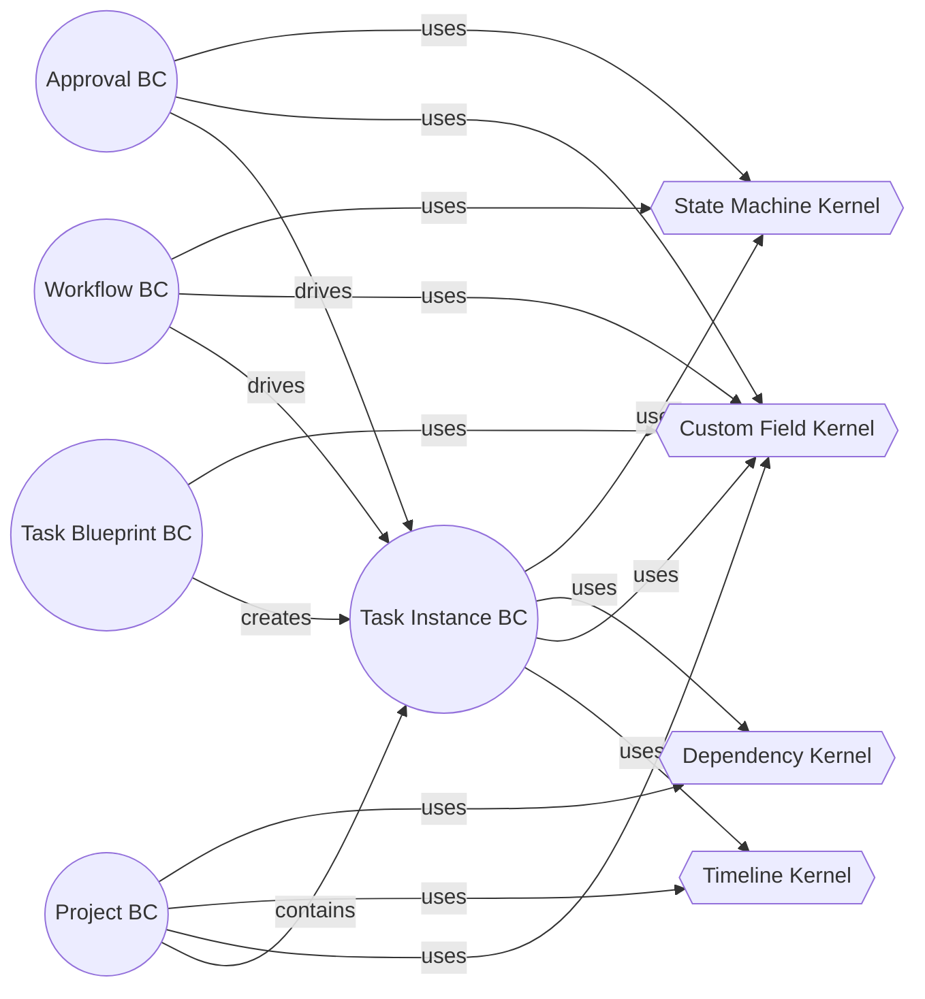

---

# **3.3 Functional Boundaries**

### **Approval Context**
Manages approval flows, decisions, rule sets, escalations, and timeouts.

### **Workflow Context**
Defines general-purpose status workflows with transitions and actions.

### **Project Management Context**
Manages projects, sprints, requirements, success criteria, and forecasting.

### **Task Blueprint Context**
Maintains templates for tasks; defines reusable structures and rules.

### **Task Instance Context**
Handles the execution of work items—assignment, delegation, blocking, scheduling, dependencies, comments, and completion.

---

# **Chapter 4 — Shared Kernel Overview**

Before entering any bounded context, we examine shared kernels used across the system.

---

## **4.1 State Machine Kernel**

A unified state machine engine powering:
- Task Status  
- Approval Status  
- Project Status (optional)  
- Workflow transitions  

### Components:
- `StateId`
- `StateCategory`  
- `Transition` (From → To)  
- `TransitionCondition`  
- `TransitionAction`  

This kernel avoids duplicating state logic across contexts.

---

## **4.2 Dependency Kernel**

Standardized dependency engine shared by:
- Projects  
- Task Instances  

### Features:
- dependency graph  
- circular detection  
- topological sort  
- lag modeling  
- critical path calculation  

---

## **4.3 Custom Field Kernel**

Unified system for all contexts.

### Capability:
- field definitions  
- value validation  
- visibility rules  
- required rules  
- read-only rules  
- versioning  

Used by:
- Tasks  
- Task Types  
- Approval Workflows  
- Workflow Schemes  
- Projects  

---

## **4.4 Timeline Kernel**

Provides a **single audit and event stream** for all contexts:
- Task history  
- Workflow transitions  
- Approvals  
- Project events  

### Value Object Example:
```
TimelineEntry {
    Timestamp
    Domain
    EntityId
    EventType
    Description
    Metadata
}
```

---

## **PART II — APPROVAL DOMAIN (ENHANCED)**  
*Hybrid Practical + Technical — Mermaid diagrams included*

---

# **Chapter 5 — Approval Domain Ubiquitous Language**

The Approval Domain governs **how requests are reviewed, processed, routed, escalated, and decided** in a formal and configurable way.

Below is the **core vocabulary** used across the Approval Context.

---

## **5.1 Core Terms**

### **Approval Workflow**  
A structured sequence of approval steps with rules defining how decisions progress.  
Workflows are versioned, validated, and cannot be modified once published.

### **Approval Step**  
A unit of approval within a workflow.  
Contains approvers, requirements, conditions, and timeout rules.

### **Approver**  
A user, role, or team allowed to make decisions at a specific step.

### **Approval Request**  
A runtime execution of an approval workflow for a specific entity (TaskInstance, ProjectDependency, etc.).

### **Approval Decision**  
An individual approval or rejection from a specific approver.

### **Approval Strategy**  
Defines how steps are evaluated:
- Sequential  
- Parallel  
- Majority  
- Any  
- Custom  

### **Escalation**  
Automatic actions triggered when an approval step is not completed in time.

### **Timeout Policy**  
Rules for what happens when a step passes its allowed time.

### **Delegation**  
Temporary reassignment of approval decision rights.

---

# **Chapter 6 — Approval Domain Overview**

The Approval Domain is built around five major elements:

1. **ApprovalWorkflow (Aggregate Root)**  
2. **ApprovalWorkflowVersion (Aggregate Root)**  
3. **ApprovalStep (Entity)**  
4. **ApprovalRequest (Aggregate Root)**  
5. **ApprovalDecision (Entity)**  

Additionally, four new components enhance the model:

- **EscalationPolicy**  
- **ApprovalRuleEngine**  
- **ApprovalTimeoutProcessor**  
- **ApprovalSimulationService**  

---

# **Chapter 7 — ApprovalWorkflow Aggregate (Enhanced)**

## **7.1 Purpose**
Defines the structure, sequencing, and logic of approval processes.

It is **configuration-time**, not runtime.

## **7.2 Aggregate Structure (Mermaid)**

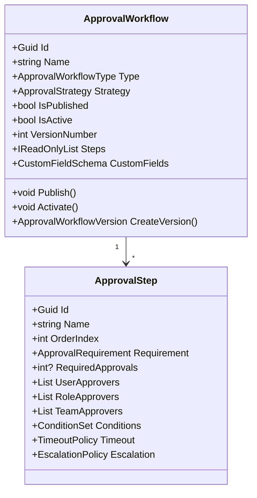

---

# **7.3 Invariants**

### **Workflow-Level**
- A workflow cannot be activated without at least 1 step.  
- A published workflow cannot be edited (must create a new version).  
- Step order indices must be unique and sequential.  
- Strategy must be compatible with step count (e.g., majority requires ≥2 approvers).

### **Step-Level**
- If Requirement = Majority → at least 2 approvers required.  
- TimeoutHours > 0 if TimeoutPolicy exists.  
- Conditions must reference valid fields.

---

# **7.4 Behavior**

### Publish()
Converts draft workflow to immutable versioned workflow.

### Activate()
Enables workflow for runtime use.

### AddStep(name, order, requirement)
Enforces ordering and requirement rules.

### RemoveStep()
Only allowed in draft state.

---

# **Chapter 8 — ApprovalWorkflowVersion (New Aggregate)**

## **8.1 Purpose**
A publish-time snapshot of a workflow.  
Immutable after creation.

## **8.2 Why Needed**
Without versioning, approval definitions change over time and corrupt historical validity.

### Example:
- A task created in 2023 should keep using the workflow version from 2023, even if updated in 2025.

---

## **8.3 Structure**

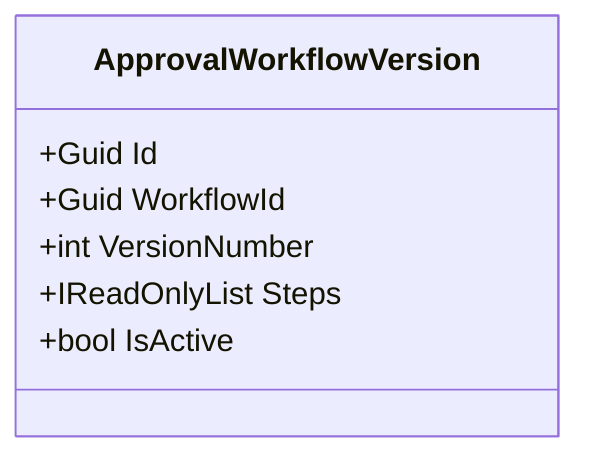

---

# **Chapter 9 — ApprovalStep (Enhanced Entity)**

Enhancements include:

### **9.1 ConditionSet**
A typed rule set:
```
FieldValue conditions  
Custom logic (plug-in)  
Data comparison operators  
```

### **9.2 TimeoutPolicy**
```
HoursUntilTimeout
TimeoutAction (AutoApprove, AutoReject, Escalate, CustomScript)
```

### **9.3 EscalationPolicy**
```
EscalateToRoles
EscalateToUsers
AddWatchers
NotifyManagers
```

### **9.4 Approver Sets**
Supports:
- direct users  
- roles  
- teams  
- dynamic approver queries (future enhancement)

---

# **Chapter 10 — ApprovalRequest Aggregate (Enhanced)**

## **10.1 Purpose**
Represents the runtime execution of an approval workflow for an entity.

## **10.2 Structure (Mermaid)**

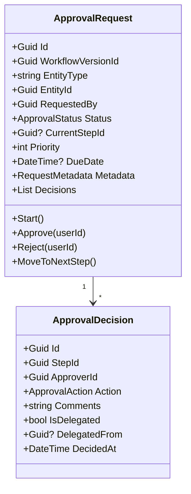

---

# **10.3 Runtime Invariants**

- Cannot act on a cancelled or completed request.  
- Only valid approvers can make decisions.  
- Cannot approve self-origin if AllowSelfApproval = false.  
- Parallel steps cannot complete until all step-level requirements met.  
- Majority/All/Any logic enforced at step completion.

---

# **Chapter 11 — ApprovalDecision (Enhanced)**

Enhancements include:

### **11.1 Derived Flags**
```
IsApproval  
IsRejection  
IsAutoDecision  
IsEscalatedDecision  
```

### **11.2 Decision Signature**
Optional digital signature / public key support.

### **11.3 Delegation metadata**
Captures audit trail for:

- delegatedFrom  
- delegatedTo  
- delegation accepted/declined  

---

# **Chapter 12 — Approval Policies (New)**

## **12.1 EscalationPolicy**
Handles SLA breaches.

### Supported Escalation Actions:
- Notify stakeholders  
- Add watchers  
- Raise priority  
- Reassign approver  
- Escalate to supervisor  
- Execute script  
- Auto-approve  
- Auto-reject  

---

## **12.2 ApprovalTimeoutPolicy**
Executed by a scheduled domain service.

---

## **12.3 self-approval policy**
Rules:
- Allowed only if explicitly permitted  
- Not allowed if requester is in a role that prohibits it  
- Not allowed in first-level approval for certain workflow types  

---

# **Chapter 13 — Approval Rule Engine (New Shared Component)**

Handles:

- conditions  
- field-based rules  
- dynamic value checks  
- plug-in evaluators  

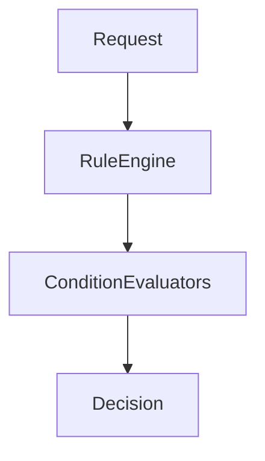

---

# **Chapter 14 — Approval Runtime Domain Services**

## **14.1 Approval Workflow Engine**
Executes the step transition logic.

### Responsibilities:
- Validate approver rights  
- Register decisions  
- Trigger step transitions  
- Detect step completion  
- Apply timeout or escalation actions  
- Emit domain events  

---

## **14.2 ApprovalTimeoutProcessor**
Scheduled service that:

- scans pending requests  
- evaluates deadlines  
- applies timeout policy  
- raises escalation actions  

---

## **14.3 ApprovalSimulationService**
Predicts outcomes based on:
- approver workloads  
- historical approval speed  
- step configuration  

Useful for forecasting approval delays.

---

# **Chapter 15 — Approval Domain Events**

### **ApprovalRequestCreatedEto**  
### **ApprovalStepCompletedEto (New)**  
### **ApprovalStepEscalatedEto (New)**  
### **ApprovalAutoApprovedEto (New)**  
### **ApprovalAutoRejectedEto (New)**  
### **ApprovalWorkflowCompletedEto**

---

# **Chapter 16 — Integration With Other Contexts**

## **16.1 Task Integration**
Tasks requiring approval initiate ApprovalRequest.  
The result updates TaskInstance.Approval aggregate.

## **16.2 Project Integration**
ProjectDependency may require approval.

## **16.3 Workflow Integration**
Workflow actions can automatically initiate approvals.

---

## **PART III — WORKFLOW DOMAIN (ENHANCED + VERSIONING)**

---

# **Chapter 17 — Workflow Domain Ubiquitous Language**

The **Workflow Domain** governs how **tasks and other entities move between statuses**, ensuring consistent, rule-driven transitions.

Below is the formal vocabulary.

---

## **17.1 Core Terms**

### **Workflow**  
A reusable, configurable set of statuses and transitions defining lifecycle behavior.

### **Workflow Version**  
An immutable snapshot of a workflow used by tasks created under it.

### **Workflow Status**  
A discrete lifecycle state (e.g., Todo, InProgress, Done, Blocked, Cancelled).

### **Transition**  
A permissible movement from one status to another, optionally controlled by:
- permission policies  
- conditions  
- validators  
- automated actions  
- required comments  
- required resolution codes  

### **Transition Condition**  
A rule evaluated before allowing a transition.

### **Transition Action**  
An automatic operation performed when a transition executes.

### **Permission Policy**  
Rules defining which users or roles may perform a transition.

### **Workflow Scheme**  
A mapping between Task Types and Workflows, configurable per project.

---

# **Chapter 18 — Workflow Domain Overview**

This domain is **configuration-time** for three major purposes:

1. Define lifecycle structure  
2. Control who can move entities between states  
3. Add automated behaviors  

A central principle:  
**Workflows are versioned. Running tasks always reference a specific workflow version.**

---

# **Chapter 19 — Workflow Aggregate (Enhanced)**

## **19.1 Purpose**
Manage workflow definitions, statuses, transitions, actions, and conditions.

---

## **19.2 Structure (Mermaid)**

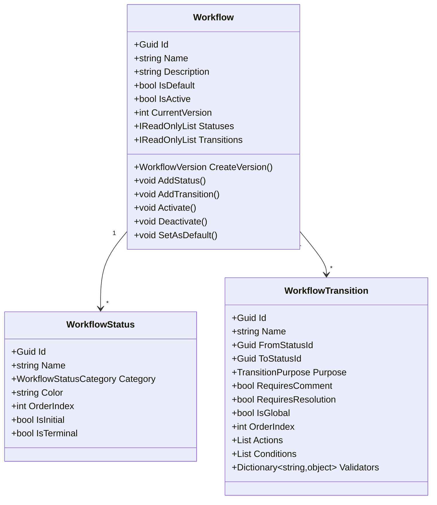

---

# **19.3 Invariants**

### Workflow-Level  
- Must have at least 1 status.  
- Must have exactly 1 initial status.  
- At least 1 terminal status required.  
- Cannot remove status if used by any transition.  
- Cannot deactivate if default workflow.

### Status-Level  
- FromStatusId ≠ ToStatusId in transitions.  
- OrderIndex unique per workflow.  

### Transition-Level  
- All referenced statuses must exist.  
- Conditions must be evaluable.  
- Validators must match defined fields.  

---

# **Chapter 20 — WorkflowVersion Aggregate (New)**

Workflows behave like software:  
**published versions freeze configuration at point-in-time.**

---

## **20.1 Why Versioning Is Mandatory**

### Problem
Tasks created under Workflow v1 would suddenly behave differently if v2 modifies rules.

### Solution  
Store workflow definitions as immutable versions.

---

## **20.2 Structure**

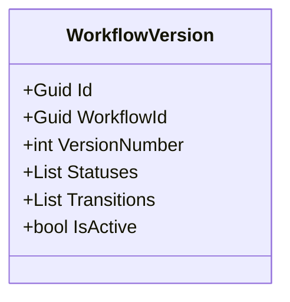

---

## **20.3 Behavior**

### Publish()
Converts editable workflow → versioned snapshot.

### ActivateVersion(versionNumber)
Switches active version for new entities.

### DeprecateVersion(versionNumber)
Marks version as disallowed for future use.

### Version Invariants
- Cannot modify after publishing.  
- Must include valid initial status.  
- All transitions must be resolvable.  

---

# **Chapter 21 — WorkflowStatus (Enhanced)**

### **21.1 Categories**

- Todo  
- InProgress  
- Done  
- Blocked  
- Cancelled  

### **21.2 Derived Properties**

- `IsTodo`  
- `IsInProgress`  
- `IsTerminal` (Done / Cancelled)  
- `IsBlocked`  

### **21.3 Enhanced Validation**
- Resolution statuses must be terminal.  
- InProgress must not be marked as terminal.  

---

# **Chapter 22 — WorkflowTransition (Enhanced)**

## **22.1 Purpose**
Defines permissible movement logic from one state to another.

---

## **22.2 Transition Diagram (Mermaid)**

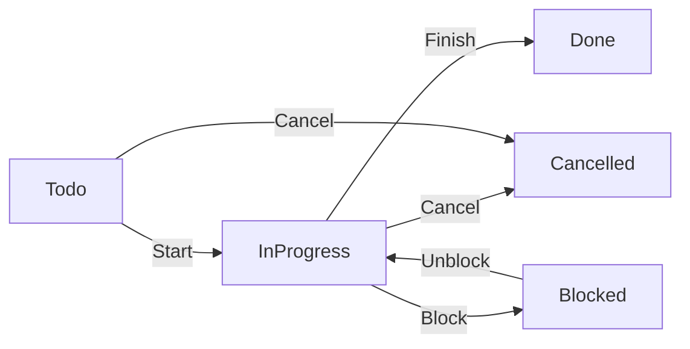

---

## **22.3 Condition Types**

- FieldValueCondition  
- RoleBasedCondition  
- ScriptCondition  
- Custom (plug-in)  

### Example:
```
Task.Priority >= High  
AND  
Task.EstimatedHours < 5
```

---

## **22.4 Validators**
Used to ensure required data is present before transition.

Examples:
- Required custom field value  
- Required resolution code  
- Required comment  

---

## **22.5 Actions**

### Action Types (Common)
- Assignment actions  
- Field updates  
- Notifications  
- Subtask creation  
- Webhook triggers  
- Approval initiation  
- Auto-approval completion  

Actions follow ordered execution:

```
OrderIndex ASC
```

---

# **Chapter 23 — TransitionPermissionPolicy (Enhanced)**

## **23.1 Purpose**
Controls who can perform transitions:
- Users  
- Roles  
- Teams  
- Permission scope (Global, Project, Custom)  

---

## **23.2 Structure**

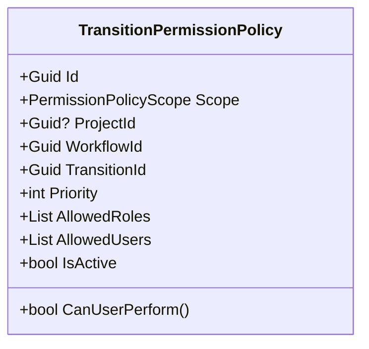

---

## **23.3 Evaluation Logic**

```
Highest priority policy wins
Project scope > Global scope
AllowedUsers OR AllowedRoles → success
Empty ruleset → allow all
```

---

# **Chapter 24 — Workflow Schemes (Enhanced)**

Workflow Schemes determine **which workflow applies to which Task Type within a project**.

---

## **24.1 Structure (Mermaid)**

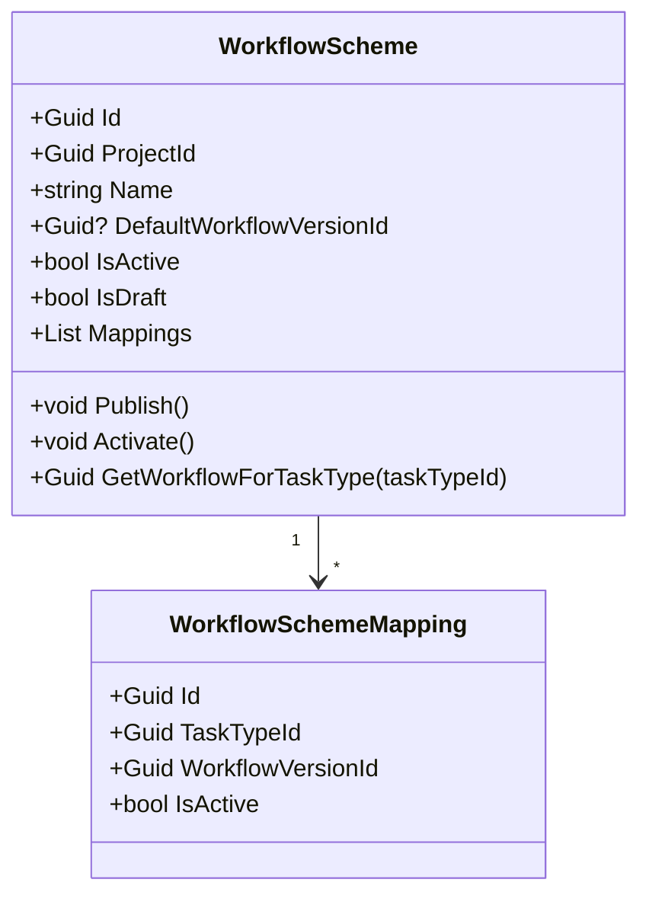

---

## **24.2 Behavior**

### Publish()
- Verify at least 1 workflow version  
- Lock mappings  
- Make immutable except activation toggle  

### Activate()
Allows scheme usage for new tasks.

---

# **Chapter 25 — Workflow Condition Evaluation Service (Enhanced)**

## **25.1 Purpose**
Evaluates all conditions using AND/OR logic.

### Supports:
- Value comparisons  
- Role checks  
- Custom evaluators  
- Multi-field rule sets  

---

### Execution Flow (Mermaid)

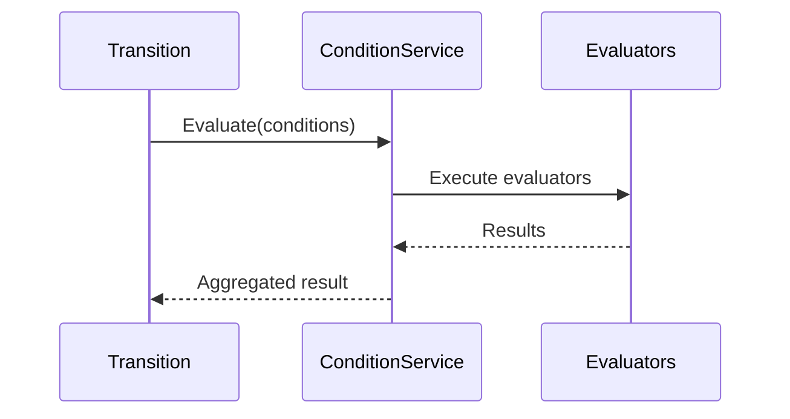

---

# **Chapter 26 — Workflow Action Executor (Enhanced)**

## **26.1 Strategy-Based Execution**

Each action is handled by a strategy executor.

Examples:
- AssignUserActionExecutor  
- SetDueDateActionExecutor  
- WebhookTriggerActionExecutor  
- ScriptActionExecutor  
- InitiateApprovalActionExecutor  

---

## **26.2 Execution Steps**

1. Filter enabled actions  
2. Sort by order  
3. Execute sync actions  
4. Queue async actions  
5. Monitor failures based on `ContinueOnError`  

---

# **Chapter 27 — Workflow Validation & Graph Analysis**

### **27.1 Problems Detected Automatically**

- unreachable statuses  
- dead-end transitions  
- cyclic transitions  
- transitions referencing non-existent statuses  
- invalid terminal statuses  

---

### Mermaid Graph Analyzer (Concept)

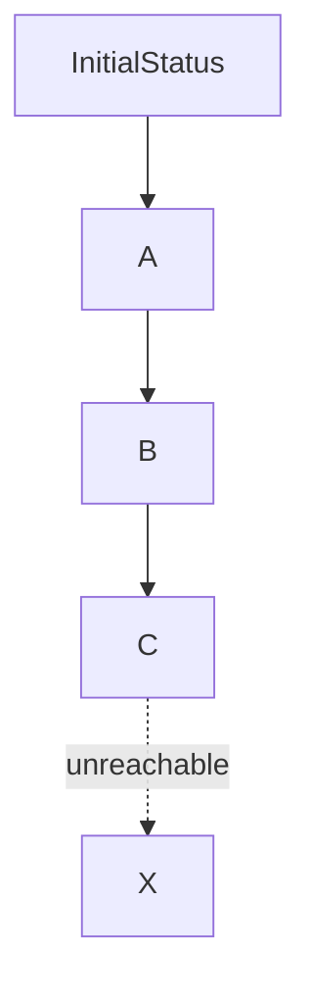

The validator ensures **all nodes reachable from initial**.

---

# **Chapter 28 — Workflow Domain Events**

### **WorkflowTransitionExecutedEto**  
### **WorkflowValidationFailedEto**  
### **WorkflowVersionPublishedEto**  
### **WorkflowTransitionDeniedEto (New)**  

TransitionDeniedEto is emitted when:
- permissions fail  
- conditions fail  
- required fields missing  

---

# **Chapter 29 — Workflow Integration with Other Domains**

### **29.1 TaskInstance Integration**
Workflow governs all status changes of Task Instances.

### **29.2 Project Integration**
Projects may use workflows for project-level status transitions.

### **29.3 Approval Integration**
Workflow transitions may trigger approval workflows automatically.

---

## **PART IV — PROJECT MANAGEMENT DOMAIN (ENHANCED)** 

---

# **Chapter 30 — Project Domain Ubiquitous Language**

The **Project Management Domain** governs planning, execution, tracking, forecasting, and risk evaluation of work at a project level.

Below is the formal vocabulary.

---

## **30.1 Core Terms**

### **Project**  
A structured unit of work containing goals, timelines, tasks, dependencies, and success criteria.

### **Sprint**  
A time-boxed iteration with a goal, start/end dates, and story point estimates.

### **Project Requirement**  
A functional or non-functional requirement tied to a project lifecycle.

### **Success Criterion**  
A measurable indicator used to track project outcome alignment.

### **Project Dependency**  
A relationship between projects (or between parts of a project) that can block progress.

### **Critical Path**  
The longest sequence of dependent activities determining the earliest possible completion date.

### **Health Score**  
A risk indicator evaluating whether the project is **On Track, At Risk, Behind, Critical, Completed**.

### **Project Portfolio**  
An aggregated view of multiple projects for prioritization and strategy.

---

# **Chapter 31 — Project Domain Overview**

The Project domain contains three major aggregates:

1. **Project (Aggregate Root)**  
2. **ProjectSprint (Aggregate Root)**  
3. **ProjectRequirement (Entity)**  
4. **ProjectSuccessCriterion (Entity)**  
5. **ProjectDependency (Entity)**  

Two important domain services power this domain:

- **ProjectForecastingService**  
- **ProjectDependencyService (Critical Path Engine)**  

---

# **Chapter 32 — Project Aggregate (Enhanced)**

## **32.1 Purpose**
Represents the core planning and execution entity in the system.

---

## **32.2 Structure (Mermaid)**

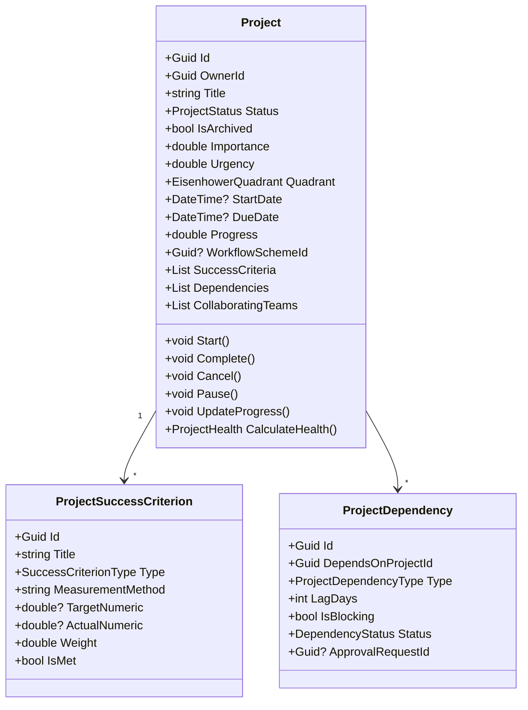

---

# **32.3 Invariants**

### Status Rules  
- Cannot start a Cancelled or Completed project.  
- Cannot archive an Active project.  
- Cannot cancel a Completed project.  

### Success Criteria  
- A project can have max **20** criteria.  
- Criterion weight must be 0–10.  

### Dependencies  
- No circular dependencies.  
- Project cannot depend on itself.  

### Dates  
- DueDate > StartDate if both exist.  

---

# **Chapter 33 — Project Behaviors (Enhanced)**

### **Start()**
- Sets status to Active  
- Sets StartDate if null  

### **Pause()**
- Moves to OnHold  

### **Complete()**
- Requires all success criteria met  

### **Cancel()**
- Requires no active sprints  

### **UpdateProgress()**
Progress =  
```
(CompletedTasks / TotalTasks) * 100  
+ WeightedSuccessCriteriaCompletion  
```

---

# **Chapter 34 — Success Criteria (Enhanced)**

### **Types**
- Quantitative  
- Qualitative  
- Binary  

### Derived Indicators  
- AchievementPercentage  
- IsOverdue  
- HasEvidence  

---

# **Chapter 35 — Project Sprint Aggregate (Enhanced)**

## **35.1 Purpose**
Manages time-boxed development cycles, typically 1–4 weeks.

---

## **35.2 Structure (Mermaid)**

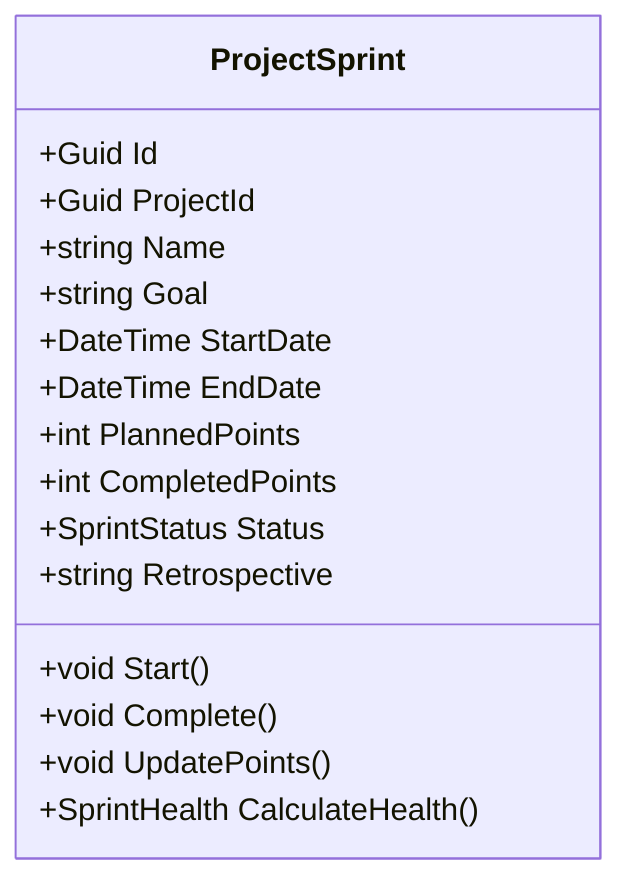

---

## **35.3 Invariants**

- Duration must be **7–30 days**.  
- CompletedPoints ≤ PlannedPoints.  
- Cannot modify a Completed sprint.

---

## **35.4 Derived Properties**

- DurationInDays  
- CompletionRate  
- VelocityAccuracy  
- TimeRemaining  

---

# **Chapter 36 — Project Requirement Entity (Enhanced)**

## **Purpose**
Tracks requirement lifecycle stages:

```
Proposed → Approved → InProgress → Implemented → Verified  
                         ↓  
                      Rejected
```

---

## **Enhancements**

- Requires workflow-driven approvals for Requirements of type “High Risk.”  
- Supports story points and business value fields.  
- Supports acceptance criteria.

---

# **Chapter 37 — Project Dependency Entity (Enhanced)**

## **37.1 Purpose**
Represents blocking relationships between projects.

---

## **37.2 Types**

- Finish-to-Start (FS)  
- Start-to-Start (SS)  
- Finish-to-Finish (FF)  
- Start-to-Finish (SF)  
- Deliverable  
- Resource  
- Approval-based  
- Informational  

---

## **37.3 Lag Time**
Delay between predecessor and successor.

---

## **37.4 Integration With Approval**
High-risk dependencies may need approval.

---

# **Chapter 38 — Critical Path & Dependency Engine (Shared Kernel)**

Used by **Project** and **TaskInstance** for dependency resolution.

---

## **38.1 Responsibilities**

- Identify circular dependencies  
- Compute earliest start dates  
- Compute latest finish dates  
- Perform topological sort  
- Calculate critical path  
- Detect blocking dependencies  

---

## **38.2 Mermaid Critical Path Graph**

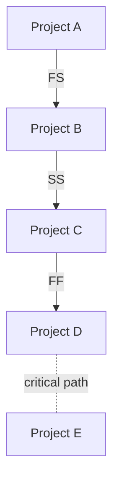

---

# **Chapter 39 — Project Health Calculation (Enhanced)**

## **39.1 Inputs Into Health Score**

1. **Progress vs. Time Elapsed**  
2. **Success Criteria Progress**  
3. **Overdue Status**  
4. **Critical Blockers**  
5. **Sprint Performance**  
6. **Workload Forecast**  
7. **Risk Indicators (New)**  
8. **Team Velocity Trends (New)**  

---

## **39.2 Outputs**

### `ProjectHealthReport`
- BaseHealth  
- OverallHealth  
- BlockedDependenciesCount  
- Recommendations  
- RiskScore  
- ScheduleVariance  
- ScopeCreepIndicator  

---

# **Chapter 40 — Project Forecasting Service (New)**

## **Purpose**
Predict project timeline outcomes based on patterns.

---

## **Forecast Inputs**

- Sprint velocities  
- Task completion history  
- Requirement changes  
- Dependency delays  
- Approval wait times  

---

## **Forecast Outputs**

- ExpectedCompletionDate  
- ProbabilityOfDelay  
- EstimatedOverrun  
- ExpectedResourceLoad  
- SuccessCriteriaProjection  

---

# **Chapter 41 — Project Portfolio Read Models (New)**

Provides consolidated real-time visibility.

---

## **Portfolio Metrics**

- Risk Heatmap  
- Velocity Trends  
- Resource Allocation  
- Project Quadrant Distribution  
- Overdue Projects  
- Critical Path Alerts  

---

## **Portfolio Diagram (Mermaid)**

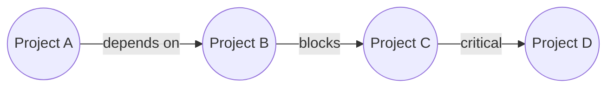

---

# **Chapter 42 — Project Domain Events**

## Key Events
- ProjectCreatedEto  
- ProjectStatusChangedEto  
- ProjectCompletedEto  
- SprintStartedEto (New)  
- SprintCompletedEto  
- RequirementApprovedEto (New)  
- RequirementRejectedEto (New)  
- ProjectDependencyResolvedEto (New)  

---

# **Chapter 43 — Project ↔ Other Context Integrations**

### **Task Domain**
Projects contain Tasks; Project health feeds into Task priority.

### **Approval Domain**
High-risk requirements and dependencies may trigger approvals.

### **Workflow Domain**
Projects may adopt workflows for their own lifecycle.

---

## **PART V — TASK BLUEPRINT DOMAIN (ENHANCED)**  

---

# **Chapter 44 — Task Blueprint Domain Ubiquitous Language**

The Task Blueprint Domain defines **reusable templates** for tasks, ensuring consistent structure for task instances created across the organization.

---

## **44.1 Core Terms**

### **Task Blueprint (Task)**  
A template representing *how a task should look* before execution.

### **Action Step**  
A checklist-style instruction required to complete a task.

### **Acceptance Criterion**  
A Given-When-Then scenario representing measurable success conditions.

### **Recurrence Rule**  
Defines automatic periodic creation of task instances (daily, weekly, etc.).

### **Blueprint Version**  
Immutable historical snapshot of a task blueprint used when creating instances.

### **Task Category / Task Type**  
Classification grouping used for workflows, custom fields, and organization.

---

# **Chapter 45 — Task Blueprint Domain Overview**

The Task Blueprint domain consists of:

1. **Task Blueprint (Aggregate Root)**  
2. **Task Blueprint Version (Aggregate Root)**  
3. **ActionStep (Entity)**  
4. **AcceptanceCriterion (Entity)**  
5. **TaskType (Aggregate Root)**  
6. **TaskTypeCustomField (Entity)**  
7. **RecurrenceRule (Value Object)**  

Key improvements introduced here:

- Blueprint versioning  
- Improved limit enforcement  
- Unified Custom Field Kernel adoption  
- Stronger invariants  
- Validated, ordered action steps  
- Enhanced GWT criteria  
- Recurring tasks support  

---

# **Chapter 46 — Task Blueprint Aggregate (Enhanced)**

## **46.1 Purpose**  
Represents the template of how tasks should be structured, including:

- structure  
- default values  
- recurring configuration  
- acceptance standards  

---

## **46.2 Structure (Mermaid)**

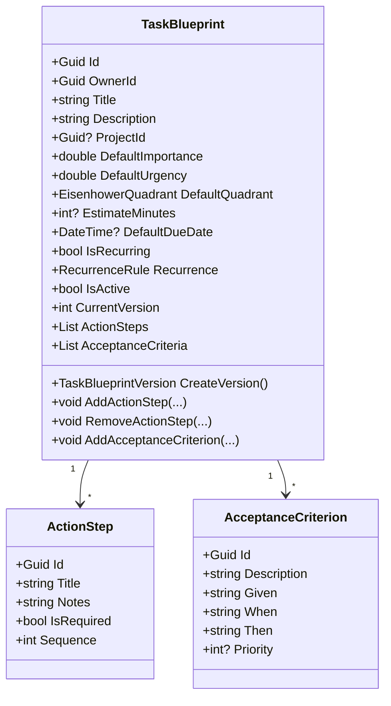

---

# **46.3 Core Invariants**

### Title  
- Required  
- Unique (within project)

### Action Steps  
- Maximum **50 steps**  
- Sequence required & must be unique  
- At least 1 required step recommended (best practice)

### Acceptance Criteria  
- Maximum **20 criteria**  
- Criteria must have a full GWT definition

### Default Values  
- Importance and Urgency: 0.0–1.0  
- EstimateMinutes must be ≥ 0  

### Recurrence  
- If IsRecurring = true → RecurrenceRule must be valid  

---

# **Chapter 47 — Blueprint Behaviors (Enhanced)**

### **AddActionStep**  
- Enforces max step limit  
- Validates sequence numbering  
- Prevents gaps in ordering  

### **ReorderActionSteps**  
- Ensures continuous sequence 1..N  
- Prevents duplicates  

### **AddAcceptanceCriterion**  
- Checks max limit  
- Validates Given/When/Then completeness  

### **MakeRecurring / RemoveRecurrence**  
- Makes recurrence rule mandatory  
- Clears recurrence configuration  

### **Activate / Deactivate**  
- Controls blueprint availability  

---

# **Chapter 48 — Acceptance Criteria (Advanced Modeling)**

Acceptance criteria use a BDD-style format:

```
Given: context/state
When:  user performs action
Then:  expected outcome occurs
```

### Derived Behaviors  
- `HasGivenWhenThen`  
- `GetFormattedGWT()`  
- `IsCritical` (if Priority is high)  

### Example  
```
Given the user is an admin  
When they approve the record  
Then the system should mark it as finalized  
```

---

# **Chapter 49 — Recurrence Rules (Enhanced)**

## **49.1 Rule Format**
Recurrence rules support:

- Frequency: Daily, Weekly, Monthly, Yearly  
- Interval: every N units  
- DaysOfWeek (for weekly)  
- Count (maximum occurrences)  
- EndDate (expiration date)  

---

## **49.2 Structure (Mermaid)**

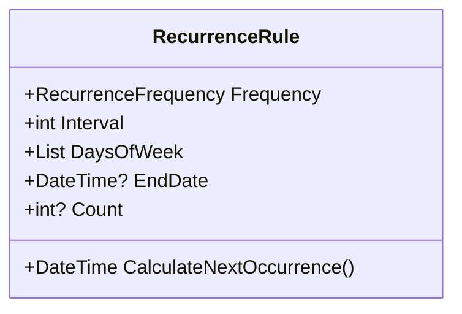

---

# **Chapter 50 — Blueprint Versioning (New Aggregate)**

Blueprint Versioning ensures:

- TaskInstances created in the past retain original structure  
- No accidental changes break task history  

---

## **50.1 Structure**

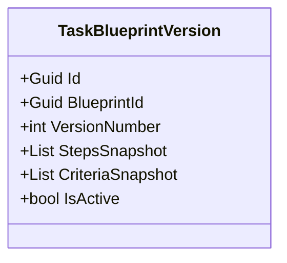

---

## **50.2 Behavior**

### PublishVersion()  
Creates immutable snapshot.

### DeprecateVersion()  
Marks version inactive.

### ReinstateVersion()  
Allows switching back (rare).

---

# **Chapter 51 — Task Type Aggregate (Enhanced)**

Task Types group tasks based on:

- categories  
- display rules  
- custom field requirements  

---

## **51.1 Structure (Mermaid)**

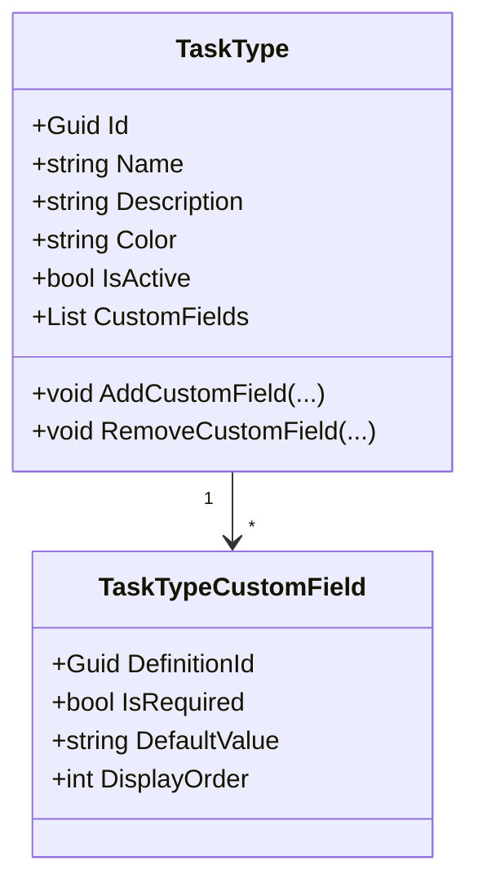

---

# **51.2 Invariants**

- Color must be valid HEX.  
- Only active custom field definitions allowed.  
- DisplayOrder must be unique and continuous.  

---

# **Chapter 52 — Custom Fields Integration (Shared Kernel)**

Task types rely on the **Unified Custom Field Kernel**:

- Field definitions  
- Value constraints  
- Data type validation  
- Field-level permissions  
- Visibility rules  

The blueprint itself does **not** store custom field values; instead, TaskInstances store values that reference the TaskType definitions.

---

# **Chapter 53 — Domain Services in Task Blueprint**

### **TaskBlueprintFactory**  
Creates new blueprint with default values.

### **TaskBlueprintVersioningService**  
Handles version creation & lifecycle.

### **TaskRecurrenceService**  
Calculates occurrence schedule.

### **TaskBlueprintValidationService**  
Ensures blueprint structure integrity.

---

# **Chapter 54 — Task Blueprint Domain Events**

### **TaskBlueprintCreatedEto**  
### **TaskBlueprintVersionPublishedEto**  
### **TaskBlueprintUpdatedEto**  
### **RecurringTaskGeneratedEto (New)**  

---

# **Chapter 55 — Integration With Other Domains**

### **Workflow Domain**  
TaskTypes map to Workflows via Workflow Schemes.

### **Task Instance Domain**  
Blueprint defines structure for runtime tasks.

### **Custom Fields Kernel**  
Provides structure for TaskType custom fields.

---

## **PART VI — TASK INSTANCE DOMAIN**  

---

# **Chapter 56 — Introduction to the Task Instance Domain**

The **Task Instance Domain** is the operational heart of the entire Work Management System.  
It manages **runtime tasks**, including:

- lifecycle  
- assignment  
- delegation  
- scheduling  
- blocking  
- dependencies  
- discussions  
- approval  
- progress  
- hierarchy (subtasks)  
- time tracking  
- history  

Originally, all of these concerns existed **inside a single massive AggregateRoot → TaskInstance**, creating:

- scalability issues  
- concurrency conflicts  
- inconsistent invariants  
- overgrown transactional boundaries  

### ✔ As part of the enhanced design, TaskInstance is decomposed into **nine specialized aggregates**.

---

# **Chapter 57 — Task Instance Domain Ubiquitous Language**

## Core Terms

### **Task Instance**  
A runtime execution of a task blueprint.

### **Progress**  
The task’s current state (Workflow-driven).

### **Schedule**  
Planned and actual start/due dates.

### **Assignment**  
Current assignee, watchers, and participant roles.

### **Delegation**  
Temporary transfer of responsibility.

### **Blocking**  
Condition preventing work progress.

### **Dependency**  
Execution ordering constraints.

### **Discussion**  
Comments, attachments, and watchers.

### **History**  
Audit of all changes performed on the task.

### **Hierarchy**  
Parent/subtask tree relationships.

### **Approval**  
Optional approval workflow tied to completion.

### **Resolution**  
Reason or outcome recorded upon task completion.

---

# **Chapter 58 — High-Level Decomposition**

## **58.1 Aggregate Decomposition Diagram (Mermaid)**

```mermaid
flowchart TB
    TaskInstance["TaskInstance (Root Aggregate)"]

    Progress["Progress Aggregate"]
    Schedule["Schedule Aggregate"]
    Assignment["Assignment Aggregate"]
    Delegation["Delegation Aggregate"]
    Blocking["Blocking Aggregate"]
    Dependency["Dependency Aggregate"]
    Discussion["Discussion Aggregate"]
    History["History Aggregate"]
    Hierarchy["Hierarchy Aggregate"]
    Approval["Approval Aggregate"]
    TimeTracking["TimeTracking Aggregate"]

    TaskInstance --> Progress
    TaskInstance --> Schedule
    TaskInstance --> Assignment
    TaskInstance --> Delegation
    TaskInstance --> Blocking
    TaskInstance --> Dependency
    TaskInstance --> Discussion
    TaskInstance --> History
    TaskInstance --> Hierarchy
    TaskInstance --> Approval
    TaskInstance --> TimeTracking
```

### ✔ Each sub-aggregate has its own invariants and transactional boundaries.  
### ✔ Only the TaskInstance root orchestrates multi-aggregate flows.  
### ✔ Reduces concurrency conflicts significantly.  

---

# **Chapter 59 — TaskInstance Aggregate Root (Enhanced)**

The **TaskInstance** itself becomes a lightweight orchestration root.

---

## **59.1 Structure (Mermaid)**

```mermaid
classDiagram
    class TaskInstance {
        +Guid Id
        +Guid TaskBlueprintVersionId
        +Guid ProjectId
        +Guid TaskTypeId
        +Guid WorkflowVersionId
        +Progress Progress
        +Schedule Schedule
        +Assignment Assignment
        +Delegation Delegation
        +Blocking Blocking
        +Dependency Dependency
        +Discussion Discussion
        +History History
        +Hierarchy Hierarchy
        +Approval Approval
        +TimeTracking TimeTracking
        +void Start()
        +void Complete()
        +void Block()
        +void Delegate()
        +void Assign()
    }
```

---

## **59.2 Key Invariants**

- A TaskInstance must reference immutable **TaskBlueprintVersion**.  
- A TaskInstance must always use a single **WorkflowVersion**.  
- Only the root can orchestrate multi-aggregate updates.  

---

# **Chapter 60 — Progress Aggregate**

## **60.1 Purpose**  
Tracks status, workflow state, and progress percentages.

---

## **60.2 Structure**

```mermaid
classDiagram
    class Progress {
        +Guid WorkflowStatusId
        +WorkflowStatusCategory Category
        +double Percent
        +bool IsNextAction
        +void MarkInProgress()
        +void MarkDone()
        +void Reset()
    }
```

---

## **60.3 Invariants**

- Percent between 0 and 100.  
- Cannot move to Done if required steps unmet.  
- Category must match WorkflowStatusDescriptor.

---

# **Chapter 61 — Schedule Aggregate**

## **61.1 Purpose**  
Stores planned and actual dates for lifecycle management.

---

## **61.2 Structure**

```mermaid
classDiagram
    class Schedule {
        +DateTime? PlannedStart
        +DateTime? PlannedDue
        +DateTime? ActualStart
        +DateTime? ActualDue
        +DateTime? CompletedAt
        +bool IsOverdue()
        +void MarkCompleted()
    }
```

---

## **61.3 Invariants**

- PlannedDue must be ≥ PlannedStart.  
- Actual dates must be chronological.  
- Cannot mark completion twice.  

---

# **Chapter 62 — Assignment Aggregate**

Manages assignees, watchers, and participant roles.

---

## **62.1 Structure**

```mermaid
classDiagram
    class Assignment {
        +Guid? AssigneeId
        +List<Guid> Watchers
        +int CommentsCount
        +int AttachmentsCount
        +void Assign(user)
        +void Unassign()
        +void AddWatcher(user)
        +void RemoveWatcher(user)
    }
```

---

## **62.2 Invariants**

- Max watchers = 50.  
- Cannot assign to blocked task.  
- Cannot unassign if delegated.  

---

# **Chapter 63 — Delegation Aggregate**

Handles temporary reassignment via structured state transitions.

---

## **63.1 Structure**

```mermaid
classDiagram
    class Delegation {
        +Guid DelegatedBy
        +Guid DelegatedTo
        +DelegationStatus Status
        +DateTime DelegatedAt
        +DateTime? RespondedAt
        +string Note
        +string ResponseNote
        +void Delegate()
        +void Accept()
        +void Decline()
        +void Revoke()
    }
```

---

## **63.2 Rules**

- Cannot delegate to self.  
- Once accepted, cannot be revoked.  
- Declined delegations terminate the cycle.  

---

# **Chapter 64 — Blocking Aggregate**

Represents blocking status preventing progress.

---

## **64.1 Structure**

```mermaid
classDiagram
    class Blocking {
        +bool IsBlocked
        +string Reason
        +DateTime? BlockedAt
        +void Block(reason)
        +void Unblock()
    }
```

---

## **64.2 Rules**

- Cannot block completed tasks.  
- Reason required.  
- Cannot unblock if reason is approval-related and approval is pending.  

---

# **Chapter 65 — Dependency Aggregate**

Uses **shared Dependency Kernel**.

---

## **65.1 Structure**

```mermaid
classDiagram
    class Dependency {
        +List<TaskDependency> Dependencies
        +void AddDependency()
        +void RemoveDependency()
    }

    class TaskDependency {
        +DependencyType Type
        +int LagMinutes
        +bool IsBlocking
        +Guid DependsOnTaskId
    }
```

---

## **65.2 Dependency Evaluation**

- Finish-to-Start  
- Start-to-Start  
- Finish-to-Finish  
- Start-to-Finish  
- Lag offset applied  
- Circular detection required  

---

# **Chapter 66 — Discussion Aggregate**

Represents collaborative discussion on a task.

---

## **66.1 Structure**

```mermaid
classDiagram
    class Discussion {
        +int CommentsCount
        +int AttachmentsCount
        +List<Guid> Watchers
        +bool IsLocked
        +void AddComment()
        +void AddAttachment()
        +void Lock()
        +void Unlock()
    }
```

---

# **Chapter 67 — History Aggregate**

Complete audit trail of all task events.

---

## **67.1 Structure**

```mermaid
classDiagram
    class HistoryEntry {
        +Guid Id
        +TaskHistoryChangeType Type
        +Guid? ChangedBy
        +DateTime ChangedAt
        +string Description
        +string Field
        +string OldValue
        +string NewValue
    }
```

The History Aggregate holds many entries.

---

# **Chapter 68 — Hierarchy Aggregate**

Handles parent-child task relationships.

---

## **68.1 Structure**

```mermaid
classDiagram
    class Hierarchy {
        +Guid? ParentTaskId
        +int OrderInParent
        +int SubtaskCount
        +int CompletedSubtasks
        +bool AllSubtasksDone()
    }
```

---

# **Chapter 69 — Approval Aggregate**

Corresponds to Approval Workflow execution state.

---

## **69.1 Structure**

```mermaid
classDiagram
    class TaskApproval {
        +Guid? ApprovalRequestId
        +bool RequiresApproval
        +ApprovalStatusEnum Status
        +DateTime? CompletedAt
        +void Require()
        +void MarkApproved()
        +void MarkRejected()
    }
```

---

# **Chapter 70 — Time Tracking Aggregate**

Tracks time spent on task.

---

## **70.1 Structure**

```mermaid
classDiagram
    class TimeTracking {
        +int ActualMinutes
        +DateTime? LastTrackedAt
        +void LogTime(minutes)
    }
```

---

# **Chapter 71 — Task Instance Orchestration Behavior**

The root aggregate coordinates all child aggregates.

---

## **71.1 Example Lifecycle Coordination**

### **Start()**
- Check dependencies  
- Update Schedule  
- Update Progress  
- Add History  
- Emit TaskStarted event  

### **Complete()**
- Validate required steps  
- Validate approval status  
- Update Progress → Done  
- Update Schedule → CompletedAt  
- Add History  
- Emit TaskCompleted event  

---

# **Chapter 72 — Task Instance Domain Services**

## **72.1 TaskInstanceFactory**  
Creates TaskInstance from BlueprintVersion.

## **72.2 TaskProcessingService**  
Coordinates multi-aggregate operations.

## **72.3 TaskDependencyService (Shared kernel)**  
Validates start eligibility.

## **72.4 TaskTransitionOrchestrator**  
Integrates workflows with TaskInstance.

---

# **Chapter 73 — Task Instance Domain Events**

- TaskInstanceCreatedEto  
- TaskStartedEto  
- TaskCompletedEto  
- TaskAssignedEto  
- TaskDelegatedEto  
- TaskDependencyAddedEto  
- TaskBlockedEto  
- TaskApprovalUpdatedEto  

---

## **PART VII — CROSS-CONTEXT INTEGRATION**  

Cross-context integration is where the Work Management System becomes more than the sum of its parts.  
This section defines **how Approval, Workflow, Project, Task Blueprint, and Task Instance** contexts work together through:

- domain events  
- orchestration services  
- shared kernels  
- commands  
- consistency rules  

This part is essential because **each context is autonomous**, but business workflows require their collaboration.

---

# **Chapter 74 — Integration Principles**

The system relies on three core integration principles:

---

## **74.1 Event-Driven Communication**

Contexts **never call each other directly**.  
They emit events describing something that happened.

These events are processed by:

- domain event handlers  
- integration event handlers  
- orchestrators  
- projections  

---

## **74.2 Consistency Without Coupling**

Contexts remain independent and use:

- Shared kernels  
- Contract-based events  
- Cross-context bridges (orchestration services)  
- Read models  

---

## **74.3 Command Gateways Instead of Direct Calls**

A Workflow does *not directly modify* a TaskInstance.  
It issues a **command**, and the TaskInstance decides what to do.

This preserves aggregate boundaries.

---

# **Chapter 75 — High-Level Integration Map (Mermaid)**

```mermaid
flowchart LR
    subgraph TaskBlueprint
        TBV["BlueprintVersion"]
    end

    subgraph TaskInstance
        TI["TaskInstance Root"]
    end

    subgraph Workflow
        WF["Workflow Engine"]
    end

    subgraph Approval
        AP["Approval Workflow"]
    end

    subgraph Project
        PR["Project"]
    end

    TBV --> TI
    WF --> TI
    TI --> AP
    AP --> TI
    PR --> TI
    TI --> PR
    WF --> AP
```

---

# **Chapter 76 — Task ↔ Workflow Integration**

## **76.1 Overview**

Workflow governs **TaskInstance lifecycle**.

When a user performs a workflow transition:

1. Workflow validates permissions  
2. Workflow validates conditions  
3. Workflow executes actions  
4. Workflow emits a **TransitionExecuted** event  
5. TaskTransitionOrchestrator updates TaskInstance  

---

## **76.2 Interaction Flow (Mermaid Sequence)**

```mermaid
sequenceDiagram
    participant U as User
    participant WF as Workflow Engine
    participant G as Transition Gateway
    participant TI as TaskInstance

    U->>WF: Request Transition
    WF->>WF: Validate Permissions & Conditions
    WF->>G: Emit Transition Command
    G->>TI: Update Task Status
    TI-->>G: Status Updated
    G-->>WF: Success
```

---

# **Chapter 77 — Workflow → Task Actions**

Some workflow transitions contain **actions** that affect the TaskInstance.

Instead of direct mutation, workflow produces **commands**:

### Example Actions Mapped to Commands

| Workflow Action | Task Command |
|-----------------|--------------|
| AssignToUser | TaskAssign(userId) |
| SetDueDate | TaskUpdateSchedule(dueDate) |
| InitiateApproval | TaskRequestApproval |
| CreateSubtask | TaskCreateSubtask |
| UpdatePriority | TaskUpdatePriority |
| MarkNextAction | TaskMarkAsNextAction |
| AddComment | TaskAddComment |

This indirection ensures **Workflow does not violate TaskInstance aggregate boundaries**.

---

# **Chapter 78 — Task ↔ Approval Integration**

Tasks can require approval for:

- completion  
- specific workflow transitions  
- high-risk operations  
- compliance requirements  

---

## **78.1 Integration Flow**

### When approval is required:

1. TaskInstance transitions to a “Pending Approval” substatus  
2. Workflow action triggers **InitiateApproval**  
3. ApprovalRequest created with reference to TaskInstance (EntityType = “Task”)  
4. TaskInstance.Approval.Aggregate updated with ApprovalRequestId  
5. Approvers perform decisions  
6. Approval workflow completes  
7. TaskInstance receives ApprovalWorkflowCompletedEto  
8. TaskInstance.Aggregate updates Approval state  
9. Workflow allows next transitions  

---

## **78.2 Mermaid Sequence: Approval Completion**

```mermaid
sequenceDiagram
    participant TI as TaskInstance
    participant WF as Workflow Engine
    participant AP as Approval Engine
    participant U as Approver

    U->>AP: Approve/Reject Step
    AP->>AP: Process Workflow Steps
    AP-->>TI: ApprovalWorkflowCompletedEto
    TI->>TI: Apply approval outcome
    TI-->>WF: Notify transition engine
```

---

# **Chapter 79 — Project ↔ Task Integration**

Projects are containers of tasks.  
The relationship influences:

- task priority  
- due dates  
- workflow scheme selection  
- project progress  
- sprint planning  

---

## **79.1 Workflow Scheme Resolution**

```mermaid
flowchart TD
    P[Project] --> S[WorkflowScheme]
    S --> M[WorkflowSchemeMapping]
    M --> W[WorkflowVersion]
    W --> TI[TaskInstance]
```

### Steps:
1. Project has WorkflowSchemeId  
2. Scheme maps TaskType → WorkflowVersion  
3. TaskInstance uses that WorkflowVersion  

---

## **79.2 Project Progress Calculation From Tasks**

Project.Progress = weighted combination of:

- completed task %

- completed subtasks  

- task importance/urgency weights  

- validation of SuccessCriteria  

---

## **79.3 Task Updates Propagate Back to Project**

### Example:
When TaskInstanceCompleted → Update Project Metrics

Project listens for:

- TaskCompletedEto  
- TaskBlockedEto  
- TaskStartedEto  
- TaskDependencyAddedEto  

---

# **Chapter 80 — Project ↔ Approval Integration**

Certain project operations require approval:

### Examples:
- Requirement approval  
- Critical dependency approval  
- Budget/resource changes (if extended)  
- Scope changes  

When a project dependency includes `"Approval"` type, the system:

1. Creates an ApprovalRequest linked to ProjectDependencyId  
2. Blocks project dependency until approved  
3. Updates dependency status based on Approval decision  

---

# **Chapter 81 — Project ↔ Workflow Integration**

Projects can use workflows for status management:

- Planned → Active → Completed  
- OnHold, Cancelled, etc.

Approach:

1. WorkflowVersion defines project statuses  
2. TransitionPermissionPolicy regulates who can move the project  
3. Workflow Action can trigger events or automation  
4. TaskInstances may respond to project transitions  

---

# **Chapter 82 — Task Blueprint ↔ Task Instance Integration**

TaskInstances reference **TaskBlueprintVersion** so that:

- action steps  
- acceptance criteria  
- default values  

remain consistent long-term.

---

## **82.1 Creation Flow**

```mermaid
sequenceDiagram
    participant TB as TaskBlueprintVersion
    participant TI as TaskInstance

    TB->>TI: CreateTaskInstance()
    TI->>TI: Copy Steps & Criteria
    TI-->>TB: Confirmation
```

---

# **Chapter 83 — Shared Kernels in Integration**

## **83.1 Shared Dependency Kernel**

Used by:

- Projects  
- TaskInstances  

Dependency kernel provides:

- cycle detection  
- lag calculations  
- critical path detection  
- execution ordering  

---

## **83.2 Unified Custom Field Kernel**

Used by:

- TaskTypes  
- Tasks  
- Workflows  
- Approval Workflows  
- Projects  

Ensures:

- consistent validation  
- consistent metadata  
- consistent visibility rules  

---

## **83.3 Timeline Kernel**

All domain events become timeline entries:

- Approval decisions  
- Task changes  
- Project events  
- Workflow transitions  

Providing a unified history.

---

# **Chapter 84 — Task Transition Orchestrator (Cross-Context Mediator)**

This is the **heart of cross-context coordination**.

---

## **84.1 Responsibilities**

- Validate user permissions (Workflow)  
- Validate conditions (Workflow)  
- Execute actions (Workflow → Task commands)  
- Update TaskInstance aggregates  
- Emit Task-level domain events  
- Sync back to WorkflowContext after update  
- Integrate Approval actions  

---

## **84.2 Mermaid Sequence**

```mermaid
sequenceDiagram
    participant WF as Workflow Context
    participant OR as TaskTransitionOrchestrator
    participant TI as TaskInstance Context
    participant AP as Approval Context

    WF->>OR: TransitionRequested
    OR->>TI: Apply transition command
    TI-->>OR: Updated
    OR->>AP: Initiate/Complete Approval (if needed)
    AP-->>OR: Approval Updated
    OR-->>WF: Transition Completed
```

---

# **Chapter 85 — Integration Event Catalog**

## **Task Events**
- TaskCreated  
- TaskStarted  
- TaskCompleted  
- TaskDelegated  
- TaskBlocked  
- TaskApprovalUpdated  

## **Workflow Events**
- WorkflowTransitionExecuted  
- WorkflowTransitionDenied  

## **Approval Events**
- ApprovalRequestCreated  
- ApprovalStepCompleted  
- ApprovalWorkflowCompleted  

## **Project Events**
- ProjectStatusChanged  
- SprintCompleted  
- RequirementApproved  
- RequirementRejected  
- ProjectDependencyResolved  

---

# **Chapter 86 — Cross-Context Consistency Rules**

## **86.1 Consistency Rules**

1. **Workflow always owns lifecycle state**, not TaskInstance.  
2. **Approval Workflow owns decision logic**, not TaskInstance.  
3. **Project owns scheduling truth**, not TaskInstance.  
4. **TaskBlueprintVersion owns structure**, not TaskInstance.  
5. **TaskInstance owns execution**, not Workflow.  

---

## **PART VIII — ADVANCED DOMAIN SERVICES & POLICY SYSTEM**  

This part describes **the intelligent heart of the system**:  
the advanced domain services, policies, evaluators, and orchestrators that bring behavior, decisions, automation, and cross-context intelligence to life.

This section is where *DDD meets real-world complexity*.

---

# **Chapter 87 — Introduction to Advanced Domain Services**

Domain services in this system implement business logic that:

- spans aggregates  
- involves cross-context domains  
- requires orchestration  
- depends on evaluation or decision rules  
- affects workflow, approval, scheduling, or progression  

They are pure domain logic, not application services.

Services covered:

1. **WorkflowTransitionService**  
2. **WorkflowActionExecutorService**  
3. **WorkflowConditionEvaluationService**  
4. **ApprovalWorkflowEngine**  
5. **TaskInstanceProcessingService**  
6. **TaskDependencyService**  
7. **ProjectHealthCalculationService**  
8. **TaskRecurrenceService**  
9. **ProjectForecastingService**  
10. **Policy System (Start, Completion, Transition)**  

---

# **Chapter 88 — WorkflowTransitionService (Core Orchestrator)**

## **88.1 Purpose**
Executes workflow transitions, validates rules, and invokes actions.

---

## **88.2 Mermaid Sequence**

```mermaid
sequenceDiagram
    participant U as User
    participant W as WorkflowTransitionService
    participant C as ConditionEvaluator
    participant A as ActionExecutor
    participant TI as TaskInstance

    U->>W: Execute Transition
    W->>C: Validate Conditions
    C-->>W: OK
    W->>A: Execute Actions
    A-->>W: Done
    W->>TI: Commit Status Change
```

---

## **88.3 Validations Performed**

### **Permission checks**  
Using TransitionPermissionPolicy.

### **Condition checks**  
Using ConditionEvaluationService.

### **Field validations**  
Using Validators in WorkflowTransition.

### **Task state validation**  
Using TaskInstance invariants.

---

# **Chapter 89 — WorkflowActionExecutorService**

Executes actions in transitions.

---

## **89.1 Action Execution Pipeline**

```mermaid
flowchart LR
    A[WorkflowTransition.Actions] --> F(Filter Enabled)
    F --> S(Sort by OrderIndex)
    S --> X[Execute Sync Action]
    S --> Y[Queue Async Action]
    X --> R[Return Results]
    Y --> R
```

---

## **89.2 Supported Actions**
- Assignment actions  
- Field updates  
- Notifications  
- Webhooks  
- Script execution  
- Approval initiation  
- Approval finalization  
- Task creation  
- Subtask linking  

---

## **89.3 Action Executors (Strategy Pattern)**

```csharp
interface IWorkflowActionExecutor {
   bool CanExecute(WorkflowAction action);
   Task<ActionExecutionResult> ExecuteAsync(action, context);
}
```

---

# **Chapter 90 — WorkflowConditionEvaluationService**

Conditions determine *whether* a transition is allowed.

---

## **90.1 Condition Types**
- Field value  
- Role-based  
- User-based  
- Script-based  
- Status-based  
- Time-based  

---

## **90.2 Mermaid Sequence**

```mermaid
sequenceDiagram
    participant T as Transition
    participant E as ConditionEvaluator
    participant C1 as Condition1
    participant C2 as Condition2

    T->>E: Evaluate All Conditions
    E->>C1: Evaluate
    C1-->>E: result
    E->>C2: Evaluate
    C2-->>E: result
    E-->>T: Aggregated True/False
```

---

# **Chapter 91 — ApprovalWorkflowEngine**

The Approval Workflow Engine runs multi-step approval processes.

---

## **91.1 Key Capabilities**

- Sequential, parallel, or custom strategy  
- Majority/All/Any rules  
- Delegation  
- Timeout rules  
- Auto-escalation  
- Decision propagation  

---

## **91.2 ProcessDecision Flow**

```mermaid
flowchart TD
    D[Decision Received] --> V[Validate Decision]
    V --> U[Update Current Step]
    U --> C{Step Complete?}
    C -->|Yes| N[Next Step]
    C -->|No| W[Waiting For More Decisions]
    N --> E[Emit Events]
    W --> E
```

---

# **Chapter 92 — TaskInstanceProcessingService**

Core service for orchestrating runtime task operations.

---

## **92.1 Responsibilities**

- Validates required steps  
- Validates completion rules  
- Executes workflow transitions  
- Applies task-level rules: assignment, blocking, delegation  
- Updates aggregates  
- Records history  

---

## **92.2 Completion Flow (Mermaid)**

```mermaid
sequenceDiagram
    participant T as TaskInstance
    participant S as ProcessingService
    participant A as ApprovalEngine
    participant W as Workflow

    T->>S: Complete()
    S->>T: Validate Required Steps
    S->>A: Check Approval Status
    A-->>S: Approved?
    S->>W: Trigger Completion Transition
    W-->>S: Transition Executed
    S->>T: Mark Completed
```

---

# **Chapter 93 — TaskDependencyService**

Manages dependency relationships between project tasks.

---

## **93.1 Capabilities**

- Circular dependency detection  
- Lag time calculations  
- Finish-to-Start, Start-to-Start, etc.  
- Earliest start date calculation  

---

## **93.2 Cycle Detection (Mermaid)**

```mermaid
graph TD
    A --> B
    B --> C
    C --> A
```

If the graph is cyclic → reject.

---

# **Chapter 94 — ProjectHealthCalculationService**

Determines project health using:

- success criteria  
- progress vs time  
- sprint performance  
- overdue analysis  
- dependency risks  
- workflow state  
- team velocity trends  

---

## **94.1 Output Structure**

### `ProjectHealthReport`
- OverallHealth  
- RiskScore  
- DependenciesBlocking  
- SuccessCriteriaCompletion  
- Recommendations  

---

## **94.2 Sample Health Algorithm**

```
BaseHealth = 
   ProgressScore
 + CriteriaScore
 + TimeScore
 - BlockerPenalty
 - RiskPenalty
```

---

# **Chapter 95 — ProjectForecastingService**

Predicts timelines and risks using forecasting models.

---

## **95.1 Forecast Inputs**

- historical sprint velocity  
- task completion patterns  
- dependency delays  
- requirement churn  
- approval delays  

---

## **95.2 Outputs**

- ExpectedCompletionDate  
- VarianceDetection  
- CriticalPathProjection  
- Bottleneck Indicators  

---

# **Chapter 96 — TaskRecurrenceService**

Manages creation of recurring tasks.

---

## **96.1 Key Operations**

- Calculate next occurrence  
- Validate recurrence rule  
- Create future tasks  
- Prevent duplicate recurrence creation  

---

## **96.2 Mermaid Diagram**

```mermaid
flowchart TD
    R[RecurrenceRule] --> C[Calculate Next]
    C --> T[Create Instance]
    T --> S[Schedule Next Invocation]
```

---

# **Chapter 97 — Policy System Architecture (Major Enhancement)**

Policies are plug-in components controlling:

- task start rules  
- task completion rules  
- workflow transition rules  
- approval rules  

---

## **97.1 Policy Types**

### **Start Policies**
- DefaultStartPolicy  
- DependencyStartPolicy  
- ScheduleWindowPolicy  

### **Completion Policies**
- RequiredStepsPolicy  
- RequiredApprovalPolicy  
- ParentTaskCompletionPolicy  

### **Transition Policies**
- PermissionPolicy  
- DataValidationPolicy  
- ConditionPolicy  

---

# **Chapter 98 — Start Policy System**

## **98.1 Start Policy Interface**

```csharp
interface ITaskStartPolicy {
    (bool CanStart, string FailureReason) Check(TaskInstance instance);
}
```

---

## **98.2 Example: DependencyStartPolicy**

Checks:

- all blocking dependencies resolved  
- required predecessor tasks started or completed  
- lag windows satisfied  

---

# **Chapter 99 — Completion Policy System**

Completion requires:

- required action steps completed  
- acceptance criteria met  
- approval required state satisfied  
- no blocking state active  

---

## **99.1 Interface**

```csharp
interface ITaskCompletionPolicy {
    (bool CanComplete, string FailureReason) Check(TaskInstance instance);
}
```

---

## **99.2 Example: RequiredApprovalPolicy**

```
If TaskInstance requires approval:
    completion allowed only if Approval.Status == Approved
```

---

# **Chapter 100 — Transition Policy System**

Imposes constraints on transitions.

---

## **100.1 Mermaid Flow**

```mermaid
flowchart LR
    T[Transition Requested] --> P[Permission Policy]
    P --> C[Condition Policy]
    C --> V[Validator Policy]
    V --> A[Execute Actions]
```

---

# **Chapter 101 — Unified Validation Framework**

Validation consists of:

1. Condition check  
2. Field check  
3. Policy check  
4. Approval check  
5. Transition exception API  

---

## **101.1 Validation Failure Example Response**

```
{
   "transitionId": "...",
   "status": "Denied",
   "reason": "Approval not granted",
   "missingFields": ["Resolution"],
   "conditionsFailed": [
       { key: "Priority", operator: "greaterThan", value: 3 }
   ],
   "nextActions": ["RequestApproval"]
}
```

---

# **Chapter 102 — Intelligent Event Routing (Integration)**

Domain events are routed by:

1. **Event Buses (ABP)**  
2. **Event Dispatchers**  
3. **Event Transformers**  
4. **Event Auditors**  
5. **Integration Subscribers**  

This system ensures:

- reliability  
- idempotence  
- replayability  

---

## **PART IX — SHARED KERNELS & FOUNDATIONAL BUILDING BLOCKS**  

Shared Kernels are the **foundational mini-domains** reused across multiple bounded contexts to ensure consistency, reduce duplication, and enable system-wide interoperability.

This part describes the *most reusable*, *most critical*, and *most stable* components of the entire platform.

---

# **Chapter 103 — Introduction to Shared Kernels**

A Shared Kernel is a set of strongly consistent, cross-context building blocks that:

- carry **no domain-specific meaning**  
- enforce **universal invariants**  
- are used **without modification** by all contexts  
- evolve through strict version control  
- establish consistency across models  

---

## **103.1 Characteristics of Shared Kernels**

1. **Universal applicability**  
2. **Stable boundaries**  
3. **No business workflow inside them**  
4. **Reusable across contexts**  
5. **High reliability, low churn**  

---

## **103.2 Core Shared Kernels**

1. **Custom Field Kernel**  
2. **Dependency Kernel**  
3. **Timeline & History Kernel**  
4. **Identity & Ownership Kernel**  
5. **Value Object Kernel**  
6. **Date & Schedule Kernel**  
7. **Metadata / ExtraProperties Kernel**  

---

# **Chapter 104 — Custom Field Kernel (Universal Extension Mechanism)**

This is a major shared kernel used by:

- Tasks  
- Task Types  
- Workflows  
- Workflow Schemes  
- Projects  
- Approval Workflows  
- Approval Requests  

---

## **104.1 Purpose**
Enables dynamic attribute extension **without schema changes**.

---

## **104.2 Structure (Mermaid)**

```mermaid
classDiagram
    class CustomFieldDefinition {
        +Guid Id
        +string Name
        +CustomFieldType FieldType
        +bool IsRequired
        +object DefaultValue
        +Dictionary<string, object> Constraints
    }

    class CustomFieldValue {
        +Guid DefinitionId
        +object Value
        +bool Validate()
    }

    class CustomFieldSchema {
        +List<CustomFieldDefinition> Definitions
    }
```

---

## **104.3 Supported Field Types**

- Text  
- Number  
- Boolean  
- DateTime  
- Lookup  
- Multi-select  
- JsonObject  
- Attachment  
- Money  
- User reference  
- Entity reference  

---

## **104.4 Constraint Engine**

Each field type supports constraints:

| Field Type | Example Constraints |
|------------|--------------------|
| Number | Min, Max, Precision |
| Text | MaxLength, Regex |
| DateTime | MinDate, MaxDate |
| Lookup | Allowed values |
| File | MaxSize, FileTypes |

---

## **104.5 Visibility & Requirement Rules**

Fields may be:

- visible or hidden depending on status  
- required on a transition  
- read-only in certain states  
- default-valued dynamically  

This is used extensively in WorkflowCustomField and TaskType.

---

# **Chapter 105 — Dependency Kernel (Graph Engine)**

Used by both Projects and Tasks.

Provides:

- dependency modeling  
- cycle detection  
- topological ordering  
- critical path analysis  
- earliest start date calculation  

---

## **105.1 Structure (Mermaid)**

```mermaid
classDiagram
    class DependencyNode {
        +Guid Id
        +List<DependencyEdge> Edges
    }

    class DependencyEdge {
        +Guid FromId
        +Guid ToId
        +DependencyType Type
        +int LagMinutes
    }

    class DependencyGraph {
        +List<DependencyNode> Nodes
        +bool HasCycle()
        +List<Guid> GetCriticalPath()
        +DateTime CalculateEarliestStart()
    }
```

---

## **105.2 Supported Dependency Types**

- Finish-to-Start (FS)  
- Start-to-Start (SS)  
- Finish-to-Finish (FF)  
- Start-to-Finish (SF)  

Plus extended types:

- Deliverable dependency  
- Approval dependency  
- Resource dependency  

---

## **105.3 Core Algorithms**

1. **Cycle Detection**  
   DFS-based detection.

2. **Topological Sort**  
   Used for ordering tasks/projects.

3. **Critical Path Algorithm**  
   Calculates earliest and latest start/finish times.

4. **Lag Handling**  
   Offsets dates based on minutes/days.

---

# **Chapter 106 — Timeline & History Kernel**

This kernel enables a **single unified activity timeline** across all domains.

---

## **106.1 Purpose**
Converts domain events into timeline entries:

- Task  
- Project  
- Approval  
- Workflow  
- Requirement  
- Sprint  

---

## **106.2 Structure**

```mermaid
classDiagram
    class TimelineEntry {
        +Guid Id
        +string EntityType
        +Guid EntityId
        +TimelineEventType Type
        +string Description
        +Guid? PerformedBy
        +DateTime At
        +Dictionary<string, object> Metadata
    }
```

---

## **106.3 Behavior**

- idempotent event handling  
- event-to-entry transformation  
- chronological ordering  
- unified filters  

---

# **Chapter 107 — Identity & Ownership Kernel**

This kernel enforces:

- ownership  
- permissions  
- actor metadata  
- tenant isolation  

It is used by:

- TaskInstance  
- Project  
- ApprovalRequest  
- WorkflowScheme  
- Blueprint  

---

## **107.1 Key Concepts**

### **OwnerId**
Entity is bound to a specific account (user, system, team).

### **TenantId**
Multi-tenancy isolation.

### **Access Control Role Kernel**
Resolves roles for:

- transitions  
- approvals  
- assignments  

---

# **Chapter 108 — Value Object Kernel**

A consistent framework for building all value objects.

---

## **108.1 Mandatory Rules**

- Immutable  
- Self-validating  
- Implement equality by value  
- Provide “With…” methods  
- Provide factory creation static methods  

---

## **108.2 Common Value Objects**

- DateRange  
- ImportanceUrgencyMatrix  
- RecurrenceRule  
- DelegationInfo  
- BlockingInfo  
- ResolutionInfo  
- ScheduleValueObject  
- TimeTrackingInfo  

---

# **Chapter 109 — Date & Schedule Kernel**

Platform-wide scheduling system used by:

- Tasks  
- Projects  
- Sprints  
- Recurrence  
- Dependencies  

---

## **109.1 Features**

- DateRange type  
- TimeRemaining calculation  
- Overdue detection  
- Business day support (extensible)  
- Working hour calendars (future-proof)  

---

## **109.2 DateRange VO**

```mermaid
classDiagram
    class DateRange {
        +DateTime Start
        +DateTime End
        +int DurationDays
        +bool Contains(date)
        +bool Overlaps(range)
    }
```

---

# **Chapter 110 — Metadata / ExtraProperties Kernel**

Provides schemaless flexibility for all domains.

---

## **110.1 Structure**

```mermaid
classDiagram
    class ExtraPropertyDictionary {
        +Dictionary<string, object> Data
        +object Get(key)
        +void Set(key, value)
        +bool Contains(key)
    }
```

---

## **110.2 Usage**

Implemented across:

- Workflows  
- WorkflowStatus  
- WorkflowTransition  
- TaskInstance  
- Projects  
- ApprovalRequests  

Allows rapid extension without migrations.

---

# **Chapter 111 — Localization Kernel (New Addition)**

Supports:

- multilingual titles  
- locale-sensitive rules  
- regional date formatting  

Used by:

- Workflows  
- TaskTypes  
- Blueprints  
- Projects  

---

# **Chapter 112 — Validation Kernel**

Shared validation utilities:

- RequiredIf  
- MustBeGreaterThan  
- UniqueWithin  
- SequentialIndexValidator  
- RegexValidator  
- MultiConstraintValidator  

---

## **112.1 Example**

```
SequentialIndexValidator(orderList):
   ensures order indices are 1..N continuous
```

---

# **Chapter 113 — Domain Events Kernel**

Standardized domain event model.

---

## **113.1 Structure**

```mermaid
classDiagram
    class DomainEvent {
        +Guid Id
        +DateTime OccurredAt
        +string EntityType
        +Guid EntityId
        +Dictionary<string, object> Data
    }
```

---

## **113.2 Features**

- replayable  
- serializable  
- versioned  
- idempotent  

---
 
## **PART X — INFRASTRUCTURE, REPOSITORIES & SPECIFICATION PATTERN**  

This part explains how the domain model is supported by infrastructure patterns such as repositories, specifications, event buses, caching, multi-tenancy, and persistence.  
It completes the full DDD architecture.

---

# **Chapter 114 — Infrastructure Layer Overview**

The infrastructure layer includes all technical components that support the domain model but are **not** part of the domain logic.

These include:

- persistence (ORM / database mappings)  
- repositories  
- specifications  
- caching  
- multi-tenancy enforcement  
- background workers  
- event outbox/inbox  
- indexing/search infrastructure  
- audit logging infrastructure  
- file storage  

Infrastructure **depends on** the domain.  
The domain **never references** infrastructure.

---

# **Chapter 115 — Repository Pattern (Enhanced)**

Repositories abstract data access for aggregates.

---

## **115.1 Repository Principles**

1. Repositories operate **only at aggregate root boundaries**.  
2. Repositories return **fully assembled aggregates**, not partial states.  
3. Repositories include **Specification support** to enable expressive querying.  
4. Repositories contain **no business logic**.  
5. Repositories respect **tenant boundaries**.  

---

## **115.2 Repository Interfaces (Generalized)**

### **Aggregate Root Repository Structure**

```csharp
public interface IRepository<TAggregateRoot, TKey> 
    where TAggregateRoot : IAggregateRoot
{
    Task<TAggregateRoot> GetAsync(TKey id);
    Task<TAggregateRoot> GetWithDetailsAsync(TKey id);
    Task<List<TAggregateRoot>> GetListAsync(ISpecification spec);
    Task InsertAsync(TAggregateRoot entity);
    Task UpdateAsync(TAggregateRoot entity);
    Task DeleteAsync(TAggregateRoot entity);
}
```

Each bounded context defines its own specialized repositories extending this structure.

---

# **Chapter 116 — Specification Pattern (Full Implementation)**

The Specification Pattern allows complex business filtering without polluting repositories.

---

## **116.1 Specification Structure**

A Specification contains:

- predicate  
- includes  
- ordering  
- paging  
- projection  

---

## **116.2 Example Specification**

```csharp
public class OverdueTaskInstancesSpecification : Specification<TaskInstance>
{
    public OverdueTaskInstancesSpecification(DateTime asOf)
    {
        Query.Where(ti => ti.Schedule.PlannedDueDate < asOf &&
                          ti.Progress.Category != WorkflowStatusCategory.Done);
    }
}
```

---

## **116.3 Specification Flow (Mermaid)**

```mermaid
flowchart LR
    A[Specification] --> B[Repository]
    B --> C[ORM Provider]
    C --> D[Database Query]
    D --> C
    C --> B
    B --> Result
```

---

# **Chapter 117 — Event Outbox / Inbox Pattern**

Ensures guaranteed delivery of domain events across bounded contexts.

---

## **117.1 Why Necessary?**

Because:

- Workflow events must reach TaskInstance  
- Approval events must reach Tasks  
- Task events must reach Projects  
- System-level events must be replayable  

---

## **117.2 Outbox Table Structure**

```mermaid
classDiagram
    class OutboxRecord {
        +Guid MessageId
        +string Type
        +string Payload
        +DateTime OccurredAt
        +DateTime? ProcessedAt
        +int RetryCount
    }
```

---

## **117.3 Inbox Table Structure**

Stores events consumed from other contexts to ensure **idempotence**.

```mermaid
classDiagram
    class InboxRecord {
        +Guid MessageId
        +string HandlerName
        +DateTime ProcessedAt
    }
}
```

---

# **Chapter 118 — Multi-Tenancy Enforcement**

Supports ABP-style multi-tenancy with:

- tenant-scoped repositories  
- tenant filters  
- tenant-specific workflows and schemes  
- tenant-isolated approval flows  
- tenant-specific projects and tasks  

---

## **118.1 Enforcement Mechanism**

### Repository Applies Tenant Filter:

```
Query.Where(entity.TenantId == CurrentTenantId)
```

---

## **118.2 Tenant-Aware Domain Events**

Every event includes:

```
TenantId
```

to ensure proper isolation.

---

# **Chapter 119 — Caching Infrastructure**

Critical for performance in workflow-heavy systems.

---

## **119.1 What Is Cached?**

- Workflow definitions  
- Workflow versions  
- Workflow transitions  
- Task blueprint versions  
- Task types  
- Custom field schemas  
- Permission policies  

---

## **119.2 Cache Invalidation Rules**

### Example:
When a Workflow is published:

```
Invalidate:
   - WorkflowVersionCache[workflowId]
   - TransitionCache[workflowVersionId]
   - ConditionCache[workflowVersionId]
```

Cache invalidation is crucial to maintain strong consistency.

---

# **Chapter 120 — Search & Indexing Infrastructure**

Used for:

- Tasks  
- Projects  
- Approvals  
- Workflow transitions  

Managed via:

- ElasticSearch  
- Lucene  
- SQL full-text search  

(Depending on deployment.)

---

## **120.1 Index Fields**

- Title  
- Description  
- Tags  
- Status  
- Assignee  
- Watchers  
- Project  
- Priority  
- Dates  
- Custom fields  

---

# **Chapter 121 — File Storage Infrastructure**

Used for:

- Approval signatures  
- Attachments in tasks  
- Evidence for success criteria  
- Documents in discussions  

---

## **121.1 Features**

Supports:

- local storage  
- cloud blob storage  
- secure download URLs  
- file-level authorization  

---

# **Chapter 122 — Background Workers**

Background processing required for:

- recurring tasks  
- approval timeouts  
- workflow async actions  
- notification sending  
- cache invalidation  

---

## **122.1 Common Workers**

- `RecurringTaskWorker`  
- `ApprovalTimeoutWorker`  
- `WorkflowAsyncActionWorker`  
- `ProjectForecastingWorker`  

---

# **Chapter 123 — Audit Logging Infrastructure**

Tracks all actions in:

- tasks  
- workflows  
- approvals  
- projects  

Each log includes:

```
UserId  
TenantId  
EntityType  
EntityId  
ChangeType  
OldValue  
NewValue  
Metadata  
```

Often mapped from **History Aggregate** + infrastructure detail.

---

# **Chapter 124 — Repository Catalog (By Context)**

Here is the full repository catalog.

---

## **124.1 Approval Context**

- IApprovalWorkflowRepository  
- IApprovalRequestRepository  
- IApprovalDecisionRepository  

---

## **124.2 Project Context**

- IProjectRepository  
- IProjectDependencyRepository  
- IProjectSuccessCriterionRepository  
- IProjectSprintRepository  

---

## **124.3 Task Blueprint Context**

- ITaskRepository  
- ITaskBlueprintVersionRepository  
- ITaskTypeRepository  

---

## **124.4 Task Instance Context**

- ITaskInstanceRepository  
- ITaskHistoryRepository  
- ITaskDependencyRepository  

---

## **124.5 Workflow Context**

- IWorkflowRepository  
- IWorkflowVersionRepository  
- IWorkflowSchemeRepository  
- ITransitionPermissionPolicyRepository  

---

# **Chapter 125 — Event Handler Mapping**

Mapping all domain events to their cross-context handlers.

---

## **125.1 Example Mapping**

| Event | Handlers |
|-------|----------|
| ApprovalWorkflowCompletedEto | TaskInstanceApprovalHandler |
| WorkflowTransitionExecutedEto | TaskTransitionOrchestrator |
| TaskCompletedEto | ProjectProgressUpdater |
| SprintCompletedEto | ProjectHealthRecalculator |
| ProjectStatusChangedEto | NotificationService |
| TaskCreatedEto | IndexingService |

This guarantees full system consistency.

---

# **Chapter 126 — Infrastructure Anti-Corruption Layer**

Used to protect the domain from:

- external APIs  
- external data models  
- integration-specific schemas  

Anti-corruption layer ensures domain integrity by:

- model translation  
- validation  
- transformation  
- context boundaries  

---

## **PART XI — APPLICATION SERVICES & ORCHESTRATION LAYERS**  
*Hybrid Practical + Technical — Clean layered architecture with orchestrators, facades, and workflow-driven service coordination*

The **Application Layer** is the glue between the UI/API layer and the Domain Layer.  
It coordinates:

- domain services  
- repositories  
- orchestrators  
- background jobs  
- external systems  
- policies  

This part formalizes the application service layer through an **enterprise-grade architecture**.

---

# **Chapter 127 — Application Layer Purpose**

The Application Layer:

- orchestrates multiple domain operations  
- performs transaction management  
- enforces application-level authorization  
- executes cross-aggregate workflows  
- queues background jobs  
- adapts data to DTOs/view models  
- assembles and distributes read models  

It does **not** contain business rules—those live in the domain.

---

# **Chapter 128 — Application Layer Structure (Mermaid)**

```mermaid
flowchart LR
    UI[UI / API / Integrations]
        --> AS[Application Service]
    AS --> OR[Orchestrators]
    OR --> DS[Domain Services]
    DS --> AR[Agg Roots / Entities]
    AS --> REP[Repositories]
    AS --> EVT[Event Bus]
    AS --> BG[Background Jobs]
```

---

# **Chapter 129 — Application Service Design Principles**

1. **Thin services, rich domain**  
2. **No domain logic in application layer**  
3. **All cross-aggregate operations go through Orchestrators**  
4. **Idempotent operations**  
5. **Transaction-protected aggregate modifications**  
6. **Return DTOs, not domain objects**  

---

# **Chapter 130 — Application Service Patterns**

## **130.1 Command Services**  
Perform domain actions:
- CreateTask  
- StartTask  
- CompleteTask  
- DelegateTask  
- ApproveRequest  
- PublishWorkflow  

## **130.2 Query Services (CQRS)**  
Read models optimized for output:
- ProjectOverviewQuery  
- TaskBoardQuery  
- ApprovalPendingListQuery  
- WorkflowAnalyticsQuery  

## **130.3 Orchestrators**  
Cross-context coordination engines:
- TaskTransitionOrchestrator  
- ApprovalIntegrationOrchestrator  
- ProjectProgressOrchestrator  
- RecurringTaskOrchestrator  
- WorkflowVersioningOrchestrator  

## **130.4 Background Workers**  
Asynchronous tasks:
- Approval timeout  
- Recurrence creation  
- Workflow async action execution  
- Projection rebuilding  

---

# **Chapter 131 — Task Application Services**

Task Instance operations involve many aggregates and require orchestration.

---

## **131.1 TaskInstanceAppService**

### Exposed API Methods

```csharp
Task<TaskInstanceDto> CreateAsync(CreateTaskInstanceInput input);
Task<TaskInstanceDto> StartAsync(Guid id);
Task<TaskInstanceDto> CompleteAsync(Guid id, CompleteTaskInput input);
Task<TaskInstanceDto> AssignAsync(Guid id, AssignTaskInput input);
Task DelegateAsync(Guid id, DelegateTaskInput input);
Task<TaskInstanceDto> UpdateCustomFieldAsync(Guid id, UpdateFieldInput input);
```

---

## **131.2 Start Task Flow**

```mermaid
sequenceDiagram
    participant API
    participant App as TaskAppService
    participant OR as TaskProcessingService
    participant TI as TaskInstance

    API->>App: StartTask(id)
    App->>OR: Start(id)
    OR->>TI: Validate Start Policies
    TI-->>OR: Started
    OR-->>App: Success
    App-->>API: TaskDto
```

---

## **131.3 Completion Flow (with Approval)**

```mermaid
sequenceDiagram
    participant API
    participant App
    participant OR as TaskProcessingService
    participant AP as ApprovalEngine
    participant TI

    API->>App: CompleteTask(id)
    App->>OR: Complete(id)
    OR->>AP: Check Approval Status
    AP-->>OR: Approved?
    OR->>TI: Mark Completed
    TI-->>OR: Done
    OR-->>App: CompletedDto
```

---

# **Chapter 132 — Workflow Application Services**

Manages workflow definitions, transitions, validations, and publishing.

---

## **132.1 WorkflowAppService Methods**

- CreateWorkflow  
- AddStatus  
- AddTransition  
- PublishVersion  
- ActivateVersion  
- ValidateWorkflow  
- GetAvailableTransitions  

---

## **132.2 Publishing Flow**

```mermaid
flowchart TD
    A[Create Workflow] --> B[Add Statuses]
    B --> C[Add Transitions]
    C --> D[Validate Workflow]
    D --> E[Publish Version]
    E --> F[Cache Invalidation]
```

---

# **Chapter 133 — Approval Application Services**

Approval workflows often require orchestration across Projects, Tasks, and Workflow.

---

## **133.1 ApprovalAppService Methods**

- CreateApprovalRequest  
- Approve  
- Reject  
- Delegate  
- GetPendingApprovals  
- GetApprovalHistory  

---

## **133.2 Step Completion Flow**

```mermaid
sequenceDiagram
    participant U as Approver
    participant AP as ApprovalAppService
    participant ENG as ApprovalWorkflowEngine
    participant AR as ApprovalRequest

    U->>AP: ApproveStep()
    AP->>ENG: ProcessDecision
    ENG->>AR: Update Request State
    AR-->>ENG: Saved
    ENG-->>AP: Completed
```

---

# **Chapter 134 — Project Application Services**

Project operations span tasks, sprints, dependencies, and success criteria.

---

## **134.1 ProjectAppService Methods**

- CreateProject  
- UpdateDetails  
- StartProject  
- CompleteProject  
- AddRequirement  
- AddSuccessCriterion  
- AddDependency  
- RecalculateProjectHealth  

---

## **134.2 Project Progress Update Flow**

```mermaid
flowchart LR
    TI[TaskCompleted Event] --> PPU[ProjectProgressOrchestrator]
    PPU --> PR[ProjectAggregate]
    PR --> REP[ProjectRepository]
```

---

# **Chapter 135 — Workflow Orchestration Layer**

One of the most sophisticated components.

---

## **135.1 Purpose**

Coordinates:

- Workflow transitions  
- TaskInstance updates  
- Transition permission checks  
- Condition evaluation  
- Approval workflow triggering  
- Action execution  

---

## **135.2 Transition Orchestration Flow (Mermaid)**

```mermaid
sequenceDiagram
    participant API
    participant TT as TaskTransitionOrchestrator
    participant WF as WorkflowEngine
    participant TI as TaskInstance
    participant AE as ApprovalEngine

    API->>TT: Transition(TaskId, TransitionId)
    TT->>WF: Validate Transition
    WF-->>TT: OK
    TT->>TI: Apply Status Change
    TI-->>TT: Updated
    TT->>AE: Run ApprovalAction (if exists)
    AE-->>TT: ApprovalStarted
    TT-->>API: Success Response
```

---

# **Chapter 136 — Background Worker Orchestrators**

## **136.1 RecurringTaskWorker**

- finds recurring blueprints  
- checks last created instance  
- computes next occurrence  
- creates new TaskInstance  

## **136.2 ApprovalTimeoutWorker**

- checks timed-out approvals  
- triggers timeout actions  
- escalates or auto-approves  

## **136.3 WorkflowAsyncActionWorker**

- executes asynchronous workflow actions:
  - emails  
  - webhooks  
  - scripts  

## **136.4 ProjectForecastingWorker**

- runs prediction models  
- updates project projections  

---

# **Chapter 137 — DTO System & Read Models**

DTOs define what the application layer **returns**, not domain objects.

---

## **137.1 DTO Types**

- Light DTO (list views)  
- Detailed DTO (full details)  
- Analytics DTO  
- Timeline DTO  
- Policy result DTO  
- Transition option DTO  

---

## **137.2 Projection Models**

Created from:

- background workers  
- domain event handlers  
- query services  

Examples:

- **Task Board View**
- **Gantt View Model**
- **Workflow Transition Matrix**
- **Approval Flow Visualization**
- **Project Health Dashboard**

---

# **Chapter 138 — API Boundary Enforcement**

Application Services enforce:

- authentication  
- authorization  
- request validation  
- anti-forgery  
- input normalization  
- anti-spam throttling  

The domain stays pure and untouched by these concerns.

---

# **Chapter 139 — Application-Level Errors**

Defines:

- domain errors (thrown by domain)  
- application errors (mapped from domain errors)  
- infrastructure errors (re-wrapped)  

Examples:

| Domain Failure | App Exception |
|----------------|---------------|
| “Cannot Start: Task blocked” | `TaskCannotStartException` |
| “Approval Required” | `ApprovalRequiredException` |
| “Workflow Transition Denied” | `TransitionDeniedException` |

---

# **Chapter 140 — Application Layer Anti-Corruption Rules**

The application layer guards the domain from:

- external APIs  
- inconsistent schemas  
- integration inconsistencies  

It uses adapters for:

- CRM systems  
- ERP systems  
- notification services  
- HRM systems  

---

## **PART XII — SECURITY, PERMISSIONS & POLICY ENFORCEMENT**  
*Hybrid Practical + Technical — Zero-trust, policy-driven, multi-context enforcement architecture*

Security in an enterprise-grade Work Management Platform is **holistic**, spanning:

- permissions  
- policies  
- authorization engines  
- workflow-level security  
- approval-level security  
- project-level security  
- task-level access control  
- team-based scoping  
- tenant isolation  
- data visibility rules  
- sensitive action constraints  

This part formalizes the *security foundation* of the entire system.

---

# **Chapter 141 — Security Architecture Overview**

Security is implemented using **four layered mechanisms**:

1. **Identity Layer**  
   Authentication, user identity, roles, permissions.

2. **Authorization Layer**  
   Permission-based & policy-based checks.

3. **Policy Enforcement Layer**  
   Domain-aware authorization:
   - workflow permissions  
   - approval permissions  
   - delegation rules  
   - assignment rules  

4. **Visibility Layer**  
   Controls what the user *can view*, not just what they can *do*.

---

## **141.1 Zero-Trust Design**

Security model follows:

```
Never trust. Always verify.
Restrict by default.
Require explicit allowance.
```

Everything—task transitions, approvals, project updates—is driven by **explicit policies**.

---

# **Chapter 142 — Identity Layer**

The Identity Layer integrates:

- user identity  
- role assignments  
- team membership  
- tenant isolation  
- user preference security  

### Core identity sources:

- Users  
- Teams / Groups  
- Roles  
- Permissions  
- Tenants  

Identity services expose:

```csharp
UserContext {
    Guid UserId;
    Guid TenantId;
    List<string> Roles;
    List<Guid> TeamIds;
    bool IsAdmin;
}
```

---

# **Chapter 143 — Permissions (RBAC)**

Role-Based Access Control defines the base permission set.

---

## **143.1 Permission Structure**

Permissions are hierarchical:

```
Tasks
 ├── Manage
 ├── Create
 ├── Update
 ├── Assign
 ├── Complete
 └── Comment

Projects
 ├── Manage
 ├── Create
 ├── Update
 ├── Archive
 └── Report

Workflows
 ├── Manage
 ├── Create
 ├── Publish
 └── Configure

Approvals
 ├── Approve
 ├── Reject
 └── Delegate
```

---

## **143.2 Permission Enforcement in App Services**

Each Application Service method checks:

```csharp
PermissionChecker.CheckAsync("Tasks.Update");
```

Domain logic never checks permissions directly.  
It only enforces *domain invariants*.

---

# **Chapter 144 — Policy Enforcement Layer**

This is where security becomes *context-aware* and *domain-driven*.

Policies enforce rules like:

- Who can perform a workflow transition  
- Who can approve an approval step  
- Who can delegate  
- Who can change priority  
- Who can update custom fields  
- Who can modify status  

Policies operate **closer to the domain**, ensuring consistency regardless of API/UI.

---

# **Chapter 145 — Workflow Transition Permission Policy**

One of the most advanced security components.

---

## **145.1 Model (Mermaid)**

```mermaid
classDiagram
    class TransitionPermissionPolicy {
        +Guid TransitionId
        +PermissionPolicyScope Scope
        +Guid? ProjectId
        +Guid WorkflowId
        +List<string> AllowedRoles
        +List<Guid> AllowedUsers
        +int Priority
        +bool IsActive
    }
```

---

## **145.2 Policy Precedence Rules**

1. **Project-specific policies override global ones**  
2. **Higher priority policies override lower**  
3. **If no policy exists → allow all**  
4. **Matching either user or role grants access**  

---

## **145.3 Evaluation Flow**

```mermaid
flowchart TD
    A[Get Policies For Transition] --> B[Filter Active Policies]
    B --> C[Select Highest Priority]
    C --> D{User in AllowedUsers?}
    D -->|Yes| E[Allow]
    D -->|No| F{UserRole in AllowedRoles?}
    F -->|Yes| E[Allow]
    F -->|No| G[Deny]
```

---

# **Chapter 146 — Approval Permission Checker**

ApprovalStep determines who can approve based on:

- user IDs  
- roles  
- teams  
- requester affinity  
- self-approval rules  

---

## **146.1 Permission Logic**

```csharp
bool CanUserApproveStep(
    Guid userId,
    ApprovalStep step,
    List<string> userRoles,
    List<Guid> userTeams,
    Guid requestedBy
)
```

---

## **146.2 Approval Eligibility Rules**

1. User explicitly listed → Eligible  
2. Role-based assignment → Eligible  
3. Team-based assignment → Eligible  
4. Self-Approval allowed?  
   - If yes and user == requestedBy → Eligible  
5. Otherwise → Not allowed  

---

# **Chapter 147 — Task-Level Security Rules**

Tasks are governed by combined:

- permission roles  
- workflow transition restrictions  
- assignment rules  
- delegation rules  
- custom field restrictions  

---

## **147.1 Assignee Rules**

Users may assign tasks if:

- Have "Tasks.Assign" permission  
- Are the task owner  
- Are project manager  
- Are workflow-permitted  

---

## **147.2 Delegation Rules**

Delegation follows:

- Cannot delegate to self  
- Delegation allowed only if:
  - user has delegation permission  
  - workflow scheme allows delegation  
  - custom “RequireApprovalForDelegation” is false OR approval triggered  

---

# **Chapter 148 — Project-Level Security**

Permissions govern:

- modifying project details  
- changing status  
- adding dependencies  
- adding requirements  
- adding sprints  

**Only project owner or project managers** typically have these rights.

---

# **Chapter 149 — Team-Based Authorization**

Teams provide a mid-layer between roles and permissions.

### A user may be authorized because:

- they belong to a team  
- the team has permission over the project  
- the team is assigned as a collaborator  

---

# **Chapter 150 — Visibility Rules**

Visibility ≠ Permissions.

Visibility controls *what can be seen*, not *what can be performed*.

Types:

- Task visibility  
- Project visibility  
- Workflow visibility  
- Approval visibility  

---

## **150.1 Visibility Groups**

1. **Public (Tenant-wide)**  
2. **Private (Owner only)**  
3. **Team-based**  
4. **Project-based**  
5. **Role-based**  
6. **Explicit allow list**  

---

# **Chapter 151 — Access Control Edge Cases**

### **Owner vs. Assignee vs. Watchers**  
Each has different privilege scopes.

### **Admin Overrides**  
Admins bypass all role-level restrictions but **not** domain invariants.

### **Cross-tenant Access**  
Not allowed (hard isolation).  

### **Custom Field Visibility**  
Fields can be visible only for certain statuses.

---

# **Chapter 152 — Multi-Layered Security Flows**

## **152.1 Example: Task Transition Flow**

```mermaid
flowchart TD
    A[User Requests Transition] --> B[Permission Checker]
    B --> C[TransitionPolicyEvaluator]
    C --> D[WorkflowConditionEvaluator]
    D --> E[Domain Invariants]
    E -->|All Pass| F[Transition Successful]
    E -->|Fail| G[Access Denied]
```

---

## **152.2 Example: Approval Execution Flow**

```mermaid
sequenceDiagram
    participant U as User
    participant SEC as ApprovalPermissionChecker
    participant APP as ApprovalEngine
    U->>SEC: CanApprove?
    SEC-->>U: Yes/No
    U->>APP: ApproveStep()
```

---

# **Chapter 153 — Policy Registration & Versioning**

Policies are **configurable at runtime** and versioned.

### Types of Versioning:

- workflow versioning  
- workflow scheme versioning  
- transition policy versioning  
- approval workflow versioning  

Each version maintains its own independent policy state.

---

# **Chapter 154 — Security Events**

Every sensitive action emits an event:

- `TaskPermissionDeniedEto`  
- `WorkflowTransitionDeniedEto`  
- `ApprovalRejectedDueToPermissionEto`  
- `UnauthorizedProjectChangeAttemptEto`  

These support:

- audit logging  
- intrusion detection  
- analytics  
- adaptive security  

---

# **Chapter 155 — Authorization Testing Framework**

A dedicated layer ensures every action is tested against:

- allowed roles  
- disallowed roles  
- allowed teams  
- disallowed teams  
- boundary conditions  

This ensures **no accidental security regressions**.

---

## **PART XIII — INTEGRATIONS & EXTERNAL SYSTEM ORCHESTRATION**  
*Hybrid Practical + Technical — Enterprise-grade integration architecture with anti-corruption and automation patterns*

Modern Work Management Systems rarely live alone.  
They integrate with:

- communication platforms  
- HRM systems  
- ticketing / issue trackers  
- ERP/CRM systems  
- calendar systems  
- identity providers  
- automation engines  
- external workflow tools  

This part defines the **official integration architecture**, including orchestration patterns, anti-corruption layers, event-driven integration, and external action execution.

---

# **Chapter 156 — Integration Philosophy**

The platform follows **"Secure, Observable, Decoupled" Integration Principles**:

1. **Decoupled**  
   External systems must **not** pollute the domain model.

2. **Observable**  
   All external interactions emit domain events & audit logs.

3. **Secure**  
   All integrations follow the platform's zero-trust model.

4. **Resilient**  
   Uses:
   - outbox pattern  
   - retries  
   - circuit breakers  
   - fallback strategies  

5. **Extensible**  
   New integrations added without modifying core code.

---

# **Chapter 157 — Integration Layers (Mermaid Architecture)**

```mermaid
flowchart LR
    API[Application Layer] --> OR[Integration Orchestrators]

    OR --> ACL[Anti-Corruption Layer]
    ACL --> ADP[Integration Adapters]
    ADP --> EXT[External Systems]

    OR --> EVT[Domain Events]
    EVT --> OUTBOX[Outbox]
    OUTBOX --> EXT
```

Layers:

- **Integration Orchestrators** — application-level coordination  
- **Anti-Corruption Layer (ACL)** — isolates domain from external schema  
- **Integration Adapters** — client wrappers for each provider  
- **Outbox** — reliable delivery  
- **External Systems** — Slack, Jira, MS Teams, etc.

---

# **Chapter 158 — Integration Types**

### 1. **Push Integrations**  
System sends updates out:
- Webhooks  
- Email  
- Slack notifications  
- MS Teams messages  

### 2. **Pull Integrations**  
System fetches data:
- Pull Jira issues  
- Pull HR directory entries  
- Pull external workflow states  

### 3. **Bidirectional Sync**  
Both directions:
- Task ↔ Jira Issue sync  
- Approval ↔ External approval provider  
- Calendar sync  

### 4. **Automation Integrations**  
Actions triggered:
- Execute scripts  
- Execute HTTP requests  
- Trigger workflow rules  

---

# **Chapter 159 — Integration Orchestrators**

These orchestrators coordinate multi-step logic interacting with external systems.

---

## **159.1 NotificationOrchestrator**

Handles outbound notifications.

Triggers:

- Task assigned  
- Task completed  
- Project created  
- Approval request pending  
- Workflow transition  

Targets:

- Email  
- Slack  
- MS Teams  
- Push notifications  

---

## **159.2 ExternalApprovalOrchestrator**

Used for external approval platforms like:

- DocuSign  
- AdobeSign  
- PowerAutomate workflows  

Flow:

```mermaid
sequenceDiagram
    participant SYS as System
    participant AO as ExternalApprovalOrchestrator
    participant EXT as External Approval System
    participant APP as ApprovalContext

    SYS->>AO: InitiateApprovalStep()
    AO->>EXT: Create External Approval Request
    EXT-->>AO: Decision Callback
    AO->>APP: ApplyDecision()
```

---

## **159.3 TaskSyncOrchestrator**

Synchronizes tasks with external trackers:

- Jira  
- Azure DevOps  
- ClickUp  
- Trello  

Supports:

- field mapping  
- status mapping  
- comment syncing  
- two-way synchronization  

---

## **159.4 CalendarOrchestrator**

Integrates with:

- Google Calendar  
- Outlook / Office365 Calendar  
- Apple Calendar  

Use cases:

- Add task due date reminders  
- Add project milestones  
- Add sprint dates  

---

# **Chapter 160 — Anti-Corruption Layer (ACL)**

ACL ensures **external schemas never enter the domain**.

---

## **160.1 Responsibilities**

- model transformation  
- data validation  
- conflict detection  
- security enforcement  
- cleansing and schema mapping  
- retry patterns  

---

## **160.2 Example: Jira Issue Mapping**

```csharp
JiraIssue -> TaskBlueprint
    Summary          -> Title
    Description      -> Description
    Story points     -> EstimateMinutes / 60
    Labels           -> Tags
    Status           -> WorkflowStatus
    Due date         -> Schedule.PlannedDueDate
```

ACL ensures:

- types match  
- invalid values rejected  
- domain invariants honored  

---

# **Chapter 161 — Integration Adapters**

Each external system has an adapter implementing:

```csharp
IExternalIntegrationAdapter {
    Task PushAsync(IntegrationPayload payload);
    Task<ExternalResult> PullAsync(QueryParams params);
    Task ListenAsync(WebhookContext context);
}
```

Adapters exist for:

- SlackAdapter  
- TeamsAdapter  
- JiraAdapter  
- GoogleCalendarAdapter  
- DocuSignAdapter  
- WebhookAdapter  
- PowerAutomateAdapter  

---

# **Chapter 162 — Webhook Integration Engine**

Supports outbound and inbound webhooks.

---

## **162.1 Outbound Webhooks**

Triggered by:

- Task created  
- Workflow transition  
- Approval completed  
- Project changed  

Features:

- event-based delivery  
- retry with backoff  
- HMAC signing  
- health monitoring  

---

## **162.2 Inbound Webhooks**

From external systems:

- Jira → Task updated  
- GitHub → Pull request merged  
- PowerAutomate → Approval completed  
- HR system → User imported  

ACL enforced before domain update.

---

# **Chapter 163 — Integration Action in Workflow Engine**

WorkflowActionType supports direct integration actions:

- `TriggerWebhook`  
- `ExecuteScript`  
- `SendNotification`  
- `SendEmail`  
- `CompleteApproval`  
- `InitiateApproval`  

This allows advanced automation similar to:

- Zapier  
- PowerAutomate  
- n8n  
- Make.com  
- ServiceNow flows  

---

# **Chapter 164 — Integration Events**

Standardized events sent to external systems.

---

## **164.1 Example Payload**

```json
{
  "eventType": "TaskCompleted",
  "taskInstanceId": "guid",
  "title": "Implement Login",
  "completedBy": "user-guid",
  "completedAt": "2025-01-01T10:00:00Z",
  "tenantId": "tenant-guid"
}
```

---

## **164.2 Supported Events**

- TaskCreatedEto  
- TaskStartedEto  
- TaskCompletedEto  
- ProjectCreatedEto  
- ApprovalRequestedEto  
- ApprovalCompletedEto  
- WorkflowTransitionExecutedEto  
- SprintCompletedEto  

---

# **Chapter 165 — API Gateways & Integration Portals**

Centralized gateways unify:

- authentication  
- rate limiting  
- usage analytics  
- quota management  
- integration settings  

Users configure integrations from:

- **Integration Management UI**  
- **Developer Portal**  
- **Admin Console**  

---

# **Chapter 166 — Integration Security**

### Features:

- OAuth 2.0  
- API keys  
- HMAC signatures  
- JWT-based webhook verification  
- Per-tenant access control  

ACL filters prevent:

- invalid payloads  
- schema violations  
- security exploits  

---

# **Chapter 167 — Observability & Monitoring**

All integrations are monitored:

- event failures  
- retry attempts  
- latency  
- throughput  
- error rates  
- external system availability  

Supported tools:

- OpenTelemetry  
- Prometheus  
- Kibana  
- Jaeger  

---

# **Chapter 168 — Retry, Fallback, Circuit Breakers**

Integration adapters include:

- **exponential backoff retry**  
- **circuit breakers**  
- **fallback mapping**  
- **dead-letter queues**  

Ensures resilience even when external systems fail.

---

# **Chapter 169 — Bulk Sync & Migration Framework**

Supports:

- syncing thousands of tasks from Jira  
- importing projects from Excel / CSV  
- migrating approval flows from legacy systems  

Bulk sync engine:

- chunking  
- batching  
- concurrency throttle  
- conflict resolution  
- rollback support  

---

# **Chapter 170 — Integration Testing Framework**

All integrations tested via:

- provider mocks  
- API simulators  
- resilience tests  
- schema validation tests  

Ensures no accidental regression.

---

## **PART XIV — OBSERVABILITY, ANALYTICS & INSIGHTS**  
*Hybrid Practical + Technical — Full telemetry, analytics, health modeling, forecasting, and insight engine*

Modern work management systems must provide more than CRUD and workflow.  
They must be:

- **measurable**  
- **predictable**  
- **self-optimizing**  
- **diagnosable**  
- **transparent**  

This part formalizes the observability, analytics, forecasting, and insight layers.

---

# **Chapter 171 — Observability Overview**

Observability consists of:

- Logging  
- Tracing  
- Metrics  
- Alerts  
- Dashboards  

Our platform extends this with:

- workflow observability  
- approval audit flow  
- project risk scoring  
- capacity modeling  
- dependency chain visualization  

---

# **Chapter 172 — Observability Architecture (Mermaid)**

```mermaid
flowchart LR
    APP[Application Layer] --> LOG[Structured Logs]
    APP --> MET[Metrics Exporter]
    APP --> TR[Distributed Traces]

    MET --> PROM[Prometheus]
    LOG --> ELK[Elastic Stack]
    TR --> JAEGER[Jaeger]

    PROM --> GRAF[Grafana Dashboards]
    ELK --> GRAF
    JAEGER --> GRAF

    GRAF --> ALERT[Alert Manager]
```

---

# **Chapter 173 — Logging Framework**

## **173.1 Structured Logging**

Each domain operation logs structured JSON:

```json
{
  "entity": "TaskInstance",
  "entityId": "guid",
  "operation": "Start",
  "userId": "guid",
  "tenantId": "guid",
  "timestamp": "2025-01-15T10:00:00Z",
  "metadata": {
    "oldStatus": "Todo",
    "newStatus": "InProgress"
  }
}
```

---

## **173.2 Logging Categories**

- **Domain Logs** — transitions, events, invariants  
- **Workflow Logs** — conditions, actions, execution chains  
- **Approval Logs** — decisions, escalations, timeouts  
- **Project Logs** — health changes, dependency status  
- **Task Logs** — lifecycle, delegation, dependencies  

Each log supports deep traceability.

---

# **Chapter 174 — Metrics System**

Monitors:

- Task throughput  
- Workflow transition frequency  
- Approval latency  
- Project progress velocity  
- Dependency resolution speed  
- Sprint completion rates  
- User productivity metrics  
- Assignment load distribution  

---

## **174.1 Example Metrics**

| Metric | Description |
|--------|-------------|
| `task_started_total` | Count of tasks started |
| `task_completed_total` | Count of tasks completed |
| `approval_step_duration_seconds` | Time spent in approval step |
| `workflow_transition_execution_seconds` | Transition execution time |
| `project_health_score` | Real-time health metric |
| `active_blockers_count` | Blocked tasks total |

---

## **174.2 Labels**

Metrics include labels:

- tenantId  
- projectId  
- workflowId  
- taskTypeId  
- transitionId  
- status  
- assignee  

---

# **Chapter 175 — Distributed Tracing**

Distributed tracing tracks cross-domain chains:

```
Task Started → Workflow Transition → Approval Trigger → Notification → External Sync → UI Delay
```

Tools used:

- OpenTelemetry  
- Jaeger  
- Zipkin  

---

## **175.1 Trace Components**

- Span for Application Service call  
- Span for Domain Service execution  
- Span for Repository access  
- Span for Workflow Action execution  
- Span for External API calls  

Provides full visibility across the business flow.

---

# **Chapter 176 — Insight Engine**

The Insight Engine turns raw telemetry into actionable business intelligence.

---

## **176.1 Types of Insights**

### **1. Task Insights**  
- Cycle time  
- Lead time  
- Time in blocked state  
- Assignee load  
- Step completion bottlenecks  

### **2. Project Insights**  
- Risk scoring  
- Predictive overdue detection  
- Success criteria progress  
- Critical path exposure  

### **3. Workflow Insights**  
- Transition heatmaps  
- Stuck state detection  
- Condition failure analysis  
- Action execution impact  

### **4. Approval Insights**  
- Longest steps  
- Bottleneck approvers  
- Escalation frequency  
- Timeout occurrences  

---

# **Chapter 177 — Analytics Models**

Analytics provide:

- dashboards  
- aggregated metrics  
- graphs  
- KPIs  
- time-series analysis  

---

## **177.1 Task Analytics**

- average completion time  
- percentile metrics (P50, P90, P99)  
- SLA compliance  
- overdue probability  
- assignment load heatmap  

---

## **177.2 Project Analytics**

- Gantt views  
- burndown charts  
- scope change trends  
- dependency graph health  
- sprint velocity predictions  
- cumulative flow diagrams  

---

## **177.3 Approval Analytics**

- approval turnaround  
- rejection rate  
- escalation patterns  
- department-level latency  

---

## **177.4 Workflow Analytics**

- transition frequency  
- status duration  
- conditional rule frequency  
- automation effectiveness  

---

# **Chapter 178 — Forecasting Engine**

Uses:

- historical patterns  
- machine learning (optional)  
- rule-based heuristics  

Forecasting models:

1. **Project Deadline Forecast Model**  
2. **Task Completion Prediction Model**  
3. **Sprint Velocity Prediction**  
4. **Approval SLA Breach Prediction**  
5. **Workflow Bottleneck Estimator**  

---

## **178.1 Project Deadline Forecast Example**

Inputs:

- current velocity  
- number of remaining tasks  
- historical patterns  

Outputs:

```json
{
  "projectId": "guid",
  "predictedCompletionDate": "2025-04-10",
  "riskLevel": "High",
  "confidence": 0.82
}
```

---

# **Chapter 179 — Health Scoring Models**

Health scoring extends beyond simple metrics.

### **Measurement Dimensions**

- Timeliness  
- Velocity  
- Blockers  
- Approval delays  
- Workflow friction  
- Dependency inner-loop failures  
- Resource availability  

### **Outputs**

- Task Health Score  
- Project Health Score  
- Workflow Health Score  

---

# **Chapter 180 — Heatmaps & Graph-Based Visualizations**

### Visualizations include:

- dependency graphs  
- workflow transition heatmaps  
- blocked task clusters  
- assignee workload charts  
- status duration clusters  
- project risk maps  
- approval bottleneck maps  

---

# **Chapter 181 — Insight Delivery Mechanisms**

Insights delivered via:

- dashboards  
- notifications  
- weekly summaries  
- proactive alerts  
- anomaly detection triggers  
- self-healing recommendations  

---

# **Chapter 182 — Alerts & Anomaly Detection**

The platform includes rules like:

- tasks staying too long in blocked state  
- workflows with excessive back-and-forth transitions  
- approval steps exceeding SLA  
- projects trending overdue  
- spikes in rejection rates  
- unexpected dependency chain growth  

Alerts can escalate through:

- email  
- Slack  
- MS Teams  
- mobile push  
- dashboard notifications  

---

# **Chapter 183 — Data Warehouse Integration**

Supports:

- BigQuery  
- Snowflake  
- Redshift  
- Azure Synapse  
- PostgreSQL analytics schemas  

ETL-powered extraction from:

- tasks  
- projects  
- workflows  
- approvals  
- sprints  
- events  
- metrics  

Standard fact tables:

- FactTask  
- FactWorkflowTransition  
- FactApprovalDecision  
- FactProject  

---

# **Chapter 184 — Analytics Governance & Privacy**

Includes:

- data masking  
- role-based access  
- tenant-level analytics separation  
- optional anonymization  
- encryption at rest & transit  
- retention policies  
- export restrictions  

---

## **PART XV — PERFORMANCE, SCALABILITY & SYSTEM OPTIMIZATION**  
*Hybrid Practical + Technical — High-performance, distributed, enterprise-grade architecture*

This part addresses the **non-functional backbone** of the entire platform:

- performance engineering  
- architectural scalability  
- distributed system design  
- data shaping for speed  
- optimization patterns  
- concurrency & locking  
- caching strategies  
- workflow execution tuning  
- large-tenant performance constraints  

This is where we turn the domain model into a **production-ready, high-scale digital work platform**.

---

# **Chapter 185 — Performance & Scalability Philosophy**

The platform follows **Performance-by-Design**, not optimization-afterwards.

Guiding principles:

1. **Data locality matters more than CPU**  
2. **Avoid cross-bounded-context joins**  
3. **Workflow transitions must be O(1) complexity**  
4. **Task operations must avoid N+1 repository calls**  
5. **Eventual consistency > distributed locking**  
6. **Cache aggressively, invalidate intelligently**  
7. **Horizontal > vertical scaling**

---

# **Chapter 186 — Distributed Architecture Overview**

```mermaid
flowchart LR
    LB[Load Balancer]
    LB --> API[API Gateways]
    API --> APP[App Servers]
    APP --> CQ[Command Queue]
    APP --> RQ[Read Query Layer]
    CQ --> DS[Domain Services]
    DS --> DB[(Clustered SQL / NoSQL)]
    DS --> CACHE[Redis Cache]
    DS --> OUTB[Outbox]
    OUTB --> BUS[Event Bus]
    BUS --> WORKERS[Background Workers]
    WORKERS --> DB
    WORKERS --> EXT[External Systems]
```

---

# **Chapter 187 — Key Performance Targets**

### **Task Instance Operations**
- Create Task Instance < **150ms**  
- Workflow Transition < **80ms**  
- Assign Task < **100ms**  
- Complete Task < **180ms**  

### **Approval Operations**
- Approve < **150ms**  
- Transition to next step < **200ms**  

### **Project Operations**
- Project overview load < **250ms**  
- Gantt view < **300–600ms** (cached)  

### **Workflow Execution**
- Action execution < **40ms** (synchronous)  
- Condition evaluation < **20ms**  

### **Scalability Targets**
- 20M tasks per tenant  
- 10M workflow transitions / month  
- 100k approvals / day  
- 1M audit log entries/day  

---

# **Chapter 188 — Database Design for High Scale**

### **188.1 Bounded Contexts Have Independent Schemas**

```
ApprovalSchema
ProjectSchema
TaskSchema
WorkflowSchema
TimelineSchema
```

This improves:

- maintainability  
- isolation  
- scalability  
- index optimization  

---

## **188.2 Index Strategy**

Critical indexes:

- Tasks: `(ProjectId, Status, Assignee)`  
- WorkflowTransitions: `(WorkflowId, FromStatusId)`  
- Approvals: `(WorkflowId, CurrentStepId)`  
- Dependencies: `(TaskId, DependsOnTaskId)`  
- History: `(EntityId)`  

---

## **188.3 Partitioning Strategy**

For huge tenants:

- Partition by ProjectId  
- Partition by TenantId  
- Partition timeline events by month  
- Partition audit logs by week  

---

# **Chapter 189 — Caching Strategy**

### **189.1 Multi-Layer Cache Architecture**

```mermaid
flowchart TB
    L1[In-Memory Cache] --> L2[Redis Distributed Cache] --> L3[Database]
```

---

## **189.2 What Gets Cached?**

| Category | Cache Level |
|---------|-------------|
| Workflow Definitions | L1 & L2 |
| Workflow Status Graph | L1 |
| Workflow Transitions | L1 |
| Task Blueprint Versions | L2 |
| Custom Field Schemas | L2 |
| TaskType Metadata | L1 |
| User Profiles | L2 |
| Project Health Score | L2 |
| Analytics Snapshots | L2 |

---

## **189.3 Cache Expiry Strategy**

- Workflow updates → invalidate workflow cache  
- TaskType updates → invalidate schema cache  
- Approval decisions → invalidate approval context caches  
- Project updates → invalidate project aggregates  

---

# **Chapter 190 — CQRS Implementation**

Heavy workloads use **Command Query Responsibility Segregation**.

### **Command Side**
- Consistency  
- Single-aggregate writes  
- Domain events  

### **Query Side**
- Optimized dashboards  
- Fast search  
- Read-optimized views  

---

## **190.1 Read Models**

Stored in specialized collections:

- TaskBoardView  
- ProjectOverview  
- WorkflowAnalytics  
- ApprovalQueue  
- CalendarAggregations  

Rebuilt by background workers.

---

# **Chapter 191 — Asynchronous Operations & Eventual Consistency**

The platform embraces eventual consistency for:

- analytics  
- dashboards  
- sync integrations  
- notifications  
- automation rules  

Strong consistency remains for:

- workflow transitions  
- approval decisions  
- task/instance updates  

---

# **Chapter 192 — High-Performance Workflow Engine**

Workflow transitions must be **fast**, ideally <80ms.

Optimizations include:

1. **Pre-compiled workflow graph**  
2. **Compiled condition expressions**  
3. **Transition permission cached**  
4. **Zero database round-trips for evaluation**  
5. **L1 cache for transition metadata**  

---

## **192.1 Workflow Graph Shape**

Graph structure is preprocessed into adjacency lists:

```mermaid
graph TD
    A[Todo] --> B[In Progress]
    B --> C[Done]
    B --> D[Blocked]
    D --> B
```

Lookups become O(1):

```
TransitionsByStatus[fromStatusId]
```

---

# **Chapter 193 — Optimizing Task Operations**

### **193.1 Task Instance Snapshot**

Heavy properties loaded once:

- custom fields  
- dependencies  
- blueprint version  
- workflow statuses  
- assignee details  

Stored in a **TaskInstanceSnapshot** for speed.

---

## **193.2 Task History Append-Only**

Audit log operations are append-only inserts.

No updates = ultra-fast.

---

## **193.3 Dependency Calculation Optimization**

Use:

- precomputed dependency graph  
- cached earliest start date  
- incremental updates  

---

# **Chapter 194 — Approval Engine Performance Optimizations**

### Key accelerations:

- Next-step lookup cached  
- Approver role/team/user indexes  
- Approval rule evaluator precompiled  
- Delegation logic isolated  

---

## **194.1 Approval Step Calculation**

```
SELECT next_step 
FROM ApprovalSteps 
WHERE WorkflowId = @wid AND Order > @current  
ORDER BY Order ASC LIMIT 1
```

Indexed → fast.

---

# **Chapter 195 — Project Health Performance**

Health recalculation can be expensive.

Optimized by:

- delayed event batching  
- projection caching  
- incremental health computation  
- priority-based updates (critical project first)  

---

# **Chapter 196 — Bulk Import & Migration Performance**

Supports:

- multi-threaded loaders  
- compressed payloads  
- batch SQL operations  
- background validation  

Throughput: **100k tasks/min**.

---

# **Chapter 197 — Search & Query Optimization**

### Techniques:

- columnstore indexes  
- read replicas  
- pre-indexed search fields  
- background search indexing  
- redundant data denormalization  

---

# **Chapter 198 — Distributed Locking & Concurrency**

Used only when necessary:

- IDempotent operations  
- Task transitions  
- Approval decisions  

### Implementation Options:

- Redis RedLock  
- SQL-level upsert locks  
- App-level idempotency tokens  

Avoids heavy distributed locking.

---

# **Chapter 199 — Scaling Out**

Horizontally scale:

- Application servers  
- Workers  
- API gateways  
- Cache nodes  
- Search clusters  
- Workflow-action runners  

---

# **Chapter 200 — Load Shedding & Circuit Breakers**

When overloaded:

- non-critical analytics paused  
- async actions delayed  
- low-priority events queued  
- API rate limits enforced  

Circuit breakers protect:

- integrations  
- databases  
- workflow actions  

---

# **Chapter 201 — Stress Testing Framework**

Simulates:

- 100k workflow transitions/hour  
- 50k approvals/day  
- 1M comments/day  
- 200k tasks created/day  

Emulates:

- real dependency chains  
- approval workflows  
- sprints  
- task hierarchies  

---

# **Chapter 202 — Capacity Planning & Auto-Scaling**

Metrics drive auto-scaling policies:

- CPU spikes → app servers scale  
- queue length spikes → worker scale  
- cache misses → cache cluster expansion  
- query load spikes → read replica expansion  

---

# **Chapter 203 — Performance Dashboards**

Live dashboards include:

- workflow transition latency  
- approval duration heatmap  
- task throughput over time  
- project risk trendline  
- dependency resolution failure rate  

---

## **PART XVI — DEPLOYMENT, DEVOPS & ENVIRONMENT ARCHITECTURE**  
*Hybrid Practical + Technical — Zero-downtime, multi-tenant, multi-region, enterprise-grade DevOps architecture*

This part describes how the Work Management Platform is deployed, automated, maintained, orchestrated, and monitored in production across multiple environments and regions.

It covers:

- CI/CD pipelines  
- Deployment strategies  
- Multi-tenant hosting  
- Environment isolation  
- Infrastructure as Code  
- Release engineering  
- Blue/green + canary deployments  
- Secrets & configuration management  
- Security scanning & compliance  
- Self-healing infrastructure  

---

# **Chapter 204 — DevOps Philosophy**

The platform follows **Continuous Delivery + Immutable Infrastructure** principles.

Key values:

1. **Automate everything**  
2. **No manual deployments**  
3. **Zero-downtime releases**  
4. **Security built-in**  
5. **Infrastructure as code**  
6. **Platform-level observability**  
7. **Rollback in seconds, not minutes**  

---

# **Chapter 205 — Environment Layout (Multi-Stage, Multi-Tenant)**

```mermaid
flowchart LR
    DEV[Developer Workstations]

    DEV --> CI[CI Pipeline]

    CI --> DEVENV[Dev Environment]
    CI --> QA[QA Environment]
    CI --> STG[Staging Environment]
    CI --> PROD[Production Environment]

    PROD --> REGION1[Region 1 Cluster]
    PROD --> REGION2[Region 2 Cluster]
    PROD --> REGION3[Region 3 Cluster]
```

### Environments:

1. **Dev** — quick deploy, no data persistence needed  
2. **QA** — automated testing, seeded data  
3. **Staging** — production-like, load testing  
4. **Production** — multi-region  
5. **Hotfix / Rollback environments (optional)**  

---

# **Chapter 206 — CI/CD Pipeline Architecture**

The CI/CD pipeline is central to ensuring safety, speed, and reliability.

---

## **206.1 CI/CD Flow (Mermaid)**

```mermaid
flowchart TD
    A[Commit/Pull Request] --> B[CI Build]
    B --> C[Static Code Analysis]
    C --> D[Security Scan]
    D --> E[Unit Tests]
    E --> F[Integration Tests]
    F --> G[Package Artifacts]

    G --> H[Deploy to Dev]
    H --> I[Automated QA Tests]
    I --> J[Deploy to Staging]
    J --> K[Load Tests]
    K --> L[Canary Deploy to Prod]
    L --> M[Full Production Release]
```

---

## **206.2 Build Steps**

1. Restore dependencies  
2. Compile  
3. Linting  
4. Code style checks  
5. Static analysis (SonarQube)  
6. Security scanning (Snyk, Whitesource)  
7. Unit + component tests  
8. Test coverage checks  
9. Artifact packaging (Docker images)  

---

# **Chapter 207 — Infrastructure as Code (IaC)**

### Supported IaC engines:

- Terraform  
- Pulumi  
- Bicep  
- AWS CloudFormation  
- Helm charts  
- Kubernetes manifests  

---

## **207.1 IaC Scope**

IaC provisions:

- Application clusters  
- Database clusters  
- Redis clusters  
- S3/Blob storage  
- API gateways  
- Load balancers  
- Kubernetes namespaces  
- Monitoring stack (Prometheus, Grafana, Loki)  
- CI/CD agents  
- Secrets Manager  

All environments are generated from code, not manual setup.

---

# **Chapter 208 — Containerization & Kubernetes**

The platform runs **100% containerized**.

### Components:

- API Gateway  
- App Services  
- Workflow Action Runners  
- Background Workers  
- Event Bus Consumers  
- CronJobs (scheduled workers)  
- Integration Adapters  
- Reverse Proxies  
- Monitoring stack  

---

## **208.1 Kubernetes Deployment Structure**

```mermaid
graph TD
    subgraph WorkManagementNamespace
        APP1[AppService ReplicaSet]
        APP2[Task Worker Pods]
        APP3[Approval Worker Pods]
        APP4[Workflow Engine Pods]
        APP5[Integration Pods]
        APP6[Action Runner Pods]
        DB[(PostgreSQL/SQL Cluster)]
        REDIS[(Redis Cluster)]
        BUS[(Kafka/RabbitMQ)]
        STORAGE[(Blob/S3)]
    end
```

---

# **Chapter 209 — Deployment Strategies**

To ensure **zero-downtime**, the platform supports:

---

## **209.1 Blue-Green Deployments**

- Two production environments: Blue + Green  
- Deploy new version to Green  
- Smoke test  
- Switch load balancer  
- Rollback = instant switch back  

---

## **209.2 Canary Deployments**

- Roll out to small subset (1–5%)  
- Observability monitors: latency, error rates  
- Expand to 20%, 50%, 100%  
- Auto-rollback on error spike  

---

## **209.3 Rolling Updates**

Kubernetes rolling update:

- gradually replaces pods  
- keeps availability constant  
- supports “max unavailable 0”  

---

# **Chapter 210 — Multi-Tenant Hosting Architecture**

Tenants can be hosted using:

---

## **210.1 Shared Database, Shared Schema (Low Isolation)**

- Cheapest  
- Simplest  
- Best for small/medium tenants  

---

## **210.2 Shared Database, Separate Schemas**

- Higher isolation  
- Per-tenant schema  
- Isolated migrations  

---

## **210.3 Dedicated Databases per Tenant**

- High-security tenants  
- Enterprise customers  
- GDPR-sensitive customers  

---

## **210.4 Hybrid Model**

The system supports mixing models.

Enterprise tenants → isolated DB  
SME tenants → shared DB

---

# **Chapter 211 — Secrets & Configuration Management**

Secrets managed by:

- Azure Key Vault  
- AWS SecretsManager  
- HashiCorp Vault  
- GCP Secret Manager  

### Secrets include:

- Database passwords  
- API keys  
- OAuth credentials  
- Integration tokens  
- Signing keys  
- Encryption keys  

Loaded into containers via:

- environment variables  
- secret mounts  
- sealed secrets (Kubernetes)  

---

# **Chapter 212 — Monitoring & Alerting**

### Tools:

- Prometheus  
- Grafana  
- Jaeger (tracing)  
- Loki / ELK (logging)  
- AlertManager  

---

## **212.1 Types of Alerts**

### Application Alerts  
- Workflow transition failure rate  
- Approval timeout spikes  
- Task engine latency  

### DevOps Alerts  
- CPU > 80% over 5 min  
- Pod crash loops  
- Node unavailability  
- Redis latency spikes  

### Database Alerts  
- Long-running queries  
- Deadlocks  
- Replication lag  

---

# **Chapter 213 — Automated Scaling**

### Horizontal Pod Autoscaling  
Based on:

- CPU  
- Memory  
- Request latency  
- Queue length  
- Workflow transition concurrency  

### Vertical Scaling  
Triggered during:

- special events  
- end-of-month loads  
- reporting runs  

---

# **Chapter 214 — Disaster Recovery Architecture**

Supports:

- **Multi-region failover**  
- **Multi-zone redundancy**  
- **Point-in-time restore**  
- **Hot standby clusters**  

---

## **214.1 DR Flow (Mermaid)**

```mermaid
flowchart TD
    A[Region A Fails] --> B[Failover Trigger]
    B --> C[Route Traffic to Region B]
    C --> D[Sync Hot Replica]
    D --> E[Full Restore]
```

---

# **Chapter 215 — Security Scanning & Compliance**

Security tooling includes:

- SAST (Static Application Security Testing)  
- DAST (Dynamic Application Security Testing)  
- SCA (Software Composition Analysis)  
- Container vulnerability scanning  
- IaC compliance scanning  

Standards supported:

- SOC 2  
- ISO 27001  
- HIPAA (optional)  
- GDPR  
- FedRAMP (optional)  

---

# **Chapter 216 — Release Management**

Each release includes:

1. Version tagging  
2. Release notes  
3. Migration scripts  
4. Rollback scripts  
5. Verification suites  
6. Canary monitoring phase  

A *Release Manager* coordinates production releases.

---

# **Chapter 217 — Self-Healing Mechanisms**

Platform automatically recovers from:

- pod crashes  
- node unavailability  
- high memory usage  
- dead pods  
- failing dependencies  

Mechanisms:

- Kubernetes health probes  
- automatic pod restarts  
- circuit breakers  
- throttling  
- backoff retries  

---

# **Chapter 218 — Deployment Dashboards**

Dashboards show:

- deployments by environment  
- rollout progress  
- error rate per deployment  
- version history  
- rollback success rate  

---

# **Chapter 219 — DevOps Best Practices**

1. Commit early, commit often  
2. Protect main branch with mandatory pull requests  
3. Enforce code coverage  
4. Use feature flags for risky changes  
5. Perform regular load tests  
6. Automate disaster recovery drills  
7. Centralize logging & metrics  
8. Monitor cost usage  
9. Avoid downtime at all costs  

---

# **Chapter 220 — DevOps Anti-Patterns**

Avoid:

- manual deployments  
- SSH-ing into servers  
- pushing hotfixes directly to production  
- mixing application logic & infrastructure  
- storing secrets in repos  
- skipping rollout monitoring  
- single-region production  

---

## **PART XVII — GOVERNANCE, DATA MANAGEMENT & COMPLIANCE**  
*Hybrid Practical + Technical — Enterprise governance, regulatory compliance, data lifecycle, and auditability.*

This part establishes how data, processes, workflows, and operations are governed at **enterprise-grade scale**, with adherence to:

- legal regulations  
- industry standards  
- data retention policies  
- auditability requirements  
- access governance  
- lifecycle management  
- content immutability  
- metadata management  
- privacy & classification  

---

# **Chapter 221 — Governance Overview**

Enterprise governance ensures:

- correctness  
- accountability  
- traceability  
- compliance  
- oversight  

This layer sits above all domains:

```
Governance → Security → Domain → Infrastructure → Execution
```

It defines *how* we ensure the system operates correctly, fairly, and legally.

---

# **Chapter 222 — Types of Governance**

### 1. **Data Governance**  
Ensures safe, compliant, and controlled handling of data.

### 2. **Process Governance**  
Defines how workflows, approvals, transitions, and projects must behave.

### 3. **Access Governance**  
Restricts who can view or manipulate sensitive entities.

### 4. **Change Governance**  
Control over changes to workflows, approval logic, automation rules.

### 5. **Audit & Compliance Governance**  
Traceability, legal retention, tamper-proof logs.

---

# **Chapter 223 — Data Governance Framework**

## **223.1 Core Principles**

- Data minimization  
- Privacy by default  
- Purpose limitation  
- Data accuracy  
- Access restriction  
- Retention controls  
- Encryption everywhere  
- Strong audit trails  

---

## **223.2 Data Classifications**

1. **Public**  
2. **Internal**  
3. **Confidential**  
4. **Highly Confidential**  
5. **Regulated** (GDPR, HIPAA, financial records)

### Examples:
- Task descriptions → Internal  
- Approval decisions → Confidential  
- Workflow configurations → Internal  
- Project financials → Highly Confidential  

---

# **Chapter 224 — Data Lifecycle Management**

Each entity has a defined lifecycle:

### 1. Create  
### 2. Active  
### 3. Archived  
### 4. Deleted (soft-delete first)  
### 5. Purged (after retention expires)  

---

## **224.1 Retention Rules**

| Entity | Default Retention | Notes |
|--------|-------------------|-------|
| Task Instance | 3–5 years | Required for audit |
| Approvals | 7–10 years | Regulatory requirement |
| Projects | 7 years | Linked to financial records |
| Workflow transitions | 5–10 years | Depends on industry |
| Domain Events | 1–2 years | Replay capability |

Tenants can override retention.

---

## **224.2 Archival Strategy**

Archiving moves data to:

- cheaper storage  
- slower databases  
- compressed format  
- read-only mode  

Typical technologies:

- S3/Infrequent Access  
- Glacier  
- Azure Archive Storage  
- Cold PostgreSQL partition  

---

# **Chapter 225 — Data Privacy & Protection**

Privacy controls include:

- encryption at rest  
- encryption in transit  
- field-level encryption  
- row-level security  
- tenant isolation  
- access logging  

---

## **225.1 Pseudonymization & Anonymization**

Used for:

- analytics  
- non-production environments  
- data exports  

Pseudonymization example:

```
UserId → HashedUUID
Email → Randomized Alias
Name → Placeholder token
```

---

## **225.2 Sensitive Data Masking**

Masked in:

- logs  
- analytics  
- API responses  
- search results  

---

# **Chapter 226 — Access Governance**

Governance defines **who can access what**.

---

## **226.1 Access Layers**

- Tenant-level access  
- Project-level access  
- Role-based access  
- Team-based access  
- Workflow permission policies  
- Approval assignment rules  
- Delegation rules  
- Explicit allow/deny lists  

---

## **226.2 Privileged Access Control**

Admins are subject to:

- just-in-time elevation  
- session recording  
- mandatory approval for high-risk actions  
- time-boxed permissions  

---

# **Chapter 227 — Compliance Framework**

Support for multiple compliance frameworks:

- **GDPR**  
- **CCPA**  
- **SOC 2**  
- **ISO 27001**  
- **HIPAA (optional)**  
- **FINRA record retention**  
- **SOX compliance**  

---

## **227.1 GDPR Compliance Features**

- Right to Access  
- Right to Rectification  
- Right to Erasure  
- Right to Restriction  
- Right to Portability  
- Right to Object  
- Data breach notifications  
- DPO workflows  

---

## **227.2 HIPAA Compliance Features**

(Enabled for healthcare tenants)

- PHI field marking  
- strict audit trail  
- minimum necessary access  
- timeout policies  
- secure messaging channels  
- SFTP-only PHI exports  

---

# **Chapter 228 — Auditability & Traceability**

Full traceability is critical to enterprise governance.

---

## **228.1 Audit Log Types**

1. **Security Logs**  
2. **Workflow Transition Logs**  
3. **Approval Logs**  
4. **Data Access Logs**  
5. **Task & Project History Logs**  
6. **Permission Change Logs**  

---

## **228.2 Immutable Audit Logs**

Logs are:

- append-only  
- tamper-evident  
- signed (optional)  
- backed up  

---

## **228.3 Traceability Chains**

Link tasks ↔ approvals ↔ transitions ↔ decisions in a unified trace:

```mermaid
flowchart LR
    T[Task Instance]
    T --> W[Workflow Transition]
    W --> A[Approval Request]
    A --> D[Approval Decision]
    D --> H[History Entry]
```

---

# **Chapter 229 — Change Governance**

Governance applies strict control over certain changes:

- workflow definitions  
- workflow schemes & mapping  
- approval workflow definitions  
- custom field definitions  
- project templates  
- task blueprints  

---

## **229.1 Workflow Change Approval**

Workflow updates require:

- versioning  
- draft → publish workflow  
- admin or workflow-manager role  
- optional approval process  
- staged rollout  

---

## **229.2 Configuration Audits**

Every config change generates:

```json
{
  "changeType": "WorkflowUpdated",
  "userId": "...",
  "oldValue": {...},
  "newValue": {...},
  "timestamp": "..."
}
```

---

# **Chapter 230 — Legal Hold & eDiscovery**

Support for legal processes:

- legal hold freeze (prevents deletion)  
- entity-level or tenant-level hold  
- export for eDiscovery tools  

Supports common formats:

- EDRM XML  
- JSONL  
- CSV + attachments  

---

# **Chapter 231 — Data Export & Portability**

Tenants can export:

- tasks  
- projects  
- approvals  
- workflow definitions  
- custom field definitions  
- audit logs  
- timeline events  

Portable formats:

- JSON  
- CSV  
- Excel  
- PDF (reports)  

Complete tenant export available.

---

# **Chapter 232 — Data Residency**

Some tenants require:

- region-specific data storage  
- cross-border transfer restrictions  

System supports deploying data to:

- EU-only  
- US-only  
- APAC-only  
- mixed  

Data localization enforced via:

- storage policies  
- restricted replication  

---

# **Chapter 233 — Governance Dashboards**

Real-time dashboards show:

- audit violations  
- compliance status  
- privacy risks  
- data retention status  
- PII usage alerts  
- access anomalies  
- workflow governance breaches  

---

# **Chapter 234 — Risk Management Framework**

Risks tracked:

- operational risk  
- compliance risk  
- security risk  
- privacy risk  
- business continuity risk  

Risk scoring attached to:

- workflows  
- projects  
- approval chains  
- sprints  
- dependencies  

---

# **Chapter 235 — Governance Automation**

Automation examples:

- stale data auto-archival  
- automatic retention enforcement  
- anomaly detection of risky access patterns  
- scheduled governance audits  
- automated GDPR data extraction  

---

# **Chapter 236 — Compliance Reporting**

Automated reports:

- audit logs  
- workflow maps  
- approval records  
- permission change history  
- domain event chain reports  

Exportable for regulators.

---

# **Chapter 237 — Governance Anti-Patterns**

Avoid:

- Manual deletion of records  
- Hard deletion without retention  
- No approval on workflow change  
- No audit trail for sensitive data  
- Allowing developers access to production data  
- Using production datasets in testing environments  

---

## **PART XVIII — ARCHITECTURAL PATTERNS & FUTURE EXTENSIONS (FINAL PART)**  
*Hybrid Practical + Technical — Advanced architectural patterns, extensibility models, future evolution paths, and system modernization blueprint.*

This final part completes the book with:

- deep architectural patterns  
- plug-in & extension architecture  
- module isolation & domain federations  
- event streaming & reactive patterns  
- AI augmentation models  
- platform ecosystem design  
- long-term evolution roadmap  
- modernization patterns  
- future-ready design (2025–2035 view)  

This equips the platform to **scale, evolve, modernize, and integrate** smoothly over the next decade.

---

# **Chapter 238 — Architectural Pattern Overview**

The system uses a combination of:

- Domain-Driven Design (DDD)  
- Event-Driven Architecture (EDA)  
- CQRS  
- Microservice-compatible modular monolith  
- Hexagonal (Ports & Adapters)  
- Actor-Based Workload Units  
- Event Sourcing (optional for workflow)  
- Clean Architecture  

The architecture is **future-proof** and can evolve into:

- distributed microservices  
- multi-tenant SaaS platform  
- large-scale integration hub  
- AI-assisted operations engine  

---

# **Chapter 239 — Modular Monolith → Microservices Continuum**

The platform is designed to operate as a **modular monolith today**  
and **microservices tomorrow** if required.

---

## **239.1 Federation of Bounded Contexts**

Bounded Contexts communicate via:

- **domain events**  
- **integration events**  
- **synchronous application services (limited cases)**  

### Federation Pattern Diagram

```mermaid
flowchart LR
    A[Task BC] --Events--> B[Workflow BC]
    B --Events--> C[Approval BC]
    C --Events--> D[Project BC]
    D --Events--> A
```

This keeps modules isolated but interconnected.

---

## **239.2 Why Modular Monolith First?**

Benefits:

- lower complexity  
- faster deployments  
- simpler debugging  
- consistent transaction boundaries  
- efficient multi-tenancy  

---

## **239.3 When to Split into Microservices**

Triggers:

1. Module becomes high throughput  
2. Requires separate scaling (e.g., Workflow engine)  
3. Needs isolation for enterprise customers  
4. Performance hot-spots  
5. Independent release cycles  

Example candidates:

- Workflow Engine → microservice  
- Task Instance Worker → microservice  
- Approval Engine → microservice  
- Analytics Engine → microservice  

---

# **Chapter 240 — Hexagonal Architecture Layering**

```mermaid
flowchart TB
    UI[User Interface] --> APP[Application Layer]
    APP --> DOMAIN[Domain Layer]
    DOMAIN --> ADP[Adapters]
    ADP --> INFRA[Infrastructure]
```

### Benefits:

- domain isolated  
- infrastructure replaceable  
- testable  
- supports plug-in model  

---

# **Chapter 241 — Event-Driven Architecture Principles**

The platform is fully event-enabled:

- domain events (in memory, within BC)  
- integration events (event bus)  
- external events (webhooks)  
- task/workflow reaction triggers  

---

## **241.1 Event Types**

### 1. **Domain Events**
Internal to bounded context.

### 2. **Integration Events**
Cross-BC or externalized to Kafka/Service Bus.

### 3. **Business Events**
Human-centric events (ProjectStatusChanged, TaskDelegated).

### 4. **Technical Events**
Locks, metrics, audits, errors.

---

## **241.2 Event Bus Options**

- Kafka  
- RabbitMQ  
- Azure Service Bus  
- AWS EventBridge  
- Redis Streams  

Fully configurable.

---

# **Chapter 242 — Reactive Architecture Patterns**

To support real-time:

- dashboards  
- boards  
- activity feeds  
- live approvals  
- workflow animations  

We use **Reactive Streams** (e.g., SignalR, WebSockets).

---

## **242.1 Real-Time Event Channels**

- Task status channel  
- Project progress channel  
- Workflow transition channel  
- Approval step completion channel  
- Commenting channel  
- Notification channel  

---

# **Chapter 243 — The Plugin & Extension Architecture**

The platform supports a **plugin model** similar to Atlassian Jira, Azure DevOps, and Notion.

---

## **243.1 Extension Types**

1. **Workflow Action Plugins**  
Custom automation (Webhook, ML scoring, create external tickets).

2. **Workflow Condition Plugins**  
Field-level and custom logic.

3. **Custom Fields**  
Tenant-defined schemas.

4. **Task/Project Template Packs**  
Packaged templates for specific industries.

5. **Integration Connectors**  
Slack, Teams, Jira, GitHub, SAP, Salesforce, etc.

6. **Dashboard Widgets**  
Custom analytics panels.

---

## **243.2 Extension Loading**

Extensions deployed via:

- NuGet plugin packages  
- JS plugin bundles  
- Tenant-specific extension folders  
- Remote plugin registry  

Loaded through:

- Dependency Injection  
- Reflection  
- Plugin manifests  
- API-based plugin registration  

---

# **Chapter 244 — Multi-Tenant Extension Sandbox**

Extensions run inside a **restricted sandbox**:

- limited API  
- isolated data access  
- no direct DB access  
- governed by security policies  
- performance quotas  

Sandbox layers:

- Workflow Sandbox  
- Task Automation Sandbox  
- Approval Sandbox  

---

# **Chapter 245 — Integration Hub Architecture**

Integration architecture follows:

- pub/sub  
- webhook routing  
- event callbacks  
- retry queues  
- dead-letter queues  
- rate limiting  
- OAuth credential vault  

---

## **245.1 Integration Types**

- REST integrations with external services  
- Event-based integrations  
- Data sync integrations  
- AI model integrations  
- Webhook-based triggers  

---

# **Chapter 246 — GraphQL & API Layer Architecture**

REST + GraphQL + gRPC.

### **GraphQL** for:  
- dashboards  
- boards  
- reporting  
- aggregated views  

### **REST** for:  
- domain operations  
- commands  
- CRUD  
- admin operations  

### **gRPC** for:  
- workflow-action workers  
- long-running task orchestration  
- high-throughput inter-node traffic  

---

# **Chapter 247 — Future-Proof Domain Patterns**

### Patterns designed for the next decade:

- domain event replay  
- workflow automation language  
- dynamic approval rules  
- AI-guided task prioritization  
- predictive project health  
- dependency auto-resolution  
- smart workflow transitions  

---

# **Chapter 248 — AI + ML Integration Architecture**

AI enhances:

- task classification  
- priority recommendation  
- risk detection  
- workflow suggestions  
- approval likelihood prediction  
- anomaly detection  
- auto-summary of project or task status  

---

## **248.1 AI Models**

1. **Classification Models**  
Estimate category, task type, urgency.

2. **Prediction Models**  
Forecast deadlines, risk, health.

3. **Generative Models**  
Draft summaries, comments, acceptance criteria.

4. **Recommendation Models**  
Suggest assignees, dependencies, steps.

---

## **248.2 AI Architecture Diagram**

```mermaid
flowchart LR
    EVENT[Domain Events] --> FEED[AI Feature Store]
    FEED --> MODEL[ML Models]
    MODEL --> RECO[AI Recommendations]
    MODEL --> RISK[AI Risk Predictions]
    MODEL --> SUMM[Auto Summaries]
```

---

# **Chapter 249 — Domain Automation Language (DSL)**

A future extension includes a mini-language for:

- workflow conditions  
- triggers  
- approval rules  
- automation scripts  
- domain event routing  

Example DSL snippet:

```
WHEN task.completed
IF task.priority > 8
THEN initiate_approval("CriticalPathApproval")
```

---

# **Chapter 250 — Long-Term Evolution Roadmap (2025–2035)**

### **Phase 1 — Consolidation (1–2 years)**  
- strengthen domain models  
- multi-region scaling  
- advanced analytics  
- workflow expansion  

### **Phase 2 — Intelligence Layer (3–5 years)**  
- deep AI integration  
- contextual automation  
- forecasting engine  
- natural language operations  

### **Phase 3 — Ecosystem Expansion (5–8 years)**  
- plugin marketplace  
- integration marketplace  
- industry vertical packs  

### **Phase 4 — Distributed Enterprise Framework (8–10 years)**  
- fully decoupled microservices  
- global active-active architecture  
- self-healing, autonomous workflows  

---

# **Chapter 251 — Summary of Architectural Principles**

The system is:

- modular  
- event-driven  
- workflow-oriented  
- AI-augmented  
- governable  
- horizontally scalable  
- multi-tenant safe  
- integrable  
- extensible  
- future-proof  

This architecture can support:

- small teams  
- mid-size companies  
- global enterprises  
- regulated industries  
- multi-country operations  

---
