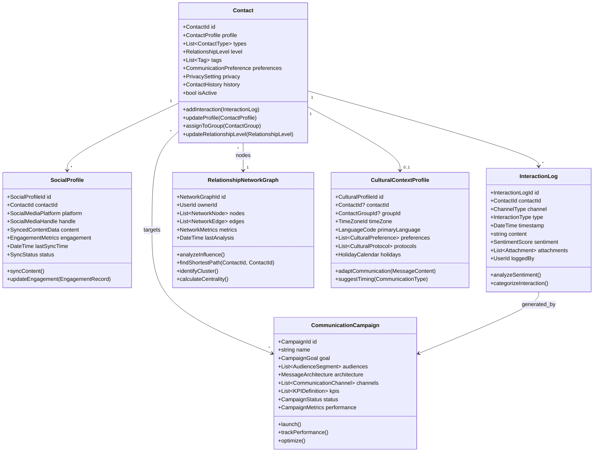
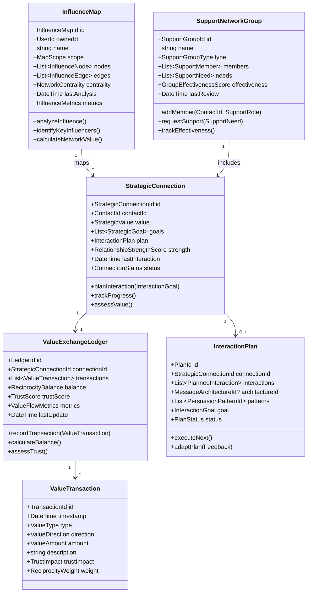
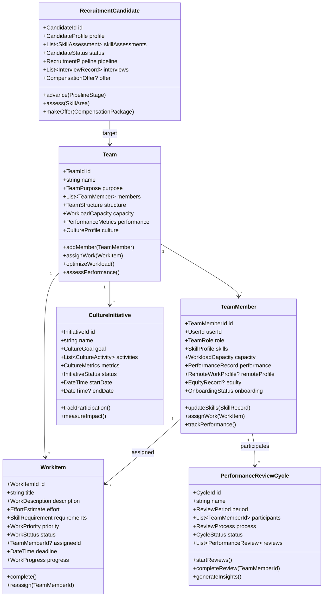
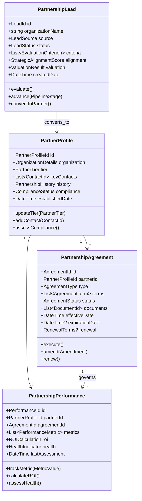
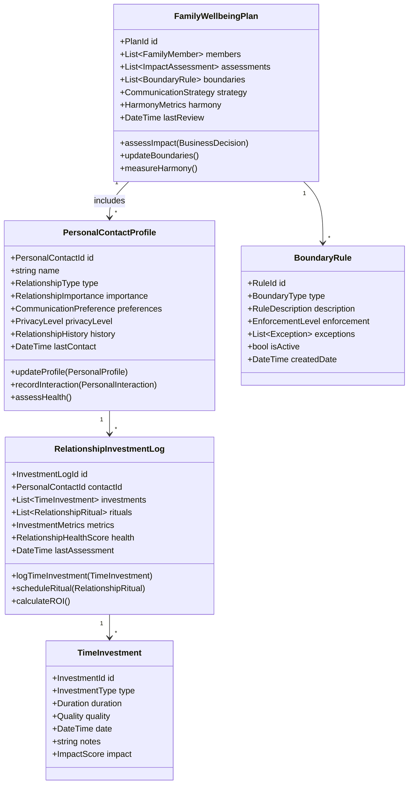
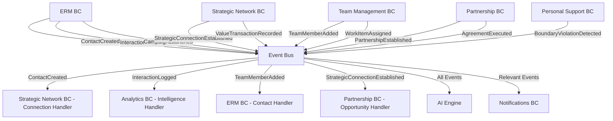
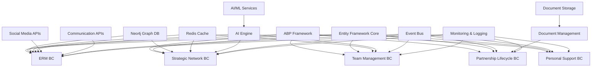

# Relationship Management Platform Domain-Driven Design Architecture Specification
## Relationship Management Platform

---

## Table of Contents

1. [Executive Summary](#1-executive-summary)
2. [Domain Architecture Overview](#2-domain-architecture-overview)
3. [Bounded Context Catalog](#3-bounded-context-catalog)
4. [Bounded Context Specifications](#4-bounded-context-specifications)
5. [Integration Patterns](#5-integration-patterns)
6. [Implementation Guidelines](#6-implementation-guidelines)
7. [Cross-Cutting Concerns](#7-cross-cutting-concerns)
8. [Dependency Matrix](#8-dependency-matrix)

---

## 1. Executive Summary

### 1.1 System Purpose
A comprehensive relationship management platform integrating external contact management, social media intelligence, team collaboration, partnership lifecycle management, strategic networking, and personal relationship support to optimize both professional and personal relationship outcomes.

### 1.2 Architecture Approach
- **Pattern**: Domain-Driven Design with CQRS and Event Sourcing
- **Framework**: ABP Framework (.NET)
- **Integration**: Event-driven architecture with eventual consistency
- **Scalability**: Microservices-ready bounded contexts
- **Security**: Enhanced privacy controls for sensitive personal data

### 1.3 Core Domain Classification
- **Core Domains**: External Relationship Management, Strategic Network & Value
- **Supporting Domains**: Team Management, Partnership Lifecycle Management, Personal Relationship Support
- **Generic Domains**: Identity & Access Management, Notifications, Document Management, AI Engine

---

## 2. Domain Architecture Overview

### 2.1 Context Map

```
┌─────────────────┐    ┌─────────────────┐    ┌─────────────────┐
│External Relation│────│Strategic Network│────│Personal Relation│
│   Management    │    │   & Value       │    │    Support      │
│   (Core)        │    │    (Core)       │    │  (Supporting)   │
└─────────────────┘    └─────────────────┘    └─────────────────┘
         │                       │                       │
         │                       │                       │
┌─────────────────┐    ┌─────────────────┐               │
│Team Management  │    │Partnership      │               │
│  (Supporting)   │    │Lifecycle Mgmt   │               │
└─────────────────┘    │  (Supporting)   │               │
         │              └─────────────────┘               │
         │                       │                       │
         └───────────────────────┼───────────────────────┘
                                 │
        ┌────────────────────────┼────────────────────────┐
        │                       │                        │
┌─────────────────┐    ┌─────────────────┐    ┌─────────────────┐
│   AI Engine     │    │Document Mgmt    │    │  Notifications  │
│   (Generic)     │    │   (Generic)     │    │    (Generic)    │
└─────────────────┘    └─────────────────┘    └─────────────────┘
        │                       │                        │
        └───────────────────────┼────────────────────────┘
                                │
                   ┌─────────────────┐
                   │      IAM        │
                   │   (Generic)     │
                   └─────────────────┘
```

### 2.2 Strategic Design Principles

1. **Relationship-Centric Design**: Each context focuses on different aspects of relationship management
2. **Privacy by Design**: Enhanced security for sensitive personal relationship data
3. **Communication Consistency**: Shared communication primitives across contexts
4. **AI-Driven Insights**: Centralized AI engine providing intelligence across all contexts
5. **Multi-Channel Integration**: Support for various communication channels and social platforms

---

## 3. Bounded Context Catalog

| Context | Type | Priority | Complexity | Team Size |
|---------|------|----------|------------|-----------|
| External Relationship Management | Core | Critical | High | 4-5 |
| Strategic Network & Value | Core | Critical | High | 3-4 |
| Team Management | Supporting | High | Medium | 3-4 |
| Partnership Lifecycle Management | Supporting | Medium | Medium | 2-3 |
| Personal Relationship Support | Supporting | Medium | High | 2-3 |
| AI Engine | Generic | High | High | 3-4 |
| Document Management | Generic | Medium | Low | 1-2 |
| Notifications | Generic | Medium | Medium | 2 |
| IAM | Generic | Critical | Medium | 2 |

---

## 4. Bounded Context Specifications

### 4.1 External Relationship Management (ERM) Bounded Context

#### 4.1.1 Context Overview
**Responsibility**: Manages comprehensive external relationships including contact profiles, social media integration, communication history, cultural context, network analysis, and strategic communication planning.

**Strategic Classification**: Core Domain - Strategic

**Subdomains**:
- Contact Management: Profile creation, organization, and lifecycle management
- Social Media Integration: Multi-platform synchronization and content management
- Communication Intelligence: History tracking and behavioral analysis
- Cultural Context: Cross-cultural communication support
- Network Analytics: Relationship mapping and influence analysis
- Strategic Communication: Campaign planning and execution

#### 4.1.2 Core Domain Model



#### 4.1.3 Aggregates Specification

##### Contact Aggregate Root
**Purpose**: Central entity managing external contact profiles and relationship data

**Entities**:
- `ContactGroup`: Organizational groupings for contacts
- `CommunicationPreference`: Channel and timing preferences
- `PrivacySetting`: Data protection and consent settings
- `ContactHistory`: Timeline of relationship development

**Value Objects**:
- `ContactId`: Unique identifier with validation
- `ContactProfile`: Name, title, organization, contact details
- `ContactType`: Business, Personal, Prospect, Customer, Partner
- `RelationshipLevel`: Acquaintance, Professional, Close, Strategic
- `Tag`: Custom categorization labels
- `CommunicationPreference`: Preferred channels, timing, frequency
- `PrivacySetting`: Consent levels, data retention policies

**Business Invariants**:
- Contact must have at least one contact method (email, phone, social)
- Privacy settings must be respected for all interactions
- Relationship level must be supported by interaction history
- Contact groups cannot create circular references

##### SocialProfile Aggregate Root
**Purpose**: Manages social media presence and synchronization for contacts

**Entities**:
- `SyncedContentItem`: Individual pieces of synced social content
- `EngagementRecord`: Interaction data from social platforms

**Value Objects**:
- `SocialProfileId`: Unique identifier
- `SocialMediaPlatform`: LinkedIn, Twitter, Facebook, Instagram
- `SocialMediaHandle`: Platform-specific identifier
- `SyncedContentData`: Posts, connections, activity data
- `EngagementMetrics`: Likes, shares, comments, reach
- `SyncStatus`: Active, Paused, Error, Disconnected

##### InteractionLog Aggregate Root
**Purpose**: Records and analyzes all communication interactions

**Entities**:
- `ChannelSpecificLog`: Email, call, meeting, social interaction details
- `AttachmentReference`: Links to documents or media

**Value Objects**:
- `InteractionLogId`: Unique identifier
- `ChannelType`: Email, Phone, Video, Social, InPerson
- `InteractionType`: Outbound, Inbound, Meeting, Event
- `SentimentScore`: Positive, Neutral, Negative with confidence
- `InteractionMetrics`: Duration, response time, engagement level

##### CommunicationCampaign Aggregate Root
**Purpose**: Manages strategic communication initiatives and performance tracking

**Entities**:
- `AudienceSegment`: Targeted contact groups for campaigns
- `CampaignMessage`: Individual messages within campaign
- `PerformanceSnapshot`: Point-in-time campaign metrics

**Value Objects**:
- `CampaignId`: Unique identifier
- `CampaignGoal`: Awareness, Engagement, Conversion, Retention
- `MessageArchitecture`: Structure and flow of communication
- `CampaignStatus`: Planning, Active, Paused, Completed, Cancelled
- `CampaignMetrics`: Delivery rate, open rate, response rate, conversion

##### RelationshipNetworkGraph Aggregate Root
**Purpose**: Maps and analyzes relationship networks and influence patterns

**Entities**:
- `NetworkNode`: Represents contacts in the network
- `NetworkEdge`: Represents relationships between contacts

**Value Objects**:
- `NetworkGraphId`: Unique identifier
- `NetworkMetrics`: Density, centrality, clustering coefficient
- `InfluenceScore`: Calculated influence within network
- `ConnectionStrength`: Relationship strength between nodes

##### CulturalContextProfile Aggregate Root
**Purpose**: Manages cultural preferences and communication adaptation

**Value Objects**:
- `CulturalProfileId`: Unique identifier
- `CulturalPreference`: Communication style, formality level
- `CulturalProtocol`: Etiquette rules and best practices
- `HolidayCalendar`: Cultural and religious observances

#### 4.1.4 Commands & Queries (CQRS)

##### Commands
**Contact Management**:
```csharp
public record CreateContact(
    ContactProfile Profile,
    List<ContactType> Types,
    RelationshipLevel Level,
    CommunicationPreference Preferences,
    PrivacySetting Privacy,
    UserId CreatedBy
);

public record UpdateContactProfile(
    ContactId ContactId,
    ContactProfile NewProfile,
    string? UpdateReason,
    UserId UpdatedBy
);

public record AssignContactToGroup(
    ContactId ContactId,
    ContactGroupId GroupId,
    UserId AssignedBy
);

public record UpdateRelationshipLevel(
    ContactId ContactId,
    RelationshipLevel NewLevel,
    string Justification,
    UserId UpdatedBy
);
```

**Social Media Integration**:
```csharp
public record ConnectSocialProfile(
    ContactId ContactId,
    SocialMediaPlatform Platform,
    SocialMediaHandle Handle,
    SyncConfiguration SyncConfig,
    UserId ConnectedBy
);

public record SyncSocialContent(
    SocialProfileId ProfileId,
    DateTime? SyncFromDate,
    bool ForceFullSync,
    UserId InitiatedBy
);
```

**Communication Tracking**:
```csharp
public record LogInteraction(
    ContactId ContactId,
    ChannelType Channel,
    InteractionType Type,
    string Content,
    List<AttachmentReference>? Attachments,
    DateTime? InteractionTime,
    UserId LoggedBy
);

public record AnalyzeInteractionSentiment(
    InteractionLogId InteractionId,
    bool UseAI,
    UserId AnalyzedBy
);
```

**Campaign Management**:
```csharp
public record CreateCommunicationCampaign(
    string Name,
    CampaignGoal Goal,
    List<AudienceSegmentDefinition> Audiences,
    MessageArchitecture Architecture,
    List<CommunicationChannel> Channels,
    List<KPIDefinition> KPIs,
    UserId CreatedBy
);

public record LaunchCampaign(
    CampaignId CampaignId,
    DateTime? ScheduledTime,
    UserId LaunchedBy
);
```

##### Queries
**Contact Queries**:
```csharp
public record GetContactById(ContactId ContactId);
public record SearchContacts(
    string? SearchTerm,
    List<ContactType>? TypeFilter,
    RelationshipLevel? LevelFilter,
    List<Tag>? TagFilter,
    ContactGroupId? GroupFilter,
    int PageNumber = 1,
    int PageSize = 20
);

public record GetContactsByGroup(ContactGroupId GroupId);
public record GetContactInteractionHistory(
    ContactId ContactId,
    DateTime? FromDate,
    DateTime? ToDate,
    ChannelType? ChannelFilter
);
```

**Network Analysis Queries**:
```csharp
public record GetNetworkGraph(UserId UserId, int? MaxDepth = 2);
public record GetContactInfluenceScore(ContactId ContactId);
public record FindNetworkPath(ContactId FromContact, ContactId ToContact);
public record GetNetworkClusters(UserId UserId);
```

**Campaign Queries**:
```csharp
public record GetCampaignPerformance(CampaignId CampaignId);
public record GetActiveCampaigns(UserId UserId);
public record GetCampaignAnalytics(
    CampaignId CampaignId,
    DateTime StartDate,
    DateTime EndDate
);
```

#### 4.1.5 Events & Integration

##### Domain Events
```csharp
public class ContactCreated : DomainEvent
{
    public ContactId ContactId { get; }
    public ContactProfile Profile { get; }
    public List<ContactType> Types { get; }
    public RelationshipLevel Level { get; }
    public UserId CreatedBy { get; }
    public DateTime CreatedAt { get; }
}

public class InteractionLogged : DomainEvent
{
    public InteractionLogId InteractionId { get; }
    public ContactId ContactId { get; }
    public ChannelType Channel { get; }
    public InteractionType Type { get; }
    public SentimentScore? Sentiment { get; }
    public DateTime InteractionTime { get; }
    public UserId LoggedBy { get; }
}

public class RelationshipLevelUpdated : DomainEvent
{
    public ContactId ContactId { get; }
    public RelationshipLevel PreviousLevel { get; }
    public RelationshipLevel NewLevel { get; }
    public string Justification { get; }
    public UserId UpdatedBy { get; }
}

public class SocialContentSynced : DomainEvent
{
    public SocialProfileId ProfileId { get; }
    public ContactId ContactId { get; }
    public SocialMediaPlatform Platform { get; }
    public int ItemsSynced { get; }
    public DateTime SyncTime { get; }
}

public class CampaignLaunched : DomainEvent
{
    public CampaignId CampaignId { get; }
    public string Name { get; }
    public CampaignGoal Goal { get; }
    public int TargetAudienceSize { get; }
    public DateTime LaunchTime { get; }
    public UserId LaunchedBy { get; }
}

public class NetworkAnalysisCompleted : DomainEvent
{
    public NetworkGraphId GraphId { get; }
    public UserId UserId { get; }
    public NetworkMetrics Metrics { get; }
    public List<ContactId> InfluentialContacts { get; }
    public DateTime AnalysisTime { get; }
}
```

##### Integration Handlers
```csharp
public class SocialIntelligenceHandler : 
    IEventHandler<SocialContentSynced>,
    IEventHandler<InteractionLogged>
{
    public async Task Handle(SocialContentSynced eventData)
    {
        // Analyze social content for insights
        await AnalyzeSocialContent(eventData.ProfileId);
        
        // Update engagement metrics
        await UpdateEngagementMetrics(eventData.ContactId);
        
        // Identify potential interaction opportunities
        await IdentifyInteractionOpportunities(eventData.ContactId);
    }
}

public class NetworkAnalysisHandler : IEventHandler<InteractionLogged>
{
    public async Task Handle(InteractionLogged eventData)
    {
        // Update relationship strength
        await UpdateRelationshipStrength(eventData.ContactId);
        
        // Trigger network recalculation if significant interaction
        if (IsSignificantInteraction(eventData))
        {
            await TriggerNetworkAnalysis(eventData.ContactId);
        }
    }
}
```

#### 4.1.6 Business Rules & Policies

##### Contact Management Policies
```csharp
public class ContactPrivacyPolicy
{
    public bool CanAccessContactData(UserId userId, ContactId contactId, DataAccessType accessType)
    {
        // Check privacy settings and consent
        var contact = GetContact(contactId);
        var privacySettings = contact.Privacy;
        
        return accessType switch
        {
            DataAccessType.View => privacySettings.AllowView,
            DataAccessType.Contact => privacySettings.AllowContact && privacySettings.ConsentLevel >= ConsentLevel.Basic,
            DataAccessType.Marketing => privacySettings.AllowMarketing && privacySettings.ConsentLevel >= ConsentLevel.Marketing,
            DataAccessType.Analytics => privacySettings.AllowAnalytics && privacySettings.ConsentLevel >= ConsentLevel.Analytics,
            _ => false
        };
    }
}

public class RelationshipLevelPolicy
{
    public ValidationResult ValidateRelationshipLevelUpdate(
        ContactId contactId,
        RelationshipLevel currentLevel,
        RelationshipLevel newLevel)
    {
        var interactionHistory = GetInteractionHistory(contactId);
        var requiredInteractions = GetRequiredInteractionsForLevel(newLevel);
        
        if (newLevel > currentLevel)
        {
            // Upgrading relationship level requires sufficient interaction history
            if (interactionHistory.Count < requiredInteractions.MinimumCount)
                return ValidationResult.Failed("Insufficient interaction history for relationship level upgrade");
                
            if (interactionHistory.GetRecentInteractionDate() > DateTime.Now.AddDays(-requiredInteractions.MaxDaysSinceLastContact))
                return ValidationResult.Failed("Recent interaction required for relationship level upgrade");
        }
        
        return ValidationResult.Success();
    }
}
```

##### Communication Campaign Policies
```csharp
public class CampaignTargetingPolicy
{
    public async Task<List<ContactId>> FilterEligibleContacts(
        List<ContactId> proposedContacts,
        CommunicationChannel channel,
        CampaignType campaignType)
    {
        var eligibleContacts = new List<ContactId>();
        
        foreach (var contactId in proposedContacts)
        {
            var contact = await GetContact(contactId);
            
            // Check privacy consent
            if (!contact.Privacy.AllowsChannelType(channel))
                continue;
                
            // Check communication frequency limits
            if (await ExceedsFrequencyLimits(contactId, channel))
                continue;
                
            // Check opt-out status
            if (await IsOptedOut(contactId, campaignType))
                continue;
                
            eligibleContacts.Add(contactId);
        }
        
        return eligibleContacts;
    }
}
```

#### 4.1.7 Technical Considerations

##### Performance Optimization
- **Contact Search**: Full-text search with Elasticsearch for contact profiles
- **Network Analysis**: Graph database (Neo4j) for relationship mapping
- **Social Sync**: Rate limiting and batch processing for API calls
- **Cultural Data**: Caching of cultural context and holiday calendars

##### Security & Privacy
- **Data Encryption**: End-to-end encryption for sensitive contact data
- **Consent Management**: Granular consent tracking and enforcement
- **Access Control**: Role-based and attribute-based access control
- **Audit Logging**: Complete audit trail for all contact data access

##### Integration Patterns
- **Social APIs**: OAuth integration with major social platforms
- **AI Services**: Integration with sentiment analysis and recommendation engines
- **Communication Channels**: Webhook support for email/SMS providers
- **Calendar Integration**: Sync with calendar systems for meeting scheduling

---

### 4.2 Strategic Network & Value Bounded Context

#### 4.2.1 Context Overview
**Responsibility**: Manages high-value strategic relationships, influence mapping, value exchange tracking, and support network coordination to maximize relationship ROI and strategic advantage.

**Strategic Classification**: Core Domain - Strategic

**Subdomains**:
- Influence Mapping: Network visualization and influence analysis
- Strategic Relationship Management: High-value relationship cultivation
- Value Exchange Tracking: Reciprocity and value flow management
- Support Network Management: Advisory and mentor relationship coordination

#### 4.2.2 Core Domain Model



#### 4.2.3 Aggregates Specification

##### InfluenceMap Aggregate Root
**Purpose**: Visualizes and analyzes relationship networks for strategic insights

**Entities**:
- `InfluenceNode`: Represents contacts in the influence network
- `InfluenceEdge`: Represents influence relationships between contacts

**Value Objects**:
- `InfluenceMapId`: Unique identifier
- `MapScope`: Personal, Professional, Industry, Global
- `NetworkCentrality`: Betweenness, closeness, eigenvector centrality
- `InfluenceScore`: Calculated influence value
- `InfluenceMetrics`: Network density, clustering, reach

##### StrategicConnection Aggregate Root
**Purpose**: Manages high-value relationships with strategic importance

**Entities**:
- `StrategicGoal`: Specific objectives for the relationship
- `ProgressRecord`: Tracking of goal achievement

**Value Objects**:
- `StrategicConnectionId`: Unique identifier
- `StrategicValue`: Monetary, influence, knowledge, access value
- `RelationshipStrengthScore`: Multi-dimensional strength assessment
- `ConnectionStatus`: Active, Dormant, At-Risk, Terminated
- `InteractionGoal`: Specific objectives for planned interactions

##### ValueExchangeLedger Aggregate Root
**Purpose**: Tracks value flow and reciprocity in strategic relationships

**Value Objects**:
- `LedgerId`: Unique identifier
- `ReciprocityBalance`: Given vs received value balance
- `TrustScore`: Calculated trust level based on exchanges
- `ValueFlowMetrics`: Frequency, consistency, growth of value exchange
- `ValueType`: Advice, Introduction, Resource, Opportunity, Information
- `ValueDirection`: Given, Received
- `ValueAmount`: Quantified or qualitative value assessment

##### SupportNetworkGroup Aggregate Root
**Purpose**: Manages formal and informal support networks

**Entities**:
- `SupportMember`: Individual members with roles and expertise
- `SupportNeed`: Specific support requests or requirements

**Value Objects**:
- `SupportGroupId`: Unique identifier
- `SupportGroupType`: Advisory Board, Mentor Circle, Peer Group, Expert Panel
- `SupportRole`: Advisor, Mentor, Peer, Expert, Coach
- `GroupEffectivenessScore`: Measured effectiveness of support provision
- `SupportNeedStatus`: Open, In Progress, Fulfilled, Closed

#### 4.2.4 Commands & Queries (CQRS)

##### Commands
**Influence Mapping**:
```csharp
public record CreateInfluenceMap(
    string Name,
    MapScope Scope,
    List<ContactId> InitialContacts,
    UserId CreatedBy
);

public record AnalyzeNetworkInfluence(
    InfluenceMapId MapId,
    AnalysisType Type,
    bool IncludeSecondDegree,
    UserId AnalyzedBy
);

public record UpdateInfluenceRelationship(
    InfluenceMapId MapId,
    ContactId FromContact,
    ContactId ToContact,
    InfluenceStrength Strength,
    UserId UpdatedBy
);
```

**Strategic Connection Management**:
```csharp
public record EstablishStrategicConnection(
    ContactId ContactId,
    StrategicValue Value,
    List<StrategicGoal> Goals,
    ConnectionPriority Priority,
    UserId EstablishedBy
);

public record PlanStrategicInteraction(
    StrategicConnectionId ConnectionId,
    InteractionGoal Goal,
    List<InteractionTactic> Tactics,
    DateTime PreferredTiming,
    MessageArchitectureId? ArchitectureId,
    UserId PlannedBy
);

public record AssessConnectionValue(
    StrategicConnectionId ConnectionId,
    ValueAssessmentCriteria Criteria,
    UserId AssessedBy
);
```

**Value Exchange Tracking**:
```csharp
public record RecordValueTransaction(
    StrategicConnectionId ConnectionId,
    ValueType Type,
    ValueDirection Direction,
    ValueAmount Amount,
    string Description,
    TrustImpact TrustImpact,
    UserId RecordedBy
);

public record AssessTrustLevel(
    StrategicConnectionId ConnectionId,
    TrustAssessmentMethod Method,
    UserId AssessedBy
);
```

**Support Network Management**:
```csharp
public record CreateSupportNetwork(
    string Name,
    SupportGroupType Type,
    List<SupportMemberDefinition> InitialMembers,
    UserId CreatedBy
);

public record RequestSupport(
    SupportGroupId GroupId,
    SupportNeedType Type,
    string Description,
    UrgencyLevel Urgency,
    List<SupportRole>? PreferredRoles,
    UserId RequestedBy
);
```

##### Queries
**Influence Analysis**:
```csharp
public record GetInfluenceMap(InfluenceMapId MapId);
public record GetTopInfluencers(UserId UserId, int Count = 10);
public record GetInfluencePath(ContactId FromContact, ContactId ToContact);
public record GetNetworkInsights(InfluenceMapId MapId);
```

**Strategic Relationship Queries**:
```csharp
public record GetStrategicConnections(
    UserId UserId,
    ConnectionStatus? Status,
    StrategicValue? MinValue
);
public record GetConnectionProgress(StrategicConnectionId ConnectionId);
public record GetInteractionPlan(StrategicConnectionId ConnectionId);
```

**Value Analysis**:
```csharp
public record GetValueExchangeHistory(
    StrategicConnectionId ConnectionId,
    DateTime? FromDate,
    DateTime? ToDate
);
public record GetReciprocityReport(UserId UserId);
public record GetTrustScoreAnalysis(StrategicConnectionId ConnectionId);
```

#### 4.2.5 Events & Integration

##### Domain Events
```csharp
public class StrategicConnectionEstablished : DomainEvent
{
    public StrategicConnectionId ConnectionId { get; }
    public ContactId ContactId { get; }
    public StrategicValue Value { get; }
    public List<StrategicGoal> Goals { get; }
    public UserId EstablishedBy { get; }
}

public class ValueTransactionRecorded : DomainEvent
{
    public TransactionId TransactionId { get; }
    public StrategicConnectionId ConnectionId { get; }
    public ValueType Type { get; }
    public ValueDirection Direction { get; }
    public ValueAmount Amount { get; }
    public ReciprocityBalance NewBalance { get; }
}

public class InfluenceAnalysisCompleted : DomainEvent
{
    public InfluenceMapId MapId { get; }
    public List<ContactId> TopInfluencers { get; }
    public NetworkCentrality Centrality { get; }
    public InfluenceMetrics Metrics { get; }
}

public class SupportRequestFulfilled : DomainEvent
{
    public SupportNeedId NeedId { get; }
    public SupportGroupId GroupId { get; }
    public ContactId FulfilledBy { get; }
    public SupportOutcome Outcome { get; }
}
```

#### 4.2.6 Business Rules & Policies

##### Strategic Value Assessment Policy
```csharp
public class StrategicValuePolicy
{
    public StrategicValue CalculateConnectionValue(
        ContactId contactId,
        List<ValueFactor> factors)
    {
        var contact = GetContact(contactId);
        var baseValue = 0m;
        
        // Industry influence factor
        if (factors.Contains(ValueFactor.IndustryInfluence))
        {
            baseValue += CalculateIndustryInfluenceValue(contact);
        }
        
        // Network reach factor
        if (factors.Contains(ValueFactor.NetworkReach))
        {
            baseValue += CalculateNetworkReachValue(contact);
        }
        
        // Decision-making authority
        if (factors.Contains(ValueFactor.DecisionAuthority))
        {
            baseValue += CalculateDecisionAuthorityValue(contact);
        }
        
        // Resource access
        if (factors.Contains(ValueFactor.ResourceAccess))
        {
            baseValue += CalculateResourceAccessValue(contact);
        }
        
        return new StrategicValue(baseValue, factors, DateTime.UtcNow);
    }
}
```

##### Trust Assessment Policy
```csharp
public class TrustAssessmentPolicy
{
    public TrustScore CalculateTrustScore(List<ValueTransaction> transactions)
    {
        var consistencyScore = CalculateConsistency(transactions);
        var reciprocityScore = CalculateReciprocity(transactions);
        var reliabilityScore = CalculateReliability(transactions);
        var transparencyScore = CalculateTransparency(transactions);
        
        var weightedScore = (consistencyScore * 0.3m) +
                           (reciprocityScore * 0.3m) +
                           (reliabilityScore * 0.25m) +
                           (transparencyScore * 0.15m);
        
        return new TrustScore(weightedScore, DateTime.UtcNow);
    }
}
```

#### 4.2.7 Technical Considerations

##### Performance Optimization
- **Graph Analysis**: Specialized graph algorithms for influence calculation
- **Value Tracking**: Time-series database for value transaction history
- **Network Visualization**: Efficient graph rendering for large networks
- **Trust Calculation**: Caching of trust scores with incremental updates

##### Security Considerations
- **Strategic Data Protection**: Enhanced security for high-value relationship data
- **Influence Intelligence**: Protection of competitive network analysis
- **Value Information**: Encryption of financial and strategic value data

---

### 4.3 Team Management Bounded Context

#### 4.3.1 Context Overview
**Responsibility**: Manages team structure, workload optimization, performance analytics, recruitment processes, culture development, and distributed team coordination.

**Strategic Classification**: Supporting Domain

**Subdomains**:
- Team Structure: Organization, roles, and permissions management
- Workload Management: Capacity planning and optimization
- Performance Analytics: Team productivity and effectiveness tracking
- Recruitment Pipeline: Hiring process and candidate management
- Culture Development: Team culture initiatives and measurement
- Remote Collaboration: Distributed team coordination and productivity

#### 4.3.2 Core Domain Model



#### 4.3.3 Aggregates Specification

##### Team Aggregate Root
**Purpose**: Central entity managing team composition, structure, and coordination

**Entities**:
- `TeamRole`: Defined roles with responsibilities and permissions
- `TeamCommunicationChannel`: Internal communication channels

**Value Objects**:
- `TeamId`: Unique identifier
- `TeamPurpose`: Mission, goals, and objectives
- `TeamStructure`: Hierarchy and reporting relationships
- `WorkloadCapacity`: Total team capacity for work
- `PerformanceMetrics`: Team-level productivity indicators
- `CultureProfile`: Team culture characteristics and values

##### TeamMember Aggregate Root
**Purpose**: Represents individual team members with capabilities and performance

**Entities**:
- `SkillRecord`: Individual skills with proficiency levels
- `PerformanceRecord`: Historical performance data
- `DevelopmentPlan`: Growth and learning objectives
- `EquityGrant`: Stock options and equity details

**Value Objects**:
- `TeamMemberId`: Unique identifier (maps to UserID)
- `TeamRole`: Current role and responsibilities
- `SkillProfile`: Comprehensive skill inventory
- `WorkloadCapacity`: Individual capacity metrics
- `RemoteWorkProfile`: Location, timezone, preferences
- `OnboardingStatus`: Progress through onboarding process

##### WorkItem Aggregate Root
**Purpose**: Represents assignable work with effort estimation and tracking

**Value Objects**:
- `WorkItemId`: Unique identifier
- `WorkDescription`: Detailed work requirements
- `EffortEstimate`: Time and complexity estimation
- `SkillRequirement`: Required skills and experience levels
- `WorkPriority`: Business priority level
- `WorkStatus`: Not Started, In Progress, Blocked, Completed
- `WorkProgress`: Completion percentage and milestones

##### RecruitmentCandidate Aggregate Root
**Purpose**: Manages candidates through the hiring pipeline

**Entities**:
- `SkillAssessment`: Evaluated skills and competencies
- `InterviewRecord`: Interview feedback and scores
- `ReferenceCheck`: Reference verification results

**Value Objects**:
- `CandidateId`: Unique identifier
- `CandidateProfile`: Resume, experience, preferences
- `CandidateStatus`: Applied, Screening, Interview, Offer, Hired, Rejected
- `RecruitmentPipeline`: Defined hiring process stages
- `CompensationOffer`: Salary, benefits, equity package

##### CultureInitiative Aggregate Root
**Purpose**: Manages culture development programs and measurement

**Entities**:
- `CultureActivity`: Specific cultural activities and events
- `ParticipationRecord`: Individual participation tracking

**Value Objects**:
- `InitiativeId`: Unique identifier
- `CultureGoal`: Specific cultural objectives
- `CultureMetrics`: Measurable culture indicators
- `InitiativeStatus`: Planning, Active, Completed, Cancelled

##### PerformanceReviewCycle Aggregate Root
**Purpose**: Manages periodic performance evaluation processes

**Entities**:
- `PerformanceReview`: Individual performance assessments
- `PeerFeedback`: 360-degree feedback collection

**Value Objects**:
- `CycleId`: Unique identifier
- `ReviewPeriod`: Time period being evaluated
- `ReviewProcess`: Defined review methodology
- `CycleStatus`: Planning, Active, Review, Completed

#### 4.3.4 Commands & Queries (CQRS)

##### Commands
**Team Management**:
```csharp
public record CreateTeam(
    string Name,
    TeamPurpose Purpose,
    TeamStructure Structure,
    UserId CreatedBy
);

public record AddTeamMember(
    TeamId TeamId,
    UserId UserId,
    TeamRole Role,
    DateTime StartDate,
    UserId AddedBy
);

public record UpdateTeamStructure(
    TeamId TeamId,
    TeamStructure NewStructure,
    string Reason,
    UserId UpdatedBy
);
```

**Workload Management**:
```csharp
public record CreateWorkItem(
    TeamId TeamId,
    string Title,
    WorkDescription Description,
    EffortEstimate Effort,
    SkillRequirement Requirements,
    WorkPriority Priority,
    DateTime Deadline,
    UserId CreatedBy
);

public record AssignWorkItem(
    WorkItemId WorkItemId,
    TeamMemberId AssigneeId,
    AssignmentReason Reason,
    UserId AssignedBy
);

public record OptimizeTeamWorkload(
    TeamId TeamId,
    OptimizationCriteria Criteria,
    UserId OptimizedBy
);
```

**Performance Management**:
```csharp
public record StartPerformanceReviewCycle(
    TeamId TeamId,
    string Name,
    ReviewPeriod Period,
    ReviewProcess Process,
    UserId StartedBy
);

public record SubmitPerformanceReview(
    CycleId CycleId,
    TeamMemberId RevieweeId,
    PerformanceRating Rating,
    string Feedback,
    List<DevelopmentGoal> Goals,
    UserId ReviewerId
);
```

**Recruitment Management**:
```csharp
public record AddRecruitmentCandidate(
    TeamId TargetTeam,
    CandidateProfile Profile,
    RecruitmentSource Source,
    UserId AddedBy
);

public record AdvanceCandidateInPipeline(
    CandidateId CandidateId,
    PipelineStage NextStage,
    string Notes,
    UserId AdvancedBy
);

public record MakeJobOffer(
    CandidateId CandidateId,
    CompensationPackage Package,
    OfferConditions Conditions,
    DateTime ExpirationDate,
    UserId OfferedBy
);
```

##### Queries
**Team Queries**:
```csharp
public record GetTeamById(TeamId TeamId);
public record GetTeamMembers(TeamId TeamId, bool ActiveOnly = true);
public record GetTeamWorkload(TeamId TeamId, DateTime? AsOfDate = null);
public record GetTeamPerformanceMetrics(
    TeamId TeamId,
    DateTime StartDate,
    DateTime EndDate
);
```

**Workload Queries**:
```csharp
public record GetMemberWorkload(TeamMemberId MemberId);
public record GetAvailableMembers(
    TeamId TeamId,
    SkillRequirement Requirements,
    DateTime StartDate,
    DateTime EndDate
);
public record GetWorkItemsByStatus(TeamId TeamId, WorkStatus Status);
```

**Performance Queries**:
```csharp
public record GetPerformanceHistory(
    TeamMemberId MemberId,
    int CycleCount = 5
);
public record GetTeamSkillsGapAnalysis(TeamId TeamId);
public record GetProductivityTrends(
    TeamId TeamId,
    DateTime StartDate,
    DateTime EndDate
);
```

#### 4.3.5 Events & Integration

##### Domain Events
```csharp
public class TeamMemberAdded : DomainEvent
{
    public TeamId TeamId { get; }
    public TeamMemberId MemberId { get; }
    public UserId UserId { get; }
    public TeamRole Role { get; }
    public DateTime StartDate { get; }
    public UserId AddedBy { get; }
}

public class WorkItemAssigned : DomainEvent
{
    public WorkItemId WorkItemId { get; }
    public TeamMemberId AssigneeId { get; }
    public EffortEstimate Effort { get; }
    public WorkPriority Priority { get; }
    public DateTime AssignedAt { get; }
}

public class PerformanceReviewCompleted : DomainEvent
{
    public CycleId CycleId { get; }
    public TeamMemberId RevieweeId { get; }
    public PerformanceRating Rating { get; }
    public List<DevelopmentGoal> Goals { get; }
    public UserId ReviewerId { get; }
}

public class CandidateHired : DomainEvent
{
    public CandidateId CandidateId { get; }
    public TeamId TeamId { get; }
    public TeamRole Role { get; }
    public CompensationPackage Package { get; }
    public DateTime StartDate { get; }
}
```

#### 4.3.6 Business Rules & Policies

##### Workload Optimization Policy
```csharp
public class WorkloadOptimizationPolicy
{
    public List<WorkAssignment> OptimizeWorkload(
        List<WorkItem> workItems,
        List<TeamMember> availableMembers,
        OptimizationCriteria criteria)
    {
        var assignments = new List<WorkAssignment>();
        
        // Sort work items by priority and urgency
        var prioritizedWork = workItems
            .OrderByDescending(w => w.Priority)
            .ThenBy(w => w.Deadline)
            .ToList();
        
        foreach (var workItem in prioritizedWork)
        {
            var suitableMembers = availableMembers
                .Where(m => CanAssignWork(m, workItem))
                .OrderByDescending(m => CalculateMatchScore(m, workItem))
                .ToList();
            
            if (suitableMembers.Any())
            {
                var bestMatch = suitableMembers.First();
                if (bestMatch.AvailableCapacity >= workItem.Effort)
                {
                    assignments.Add(new WorkAssignment(workItem.Id, bestMatch.Id));
                    bestMatch.AllocateCapacity(workItem.Effort);
                }
            }
        }
        
        return assignments;
    }
}
```

#### 4.3.7 Technical Considerations

##### Performance Optimization
- **Capacity Calculations**: Real-time workload and availability tracking
- **Skill Matching**: Efficient algorithms for skill-based work assignment
- **Performance Analytics**: Time-series analysis for trend identification

---

### 4.4 Partnership Lifecycle Management Bounded Context

#### 4.4.1 Context Overview
**Responsibility**: Manages the complete partnership lifecycle from lead identification through performance monitoring, including evaluation, agreement management, and ROI tracking.

**Strategic Classification**: Supporting Domain

**Subdomains**:
- Partnership Development: Lead tracking and evaluation pipeline
- Agreement Management: Contract terms and document management
- Performance Monitoring: Metrics tracking and health assessment
- Partnership Analytics: ROI analysis and strategic alignment

#### 4.4.2 Core Domain Model



#### 4.4.3 Aggregates Specification

##### PartnershipLead Aggregate Root
**Purpose**: Manages potential partnerships through evaluation pipeline

**Entities**:
- `EvaluationCriterion`: Assessment criteria and scoring
- `ValuationModel`: Financial and strategic value assessment

**Value Objects**:
- `LeadId`: Unique identifier
- `LeadSource`: Referral, Inbound, Outbound, Event, Research
- `LeadStatus`: Prospect, Evaluating, Negotiating, Approved, Rejected
- `StrategicAlignmentScore`: Alignment with business objectives
- `ValuationResult`: Estimated partnership value

##### PartnerProfile Aggregate Root
**Purpose**: Comprehensive partner organization information

**Entities**:
- `KeyContact`: Important contacts within partner organization
- `ComplianceRecord`: Regulatory and policy compliance tracking

**Value Objects**:
- `PartnerProfileId`: Unique identifier
- `OrganizationDetails`: Company information, industry, size
- `PartnerTier`: Strategic, Preferred, Standard, Limited
- `PartnershipHistory`: Timeline of relationship milestones
- `ComplianceStatus`: Compliant, At-Risk, Non-Compliant

##### PartnershipAgreement Aggregate Root
**Purpose**: Manages partnership terms, conditions, and documentation

**Entities**:
- `AgreementTerm`: Specific contractual terms and conditions
- `Amendment`: Changes to original agreement
- `DocumentReference`: Links to legal documents

**Value Objects**:
- `AgreementId`: Unique identifier
- `AgreementType`: Strategic Alliance, Vendor, Channel, Technology
- `AgreementStatus`: Draft, Under Review, Active, Suspended, Terminated
- `RenewalTerms`: Automatic renewal conditions

##### PartnershipPerformance Aggregate Root
**Purpose**: Tracks partnership metrics, ROI, and health indicators

**Entities**:
- `PerformanceMetric`: Individual KPI measurements
- `BenchmarkComparison`: Performance vs industry benchmarks

**Value Objects**:
- `PerformanceId`: Unique identifier
- `ROICalculation`: Return on investment analysis
- `HealthIndicator`: Green, Yellow, Red health status
- `MetricValue`: Quantified performance measurement

#### 4.4.4 Commands & Queries (CQRS)

##### Commands
```csharp
public record CreatePartnershipLead(
    string OrganizationName,
    LeadSource Source,
    ContactInformation Contact,
    List<EvaluationCriterion> Criteria,
    UserId CreatedBy
);

public record EvaluatePartnershipLead(
    LeadId LeadId,
    List<CriterionScore> Scores,
    ValuationMethod Method,
    UserId EvaluatedBy
);

public record EstablishPartnership(
    LeadId LeadId,
    PartnerTier Tier,
    List<ContactId> KeyContacts,
    UserId EstablishedBy
);

public record CreatePartnershipAgreement(
    PartnerProfileId PartnerId,
    AgreementType Type,
    List<AgreementTerm> Terms,
    DateTime EffectiveDate,
    DateTime? ExpirationDate,
    UserId CreatedBy
);

public record TrackPartnershipMetric(
    PartnerProfileId PartnerId,
    MetricDefinition Metric,
    MetricValue Value,
    DateTime MeasuredAt,
    UserId TrackedBy
);
```

##### Queries
```csharp
public record GetPartnershipLeadById(LeadId LeadId);
public record GetPartnershipLeadsByStatus(LeadStatus Status);
public record GetPartnerProfile(PartnerProfileId PartnerId);
public record GetPartnershipAgreements(
    PartnerProfileId PartnerId,
    AgreementStatus? Status = null
);
public record GetPartnershipPerformance(
    PartnerProfileId PartnerId,
    DateTime StartDate,
    DateTime EndDate
);
```

#### 4.4.5 Events & Integration

##### Domain Events
```csharp
public class PartnershipLeadCreated : DomainEvent
{
    public LeadId LeadId { get; }
    public string OrganizationName { get; }
    public LeadSource Source { get; }
    public UserId CreatedBy { get; }
}

public class PartnershipEstablished : DomainEvent
{
    public PartnerProfileId PartnerId { get; }
    public string OrganizationName { get; }
    public PartnerTier Tier { get; }
    public DateTime EstablishedDate { get; }
    public UserId EstablishedBy { get; }
}

public class AgreementExecuted : DomainEvent
{
    public AgreementId AgreementId { get; }
    public PartnerProfileId PartnerId { get; }
    public AgreementType Type { get; }
    public DateTime EffectiveDate { get; }
    public DateTime? ExpirationDate { get; }
}

public class PartnershipHealthAlert : DomainEvent
{
    public PartnerProfileId PartnerId { get; }
    public HealthIndicator PreviousHealth { get; }
    public HealthIndicator CurrentHealth { get; }
    public List<HealthFactor> ConcernFactors { get; }
}
```

#### 4.4.6 Business Rules & Policies

##### Partnership Evaluation Policy
```csharp
public class PartnershipEvaluationPolicy
{
    public EvaluationResult EvaluateLead(
        PartnershipLead lead,
        List<CriterionScore> scores)
    {
        var totalScore = 0m;
        var weightedSum = 0m;
        
        foreach (var criterion in lead.Criteria)
        {
            var score = scores.FirstOrDefault(s => s.CriterionId == criterion.Id);
            if (score != null)
            {
                weightedSum += score.Value * criterion.Weight;
                totalScore += criterion.Weight;
            }
        }
        
        var finalScore = totalScore > 0 ? weightedSum / totalScore : 0;
        
        var recommendation = finalScore switch
        {
            >= 80 => EvaluationRecommendation.HighlyRecommended,
            >= 60 => EvaluationRecommendation.Recommended,
            >= 40 => EvaluationRecommendation.Conditional,
            _ => EvaluationRecommendation.NotRecommended
        };
        
        return new EvaluationResult(finalScore, recommendation, DateTime.UtcNow);
    }
}
```

---

### 4.5 Personal Relationship Support Bounded Context

#### 4.5.1 Context Overview
**Responsibility**: Manages personal relationships including family integration, boundary management, relationship investment tracking, and work-life balance optimization with enhanced privacy controls.

**Strategic Classification**: Supporting Domain

**Subdomains**:
- Family Integration: Business impact assessment and communication
- Boundary Management: Work-life separation and expectation alignment
- Relationship Investment: Time and attention allocation tracking
- Personal Wellness: Relationship health and harmony monitoring

#### 4.5.2 Core Domain Model



#### 4.5.3 Aggregates Specification

##### PersonalContactProfile Aggregate Root
**Purpose**: Manages personal relationships with enhanced privacy protection

**Entities**:
- `PersonalInteraction`: Personal communication records
- `RelationshipMilestone`: Important relationship events

**Value Objects**:
- `PersonalContactId`: Unique identifier with enhanced security
- `RelationshipType`: Family, Close Friend, Mentor, Community
- `RelationshipImportance`: Critical, High, Medium, Low
- `PrivacyLevel`: Ultra-Secure, Secure, Protected, Standard
- `RelationshipHealthScore`: Multi-dimensional health assessment

**Business Invariants**:
- Personal contacts require highest privacy level
- Access logs must be maintained for all data access
- Data retention policies must be strictly enforced
- Cross-context sharing requires explicit consent

##### FamilyWellbeingPlan Aggregate Root
**Purpose**: Assesses business impact on family and manages boundaries

**Entities**:
- `FamilyMember`: Individual family member profiles
- `ImpactAssessment`: Business decision impact analysis
- `FamilyCommunicationUpdate`: Regular family updates

**Value Objects**:
- `PlanId`: Unique identifier
- `ImpactScore`: Quantified impact on family wellbeing
- `HarmonyMetrics`: Family relationship health indicators
- `CommunicationStrategy`: Structured family communication approach

##### RelationshipInvestmentLog Aggregate Root
**Purpose**: Tracks time and attention investment in personal relationships

**Entities**:
- `RelationshipRitual`: Recurring relationship activities
- `InvestmentSchedule`: Planned relationship time

**Value Objects**:
- `InvestmentLogId`: Unique identifier
- `InvestmentMetrics`: Time allocation and quality metrics
- `InvestmentType`: Quality Time, Communication, Support, Celebration
- `Quality`: Focused, Distracted, Interrupted, Optimal

#### 4.5.4 Commands & Queries (CQRS)

##### Commands
```csharp
public record CreatePersonalContact(
    string Name,
    RelationshipType Type,
    RelationshipImportance Importance,
    PrivacyLevel PrivacyLevel,
    UserId CreatedBy
);

public record LogPersonalInteraction(
    PersonalContactId ContactId,
    InteractionType Type,
    Duration Duration,
    Quality Quality,
    string? Notes,
    UserId LoggedBy
);

public record AssessFamilyImpact(
    BusinessDecision Decision,
    ImpactAssessmentCriteria Criteria,
    UserId AssessedBy
);

public record ScheduleRelationshipTime(
    PersonalContactId ContactId,
    DateTime ScheduledTime,
    Duration Duration,
    ActivityType Activity,
    UserId ScheduledBy
);

public record UpdateBoundaryRules(
    List<BoundaryRule> Rules,
    string Reason,
    UserId UpdatedBy
);
```

##### Queries
```csharp
public record GetPersonalContacts(
    RelationshipType? Type = null,
    RelationshipImportance? Importance = null
);

public record GetRelationshipHealth(PersonalContactId ContactId);

public record GetFamilyWellbeingReport(DateTime StartDate, DateTime EndDate);

public record GetRelationshipInvestmentSummary(
    DateTime StartDate,
    DateTime EndDate
);

public record GetBoundaryCompliance(DateTime StartDate, DateTime EndDate);
```

#### 4.5.5 Events & Integration

##### Domain Events
```csharp
public class PersonalContactAdded : DomainEvent
{
    public PersonalContactId ContactId { get; }
    public RelationshipType Type { get; }
    public RelationshipImportance Importance { get; }
    public UserId AddedBy { get; }
    // Note: Minimal data in events for privacy
}

public class RelationshipHealthAlert : DomainEvent
{
    public PersonalContactId ContactId { get; }
    public RelationshipHealthScore PreviousScore { get; }
    public RelationshipHealthScore CurrentScore { get; }
    public List<HealthFactor> ConcernFactors { get; }
}

public class BoundaryViolationDetected : DomainEvent
{
    public BoundaryRule ViolatedRule { get; }
    public ViolationSeverity Severity { get; }
    public DateTime ViolationTime { get; }
    public string Context { get; }
}

public class FamilyHarmonyAssessed : DomainEvent
{
    public HarmonyMetrics CurrentMetrics { get; }
    public HarmonyTrend Trend { get; }
    public List<RecommendedAction> Recommendations { get; }
}
```

#### 4.5.6 Business Rules & Policies

##### Privacy Protection Policy
```csharp
public class PersonalDataPrivacyPolicy
{
    public AccessResult ValidateAccess(
        UserId requestingUser,
        PersonalContactId contactId,
        DataAccessType accessType)
    {
        var contact = GetPersonalContact(contactId);
        
        // Only owner can access personal contact data
        if (contact.OwnerId != requestingUser)
        {
            LogUnauthorizedAccess(requestingUser, contactId, accessType);
            return AccessResult.Denied("Unauthorized access to personal data");
        }
        
        // Check privacy level restrictions
        if (contact.PrivacyLevel == PrivacyLevel.UltraSecure && 
            !IsHighSecurityContext())
        {
            return AccessResult.Denied("Ultra-secure data requires enhanced security context");
        }
        
        // Log all access for audit
        LogDataAccess(requestingUser, contactId, accessType, DateTime.UtcNow);
        
        return AccessResult.Allowed();
    }
}
```

##### Boundary Enforcement Policy
```csharp
public class BoundaryEnforcementPolicy
{
    public BoundaryViolation? CheckBoundaryViolation(
        List<BoundaryRule> activeBoundaries,
        BusinessActivity activity,
        DateTime activityTime)
    {
        foreach (var boundary in activeBoundaries.Where(b => b.IsActive))
        {
            if (boundary.Type == BoundaryType.TimeBasedWork)
            {
                var workHours = GetWorkHours(activityTime.Date);
                if (activity.IsWorkRelated && !workHours.Contains(activityTime.TimeOfDay))
                {
                    if (!HasException(boundary, activity, activityTime))
                    {
                        return new BoundaryViolation(boundary, activity, activityTime);
                    }
                }
            }
            
            if (boundary.Type == BoundaryType.FamilyTime)
            {
                var familyTimes = GetFamilyTimes(activityTime.Date);
                if (familyTimes.Any(ft => ft.Contains(activityTime)) && 
                    activity.IsWorkRelated)
                {
                    return new BoundaryViolation(boundary, activity, activityTime);
                }
            }
        }
        
        return null;
    }
}
```

#### 4.5.7 Technical Considerations

##### Enhanced Security Requirements
- **Data Encryption**: End-to-end encryption for all personal relationship data
- **Access Logging**: Complete audit trail for all data access
- **Data Isolation**: Physical separation of personal data storage
- **Retention Policies**: Automatic data purging based on user preferences
- **Backup Security**: Encrypted backups with additional access controls

##### Privacy by Design
- **Minimal Data Collection**: Only collect necessary relationship data
- **User Control**: Complete user control over data sharing and retention
- **Transparency**: Clear visibility into data usage and access
- **Consent Management**: Granular consent for different data uses

---

## 5. Integration Patterns

### 5.1 Event-Driven Integration

#### 5.1.1 Event Flow Architecture


#### 5.1.2 Cross-Context Communication Events

**Relationship Intelligence Events**:
```csharp
public class RelationshipStrengthUpdated : DomainEvent
{
    public ContactId ContactId { get; }
    public RelationshipStrengthScore PreviousScore { get; }
    public RelationshipStrengthScore NewScore { get; }
    public List<StrengthFactor> Factors { get; }
}

public class InfluenceNetworkChanged : DomainEvent
{
    public UserId UserId { get; }
    public List<ContactId> AffectedContacts { get; }
    public NetworkChangeType ChangeType { get; }
    public InfluenceMetrics NewMetrics { get; }
}

public class CommunicationOpportunityIdentified : DomainEvent
{
    public ContactId ContactId { get; }
    public OpportunityType Type { get; }
    public RecommendedAction Action { get; }
    public ConfidenceScore Confidence { get; }
}
```

### 5.2 Communication Primitives (Shared Kernel)

#### 5.2.1 Message Architecture Framework
```csharp
public class MessageArchitecture
{
    public MessageArchitectureId Id { get; }
    public string Name { get; }
    public MessageStructure Structure { get; }
    public List<PersuasionPattern> Patterns { get; }
    public AudienceProfile TargetAudience { get; }
    public EffectivenessMetrics Metrics { get; }
    
    public Message GenerateMessage(MessageContext context)
    {
        var template = SelectTemplate(context);
        var personalizedContent = ApplyPersonalization(template, context);
        var persuasiveContent = ApplyPersuasionPatterns(personalizedContent, context);
        
        return new Message(personalizedContent, persuasiveContent, context.Channel);
    }
}

public class PersuasionPattern
{
    public PersuasionPatternId Id { get; }
    public string Name { get; }
    public PatternType Type { get; } // Reciprocity, Authority, Social Proof, etc.
    public ApplicationGuidelines Guidelines { get; }
    public EffectivenessData Effectiveness { get; }
    
    public string Apply(string content, PersonalizationContext context)
    {
        return Type switch
        {
            PatternType.Reciprocity => ApplyReciprocityPattern(content, context),
            PatternType.SocialProof => ApplySocialProofPattern(content, context),
            PatternType.Authority => ApplyAuthorityPattern(content, context),
            _ => content
        };
    }
}
```

#### 5.2.2 KPI and Metrics Framework
```csharp
public class KPIDefinition
{
    public KPIDefinitionId Id { get; }
    public string Name { get; }
    public string Description { get; }
    public KPICategory Category { get; }
    public MeasurementMethod Method { get; }
    public DataSource Source { get; }
    public CalculationFormula Formula { get; }
    public TargetValue Target { get; }
    public List<Dimension> Dimensions { get; }
}

public class CommunicationMetrics
{
    public static readonly KPIDefinition ResponseRate = new(
        "Response Rate",
        "Percentage of communications that receive a response",
        KPICategory.Engagement,
        MeasurementMethod.Percentage,
        DataSource.InteractionLog,
        new CalculationFormula("(Responses / Total Sent) * 100"),
        new TargetValue(25, Unit.Percentage),
        new List<Dimension> { Dimension.Channel, Dimension.Audience, Dimension.TimeFrame }
    );
    
    public static readonly KPIDefinition RelationshipGrowth = new(
        "Relationship Growth Rate",
        "Rate of relationship strength increase over time",
        KPICategory.RelationshipHealth,
        MeasurementMethod.Rate,
        DataSource.RelationshipScore,
        new CalculationFormula("(Current Score - Previous Score) / Previous Score"),
        new TargetValue(10, Unit.Percentage),
        new List<Dimension> { Dimension.RelationshipType, Dimension.TimeFrame }
    );
}
```

### 5.3 AI Engine Integration

#### 5.3.1 AI Service Interfaces
```csharp
public interface IRelationshipIntelligenceService
{
    Task<RelationshipInsights> AnalyzeRelationshipPatterns(ContactId contactId);
    Task<CommunicationRecommendations> GenerateCommunicationRecommendations(ContactId contactId);
    Task<NetworkOpportunities> IdentifyNetworkOpportunities(UserId userId);
    Task<InfluenceAnalysis> AnalyzeInfluenceNetwork(InfluenceMapId mapId);
}

public interface IPredictiveAnalyticsService
{
    Task<RelationshipRisk> PredictRelationshipRisk(ContactId contactId);
    Task<OptimalTiming> PredictOptimalCommunicationTiming(ContactId contactId, MessageType messageType);
    Task<PersonalizationSuggestions> GeneratePersonalizationSuggestions(ContactId contactId, MessageTemplate template);
    Task<PerformanceForecast> ForecastPartnershipPerformance(PartnerProfileId partnerId);
}

public interface ICulturalIntelligenceService
{
    Task<CulturalAdaptations> SuggestCulturalAdaptations(ContactId contactId, MessageContent content);
    Task<CommunicationStyle> RecommendCommunicationStyle(ContactId contactId);
    Task<TimingRecommendations> SuggestOptimalTiming(ContactId contactId, CommunicationType type);
}
```

#### 5.3.2 AI-Driven Event Handlers
```csharp
public class AIRelationshipAnalysisHandler : 
    IEventHandler<InteractionLogged>,
    IEventHandler<ValueTransactionRecorded>,
    IEventHandler<StrategicConnectionEstablished>
{
    private readonly IRelationshipIntelligenceService _aiService;
    private readonly IPredictiveAnalyticsService _predictiveService;
    
    public async Task Handle(InteractionLogged eventData)
    {
        // Analyze interaction for relationship insights
        var insights = await _aiService.AnalyzeRelationshipPatterns(eventData.ContactId);
        
        // Predict relationship risk
        var riskAssessment = await _predictiveService.PredictRelationshipRisk(eventData.ContactId);
        
        // Generate communication recommendations
        var recommendations = await _aiService.GenerateCommunicationRecommendations(eventData.ContactId);
        
        // Publish insights for other contexts
        await PublishEvent(new RelationshipInsightsGenerated(
            eventData.ContactId,
            insights,
            riskAssessment,
            recommendations
        ));
    }
}
```

### 5.4 Anti-Corruption Layers

#### 5.4.1 ERM-Strategic Network Integration
```csharp
public class ERMStrategicNetworkACL
{
    private readonly IContactQueryService _contactService;
    private readonly IStrategicNetworkCommandService _strategicService;
    
    public async Task<StrategicConnectionResult> ElevateContactToStrategicConnection(
        ContactId contactId,
        StrategicElevationCriteria criteria)
    {
        // Validate contact exists and meets criteria
        var contact = await _contactService.GetContactById(contactId);
        if (contact == null)
            return StrategicConnectionResult.ContactNotFound();
        
        // Assess strategic value
        var valueAssessment = await AssessStrategicValue(contact, criteria);
        if (!valueAssessment.MeetsThreshold)
            return StrategicConnectionResult.InsufficientValue(valueAssessment);
        
        // Translate contact data to strategic connection
        var strategicConnection = TranslateToStrategicConnection(contact, valueAssessment);
        
        // Create strategic connection
        var connectionId = await _strategicService.EstablishStrategicConnection(strategicConnection);
        
        return StrategicConnectionResult.Success(connectionId);
    }
    
    private StrategicConnectionDefinition TranslateToStrategicConnection(
        Contact contact,
        StrategicValueAssessment assessment)
    {
        return new StrategicConnectionDefinition(
            contact.Id,
            assessment.CalculatedValue,
            DeriveStrategicGoals(contact, assessment),
            MapConnectionPriority(contact.RelationshipLevel),
            contact.Profile.UserId
        );
    }
}
```

#### 5.4.2 Team-ERM Integration
```csharp
public class TeamERMIntegrationACL
{
    public async Task SynchronizeTeamMemberContact(TeamMemberAdded eventData)
    {
        // Check if team member already has ERM contact
        var existingContact = await FindContactByUserId(eventData.UserId);
        
        if (existingContact == null)
        {
            // Create internal contact for team member
            var contactData = await GetUserProfileData(eventData.UserId);
            var internalContact = new CreateContactCommand(
                contactData.Profile,
                new List<ContactType> { ContactType.Internal, ContactType.TeamMember },
                RelationshipLevel.Professional,
                GetDefaultInternalPreferences(),
                GetInternalPrivacySettings(),
                eventData.AddedBy
            );
            
            await CreateContact(internalContact);
        }
        else
        {
            // Update existing contact with team member information
            await UpdateContactWithTeamRole(existingContact.Id, eventData.Role);
        }
    }
}
```

---

## 6. Implementation Guidelines

### 6.1 Development Standards

#### 6.1.1 Domain Model Implementation

**Contact Aggregate Example**:
```csharp
public class Contact : AggregateRoot<ContactId>
{
    private readonly List<InteractionLog> _interactions = new();
    private readonly List<SocialProfile> _socialProfiles = new();
    
    public ContactProfile Profile { get; private set; }
    public List<ContactType> Types { get; private set; }
    public RelationshipLevel Level { get; private set; }
    public CommunicationPreference Preferences { get; private set; }
    public PrivacySetting Privacy { get; private set; }
    
    public IReadOnlyList<InteractionLog> Interactions => _interactions.AsReadOnly();
    public IReadOnlyList<SocialProfile> SocialProfiles => _socialProfiles.AsReadOnly();
    
    public static Contact Create(
        ContactProfile profile,
        List<ContactType> types,
        RelationshipLevel level,
        CommunicationPreference preferences,
        PrivacySetting privacy,
        UserId createdBy)
    {
        // Business rule validation
        if (string.IsNullOrWhiteSpace(profile.Name))
            throw new DomainException("Contact must have a name");
        
        if (!HasValidContactMethod(profile))
            throw new DomainException("Contact must have at least one contact method");
        
        var contact = new Contact(ContactId.New(), profile, types, level, preferences, privacy);
        
        contact.RaiseDomainEvent(new ContactCreated(
            contact.Id,
            profile,
            types,
            level,
            createdBy,
            DateTime.UtcNow
        ));
        
        return contact;
    }
    
    public void LogInteraction(
        ChannelType channel,
        InteractionType type,
        string content,
        UserId loggedBy)
    {
        // Validate privacy settings
        if (!Privacy.AllowsChannelType(channel))
            throw new DomainException("Contact privacy settings prohibit this channel type");
        
        var interaction = new InteractionLog(
            InteractionLogId.New(),
            Id,
            channel,
            type,
            DateTime.UtcNow,
            content,
            loggedBy
        );
        
        _interactions.Add(interaction);
        
        // Update relationship level if warranted
        var newLevel = CalculateRelationshipLevel(_interactions);
        if (newLevel != Level)
        {
            UpdateRelationshipLevel(newLevel, "Automatic update based on interaction history", loggedBy);
        }
        
        RaiseDomainEvent(new InteractionLogged(
            interaction.Id,
            Id,
            channel,
            type,
            interaction.Sentiment,
            DateTime.UtcNow,
            loggedBy
        ));
    }
    
    public void UpdateRelationshipLevel(
        RelationshipLevel newLevel,
        string justification,
        UserId updatedBy)
    {
        var previousLevel = Level;
        
        // Validate relationship level change
        var validation = new RelationshipLevelPolicy().ValidateRelationshipLevelUpdate(
            Id, Level, newLevel);
        
        if (!validation.IsValid)
            throw new DomainException(validation.ErrorMessage);
        
        Level = newLevel;
        
        RaiseDomainEvent(new RelationshipLevelUpdated(
            Id,
            previousLevel,
            newLevel,
            justification,
            updatedBy
        ));
    }
}
```

#### 6.1.2 Command Handler Implementation

```csharp
public class CreateContactHandler : ICommandHandler<CreateContact, ContactId>
{
    private readonly IContactRepository _repository;
    private readonly IContactDuplicationService _duplicationService;
    private readonly IPrivacyValidationService _privacyService;
    
    public async Task<ContactId> Handle(CreateContact command)
    {
        // Check for duplicates
        var potentialDuplicates = await _duplicationService.FindPotentialDuplicates(command.Profile);
        if (potentialDuplicates.Any())
        {
            throw new BusinessRuleException(
                "DUPLICATE_CONTACT_DETECTED",
                "Similar contact already exists",
                new Dictionary<string, object> { ["Duplicates"] = potentialDuplicates }
            );
        }
        
        // Validate privacy compliance
        var privacyValidation = await _privacyService.ValidatePrivacySettings(command.Privacy);
        if (!privacyValidation.IsValid)
        {
            throw new BusinessRuleException(
                "PRIVACY_VALIDATION_FAILED",
                privacyValidation.ErrorMessage
            );
        }
        
        // Create contact
        var contact = Contact.Create(
            command.Profile,
            command.Types,
            command.Level,
            command.Preferences,
            command.Privacy,
            command.CreatedBy
        );
        
        await _repository.SaveAsync(contact);
        
        return contact.Id;
    }
}
```

#### 6.1.3 Query Handler Implementation

```csharp
public class SearchContactsHandler : IQueryHandler<SearchContacts, PagedList<ContactSummaryDto>>
{
    private readonly IContactReadModelRepository _readRepository;
    private readonly ICurrentUserService _currentUserService;
    
    public async Task<PagedList<ContactSummaryDto>> Handle(SearchContacts query)
    {
        // Build search specification
        var spec = new ContactSearchSpecification(query.SearchTerm)
            .And(query.TypeFilter, c => query.TypeFilter.Any(t => c.Types.Contains(t)))
            .And(query.LevelFilter, c => c.Level == query.LevelFilter)
            .And(query.TagFilter, c => query.TagFilter.Any(t => c.Tags.Contains(t)))
            .And(query.GroupFilter, c => c.GroupId == query.GroupFilter);
        
        // Apply user access filters
        var userAccessSpec = new UserAccessSpecification(_currentUserService.UserId);
        spec = spec.And(userAccessSpec);
        
        // Execute query with pagination
        return await _readRepository.GetPagedAsync(spec, query.PageNumber, query.PageSize);
    }
}
```

#### 6.1.4 Event Handler Implementation

```csharp
public class RelationshipIntelligenceHandler : 
    IEventHandler<InteractionLogged>,
    IEventHandler<SocialContentSynced>
{
    private readonly IRelationshipIntelligenceService _aiService;
    private readonly IEventPublisher _eventPublisher;
    
    public async Task Handle(InteractionLogged eventData)
    {
        try
        {
            // Analyze interaction for insights
            var insights = await _aiService.AnalyzeInteractionPatterns(
                eventData.ContactId,
                eventData.Channel,
                eventData.Type
            );
            
            // Generate communication recommendations
            var recommendations = await _aiService.GenerateCommunicationRecommendations(
                eventData.ContactId
            );
            
            // Check for relationship risks
            var riskAssessment = await _aiService.AssessRelationshipRisk(
                eventData.ContactId
            );
            
            // Publish insights for other contexts
            await _eventPublisher.PublishAsync(new RelationshipInsightsGenerated(
                eventData.ContactId,
                insights,
                recommendations,
                riskAssessment
            ));
            
        }
        catch (Exception ex)
        {
            // Log error but don't fail the event processing
            _logger.LogError(ex, "Failed to process relationship intelligence for interaction {InteractionId}", 
                eventData.InteractionId);
        }
    }
}
```

### 6.2 Privacy and Security Implementation

#### 6.2.1 Enhanced Privacy for Personal Relationships

```csharp
public class PersonalDataProtectionService
{
    private readonly IDataProtector _protector;
    private readonly IAuditLogger _auditLogger;
    
    public async Task<TData> ProtectPersonalData<TData>(TData data, PrivacyLevel level)
        where TData : class
    {
        switch (level)
        {
            case PrivacyLevel.UltraSecure:
                return await EncryptWithUserKey(data);
            case PrivacyLevel.Secure:
                return await EncryptWithSystemKey(data);
            case PrivacyLevel.Protected:
                return await HashSensitiveFields(data);
            default:
                return data;
        }
    }
    
    public async Task<AccessResult> ValidatePersonalDataAccess(
        UserId requestingUser,
        PersonalContactId contactId,
        DataAccessType accessType)
    {
        // Log access attempt
        await _auditLogger.LogAccessAttempt(requestingUser, contactId, accessType);
        
        var contact = await GetPersonalContact(contactId);
        
        // Only owner can access personal relationship data
        if (contact.OwnerId != requestingUser)
        {
            await _auditLogger.LogUnauthorizedAccess(requestingUser, contactId, accessType);
            return AccessResult.Denied("Unauthorized access to personal relationship data");
        }
        
        // Check for additional security requirements
        if (contact.PrivacyLevel == PrivacyLevel.UltraSecure)
        {
            var mfaResult = await ValidateMultiFactorAuth(requestingUser);
            if (!mfaResult.IsValid)
            {
                return AccessResult.Denied("Multi-factor authentication required for ultra-secure data");
            }
        }
        
        // Log successful access
        await _auditLogger.LogSuccessfulAccess(requestingUser, contactId, accessType);
        
        return AccessResult.Allowed();
    }
}
```

#### 6.2.2 Cultural Context Security

```csharp
public class CulturalDataSecurityService
{
    public async Task<bool> ValidateCulturalDataAccess(
        UserId requestingUser,
        ContactId contactId,
        CulturalDataType dataType)
    {
        var contact = await GetContact(contactId);
        var culturalProfile = await GetCulturalProfile(contactId);
        
        // Check if user has permission to access cultural data
        if (!contact.Privacy.AllowsCulturalDataAccess(requestingUser))
            return false;
        
        // Some cultural data may be more sensitive
        if (dataType == CulturalDataType.ReligiousPreferences &&
            !culturalProfile.AllowsReligiousDataSharing)
            return false;
        
        return true;
    }
}
```

### 6.3 AI Integration Implementation

#### 6.3.1 Relationship Intelligence Service

```csharp
public class RelationshipIntelligenceService : IRelationshipIntelligenceService
{
    private readonly IAIModelService _aiModelService;
    private readonly IRelationshipDataService _dataService;
    
    public async Task<RelationshipInsights> AnalyzeRelationshipPatterns(ContactId contactId)
    {
        // Gather relationship data
        var interactions = await _dataService.GetInteractionHistory(contactId);
        var socialData = await _dataService.GetSocialProfileData(contactId);
        var valueExchanges = await _dataService.GetValueExchangeHistory(contactId);
        
        // Prepare data for AI analysis
        var analysisData = new RelationshipAnalysisData(
            interactions: interactions.Select(MapToAIFormat).ToList(),
            socialEngagement: socialData.Select(MapToAIFormat).ToList(),
            valueHistory: valueExchanges.Select(MapToAIFormat).ToList()
        );
        
        // Call AI service
        var aiResult = await _aiModelService.AnalyzeRelationshipPatterns(analysisData);
        
        // Transform AI result to domain model
        return new RelationshipInsights(
            relationshipStrength: new RelationshipStrengthScore(aiResult.StrengthScore),
            communicationPreferences: MapCommunicationPreferences(aiResult.Preferences),
            interactionFrequency: new InteractionFrequency(aiResult.OptimalFrequency),
            recommendedActions: aiResult.Actions.Select(MapToRecommendedAction).ToList(),
            confidenceLevel: new ConfidenceScore(aiResult.Confidence)
        );
    }
    
    public async Task<CommunicationRecommendations> GenerateCommunicationRecommendations(
        ContactId contactId)
    {
        var contact = await _dataService.GetContact(contactId);
        var recentInteractions = await _dataService.GetRecentInteractions(contactId, TimeSpan.FromDays(90));
        var culturalContext = await _dataService.GetCulturalContext(contactId);
        
        var recommendationRequest = new CommunicationRecommendationRequest(
            contact: MapContactForAI(contact),
            recentInteractions: recentInteractions.Select(MapInteractionForAI).ToList(),
            culturalContext: MapCulturalContextForAI(culturalContext)
        );
        
        var aiRecommendations = await _aiModelService.GenerateCommunicationRecommendations(
            recommendationRequest);
        
        return new CommunicationRecommendations(
            preferredChannels: aiRecommendations.Channels.Select(MapToChannelType).ToList(),
            optimalTiming: new OptimalTiming(aiRecommendations.BestTimes),
            messageStyle: new MessageStyle(aiRecommendations.ToneRecommendation),
            persuasionPatterns: aiRecommendations.PersuasionPatterns.Select(MapToPersuasionPattern).ToList(),
            culturalAdaptations: aiRecommendations.CulturalAdaptations.Select(MapToCulturalAdaptation).ToList()
        );
    }
}
```

#### 6.3.2 Predictive Analytics Implementation

```csharp
public class PredictiveAnalyticsService : IPredictiveAnalyticsService
{
    public async Task<RelationshipRisk> PredictRelationshipRisk(ContactId contactId)
    {
        var riskFactors = await GatherRiskFactors(contactId);
        var prediction = await _aiModelService.PredictRelationshipRisk(riskFactors);
        
        return new RelationshipRisk(
            riskLevel: MapRiskLevel(prediction.RiskScore),
            riskFactors: prediction.Factors.Select(MapRiskFactor).ToList(),
            mitigationSuggestions: prediction.Mitigations.Select(MapMitigation).ToList(),
            confidenceLevel: new ConfidenceScore(prediction.Confidence),
            projectedOutcome: MapProjectedOutcome(prediction.Outcome),
            timeframe: TimeSpan.FromDays(prediction.TimeframeDays)
        );
    }
    
    public async Task<OptimalTiming> PredictOptimalCommunicationTiming(
        ContactId contactId, 
        MessageType messageType)
    {
        var timingData = await GatherTimingData(contactId);
        var prediction = await _aiModelService.PredictOptimalTiming(timingData, messageType);
        
        return new OptimalTiming(
            bestDayOfWeek: prediction.OptimalDay,
            bestTimeOfDay: prediction.OptimalTime,
            timeZoneConsiderations: MapTimeZoneFactors(prediction.TimeZoneFactors),
            culturalConsiderations: MapCulturalFactors(prediction.CulturalFactors),
            confidenceLevel: new ConfidenceScore(prediction.Confidence),
            alternativeTimes: prediction.AlternativeTimes.Select(MapAlternativeTime).ToList()
        );
    }
    
    private async Task<RelationshipRiskFactors> GatherRiskFactors(ContactId contactId)
    {
        var contact = await _dataService.GetContact(contactId);
        var interactions = await _dataService.GetInteractionHistory(contactId);
        var responsePatterns = await _dataService.GetResponsePatterns(contactId);
        var valueExchanges = await _dataService.GetValueExchangeHistory(contactId);
        
        return new RelationshipRiskFactors(
            communicationFrequency: CalculateCommunicationFrequency(interactions),
            responseRate: CalculateResponseRate(interactions),
            reciprocityBalance: CalculateReciprocityBalance(valueExchanges),
            engagementTrend: CalculateEngagementTrend(interactions),
            lastInteractionAge: CalculateLastInteractionAge(interactions),
            relationshipDuration: CalculateRelationshipDuration(contact),
            conflictIndicators: DetectConflictIndicators(interactions)
        );
    }
}
```

### 6.4 Performance Optimization

#### 6.4.1 Caching Strategy

```csharp
public class CachedContactQueryService : IContactQueryService
{
    private readonly IContactQueryService _inner;
    private readonly IDistributedCache _cache;
    private readonly ILogger<CachedContactQueryService> _logger;
    
    public async Task<ContactDetailDto?> GetContactDetailAsync(ContactId contactId)
    {
        var cacheKey = GenerateCacheKey("contact-detail", contactId);
        
        var cachedContact = await _cache.GetAsync<ContactDetailDto>(cacheKey);
        if (cachedContact != null)
        {
            _logger.LogDebug("Cache hit for contact {ContactId}", contactId);
            return cachedContact;
        }
        
        var contact = await _inner.GetContactDetailAsync(contactId);
        
        if (contact != null)
        {
            var cacheOptions = new DistributedCacheEntryOptions
            {
                AbsoluteExpirationRelativeToNow = TimeSpan.FromMinutes(30),
                SlidingExpiration = TimeSpan.FromMinutes(10)
            };
            
            await _cache.SetAsync(cacheKey, contact, cacheOptions);
            _logger.LogDebug("Cached contact {ContactId}", contactId);
        }
        
        return contact;
    }
    
    public async Task<RelationshipInsights> GetRelationshipInsightsAsync(ContactId contactId)
    {
        var cacheKey = GenerateCacheKey("relationship-insights", contactId);
        
        var cachedInsights = await _cache.GetAsync<RelationshipInsights>(cacheKey);
        if (cachedInsights != null && !cachedInsights.IsStale())
        {
            return cachedInsights;
        }
        
        var insights = await _inner.GetRelationshipInsightsAsync(contactId);
        
        // Cache insights for longer period as they're expensive to compute
        var cacheOptions = new DistributedCacheEntryOptions
        {
            AbsoluteExpirationRelativeToNow = TimeSpan.FromHours(4),
            SlidingExpiration = TimeSpan.FromHours(1)
        };
        
        await _cache.SetAsync(cacheKey, insights, cacheOptions);
        
        return insights;
    }
}

// Cache invalidation handler
public class ContactCacheInvalidationHandler : 
    IEventHandler<ContactUpdated>,
    IEventHandler<InteractionLogged>
{
    private readonly IDistributedCache _cache;
    
    public async Task Handle(ContactUpdated eventData)
    {
        await InvalidateContactCaches(eventData.ContactId);
    }
    
    public async Task Handle(InteractionLogged eventData)
    {
        // Invalidate insights cache when new interactions are logged
        var insightsCacheKey = GenerateCacheKey("relationship-insights", eventData.ContactId);
        await _cache.RemoveAsync(insightsCacheKey);
    }
    
    private async Task InvalidateContactCaches(ContactId contactId)
    {
        var cacheKeys = new[]
        {
            GenerateCacheKey("contact-detail", contactId),
            GenerateCacheKey("relationship-insights", contactId),
            GenerateCacheKey("communication-recommendations", contactId)
        };
        
        var tasks = cacheKeys.Select(key => _cache.RemoveAsync(key));
        await Task.WhenAll(tasks);
    }
}
```

#### 6.4.2 Database Optimization

```csharp
// Entity configurations for optimal querying
public class ContactConfiguration : IEntityTypeConfiguration<Contact>
{
    public void Configure(EntityTypeBuilder<Contact> builder)
    {
        builder.HasKey(c => c.Id);
        
        // Indexes for common queries
        builder.HasIndex(c => c.Level);
        builder.HasIndex(c => new { c.Level, c.Types });
        builder.HasIndex(c => c.LastInteractionDate);
        builder.HasIndex(c => new { c.UserId, c.Level });
        
        // Full-text search index for names and descriptions
        builder.HasIndex(c => c.Profile.Name).HasDatabaseName("IX_Contact_Name_FullText");
        
        // Value object configurations
        builder.OwnsOne(c => c.Profile, profile =>
        {
            profile.Property(p => p.Name).HasMaxLength(200).IsRequired();
            profile.Property(p => p.Title).HasMaxLength(100);
            profile.Property(p => p.Organization).HasMaxLength(200);
            
            profile.OwnsMany(p => p.EmailAddresses, email =>
            {
                email.Property(e => e.Address).HasMaxLength(255);
                email.HasIndex(e => e.Address);
            });
        });
        
        builder.OwnsOne(c => c.Privacy, privacy =>
        {
            privacy.Property(p => p.Level).HasConversion<string>();
            privacy.Property(p => p.ConsentDate).IsRequired();
            privacy.Property(p => p.ConsentLevel).HasConversion<string>();
        });
        
        // Navigation properties
        builder.HasMany(c => c.Interactions)
            .WithOne()
            .HasForeignKey("ContactId")
            .OnDelete(DeleteBehavior.Cascade);
            
        builder.HasMany(c => c.SocialProfiles)
            .WithOne()
            .HasForeignKey("ContactId")
            .OnDelete(DeleteBehavior.Cascade);
    }
}

// Read model for optimized queries
public class ContactSummaryReadModel
{
    public ContactId ContactId { get; set; }
    public string Name { get; set; }
    public string Title { get; set; }
    public string Organization { get; set; }
    public List<ContactType> Types { get; set; }
    public RelationshipLevel Level { get; set; }
    public DateTime? LastInteractionDate { get; set; }
    public int InteractionCount { get; set; }
    public List<string> Tags { get; set; }
    public RelationshipStrengthScore? StrengthScore { get; set; }
    public DateTime CreatedAt { get; set; }
    public DateTime UpdatedAt { get; set; }
    
    // Computed fields for efficient querying
    public int DaysSinceLastInteraction { get; set; }
    public bool IsHighValue { get; set; }
    public bool NeedsAttention { get; set; }
}
```

#### 6.4.3 Network Analysis Optimization

```csharp
public class OptimizedNetworkAnalysisService
{
    private readonly IGraphDatabase _graphDb; // Neo4j or similar
    private readonly IMemoryCache _cache;
    
    public async Task<InfluenceAnalysis> AnalyzeInfluenceNetwork(
        InfluenceMapId mapId,
        int maxDepth = 3)
    {
        var cacheKey = $"influence-analysis:{mapId}:{maxDepth}";
        
        if (_cache.TryGetValue(cacheKey, out InfluenceAnalysis cachedResult))
        {
            return cachedResult;
        }
        
        // Use graph database for complex network queries
        var query = """
            MATCH (center:Contact {userId: $userId})
            CALL apoc.path.subgraphNodes(center, {
                relationshipFilter: "CONNECTED_TO",
                minLevel: 1,
                maxLevel: $maxDepth
            }) YIELD node
            WITH center, collect(node) as networkNodes
            
            // Calculate centrality measures
            CALL gds.betweenness.stream('influence-graph', {
                sourceNodes: [center]
            }) YIELD nodeId, score as betweenness
            
            CALL gds.pageRank.stream('influence-graph', {
                sourceNodes: [center]
            }) YIELD nodeId, score as pageRank
            
            RETURN center, networkNodes, 
                   collect({nodeId: nodeId, betweenness: betweenness}) as betweennessScores,
                   collect({nodeId: nodeId, pageRank: pageRank}) as pageRankScores
            """;
        
        var result = await _graphDb.ExecuteQueryAsync(query, new 
        { 
            userId = GetUserIdFromMap(mapId), 
            maxDepth = maxDepth 
        });
        
        var analysis = MapToInfluenceAnalysis(result);
        
        // Cache for 1 hour
        _cache.Set(cacheKey, analysis, TimeSpan.FromHours(1));
        
        return analysis;
    }
    
    public async Task<List<NetworkPath>> FindShortestPaths(
        ContactId fromContact,
        ContactId toContact,
        int maxDepth = 5)
    {
        var query = """
            MATCH (start:Contact {id: $fromContactId}), (end:Contact {id: $toContactId})
            CALL apoc.algo.dijkstra(start, end, 'CONNECTED_TO', 'strength') 
            YIELD path, weight
            WITH path, weight
            ORDER BY weight ASC
            LIMIT 5
            RETURN path, weight
            """;
        
        var result = await _graphDb.ExecuteQueryAsync(query, new 
        { 
            fromContactId = fromContact.Value, 
            toContactId = toContact.Value 
        });
        
        return MapToNetworkPaths(result);
    }
}
```

### 6.5 Security Implementation

#### 6.5.1 Authorization Policies

```csharp
public static class RelationshipManagementPolicies
{
    public const string CanManageContacts = "CanManageContacts";
    public const string CanViewAllContacts = "CanViewAllContacts";
    public const string CanAccessSocialData = "CanAccessSocialData";
    public const string CanViewNetworkAnalysis = "CanViewNetworkAnalysis";
    public const string CanManagePersonalData = "CanManagePersonalData";
}

public class ContactAuthorizationHandler : 
    AuthorizationHandler<OperationAuthorizationRequirement, Contact>
{
    protected override Task HandleRequirementAsync(
        AuthorizationHandlerContext context,
        OperationAuthorizationRequirement requirement,
        Contact resource)
    {
        var userId = context.User.GetUserId();
        
        if (requirement == Operations.Read)
        {
            if (CanReadContact(context.User, resource, userId))
            {
                context.Succeed(requirement);
            }
        }
        else if (requirement == Operations.Update)
        {
            if (CanUpdateContact(context.User, resource, userId))
            {
                context.Succeed(requirement);
            }
        }
        else if (requirement == Operations.Delete)
        {
            if (CanDeleteContact(context.User, resource, userId))
            {
                context.Succeed(requirement);
            }
        }
        
        return Task.CompletedTask;
    }
    
    private bool CanReadContact(ClaimsPrincipal user, Contact contact, UserId userId)
    {
        // Contact owner can always read
        if (contact.OwnerId == userId)
            return true;
        
        // Check privacy settings
        if (!contact.Privacy.AllowsExternalAccess)
            return false;
        
        // Check if user has general contact access permission
        if (user.HasClaim("permission", "contacts:view:all"))
            return true;
        
        // Check if contact is in user's network
        if (user.HasClaim("network_member", contact.Id.ToString()))
            return true;
        
        return false;
    }
    
    private bool CanUpdateContact(ClaimsPrincipal user, Contact contact, UserId userId)
    {
        // Only owner or authorized users can update
        return contact.OwnerId == userId ||
               user.HasClaim("permission", "contacts:manage:all");
    }
}

// Personal relationship data requires enhanced authorization
public class PersonalDataAuthorizationHandler : 
    AuthorizationHandler<OperationAuthorizationRequirement, PersonalContactProfile>
{
    protected override Task HandleRequirementAsync(
        AuthorizationHandlerContext context,
        OperationAuthorizationRequirement requirement,
        PersonalContactProfile resource)
    {
        var userId = context.User.GetUserId();
        
        // Only the owner can access personal relationship data
        if (resource.OwnerId != userId)
        {
            // Log unauthorized access attempt
            LogUnauthorizedPersonalDataAccess(userId, resource.Id, requirement);
            context.Fail();
            return Task.CompletedTask;
        }
        
        // Check for additional security requirements
        if (resource.PrivacyLevel == PrivacyLevel.UltraSecure)
        {
            if (!context.User.HasClaim("mfa_verified", "true"))
            {
                context.Fail();
                return Task.CompletedTask;
            }
        }
        
        context.Succeed(requirement);
        return Task.CompletedTask;
    }
}
```

#### 6.5.2 Data Protection Implementation

```csharp
public class RelationshipDataProtectionService
{
    private readonly IDataProtectionProvider _protectionProvider;
    private readonly IAuditLogger _auditLogger;
    
    public async Task<string> ProtectSensitiveData(
        string data,
        DataSensitivityLevel level,
        UserId ownerId)
    {
        var protector = _protectionProvider.CreateProtector($"RelationshipData.{level}.{ownerId}");
        
        switch (level)
        {
            case DataSensitivityLevel.Personal:
                // Use time-limited protection for personal data
                var timeLimitedProtector = protector.ToTimeLimitedDataProtector();
                return timeLimitedProtector.Protect(data, TimeSpan.FromDays(365));
            
            case DataSensitivityLevel.Confidential:
                return protector.Protect(data);
            
            case DataSensitivityLevel.Internal:
                return Convert.ToBase64String(Encoding.UTF8.GetBytes(data));
            
            default:
                return data;
        }
    }
    
    public async Task<string> UnprotectSensitiveData(
        string protectedData,
        DataSensitivityLevel level,
        UserId ownerId,
        UserId requestingUser)
    {
        // Audit all data access
        await _auditLogger.LogDataAccess(requestingUser, ownerId, level);
        
        // Validate access permissions
        if (ownerId != requestingUser && level >= DataSensitivityLevel.Personal)
        {
            throw new UnauthorizedAccessException("Cannot access personal data of another user");
        }
        
        var protector = _protectionProvider.CreateProtector($"RelationshipData.{level}.{ownerId}");
        
        try
        {
            return level switch
            {
                DataSensitivityLevel.Personal => protector.ToTimeLimitedDataProtector().Unprotect(protectedData),
                DataSensitivityLevel.Confidential => protector.Unprotect(protectedData),
                DataSensitivityLevel.Internal => Encoding.UTF8.GetString(Convert.FromBase64String(protectedData)),
                _ => protectedData
            };
        }
        catch (CryptographicException ex)
        {
            await _auditLogger.LogDataDecryptionFailure(requestingUser, ownerId, level, ex);
            throw new DataProtectionException("Failed to decrypt protected data", ex);
        }
    }
}
```

#### 6.5.3 Privacy Compliance

```csharp
public class PrivacyComplianceService
{
    public async Task<ConsentValidationResult> ValidateConsent(
        ContactId contactId,
        DataProcessingPurpose purpose,
        UserId requestingUser)
    {
        var contact = await GetContact(contactId);
        var consent = contact.Privacy.ConsentRecords
            .Where(c => c.Purpose == purpose && c.IsActive)
            .OrderByDescending(c => c.GrantedDate)
            .FirstOrDefault();
        
        if (consent == null)
        {
            return ConsentValidationResult.NoConsent();
        }
        
        if (consent.HasExpired())
        {
            return ConsentValidationResult.ExpiredConsent(consent.ExpirationDate);
        }
        
        if (consent.IsRevoked)
        {
            return ConsentValidationResult.RevokedConsent(consent.RevocationDate);
        }
        
        return ConsentValidationResult.Valid(consent);
    }
    
    public async Task<DataRetentionReport> AssessDataRetention(UserId userId)
    {
        var contacts = await GetContactsForUser(userId);
        var retentionViolations = new List<DataRetentionViolation>();
        
        foreach (var contact in contacts)
        {
            var retentionPolicy = GetRetentionPolicy(contact.Privacy.ConsentLevel);
            var dataAge = DateTime.UtcNow - contact.CreatedAt;
            
            if (dataAge > retentionPolicy.MaximumRetention)
            {
                retentionViolations.Add(new DataRetentionViolation(
                    contact.Id,
                    dataAge,
                    retentionPolicy.MaximumRetention,
                    RecommendedAction.DeleteOrAnonymize
                ));
            }
            else if (dataAge > retentionPolicy.ReviewThreshold)
            {
                retentionViolations.Add(new DataRetentionViolation(
                    contact.Id,
                    dataAge,
                    retentionPolicy.ReviewThreshold,
                    RecommendedAction.ReviewAndConfirm
                ));
            }
        }
        
        return new DataRetentionReport(retentionViolations);
    }
    
    public async Task ProcessDataDeletionRequest(
        ContactId contactId,
        DeletionReason reason,
        UserId requestedBy)
    {
        var contact = await GetContact(contactId);
        
        // Validate deletion request
        if (contact.OwnerId != requestedBy)
        {
            throw new UnauthorizedAccessException("Only contact owner can request deletion");
        }
        
        // Check for legal hold requirements
        var legalHolds = await GetActiveLegalHolds(contactId);
        if (legalHolds.Any())
        {
            throw new LegalHoldException("Cannot delete data under legal hold");
        }
        
        // Process deletion based on data type
        switch (reason)
        {
            case DeletionReason.UserRequest:
                await SoftDeleteContact(contactId, requestedBy);
                break;
            case DeletionReason.RetentionPolicy:
                await AnonymizeContact(contactId, requestedBy);
                break;
            case DeletionReason.ConsentWithdrawal:
                await HardDeleteContact(contactId, requestedBy);
                break;
        }
        
        // Audit the deletion
        await _auditLogger.LogDataDeletion(contactId, reason, requestedBy);
    }
}
```

---

## 7. Cross-Cutting Concerns

### 7.1 Logging and Monitoring

#### 7.1.1 Relationship Analytics Logging

```csharp
public class RelationshipAnalyticsLogger
{
    private readonly ILogger<RelationshipAnalyticsLogger> _logger;
    private readonly ITelemetryService _telemetry;
    
    public void LogRelationshipInsight(ContactId contactId, InsightType type, ConfidenceScore confidence)
    {
        _logger.LogInformation("Generated relationship insight {InsightType} for contact {ContactId} with confidence {Confidence}",
            type, contactId, confidence.Value);
        
        _telemetry.TrackEvent("RelationshipInsightGenerated", new Dictionary<string, string>
        {
            ["ContactId"] = contactId.ToString(),
            ["InsightType"] = type.ToString(),
            ["Confidence"] = confidence.Value.ToString("F2"),
            ["UserId"] = GetCurrentUserId()
        });
    }
    
    public void LogNetworkAnalysis(UserId userId, NetworkAnalysisType type, NetworkMetrics metrics)
    {
        using var scope = _logger.BeginScope(new Dictionary<string, object>
        {
            ["UserId"] = userId,
            ["AnalysisType"] = type,
            ["NetworkSize"] = metrics.NodeCount,
            ["NetworkDensity"] = metrics.Density
        });
        
        _logger.LogInformation("Completed network analysis {AnalysisType} for user {UserId}. Network size: {NodeCount}, Density: {Density:F3}",
            type, userId, metrics.NodeCount, metrics.Density);
    }
    
    public void LogCommunicationRecommendation(ContactId contactId, RecommendationType type, List<RecommendedAction> actions)
    {
        _logger.LogInformation("Generated {RecommendationType} recommendations for contact {ContactId}: {ActionCount} actions",
            type, contactId, actions.Count);
        
        foreach (var action in actions)
        {
            _telemetry.TrackEvent("CommunicationRecommendation", new Dictionary<string, string>
            {
                ["ContactId"] = contactId.ToString(),
                ["RecommendationType"] = type.ToString(),
                ["ActionType"] = action.Type.ToString(),
                ["Priority"] = action.Priority.ToString(),
                ["Confidence"] = action.Confidence.ToString("F2")
            });
        }
    }
}
```

#### 7.1.2 Privacy Compliance Monitoring

```csharp
public class PrivacyComplianceMonitor
{
    private readonly ILogger<PrivacyComplianceMonitor> _logger;
    private readonly IMetrics _metrics;
    
    public void MonitorDataAccess(UserId requestingUser, ContactId contactId, DataAccessType accessType, bool wasAuthorized)
    {
        var labels = new Dictionary<string, string>
        {
            ["AccessType"] = accessType.ToString(),
            ["Authorized"] = wasAuthorized.ToString(),
            ["UserType"] = GetUserType(requestingUser)
        };
        
        _metrics.Counter("data_access_attempts_total")
            .WithTags(labels)
            .Increment();
        
        if (!wasAuthorized)
        {
            _logger.LogWarning("Unauthorized data access attempt by user {UserId} for contact {ContactId}, access type: {AccessType}",
                requestingUser, contactId, accessType);
            
            _metrics.Counter("unauthorized_access_attempts_total")
                .WithTag("AccessType", accessType.ToString())
                .Increment();
        }
    }
    
    public void MonitorConsentStatus(UserId userId, int totalContacts, int validConsents, int expiredConsents, int revokedConsents)
    {
        _metrics.Gauge("user_consent_compliance_ratio")
            .WithTag("UserId", userId.ToString())
            .Set(totalContacts > 0 ? (double)validConsents / totalContacts : 1.0);
        
        if (expiredConsents > 0)
        {
            _logger.LogWarning("User {UserId} has {ExpiredCount} expired consents requiring attention",
                userId, expiredConsents);
        }
        
        if (revokedConsents > 0)
        {
            _logger.LogInformation("User {UserId} has {RevokedCount} revoked consents requiring data cleanup",
                userId, revokedConsents);
        }
    }
}
```

### 7.2 Configuration Management

#### 7.2.1 Relationship Management Configuration

```csharp
public class RelationshipManagementOptions
{
    public const string SectionName = "RelationshipManagement";
    
    public ContactManagementOptions ContactManagement { get; set; } = new();
    public SocialMediaOptions SocialMedia { get; set; } = new();
    public NetworkAnalysisOptions NetworkAnalysis { get; set; } = new();
    public PrivacyOptions Privacy { get; set; } = new();
    public AIOptions AI { get; set; } = new();
}

public class ContactManagementOptions
{
    public int MaxContactsPerUser { get; set; } = 10000;
    public int MaxInteractionsPerContact { get; set; } = 5000;
    public TimeSpan InteractionRetentionPeriod { get; set; } = TimeSpan.FromDays(2555); // 7 years
    public bool EnableDuplicateDetection { get; set; } = true;
    public decimal DuplicateDetectionThreshold { get; set; } = 0.8m;
    public bool EnableAutomaticRelationshipLevelUpdates { get; set; } = true;
}

public class SocialMediaOptions
{
    public bool EnableLinkedInIntegration { get; set; } = true;
    public bool EnableTwitterIntegration { get; set; } = true;
    public bool EnableFacebookIntegration { get; set; } = false;
    public TimeSpan SyncFrequency { get; set; } = TimeSpan.FromHours(6);
    public int MaxSyncRetries { get; set; } = 3;
    public TimeSpan RateLimitWindow { get; set; } = TimeSpan.FromMinutes(15);
    public int MaxRequestsPerWindow { get; set; } = 100;
}

public class NetworkAnalysisOptions
{
    public int MaxNetworkDepth { get; set; } = 3;
    public int MaxNetworkSize { get; set; } = 1000;
    public TimeSpan AnalysisFrequency { get; set; } = TimeSpan.FromDays(1);
    public bool EnableRealTimeUpdates { get; set; } = false;
    public decimal InfluenceThreshold { get; set; } = 0.1m;
}

public class PrivacyOptions
{
    public TimeSpan DefaultDataRetentionPeriod { get; set; } = TimeSpan.FromDays(2555); // 7 years
    public TimeSpan PersonalDataRetentionPeriod { get; set; } = TimeSpan.FromDays(1095); // 3 years
    public bool RequireExplicitConsent { get; set; } = true;
    public bool EnableDataPortability { get; set; } = true;
    public bool EnableRightToBeForgotten { get; set; } = true;
    public TimeSpan ConsentRenewalPeriod { get; set; } = TimeSpan.FromDays(365);
}

public class AIOptions
{
    public bool EnableRelationshipInsights { get; set; } = true;
    public bool EnableCommunicationRecommendations { get; set; } = true;
    public bool EnablePredictiveAnalytics { get; set; } = true;
    public decimal MinimumConfidenceThreshold { get; set; } = 0.7m;
    public TimeSpan InsightCacheDuration { get; set; } = TimeSpan.FromHours(4);
    public int MaxRecommendationsPerContact { get; set; } = 5;
}
```

#### 7.2.2 Environment-Specific Configuration

```json
// appsettings.Development.json
{
  "RelationshipManagement": {
    "ContactManagement": {
      "MaxContactsPerUser": 1000,
      "EnableDuplicateDetection": false,
      "EnableAutomaticRelationshipLevelUpdates": false
    },
    "SocialMedia": {
      "EnableLinkedInIntegration": false,
      "EnableTwitterIntegration": false,
      "SyncFrequency": "01:00:00"
    },
    "NetworkAnalysis": {
      "MaxNetworkDepth": 2,
      "MaxNetworkSize": 100,
      "EnableRealTimeUpdates": false
    },
    "Privacy": {
      "RequireExplicitConsent": false,
      "DefaultDataRetentionPeriod": "30.00:00:00"
    },
    "AI": {
      "EnableRelationshipInsights": false,
      "EnableCommunicationRecommendations": false,
      "EnablePredictiveAnalytics": false
    }
  },
  "ConnectionStrings": {
    "DefaultConnection": "Server=localhost;Database=RelationshipMgmtDev;Trusted_Connection=true;",
    "GraphDatabase": "bolt://localhost:7687"
  }
}

// appsettings.Production.json
{
  "RelationshipManagement": {
    "ContactManagement": {
      "MaxContactsPerUser": 10000,
      "EnableDuplicateDetection": true,
      "EnableAutomaticRelationshipLevelUpdates": true
    },
    "SocialMedia": {
      "EnableLinkedInIntegration": true,
      "EnableTwitterIntegration": true,
      "SyncFrequency": "06:00:00",
      "MaxRequestsPerWindow": 500
    },
    "NetworkAnalysis": {
      "MaxNetworkDepth": 3,
      "MaxNetworkSize": 5000,
      "EnableRealTimeUpdates": true,
      "AnalysisFrequency": "1.00:00:00"
    },
    "Privacy": {
      "RequireExplicitConsent": true,
      "EnableDataPortability": true,
      "EnableRightToBeForgotten": true
    },
    "AI": {
      "EnableRelationshipInsights": true,
      "EnableCommunicationRecommendations": true,
      "EnablePredictiveAnalytics": true,
      "MinimumConfidenceThreshold": 0.8
    }
  }
}
```

### 7.3 Health Checks

#### 7.3.1 Comprehensive Health Monitoring

```csharp
public class RelationshipManagementHealthCheck : IHealthCheck
{
    private readonly IContactRepository _contactRepository;
    private readonly ISocialMediaSyncService _socialMediaService;
    private readonly INetworkAnalysisService _networkService;
    private readonly IAIService _aiService;
    
    public async Task<HealthCheckResult> CheckHealthAsync(
        HealthCheckContext context,
        CancellationToken cancellationToken = default)
    {
        var healthData = new Dictionary<string, object>();
        var isHealthy = true;
        var healthIssues = new List<string>();
        
        try
        {
            // Check database connectivity
            var dbHealth = await CheckDatabaseHealth(cancellationToken);
            healthData["Database"] = dbHealth;
            if (!dbHealth.IsHealthy)
            {
                isHealthy = false;
                healthIssues.Add("Database connectivity issues");
            }
            
            // Check social media integrations
            var socialHealth = await CheckSocialMediaHealth(cancellationToken);
            healthData["SocialMedia"] = socialHealth;
            if (!socialHealth.IsHealthy)
            {
                healthIssues.Add("Social media integration issues");
            }
            
            // Check AI services
            var aiHealth = await CheckAIServicesHealth(cancellationToken);
            healthData["AI"] = aiHealth;
            if (!aiHealth.IsHealthy)
            {
                healthIssues.Add("AI services unavailable");
            }
            
            // Check graph database for network analysis
            var graphHealth = await CheckGraphDatabaseHealth(cancellationToken);
            healthData["GraphDatabase"] = graphHealth;
            if (!graphHealth.IsHealthy)
            {
                healthIssues.Add("Graph database issues");
            }
            
            if (isHealthy)
            {
                return HealthCheckResult.Healthy("All relationship management services are operational", healthData);
            }
            else
            {
                return HealthCheckResult.Degraded($"Some issues detected: {string.Join(", ", healthIssues)}", null, healthData);
            }
        }
        catch (Exception ex)
        {
            return HealthCheckResult.Unhealthy("Relationship management health check failed", ex, healthData);
        }
    }
    
    private async Task<ServiceHealthStatus> CheckDatabaseHealth(CancellationToken cancellationToken)
    {
        try
        {
            var recentContactsCount = await _contactRepository.GetRecentContactsCountAsync(TimeSpan.FromMinutes(5));
            return new ServiceHealthStatus(true, $"Database responsive, {recentContactsCount} recent contacts");
        }
        catch (Exception ex)
        {
            return new ServiceHealthStatus(false, $"Database error: {ex.Message}");
        }
    }
    
    private async Task<ServiceHealthStatus> CheckSocialMediaHealth(CancellationToken cancellationToken)
    {
        try
        {
            var syncStatus = await _socialMediaService.GetSyncStatusAsync();
            var healthyPlatforms = syncStatus.Count(s => s.IsHealthy);
            var totalPlatforms = syncStatus.Count;
            
            var isHealthy = healthyPlatforms >= totalPlatforms * 0.7; // 70% of platforms should be healthy
            return new ServiceHealthStatus(isHealthy, $"{healthyPlatforms}/{totalPlatforms} social platforms healthy");
        }
        catch (Exception ex)
        {
            return new ServiceHealthStatus(false, $"Social media check failed: {ex.Message}");
        }
    }
}

public record ServiceHealthStatus(bool IsHealthy, string Message);
```

---

## 8. Dependency Matrix

### 8.1 Bounded Context Dependencies

| From Context | To Context | Dependency Type | Purpose | Coupling Level |
|--------------|------------|-----------------|---------|----------------|
| ERM | Strategic Network & Value | Event Publishing | Relationship elevation triggers | Loose |
| ERM | Team Management | Event Subscription | Team member contact sync | Loose |
| ERM | Partnership Lifecycle | Event Publishing | Contact-to-partner conversion | Loose |
| ERM | AI Engine | Service Call | Intelligence and recommendations | Medium |
| Strategic Network & Value | ERM | Query Service | Contact information retrieval | Medium |
| Strategic Network & Value | Partnership Lifecycle | Event Publishing | Strategic partnership identification | Loose |
| Team Management | ERM | Command Service | Internal contact creation | Medium |
| Team Management | Strategic Network & Value | Event Publishing | Team network mapping | Loose |
| Partnership Lifecycle | ERM | Query Service | Partner contact validation | Medium |
| Partnership Lifecycle | Strategic Network & Value | Event Subscription | Strategic value assessment | Loose |
| Personal Relationship Support | ERM | Anti-Corruption Layer | Personal contact isolation | High |
| AI Engine | All Core BCs | Event Subscription | Intelligence gathering | Loose |
| Notifications | All BCs | Event Subscription | Alert generation | Loose |
| Document Management | Partnership Lifecycle | Service Call | Agreement storage | Medium |
| IAM | All BCs | Service Call | Authorization and authentication | High |

### 8.2 Technical Dependencies



### 8.3 Data Flow Dependencies

**Relationship Intelligence Flow**:
1. Contact Interaction → ERM BC → Event Bus → AI Engine
2. AI Analysis → Insights → Strategic Network BC → Value Assessment
3. Value Assessment → Partnership Lifecycle BC → Opportunity Identification

**Privacy Compliance Flow**:
1. Data Access Request → Authorization Check → Privacy Validation
2. Consent Management → Data Processing → Audit Logging
3. Retention Policy → Data Cleanup → Compliance Reporting

**Social Intelligence Flow**:
1. Social Platform → Sync Service → ERM BC → Content Storage
2. Content Analysis → AI Engine → Engagement Insights
3. Insights → Communication Recommendations → User Interface
