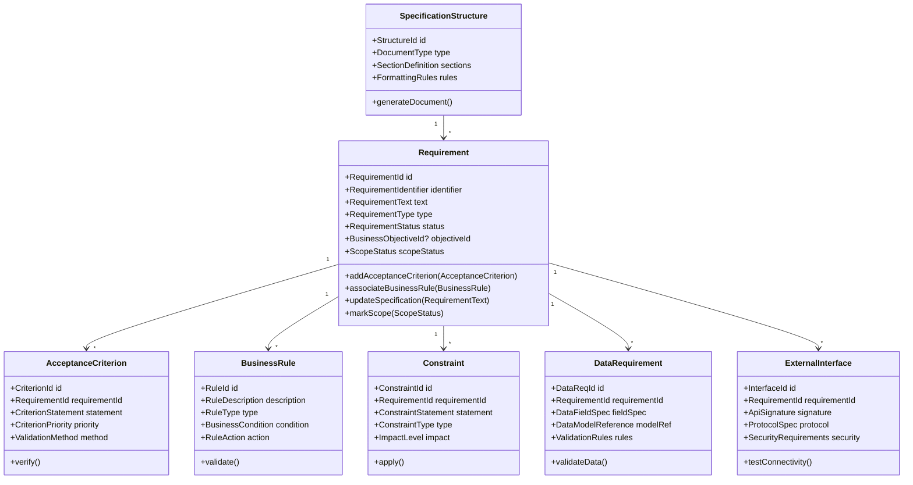
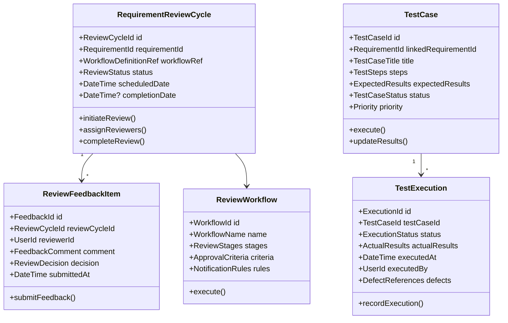
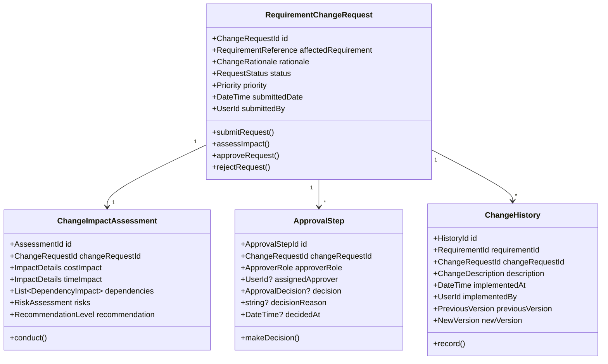
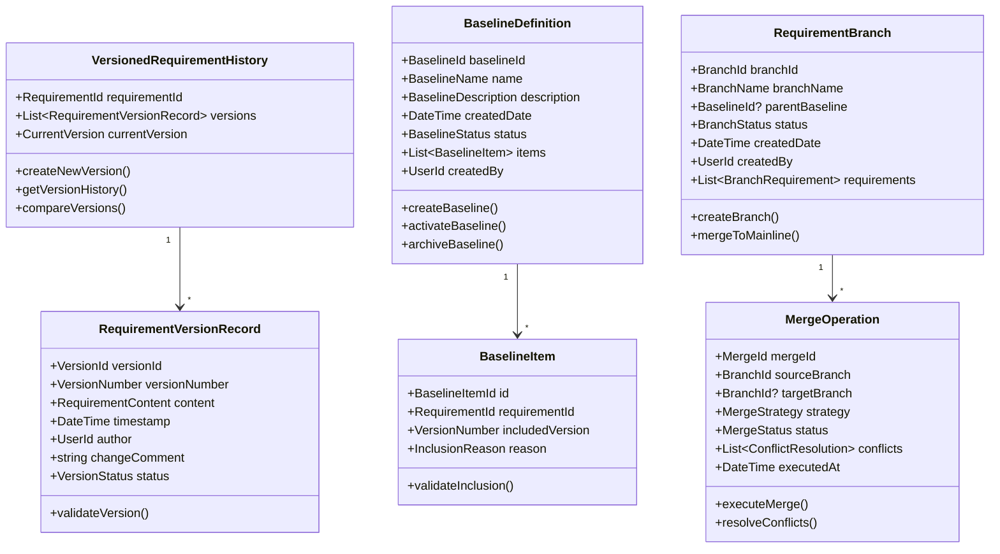
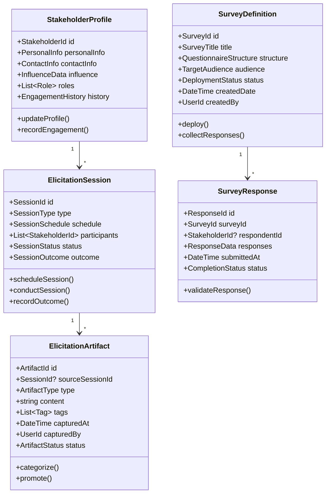
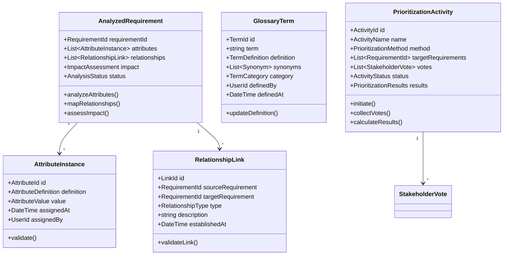
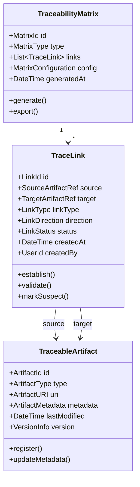
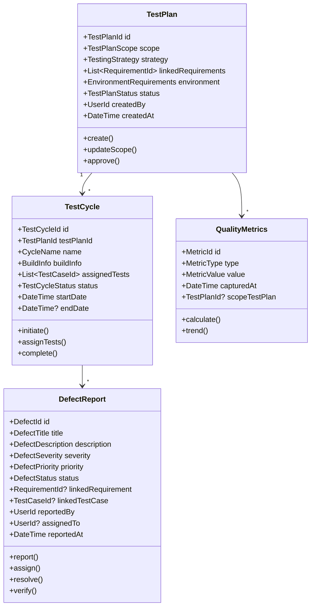
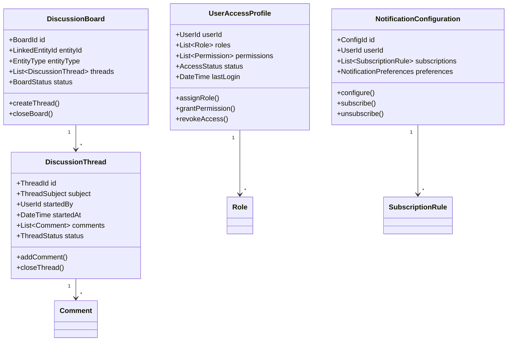
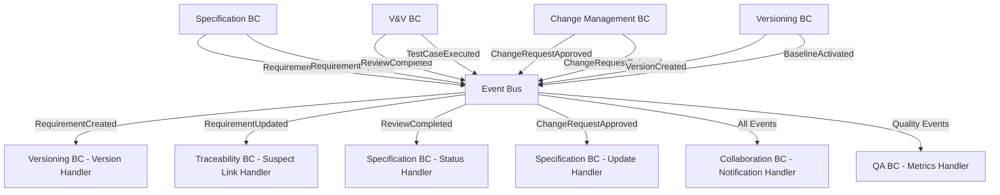

# Requirements Management Platform Domain-Driven Design Architecture Specification
## Requirements Management Platform

---

## Table of Contents

1. [Executive Summary](#1-executive-summary)
2. [Domain Architecture Overview](#2-domain-architecture-overview)
3. [Bounded Context Catalog](#3-bounded-context-catalog)
4. [Bounded Context Specifications](#4-bounded-context-specifications)
5. [Integration Patterns](#5-integration-patterns)
6. [Implementation Guidelines](#6-implementation-guidelines)
7. [Cross-Cutting Concerns](#7-cross-cutting-concerns)
8. [Dependency Matrix](#8-dependency-matrix)

---

## 1. Executive Summary

### 1.1 System Purpose
A comprehensive requirements management platform that supports the complete requirements engineering lifecycle from elicitation through validation, including stakeholder collaboration, change management, versioning, traceability, and quality assurance activities.

### 1.2 Architecture Approach
- **Pattern**: Domain-Driven Design with CQRS and Event Sourcing
- **Framework**: ABP Framework (.NET)
- **Integration**: Event-driven architecture with eventual consistency
- **Scalability**: Microservices-ready bounded contexts

### 1.3 Core Domain Classification
- **Core Domains**: Requirements Specification, Validation & Verification, Change Management, Versioning & Baselining
- **Supporting Domains**: Requirements Elicitation, Analysis & Prioritization, Traceability, Quality Assurance
- **Generic Domains**: Collaboration & Access Control

---

## 2. Domain Architecture Overview

### 2.1 Context Map

```
┌─────────────────┐    ┌─────────────────┐    ┌─────────────────┐
│   Elicitation   │────│  Analysis &     │────│  Specification  │
│  (Supporting)   │    │ Prioritization  │    │     (Core)      │
│                 │    │  (Supporting)   │    │                 │
└─────────────────┘    └─────────────────┘    └─────────────────┘
         │                       │                       │
         │                       │                       │
┌─────────────────┐    ┌─────────────────┐    ┌─────────────────┐
│  Validation &   │    │ Change Mgmt     │    │  Versioning &   │
│ Verification    │    │    (Core)       │    │  Baselining     │
│     (Core)      │    │                 │    │     (Core)      │
└─────────────────┘    └─────────────────┘    └─────────────────┘
         │                       │                       │
         └───────────────────────┼───────────────────────┘
                                 │
        ┌────────────────────────┼────────────────────────┐
        │                       │                        │
┌─────────────────┐    ┌─────────────────┐    ┌─────────────────┐
│  Traceability   │    │ Quality Assurance│   │  Collaboration  │
│  (Supporting)   │    │  (Supporting)   │    │ & Access Control│
│                 │    │                 │    │   (Generic)     │
└─────────────────┘    └─────────────────┘    └─────────────────┘
```

### 2.2 Strategic Design Principles

1. **Requirements Lifecycle Management**: Complete support from elicitation to verification
2. **Formal Change Control**: Structured approach to requirement modifications
3. **Comprehensive Traceability**: Full bidirectional linking across artifacts
4. **Stakeholder Collaboration**: Built-in support for review, discussion, and approval workflows
5. **Version Control**: Complete history and baseline management for requirements

---

## 3. Bounded Context Catalog

| Context | Type | Priority | Complexity | Team Size |
|---------|------|----------|------------|-----------|
| Requirements Specification | Core | Critical | High | 3-4 |
| Validation & Verification | Core | Critical | High | 3-4 |
| Change Management | Core | High | Medium | 2-3 |
| Versioning & Baselining | Core | High | High | 3-4 |
| Requirements Elicitation | Supporting | Medium | Medium | 2-3 |
| Analysis & Prioritization | Supporting | Medium | Medium | 2-3 |
| Traceability | Supporting | High | Medium | 2-3 |
| Quality Assurance | Supporting | Medium | High | 2-3 |
| Collaboration & Access Control | Generic | Critical | Medium | 2 |

---

## 4. Bounded Context Specifications

### 4.1 Requirements Specification Bounded Context

#### 4.1.1 Context Overview
**Responsibility**: Defines formal, detailed requirements artifacts including acceptance criteria, business rules, constraints, and linkages to business objectives.

**Strategic Classification**: Core Domain - Strategic

**Subdomains**:
- Core Requirements: Basic requirement properties and lifecycle
- Acceptance Criteria: Verification conditions for requirements
- Business Rules: Associated business logic and constraints
- External Interfaces: Integration requirements specification

#### 4.1.2 Core Domain Model



#### 4.1.3 Aggregates Specification

##### Requirement Aggregate Root
**Purpose**: Central entity managing formal requirement specifications and ensuring business invariants

**Entities**:
- `AcceptanceCriterion`: Verification conditions for the requirement
- `BusinessRule`: Associated business logic
- `Constraint`: Technical or business constraints
- `DataRequirement`: Data-specific requirements
- `ExternalInterface`: Integration specifications

**Value Objects**:
- `RequirementId`: Unique identifier with validation
- `RequirementIdentifier`: Business-friendly identifier (REQ-001)
- `RequirementText`: Detailed requirement description
- `RequirementType`: Functional, Non-Functional, Interface, Data
- `RequirementStatus`: Draft, Review, Approved, Implemented, Verified
- `BusinessObjectiveId`: Link to business objectives
- `ScopeStatus`: In-Scope, Out-of-Scope, Deferred

**Business Invariants**:
- Requirement must have unique identifier within project
- Cannot delete requirement with approved status without change request
- At least one acceptance criterion required for functional requirements
- External interfaces must have valid API signatures

#### 4.1.4 Commands & Queries (CQRS)

##### Commands
**Requirement Lifecycle**:
```csharp
public record CreateRequirement(
    string RequirementText,
    RequirementType Type,
    BusinessObjectiveId? ObjectiveId,
    ScopeStatus ScopeStatus,
    UserId CreatedBy
);

public record UpdateRequirementSpecification(
    RequirementId RequirementId,
    string UpdatedText,
    string ChangeReason,
    UserId UpdatedBy
);

public record AddAcceptanceCriterion(
    RequirementId RequirementId,
    string CriterionStatement,
    CriterionPriority Priority,
    ValidationMethod Method,
    UserId AddedBy
);
```

##### Queries
```csharp
public record GetRequirementById(RequirementId RequirementId);
public record GetRequirementsByStatus(RequirementStatus Status);
public record GetRequirementsByObjective(BusinessObjectiveId ObjectiveId);
public record SearchRequirements(string SearchText, RequirementType? Type = null);
```

#### 4.1.5 Events & Integration

##### Domain Events
```csharp
public class RequirementCreated : DomainEvent
{
    public RequirementId RequirementId { get; }
    public string RequirementText { get; }
    public RequirementType Type { get; }
    public BusinessObjectiveId? ObjectiveId { get; }
    public UserId CreatedBy { get; }
    public DateTime CreatedAt { get; }
}

public class RequirementSpecificationUpdated : DomainEvent
{
    public RequirementId RequirementId { get; }
    public string PreviousText { get; }
    public string UpdatedText { get; }
    public string ChangeReason { get; }
    public UserId UpdatedBy { get; }
    public DateTime UpdatedAt { get; }
}

public class AcceptanceCriterionAdded : DomainEvent
{
    public RequirementId RequirementId { get; }
    public CriterionId CriterionId { get; }
    public string CriterionStatement { get; }
    public CriterionPriority Priority { get; }
    public UserId AddedBy { get; }
}
```

---

### 4.2 Validation & Verification Bounded Context

#### 4.2.1 Context Overview
**Responsibility**: Manages review workflows, approval processes, and test linkage for requirements validation and verification.

**Strategic Classification**: Core Domain - Strategic

**Subdomains**:
- Review Management: Formal review processes and workflows
- Test Integration: Linkage between requirements and test cases
- Approval Workflows: Multi-stage approval processes
- Coverage Analysis: Test coverage and verification tracking

#### 4.2.2 Core Domain Model



#### 4.2.3 Aggregates Specification

##### RequirementReviewCycle Aggregate Root
**Purpose**: Manages formal review processes for requirements validation

**Entities**:
- `ReviewFeedbackItem`: Individual reviewer feedback and decisions
- `ReviewerAssignment`: Assigned reviewers with roles and deadlines

**Value Objects**:
- `ReviewCycleId`: Unique identifier
- `WorkflowDefinitionRef`: Reference to review workflow template
- `ReviewStatus`: Pending, In Progress, Completed, Cancelled
- `ReviewDecision`: Approve, Reject, Request Changes, Abstain
- `FeedbackComment`: Detailed review comments

##### TestCase Aggregate Root
**Purpose**: Manages test cases for requirement verification

**Entities**:
- `TestStep`: Individual test step with instructions
- `TestExecution`: Records of test case execution

**Value Objects**:
- `TestCaseId`: Unique identifier
- `TestCaseTitle`: Descriptive title
- `TestSteps`: Ordered list of test instructions
- `ExpectedResults`: Expected outcomes
- `ExecutionStatus`: Pass, Fail, Blocked, Not Executed
- `ActualResults`: Recorded execution results

#### 4.2.4 Commands & Queries (CQRS)

##### Commands
```csharp
public record InitiateRequirementReview(
    RequirementId RequirementId,
    WorkflowDefinitionRef WorkflowRef,
    List<UserId> ReviewerIds,
    DateTime ScheduledDate,
    UserId InitiatedBy
);

public record SubmitReviewFeedback(
    ReviewCycleId ReviewCycleId,
    FeedbackComment Comment,
    ReviewDecision Decision,
    UserId ReviewerId
);

public record CreateTestCase(
    RequirementId LinkedRequirementId,
    string Title,
    List<TestStepDefinition> Steps,
    string ExpectedResults,
    Priority Priority,
    UserId CreatedBy
);

public record ExecuteTestCase(
    TestCaseId TestCaseId,
    ExecutionStatus Status,
    string ActualResults,
    List<DefectReference>? DefectReferences,
    UserId ExecutedBy
);
```

##### Queries
```csharp
public record GetReviewCycleById(ReviewCycleId ReviewCycleId);
public record GetActiveReviewsForUser(UserId ReviewerId);
public record GetTestCasesForRequirement(RequirementId RequirementId);
public record GetTestCoverageReport(List<RequirementId> RequirementIds);
```

#### 4.2.5 Events & Integration

##### Domain Events
```csharp
public class RequirementReviewInitiated : DomainEvent
{
    public ReviewCycleId ReviewCycleId { get; }
    public RequirementId RequirementId { get; }
    public List<UserId> AssignedReviewers { get; }
    public DateTime ScheduledDate { get; }
    public UserId InitiatedBy { get; }
}

public class ReviewFeedbackSubmitted : DomainEvent
{
    public ReviewCycleId ReviewCycleId { get; }
    public RequirementId RequirementId { get; }
    public UserId ReviewerId { get; }
    public ReviewDecision Decision { get; }
    public string Comment { get; }
    public DateTime SubmittedAt { get; }
}

public class RequirementReviewCompleted : DomainEvent
{
    public ReviewCycleId ReviewCycleId { get; }
    public RequirementId RequirementId { get; }
    public ReviewOutcome Outcome { get; }
    public List<ReviewDecision> ReviewerDecisions { get; }
    public DateTime CompletedAt { get; }
}

public class TestCaseExecuted : DomainEvent
{
    public TestCaseId TestCaseId { get; }
    public RequirementId LinkedRequirementId { get; }
    public ExecutionStatus Status { get; }
    public UserId ExecutedBy { get; }
    public DateTime ExecutedAt { get; }
    public List<DefectReference>? DefectReferences { get; }
}
```

---

### 4.3 Change Management Bounded Context

#### 4.3.1 Context Overview
**Responsibility**: Handles formal processes for requesting, evaluating, and approving changes to agreed-upon requirements.

**Strategic Classification**: Core Domain - Strategic

**Subdomains**:
- Change Request Processing: Formal change request lifecycle
- Impact Assessment: Analysis of change impacts across system
- Approval Management: Multi-level approval workflows
- Change Tracking: Historical tracking of all changes

#### 4.3.2 Core Domain Model



#### 4.3.3 Aggregates Specification

##### RequirementChangeRequest Aggregate Root
**Purpose**: Manages formal change requests for requirements

**Entities**:
- `ChangeImpactAssessment`: Analysis of change implications
- `ApprovalStep`: Individual approval steps in workflow
- `ChangeHistory`: Historical record of implemented changes

**Value Objects**:
- `ChangeRequestId`: Unique identifier
- `RequirementReference`: Reference to affected requirement (ID + Version)
- `ChangeRationale`: Justification for the change
- `RequestStatus`: Submitted, Under Review, Approved, Rejected, Implemented
- `ImpactDetails`: Cost, time, resource impact analysis
- `ApprovalDecision`: Approve, Reject, Request More Information

**Business Invariants**:
- Change request must reference valid requirement version
- Impact assessment required before approval workflow
- All required approval steps must be completed for approval
- Cannot modify approved change request without new request

#### 4.3.4 Commands & Queries (CQRS)

##### Commands
```csharp
public record SubmitChangeRequest(
    RequirementReference AffectedRequirement,
    string Rationale,
    string ProposedChange,
    Priority Priority,
    UserId SubmittedBy
);

public record ConductImpactAssessment(
    ChangeRequestId ChangeRequestId,
    decimal EstimatedCost,
    TimeSpan EstimatedTimeImpact,
    List<DependencyImpact> Dependencies,
    RiskLevel RiskLevel,
    UserId AssessedBy
);

public record ApproveChangeRequest(
    ChangeRequestId ChangeRequestId,
    string ApprovalReason,
    UserId ApprovedBy
);

public record RejectChangeRequest(
    ChangeRequestId ChangeRequestId,
    string RejectionReason,
    UserId RejectedBy
);
```

##### Queries
```csharp
public record GetChangeRequestById(ChangeRequestId ChangeRequestId);
public record GetPendingChangeRequests(UserId? AssignedTo = null);
public record GetChangeRequestsForRequirement(RequirementId RequirementId);
public record GetChangeHistoryForRequirement(RequirementId RequirementId);
```

#### 4.3.5 Events & Integration

##### Domain Events
```csharp
public class ChangeRequestSubmitted : DomainEvent
{
    public ChangeRequestId ChangeRequestId { get; }
    public RequirementReference AffectedRequirement { get; }
    public string Rationale { get; }
    public Priority Priority { get; }
    public UserId SubmittedBy { get; }
    public DateTime SubmittedAt { get; }
}

public class ChangeImpactAssessmentCompleted : DomainEvent
{
    public ChangeRequestId ChangeRequestId { get; }
    public ImpactDetails CostImpact { get; }
    public ImpactDetails TimeImpact { get; }
    public List<DependencyImpact> Dependencies { get; }
    public RiskLevel RiskLevel { get; }
    public RecommendationLevel Recommendation { get; }
    public UserId AssessedBy { get; }
}

public class ChangeRequestApproved : DomainEvent
{
    public ChangeRequestId ChangeRequestId { get; }
    public RequirementReference AffectedRequirement { get; }
    public string ApprovalReason { get; }
    public UserId ApprovedBy { get; }
    public DateTime ApprovedAt { get; }
}

public class ChangeRequestRejected : DomainEvent
{
    public ChangeRequestId ChangeRequestId { get; }
    public RequirementReference AffectedRequirement { get; }
    public string RejectionReason { get; }
    public UserId RejectedBy { get; }
    public DateTime RejectedAt { get; }
}
```

---

### 4.4 Versioning & Baselining Bounded Context

#### 4.4.1 Context Overview
**Responsibility**: Manages version history, stable baselines, and experimental branches of requirements.

**Strategic Classification**: Core Domain - Strategic

**Subdomains**:
- Version Control: Complete history and versioning of requirements
- Baseline Management: Stable requirement sets for releases
- Branch Management: Experimental requirement development
- Merge Operations: Integration of requirement changes

#### 4.4.2 Core Domain Model



#### 4.4.3 Aggregates Specification

##### VersionedRequirementHistory Aggregate Root
**Purpose**: Manages complete version history for individual requirements

**Entities**:
- `RequirementVersionRecord`: Individual version snapshots
- `VersionMetadata`: Additional version information

**Value Objects**:
- `RequirementId`: Identifier of the versioned requirement
- `VersionNumber`: Semantic version identifier
- `RequirementContent`: Complete requirement data snapshot
- `ChangeComment`: Description of version changes
- `VersionStatus`: Draft, Published, Superseded, Archived

##### BaselineDefinition Aggregate Root
**Purpose**: Manages stable requirement sets for releases or milestones

**Entities**:
- `BaselineItem`: Individual requirement inclusion with version
- `BaselineValidationRule`: Rules for baseline consistency

**Value Objects**:
- `BaselineId`: Unique baseline identifier
- `BaselineName`: Human-readable baseline name
- `BaselineStatus`: Draft, Active, Archived
- `InclusionReason`: Justification for requirement inclusion

##### RequirementBranch Aggregate Root
**Purpose**: Manages experimental requirement development streams

**Entities**:
- `BranchRequirement`: Requirements specific to the branch
- `MergeOperation`: Operations to integrate branch changes

**Value Objects**:
- `BranchId`: Unique branch identifier
- `BranchName`: Descriptive branch name
- `BranchStatus`: Active, Merged, Abandoned
- `MergeStrategy`: Fast-forward, Three-way, Manual

#### 4.4.4 Commands & Queries (CQRS)

##### Commands
```csharp
public record CreateRequirementVersion(
    RequirementId RequirementId,
    RequirementContent Content,
    string ChangeComment,
    UserId Author
);

public record CreateBaseline(
    string BaselineName,
    string Description,
    List<BaselineItemDefinition> Items,
    UserId CreatedBy
);

public record ActivateBaseline(
    BaselineId BaselineId,
    DateTime ActivationDate,
    UserId ActivatedBy
);

public record CreateBranch(
    string BranchName,
    BaselineId? ParentBaseline,
    UserId CreatedBy
);

public record MergeBranch(
    BranchId SourceBranch,
    BranchId? TargetBranch,
    MergeStrategy Strategy,
    List<ConflictResolution>? ConflictResolutions,
    UserId MergedBy
);
```

##### Queries
```csharp
public record GetVersionHistory(RequirementId RequirementId);
public record GetRequirementVersion(RequirementId RequirementId, VersionNumber Version);
public record CompareVersions(RequirementId RequirementId, VersionNumber Version1, VersionNumber Version2);
public record GetActiveBaselines();
public record GetBaselineContents(BaselineId BaselineId);
public record GetActiveBranches();
public record GetBranchRequirements(BranchId BranchId);
```

#### 4.4.5 Events & Integration

##### Domain Events
```csharp
public class RequirementVersionCreated : DomainEvent
{
    public RequirementId RequirementId { get; }
    public VersionNumber VersionNumber { get; }
    public RequirementContent Content { get; }
    public string ChangeComment { get; }
    public UserId Author { get; }
    public DateTime CreatedAt { get; }
}

public class BaselineCreated : DomainEvent
{
    public BaselineId BaselineId { get; }
    public string BaselineName { get; }
    public List<BaselineItem> Items { get; }
    public UserId CreatedBy { get; }
    public DateTime CreatedAt { get; }
}

public class BaselineActivated : DomainEvent
{
    public BaselineId BaselineId { get; }
    public string BaselineName { get; }
    public DateTime ActivationDate { get; }
    public UserId ActivatedBy { get; }
}

public class BranchMerged : DomainEvent
{
    public BranchId SourceBranch { get; }
    public BranchId? TargetBranch { get; }
    public MergeStrategy Strategy { get; }
    public List<RequirementId> AffectedRequirements { get; }
    public UserId MergedBy { get; }
    public DateTime MergedAt { get; }
}
```

---

### 4.5 Requirements Elicitation Bounded Context

#### 4.5.1 Context Overview
**Responsibility**: Captures raw requirements and contextual information from various sources and stakeholders.

**Strategic Classification**: Supporting Domain

**Subdomains**:
- Stakeholder Management: Stakeholder profiles and engagement tracking
- Elicitation Sessions: Interviews, workshops, and surveys
- Artifact Capture: Raw requirement artifacts and ideas
- Response Management: Survey and questionnaire responses

#### 4.5.2 Core Domain Model



#### 4.5.3 Commands & Queries (CQRS)

##### Commands
```csharp
public record CreateStakeholderProfile(
    PersonalInfo PersonalInfo,
    ContactInfo ContactInfo,
    InfluenceData Influence,
    List<Role> Roles,
    UserId CreatedBy
);

public record ScheduleElicitationSession(
    SessionType Type,
    DateTime ScheduledDate,
    List<StakeholderId> Participants,
    string Agenda,
    UserId ScheduledBy
);

public record CreateSurvey(
    string Title,
    QuestionnaireStructure Structure,
    TargetAudience Audience,
    UserId CreatedBy
);

public record CaptureElicitationArtifact(
    SessionId? SourceSessionId,
    ArtifactType Type,
    string Content,
    List<Tag> Tags,
    UserId CapturedBy
);
```

##### Queries
```csharp
public record GetStakeholderProfiles(Role? RoleFilter = null);
public record GetElicitationSessions(DateTime? StartDate = null, DateTime? EndDate = null);
public record GetSurveyResponses(SurveyId SurveyId);
public record GetElicitationArtifacts(ArtifactType? TypeFilter = null, ArtifactStatus? StatusFilter = null);
```

---

### 4.6 Analysis & Prioritization Bounded Context

#### 4.6.1 Context Overview
**Responsibility**: Analyzes requirements for attributes, relationships, impact, and facilitates prioritization activities.

**Strategic Classification**: Supporting Domain

**Subdomains**:
- Requirement Analysis: Attribute assignment and relationship mapping
- Impact Analysis: Change impact assessment
- Glossary Management: Term definitions and consistency
- Prioritization Techniques: Various prioritization methodologies

#### 4.6.2 Core Domain Model



---

### 4.7 Traceability Bounded Context

#### 4.7.1 Context Overview
**Responsibility**: Creates, manages, and queries links between requirements and other development artifacts.

**Strategic Classification**: Supporting Domain

**Subdomains**:
- Link Management: Creation and maintenance of trace links
- Artifact Registry: Registration of traceable artifacts
- Traceability Queries: Matrix generation and impact analysis
- Suspect Link Detection: Identification of potentially outdated links

#### 4.7.2 Core Domain Model



---

### 4.8 Quality Assurance Bounded Context

#### 4.8.1 Context Overview
**Responsibility**: Plans, executes, and tracks quality assurance activities, manages test assets, tracks defects, and reports quality metrics.

**Strategic Classification**: Supporting Domain

**Subdomains**:
- Test Planning: QA strategy and test plan management
- Test Execution: Test cycle management and execution tracking
- Defect Management: Defect lifecycle and resolution tracking
- Quality Reporting: Metrics and quality dashboard generation

#### 4.8.2 Core Domain Model



---

### 4.9 Collaboration & Access Control Bounded Context

#### 4.9.1 Context Overview
**Responsibility**: Manages user permissions, notifications, and discussions related to requirements management activities.

**Strategic Classification**: Generic Domain

**Subdomains**:
- Access Control: User roles and permissions management
- Notification Management: Event-based notification system
- Discussion Management: Collaborative discussion threads
- Audit Trail: Activity logging and compliance tracking

#### 4.9.2 Core Domain Model



---

## 5. Integration Patterns

### 5.1 Event-Driven Integration

#### 5.1.1 Event Flow Architecture


### 5.2 Saga Pattern for Complex Workflows

#### 5.2.1 Requirement Formalization Saga
```csharp
public class RequirementFormalizationSaga : ISaga<ElicitationArtifactPromoted>
{
    public async Task Handle(ElicitationArtifactPromoted @event)
    {
        // Step 1: Create formal requirement in Specification BC
        await SendCommand(new CreateRequirement(@event.ArtifactContent));
        
        // Step 2: Create version in Versioning BC
        await SendCommand(new CreateInitialVersion(@event.RequirementId));
        
        // Step 3: Establish traceability link
        await SendCommand(new CreateTraceLink(@event.ArtifactId, @event.RequirementId));
        
        // Step 4: Initiate review process if configured
        await SendCommand(new InitiateAutomaticReview(@event.RequirementId));
    }
}
```

#### 5.2.2 Change Request Processing Saga
```csharp
public class ChangeRequestProcessingSaga : ISaga<ChangeRequestSubmitted>
{
    public async Task Handle(ChangeRequestSubmitted @event)
    {
        // Step 1: Conduct impact assessment
        await SendCommand(new ConductImpactAssessment(@event.ChangeRequestId));
        
        // Step 2: Route for approval
        await SendCommand(new RouteForApproval(@event.ChangeRequestId));
        
        // Step 3: If approved, create new version
        await SendCommand(new CreateNewVersionFromChange(@event.ChangeRequestId));
        
        // Step 4: Update traceability links
        await SendCommand(new UpdateSuspectLinks(@event.AffectedRequirementId));
    }
}
```

### 5.3 Anti-Corruption Layer (ACL) Pattern

#### 5.3.1 External Tool Integration ACL
```csharp
public class ExternalTestToolIntegrationService
{
    private readonly ITestCaseRepository _testCaseRepository;
    private readonly IExternalTestTool _externalTool;
    
    public async Task<TestExecutionResult> SynchronizeTestExecution(
        TestCaseId testCaseId,
        ExternalTestExecutionId externalExecutionId)
    {
        // Get internal test case
        var testCase = await _testCaseRepository.GetByIdAsync(testCaseId);
        
        // Get external execution result
        var externalResult = await _externalTool.GetExecutionResult(externalExecutionId);
        
        // Translate external result to internal model
        var internalResult = TranslateExecutionResult(externalResult);
        
        // Update internal test case
        testCase.UpdateExecutionResult(internalResult);
        await _testCaseRepository.SaveAsync(testCase);
        
        return internalResult;
    }
    
    private TestExecutionResult TranslateExecutionResult(ExternalExecutionResult external)
    {
        return new TestExecutionResult(
            MapStatus(external.Status),
            external.ActualResults,
            external.ExecutedAt,
            MapDefects(external.FoundDefects)
        );
    }
}
```

---

## 6. Implementation Guidelines

### 6.1 Domain Service Examples

#### 6.1.1 Change Impact Assessment Service
```csharp
public class ChangeImpactAssessmentService : IDomainService
{
    private readonly ITraceabilityQueryService _traceabilityService;
    private readonly IRequirementAnalysisService _analysisService;
    private readonly ITestCoverageService _testCoverageService;
    
    public async Task<ChangeImpactAssessment> AssessImpact(
        RequirementReference affectedRequirement,
        string proposedChange)
    {
        // Analyze direct dependencies
        var directDependencies = await _traceabilityService
            .GetDirectDependencies(affectedRequirement.RequirementId);
        
        // Analyze transitive dependencies
        var transitiveDependencies = await _traceabilityService
            .GetTransitiveDependencies(affectedRequirement.RequirementId);
        
        // Assess test impact
        var testImpact = await _testCoverageService
            .AssessTestImpact(affectedRequirement.RequirementId);
        
        // Calculate effort estimation
        var effortEstimate = await CalculateEffortEstimate(
            affectedRequirement, proposedChange, directDependencies);
        
        return new ChangeImpactAssessment(
            costImpact: effortEstimate.Cost,
            timeImpact: effortEstimate.Time,
            dependencies: directDependencies.Concat(transitiveDependencies).ToList(),
            testImpact: testImpact,
            riskLevel: CalculateRiskLevel(effortEstimate, testImpact)
        );
    }
}
```

#### 6.1.2 Requirement Validation Service
```csharp
public class RequirementValidationService : IDomainService
{
    public async Task<ValidationResult> ValidateRequirement(Requirement requirement)
    {
        var validationRules = new List<IValidationRule>
        {
            new RequirementTextQualityRule(),
            new AcceptanceCriteriaCompletenessRule(),
            new BusinessRuleConsistencyRule(),
            new TraceabilityCompletenessRule()
        };
        
        var results = new List<ValidationRuleResult>();
        
        foreach (var rule in validationRules)
        {
            var result = await rule.ValidateAsync(requirement);
            results.Add(result);
        }
        
        return new ValidationResult(
            isValid: results.All(r => r.IsValid),
            violations: results.Where(r => !r.IsValid).Select(r => r.Violation).ToList()
        );
    }
}
```

### 6.2 Repository Pattern Implementation

#### 6.2.1 Requirement Repository
```csharp
public class RequirementRepository : IRequirementRepository
{
    private readonly RequirementDbContext _context;
    private readonly IDomainEventDispatcher _eventDispatcher;
    
    public async Task<Requirement?> GetByIdAsync(RequirementId id)
    {
        return await _context.Requirements
            .Include(r => r.AcceptanceCriteria)
            .Include(r => r.BusinessRules)
            .Include(r => r.Constraints)
            .FirstOrDefaultAsync(r => r.Id == id);
    }
    
    public async Task SaveAsync(Requirement requirement)
    {
        _context.Requirements.Update(requirement);
        
        // Dispatch domain events
        await _eventDispatcher.DispatchEventsAsync(requirement.DomainEvents);
        requirement.ClearDomainEvents();
        
        await _context.SaveChangesAsync();
    }
    
    public async Task<List<Requirement>> GetByStatusAsync(RequirementStatus status)
    {
        return await _context.Requirements
            .Where(r => r.Status == status)
            .OrderBy(r => r.Identifier)
            .ToListAsync();
    }
}
```

### 6.3 Event Handler Implementation

#### 6.3.1 Requirement Change Handler
```csharp
public class RequirementChangeHandler : 
    IEventHandler<RequirementSpecificationUpdated>,
    IEventHandler<ChangeRequestApproved>
{
    private readonly IVersioningService _versioningService;
    private readonly ITraceabilityService _traceabilityService;
    private readonly INotificationService _notificationService;
    
    public async Task Handle(RequirementSpecificationUpdated @event)
    {
        // Create new version
        await _versioningService.CreateNewVersion(
            @event.RequirementId,
            @event.UpdatedText,
            @event.ChangeReason,
            @event.UpdatedBy
        );
        
        // Mark related trace links as suspect
        await _traceabilityService.MarkRelatedLinksAsSuspect(@event.RequirementId);
        
        // Notify stakeholders
        await _notificationService.NotifyRequirementUpdate(@event);
    }
    
    public async Task Handle(ChangeRequestApproved @event)
    {
        // Enable requirement modification
        await EnableRequirementModification(@event.ChangeRequestId);
        
        // Notify change implementer
        await _notificationService.NotifyChangeApproval(@event);
    }
}
```

---

## 7. Cross-Cutting Concerns

### 7.1 Audit and Compliance

#### 7.1.1 Audit Trail Implementation
```csharp
public class AuditTrailService : IEventHandler<DomainEvent>
{
    private readonly IAuditRepository _auditRepository;
    
    public async Task Handle(DomainEvent domainEvent)
    {
        var auditEntry = new AuditEntry
        {
            EventId = domainEvent.EventId,
            EventType = domainEvent.GetType().Name,
            EntityId = ExtractEntityId(domainEvent),
            EntityType = ExtractEntityType(domainEvent),
            UserId = ExtractUserId(domainEvent),
            Timestamp = domainEvent.OccurredAt,
            Changes = SerializeChanges(domainEvent),
            ClientInfo = GetClientInfo()
        };
        
        await _auditRepository.SaveAsync(auditEntry);
    }
    
    private string SerializeChanges(DomainEvent domainEvent)
    {
        return JsonSerializer.Serialize(domainEvent, new JsonSerializerOptions
        {
            PropertyNamingPolicy = JsonNamingPolicy.CamelCase,
            WriteIndented = false
        });
    }
}
```

### 7.2 Security and Authorization

#### 7.2.1 Resource-Based Authorization
```csharp
public class RequirementAuthorizationHandler : 
    AuthorizationHandler<OperationAuthorizationRequirement, Requirement>
{
    protected override Task HandleRequirementAsync(
        AuthorizationHandlerContext context,
        OperationAuthorizationRequirement requirement,
        Requirement resource)
    {
        var userId = context.User.GetUserId();
        
        if (requirement == Operations.Read)
        {
            if (CanReadRequirement(context.User, resource))
                context.Succeed(requirement);
        }
        else if (requirement == Operations.Update)
        {
            if (CanUpdateRequirement(context.User, resource))
                context.Succeed(requirement);
        }
        else if (requirement == Operations.Approve)
        {
            if (CanApproveRequirement(context.User, resource))
                context.Succeed(requirement);
        }
        
        return Task.CompletedTask;
    }
    
    private bool CanUpdateRequirement(ClaimsPrincipal user, Requirement requirement)
    {
        return requirement.Status == RequirementStatus.Draft ||
               user.HasClaim("permission", "requirements:update") ||
               user.HasClaim("role", "RequirementsAnalyst");
    }
}
```

### 7.3 Performance Optimization

#### 7.3.1 Read Model Projections
```csharp
public class RequirementSummaryProjection : 
    IEventHandler<RequirementCreated>,
    IEventHandler<RequirementSpecificationUpdated>,
    IEventHandler<RequirementStatusChanged>
{
    private readonly IReadModelRepository _readRepository;
    
    public async Task Handle(RequirementCreated @event)
    {
        var summary = new RequirementSummary
        {
            RequirementId = @event.RequirementId,
            Identifier = @event.Identifier,
            Title = ExtractTitle(@event.RequirementText),
            Type = @event.Type,
            Status = RequirementStatus.Draft,
            CreatedBy = @event.CreatedBy,
            CreatedAt = @event.CreatedAt,
            LastModified = @event.CreatedAt
        };
        
        await _readRepository.UpsertAsync(summary);
    }
    
    public async Task Handle(RequirementSpecificationUpdated @event)
    {
        var summary = await _readRepository.GetByIdAsync(@event.RequirementId);
        if (summary != null)
        {
            summary.Title = ExtractTitle(@event.UpdatedText);
            summary.LastModified = @event.UpdatedAt;
            summary.LastModifiedBy = @event.UpdatedBy;
            
            await _readRepository.UpsertAsync(summary);
        }
    }
}
```

---

## 8. Dependency Matrix

### 8.1 Bounded Context Dependencies

| From Context | To Context | Dependency Type | Purpose | Coupling Level |
|--------------|------------|-----------------|---------|----------------|
| Specification | Versioning & Baselining | Event Publishing | Version creation on updates | Loose |
| Specification | Validation & Verification | Event Publishing | Review initiation | Loose |
| Specification | Traceability | Event Publishing | Artifact registration | Loose |
| V&V | Specification | Event Publishing | Status updates from reviews | Loose |
| V&V | QA | Query Service | Test case information | Medium |
| Change Management | Specification | Command Service | Requirement updates | Medium |
| Change Management | Traceability | Query Service | Impact assessment | Medium |
| Change Management | Analysis & Prioritization | Query Service | Relationship analysis | Medium |
| Versioning & Baselining | Specification | Event Subscription | Requirement changes | Loose |
| Elicitation | Specification | Command Service | Artifact promotion | Medium |
| Analysis & Prioritization | Specification | Query Service | Requirement data | Medium |
| Traceability | All Core BCs | Event Subscription | Link management | Loose |
| QA | V&V | Event Subscription | Test execution updates | Loose |
| Collaboration | All BCs | Event Subscription | Notification triggers | Loose |

### 8.2 Data Flow Dependencies

**Requirements Lifecycle Flow**:
1. Elicitation → Analysis → Specification → V&V → Versioning
2. Change Request → Impact Assessment → Approval → Specification Update → Versioning
3. Test Execution → V&V → QA Metrics → Quality Reports

**Traceability Flow**:
1. Artifact Creation → Traceability Registration → Link Establishment
2. Requirement Change → Suspect Link Detection → Link Validation
3. Impact Analysis → Dependency Traversal → Impact Report

**Collaboration Flow**:
1. Domain Events → Notification Rules → Stakeholder Notifications
2. Review Activities → Discussion Threads → Collaborative Decisions
3. Access Requests → Permission Validation → Resource Access
