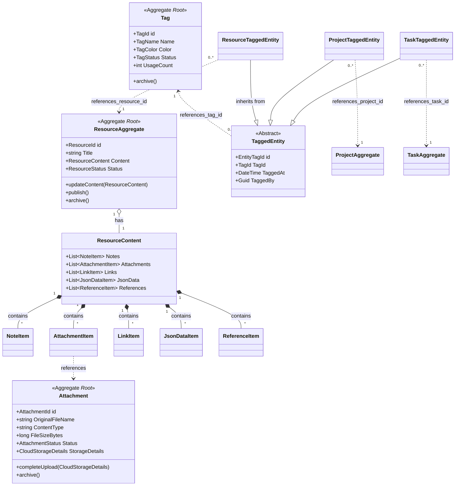

## 1. Bounded Context Specifications

### 1.1 Shared Core Bounded Context

#### 1.1.1 Context Overview
**Responsibility**: Manages the lifecycle and rules for shared, cross-cutting domain concepts. It provides a common language and model for fundamental entities that are used across multiple bounded contexts, ensuring consistency and reusability.

**Strategic Classification**: Shared Core Domain

**Subdomains**:
- **Resource Management**: Provides a generic container (`ResourceAggregate`) for composite content, including notes, links, and structured data.
- **Attachment Management**: Handles the lifecycle of file uploads (`Attachment` aggregate), their storage in the cloud, and metadata.
- **Tag Management**: Manages the creation, application, and lifecycle of tags (`Tag` aggregate) for classifying any entity in the system.

---
#### 1.1.2 Core Domain Model



---
#### 1.1.3 Aggregates Specification

##### ResourceAggregate Aggregate Root
**Purpose**: To act as a generic, content-agnostic container for information. It aggregates various types of content (notes, files, links) and tags into a single manageable entity with its own lifecycle.

**Entities**:
- None. `ResourceContent` and its items are Value Objects.

**Value Objects**:
- `ResourceId`: A unique identifier for the resource.
- `ResourceContent`: A composite value object holding all content.
- `NoteItem`: A piece of text content, with a specific format (e.g., Markdown).
- `AttachmentItem`: A reference to an `Attachment` aggregate, with context-specific details.
- `LinkItem`: A URL with an optional title and description.
- `JsonDataItem`: Stores structured data in JSON format.
- `ReferenceItem`: A link to another entity within the system.
- `ResourceActivity`: An audit record of an action taken on the resource.
- `ResourceStatus`: Enum (Draft, Published, Archived, Deleted).
- `ResourceType`: Enum (e.g., Knowledge, Reference) for classification.

**Business Invariants**:
- A resource cannot be published without content.
- A deleted resource cannot be modified.
- Content of an archived resource cannot be modified.
- Status transitions must follow a defined lifecycle (e.g., Draft -> Published).
- A resource cannot have duplicate tags.
- Tags can only be added or removed when the resource is in Draft or Published status.

---
##### Attachment Aggregate Root
**Purpose**: To manage the complete lifecycle of a file, from initial upload request to cloud storage, processing, and eventual deletion. It ensures file integrity and enforces security rules.

**Entities**:
- None.

**Value Objects**:
- `AttachmentId`: Unique identifier for the attachment.
- `CloudStorageDetails`: Contains all necessary information for accessing the file in cloud storage (e.g., bucket, key, provider).
- `AttachmentMetadata`: A dictionary for storing custom key-value metadata.
- `AttachmentStatus`: Enum (Pending, Uploading, Available, Failed, Processing, Deleted, Archived).
- `AttachmentType`: Enum (e.g., Document, Image, Avatar) for classification.

**Business Invariants**:
- An attachment's status must be `Pending` to start an upload.
- An attachment's status must be `Uploading` to complete or fail the upload.
- An attachment must be in the `Available` state to be archived, deleted, or have its access recorded.
- `FileSize` must be greater than zero and not exceed the system's maximum allowed size.
- If an `EntityId` is provided, an `EntityType` is also required.

---
##### Tag Aggregate Root
**Purpose**: To create a reusable classification system. It manages the definition of a tag and tracks all entities that have been associated with it, maintaining a usage count.

**Entities**:
- `TaggedEntity`: Represents the abstract link between the tag and a specific entity in the system.

**Value Objects**:
- `TagId`: Unique identifier for the tag.
- `TagName`: A validated, non-empty string for the tag's name.
- `TagColor`: A validated hex color code string.
- `TagType`: Enum (e.g., General, Category, Status) for classification.
- `TagStatus`: Enum (Active, Inactive, Archived).

**Business Invariants**:
- A tag's name must be unique within a tenant.
- An archived tag cannot be updated or applied to new entities.
- An entity cannot be tagged more than once with the same tag.
- A tag that is in use (`UsageCount` > 0) cannot be hard-deleted.

---
#### 1.1.4 Events & Integration

##### Domain Events
```csharp
// Resource Events
public record ResourceCreatedEto(Guid Id, string Title, ResourceType Type, Guid? TenantId, Guid CreatedBy, DateTime CreatedAt);
public record ResourceUpdatedEto(Guid Id, string Title, string Description, Guid ModifiedBy, List<string> ChangedProperties);
public record ResourceDeletedEto(Guid Id, string Title, Guid DeletedBy, DateTime DeletedAt);
public record ResourcePublishedEto(Guid Id, string Title, Guid PublishedBy, DateTime PublishedAt);
public record ResourceContentUpdatedEto(Guid Id, string Title, Guid UpdatedBy, DateTime UpdatedAt);
public record ResourceTaggedEto(Guid ResourceId, Guid TagId, string TagName, Guid TaggedBy, DateTime TaggedAt);
public record ResourceUntaggedEto(Guid ResourceId, Guid TagId, string TagName, Guid UntaggedBy, DateTime UntaggedAt);

// Attachment Events
public record AttachmentUploadedEto(Guid Id, string FileName, string OriginalFileName, string ContentType, long FileSizeBytes, AttachmentType Type, Guid? TenantId, Guid UploadedBy, DateTime UploadedAt);
public record AttachmentDeletedEto(Guid Id, string FileName, AttachmentType Type, Guid? TenantId, Guid DeletedBy, DateTime DeletedAt, bool PermanentDelete);

// Tag Events
public record TagCreatedEto(Guid Id, string Name, string Description, string Color, TagType Type, Guid? TenantId, Guid CreatorId);
public record TagUpdatedEto(Guid Id, string Name, string Description, string Color, TagType Type, TagStatus Status, Guid? TenantId);
public record EntityTaggedEto(Guid TagId, string TagName, string EntityType, Guid EntityId, Guid? TenantId, Guid TaggedBy, DateTime TaggedAt);
public record EntityUntaggedEto(Guid TagId, string TagName, string EntityType, Guid EntityId, Guid? TenantId, Guid UntaggedBy, DateTime UntaggedAt);
```

##### Event Handlers
- **`PeriodicCleanupService`**: A background service that periodically enqueues a cleanup job.
- **`CleanupExpiredResourcesJob`**: A background job that handles the archival and deletion of expired or soft-deleted Resources and Attachments, ensuring the system remains clean over time.

---
#### 1.1.5 Business Rules & Policies

##### Domain Services
- **`ResourceDomainService`**: Encapsulates complex business logic for resources that doesn't naturally fit within the aggregate. Its responsibilities include:
    - Validating a resource's state and content before it can be published.
    - Validating status transitions (e.g., from Draft to Published).
    - Calculating detailed metrics and quality analysis for a resource.
    - Managing tag assignments and validating tag-related business rules.
- **`AttachmentDomainService`**: Contains business logic related to file attachments.
    - Validating file uploads against a set of security and quota rules.
    - Analyzing files for safety risks and content type mismatches.
    - Analyzing storage usage to provide optimization recommendations.
- **`TagDomainService`**: Manages business logic and rules for the tagging system.
    - Validating tag creation against naming rules and tenant quotas.
    - Validating if an entity can be tagged based on rules like maximum tags per entity.
    - Handling the logic for merging two similar or duplicate tags.

##### Business Policies
- **File Upload Policy**: A file upload is validated against file size limits (global and type-specific), blocked content types, blocked file extensions, and tenant storage quotas before it is accepted.
- **Resource Publishing Policy**: A resource can only be published if it has content, a title of sufficient length, and a description (if required by rules). All associated attachments must be in an `Available` state.
- **Tag Uniqueness Policy**: Tag names are case-insensitive and must be unique within a single tenant to prevent ambiguity.
- **Resource Tagging Policy**: A resource can have a maximum number of tags (configurable per tenant), and tags can only be managed when the resource is in an editable state.

---
#### 1.1.6 Technical Considerations

##### Performance
- **Indexing**: Database indexes are heavily used on foreign keys, status fields, type fields, and other commonly queried properties like `Title`, `TenantId`, `CreationTime`, and `ExpiresAt` to ensure fast lookups.
- **Pagination**: All list-based application service methods (`GetListAsync`) support pagination to handle large datasets efficiently.
- **JSONB Data Type**: Complex value objects like `ResourceContent` and `AttachmentMetadata` are serialized into a single `jsonb` column in PostgreSQL, allowing for efficient storage and the ability to query inside the JSON structure if needed.
- **Specifications**: The Specification pattern is used to create reusable, composable, and testable query definitions, separating query logic from repositories.

##### Scalability
- **Async Operations**: All I/O-bound operations (database access, service calls) are implemented asynchronously using `async`/`await` to improve throughput.
- **Background Jobs**: Long-running or periodic tasks like cleaning up expired entities are offloaded to a background job manager (`IBackgroundJobManager`), preventing them from blocking request threads.

##### Security
- **Authorization**: A detailed permission-based authorization model is defined in `GenericPermissions`. Application service methods are protected with `[Authorize]` attributes, ensuring that users can only perform actions for which they have explicit permission.
- **Tenant Isolation**: All repository queries and service logic include checks for the `CurrentTenant.Id`, ensuring strict data isolation in a multi-tenant environment.
- **Input Validation**: Data Transfer Objects (DTOs) are rigorously validated using `FluentValidation` to prevent invalid data from entering the domain layer.