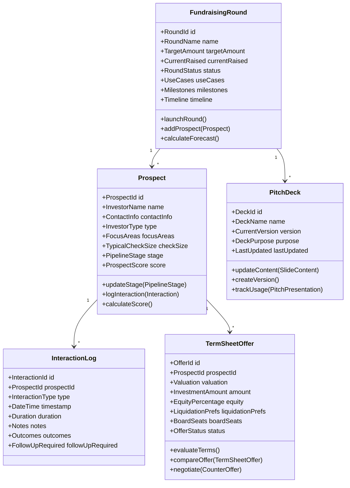
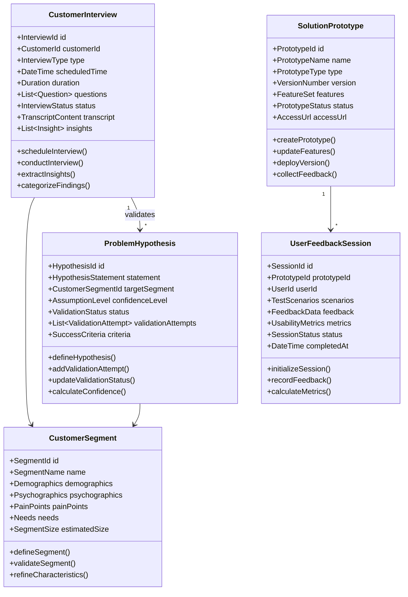
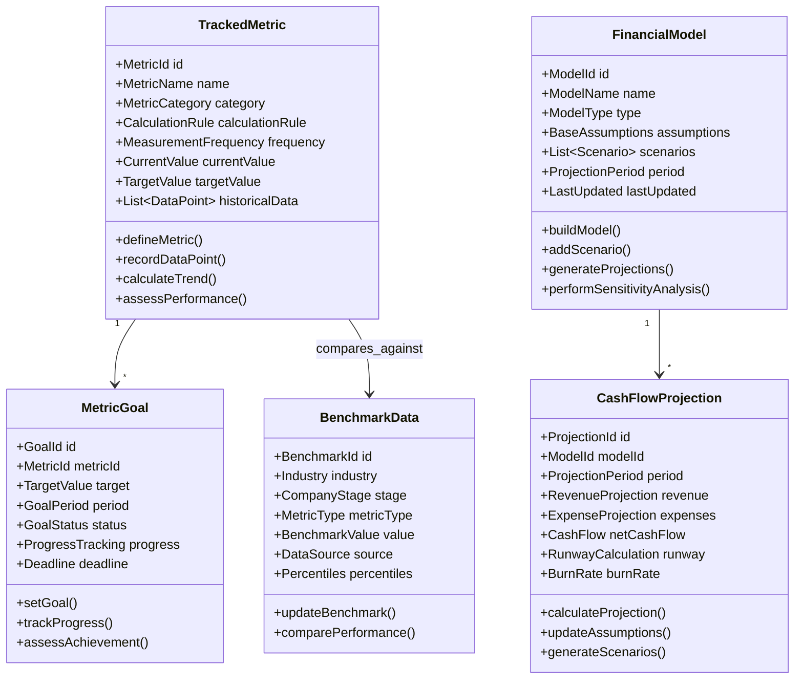
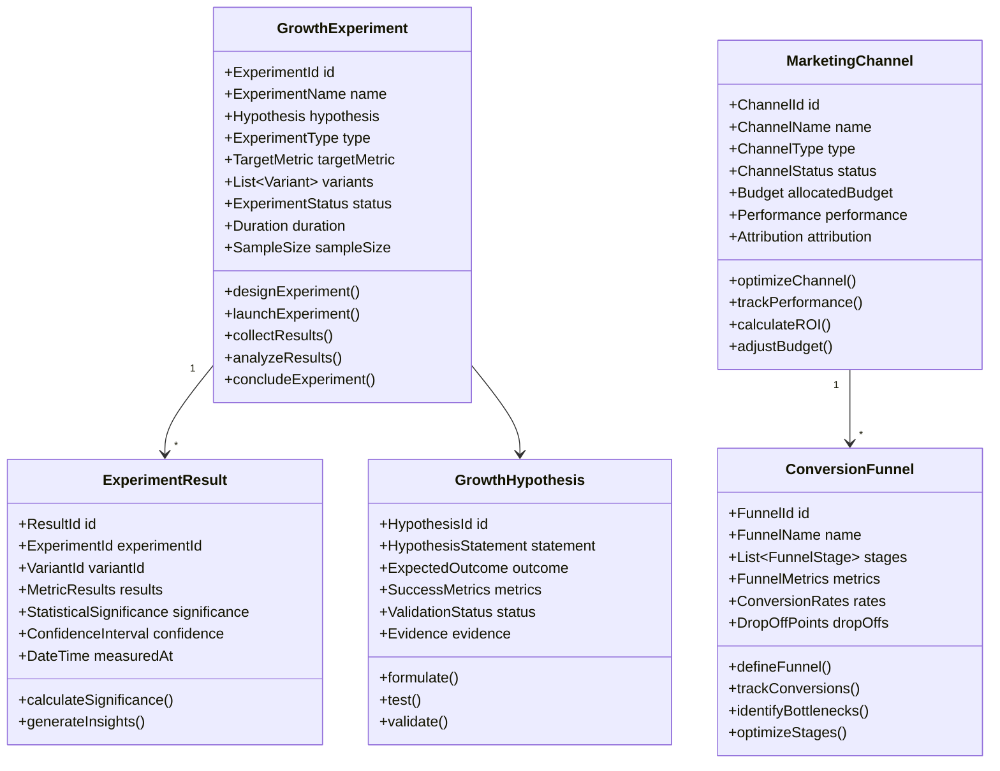
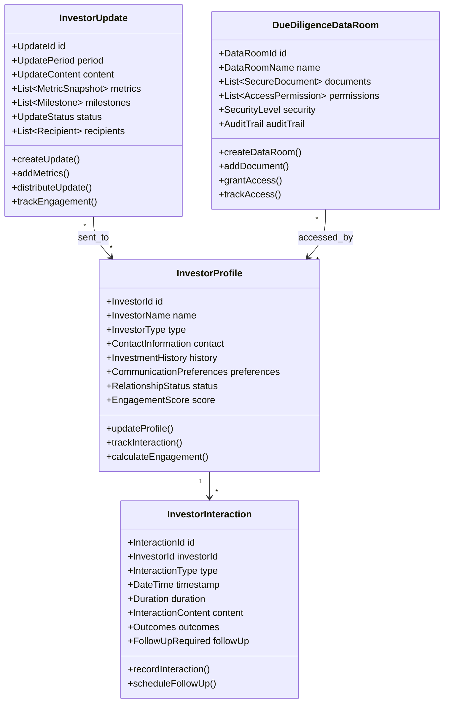
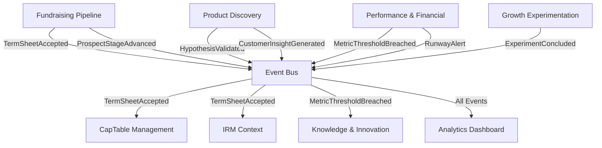
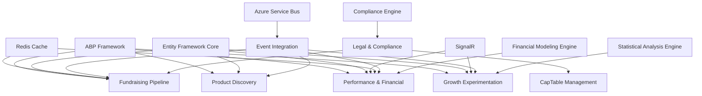

# Startup Lifecycle Management & Growth Platform Domain-Driven Design Architecture Specification
## Startup Ecosystem Management Platform

---

## Table of Contents

1. [Executive Summary](#1-executive-summary)
2. [Domain Architecture Overview](#2-domain-architecture-overview)
3. [Bounded Context Catalog](#3-bounded-context-catalog)
4. [Bounded Context Specifications](#4-bounded-context-specifications)
5. [Integration Patterns](#5-integration-patterns)
6. [Implementation Guidelines](#6-implementation-guidelines)
7. [Cross-Cutting Concerns](#7-cross-cutting-concerns)
8. [Dependency Matrix](#8-dependency-matrix)

---

## 1. Executive Summary

### 1.1 System Purpose
A comprehensive startup lifecycle management platform that supports founders from ideation through growth, encompassing fundraising, product validation, market intelligence, financial modeling, and regulatory compliance to optimize startup success rates and accelerate growth.

### 1.2 Architecture Approach
- **Pattern**: Domain-Driven Design with CQRS and Event Sourcing
- **Framework**: ABP Framework (.NET)
- **Integration**: Event-driven architecture with eventual consistency
- **Scalability**: Microservices-ready bounded contexts with startup-specific business logic

### 1.3 Core Domain Classification
- **Core Domains**: Fundraising Pipeline, Product Discovery & Validation, Performance & Financial Modeling, Growth Experimentation
- **Supporting Domains**: Investor Relationship Management, Business Model Management, Market Intelligence, Legal & Compliance
- **Generic Domains**: Knowledge & Innovation, Capitalization Table Management

---

## 2. Domain Architecture Overview

### 2.1 Context Map

```
┌─────────────────┐    ┌─────────────────┐    ┌─────────────────┐
│ Fundraising     │────│   Investor      │────│   CapTable      │
│ Pipeline (Core) │    │  Relationship   │    │ Management      │
│                 │    │  (Supporting)   │    │  (Generic)      │
└─────────────────┘    └─────────────────┘    └─────────────────┘
         │                       │                       │
         │                       │                       │
┌─────────────────┐    ┌─────────────────┐    ┌─────────────────┐
│Product Discovery│    │Business Model   │    │Performance &    │
│& Validation     │    │Management       │    │Financial        │
│    (Core)       │    │ (Supporting)    │    │Modeling (Core)  │
└─────────────────┘    └─────────────────┘    └─────────────────┘
         │                       │                       │
         │                       │                       │
┌─────────────────┐    ┌─────────────────┐    ┌─────────────────┐
│Market           │    │Growth           │    │Legal &          │
│Intelligence     │    │Experimentation  │    │Compliance       │
│ (Supporting)    │    │    (Core)       │    │ (Supporting)    │
└─────────────────┘    └─────────────────┘    └─────────────────┘
         │                       │                       │
         └───────────────────────┼───────────────────────┘
                                 │
                     ┌─────────────────┐
                     │ Knowledge &     │
                     │ Innovation      │
                     │  (Generic)      │
                     └─────────────────┘
```

### 2.2 Strategic Design Principles

1. **Lean Startup Methodology**: Each context supports validated learning and iterative improvement
2. **Data-Driven Decision Making**: Rich analytics and metrics across all contexts
3. **Stakeholder-Centric Design**: Clear separation between investor, customer, and internal stakeholder management
4. **Compliance-First Approach**: Legal and regulatory requirements integrated throughout
5. **Growth-Oriented Architecture**: Experimentation and optimization built into core processes

---

## 3. Bounded Context Catalog

| Context | Type | Priority | Complexity | Team Size |
|---------|------|----------|------------|-----------|
| Fundraising Pipeline | Core | Critical | High | 3-4 |
| Product Discovery & Validation | Core | Critical | High | 3-4 |
| Performance & Financial Modeling | Core | Critical | High | 3-4 |
| Growth Experimentation | Core | High | High | 2-3 |
| Investor Relationship Management | Supporting | High | Medium | 2-3 |
| Business Model Management | Supporting | High | Medium | 2-3 |
| Market Intelligence | Supporting | Medium | Low | 1-2 |
| Legal & Compliance | Supporting | High | Medium | 2-3 |
| Capitalization Table Management | Generic | Critical | High | 2-3 |
| Knowledge & Innovation | Generic | Low | Low | 1-2 |

---

## 4. Bounded Context Specifications

### 4.1 Fundraising Pipeline Bounded Context

#### 4.1.1 Context Overview
**Responsibility**: Manages the complete process of identifying, engaging, and securing investment from potential investors, including prospect management, pitch coordination, and term sheet evaluation.

**Strategic Classification**: Core Domain - Strategic

**Subdomains**:
- Prospect Management: Investor identification and relationship tracking
- Pitch Coordination: Presentation management and feedback collection
- Term Sheet Evaluation: Offer comparison and negotiation tracking

#### 4.1.2 Core Domain Model



#### 4.1.3 Aggregates Specification

##### FundraisingRound Aggregate Root
**Purpose**: Central coordination entity for fundraising activities within a specific round

**Entities**:
- `Milestone`: Key fundraising objectives with dates
- `RoundTimeline`: Critical dates and deadlines
- `ForecastProjection`: Projected fundraising outcomes

**Value Objects**:
- `RoundId`: Unique identifier with round naming convention
- `TargetAmount`: Fundraising goal with currency
- `RoundStatus`: Planning, Active, Closing, Completed, Cancelled
- `UseCases`: Intended use of funds
- `ForecastAccuracy`: Historical vs actual performance

**Business Invariants**:
- Current raised cannot exceed target amount
- Round must have at least one use case defined
- Cannot close round without minimum viable funding
- All prospects must be in valid pipeline stages

##### Prospect Aggregate Root
**Purpose**: Manages individual investor prospects and their engagement journey

**Entities**:
- `InteractionLog`: Historical engagement records
- `FitAssessment`: Alignment with startup profile
- `DueDiligenceRequest`: Information requests from prospect

**Value Objects**:
- `ProspectId`: Unique identifier
- `InvestorType`: Angel, VC, Strategic, Family Office
- `PipelineStage`: Identified, Contacted, Interested, Due Diligence, Term Sheet, Committed
- `ProspectScore`: Composite score based on fit, likelihood, and engagement
- `ContactInfo`: Structured contact information
- `CheckSize`: Typical investment range

**Business Invariants**:
- Pipeline stages must follow logical progression
- Score must be recalculated after significant interactions
- Cannot move to Term Sheet stage without due diligence completion
- Contact information must be validated

##### PitchDeck Aggregate Root
**Purpose**: Manages pitch materials and their evolution

**Entities**:
- `DeckVersion`: Historical versions with change tracking
- `SlideContent`: Individual slide content and purpose
- `UsageAnalytics`: Presentation performance metrics

**Value Objects**:
- `DeckId`: Unique identifier
- `DeckPurpose`: Demo Day, Series A, Strategic Partner
- `Version`: Semantic versioning for deck iterations
- `EffectivenessScore`: Success rate with prospects

##### TermSheetOffer Aggregate Root
**Purpose**: Manages term sheet offers and comparison analysis

**Entities**:
- `TermClause`: Individual terms with impact analysis
- `NegotiationHistory`: Changes and counteroffers
- `ImpactAssessment`: Effect on company and existing shareholders

**Value Objects**:
- `OfferId`: Unique identifier
- `Valuation`: Pre-money and post-money valuations
- `LiquidationPreference`: Multiple and participation rights
- `OfferStatus`: Received, Under Review, Negotiating, Accepted, Declined

#### 4.1.4 Commands & Queries (CQRS)

##### Commands
**Round Management**:
```csharp
public record LaunchFundraisingRound(
    string RoundName,
    MonetaryAmount TargetAmount,
    List<UseCase> UseCases,
    Timeline Timeline,
    UserId LaunchedBy
);

public record AddProspectToRound(
    RoundId RoundId,
    string InvestorName,
    ContactInfo ContactInfo,
    InvestorType Type,
    MonetaryAmount TypicalCheckSize,
    UserId AddedBy
);
```

**Prospect Engagement**:
```csharp
public record LogProspectInteraction(
    ProspectId ProspectId,
    InteractionType Type,
    DateTime InteractionTime,
    Duration Duration,
    string Notes,
    List<Outcome> Outcomes,
    bool RequiresFollowUp,
    UserId LoggedBy
);

public record UpdateProspectStage(
    ProspectId ProspectId,
    PipelineStage NewStage,
    string Reason,
    DateTime EffectiveDate,
    UserId UpdatedBy
);
```

**Term Sheet Management**:
```csharp
public record ReceiveTermSheetOffer(
    ProspectId ProspectId,
    Valuation Valuation,
    MonetaryAmount InvestmentAmount,
    TermDetails Terms,
    DateTime ReceivedDate,
    UserId ReceivedBy
);

public record CompareTermSheetOffers(
    List<OfferId> OfferIds,
    List<ComparisonCriteria> Criteria,
    UserId RequestedBy
);
```

##### Queries
**Pipeline Analytics**:
```csharp
public record GetFundraisingPipelineStatus(RoundId RoundId);
public record GetProspectsByStage(RoundId RoundId, PipelineStage? Stage = null);
public record GetForecastProjection(RoundId RoundId, DateTime ProjectionDate);
```

**Performance Tracking**:
```csharp
public record GetPitchEffectivenessAnalysis(DeckId DeckId, DateTime StartDate, DateTime EndDate);
public record GetProspectEngagementHistory(ProspectId ProspectId);
```

#### 4.1.5 Events & Integration

##### Domain Events
```csharp
public class FundraisingRoundLaunched : DomainEvent
{
    public RoundId RoundId { get; }
    public string RoundName { get; }
    public MonetaryAmount TargetAmount { get; }
    public List<UseCase> UseCases { get; }
    public UserId LaunchedBy { get; }
    public DateTime LaunchedAt { get; }
}

public class ProspectStageAdvanced : DomainEvent
{
    public ProspectId ProspectId { get; }
    public RoundId RoundId { get; }
    public PipelineStage PreviousStage { get; }
    public PipelineStage NewStage { get; }
    public DateTime AdvancedAt { get; }
    public UserId AdvancedBy { get; }
}

public class TermSheetOfferReceived : DomainEvent
{
    public OfferId OfferId { get; }
    public ProspectId ProspectId { get; }
    public RoundId RoundId { get; }
    public Valuation Valuation { get; }
    public MonetaryAmount InvestmentAmount { get; }
    public DateTime ReceivedAt { get; }
}

public class TermSheetAccepted : DomainEvent
{
    public OfferId OfferId { get; }
    public ProspectId ProspectId { get; }
    public RoundId RoundId { get; }
    public FinalTerms AcceptedTerms { get; }
    public DateTime AcceptedAt { get; }
    public UserId AcceptedBy { get; }
}
```

#### 4.1.6 Business Rules & Policies

##### Prospect Qualification Policy
```csharp
public class ProspectQualificationPolicy
{
    public ProspectScore CalculateScore(Prospect prospect, List<InteractionLog> interactions)
    {
        var fitScore = CalculateFitScore(prospect);
        var engagementScore = CalculateEngagementScore(interactions);
        var likelihoodScore = CalculateLikelihoodScore(prospect, interactions);
        
        return new ProspectScore(
            Overall: (fitScore + engagementScore + likelihoodScore) / 3,
            Fit: fitScore,
            Engagement: engagementScore,
            Likelihood: likelihoodScore
        );
    }
    
    private decimal CalculateFitScore(Prospect prospect)
    {
        // Algorithm considering check size alignment, focus areas match, stage preference
        var checkSizeAlignment = prospect.TypicalCheckSize.IsWithinRange(MinDesiredCheck, MaxDesiredCheck) ? 1.0m : 0.5m;
        var focusAreaMatch = prospect.FocusAreas.Any(area => CompanyFocusAreas.Contains(area)) ? 1.0m : 0.3m;
        
        return (checkSizeAlignment + focusAreaMatch) / 2;
    }
}
```

---

### 4.2 Product Discovery & Validation Bounded Context

#### 4.2.1 Context Overview
**Responsibility**: Systematically validates problem hypotheses and solution concepts through customer interaction, feedback collection, and prototype testing to achieve product-market fit.

**Strategic Classification**: Core Domain - Strategic

**Subdomains**:
- Customer Research: Interview management and insight extraction
- Hypothesis Validation: Problem/solution validation framework
- Prototype Testing: Solution validation and user feedback collection

#### 4.2.2 Core Domain Model



#### 4.2.3 Aggregates Specification

##### CustomerInterview Aggregate Root
**Purpose**: Manages structured customer research sessions and insight generation

**Entities**:
- `InterviewQuestion`: Structured questions with response categories
- `InterviewResponse`: Customer responses with context
- `ExtractedInsight`: Key learnings with evidence

**Value Objects**:
- `InterviewId`: Unique identifier
- `InterviewType`: Discovery, Validation, Usability, Exit
- `InsightCategory`: Problem, Need, Behavior, Preference
- `ConfidenceLevel`: How reliable the insight is
- `InterviewGuide`: Structured question framework

**Business Invariants**:
- Interview must have at least 3 substantive questions
- Insights must be linked to specific responses
- Interview cannot be marked complete without response recording
- Customer segment assignment required for analysis

##### ProblemHypothesis Aggregate Root
**Purpose**: Tracks validation of problem assumptions through systematic testing

**Entities**:
- `ValidationAttempt`: Individual validation tests
- `ValidationEvidence`: Supporting data for validation
- `HypothesisRefinement`: Iterations and adjustments

**Value Objects**:
- `HypothesisId`: Unique identifier
- `HypothesisStatement`: Clear, testable problem statement
- `ValidationStatus`: Draft, Testing, Validated, Invalidated, Refined
- `SuccessCriteria`: Measurable validation thresholds
- `ConfidenceScore`: Statistical confidence in validation

##### SolutionPrototype Aggregate Root
**Purpose**: Manages solution concepts and their iterative testing

**Entities**:
- `PrototypeFeature`: Individual capabilities within prototype
- `TestScenario`: Structured user testing scenarios
- `VersionHistory`: Prototype evolution tracking

**Value Objects**:
- `PrototypeId`: Unique identifier
- `PrototypeType`: Mockup, MVP, Clickable, Interactive
- `FeatureSet`: Collection of prototype capabilities
- `PrototypeStatus`: Concept, Development, Testing, Validated

#### 4.2.4 Commands & Queries (CQRS)

##### Commands
**Customer Research**:
```csharp
public record ScheduleCustomerInterview(
    CustomerId CustomerId,
    InterviewType Type,
    DateTime ScheduledTime,
    Duration EstimatedDuration,
    List<Question> Questions,
    CustomerSegmentId? TargetSegment,
    UserId ScheduledBy
);

public record ExtractInterviewInsights(
    InterviewId InterviewId,
    List<InsightDefinition> Insights,
    UserId ExtractedBy
);
```

**Hypothesis Management**:
```csharp
public record DefineProblemHypothesis(
    string HypothesisStatement,
    CustomerSegmentId TargetSegment,
    SuccessCriteria Criteria,
    AssumptionLevel InitialConfidence,
    UserId DefinedBy
);

public record RecordValidationAttempt(
    HypothesisId HypothesisId,
    ValidationMethod Method,
    ValidationData Data,
    ValidationOutcome Outcome,
    UserId RecordedBy
);
```

**Prototype Testing**:
```csharp
public record CreateSolutionPrototype(
    string PrototypeName,
    PrototypeType Type,
    List<FeatureDefinition> Features,
    List<HypothesisId> AddressedHypotheses,
    UserId CreatedBy
);

public record CollectPrototypeFeedback(
    PrototypeId PrototypeId,
    UserId TestUserId,
    List<TestScenario> Scenarios,
    FeedbackData Feedback,
    UsabilityMetrics Metrics,
    UserId CollectedBy
);
```

##### Queries
**Research Analytics**:
```csharp
public record GetCustomerInsightsSummary(
    CustomerSegmentId? SegmentFilter = null,
    DateTime? StartDate = null,
    DateTime? EndDate = null
);

public record GetHypothesisValidationStatus(
    List<HypothesisId>? HypothesisIds = null,
    ValidationStatus? StatusFilter = null
);
```

**Prototype Performance**:
```csharp
public record GetPrototypeFeedbackAnalysis(
    PrototypeId PrototypeId,
    AnalysisType AnalysisType
);

public record GetProductMarketFitMetrics(
    ProductId? ProductId = null,
    DateTime AssessmentDate = default
);
```

#### 4.2.5 Events & Integration

##### Domain Events
```csharp
public class CustomerInterviewCompleted : DomainEvent
{
    public InterviewId InterviewId { get; }
    public CustomerId CustomerId { get; }
    public CustomerSegmentId SegmentId { get; }
    public List<ExtractedInsight> Insights { get; }
    public DateTime CompletedAt { get; }
    public UserId CompletedBy { get; }
}

public class ProblemHypothesisValidated : DomainEvent
{
    public HypothesisId HypothesisId { get; }
    public string HypothesisStatement { get; }
    public ValidationStatus NewStatus { get; }
    public ConfidenceScore ConfidenceLevel { get; }
    public List<ValidationEvidence> SupportingEvidence { get; }
    public DateTime ValidatedAt { get; }
}

public class PrototypeFeedbackCollected : DomainEvent
{
    public PrototypeId PrototypeId { get; }
    public UserId TestUserId { get; }
    public CustomerSegmentId UserSegment { get; }
    public FeedbackSummary Feedback { get; }
    public UsabilityScore UsabilityMetrics { get; }
    public DateTime CollectedAt { get; }
}
```

---

### 4.3 Performance & Financial Modeling Bounded Context

#### 4.3.1 Context Overview
**Responsibility**: Tracks startup performance through key metrics, creates financial models and projections, and provides insights for data-driven decision making and investor reporting.

**Strategic Classification**: Core Domain - Strategic

**Subdomains**:
- KPI Management: Metric definition, tracking, and analysis
- Financial Modeling: Cash flow projections and scenario planning
- Performance Analytics: Trend analysis and predictive insights

#### 4.3.2 Core Domain Model



#### 4.3.3 Aggregates Specification

##### TrackedMetric Aggregate Root
**Purpose**: Manages KPI definitions, data collection, and performance analysis

**Entities**:
- `MetricDataPoint`: Time-series data points with context
- `TrendAnalysis`: Statistical trend analysis results
- `PerformanceAlert`: Automated alerts for threshold breaches

**Value Objects**:
- `MetricId`: Unique identifier
- `MetricCategory`: Revenue, Growth, Operations, Customer, Financial
- `CalculationRule`: Formula and calculation logic
- `MeasurementFrequency`: Daily, Weekly, Monthly, Quarterly
- `TrendDirection`: Improving, Declining, Stable, Volatile

**Business Invariants**:
- Calculation rule must be mathematically valid
- Data points must be chronologically ordered
- Target values must be realistic based on historical performance
- Frequency must align with data availability

##### FinancialModel Aggregate Root
**Purpose**: Creates and maintains financial projections and scenario analysis

**Entities**:
- `ModelScenario`: Different financial scenarios (base, optimistic, pessimistic)
- `AssumptionSet`: Key assumptions driving projections
- `SensitivityAnalysis`: Impact analysis of assumption changes

**Value Objects**:
- `ModelId`: Unique identifier
- `ModelType`: Revenue, Cash Flow, Valuation, Unit Economics
- `ProjectionPeriod`: Time horizon for projections
- `ConfidenceLevel`: Statistical confidence in projections
- `ModelAccuracy`: Historical accuracy of model predictions

##### CashFlowProjection Aggregate Root
**Purpose**: Manages cash flow forecasting and runway calculations

**Entities**:
- `RevenueStream`: Individual revenue sources
- `ExpenseCategory`: Categorized expense projections
- `CashFlowEvent`: Significant cash inflows/outflows

**Value Objects**:
- `ProjectionId`: Unique identifier
- `BurnRate`: Monthly cash consumption rate
- `RunwayLength`: Time until cash depletion
- `CashPosition`: Current and projected cash balances
- `BreakEvenPoint`: When revenue equals expenses

#### 4.3.4 Commands & Queries (CQRS)

##### Commands
**Metric Management**:
```csharp
public record DefineTrackedMetric(
    string MetricName,
    MetricCategory Category,
    CalculationRule CalculationRule,
    MeasurementFrequency Frequency,
    string Description,
    UserId DefinedBy
);

public record RecordMetricDataPoint(
    MetricId MetricId,
    MetricValue Value,
    DateTime MeasurementDate,
    string? Context,
    DataSource Source,
    UserId RecordedBy
);

public record SetMetricGoal(
    MetricId MetricId,
    TargetValue Target,
    GoalPeriod Period,
    DateTime Deadline,
    string Rationale,
    UserId SetBy
);
```

**Financial Modeling**:
```csharp
public record CreateFinancialModel(
    string ModelName,
    ModelType Type,
    ProjectionPeriod Period,
    BaseAssumptions Assumptions,
    UserId CreatedBy
);

public record UpdateModelAssumptions(
    ModelId ModelId,
    List<AssumptionChange> Changes,
    string ChangeReason,
    UserId UpdatedBy
);

public record GenerateScenarioAnalysis(
    ModelId ModelId,
    List<ScenarioDefinition> Scenarios,
    AnalysisParameters Parameters,
    UserId RequestedBy
);
```

##### Queries
**Performance Analytics**:
```csharp
public record GetMetricPerformanceDashboard(
    List<MetricId>? MetricFilter = null,
    DateTime? StartDate = null,
    DateTime? EndDate = null
);

public record GetTrendAnalysis(
    MetricId MetricId,
    TrendPeriod Period,
    AnalysisType AnalysisType
);

public record GetBenchmarkComparison(
    List<MetricId> MetricIds,
    Industry Industry,
    CompanyStage Stage
);
```

**Financial Projections**:
```csharp
public record GetCashFlowProjection(
    ModelId ModelId,
    ProjectionPeriod Period,
    ScenarioId? ScenarioId = null
);

public record GetRunwayAnalysis(
    DateTime AnalysisDate,
    BurnRateAssumptions Assumptions
);
```

#### 4.3.5 Events & Integration

##### Domain Events
```csharp
public class MetricThresholdBreached : DomainEvent
{
    public MetricId MetricId { get; }
    public string MetricName { get; }
    public MetricValue CurrentValue { get; }
    public MetricValue ThresholdValue { get; }
    public ThresholdType Type { get; } // Upper, Lower, Target
    public Severity Severity { get; }
    public DateTime BreachedAt { get; }
}

public class FinancialModelUpdated : DomainEvent
{
    public ModelId ModelId { get; }
    public string ModelName { get; }
    public List<AssumptionChange> Changes { get; }
    public ProjectionSummary NewProjections { get; }
    public DateTime UpdatedAt { get; }
    public UserId UpdatedBy { get; }
}

public class RunwayAlert : DomainEvent
{
    public RunwayLength RemainingRunway { get; }
    public BurnRate CurrentBurnRate { get; }
    public DateTime ProjectedDepletion { get; }
    public AlertLevel Level { get; } // Warning, Critical, Emergency
    public DateTime CalculatedAt { get; }
}
```

---

### 4.4 Growth Experimentation Bounded Context

#### 4.4.1 Context Overview
**Responsibility**: Manages systematic growth experiments, A/B testing, marketing channel optimization, and conversion funnel analysis to drive data-driven growth decisions.

**Strategic Classification**: Core Domain - Strategic

**Subdomains**:
- Experiment Design: Hypothesis-driven experimentation framework
- Channel Analytics: Marketing channel performance tracking
- Conversion Optimization: Funnel analysis and optimization

#### 4.4.2 Core Domain Model



#### 4.4.3 Aggregates Specification

##### GrowthExperiment Aggregate Root
**Purpose**: Manages the complete lifecycle of growth experiments

**Entities**:
- `ExperimentVariant`: Different versions being tested
- `ExperimentMetric`: Metrics being measured
- `ExperimentParticipant`: Users included in experiment

**Value Objects**:
- `ExperimentId`: Unique identifier
- `ExperimentType`: A/B Test, Multivariate, Feature Flag
- `Hypothesis`: Testable prediction about outcomes
- `ExperimentStatus`: Design, Running, Analysis, Concluded
- `StatisticalPower`: Confidence in detecting true effects

**Business Invariants**:
- Must have at least one control and one variant
- Sample size must be sufficient for statistical power
- Cannot conclude experiment before minimum duration
- All variants must measure same success metrics

##### MarketingChannel Aggregate Root
**Purpose**: Tracks and optimizes individual marketing channel performance

**Entities**:
- `ChannelCampaign`: Specific campaigns within channel
- `ChannelMetric`: Performance metrics for channel
- `AttributionModel`: How conversions are attributed

**Value Objects**:
- `ChannelId`: Unique identifier
- `ChannelType`: Paid Search, Social, Content, Email, Referral
- `PerformanceMetrics`: CAC, LTV, ROAS, Conversion Rate
- `BudgetAllocation`: Spend distribution and limits
- `AttributionWindow`: Time window for attribution

##### ConversionFunnel Aggregate Root
**Purpose**: Models and optimizes user conversion paths

**Entities**:
- `FunnelStage`: Individual steps in conversion process
- `ConversionEvent`: Specific user actions tracked
- `DropOffAnalysis`: Analysis of where users exit

**Value Objects**:
- `FunnelId`: Unique identifier
- `StageDefinition`: Criteria for stage completion
- `ConversionRate`: Percentage converting between stages
- `DropOffRate`: Percentage exiting at each stage
- `FunnelVelocity`: Time to complete conversion

#### 4.4.4 Commands & Queries (CQRS)

##### Commands
**Experiment Management**:
```csharp
public record DesignGrowthExperiment(
    string ExperimentName,
    GrowthHypothesis Hypothesis,
    ExperimentType Type,
    List<VariantDefinition> Variants,
    TargetMetric SuccessMetric,
    Duration PlannedDuration,
    int RequiredSampleSize,
    UserId DesignedBy
);

public record LaunchExperiment(
    ExperimentId ExperimentId,
    DateTime LaunchDate,
    TrafficAllocation TrafficSplit,
    UserId LaunchedBy
);

public record RecordExperimentResult(
    ExperimentId ExperimentId,
    VariantId VariantId,
    MetricType MetricType,
    MetricValue Value,
    DateTime MeasuredAt,
    UserId RecordedBy
);
```

**Channel Optimization**:
```csharp
public record SetupMarketingChannel(
    string ChannelName,
    ChannelType Type,
    BudgetAllocation Budget,
    List<PerformanceMetric> TrackedMetrics,
    AttributionModel Attribution,
    UserId SetupBy
);

public record OptimizeChannelBudget(
    ChannelId ChannelId,
    BudgetAdjustment Adjustment,
    OptimizationReason Reason,
    UserId OptimizedBy
);
```

##### Queries
**Experiment Analytics**:
```csharp
public record GetExperimentResults(
    ExperimentId ExperimentId,
    AnalysisType AnalysisType
);

public record GetExperimentPortfolio(
    ExperimentStatus? StatusFilter = null,
    DateTime? StartDate = null,
    DateTime? EndDate = null
);
```

**Growth Analytics**:
```csharp
public record GetChannelPerformanceReport(
    List<ChannelId>? ChannelFilter = null,
    DateTime StartDate,
    DateTime EndDate,
    ReportGranularity Granularity
);

public record GetConversionFunnelAnalysis(
    FunnelId FunnelId,
    DateTime StartDate,
    DateTime EndDate,
    List<SegmentFilter>? Segments = null
);
```

#### 4.4.5 Events & Integration

##### Domain Events
```csharp
public class ExperimentLaunched : DomainEvent
{
    public ExperimentId ExperimentId { get; }
    public string ExperimentName { get; }
    public GrowthHypothesis Hypothesis { get; }
    public List<VariantDefinition> Variants { get; }
    public TargetMetric SuccessMetric { get; }
    public DateTime LaunchedAt { get; }
    public UserId LaunchedBy { get; }
}

public class ExperimentConcluded : DomainEvent
{
    public ExperimentId ExperimentId { get; }
    public ExperimentResult Results { get; }
    public VariantId WinningVariant { get; }
    public StatisticalSignificance Significance { get; }
    public List<Insight> KeyInsights { get; }
    public DateTime ConcludedAt { get; }
}

public class ChannelPerformanceAlert : DomainEvent
{
    public ChannelId ChannelId { get; }
    public string ChannelName { get; }
    public PerformanceMetric UnderperformingMetric { get; }
    public MetricValue CurrentValue { get; }
    public MetricValue ThresholdValue { get; }
    public RecommendedAction Recommendation { get; }
    public DateTime AlertedAt { get; }
}
```

---

### 4.5 Investor Relationship Management (IRM) Bounded Context

#### 4.5.1 Context Overview
**Responsibility**: Manages ongoing relationships with existing investors, facilitates regular updates and communication, and maintains secure due diligence materials and data rooms.

**Strategic Classification**: Supporting Domain

**Subdomains**:
- Investor Communication: Regular updates and reporting
- Relationship Management: Investor engagement tracking
- Due Diligence: Secure document management and data rooms

#### 4.5.2 Core Domain Model



#### 4.5.3 Aggregates Specification

##### InvestorProfile Aggregate Root
**Purpose**: Maintains comprehensive investor information and relationship history

**Entities**:
- `InvestmentRecord`: Historical investment details
- `CommunicationLog`: Interaction history
- `PreferenceSettings`: Communication and reporting preferences

**Value Objects**:
- `InvestorId`: Unique identifier
- `InvestorType`: Angel, VC Fund, Strategic, Family Office
- `InvestmentAmount`: Amount and terms of investment
- `EngagementScore`: Composite score based on interactions
- `RelationshipHealth`: Current relationship status

##### InvestorUpdate Aggregate Root
**Purpose**: Manages periodic investor communications and reporting

**Entities**:
- `UpdateSection`: Individual sections within update
- `MetricSnapshot`: Point-in-time metric values
- `DistributionRecord`: Tracking of update delivery

**Value Objects**:
- `UpdateId`: Unique identifier
- `UpdateTemplate`: Standardized update format
- `UpdateStatus`: Draft, Review, Sent, Acknowledged
- `EngagementMetrics`: Open rate, response rate, feedback

##### DueDiligenceDataRoom Aggregate Root
**Purpose**: Secure management of sensitive investor documents

**Entities**:
- `SecureDocument`: Individual documents with metadata
- `AccessLog`: Detailed access tracking
- `PermissionGrant`: Specific access permissions

**Value Objects**:
- `DataRoomId`: Unique identifier
- `SecurityLevel`: Confidential, Restricted, Internal
- `DocumentCategory`: Financial, Legal, Business, Technical
- `AccessDuration`: Time-limited access grants

#### 4.5.4 Commands & Queries (CQRS)

##### Commands
**Investor Management**:
```csharp
public record CreateInvestorProfile(
    string InvestorName,
    InvestorType Type,
    ContactInformation Contact,
    InvestmentDetails Investment,
    CommunicationPreferences Preferences,
    UserId CreatedBy
);

public record RecordInvestorInteraction(
    InvestorId InvestorId,
    InteractionType Type,
    DateTime InteractionTime,
    Duration Duration,
    string Content,
    List<Outcome> Outcomes,
    bool RequiresFollowUp,
    UserId RecordedBy
);
```

**Update Management**:
```csharp
public record CreateInvestorUpdate(
    UpdatePeriod Period,
    UpdateTemplate Template,
    List<MetricId> IncludedMetrics,
    List<MilestoneId> IncludedMilestones,
    UserId CreatedBy
);

public record DistributeInvestorUpdate(
    UpdateId UpdateId,
    List<InvestorId> Recipients,
    DistributionMethod Method,
    DateTime ScheduledTime,
    UserId DistributedBy
);
```

**Data Room Management**:
```csharp
public record CreateDueDiligenceDataRoom(
    string DataRoomName,
    SecurityLevel SecurityLevel,
    List<DocumentCategory> AllowedCategories,
    UserId CreatedBy
);

public record GrantDataRoomAccess(
    DataRoomId DataRoomId,
    InvestorId InvestorId,
    List<DocumentCategory> AccessCategories,
    DateTime ExpirationDate,
    UserId GrantedBy
);
```

##### Queries
**Investor Analytics**:
```csharp
public record GetInvestorPortfolio(
    InvestorType? TypeFilter = null,
    RelationshipStatus? StatusFilter = null
);

public record GetInvestorEngagementReport(
    List<InvestorId>? InvestorFilter = null,
    DateTime StartDate,
    DateTime EndDate
);
```

**Communication History**:
```csharp
public record GetInvestorCommunicationHistory(
    InvestorId InvestorId,
    CommunicationType? TypeFilter = null
);

public record GetUpdateDeliveryReport(
    UpdateId UpdateId
);
```

#### 4.5.5 Events & Integration

##### Domain Events
```csharp
public class InvestorUpdateDistributed : DomainEvent
{
    public UpdateId UpdateId { get; }
    public UpdatePeriod Period { get; }
    public List<InvestorId> Recipients { get; }
    public List<MetricSnapshot> IncludedMetrics { get; }
    public DateTime DistributedAt { get; }
    public UserId DistributedBy { get; }
}

public class InvestorEngagementDeclined : DomainEvent
{
    public InvestorId InvestorId { get; }
    public EngagementScore PreviousScore { get; }
    public EngagementScore CurrentScore { get; }
    public List<EngagementIndicator> DeclineIndicators { get; }
    public DateTime DetectedAt { get; }
}

public class DueDiligenceDataRoomAccessed : DomainEvent
{
    public DataRoomId DataRoomId { get; }
    public InvestorId AccessorId { get; }
    public List<DocumentId> AccessedDocuments { get; }
    public Duration SessionDuration { get; }
    public DateTime AccessedAt { get; }
}
```

---

## 5. Integration Patterns

### 5.1 Event-Driven Integration Architecture

#### 5.1.1 Cross-Context Event Flow


#### 5.1.2 Key Integration Flows

**Fundraising to CapTable Flow**:
```csharp
public class TermSheetAcceptanceHandler : IEventHandler<TermSheetAccepted>
{
    public async Task Handle(TermSheetAccepted @event)
    {
        // Update CapTable with new funding round
        await _capTableService.RecordFundingRound(new RecordFundingRound
        {
            RoundId = @event.RoundId,
            InvestorId = @event.ProspectId,
            InvestmentAmount = @event.AcceptedTerms.InvestmentAmount,
            EquityPercentage = @event.AcceptedTerms.EquityPercentage,
            SharePrice = @event.AcceptedTerms.PricePerShare,
            LiquidationPreference = @event.AcceptedTerms.LiquidationPrefs
        });
        
        // Create investor profile in IRM
        await _irmService.CreateInvestorFromProspect(new CreateInvestorFromProspect
        {
            ProspectId = @event.ProspectId,
            InvestmentDetails = @event.AcceptedTerms,
            OnboardingDate = @event.AcceptedAt
        });
    }
}
```

**Performance Metrics to Investor Updates Flow**:
```csharp
public class MetricUpdateIntegrationHandler : IEventHandler<MetricDataPointRecorded>
{
    public async Task Handle(MetricDataPointRecorded @event)
    {
        if (IsInvestorReportingMetric(@event.MetricId))
        {
            await _irmService.UpdateInvestorReportingMetric(new UpdateReportingMetric
            {
                MetricId = @event.MetricId,
                Value = @event.Value,
                ReportingPeriod = DetermineReportingPeriod(@event.MeasurementDate),
                MeasuredAt = @event.MeasurementDate
            });
        }
    }
}
```

### 5.2 Saga Patterns for Complex Workflows

#### 5.2.1 Fundraising Completion Saga
```csharp
public class FundraisingCompletionSaga : ISaga<TermSheetAccepted>
{
    public async Task Handle(TermSheetAccepted @event)
    {
        var sagaData = new FundraisingCompletionSagaData
        {
            RoundId = @event.RoundId,
            InvestorId = @event.ProspectId,
            AcceptedTerms = @event.AcceptedTerms
        };
        
        // Step 1: Update CapTable
        await SendCommand(new RecordFundingRound(sagaData.AcceptedTerms));
        
        // Step 2: Create Investor Profile
        await SendCommand(new CreateInvestorProfile(sagaData.InvestorId));
        
        // Step 3: Update Financial Model
        await SendCommand(new UpdateCashPosition(sagaData.AcceptedTerms.InvestmentAmount));
        
        // Step 4: Generate Legal Documents
        await SendCommand(new GenerateInvestmentDocuments(sagaData.AcceptedTerms));
        
        // Step 5: Schedule Investor Onboarding
        await SendCommand(new ScheduleInvestorOnboarding(sagaData.InvestorId));
    }
}
```

### 5.3 Anti-Corruption Layer Patterns

#### 5.3.1 External Data Integration
```csharp
public class MarketDataIntegrationService
{
    public async Task<BenchmarkData> GetIndustryBenchmarks(Industry industry, CompanyStage stage)
    {
        // External API call to market data provider
        var externalData = await _externalMarketDataApi.GetBenchmarks(industry, stage);
        
        // Transform external format to domain model
        return new BenchmarkData
        {
            Industry = MapIndustry(externalData.IndustryCode),
            Stage = MapStage(externalData.CompanySize),
            Metrics = externalData.Metrics.Select(m => new BenchmarkMetric
            {
                Type = MapMetricType(m.MetricName),
                Value = m.Value,
                Percentiles = MapPercentiles(m.Distribution)
            }).ToList()
        };
    }
}
```

---

## 6. Implementation Guidelines

### 6.1 Startup-Specific Development Standards

#### 6.1.1 Domain Model Patterns

**Fundraising Domain Example**:
```csharp
public class FundraisingRound : AggregateRoot<RoundId>
{
    private readonly List<Prospect> _prospects = new();
    private readonly List<Milestone> _milestones = new();
    
    public RoundName Name { get; private set; }
    public MonetaryAmount TargetAmount { get; private set; }
    public MonetaryAmount CurrentRaised { get; private set; }
    public RoundStatus Status { get; private set; }
    
    public Result<Prospect> AddProspect(
        string investorName, 
        ContactInfo contactInfo, 
        InvestorType type,
        MonetaryAmount typicalCheckSize)
    {
        // Business rule: Cannot add prospects to closed rounds
        if (Status == RoundStatus.Closed)
            return Result.Failure<Prospect>("Cannot add prospects to closed round");
        
        // Business rule: Check size should align with round target
        if (!IsCheckSizeAppropriate(typicalCheckSize))
            return Result.Failure<Prospect>("Check size not appropriate for round size");
        
        var prospect = Prospect.Create(investorName, contactInfo, type, typicalCheckSize);
        _prospects.Add(prospect);
        
        RaiseDomainEvent(new ProspectAddedToRound(Id, prospect.Id, investorName, type));
        
        return Result.Success(prospect);
    }
    
    private bool IsCheckSizeAppropriate(MonetaryAmount checkSize)
    {
        var minimumViableCheck = TargetAmount * 0.01m; // 1% minimum
        var maximumSingleCheck = TargetAmount * 0.5m;  // 50% maximum
        
        return checkSize >= minimumViableCheck && checkSize <= maximumSingleCheck;
    }
}
```

#### 6.1.2 Financial Calculations Service

```csharp
public class StartupFinancialCalculationService
{
    public RunwayCalculation CalculateRunway(
        MonetaryAmount currentCash,
        MonetaryAmount monthlyBurnRate,
        List<ProjectedCashEvent> projectedEvents)
    {
        var projectedCash = currentCash;
        var months = 0;
        var cashFlowByMonth = new List<MonthlyCashFlow>();
        
        while (projectedCash > MonetaryAmount.Zero && months < 120) // Max 10 years
        {
            months++;
            var monthlyEvents = projectedEvents.Where(e => e.Month == months);
            var monthlyNetChange = monthlyEvents.Sum(e => e.Amount) - monthlyBurnRate;
            
            projectedCash += monthlyNetChange;
            cashFlowByMonth.Add(new MonthlyCashFlow(months, projectedCash, monthlyNetChange));
            
            if (projectedCash <= MonetaryAmount.Zero)
                break;
        }
        
        return new RunwayCalculation(
            MonthsRemaining: months,
            ProjectedDepletionDate: DateTime.Now.AddMonths(months),
            CashFlowProjection: cashFlowByMonth,
            CriticalThresholds: CalculateCriticalThresholds(cashFlowByMonth)
        );
    }
    
    public DilutionImpact CalculateDilutionImpact(
        CapTableSnapshot currentCapTable,
        MonetaryAmount newInvestment,
        Valuation preMoneyValuation)
    {
        var postMoneyValuation = preMoneyValuation.Amount + newInvestment;
        var newInvestorOwnership = newInvestment / postMoneyValuation;
        
        var dilutionResults = currentCapTable.SecurityHolders.Select(holder =>
        {
            var preDilutionOwnership = holder.OwnershipPercentage;
            var postDilutionOwnership = preDilutionOwnership * (1 - newInvestorOwnership);
            var dilutionAmount = preDilutionOwnership - postDilutionOwnership;
            
            return new HolderDilution(
                HolderId: holder.HolderId,
                PreDilutionOwnership: preDilutionOwnership,
                PostDilutionOwnership: postDilutionOwnership,
                DilutionAmount: dilutionAmount
            );
        }).ToList();
        
        return new DilutionImpact(dilutionResults, newInvestorOwnership);
    }
}
```

### 6.2 Startup Metrics and KPI Framework

#### 6.2.1 Predefined Startup Metrics

```csharp
public static class StartupMetricDefinitions
{
    public static readonly MetricDefinition MonthlyRecurringRevenue = new(
        Name: "Monthly Recurring Revenue",
        Category: MetricCategory.Revenue,
        CalculationRule: "SUM(subscription_revenue) WHERE billing_cycle = 'monthly'",
        Frequency: MeasurementFrequency.Monthly,
        Industry: "SaaS",
        Stage: "Growth"
    );
    
    public static readonly MetricDefinition CustomerAcquisitionCost = new(
        Name: "Customer Acquisition Cost",
        Category: MetricCategory.Marketing,
        CalculationRule: "SUM(marketing_spend + sales_spend) / COUNT(new_customers)",
        Frequency: MeasurementFrequency.Monthly,
        Industry: "All",
        Stage: "All"
    );
    
    public static readonly MetricDefinition ProductMarketFitScore = new(
        Name: "Product-Market Fit Score",
        Category: MetricCategory.Product,
        CalculationRule: "PERCENTAGE(customers_very_disappointed) WHERE survey_question = 'disappointed_without_product'",
        Frequency: MeasurementFrequency.Quarterly,
        Industry: "All",
        Stage: "Early"
    );
    
    public static readonly MetricDefinition BurnRate = new(
        Name: "Monthly Burn Rate",
        Category: MetricCategory.Financial,
        CalculationRule: "ABS(SUM(monthly_expenses) - SUM(monthly_revenue))",
        Frequency: MeasurementFrequency.Monthly,
        Industry: "All",
        Stage: "All"
    );
}

public class StartupMetricsInitializationService
{
    public async Task InitializeDefaultMetrics(CompanyProfile company)
    {
        var applicableMetrics = StartupMetricDefinitions.GetMetricsForStage(company.Stage)
            .Where(m => m.Industry == "All" || m.Industry == company.Industry);
            
        foreach (var metricDef in applicableMetrics)
        {
            await _metricsService.DefineMetric(new DefineTrackedMetric
            {
                MetricName = metricDef.Name,
                Category = metricDef.Category,
                CalculationRule = metricDef.CalculationRule,
                Frequency = metricDef.Frequency,
                Description = metricDef.Description,
                DefinedBy = company.FounderId
            });
        }
    }
}
```

### 6.3 Validation and Hypothesis Testing Framework

#### 6.3.1 Lean Startup Validation Engine

```csharp
public class ValidationEngine
{
    public async Task<ValidationResult> ValidateHypothesis(
        HypothesisId hypothesisId,
        List<ValidationEvidence> evidence)
    {
        var hypothesis = await _hypothesisRepository.GetByIdAsync(hypothesisId);
        var validationFramework = DetermineValidationFramework(hypothesis.Type);
        
        var result = validationFramework switch
        {
            ValidationFramework.ProblemSolution => ValidateProblemSolutionFit(hypothesis, evidence),
            ValidationFramework.ProductMarket => ValidateProductMarketFit(hypothesis, evidence),
            ValidationFramework.BusinessModel => ValidateBusinessModel(hypothesis, evidence),
            _ => throw new NotSupportedException($"Framework {validationFramework} not supported")
        };
        
        await UpdateHypothesisStatus(hypothesisId, result);
        return result;
    }
    
    private ValidationResult ValidateProblemSolutionFit(
        ProblemHypothesis hypothesis, 
        List<ValidationEvidence> evidence)
    {
        var customerInterviewEvidence = evidence.OfType<CustomerInterviewEvidence>();
        var totalInterviews = customerInterviewEvidence.Count();
        var confirmatoryInterviews = customerInterviewEvidence
            .Count(e => e.ProblemConfirmed && e.SolutionResonated);
        
        var confirmationRate = (decimal)confirmatoryInterviews / totalInterviews;
        var confidenceLevel = CalculateConfidenceLevel(totalInterviews, confirmationRate);
        
        var status = (confirmationRate, confidenceLevel) switch
        {
            (>= 0.7m, >= 0.8m) => ValidationStatus.Validated,
            (>= 0.4m, >= 0.6m) => ValidationStatus.PartiallyValidated,
            (< 0.3m, _) => ValidationStatus.Invalidated,
            _ => ValidationStatus.InsufficientData
        };
        
        return new ValidationResult(
            Status: status,
            ConfidenceLevel: confidenceLevel,
            ConfirmationRate: confirmationRate,
            SampleSize: totalInterviews,
            Insights: ExtractKeyInsights(customerInterviewEvidence)
        );
    }
}
```

---

## 7. Cross-Cutting Concerns

### 7.1 Startup-Specific Security Considerations

#### 7.1.1 Sensitive Data Protection

```csharp
public class StartupDataClassificationService
{
    public DataClassification ClassifyData(object data, BoundedContext context)
    {
        return data switch
        {
            FinancialProjection => DataClassification.Confidential,
            TermSheetOffer => DataClassification.Confidential,
            CustomerInterview when context == BoundedContext.ProductDiscovery 
                => DataClassification.Sensitive,
            InvestorUpdate => DataClassification.Internal,
            MarketAnalysis => DataClassification.Internal,
            _ => DataClassification.Public
        };
    }
}

public class InvestorDataAccessController
{
    public async Task<bool> CanAccessFinancialData(UserId userId, DataRequest request)
    {
        var user = await _userService.GetUserAsync(userId);
        
        // Only board members, founders, and specific investors can access detailed financials
        return user.Roles.Any(r => r.Type == RoleType.BoardMember || 
                                  r.Type == RoleType.Founder ||
                                  (r.Type == RoleType.Investor && r.HasFinancialAccess));
    }
}
```

#### 7.1.2 Audit Trail for Regulatory Compliance

```csharp
public class StartupAuditService
{
    public async Task LogSecuritiesTransaction(SecurityTransaction transaction)
    {
        var auditEntry = new AuditEntry
        {
            EventType = "SECURITIES_TRANSACTION",
            EntityType = nameof(SecurityTransaction),
            EntityId = transaction.Id.ToString(),
            UserId = transaction.AuthorizedBy,
            Timestamp = DateTime.UtcNow,
            Details = new Dictionary<string, object>
            {
                ["TransactionType"] = transaction.Type,
                ["SecurityType"] = transaction.SecurityType,
                ["ShareCount"] = transaction.ShareCount,
                ["PricePerShare"] = transaction.PricePerShare,
                ["TotalValue"] = transaction.TotalValue,
                ["Counterparty"] = transaction.Counterparty
            },
            ComplianceFlags = DetermineComplianceFlags(transaction)
        };
        
        await _auditRepository.SaveAsync(auditEntry);
        
        // Trigger compliance alerts if needed
        if (auditEntry.ComplianceFlags.Any())
        {
            await _complianceService.ProcessComplianceAlerts(auditEntry);
        }
    }
}
```

### 7.2 Performance Optimization for Startup Analytics

#### 7.2.1 Metrics Aggregation Engine

```csharp
public class MetricsAggregationEngine
{
    public async Task ProcessMetricAggregation(MetricAggregationJob job)
    {
        using var scope = _serviceProvider.CreateScope();
        var processor = scope.ServiceProvider.GetRequiredService<IMetricProcessor>();
        
        var timeWindows = new[]
        {
            TimeWindow.Daily,
            TimeWindow.Weekly, 
            TimeWindow.Monthly,
            TimeWindow.Quarterly
        };
        
        foreach (var window in timeWindows)
        {
            await ProcessTimeWindow(processor, job.MetricId, window, job.ProcessingDate);
        }
        
        // Update trend calculations
        await UpdateTrendAnalysis(job.MetricId, job.ProcessingDate);
        
        // Check for threshold breaches
        await CheckThresholdBreaches(job.MetricId, job.ProcessingDate);
    }
    
    private async Task ProcessTimeWindow(
        IMetricProcessor processor, 
        MetricId metricId, 
        TimeWindow window,
        DateTime processingDate)
    {
        var windowStart = window.GetWindowStart(processingDate);
        var windowEnd = window.GetWindowEnd(processingDate);
        
        var rawDataPoints = await _metricsRepository.GetDataPointsAsync(
            metricId, windowStart, windowEnd);
        
        var aggregatedValue = await processor.AggregateAsync(rawDataPoints, window);
        
        await _aggregatedMetricsRepository.UpsertAsync(new AggregatedMetric
        {
            MetricId = metricId,
            TimeWindow = window,
            WindowStart = windowStart,
            WindowEnd = windowEnd,
            Value = aggregatedValue,
            CalculatedAt = DateTime.UtcNow
        });
    }
}
```

### 7.3 Compliance and Legal Framework

#### 7.3.1 Securities Compliance Engine

```csharp
public class SecuritiesComplianceService
{
    public async Task<ComplianceResult> ValidateEquityTransaction(
        EquityTransaction transaction)
    {
        var complianceChecks = new List<IComplianceCheck>
        {
            new Rule506ComplianceCheck(),
            new AccreditedInvestorCheck(),
            new InvestorLimitCheck(),
            new ResaleRestrictionCheck(),
            new BlueSkylawCheck()
        };
        
        var results = new List<ComplianceCheckResult>();
        
        foreach (var check in complianceChecks)
        {
            var result = await check.ValidateAsync(transaction);
            results.Add(result);
            
            if (result.IsBlocking && !result.Passed)
            {
                // Stop processing on blocking failures
                break;
            }
        }
        
        var overallResult = new ComplianceResult
        {
            TransactionId = transaction.Id,
            IsCompliant = results.All(r => r.Passed || !r.IsBlocking),
            CheckResults = results,
            RequiredActions = results
                .Where(r => !r.Passed)
                .SelectMany(r => r.RequiredActions)
                .ToList()
        };
        
        await LogComplianceCheck(overallResult);
        
        return overallResult;
    }
}

public class Rule506ComplianceCheck : IComplianceCheck
{
    public async Task<ComplianceCheckResult> ValidateAsync(EquityTransaction transaction)
    {
        // Rule 506 allows unlimited amount from accredited investors
        // but limits to 35 non-accredited investors
        
        var currentInvestors = await _capTableService.GetCurrentInvestorsAsync();
        var nonAccreditedCount = currentInvestors.Count(i => !i.IsAccredited);
        
        if (transaction.Investor.IsAccredited)
        {
            return ComplianceCheckResult.Pass("Accredited investor - no limit");
        }
        
        if (nonAccreditedCount >= 35)
        {
            return ComplianceCheckResult.Fail(
                "Rule 506 violation: Cannot exceed 35 non-accredited investors",
                isBlocking: true,
                requiredActions: new[] { "Convert investor to accredited status or restructure offering" }
            );
        }
        
        return ComplianceCheckResult.Pass($"Non-accredited investor count: {nonAccreditedCount + 1}/35");
    }
}
```

---

## 8. Dependency Matrix

### 8.1 Bounded Context Dependencies

| From Context | To Context | Dependency Type | Purpose | Coupling Level |
|--------------|------------|-----------------|---------|----------------|
| Fundraising Pipeline | CapTable Management | Event Publishing | Term sheet acceptance → equity updates | Loose |
| Fundraising Pipeline | IRM | Event Publishing | Prospect → investor conversion | Loose |
| Product Discovery | Business Model Mgmt | Event Subscription | Hypothesis validation → model updates | Loose |
| Product Discovery | Growth Experimentation | Query Service | Customer insights for experiments | Medium |
| Performance & Financial | IRM | Query Service | Metrics for investor updates | Medium |
| Performance & Financial | Business Model Mgmt | Event Subscription | Financial results → model validation | Loose |
| Growth Experimentation | Performance & Financial | Event Publishing | Experiment results → KPI updates | Loose |
| CapTable Management | Legal & Compliance | Event Publishing | Equity changes → compliance validation | Loose |
| All Core Contexts | Knowledge & Innovation | Event Publishing | Learning and decision capture | Loose |

### 8.2 Technical Infrastructure Dependencies



### 8.3 Data Flow and Event Dependencies

**High-Level Data Flow**:
1. **Fundraising Events** → CapTable Updates → Investor Onboarding → Financial Model Updates
2. **Customer Discovery** → Hypothesis Validation → Business Model Updates → Growth Experiments
3. **Performance Metrics** → Investor Reports → Threshold Alerts → Strategic Decisions
4. **Growth Results** → Performance Updates → Financial Projections → Fundraising Strategy

**Critical Event Flows**:
1. `TermSheetAccepted` → `CapTableUpdated` → `InvestorProfileCreated` → `CashPositionUpdated`
2. `HypothesisValidated` → `BusinessModelUpdated` → `ExperimentDesigned` → `GrowthStrategyAdjusted`
3. `MetricThresholdBreached` → `AlertGenerated` → `InvestorNotified` → `ActionPlanCreated`
4. `ExperimentConcluded` → `KPIUpdated` → `FinancialProjectionAdjusted` → `InvestorUpdateGenerated`
