# 📘 **Startup Lifecycle Management & Growth Platform**

## **Domain-Driven Architecture Specification — Enhanced Edition (v2.0)**

### **PART 1 — Executive Summary + Global Enhancements**

---

# **1. Executive Summary**

## 1.1 Purpose

This specification defines the **complete, enhanced, end-to-end** domain architecture for the *Startup Lifecycle Management & Growth Platform*, incorporating:

* Unified domain model
* Canonical value objects library
* Lifecycle state machines
* Cross-context policy framework
* Enhanced bounded context models
* Strategic objective system (OKR-native)
* Insight & knowledge graph fabric
* Securities & compliance engine
* Human capital and team performance context
* C4 architectural views
* Enhanced domain events with causality metadata
* Complete CQRS definitions
* Sagas and cross-context orchestration
* Event-driven distributed architecture

This version (2.0) incorporates all enhancements requested.

---

## 1.2 Platform Purpose

To provide founders, investors, and operators with a **single integrated platform** to manage the entire startup lifecycle:

* Ideation
* Validation
* Product-market fit
* Fundraising
* Financial planning
* Growth
* Investor relations
* Legal & compliance
* Equity & securities
* Learning & insights
* Team health & performance

---

## 1.3 Strategic Architectural Principles

1. **Domain-Driven Design (DDD)**

   * Explicit bounded contexts
   * Rich aggregates
   * Strong invariants
   * Canonical VOs
   * Policies and domain services

2. **Event-Driven Integration**

   * Event sourcing (where applicable)
   * Outbox pattern
   * Distributed sagas

3. **Knowledge-Centric Architecture**

   * Unified Insight Model
   * Knowledge Graph domain
   * Contextualized learning loops

4. **Lifecycle-Oriented Design**

   * Each aggregate has a formal lifecycle
   * Startup has a global lifecycle (Idea → Seed → Series A → Growth → Scale)

5. **Metrics and Evidence-Driven**

   * KPIs embedded in every aggregate
   * Evidence-backed validation
   * Intelligence-powered recommendations

---

## 1.4 Core Domains

These represent the competitive advantage of the platform.

| Core Domain                          | Problem Solved                                   |
| ------------------------------------ | ------------------------------------------------ |
| **Fundraising Pipeline**             | Structured investor engagement & capital raising |
| **Product Discovery & Validation**   | Evidence-backed validation & insights            |
| **Growth Experimentation**           | Experimentation, optimization, growth systems    |
| **Financial Modeling & Performance** | Forecasting, runway, cash, KPIs                  |

---

## 1.5 Supporting Domains

* Investor Relationship Management (IRM)
* Business Model Management
* Market Intelligence
* Legal & Compliance
* Capitalization Table & Securities
* Team & Human Capital Management
* Strategic Objectives / OKRs
* Document & Data Room Management

---

## 1.6 Generic Domains

* Knowledge & Innovation Graph
* Notification & Communication
* Identity & Access
* Document Generation

---

# **2. Global Enhancements (Unified Across All Contexts)**

This section describes the **cross-cutting enhancements** applied throughout the regenerated architecture.

---

# **2.1 Canonical Value Object Library (NEW)**

These VOs eliminate duplication and unify domain semantics.

## 2.1.1 Core Canonical VOs

| Value Object           | Description                                               |
| ---------------------- | --------------------------------------------------------- |
| **MonetaryAmount**     | Money + currency + arithmetic safety                      |
| **ConfidenceLevel**    | 0–1 scoring used across hypotheses, insights, experiments |
| **Score**              | Universal scoring object with components + weights        |
| **Version**            | SemVer-style versioning used for decks, prototypes, docs  |
| **LifeCycleState**     | State machine representation                              |
| **Outcome**            | Represent the result of any domain process                |
| **RiskRating**         | Likelihood × Impact scoring                               |
| **Insight**            | Unified learning model across contexts                    |
| **TimeWindow**         | Hour/Day/Week/Month/Quarter/Year                          |
| **MetricReference**    | Pointer to any KPI or tracked metric                      |
| **EntityLink**         | Connects any two domain entities                          |
| **EventCorrelationId** | Maintains causality chains                                |

These will appear across all aggregates.

---

# **2.2 Lifecycle State Machines (NEW)**

Every aggregate now uses a consistent lifecycle pattern:

```
Draft → Active → InProgress → Completed → Archived
```

Specialized lifecycles:

### FundraisingRound

```
Planning → Active → DueDiligence → Closing → Closed → Archived
```

### Hypothesis

```
Draft → Testing → Validated | Invalidated → Refined → Archived
```

### Experiment

```
Designed → Running → Paused → Concluded → Archived
```

### FinancialModel

```
Draft → Modeling → Forecasting → Validated → Archived
```

### Prototype

```
Concept → Development → Testing → Validated → Deprecated
```

### InvestorProfile

```
New → Engaged → AtRisk → Dormant → Churned
```

Lifecycle transitions are governed by domain policies with strict invariants.

---

# **2.3 Policies as First-Class Modules (NEW)**

Every major behavior now uses dedicated **Policy Objects**.

### Examples:

* **ProspectQualificationPolicy**
* **HypothesisValidationPolicy**
* **ExperimentStatisticalPolicy**
* **FundraisingMinimumViableRoundPolicy**
* **InvestorCommunicationCadencePolicy**
* **ComplianceRulePolicy**
* **DilutionSimulationPolicy**
* **BurnRateProjectionPolicy**
* **TeamHealthRiskPolicy**

Policies are pure domain constructs—not application logic.

---

# **2.4 Unified Insight Model (NEW)**

Insights previously lived scattered across contexts.
Now they use a single domain object:

### Insight

* InsightId
* Category: (Problem, Market, Product, Growth, Financial, Investor, Legal, Risk)
* Evidence: links to events, interviews, experiment results
* ConfidenceLevel
* ImpactScore
* RecommendedAction
* CreatedFrom: Hypothesis, Interview, Experiment, MetricThreshold, Interaction, etc.
* LinkedEntities: any aggregate ID via EntityLink

Insights now flow into the **Knowledge Graph**.

---

# **2.5 Knowledge Graph Domain (NEW)**

A dedicated domain for connecting and contextualizing knowledge across the entire platform.

### Node Types

* Hypothesis
* Insight
* Experiment
* Metric
* Investor
* Prospect
* Prototype
* FinancialModel
* FundraisingRound
* DataRoomDocument
* TeamMember
* MarketSignal

### Relationship Types

* ValidatedBy
* Challenges
* Strengthens
* Impacts
* DependsOn
* Supports
* ConflictsWith
* Triggers
* DerivedFrom

This is the intelligence engine of the platform.

---

# **2.6 Strategic Objectives Domain (NEW)**

Every activity is tied to strategic outcomes.

### StrategicObjective Aggregate

* ObjectiveId
* ObjectiveType: Growth, Financial, Product, Fundraising, Learning
* KeyResults
* LinkedMetrics
* LinkedExperiments
* LinkedMilestones
* ConfidenceScore
* Status: OnTrack / AtRisk / OffTrack

This implements an **OKR-native system** embedded into DDD.

---

# **2.7 Risk Modeling (NEW)**

Cross-context risk domain for evaluating uncertainties.

### Risk Aggregate

* Category: Product, Market, Financial, Legal, Operational, Team
* Likelihood
* Impact
* MitigationPlan
* TriggerEvents
* Owner
* ResidualRisk

Links to:

* Fundraising
* Experiments
* Hypotheses
* Financial models
* Compliance events
* Team domain

---

# **2.8 Enhanced Domain Events + Causality Metadata (NEW)**

All domain events now include:

| Meta Field             | Purpose                              |
| ---------------------- | ------------------------------------ |
| **EventCorrelationId** | Chain reactions                      |
| **CausalityGraph**     | What caused what                     |
| **ImpactWeight**       | High/medium/low                      |
| **AffectedDomains**    | Fundraising, Financial, Growth, etc. |
| **ConfidenceScore**    | Inference events                     |
| **RiskChanges**        | Which risks changed                  |

This enables a powerful audit trail + intelligence.

---

# **2.9 Startup Stage Model (NEW)**

Startup itself is now an aggregate with defined lifecycle:

### StartupStage Aggregate

* StageType: Ideation, Problem-Solution Fit, MVP, PMF, Growth, Scale
* EntryCriteria
* ExitCriteria
* RequiredMilestones
* RecommendedKPIs
* FundraisingStrategyTemplate
* RiskProfile

---

# **2.10 Human Capital & Team Domain (NEW)**

Startup team performance affects product, fundraising, and growth.

### Team Aggregate

* TeamId
* Members
* Roles
* Skills
* Allocation
* Workload
* BurnoutIndex
* PerformanceMetrics
* RiskIndicators

Links to:

* Product development
* Experimentation speed
* Fundraising readiness
* Strategic objectives

---

# **2. Canonical Value Object Library (Complete Definitions)**

This section defines the **unified, platform-wide value objects** used consistently across all bounded contexts.
They ensure semantic integrity, eliminate domain duplication, and create cross-context interoperability.

---

# **2.1 MonetaryAmount**

### Purpose

A canonical representation of money that enforces:

* Currency consistency
* Arithmetic safety
* Comparison rules
* Precision rules
* Exchange conversions (optional policy)

### Structure

```
MonetaryAmount {
    decimal Value               // numeric value
    Currency Currency           // ISO-4217
}
```

### Invariants

* Value ≥ 0 (unless explicitly allowed for negative cashflow)
* Currency must be valid ISO code

### Behaviors

* Add(), Subtract(), Multiply(), Divide()
* ConvertTo(currency, rate)
* IsWithinRange(min, max)

Used in:
Fundraising, Financial Models, CapTable, Expenses, Growth budgets, KPIs.

---

# **2.2 ConfidenceLevel**

### Purpose

Represents statistical or qualitative confidence about any learning or outcome.

### Structure

```
ConfidenceLevel {
    decimal Value // range: 0.0 to 1.0
}
```

### Invariants

* 0.0 ≤ Value ≤ 1.0

### Used In:

* Hypothesis validation
* Insight confidence
* Experiment significance
* Strategic objective progress
* Risk mitigation effectiveness

---

# **2.3 Score**

### Purpose

Generic scoring model with weighted sub-scores.

### Structure

```
Score {
    decimal Overall
    decimal Primary
    decimal Secondary
    Dictionary<string, decimal> Components
}
```

### Examples

* ProspectScore
* EngagementScore
* TeamHealthScore
* Financial Health Score
* CEO Readiness Score (in IRM)

---

# **2.4 Version**

### Purpose

Standardized semantic versioning for documents, prototypes, pitch decks, workflows.

### Structure

```
Version {
    int Major
    int Minor
    int Patch
}
```

### Behavior

* IncrementMajor()
* IncrementMinor()
* IncrementPatch()

---

# **2.5 LifecycleState**

### Purpose

Represents the lifecycle stage of any aggregate.

### Structure

```
LifecycleState {
    string Current
    List<string> AllowedTransitions
}
```

### Behavior

* CanTransitionTo(state)
* TransitionTo(state)

---

# **2.6 Outcome**

### Purpose

Represents the result of any process, event, experiment, or decision.

### Structure

```
Outcome {
    OutcomeType Type           // Success, Failure, Partial, Neutral
    ConfidenceLevel Confidence
    string Summary
    Dictionary<string, object> Metadata
}
```

### Examples

* Term sheet negotiation outcome
* Experiment analysis outcome
* Hypothesis validation outcome
* Compliance check outcome

---

# **2.7 RiskRating**

### Purpose

Quantifies uncertainty using likelihood × impact.

### Structure

```
RiskRating {
    decimal Likelihood
    decimal Impact
    decimal Score // Likelihood * Impact
    RiskSeverity Severity
}
```

Severity tiers:

* Low
* Moderate
* High
* Critical

---

# **2.8 Insight (Unified Insight Model)**

### Purpose

Central knowledge representation across the entire platform.

### Structure

```
Insight {
    InsightId Id
    InsightCategory Category
    string Statement
    ConfidenceLevel Confidence
    decimal ImpactScore
    List<EvidenceReference> Evidence
    List<EntityLink> RelatedEntities
    RecommendedAction Action
}
```

### EvidenceReference

```
EvidenceReference {
    EventId SourceEvent
    string Description
    DateTime Timestamp
}
```

### RelatedEntities

Maps insights to:
Hypotheses, Interviews, Experiments, Prospects, Metrics, Segments, Financial models, Risks.

---

# **2.9 TimeWindow**

### Purpose

Defines an analytical time window.

### Structure

```
TimeWindow {
    TimeWindowType Type // Day, Week, Month, Quarter, Year
    DateTime Start
    DateTime End
}
```

Used in KPI aggregation, forecasting, market analysis.

---

# **2.10 MetricReference**

### Purpose

Universal pointer to a KPI or metric definition.

### Structure

```
MetricReference {
    MetricId Id
    string Name
    MetricCategory Category
}
```

Used in:
Experiments, OKRs, Financial models, Reporting, Investor updates.

---

# **2.11 EntityLink**

### Purpose

Represents a lightweight reference to any entity in any bounded context.

### Structure

```
EntityLink {
    string Context
    string EntityType
    Guid EntityId
}
```

### Use Cases

* Insight linking
* Knowledge graph relationships
* Sagas operating across contexts
* Audit trails

---

# **2.12 EventCorrelationId**

### Purpose

Maintains causality between domain events.

### Structure

```
EventCorrelationId {
    Guid Value
}
```

Used in:

* Sagas
* Multi-event cascades
* Audit trails
* Knowledge graph construction

---

# **2.13 ValidationThreshold**

### Purpose

Defines thresholds for validation or decision-making.

### Structure

```
ValidationThreshold {
    decimal MinimumConfidence
    int MinimumSampleSize
    decimal RequiredSignalStrength
}
```

Used for:

* Hypothesis validation
* Experiment statistical confidence
* Insight acceptance
* Financial model reliability

---

# **2.14 FitScore**

### Purpose

Shared value object for assessing fit between two domain entities.

### Structure

```
FitScore {
    decimal Score
    Dictionary<string, decimal> ComponentScores
}
```

Examples:

* Investor ↔ Startup fit
* Customer segment ↔ Problem fit
* Feature set ↔ User needs fit

---

# **2.15 AttributionWindow**

### Purpose

Defines how events are attributed (marketing, user behavior).

### Structure

```
AttributionWindow {
    TimeSpan Duration
    AttributionModelType Model
}
```

Models:

* First-touch
* Last-touch
* Linear
* Time-decay
* Multi-touch

---

# **3. Shared Domain Policies Framework**

Domain Policies are first-class DDD constructs used to enforce **rules**, **constraints**, **heuristics**, and **strategic patterns** across aggregates without embedding business logic directly into entities.

Policies ensure:

* Behavior consistency across bounded contexts
* Separation of pure domain logic from aggregates
* Extensibility for advanced rules (e.g., statistical significance, regulatory constraints)
* Increased testability
* Reduced aggregate bloat
* Improved modeling of real-world decision-making

---

# **3.1 Policy Categories**

The platform uses six categories of policies:

| Policy Category            | Purpose                                    |
| -------------------------- | ------------------------------------------ |
| **Qualification Policies** | Determine eligibility, fit, or readiness   |
| **Validation Policies**    | Validate hypotheses, experiments, markets  |
| **Statistical Policies**   | Significance, power, noise, confidence     |
| **Compliance Policies**    | Securities and legal validation            |
| **Financial Policies**     | Cashflow, dilution, runway, KPI logic      |
| **Workflow Policies**      | Timing, progression, lifecycle transitions |

---

# **3.2 ProspectQualificationPolicy**

*(Used in Fundraising Pipeline)*

### Purpose

Evaluate investor prospects based on fit criteria and assign a **ProspectScore**.

### Inputs

* Prospect
* CompanyProfile
* Interaction logs
* Historical investor preferences

### Outputs

* `ProspectScore` (VO)
* Recommendations (Actions)

### Pseudocode Example

```
CalculateScore(prospect, interactions, companyProfile)
    fitScore = EvaluateFit(prospect.FocusAreas, companyProfile.Sector)
    checkSizeScore = EvaluateCheckSize(prospect.TypicalCheckSize, round.TargetAmount)
    engagementScore = EvaluateEngagement(interactions)
    likelihoodScore = ComputeLikelihood(prospect, interactions)

    return ProspectScore(
        Overall = Avg(fitScore, engagementScore, likelihoodScore),
        Fit = fitScore,
        Engagement = engagementScore,
        Likelihood = likelihoodScore
    )
```

### Invariants

* Cannot compute score without at least one interaction
* Prospects with insufficient data have confidence penalty

---

# **3.3 HypothesisValidationPolicy**

*(Used in Product Discovery & Validation)*

### Purpose

Determine if a hypothesis is validated, invalidated, or inconclusive based on evidence.

### Inputs

* Evidence (interviews, behavior logs, data)
* ValidationThreshold (min sample, confidence)
* Hypothesis type

### Outputs

* ValidationStatus
* ConfidenceLevel
* Insight list

### Rules

* Problem hypotheses require ≥ X interviews with ≥ Y confirmation rate
* Solution hypotheses require usability evidence
* Market hypotheses require TAM/SAM/SOM alignment
* Hypotheses with conflicting evidence lower confidence

---

# **3.4 ExperimentStatisticalPolicy**

*(Used in Growth Experimentation)*

### Purpose

Enforce proper statistical rigor for experiments (A/B, multivariate).

### Functions

* Calculate statistical significance
* Compute effect size
* Determine sample size adequacy
* Apply multiple-test corrections
* Compute confidence intervals

### Example Formula (Simplified)

```
Significance = ZTest(control, variant)
Power = ComputePower(sampleSize, effectSize)
Confidence = ConfidenceInterval(variant)
```

### Invariants

* No experiment can conclude without minimum sample size
* All variants must measure same primary metric

---

# **3.5 FundraisingMinimumViableRoundPolicy**

*(Used in Fundraising Pipeline)*

### Purpose

Determine minimum viable round conditions before closing a round.

### Inputs

* TargetAmount
* Committed Capital
* Minimum Operating Runway
* Strategic Requirements (e.g., key investor required)

### Rules

A round can close only if:

1. Committed ≥ MinimumViableAmount
2. Lead investor secured
3. Dilution impact acceptable
4. Legal/compliance checks passed
5. Financial models updated
6. Runway extends beyond defined threshold (e.g., 12 months)

---

# **3.6 InvestorCommunicationCadencePolicy**

*(Used in IRM)*

### Purpose

Determine when investor updates must be sent.

### Inputs

* Stage of company
* Fundraising status
* Investor relationship health
* Frequency preferences

### Example

* Seed stage: monthly updates
* Growth stage: quarterly updates
* Active fundraising: weekly updates to leads

---

# **3.7 ComplianceRulePolicy**

*(Used in Legal & Securities)*

### Purpose

Evaluate transactions against regulatory rules.

### Includes:

* Rule 506(b) / 506(c)
* Accredited investor rules
* Non-accredited investor count restrictions
* Blue sky filing checks
* Vesting & 83(b) election tracking
* Secondary sale restrictions

### Behavior

```
ComplianceCheck(transaction)
    CheckAccreditation()
    CheckNonAccreditedLimit()
    CheckSecurityTypeRestrictions()
    CheckDisclosureRequirements()
    CheckJurisdictionRules()
```

Output:
**ComplianceResult** with required remedial actions.

---

# **3.8 DilutionSimulationPolicy**

*(Used in CapTable)*

### Purpose

Compute share dilution impact of a term sheet or investment event.

### Outputs

* New investor ownership
* Existing shareholder dilution
* Post-money cap table snapshot

---

# **3.9 BurnRateProjectionPolicy**

*(Used in Financial Modeling)*

### Purpose

Project 12–36 month burn rate using:

* Revenue forecast
* Expense classes
* Hiring model
* Fundraising events
* Market downturn modifiers

---

# **3.10 TeamHealthRiskPolicy**

*(Used in Human Capital Domain)*

### Purpose

Compute risks based on:

* Workload imbalance
* Leadership stress
* Burnout index
* Capability gaps
* Role redundancy
* Turnover risk

Outputs:

* TeamRiskRating
* Recommendations
* Alerts

---

# **3.11 LifecycleTransitionPolicy**

*(Global)*

Defines all valid transitions for every aggregate lifecycle.

Example:

```
If CurrentState == Draft AND EvidenceCount > 0
    CanTransitionTo(Active)
If CurrentState == DueDiligence AND AllDocumentsProvided
    CanTransitionTo(Closing)
```

---

# **3.12 InvestorFitPolicy (NEW)**

Evaluates compatibility between startup and an investor based on:

* Sector focus
* Stage preferences
* Check size
* Historical success patterns
* Thesis alignment
* Market conditions

Produces:

* FitScore
* AlignmentReasoning

---

# **4. Aggregate Lifecycle State Machines**

Lifecycle State Machines ensure:

* Predictable transitions
* Strong domain invariants
* Simpler consistency checks
* Enforcement of business rules
* Clear domain events for state changes
* Better analytics (stage-based reporting)
* Improved orchestration for sagas

Each major aggregate in the platform has a **formal lifecycle**, represented using the canonical **LifecycleState VO** and governed by **LifecycleTransitionPolicy**.

---

# **4.1 Global Lifecycle Pattern**

Most aggregates use the following common backbone state machine:

```
Draft → Active → InProgress → Completed → Archived
```

* **Draft:** Created but not yet actionable
* **Active:** Ready for work
* **InProgress:** Actively being executed
* **Completed:** Finished
* **Archived:** Historical, immutable, locked

This reduces cognitive load and cross-context inconsistency.

---

# **4.2 Lifecycle: Startup Entity**

The startup itself follows a strategic lifecycle:

### **State Machine**

```
Ideation
   ↓
Problem-Solution Fit
   ↓
MVP Development
   ↓
Product-Market Fit (PMF)
   ↓
Growth
   ↓
Scale
```

### **Transitions**

| From           | To                                                | Criteria |
| -------------- | ------------------------------------------------- | -------- |
| Ideation → PSF | Validated problem hypotheses (≥ 70% confirmation) |          |
| PSF → MVP      | Solution validated + prototype created            |          |
| MVP → PMF      | Retention ≥ threshold, strong insights            |          |
| PMF → Growth   | CAC < LTV, repeatable acquisition                 |          |
| Growth → Scale | Organizational readiness + capital secured        |          |

### **Events**

* StartupStageAdvanced
* StageCriteriaFailed
* StageRequirementsCompleted

---

# **4.3 Lifecycle: FundraisingRound**

### **States**

```
Planning → Active → DueDiligence → Closing → Closed → Archived
```

### Constraints

* Cannot leave Planning until round data complete
* Cannot enter DueDiligence without at least one strong prospect
* Cannot enter Closing without lead investor
* Cannot enter Closed until minimum viable target reached
* Cannot modify round details after Closed

### Events

* FundraisingRoundLaunched
* DueDiligenceStarted
* RoundClosingInitiated
* RoundClosed
* RoundArchived

---

# **4.4 Lifecycle: Prospect**

### **States**

```
Identified → Contacted → Engaged → DueDiligence → TermSheet → Committed → Churned
```

### Transition Rules

| From                     | To                                     | Rule |
| ------------------------ | -------------------------------------- | ---- |
| Identified → Contacted   | Communication initiated                |      |
| Contacted → Engaged      | At least one positive interaction      |      |
| Engaged → DueDiligence   | Investor requests validation documents |      |
| DueDiligence → TermSheet | Investor issues offer                  |      |
| TermSheet → Committed    | Offer accepted by startup              |      |
| Any → Churned            | Investor declines by any reason        |      |

### Events

* ProspectEngaged
* ProspectAdvancedStage
* ProspectChurned
* ProspectCommitted

---

# **4.5 Lifecycle: Hypothesis**

### **States**

```
Draft → Testing → Validated / Invalidated → Refined → Archived
```

### Rules

* Cannot jump from Draft to Validated
* Must have minimum evidence count
* Confidence ≥ threshold
* Contradictory evidence reduces confidence

### Events

* HypothesisDefined
* HypothesisValidationStarted
* HypothesisValidated
* HypothesisInvalidated
* HypothesisRefined

---

# **4.6 Lifecycle: CustomerInterview**

### **States**

```
Scheduled → Conducted → Analyzed → InsightsExtracted → Archived
```

### Rules

* Requires minimum number of questions
* Must record all responses before “Conducted” → “Analyzed”
* Insights must contain referenced evidence

### Events

* InterviewScheduled
* InterviewConducted
* InterviewInsightsExtracted

---

# **4.7 Lifecycle: SolutionPrototype**

### **States**

```
Concept → Development → Testing → Validated → Deprecated
```

### Rules

* Cannot reach Validated without user feedback sessions
* Deprecated prototypes cannot be reactivated
* Version increments required at each iteration

### Events

* PrototypeCreated
* PrototypeVersionReleased
* PrototypeValidated
* PrototypeDeprecated

---

# **4.8 Lifecycle: UserFeedbackSession**

### **States**

```
Initialized → Running → Completed → Analyzed → Archived
```

---

# **4.9 Lifecycle: GrowthExperiment**

### **States**

```
Designed → Running → Paused → Concluded → Archived
```

### Rules

* Cannot conclude unless minimum sample size reached
* Paused experiments cannot exceed max duration
* Concluded state triggers significance calculations

### Events

* ExperimentLaunched
* ExperimentPaused
* ExperimentConcluded

---

# **4.10 Lifecycle: MarketingChannel**

### **States**

```
Inactive → Active → Optimizing → Saturated → Deprecated
```

### Rules

* Saturated if diminishing returns detected
* Deprecated channels no longer accept budget increases

---

# **4.11 Lifecycle: ConversionFunnel**

### **States**

```
Draft → Live → Monitoring → Optimizing → Archived
```

---

# **4.12 Lifecycle: TrackedMetric**

### **States**

```
Defined → Active → Monitoring → Alerting → Archived
```

Rules:

* Alerting triggered by threshold breaches
* Archived metrics cannot accept datapoints

---

# **4.13 Lifecycle: FinancialModel**

### **States**

```
Draft → Modeling → Forecasting → Validated → Archived
```

Rules:

* Must complete scenario analysis before Validated
* Validated models feed investor updates automatically

---

# **4.14 Lifecycle: CashFlowProjection**

### **States**

```
Draft → Calculated → Updated → Finalized
```

Rules:

* Finalized projections trigger RunwayAlert evaluation

---

# **4.15 Lifecycle: InvestorProfile**

### **States**

```
New → Engaged → AtRisk → Dormant → Churned
```

### Rules

* AtRisk if engagement score < threshold
* Dormant if no activity > 90 days
* Churned if explicit withdrawal

### Events

* InvestorEngagementDeclined
* InvestorReactivated

---

# **4.16 Lifecycle: DataRoom & Documents**

### **States**

```
Draft → Shared → Accessed → Updated → Locked → Archived
```

Legal implication: Locked documents become immutable.

---

# **4.17 Lifecycle: SecurityInstrument (CapTable)**

### **States**

```
Issued → Vesting → Vested → Exercised → Cancelled → Expired
```

Applies to:

* Options
* RSUs
* Warrants
* SAFEs
* Convertible notes

---

# **4.18 Lifecycle: Risk**

### **States**

```
Identified → Assessed → Mitigating → Stabilized → Closed
```

---

# **4.19 Lifecycle: StrategicObjective (OKRs)**

### **States**

```
Draft → Active → Monitoring → Completed → Archived
```

Rules:

* Objectives with insufficient metric linkage cannot activate

---

# **5. Knowledge Graph Domain (Full Specification)**

The **Knowledge Graph** is one of the most powerful enhancements in v2.0.
It transforms the platform from a traditional operational system into a **learning, intelligence-driven architecture**.

It connects:

* Hypotheses
* Insights
* Customer interviews
* Experiments
* Metrics
* Investor interactions
* Market signals
* Risks
* Models
* Documents
* Segments
* Objectives
* Team metrics

into a **single semantic fabric** that reveals patterns, insights, causality, and recommended actions.

---

# **5.1 Purpose of the Knowledge Graph**

### The Knowledge Graph enables:

### ✔ Product intelligence

Identify patterns between insights, experiments, segments, and outcomes.

### ✔ Growth intelligence

Discover correlations between channels, budgets, experiments, and KPIs.

### ✔ Investor intelligence

Detect engagement patterns, communication preferences, risk factors.

### ✔ Financial intelligence

Trace KPI movements back to root causes (hypotheses, experiments, product changes).

### ✔ Insight discovery

Surface hidden relationships and conflicting evidence.

### ✔ Narrative generation

Auto-generate founder updates, pitch narratives, due diligence answers.

### ✔ Strategic decisioning

Link Objectives → Metrics → Experiments → Outcomes → Insights.

---

# **5.2 Domain Model Overview**

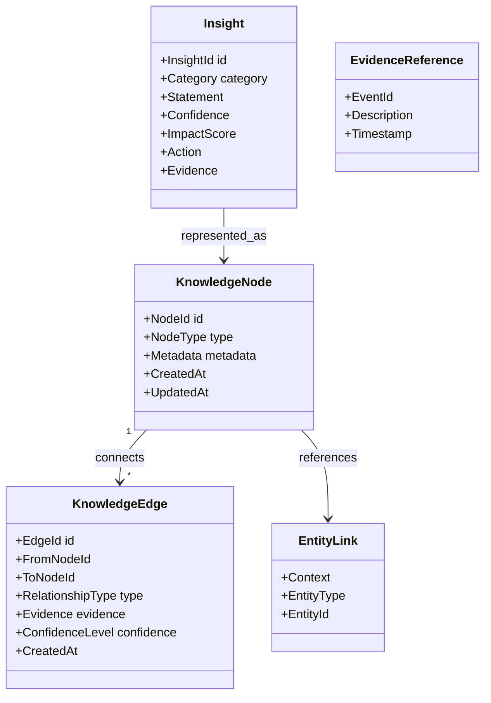

---

# **5.3 Node Types (Complete)**

Every domain concept that can encode knowledge becomes a graph node.

### **Core Knowledge Nodes**

* Hypothesis
* Insight
* CustomerInterview
* InterviewResponse
* ValidationAttempt
* Experiment
* ExperimentResult
* Metric
* DataPoint
* Prototype
* Feature
* Funnel
* Channel
* StrategicObjective
* KeyResult
* FinancialModel
* Scenario
* Investor
* Prospect
* Interaction
* TermSheet
* Risk
* TeamMember
* Skill
* Meeting (Investor / Customer)
* Document (DataRoom)

### **Meta Nodes**

* StartupStage
* Segment
* Persona
* MarketTrend
* ExternalBenchmark

---

# **5.4 Relationship Types**

Relationships define how knowledge flows between domain concepts.

### **Validation Relationships**

* *Validates* (Interview → Hypothesis)
* *Invalidates* (Interview → Hypothesis)
* *Supports* (Evidence → Insight)
* *Contradicts* (Evidence → Insight)

### **Causality Relationships**

* *Causes*
* *Influences*
* *TriggeredBy*
* *MitigatedBy*

### **Product Relationships**

* *Addresses* (Prototype → Hypothesis)
* *Tests* (Prototype → Problem)
* *ContainsFeature* (Prototype → Feature)
* *FeedbackFor* (Interview → Feature)

### **Growth Relationships**

* *Activates* (Channel → Funnel)
* *ImpactsMetric* (Experiment → KPI)
* *DependsOn* (Growth → Product readiness)

### **Investor Relationships**

* *EngagedBy*
* *InfluencedBy*
* *Requires*
* *ProvidesSignal*

### **Financial Relationships**

* *AffectsRunway*
* *ImpactsValuation*
* *DependsOnFinancialModel*

### **Team Relationships**

* *AssignedTo*
* *BlockedBy*
* *ResponsibleFor*
* *ContributesTo*

---

# **5.5 KnowledgeNode Aggregate Root**

### **Attributes**

```
NodeId
NodeType
Metadata (JSON-like structured attributes)
CreatedAt
UpdatedAt
LinkedEntities (List<EntityLink>)
```

### **Behavior**

* AddEdge()
* RemoveEdge()
* UpdateMetadata()
* AttachEntityReference()
* ComputeNodeImportance()
* GenerateContextualSummary()

### **Node Importance Calculation (Example)**

```
importance = degree * avg(confidence of edges) * recencyWeight
```

Used for insight prioritization.

---

# **5.6 KnowledgeEdge Aggregate Root**

### **Attributes**

```
EdgeId
FromNode
ToNode
RelationshipType
Evidence
ConfidenceLevel
Directionality
CreatedAt
```

### **Evidence Field**

* EvidenceReference list
* DataPoint references
* Event references

### **Behavior**

* StrengthenEdge()          // add evidence
* WeakenEdge()              // contradictory evidence
* ComputeConfidence()
* DetectCycle()
* DetectConflict()

---

# **5.7 Insight Integration**

**Insights** are both nodes and edge anchors.

Whenever a domain event occurs:

### Example: HypothesisValidated

Produces:

* Hypothesis node
* Insight node
* ValidationAttempt node
* Links:

  * Outcome → Hypothesis
  * Evidence → Insight
  * Insight → StrategicObjective
  * Insight → Segment

This allows the system to:

* Auto-extract patterns
* Recommend next actions
* Generate automated updates

---

# **5.8 Knowledge Graph Construction Pipeline**

### 1. **Event Ingestion**

All domain events flow into the graph builder:

* HypothesisValidated
* ExperimentConcluded
* CustomerInterviewCompleted
* MetricThresholdBreached
* TermSheetAccepted
* InvestorInteractionLogged

### 2. **Entity Extraction**

Entities extracted based on metadata & domain model.

### 3. **Node Mapping**

Each entity → node type.
Duplicate detection using:

* Similarity hashes
* Semantic embeddings

### 4. **Edge Mapping**

Creates relationships using:

* EventCorrelationId
* Relationship heuristics
* Ontology mappings
* Policies (KnowledgeGraphPolicy)

### 5. **Insight Consolidation**

Merges overlapping insights into “meta-insights”.

### 6. **Graph Analysis**

Algorithms for:

* Community detection
* Causality tree extraction
* Impact propagation
* Relevance scoring
* Contradiction detection

---

# **5.9 Ontology Definition**

Defines allowed node types, edge types, and rules.

Example:

```
ProblemHypothesis ->validated_by-> InterviewEvidence
Experiment ->impacts-> Metric
Investor ->engaged_in-> Interaction
FinancialModel ->affects-> Runway
```

The ontology prevents invalid edges (e.g., Metric → TermSheet).

---

# **5.10 Knowledge Graph API**

Queries supported:

### **1. getNodeContext(id, depth)**

Returns neighbors, subgraph, insights, metrics.

### **2. explainMetricChange(metricId)**

Returns causal graph.

### **3. recommendNextExperiments(segmentId)**

Uses patterns from similar nodes.

### **4. detectConflictingInsights()**

### **5. narrativeForObjective(objectiveId)**

Generates investor-ready narrative.

---

# **5.11 Domain Events Used to Build Graph**

All major events produce graph records:

* HypothesisValidated
* InsightCreated
* InterviewCompleted
* ExperimentConcluded
* MetricThresholdBreached
* StrategicObjectiveUpdated
* ProspectStageAdvanced
* InvestorInteractionLogged
* FinancialModelUpdated
* RiskDetected

Each event includes causality metadata.

---

# **5.12 Knowledge Graph Use Cases**

### ⭐ Investor Narrative Generation

Show how:

* interviews → hypotheses → experiments → KPIs → fundraising

### ⭐ PMF Readiness Assessment

Graph-derived PMF score:

* retention nodes
* qualitative insights
* revenue nodes

### ⭐ Growth Loops Detection

Automatically detect:

* acquisition → activation → referral → return loops

### ⭐ Root Cause Analysis

If KPI drops:

* graph paths show where issue originates

### ⭐ Strategic Decision Recommendations

Use multi-hop graph queries to suggest:

* next hypotheses
* next experiments
* next investor updates
* key risks
* team bottlenecks

---

# **6. Strategic Objectives & OKR Domain (Full Specification)**

The Strategic Objectives domain introduces a **structured, evidence-backed OKR system** embedded into every part of the platform.
It is not a simple task tracker — it is a **strategic alignment engine** driven by metrics, insights, experiments, and learning.

This domain connects:

* Fundraising strategy
* Product validation
* Growth experimentation
* Financial goals
* Investor communication
* Team performance
* Market intelligence

into a **single source of strategic truth**.

---

# **6.1 Purpose of the Strategic Objectives Domain**

### ✔ Aligns teams around measurable outcomes

OKRs grounded in validated metrics, not opinions.

### ✔ Connects strategy → execution → learning

Objectives link to:

* KPIs (TrackedMetric)
* Experiments
* Hypotheses
* Insights
* Milestones
* Financial models

### ✔ Drives automated recommendations

Using the Knowledge Graph:

* Suggest next experiments
* Highlight risk areas
* Identify stuck objectives

### ✔ Supports investor reporting

Investor updates pull OKR progress automatically.

---

# **6.2 Core Domain Model Overview**

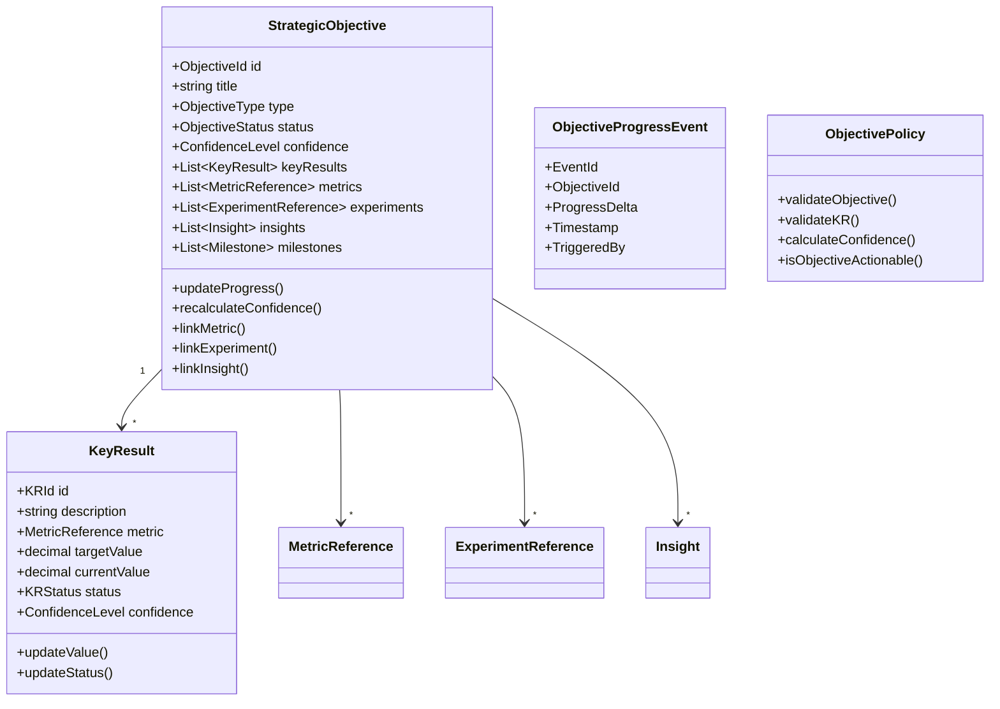

---

# **6.3 StrategicObjective Aggregate Root**

## Attributes

```
ObjectiveId
Title
ObjectiveType (Growth, Product, Financial, Fundraising, Operations, Learning)
Status (Draft, Active, Monitoring, Completed, Archived)
ConfidenceLevel
Owner
AssociatedStartupStage
List<KeyResult>
List<MetricReference>
List<ExperimentReference>
List<Insight>
List<Risk>
List<Milestone>
StartDate
EndDate
```

## Behaviors

* ActivateObjective()
* CompleteObjective()
* ArchiveObjective()
* AddKeyResult()
* LinkMetric()
* LinkExperiment()
* AttachInsight()
* RecalculateConfidence()
* UpdateProgress()
* AutoAlignWithStartupStage()

## Invariants

* Must have at least one Key Result
* Each KR must have a measurable metric
* Objective cannot activate without metric coverage
* Cannot complete if any KR < 80% progress

---

# **6.4 KeyResult Entity**

### Attributes

```
KRId
Description
MetricReference
TargetValue
CurrentValue
StartValue
Status (NotStarted, OnTrack, AtRisk, OffTrack, Completed)
ConfidenceLevel
LastUpdated
```

### Behaviors

* UpdateCurrentValue()
* UpdateStatus()
* RecalculateConfidence()
* TriggerProgressEvent()

---

# **6.5 Objective Types**

### 1. **Growth Objective**

Examples:

* Increase weekly active users to 20K
* Reduce CAC by 30%
* Increase MRR by 40%

### 2. **Product Objective**

Examples:

* Validate problem for top 3 segments
* Ship MVP version 1.0
* Improve onboarding funnel conversion

### 3. **Financial Objective**

Examples:

* Extend runway to 18 months
* Reduce burn by 25%
* Achieve positive contribution margin

### 4. **Fundraising Objective**

Examples:

* Close $1.5M seed round
* Prepare data room and due diligence

### 5. **Operations Objective**

Examples:

* Hire 3 core engineers
* Reduce cycle time by 20%

### 6. **Learning Objective**

Examples:

* Validate top 5 hypotheses
* Complete discovery interviews for 50 users

---

# **6.6 Objective Status Lifecycle**

```
Draft → Active → Monitoring → Completed → Archived
```

### Transition Rules

| From                   | To                                       | Conditions |
| ---------------------- | ---------------------------------------- | ---------- |
| Draft → Active         | All KRs defined + metrics linked         |            |
| Active → Monitoring    | Work in progress + evidence accumulating |            |
| Monitoring → Completed | All KRs >= target threshold              |            |
| Completed → Archived   | No new insights expected                 |            |

---

# **6.7 Objective Confidence Calculation**

ConfidenceLevel depends on:

### 1. Progress Score

Sum(KRProgress × Weight)

### 2. Evidence Support

Number of insights linked

### 3. Experimentality

Experiments validating or invalidating KRs

### 4. Risk Rating

Inverse relationship with active risks

### Formula (Simplified)

```
confidence = 
    (KRProgressScore * 0.5) +
    (InsightSupportScore * 0.2) +
    (ExperimentEvidenceScore * 0.2) +
    (RiskAdjustment * 0.1)
```

---

# **6.8 Integration With Other Domains**

### **Fundraising**

Objectives link directly to:

* Milestones
* Investor requirements
* Financial metrics

### **Product Discovery**

Objectives tied to:

* Hypotheses
* Segments
* Insights

### **Growth Experimentation**

Objectives validate:

* Key Results via experiments
* Funnel metrics
* Conversion improvements

### **Financial Modeling**

Objectives feed:

* Cashflow projections
* Runway goals
* Revenue targets

### **Investor Relationship Management**

Objectives appear in:

* Investor updates
* Quarterly reviews
* Progress dashboards

### **Team Domain**

Objectives tied to:

* Hiring
* Skills
* Cycle time
* Productivity metrics

---

# **6.9 Domain Events**

### StrategicObjectiveDefined

### KeyResultAdded

### ObjectiveActivated

### KeyResultProgressUpdated

### ObjectiveConfidenceChanged

### ObjectiveCompleted

### ObjectiveArchived

Each event includes:

* ObjectiveId
* Metrics
* Confidence
* Causality metadata
* Linked evidence
* ImpactWeight

---

# **6.10 Example Objective Definition (Pseudocode)**

```csharp
var objective = StrategicObjective.Create(
    "Achieve strong Product-Market Fit",
    ObjectiveType.Product,
    owner: founderId,
    startDate: Q2,
    endDate: Q3);

objective.AddKeyResult("Increase retention to 45%", metricRetention, 0.45m);
objective.AddKeyResult("Reduce onboarding drop-off by 25%", metricFunnelDropoff, target: 0.25m);

objective.LinkExperiment(experimentOnboardingRedesign);
objective.LinkInsight(insightUserPainPoints);

objective.Activate();
```

---

# **6.11 Automated Recommendations (Powered by Knowledge Graph)**

The OKR domain uses the graph to:

### ✔ Suggest next experiments

Based on failed KRs or weak metrics.

### ✔ Suggest new KRs

When patterns emerge across insights.

### ✔ Detect KR conflicts

When two objectives rely on conflicting metrics.

### ✔ Recalculate confidence in real time

Using:

* KPI fluctuations
* Experiment outcomes
* New insights
* Financial changes

---

# **6.12 Strategic Objective Anti-Corruption Layer**

When syncing with:

* Jira
* Linear
* Notion
* Asana

The ACL maps:

* Tasks → KRs
* Projects → Objectives
* Issues → Blockers
* Releases → Milestones

Maintains domain purity.

---

# **7. Fundraising Pipeline Domain (Enhanced Specification)**

The Fundraising Pipeline is one of the **core strategic domains** of the platform.
It manages the lifecycle of raising capital, from prospect identification to due diligence to closing a round and integrating equity into the CapTable.

This enhanced specification includes:

* Canonical value objects
* Lifecycle state machines
* Investor fit scoring
* Term sheet & negotiation modeling
* Integration with Strategic Objectives
* Integration with Knowledge Graph
* Enhanced policies
* Enhanced domain events with causality metadata
* Compliance hooks
* CapTable impacts
* Risk modeling
* Financial model updates

---

# **7.1 Purpose of Fundraising Domain**

The Fundraising Domain enables startups to:

### ✔ Identify and qualify investor prospects

using **ProspectQualificationPolicy** and **InvestorFitPolicy**

### ✔ Manage investor engagement lifecycle

through interactions, stages, and scoring

### ✔ Track pitch materials and their versions

(PitchDeck, MeetingDocs, DataRooms)

### ✔ Evaluate, negotiate, and compare term sheets

using financial and legal policy engines

### ✔ Close rounds and update the CapTable

via **TermSheetAccepted → FundingEventCreated**

### ✔ Generate investor readiness insights

via Knowledge Graph relationships

### ✔ Integrate directly with Strategic Objectives

(Fundraising objectives, milestones, KRs)

---

# **7.2 Domain Model Overview**

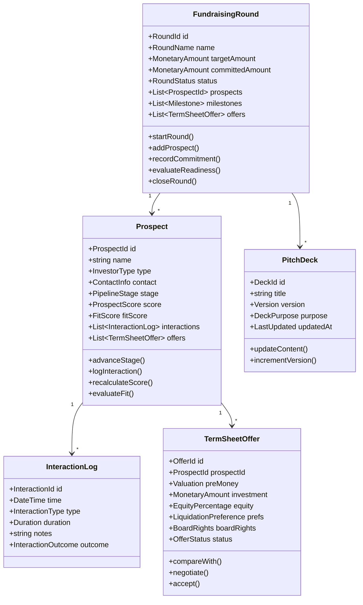

---

# **7.3 Aggregates and Entities**

## **7.3.1 FundraisingRound Aggregate Root**

### Attributes

```
RoundId
RoundName
TargetAmount
CommittedAmount
RoundStatus
Timeline
UseCases
Milestones
Prospects
TermSheetOffers
RoundInsights
RoundRiskRating
RoundConfidenceLevel
AssociatedStrategicObjective
RoundReadinessScore
```

### Lifecycle

```
Planning → Active → DueDiligence → Closing → Closed → Archived
```

### Behaviors

* LaunchRound()
* AddProspect()
* UpdateMilestone()
* AddTermSheetOffer()
* EvaluateReadiness()
* UpdateCommittedAmount()
* InitiateClosing()
* CloseRound()
* ArchiveRound()

### Invariants

* Cannot add prospect after round is closed
* Cannot close round without **MinimumViableFunding**
* Cannot start closing phase without a **lead investor**
* CommittedAmount ≤ TargetAmount (enforced)

---

## **7.3.2 Prospect Aggregate Root**

### Attributes

```
ProspectId
Name
InvestorType
ContactInfo
PipelineStage
ProspectScore
FitScore
TypicalCheckSize
PreferredSectors
PreferredStages
InteractionHistory
TermSheetOffers
EngagementScore
EngagementStatus
RiskSignals
LinkedInsights
```

### Pipeline Lifecycle

```
Identified → Contacted → Engaged → DueDiligence → TermSheet → Committed → Churned
```

### Behaviors

* LogInteraction()
* AdvanceStage()
* RecalculateProspectScore()
* EvaluateFit()
* AddTermSheetOffer()
* MarkAsCommitted()
* MarkAsChurned()

### Invariants

* Stage transitions must follow pipeline order
* Cannot issue term sheet unless in **DueDiligence**
* Cannot commit unless term sheet accepted

---

## **7.3.3 TermSheetOffer Aggregate Root**

### Attributes

```
OfferId
ProspectId
RoundId
Valuation (PreMoney, PostMoney)
InvestmentAmount
EquityPercentage
LiquidationPreferences
BoardSeats
ProRataRights
ParticipationRights
AntiDilutionType
OfferStatus
NegotiationHistory
LegalRiskProfile
DilutionImpactEstimate
ConfidenceLevel
```

### Lifecycle

```
Received → UnderReview → Negotiating → Accepted → Declined → Withdrawn
```

### Behaviors

* EvaluateTerms()
* CompareWith(otherOffer)
* Negotiate(counterOffer)
* Accept()
* Decline()

### Invariants

* Cannot accept if violates compliance policy
* Cannot negotiate after withdrawal

---

## **7.3.4 PitchDeck Aggregate Root**

### Attributes

```
DeckId
Title
Purpose (Demo Day, Seed, Series A, Update)
Version
Slides
AnalyticsData
LinkedInsights
```

### Behaviors

* UpdateDeck()
* CreateVersion()
* TrackUsage()
* LinkInsight()

---

## **7.3.5 InteractionLog Entity**

Stores structured investor interactions:

### Attributes

```
InteractionId
ProspectId
RoundId
InteractionType (Call, Meeting, Email, Demo)
Timestamp
Duration
Notes
Outcome (Positive, Neutral, Negative)
FollowUpRequired
LinkedInsights
```

---

# **7.4 Enhanced Value Objects**

### **InvestorType**

* Angel
* Seed VC
* Series A VC
* Family Office
* Corporate VC
* Strategic Partner

### **PipelineStage**

* Identified
* Contacted
* Engaged
* DueDiligence
* TermSheet
* Committed
* Churned

### **ProspectScore**

Weighted:

* FitScore (40%)
* EngagementScore (30%)
* LikelihoodScore (30%)

### **FitScore**

Evaluates alignment between investor thesis and startup profile.

### **LiquidationPreference**

* 1x non-participating
* 1x participating
* 2x participating
* Custom

### **RoundStatus**

* Planning
* Active
* DueDiligence
* Closing
* Closed
* Archived

---

# **7.5 Fundraising Policies**

## **7.5.1 ProspectQualificationPolicy**

Evaluates quality and likelihood of conversion.

**Inputs**

* Prospect
* Market data
* Team data
* Startup profile

**Outputs**

* ProspectScore
* FitScore
* Recommended engagement strategy

---

## **7.5.2 MinimumViableRoundPolicy**

Round cannot close unless:

* **CommittedAmount ≥ Target × 0.7**
* Lead investor secured
* Dilution acceptable (< threshold)
* Updated financial models confirm runway ≥ 12 months

---

## **7.5.3 TermSheetComparisonPolicy**

Compares offers using:

* Valuation
* Dilution impact
* Liquidation preferences
* Board control
* Pro-rata & participation rights
* Founder-friendliness score
* Overall risk score

---

# **7.6 Fundraising Domain Events (Enhanced with Causality)**

### **FundraisingRoundLaunched**

* RoundId
* TargetAmount
* UseCases
* Causality: StrategicObjectiveId

### **ProspectAddedToRound**

* ProspectId
* RoundId

### **ProspectStageAdvanced**

* ProspectId
* PreviousStage
* NewStage
* Reason

### **TermSheetOfferReceived**

* OfferId
* ProspectId
* RoundId
* Valuation
* InvestmentAmount

### **TermSheetNegotiated**

* OfferId
* PreviousTerms
* NewTerms

### **TermSheetAccepted**

* OfferId
* ProspectId
* RoundId
* AcceptedTerms
* Causality: triggers → FundingEvent → CapTableUpdate

### **FundraisingRoundClosed**

* RoundId
* TotalCapitalRaised
* FinalValuation

---

# **7.7 Integration With Other Domains**

## **CapTable Domain**

* TermSheetAccepted → IssueShares
* Update dilution
* Update security instruments

## **Financial Modeling**

* Update runway
* Update cash position
* Update valuation model

## **Investor Relationship Management**

* Convert Prospect → Investor
* Sync engagement history
* DataRoom access rights

## **Legal & Compliance**

* Verify security issuance
* Validate subscription agreements

## **Knowledge Graph**

* Generates nodes:

  * Prospect
  * TermSheet
  * Interaction
  * FundingRound

* Edges:

  * “causes”, “requires”, “influences”

## **Strategic Objectives**

* Connect fundraising objectives
* Update progress based on commitments

---

# **7.8 Sample Commands & Queries**

### Commands

```csharp
public record StartFundraisingRound(RoundId RoundId, RoundName Name, MonetaryAmount Target, List<UseCase> UseCases);

public record AddProspect(RoundId RoundId, string Name, InvestorType Type, ContactInfo Contact);

public record LogProspectInteraction(ProspectId ProspectId, InteractionType Type, DateTime Timestamp, string Notes);

public record RecordTermSheetOffer(ProspectId ProspectId, Valuation Valuation, MonetaryAmount Investment, Terms Terms);

public record AcceptTermSheetOffer(OfferId OfferId, UserId AcceptedBy);
```

### Queries

```csharp
public record GetRoundPipeline(RoundId RoundId);
public record GetProspectEngagementHistory(ProspectId ProspectId);
public record CompareTermSheets(List<OfferId> OfferIds);
public record GetFundraisingReadinessScore(RoundId RoundId);
```

---

# **7.9 Key Indicators & Analytics**

### Fundraising KPIs

* Lead investor engagement score
* Conversion rate by stage
* Median check size vs round size
* Average time in each stage
* Prospect fit scoring
* Round readiness score
* Expected time to close

---

# **8. Product Discovery & Validation Domain (Fully Enhanced)**

This domain is the **product intelligence engine** of the platform.
It transforms raw customer interactions into validated insights, hypotheses, prototypes, and confidence scores — enabling the startup to reach **Product-Market Fit (PMF)** with structured, evidence-backed decisions.

This domain ties directly into:

* Strategic Objectives
* Growth Experiments
* Financial Models
* Market Intelligence
* Knowledge Graph
* Customer Segments
* Product Roadmapping

---

# **8.1 Purpose of the Product Discovery Domain**

### The Product Discovery domain ensures the startup can:

### ✔ Validate problems before building solutions

through interviews, insights, and hypotheses.

### ✔ Validate solutions before building features

through prototypes and usability testing.

### ✔ Systematically measure evidence

with validation attempts & confidence scoring.

### ✔ Converge toward PMF using data, not assumptions

integrated through the **Knowledge Graph**.

### ✔ Continuously refine customer segments & personas

based on interviews and behavioral evidence.

### ✔ Connect everything to experiments and KPIs

for measurable product traction.

---

# **8.2 Domain Model Overview**

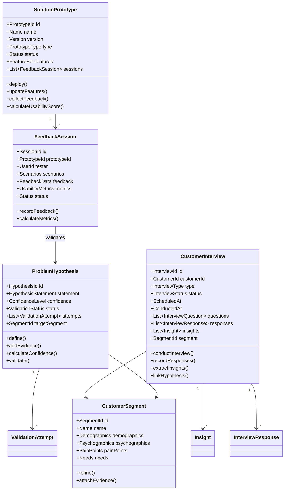

---

# **8.3 Aggregate Roots**

## **8.3.1 CustomerInterview Aggregate Root**

### Attributes

```
InterviewId
CustomerId
SegmentId
InterviewType
Status (Scheduled, Conducted, Analyzed, InsightsExtracted, Archived)
Questions
Responses
Insights
EvidenceScore
Interviewer
Transcript
RecordingUrl
Tags
```

### Behaviors

* ScheduleInterview()
* ConductInterview()
* RecordResponses()
* ExtractInsights()
* LinkToHypothesis()
* CategorizeResponses()
* RateInterviewQuality()

### Invariants

* Minimum 3 questions required
* Must record responses before marking conducted
* Insights must reference evidence

---

## **8.3.2 ProblemHypothesis Aggregate Root**

### Attributes

```
HypothesisId
HypothesisStatement
TargetSegment
AssumptionLevel
ValidationStatus 
ConfidenceLevel
EvidenceStrength
List<ValidationAttempt>
LinkedInsights
RelatedExperiments
RiskScore
RootCauseCategory
```

### Hypothesis Lifecycle

```
Draft → Testing → Validated / Invalidated → Refined → Archived
```

### Behaviors

* Define()
* AddValidationAttempt()
* AddEvidence()
* UpdateValidationStatus()
* RefineStatement()
* CalculateConfidence()

### Confidence Formula (simplified)

```
confidence = 
  (evidence reliability * 0.4) +
  (confirmation rate * 0.4) +
  (sample size weight * 0.2)
```

### Invariants

* Cannot declare validated without ≥ minimum evidence
* Cannot skip “Testing” state

---

## **8.3.3 SolutionPrototype Aggregate Root**

### Attributes

```
PrototypeId
Name
Version
Type (Clickable, Mockup, MVP, High-Fidelity)
Status (Concept, Development, Testing, Validated, Deprecated)
FeatureSet
LinkedHypotheses
UsabilityScore
Sessions
DeploymentUrl
ReleaseNotes
```

### Behaviors

* CreatePrototype()
* UpdateFeatureSet()
* ReleaseVersion()
* CollectFeedback()
* CalculateUsabilityScore()
* MarkAsValidated()

### Invariants

* Cannot validate without feedback sessions
* Must increment version on each update

---

## **8.3.4 FeedbackSession Aggregate Root**

### Attributes

```
SessionId
PrototypeId
UserId
TestScenarios
FeedbackData
UsabilityMetrics
CompletionStatus
```

### Behaviors

* InitializeSession()
* RecordFeedback()
* CalculateMetrics()
* CloseSession()

### Invariants

* Must record scenarios before metrics
* Session cannot be closed without feedback

---

## **8.3.5 CustomerSegment Aggregate Root**

### Attributes

```
SegmentId
Name
Demographics
Psychographics
Needs
Behaviors
PainPoints
Archetypes
EvidenceConfidence
Insights
```

### Behaviors

* DefineSegment()
* AttachEvidence()
* RefineSegment()
* UpdateConfidence()

### Invariants

* Cannot refine segment without supporting evidence

---

# **8.4 Enhanced Value Objects**

### **InterviewType**

* Discovery
* Problem Validation
* Solution Validation
* Usability
* Exit

### **ValidationStatus**

* Draft
* Testing
* Validated
* Invalidated
* Refined
* InsufficientData

### **PrototypeType**

* Wireframe
* Clickable
* MVP
* Interactive
* Experimental

### **InsightCategory**

* Problem
* Need
* Behavior
* Preference
* Friction
* Objection
* Opportunity

### **UsabilityMetrics**

* TaskSuccessRate
* CompletionTime
* SatisfactionScore
* ErrorRate

---

# **8.5 Domain Events (Enhanced)**

### CustomerInterviewScheduled

### CustomerInterviewConducted

### InterviewInsightsExtracted

### HypothesisDefined

### HypothesisValidated

### HypothesisInvalidated

### HypothesisRefined

### PrototypeCreated

### PrototypeVersionReleased

### PrototypeFeedbackCollected

### PrototypeValidated

### CustomerSegmentRefined

All events include:

* Evidence references
* Confidence scores
* Causality links

---

# **8.6 Integration With Other Domains**

## **Strategic Objectives**

* Product objectives automatically update based on:

  * Hypotheses validated
  * Insights extracted
  * Prototype performance

## **Growth Experimentation**

* Validated hypotheses → experiment generation
* Failed hypotheses → redesign experiments
* Feedback sessions → new experiment candidates

## **Financial Modeling**

* Hypothesis outcomes → revenue model assumptions
* Feature validation → cost modeling
* Segment confidence → pricing models

## **Investor Relationship Management**

* Interviews → data room insights
* Hypothesis validations → investor updates
* PMF indicators → fundraising narrative

## **Knowledge Graph**

Every interview, insight, hypothesis, evidence becomes a **KnowledgeNode**.

Relationships:

```
Interview → yields → Insight  
Insight → supports → Hypothesis  
Hypothesis → informs → Experiment  
Prototype → validates → Hypothesis  
Feedback → strengthens → Insight  
```

---

# **8.7 Example Flow: Problem Validation**

### 1. Create Draft Hypothesis

"Hiring managers struggle to evaluate junior developers quickly."

### 2. Conduct interviews

Minimum 10 interviews.

### 3. Extract insights

* 7 confirm the problem
* 3 contradict or deprioritize it

### 4. System calculates confidence

* Confirmation rate: 70%
* Evidence score: 0.66
* Confidence: 0.75

### 5. Hypothesis becomes “Validated”

Triggers:

* New strategic objective alignment
* Experiment design prompts
* Segment refinement

---

# **8.8 PMF Readiness Score**

Based on:

* Hypothesis validation strength
* Prototype usability metrics
* Segment evidence confidence
* Retention signals
* Growth experiment outcomes

**Output:**
A PMF readiness score between **0.0–1.0**.

---

# **9. Growth Experimentation Domain (Fully Enhanced)**

The Growth Experimentation domain is the **engine for scalable, predictable, evidence-driven growth**.

It integrates deeply with:

* Product Discovery
* Metrics & KPIs
* Strategic Objectives
* Marketing Channels
* Financial Modeling
* Conversion Funnels
* Knowledge Graph

This domain manages a startup’s experiments with the same rigor used in scientific research — ensuring decisions are **data-backed**, repeatable, and scalable.

---

# **9.1 Purpose of the Growth Experimentation Domain**

This domain enables the startup to:

### ✔ Run scientifically valid experiments

A/B, multivariate, holdout tests, feature-flag experiments.

### ✔ Track growth levers

Channels, funnels, audiences, messaging, product changes.

### ✔ Measure causality and significance

Determine **why** a metric moved, not just that it moved.

### ✔ Produce validated growth learnings

Connect experiments → insights → KPIs → revenue → investor narrative.

### ✔ Build predictive growth models

Using experiment outcomes + KPI trends.

### ✔ Prioritize high-impact experiments

Using ICE/RICE scoring, probabilistic uplift modeling.

---

# **9.2 Domain Model Overview**

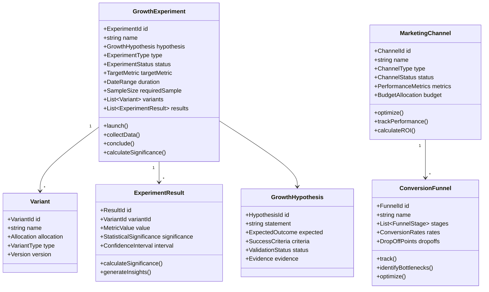

---

# **9.3 Aggregate Roots**

---

## **9.3.1 GrowthExperiment Aggregate Root**

### Attributes

```
ExperimentId
Name
Type (A/B, Multivariate, FeatureFlag, Sequential Test)
Status (Designed, Running, Paused, Concluded, Archived)
GrowthHypothesis
TargetMetric
SecondaryMetrics
Variants
TrafficAllocation
SampleSizeRequired
SampleSizeAchieved
Duration
SignificanceLevel
InsightSummary
ConfidenceLevel
ExperimentImpactScore
LinkedSegments
LinkedChannels
LinkedFunnels
CausalImpactAnalysis
```

### Behaviors

* DesignExperiment()
* Launch()
* Pause()
* RecordResult()
* Conclude()
* ComputeStatisticalSignificance()
* ComputeUplift()
* GenerateInsights()
* RecommendNextActions()

### Invariants

* Must have ≥ 1 control variant
* Target metric must be defined
* Minimum sample size must be estimated
* Cannot conclude before minimum exposure duration

---

## **9.3.2 Variant Entity**

### Attributes

```
VariantId
Name
Allocation (percentage split)
VariantType (Control, Treatment)
Version
Configuration (flags, content, UI config)
```

### Invariants

* Control variant allocation ≥ 10%
* Sum of allocations = 100%

---

## **9.3.3 ExperimentResult Aggregate Root**

### Attributes

```
ResultId
ExperimentId
VariantId
MetricValues
pValue
Significance
ConfidenceInterval
EffectSize
Uplift
TrafficSeen
SampleSize
SegmentationBreakdown
```

### Behaviors

* CalculateSignificance()
* ComputeConfidenceInterval()
* DetectWinner()
* GenerateInsight()

---

## **9.3.4 GrowthHypothesis Aggregate Root**

### Attributes

```
HypothesisId
Statement
ExpectedOutcome
SuccessCriteria
LinkedInsights
ValidationStatus
EvidenceStrength
RootCauseCategory
```

### Behaviors

* Define()
* LinkEvidence()
* Validate()
* Invalidate()
* UpdateConfidence()

---

## **9.3.5 MarketingChannel Aggregate Root**

### Attributes

```
ChannelId
Name
Type (PaidSearch, Social, Email, Referral, PR)
Status (Inactive, Active, Optimizing, Saturated)
BudgetAllocation
PerformanceMetrics (CAC, CTR, LTV, CPA)
AttributionModel
ChannelHealthScore
```

### Behaviors

* OptimizeBudget()
* TrackPerformance()
* AdjustAttribution()
* CalculateROI()
* DetectUnderperformance()

---

## **9.3.6 ConversionFunnel Aggregate Root**

### Attributes

```
FunnelId
Name
Stages (View → Click → Signup → Activate → Retain)
ConversionRates
DropOffPoints
FunnelVelocity
SegmentBreakdown
FrictionMetrics
```

### Behaviors

* TrackStageEvents()
* IdentifyBottlenecks()
* GenerateOptimizationIdeas()
* LinkToExperiments()

---

# **9.4 Value Objects**

### **ExperimentType**

* A/B Test
* Multivariate Test
* Feature Flag
* Switchback Test
* Sequential Test

### **ExperimentStatus**

* Designed
* Running
* Paused
* Concluded
* Archived

### **StatisticalSignificance**

* HighlySignificant
* Significant
* Inconclusive
* NegativeImpact

### **SuccessCriteria**

* Minimum uplift threshold
* Statistical significance threshold
* Risk threshold
* Confidence threshold

---

# **9.5 Domain Events (Enhanced)**

### ExperimentDesigned

### ExperimentLaunched

### ExperimentPaused

### VariantTrafficSplitUpdated

### ExperimentResultRecorded

### ExperimentConcluded

### GrowthHypothesisValidated

### GrowthHypothesisInvalidated

### ChannelPerformanceDropped

### FunnelBottleneckDetected

Each event includes:

* Confidence
* Impact weight
* Causality links
* Metric references
* Evidence references

---

# **9.6 Integration With Other Domains**

---

## **Product Discovery**

* Validated hypotheses → growth experiments
* Invalidated hypotheses → experiment cancellation

---

## **Metrics Domain**

Growth experiments **write metrics**, they never compute raw metrics themselves.

* Uplift
* Effect size
* Confidence interval
* p-value
* Traffic exposure
* Metric deltas

---

## **Strategic Objectives**

Allows OKRs such as:

* “Improve signup conversion by 25%”
* “Reduce CAC by 30%”

to be validated by experiments.

---

## **Financial Modeling**

Experiments update:

* CAC
* LTV
* Revenue projections
* Spend modeling
* Payback period

This affects:

* Runway
* Hiring plans
* Fundraising strategy

---

## **Investor Relationship Management**

Experiments contribute to:

* Investor updates
* Quarterly reports
* Evidence of traction
* PMF readiness

---

## **Knowledge Graph**

Nodes created:

* Experiment
* Variant
* Result
* Hypothesis
* Metric
* Funnel
* Channel

Edges:

```
Experiment → impacts → Metric  
Hypothesis → tested_by → Experiment  
Variant → produces → Result  
Result → supports/contradicts → Insight  
```

---

# **9.7 Experiment Scoring & Prioritization**

Prioritization models:

### **ICE Score**

```
ICE = Impact * Confidence * Ease
```

### **RICE Score**

```
RICE = (Reach * Impact * Confidence) / Effort
```

### **Probabilistic Uplift Model**

Predicts ROI of an experiment using historical data.

---

# **9.8 Causal Impact Engine**

Uses Bayesian structural time series to determine:

* If experiment caused metric movement
* How much variance is explained
* Counterfactual forecast

Outputs:

```
causalImpact = actualMetric - predictedCounterfactual
```

---

# **9.9 Growth Loop Modeling**

Experiments build loops:

* Acquisition → Activation → Monetization → Referral
* Content loop
* Viral loop
* Paid loop

Graph detects:

* Weak loop points
* Missing loop components
* Experiment opportunities

---

# **9.10 Example End-to-End Experiment Lifecycle**

### **1. Hypothesis Defined**

“Improving onboarding clarity will increase activation rate by 15%.”

### **2. Experiment Designed**

A/B test with two variants:

* Control
* Treatment with improved onboarding

### **3. Minimum sample size estimated**

n = 5,200 total users.

### **4. Experiment Launched**

### **5. Metrics collected**

Activation
Time-to-activation
Engagement

### **6. Analysis**

* Uplift: +18%
* p-value: 0.03
* Confidence: 92%

### **7. Conclusion**

* Winner: Treatment
* Status: Validated
* Next action: Rollout to 100%

### **8. Automatic triggers**

* Strategic Objective progress updated
* PMF score updated
* Investor narrative updated
* Knowledge Graph updated

---

# **10. Performance & Financial Modeling Domain (Enhanced Specification)**

The Performance & Financial Modeling Domain is the **central nervous system** for quantitative decision-making across the entire platform.

This is where **metrics, financial projections, performance analytics, and KPI intelligence converge** to create a unified, predictive understanding of the startup’s trajectory.

It powers:

* KPI dashboards
* Cashflow forecasting
* Burn modeling
* Revenue projections
* Scenario planning
* Benchmarking
* Runway calculations
* Strategic objective scoring
* Investor updates
* Growth experiment evaluation
* Startup valuation modeling

---

# **10.1 Purpose of the Performance & Financial Modeling Domain**

The domain ensures the startup can:

### ✔ Measure what matters

Define KPIs, record data, detect anomalies, measure trends.

### ✔ Forecast the future

Create accurate cashflow, revenue, and cost projections.

### ✔ Respond to financial risks

Burn spikes, negative cashflows, runway collapse.

### ✔ Support fundraising

Provide real-time investor-grade financial views.

### ✔ Validate assumptions

Link financial assumptions to insights, experiments, and metrics.

### ✔ Connect performance → strategy

Objectives depend directly on KPI trends and model outcomes.

---

# **10.2 Domain Model Overview**

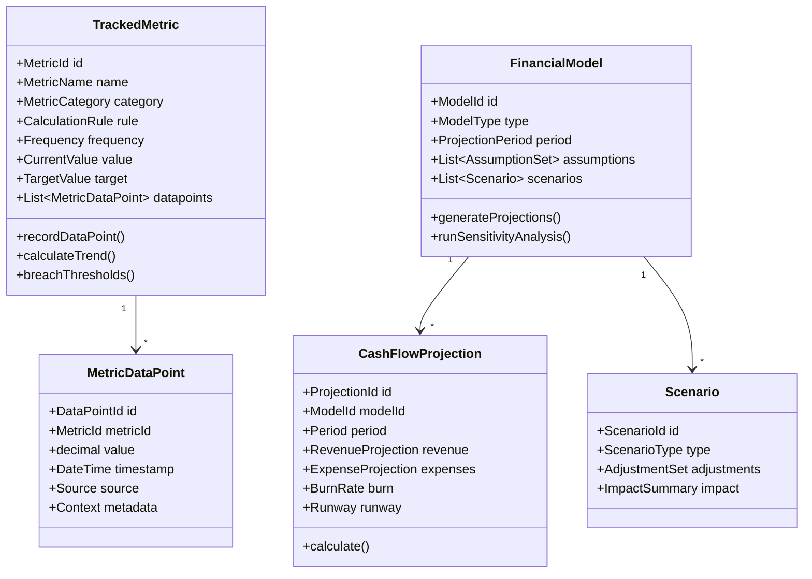

---

# **10.3 Aggregate Roots**

---

## **10.3.1 TrackedMetric Aggregate Root**

### Attributes

```
MetricId
Name
Category (Financial, Product, Growth, Operational)
CalculationRule
Frequency
CurrentValue
TargetValue
ThresholdRules
DataPoints
SourceSystems
TrendAnalysis
MetricHealthScore
AnomalyScore
LinkedInsights
LinkedObjectives
```

### Behaviors

* RecordDataPoint()
* RecalculateCurrentValue()
* ComputeTrend()
* DetectThresholdBreach()
* ComputeHealthScore()
* IntegrateWithExperiments()
* UpdateMetricConfidence()

### Invariants

* DataPoints must be timestamp-ordered
* Metric cannot compute without valid calculation rule
* Target must align with metric category

---

## **10.3.2 MetricDataPoint Entity**

### Attributes

```
DataPointId
MetricId
Value
Timestamp
Source (System, Manual, Integration)
Metadata
LinkedExperiment
LinkedEvent
```

Validation:

* Must fall within acceptable bounds (based on rule)
* Cannot be > 1 year in future or 10 years in past

---

## **10.3.3 FinancialModel Aggregate Root**

### Attributes

```
ModelId
Name
ModelType (CashFlow, Revenue, Valuation, CostStructure)
ProjectionPeriod
Assumptions
Scenarios
ModelAccuracy
LinkedInsights
LinkedExperiments
LinkedHypotheses
GeneratedProjections
```

### Behaviors

* BuildModel()
* UpdateAssumptions()
* AddScenario()
* GenerateProjections()
* RunSensitivityAnalysis()
* ComputeRunway()
* ComputeValuation()
* DetectModelRisk()

### Invariants

* Must include baseline scenario
* Cannot finalize with missing assumptions
* Projection period must be continuous and valid

---

## **10.3.4 CashFlowProjection Aggregate Root**

### Attributes

```
ProjectionId
ModelId
PeriodStart
PeriodEnd
RevenueProjection
ExpenseProjection
NetCashFlow
BurnRate
Runway
BreakEvenPoint
RiskAdjustments
```

### Behaviors

* CalculateMonthlyProjection()
* UpdateWithNewAssumptions()
* ForecastRunway()
* DetectCriticalBurn()
* GenerateFinancialAlerts()

---

# **10.4 Value Objects**

### **MetricCategory**

* Financial
* Product
* Growth
* Operational
* Customer
* Organizational

### **ModelType**

* RevenueModel
* UnitEconomicsModel
* CashFlowModel
* ValuationModel
* CostStructureModel

### **Runway**

Includes:

* MonthsRemaining
* DepletionDate
* BurnRate
* RiskLevel

### **BurnRate**

* GrossBurn
* NetBurn
* AdjustedBurn

### **ScenarioType**

* Base
* Optimistic
* Pessimistic
* Crisis
* Hypergrowth

---

# **10.5 Domain Events (Enhanced)**

### MetricDataPointRecorded

### MetricThresholdBreached

### MetricTrendShifted

### MetricAnomalyDetected

### FinancialModelUpdated

### ScenarioAnalysisCompleted

### CashFlowProjectionGenerated

### RunwayAlert

Each event includes:

* Confidence score
* Impact score
* Causality chain
* Linked objectives
* Linked experiments

---

# **10.6 Integration With Other Domains**

---

## **1. Growth Experimentation**

Experiments feed:

* MetricDataPoints
* Uplift metrics
* Trend changes
* KPI improvements

Metrics feed back:

* Experiment validation
* Experiment insights
* Effect size analysis

---

## **2. Product Discovery**

* Hypothesis validation influences model assumptions
* Segment insights refine revenue & cost assumptions

---

## **3. Fundraising Domain**

Financial models:

* Feed pitch decks
* Influence valuation discussions
* Update investor narratives

Events such as TermSheetAccepted update:

* Cash position
* Runway
* Burn models

---

## **4. Investor Relationship Management**

Investor updates include:

* KPI summaries
* Financial projections
* Runway charts
* Scenario plans

---

## **5. Strategic Objectives**

Objectives depend on:

* Metric performance
* Model projections
* Scenario outcomes

Objectives auto-update when:

* Metrics change
* Thresholds breach
* Trends shift

---

## **6. Knowledge Graph**

Nodes:

* Metrics
* DataPoints
* FinancialModels
* Scenarios
* Projections

Edges:

```
Metric → influences → Objective  
Experiment → impacts → Metric  
Hypothesis → informs → ModelAssumption  
Scenario → changes → Projection  
Projection → affects → Runway  
```

---

# **10.7 Advanced Algorithms**

---

## **10.7.1 Runway Calculation**

Formula:

```
runwayMonths = currentCash / netBurn
```

Enhanced:

* Includes upcoming inflows
* Includes scheduled hiring
* Includes spend ramp-ups
* Includes dilution impact
* Includes stress scenarios

---

## **10.7.2 Trend Analysis Engine**

Supports:

* Linear regression
* Exponential smoothing
* Seasonality models
* Rolling averages
* Derivative tracking
* KPI slope & velocity

Outputs:

* Trend direction
* Trend stability
* Trend strength

---

## **10.7.3 Anomaly Detection**

Using:

* z-score
* Isolation forest
* Seasonal decomposition
* Outlier clustering

Alerts include:

* Data quality warning
* Performance anomaly
* Contextual anomaly (comparison to similar periods)

---

## **10.7.4 Scenario Planning**

### Inputs:

* Pricing changes
* Hiring plans
* CAC changes
* LTV changes
* Spend changes
* Conversion changes
* New revenue streams

### Outputs:

* Revenue projections
* Cashflow forecasts
* Valuation range
* Runway changes
* Dilution impact

---

# **10.8 Example: Full Revenue Model Flow**

### Step 1 — Define assumptions

* ARPU = $50
* Activation rate = 20%
* CAC = $200
* MRR retention 85%

### Step 2 — Build model

Cohort modeling + revenue waterfall.

### Step 3 — Generate projections

12, 24, 36 months.

### Step 4 — Run scenarios

* Optimistic: CAC -20%
* Pessimistic: Retention drops to 75%

### Step 5 — Update strategic objectives

OKR: “Reach $100K MRR” updates based on projections.

### Step 6 — Update investor reports

Financial update automatically refreshed.

---

# **11. Investor Relationship Management (IRM) Domain (Fully Enhanced)**

The IRM domain manages **all aspects of startup–investor relationships** beyond fundraising.

It ensures:

* Strong investor communications
* Structured engagement tracking
* Secure due diligence management
* Investor onboarding
* Performance reporting
* Compliance and data access control
* Relationship health scoring
* Pattern detection (via Knowledge Graph)
* Personalized communication strategies
* Alignment with fundraising strategy

This domain is essential for increasing:

* Trust
* Transparency
* Follow-on investment
* Investor satisfaction
* Funding velocity

---

# **11.1 Purpose of the IRM Domain**

This domain ensures the startup can:

### ✔ Keep investors informed

via structured updates, metrics, milestones, and reports.

### ✔ Maintain strong engagement

by tracking interactions, preferences, and responsiveness.

### ✔ Manage due diligence efficiently

with automated data rooms, permissions, and audits.

### ✔ Build narratives using real evidence

via deep integration with metrics, experiments, and insights.

### ✔ Detect risk in investor relationships

based on engagement score, response patterns, and sentiment.

### ✔ Support ongoing fundraising

by converting existing investors into repeat backers.

---

# **11.2 Domain Model Overview**

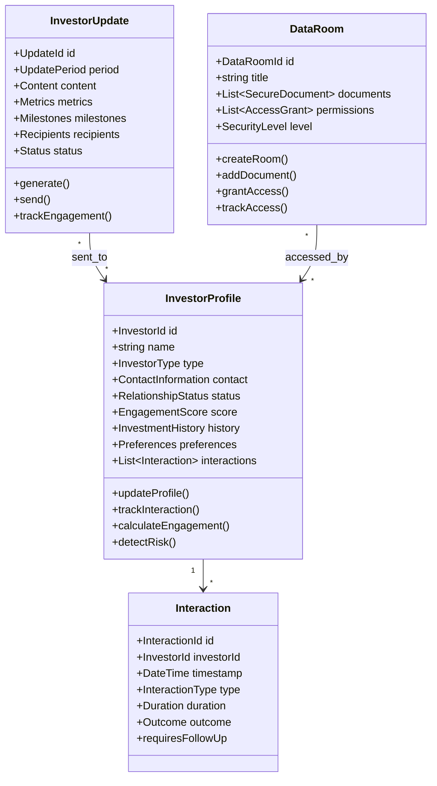

---

# **11.3 Aggregate Roots**

---

## **11.3.1 InvestorProfile Aggregate Root**

### Attributes

```
InvestorId
Name
InvestorType
ContactInfo
RelationshipStatus (New, Active, AtRisk, Dormant, Churned)
EngagementScore
Preferences (Format, Frequency, Channels)
InvestmentHistory
InteractionHistory
PortfolioAlignmentScore
FollowOnProbability
RiskSignals
DataRoomAccessHistory
StrategicValueRating
```

### Behaviors

* UpdateProfileInfo()
* LogInteraction()
* RecalculateEngagementScore()
* DetectRelationshipRisk()
* UpdateCommunicationPreferences()
* AddInvestmentRecord()
* MarkAsAtRisk()
* MarkAsReactivated()

### Invariants

* InvestorType must be valid
* Must have at least one contact method
* Cannot become “Churned” without explicit withdrawal

---

## **11.3.2 InvestorUpdate Aggregate Root**

### Attributes

```
UpdateId
Period (Monthly, Quarterly, Ad-Hoc)
ContentSections (Narrative, Metrics, Milestones, Risks, Strategy)
IncludedMetrics
IncludedMilestones
DistributionList
Status (Draft, Review, Sent, Acknowledged)
EngagementAnalytics
ContentConfidenceScore
GeneratedFromGraphInsights
```

### Behaviors

* CreateUpdate()
* AddContentSection()
* AttachMetrics()
* AttachMilestones()
* SendUpdate()
* TrackEngagement()
* GenerateSummary()

### Invariants

* Cannot send if no recipients
* Must include at least one metric
* Cannot move to Review state before content sections exist

---

## **11.3.3 DueDiligenceDataRoom Aggregate Root**

### Attributes

```
DataRoomId
Name
SecurityLevel
Documents
AccessPermissions
AccessAudits
LastUpdated
ComplianceStatus
```

### Behaviors

* CreateDataRoom()
* AddDocument()
* UpdateDocumentVersion()
* GrantAccess()
* RevokeAccess()
* TrackAccessEvent()
* CheckComplianceRequirements()

### Invariants

* Certain documents (e.g., P&L, CapTable) must always have latest version
* Documents marked “Locked” cannot be edited

---

## **11.3.4 Interaction Aggregate Root**

### Attributes

```
InteractionId
InvestorId
Timestamp
InteractionType (Call, Email, Meeting, Demo, UpdateResponse)
Notes
Outcome
FollowUpRequired
LinkedInsights
SentimentScore
```

### Behaviors

* Record()
* AnalyzeSentiment()
* GenerateFollowUpTask()
* CategorizeOutcome()

### Invariants

* Must have timestamp
* Must reference exactly one investor

---

# **11.4 Value Objects**

### **RelationshipStatus**

* New
* Active
* AtRisk
* Dormant
* Churned

### **InvestorType**

* Angel
* VC Fund
* Corporate VC
* Family Office
* Accelerator
* Strategic Partner

### **EngagementScore**

Weighted:

* Interaction frequency
* Response rate
* Depth of engagement
* Data room activity
* Sentiment score

### **SecurityLevel**

* Public
* Internal
* Confidential
* Restricted

---

# **11.5 Domain Events (Enhanced)**

### InvestorProfileCreated

### InvestorInteractionLogged

### InvestorEngagementDeclined

### InvestorReactivated

### InvestorUpdateCreated

### InvestorUpdateSent

### InvestorUpdateEngaged

### DataRoomCreated

### DataRoomAccessGranted

### DataRoomAccessed

### DocumentVersionUpdated

Each event contains:

* Causality chain
* Evidence references
* Impact scoring
* Relationship impact

---

# **11.6 Integration with Other Domains**

---

## **Fundraising Domain**

* Converts Prospect → InvestorProfile
* Syncs committed amounts
* Tracks communication cycles
* Merges interaction logs

---

## **Performance & Financial Modeling**

Investor updates automatically pull:

* Latest KPIs
* Latest financial models
* Runway
* Burn rate
* Cashflow projections

---

## **Strategic Objectives**

Investor-facing objectives highlighted:

* Fundraising goals
* Product milestones
* Growth KPIs

---

## **Legal & Compliance Domain**

Data room verifies:

* Subscription agreements
* Compliance checks
* Equity issuance documents

---

## **Knowledge Graph Integration**

Nodes:

* Investor
* Interaction
* Update
* DataRoom
* Document

Edges:

```
Investor → engaged_in → Interaction  
Interaction → produces → Insight  
Investor → accesses → Document  
Update → informs → Investor  
FinancialMetric → reported_in → Update  
```

Used to detect:

* declining engagement
* investor interest trends
* sentiment shifts
* response correlates
* investor behavior patterns

---

# **11.7 Investor Engagement Intelligence**

Using behavioral signals:

### EngagementScore Formula

```
(InteractionFrequency * 0.3) +
(ResponseRate * 0.3) +
(DataRoomActivity * 0.2) +
(MeetingDepth * 0.1) +
(SentimentScore * 0.1)
```

### Risk Detection

AtRisk if:

* engagement drops > 30%
* sentiment < 50%
* no interactions in 45+ days
* negative feedback on updates

### Follow-On Probability

Predicts re-investment likelihood using:

* engagement
* involvement in strategy
* prior investment patterns
* reaction to updates
* market alignment

---

# **11.8 Investor Update Engine**

Includes:

* Narrative section
* KPI summary
* Milestones
* Risks
* Opportunities
* Ask (fundraising, intros, help)

### Auto-Generated Narrative

Using:

* experiment outcomes
* hypothesis validations
* KPI changes
* financial projections
* frequent insights
* product progress

Powered by patterns in the **Knowledge Graph**.

---

# **11.9 Due Diligence Automation**

### Automatically Managed Documents

* CapTable
* Financials
* Forecasts
* Metrics dashboards
* User analytics
* Legal docs
* Hiring plans
* Product architecture

### Role-Based Data Access

* Board
* Existing investors
* Prospective investors
* Advisors
* Legal counsel

### Access Log Analytics

Detects:

* interest
* disengagement
* risk of churn
* fraud indicators

---

# **11.10 Example End-to-End Investor Relationship Flow**

### 1. Prospect → Investor

After a term sheet is accepted.

### 2. Investor Onboarding

* Create InvestorProfile
* Grant DataRoom access
* Add to distribution list

### 3. First Quarterly Update

Auto-generated from:

* KPIs
* experiments
* metrics
* milestones
* financial models

### 4. Interaction Tracking

Call → Meeting → DataRoom usage → Update engagement.

### 5. Relationship Health

EngagementScore updated daily.

### 6. InvestorFollowOnOpportunity

Triggered if:

* engagement ↑
* metrics ↑
* active interest signals detected.

---

# **12. Capitalization Table & Securities Management Domain (Fully Enhanced)**

This domain manages the **entire equity structure** of the startup:

* securities (common, preferred, SAFEs, notes, options, RSUs, warrants)
* ownership
* dilution
* vesting
* transactions
* compliance
* investor equity history
* board governance rights

It is deeply integrated with **Fundraising**, **Legal & Compliance**, and **IRM**.

---

# **12.1 Purpose of the CapTable Domain**

### ✔ Maintain a complete, accurate equity ledger

### ✔ Support fundraising and term sheet modeling

### ✔ Calculate dilution and post-money ownership

### ✔ Handle vesting and employee equity

### ✔ Manage SAFE and convertible note conversions

### ✔ Track board rights, voting rights, preferences

### ✔ Enable legal compliance

### ✔ Generate investor-ready reports automatically

The CapTable is both a **legal ledger** and a **strategic decision engine**.

---

# **12.2 Domain Model Overview**

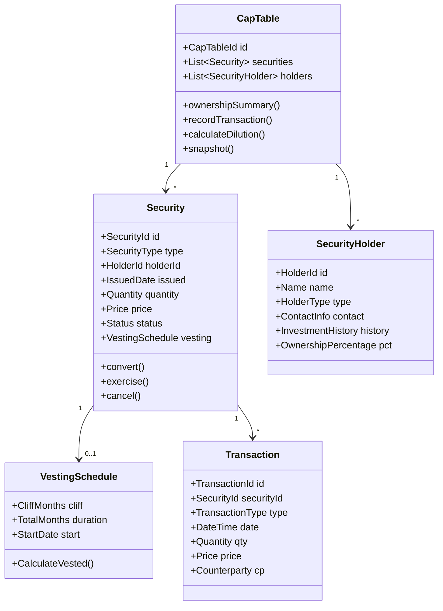

---

# **12.3 Aggregate Roots**

---

## **12.3.1 CapTable Aggregate Root**

### Attributes

```
CapTableId
Securities[]
SecurityHolders[]
OwnershipBreakdown
DilutionHistory
ValuationHistory
ComplianceState
BoardRights
VotingPowerDistribution
PreferredRightsSummary
SAFEConversionRules
ConvertibleNoteTerms
```

### Behaviors

* AddSecurity()
* RemoveSecurity()
* RecordTransaction()
* ConvertSecurity()
* ApplySAFEConversion()
* ApplyNoteConversion()
* CalculateDilutionImpact()
* GenerateCapTableSnapshot()
* ComputeOwnership()
* ComputeVotingPower()
* ComputeBoardSeats()
* UpdateValuation()

### Invariants

* Securities quantity cannot be negative
* Ownership must sum to 100%
* Voting power must align with rights
* Preferred rights must follow legal precedence

---

## **12.3.2 Security Aggregate Root**

### Security Types

```
CommonStock
PreferredStock
StockOption
RSU
Warrant
SAFE
ConvertibleNote
PhantomShare
```

### Attributes

```
SecurityId
SecurityType
HolderId
Quantity
PricePerShare
IssueDate
SecurityStatus
VestingSchedule
ConversionCap
DiscountRate
PreferenceMultiple
ParticipationRights
BoardRights
VotingRights
TransferRestrictions
```

### Behaviors

* Exercise()
* Convert()
* VestShares()
* Cancel()
* UpdateHolder()
* ApplyConversionFormula()
* ComputeOwnershipImpact()

### Invariants

* Convertible instruments must specify cap/discount
* Vested quantity ≤ total quantity
* Cannot exercise before vesting unless permitted

---

## **12.3.3 SecurityHolder Aggregate Root**

### Types

* Founder
* Employee
* Advisor
* Angel Investor
* VC Fund
* Corporate Investor

### Attributes

```
HolderId
Name
HolderType
ContactInfo
InvestmentRecords[]
SecuritiesHeld[]
TotalOwnership
FullyDilutedOwnership
VotingPower
BoardSeats
RightsSummary
ComplianceFlags
```

### Behaviors

* AddSecurity()
* RemoveSecurity()
* RecalculateOwnership()
* UpdateRights()

---

## **12.3.4 VestingSchedule Value Object**

### Attributes

```
StartDate
CliffMonths
TotalMonths
AccelerationRules
VestingFrequency (Monthly/Quarterly)
```

### Functions

* CalculateVestedShares()
* CalculateUnvestedShares()
* ApplyAcceleration()

---

## **12.3.5 Transaction Entity**

### Types

* Issuance
* Transfer
* Exercise
* Conversion
* Repurchase
* Cancellation

### Attributes

```
TransactionId
SecurityId
TransactionType
Quantity
Price
Date
Counterparty
Reason
Approver
ComplianceEvidence
```

---

# **12.4 SAFE & Convertible Note Conversion Engine**

When fundraising occurs, SAFEs and notes convert into shares.

### Conversion Inputs

* Valuation cap
* Discount
* Pre/Post-money SAFE type
* Round valuation
* Round price per share
* Pro-rata rights

### Output

* Shares issued
* New ownership
* Dilution impact

### Conversion Formula (Simplified)

```
price = MIN(
    valuation_cap / company_capitalization,
    round_price * (1 - discount)
)

shares = investment_amount / price
```

### Events

* SAFEConverted
* NoteConverted
* ConversionTriggeredByRound
* ConversionCompleted

---

# **12.5 Dilution Engine**

Triggered by:

* fundraising
* exercise of options
* issuance of shares
* conversion events

### Dilution Calculation

```
newOwnership = oldShares / newTotalShares
dilution = oldOwnership - newOwnership
```

### Outputs

* CapTableDilutionEvent
* HolderDilutionSummary
* RoundDilutionSummary
* FullyDilutedViewUpdated

---

# **12.6 Board & Voting Rights Engine**

CapTable automatically manages:

* Voting power by class
* Board seats allocated to investors
* Preferred rights enforcement
* Drag-along / tag-along rules
* Pro-rata rights

### Board Seat Calculation

Rules often depend on:

* share class
* ownership thresholds
* negotiated rights

---

# **12.7 CapTable Snapshots**

Snapshots capture state at:

* fundraising
* equity updates
* option grants
* investor reporting cycles

Contains:

* Ownership
* Cap Table percentages
* Fully diluted numbers
* Voting power
* Preferences stack
* Conversion/liquidation waterfalls

---

# **12.8 Reports & Outputs**

### Automatically Generated:

* Standard CapTable
* Fully Diluted CapTable
* Post-Money Ownership Table
* Pre-Money Ownership Table
* Waterfall Analysis
* Pro-forma CapTable
* Employee Option Pool Analysis
* Liquidation Preference Stack
* SAFEs & Notes Conversion Summary
* Founder Dilution Summary
* Investor Rights Summary

---

# **12.9 Integration with Other Domains**

---

## **Fundraising Domain**

TermSheetAccepted triggers:

* Updated ownership
* Updated valuation
* Conversion of SAFEs & notes

---

## **Performance & Financial Modeling**

CapTable provides:

* share counts
* option pool impact
* valuation calculations
* dilution projections

---

## **Investor Relationship Management**

Investor profile updated with:

* new securities
* ownership changes
* voting rights
* data room access

---

## **Legal & Compliance Domain**

* Securities issuance reports
* Compliance tracking
* Document generation
* Audit trails

Compliance checks include:

* accredited investor validation
* Rule 506
* transfer restrictions
* option grant approval

---

## **Knowledge Graph Integration**

Nodes:

* Security
* Holder
* Transaction
* VestingSchedule
* FundingRound
* SAFE
* ConvertibleNote
* PreferredShare

Edges:

```
SecurityHolder → holds → Security  
Security → created_by → Transaction  
Security → governed_by → Terms  
Security → vests_according_to → VestingSchedule  
SAFE → converts_in → FundingRound  
FundingRound → changes → CapTable  
```

This enables:

* automatic waterfall analysis
* ownership prediction
* dilution simulation
* investor behavior modeling

---

# **12.10 Example: Full Cap Table Update Flow**

### 1. Funding Round Initiated

Round price per share determined.

### 2. SAFE Conversion Triggered

Use cap/discount.

### 3. New Shares Issued

Compute per investor.

### 4. Dilution Impact Calculated

Update founders, employees, existing investors.

### 5. Update CapTable Snapshot

Stored in knowledge graph.

### 6. Update IRM

InvestorProfile updated with the new stake.

### 7. Compliance Triggered

Legal documents generated.

### 8. Financial Model Updated

New post-money valuation → affects runway, revenue multiples.

---

# **13. Legal & Compliance Domain (Fully Enhanced)**

The Legal & Compliance Domain ensures the platform operates with **regulatory, contractual, and corporate governance integrity** across all bounded contexts.

It is responsible for:

* Securities law compliance (Rule 506, Reg D, local laws)
* Corporate governance workflows
* Investor documentation
* Contract lifecycle management
* Regulatory filings
* Policy enforcement
* Compliance audits
* Legal risk management
* Document automation & validation

The aim is to transform compliance from a bottleneck into a **predictive, automated capability** integrated across the entire startup lifecycle.

---

# **13.1 Purpose of the Legal & Compliance Domain**

This domain ensures:

### ✔ Startup follows securities regulations

SAFE conversions, investor limits, accredited checks.

### ✔ All equity events are legally valid

Board consents, approvals, filings.

### ✔ Corporate governance is enforced

Board approvals, resolutions, consents.

### ✔ Legal documents are generated automatically

Investment agreements, employee agreements, NDAs, option grants.

### ✔ Compliance risk is monitored continuously

Alerts, violations, thresholds, anomalies.

### ✔ All audit trails are immutable

Every action captured for regulatory review.

---

# **13.2 Domain Model Overview**

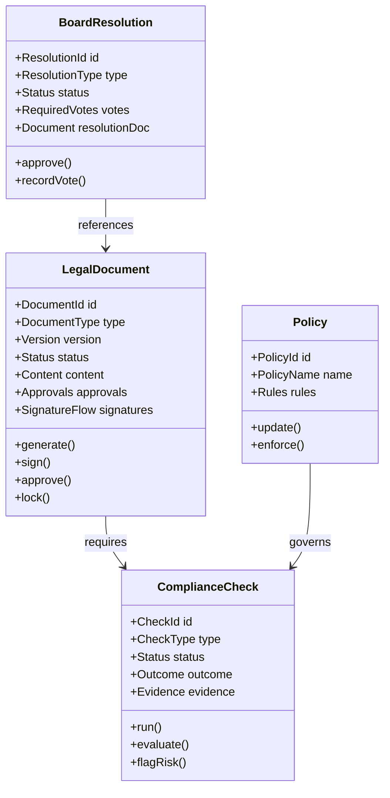

---

# **13.3 Aggregate Roots**

---

## **13.3.1 LegalDocument Aggregate Root**

### Attributes

```
DocumentId
DocumentType (Contract, Resolution, Agreement, Filing, PolicyDoc)
Content
TemplateId
Status (Draft, Review, Approved, Signed, Locked)
Version
RequiredSignatures
SignatureFlow
LinkedComplianceChecks
EffectiveDate
ExpirationDate
AuditTrail
```

### Behaviors

* GenerateDocument()
* FillTemplate()
* RouteForSignature()
* Approve()
* Sign()
* LockDocument()
* AddComplianceEvidence()
* ValidateLegalCompleteness()

### Invariants

* Cannot sign until all compliance checks pass
* Locked documents cannot be modified
* Must maintain version history

---

## **13.3.2 ComplianceCheck Aggregate Root**

### Compliance Types

* Accredited Investor Verification
* Rule 506(b)/(c) Validation
* Securities Transfer Restrictions
* Blue Sky Law Check
* KYC/AML Check
* GDPR/Privacy Check
* Employment Compliance
* Vesting Agreement Compliance
* Board Approval Requirement Check

### Attributes

```
CheckId
CheckType
Status (Pending, Passed, Failed)
OutcomeDetails
Evidence
ImpactSeverity
Blocking
TriggeredByEventId
ResolutionSteps
ComplianceOwner
```

### Behaviors

* Run()
* ValidateInputs()
* EvaluateOutcome()
* FlagRisk()
* AttachEvidence()
* AutoResolve()

### Invariants

* Blocking failures must halt dependent workflows
* Evidence must be stored before marking as "Passed"

---

## **13.3.3 BoardResolution Aggregate Root**

### Resolution Types

* Equity Issuance
* Option Grants
* SAFE/Note Approval
* Fundraising Approval
* Hiring Executive Roles
* Budget Approval
* Major Contracts
* Corporate Structure Change

### Attributes

```
ResolutionId
ResolutionType
Status (Draft, Voting, Approved, Rejected)
MeetingId
VotesRequired
Votes[]
LinkedDocuments
ApprovalThreshold
RecordOfDecision
```

### Behaviors

* CreateResolution()
* RecordVote()
* Approve()
* Reject()
* AddDocument()
* GenerateCertificate()

### Invariants

* Cannot approve without meeting threshold
* Votes must reflect board membership weights

---

## **13.3.4 Policy Aggregate Root**

### Attributes

```
PolicyId
Name
Scope (HR, Finance, Legal, Data)
Rules[]
ComplianceOwner
EffectiveDate
LastUpdated
AuditTrail
```

### Behaviors

* UpdateRules()
* Enforce()
* EvaluateCompliance()

### Invariants

* Cannot retroactively change rules
* Must trigger re-evaluation on update

---

# **13.4 Compliance Flows**

---

# **13.4.1 Securities Compliance Engine**

Used during:

* issuing shares
* converting SAFEs
* transferring securities
* running fundraising rounds

### Checks include:

### 1. Accredited Investor Check

Verifies:

* income
* net worth
* supported documents

### 2. Rule 506(b)/(c) Compliance

Ensures:

* max non-accredited investors
* advertising restrictions
* proper disclosures

### 3. Transfer Restrictions Check

Identifies prohibited transfers.

### 4. CapTable Alignment

Ensures securities issuance matches authorized shares.

### 5. Vesting Compliance

Verifies vesting rules when moving or modifying securities.

### 6. Board Approval Requirement

Prevents illegal issuance of equity without consents.

---

# **13.4.2 Corporate Governance Engine**

Handles:

* Board meeting creation
* Attendance tracking
* Quorum validation
* Voting rules
* Resolution outcomes

### Rules:

* Certain decisions require supermajority
* Some resolutions require observer approval
* Weighted voting based on share class

---

# **13.4.3 Legal Document Lifecycle**

```
Draft → Review → ComplianceChecks → SignatureFlow → Signed → Locked
```

### Locked means:

* immutable
* version frozen
* audit complete
* evidence attached

---

# **13.5 Domain Events (Enhanced)**

### LegalDocumentCreated

### LegalDocumentSigned

### LegalDocumentLocked

### ComplianceCheckStarted

### ComplianceCheckPassed

### ComplianceCheckFailed

### ResolutionCreated

### ResolutionApproved

### ResolutionRejected

### PolicyUpdated

### ComplianceViolationDetected

### DataPrivacyIncidentDetected

Each event includes:

* evidence
* severity
* required actions
* responsible party
* knowledge graph links

---

# **13.6 Integration with Other Domains**

---

## **Fundraising Domain**

* Legal documents: term sheets, investment agreements
* Compliance checks for new investors
* Board resolutions for new rounds

---

## **CapTable Domain**

* Securities issuance
* SAFE & Note conversions
* Board approvals required

---

## **IRM Domain**

* Investor access rights
* Document distribution
* Due diligence workflows

---

## **Performance & Financial Modeling**

* Certain filings depend on financial projections

---

## **Strategic Objectives**

* Compliance violations automatically adjust risk scores

---

## **Knowledge Graph Integration**

Nodes:

* LegalDocument
* ComplianceCheck
* BoardResolution
* Policy
* Event

Edges:

```
LegalDocument → requires → ComplianceCheck  
Resolution → authorizes → SecurityIssuance  
Investor → must_pass → ComplianceCheck  
SAFE → governed_by → Terms  
Policy → governs → Action  
```

This enables:

* automated compliance recommendations
* legal risk prediction
* cross-linking of documents and decisions

---

# **13.7 Advanced Mechanisms**

---

## **13.7.1 Multi-Jurisdiction Compliance Engine**

Tracks:

* US SEC rules
* EU GDPR
* UK FCA
* India SEBI
* Local employment laws
* Data privacy regulations
* IP protection laws

Uses:

* jurisdiction lookup
* entity type rules
* automated document generation
* compliance algorithms

---

## **13.7.2 Compliance Risk Scoring**

Weighted by:

* severity
* frequency
* business impact
* regulatory risk

Generates:

* ComplianceRiskScore
* ComplianceAlerts
* MitigationPlan

---

## **13.7.3 Legal Document AI Generator**

Based on:

* templates
* clauses
* negotiation terms
* investor type
* jurisdiction

Generates:

* SAFE agreements
* subscription agreements
* board resolutions
* option grant notices
* NDAs

---

## **13.7.4 Audit Trail Engine**

Immutable ledger storing:

* document versions
* signatories
* approval chain
* timestamped events
* evidence references

Powering:

* audits
* due diligence
* compliance reviews

---

# **13.8 Example End-to-End Legal & Compliance Flow**

### A fundraising round closes:

1. **Term Sheet Signed**
   LegalDocumentCreated → SignatureFlowCompleted

2. **Compliance Checks Run**
   AccreditedInvestorCheck
   Rule506ComplianceCheck
   SecuritiesTransferRestrictionCheck

3. **Board Approves Round**
   BoardResolutionCreated → Voting → Approved

4. **Securities Issued**
   CapTableUpdated → SecuritiesIssuedEvent

5. **Due Diligence Folder Updated**
   Documents locked and added to DataRoom

6. **Compliance Logged**
   ComplianceReportStored

7. **Funding Round Legally Completed**
   LegalClosingEventPublished

---

# **14. Strategic Management & OKR Domain (Fully Enhanced)**

The **Strategic Management & OKR Domain** governs how the startup defines, executes, monitors, and adapts its **high-level strategic direction**, including:

* Strategic themes
* OKRs (Objectives & Key Results)
* Initiatives & programs
* Strategic priorities
* Cross-functional alignment
* Strategic risk analysis
* Strategy-to-execution mapping
* Performance linkage to metrics & models
* Strategic learning cycles
* Scenario-based strategic adjustments

This domain acts as the **brains of the organization**, orchestrating alignment across **Fundraising, Product Discovery, Growth, Market Intelligence, Financial Modeling**, and the **Knowledge Graph**.

---

# **14.1 Purpose of the Strategic Management Domain**

This domain ensures:

### ✔ The startup has a clear long-term direction

### ✔ All teams align around measurable OKRs

### ✔ Strategy is adjusted based on real performance signals

### ✔ Strategic risks are identified early

### ✔ Insights from data → experiments → metrics → finances → strategy

### ✔ Every decision is traceable to evidence

### ✔ Planning cycles are consistent and predictable

---

# **14.2 Domain Model Overview**

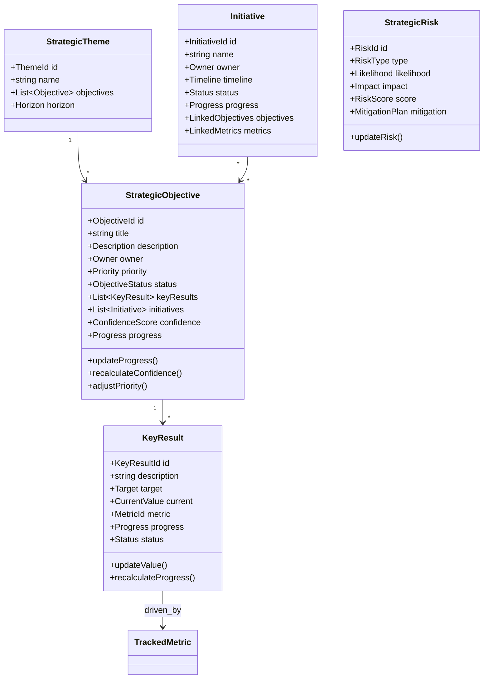

---

# **14.3 Aggregate Roots**

---

# **14.3.1 StrategicObjective Aggregate Root**

### Represents the central unit of strategy.

### Attributes

```
ObjectiveId
Title
Description
Owner
Priority (Critical, High, Medium, Low)
TimeHorizon (Quarterly, Annual, Long-Term)
ObjectiveStatus (Draft, Active, InProgress, Completed, Archived)
KeyResults[]
Initiatives[]
LinkedInsights
LinkedMetrics
ForecastedAchievementProbability
ConfidenceScore
RiskScore
Dependencies
```

### Behaviors

* ActivateObjective()
* AddKeyResult()
* LinkMetric()
* LinkInitiative()
* RecalculateObjectiveProgress()
* EvaluateConfidenceScore()
* DetectStrategicRisk()
* AutoAdjustPriority()
* ArchiveObjective()

### Invariants

* Must have at least one Key Result
* Cannot be Active without owner assigned
* Confidence must be recalculated when KPIs update
* Cannot complete until all Key Results complete

---

# **14.3.2 KeyResult Aggregate Root**

### Types

* Metric-based (value)
* Milestone-based (completion)
* Binary (yes/no)
* Revenue/financial targets
* Customer/retention targets
* Growth KPIs
* Operational KPIs

### Attributes

```
KeyResultId
Description
MetricId (optional)
TargetValue
CurrentValue
ProgressPercentage
Status (NotStarted, OnTrack, AtRisk, Behind, Completed)
EvidenceLinks
ForecastModelLink
```

### Behaviors

* UpdateCurrentValue()
* RecalculateProgress()
* ForecastAchievement()
* DetectDeviation()
* GenerateAlert()

### Invariants

* TargetValue cannot be null for metric-based KRs
* KRs tied to metrics must update automatically when metrics change

---

# **14.3.3 StrategicTheme Aggregate Root**

### Description

Themes organize strategic objectives across horizons.

### Examples

* Market Expansion
* Revenue Growth
* Operational Excellence
* Product Innovation
* Customer Success

### Attributes

```
ThemeId  
Name  
Horizon (H1, H2, H3)  
Objectives[]  
Owner  
Narrative  
```

### Behaviors

* AddObjective()
* AdjustThemeHorizon()
* UpdateNarrative()

---

# **14.3.4 Initiative Aggregate Root**

### Represents the **execution layer** of strategy.

### Attributes

```
InitiativeId
Name
Owner
Timeline (Start, End)
Budget
LinkedObjectives
LinkedMetrics
Status
Progress
Deliverables
RiskLevel
Dependencies
```

### Behaviors

* UpdateProgress()
* LinkObjective()
* LinkMetric()
* DetectBlockedStatus()
* RecalculateImpactScore()

### Invariants

* Must link to at least one objective
* Cannot be marked Completed without all deliverables fulfilled

---

# **14.3.5 StrategicRisk Aggregate Root**

### Types

* Market Risk
* Product Risk
* Operational Risk
* Financial Risk
* Compliance Risk
* Growth Risk
* Team/Hiring Risk

### Attributes

```
RiskId
RiskType
Description
Likelihood
Impact
RiskScore (Likelihood * Impact)
TriggerSignals
MitigationPlan
Owner
Status
LinkedObjectives
```

### Behaviors

* UpdateLikelihood()
* UpdateImpact()
* GenerateAlerts()
* TriggerMitigation()
* LinkObjective()

---

# **14.4 Strategic Scoring Models**

---

# **14.4.1 Objective Confidence Score**

Inputs:

* Metric trend
* Variance in performance
* Model forecasts
* KR progress
* Risk signals
* Market conditions

Formula (simplified):

```
confidence = 
0.4 * KRProgress +
0.2 * MetricTrendScore +
0.2 * ForecastAchievementProbability +
0.1 * RiskScoreInverse +
0.1 * InitiativeProgressScore
```

---

# **14.4.2 Objective Priority Engine**

Automatically increases priority if:

* High business impact
* Dependencies from other objectives
* Funding constraints
* Competitive pressure
* Strategic risk triggered

Automatically lowers priority if:

* Deprioritized theme
* Insufficient bandwidth
* Misaligned with new insights
* Objective repeatedly at-risk

---

# **14.4.3 Strategy Risk Score**

Generated from:

* Operational failures
* Financial underperformance
* Market shifts
* Experiment failures
* Hypothesis invalidation
* KPI anomalies
* Competitive intelligence
* Legal/compliance alerts

---

# **14.5 Domain Events (Enhanced)**

### StrategicObjectiveCreated

### StrategicObjectiveActivated

### KeyResultUpdated

### KeyResultAtRisk

### KeyResultCompleted

### InitiativeStarted

### InitiativeBlocked

### InitiativeCompleted

### StrategicRiskDetected

### StrategicRiskEscalated

### ObjectivePriorityAdjusted

### ObjectiveConfidenceChanged

Events include:

* linked_metrics
* causality chain
* severity
* recommended actions
* cross-domain references

---

# **14.6 Integration with Other Domains**

---

## **Fundraising Domain**

* Objectives tied to fundraising milestones
* KRs linked to investor pipeline metrics
* Strategy adjusts based on round success/failure

---

## **Product Discovery & Validation**

* Problem hypotheses → input to strategic themes
* User insights → strategic shifts
* PMF indicators → OKR updates

---

## **Growth Experimentation**

* Experiment results → KR metrics
* Strategy shifts on winning experiments

---

## **Performance & Financial Modeling**

* Forecasting → informs confidence calculations
* Financial risks → escalate strategic risks
* Budget & runway constraints → initiative prioritization

---

## **Investor Relationship Management**

* Investor updates include strategic progress
* Strategy changes broadcast to investor narratives

---

## **Knowledge Graph Integration**

Nodes:

* StrategicObjective
* KeyResult
* Initiative
* StrategicTheme
* StrategicRisk
* Metric

Edges:

```
Objective → measured_by → Metric  
Objective → advanced_by → Initiative  
KeyResult → influenced_by → Experiment  
StrategicRisk → impacts → Objective  
Metric → forecasts → KeyResult  
Objective → depends_on → Objective  
```

This supports:

* automated priority recommendations
* predictive strategy modeling
* causal impact analysis

---

# **14.7 Strategic Planning Cycles**

---

## **Quarterly OKR Cycle**

1. Define strategic themes
2. Add strategic objectives
3. Link to metrics
4. Identify risks
5. Begin execution
6. Track weekly

---

## **Annual Strategy Cycle**

1. Horizon planning
2. Scenario analysis
3. Strategic resource allocation
4. OKR alignment
5. Strategic risks & themes update

---

# **14.8 Example End-to-End Strategic Execution Flow**

### 1. Startup defines a Strategic Objective

“Achieve $100K MRR by Q4”

### 2. Create Key Results

* KR1: MRR → 100K
* KR2: Churn < 5%
* KR3: CAC < $150

### 3. Link to Metrics

* MonthlyRecurringRevenue
* ChurnRate
* CustomerAcquisitionCost

### 4. Link Initiatives

* Launch new pricing
* Expand sales team
* Improve onboarding

### 5. Metrics update in real time

KR progress updates automatically.

### 6. Confidence score recalculated

Signals whether the objective is at risk.

### 7. Strategy adjusted

If metrics fall, initiatives pivot or new ones are proposed.

### 8. Investor updates reflect strategic progress

Automatically showing KR progress, confidence, and forecasts.

---

# **15. Market Intelligence Domain (Fully Enhanced)**

The **Market Intelligence Domain** provides the startup with real-time and strategic understanding of its market through:

* Competitive Intelligence
* Industry Trends
* Market Sizing
* User Sentiment & Behavior Analysis
* Pricing Insights
* Category Evolution
* Competitive Benchmarking
* TAM/SAM/SOM Modeling
* Market Signals & Alerts

This domain becomes the **external lens** through which the startup perceives the competitive environment, enabling:

* Better strategic planning
* Stronger fundraising narratives
* Faster opportunity identification
* Proactive risk mitigation
* Data-backed product decisions
* Real-time responsiveness to market shifts

---

# **15.1 Purpose of the Market Intelligence Domain**

It ensures:

### ✔ The startup sees threats & opportunities early

### ✔ Leadership receives real-time strategic signals

### ✔ Insights are connected to product, strategy, growth, and financial models

### ✔ Market shifts automatically trigger strategic adjustments

### ✔ Competitive benchmarking is continuous

### ✔ Pricing and positioning stay aligned with market dynamics

This domain is tightly integrated with the **Knowledge Graph** to unlock compound intelligence.

---

# **15.2 Domain Model Overview**

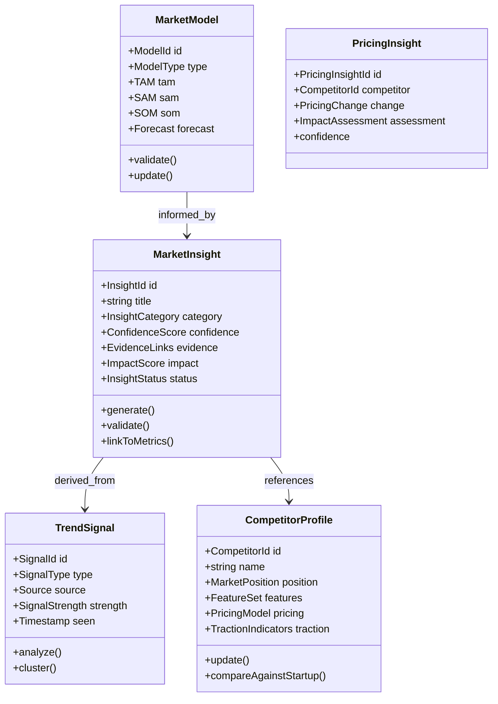

---

# **15.3 Aggregate Roots**

---

# **15.3.1 MarketInsight Aggregate Root**

### Insight Categories

* Competition
* Customer
* Product
* Market
* Technology
* Pricing
* Macro
* Regulatory

### Attributes

```
InsightId
Title
Description
InsightCategory
PrimaryEvidence
SecondaryEvidence
InsightStatus (Draft, Validated, Rejected, Published)
ConfidenceScore
ImpactScore
SourceType (Internal, External, Research, Analytics)
LinkedMetrics
LinkedObjectives
LinkedHypotheses
LinkedCompetitors
RecommendedActions
TimeSensitivity
```

### Behaviors

* GenerateInsight()
* ValidateInsight()
* LinkToObjective()
* LinkToMetric()
* ComputeImpactScore()
* PublishInsight()
* AutoArchive()
* TriggerReactiveStrategy()

### Invariants

* Insight must have at least one evidence source
* Cannot publish without validation
* Time-sensitive insights auto-expire

---

# **15.3.2 CompetitorProfile Aggregate Root**

### Attributes

```
CompetitorId
Name
Website
Industry
BusinessModel
GoToMarketStrategy
FeatureMatrix
PricingModel
TractionSignals
MarketPosition (Leader, Challenger, Emerging, Declining)
SWOT
FundingHistory
LastUpdated
```

### Behaviors

* UpdateProfile()
* RecordPricingChange()
* AddTractionSignal()
* CompareToStartup()
* GenerateCompetitorScore()

### Invariants

* MarketPosition must be consistent with traction signals
* Pricing must belong to a known pricing model type

---

# **15.3.3 TrendSignal Aggregate Root**

### Signal Types

* Market demand shifts
* Technology trends
* Regulatory changes
* Pricing changes
* Category shifts
* Competitor moves
* User sentiment patterns
* Macro-economic signals

### Attributes

```
SignalId
SignalType
Source
RawData
NormalizedSignalValue
SignalStrength
TimeDetected
ClusterId
Confidence
```

### Behaviors

* NormalizeSignal()
* ClusterSignals()
* GenerateInsightCandidate()
* LinkToCompetitors()
* ScoreSignalStrength()

### Invariants

* RawData cannot be empty
* Must maintain timestamp

---

# **15.3.4 MarketModel Aggregate Root**

### Models

* TAM/SAM/SOM
* Market Forecast
* Growth Rate Model
* Market Segmentation

### Attributes

```
ModelId
ModelType (TAM, MarketForecast)
TAM
SAM
SOM
Segmentation
GrowthRates
ForecastPeriod
Assumptions
LinkedInsights
ModelAccuracy
LastUpdated
```

### Behaviors

* UpdateMarketSize()
* RecomputeForecast()
* ApplyNewInsight()
* ValidateAssumptions()
* GenerateMarketReport()

### Invariants

* TAM ≥ SAM ≥ SOM
* Forecast period must be valid

---

# **15.3.5 PricingInsight Aggregate Root**

### Attributes

```
PricingInsightId
CompetitorId
DetectedPricingChange
ChangeType (Increase, Decrease, NewPlan, RemovedPlan)
ImpactAssessment
PricingModelAfterChange
ConfidenceScore
TimeDetected
LinkedSignals
```

### Behaviors

* ValidateChange()
* AssessImpact()
* LinkToCompetitor()
* LinkToStartupPricingModel()

---

# **15.4 Advanced Intelligence Mechanisms**

---

# **15.4.1 Trend Detection & Clustering**

Uses AI clustering across:

* news
* user reviews
* social feeds
* competitor updates
* pricing pages
* product changelogs
* job postings
* macroeconomic data

Clusters become:

* TrendSignals
* MarketInsights

---

# **15.4.2 Competitive Benchmarking Engine**

Ranks competitors based on:

* traction
* funding
* product depth
* pricing competitiveness
* user satisfaction
* momentum
* velocity of updates

Outputs:

* CompetitorScore
* MarketShareEstimates
* CompetitorThreatLevel

---

# **15.4.3 Market Sizing Engine**

Supports:

* top-down analysis
* bottom-up analysis
* value-based TAM
* cohort-based SAM/SOM
* scenario-based market modeling

Generates:

* market growth forecasts
* TAM expansion opportunities
* market adjacencies

---

# **15.4.4 Pricing Intelligence Engine**

Monitors:

* competitor pricing changes
* feature gating
* plan changes
* discounting behavior
* promotions
* churn-linked pricing moves

Outputs:

* pricing strategies
* elasticity insights
* CAC–LTV impact predictions

---

# **15.5 Domain Events (Enhanced)**

### TrendSignalDetected

### CompetitorProfileUpdated

### PricingChangeDetected

### MarketInsightGenerated

### MarketInsightValidated

### MarketInsightExpired

### MarketModelUpdated

### CompetitiveThreatDetected

### MarketOpportunityDetected

Each event includes:

* severity
* confidence
* impact score
* linked hypotheses
* recommended actions
* knowledge graph embedding

---

# **15.6 Integrations with Other Domains**

---

## **Product Discovery & Validation**

* Insights refine problem hypotheses
* User sentiment → feature priorities
* Trend signals lead to new hypotheses

---

## **Growth Experimentation**

* Competitor moves trigger new experiments
* Pricing insights → pricing tests
* Market shifts → growth strategy changes

---

## **Fundraising Domain**

* Investors see market proof
* Market insights strengthen narratives
* TAM/SAM/SOM outputs inform valuation

---

## **Performance & Financial Modeling**

* Market forecasts drive revenue projections
* Pricing insights affect financial model inputs
* Market risks integrate with runway and cashflow models

---

## **Strategic Management & OKR Domain**

Insights connect to:

* strategic themes
* objective risk scoring
* initiative prioritization

---

## **Knowledge Graph Integration**

Nodes:

* MarketInsight
* Competitor
* PricingEvent
* TrendSignal
* MarketModel

Edges:

```
TrendSignal → clusters_into → MarketInsight  
Competitor → triggers → PricingInsight  
Insight → informs → Strategy  
MarketModel → forecasts → FinancialModel  
```

Enables:

* insight propagation across the company
* automated strategic recommendations
* predictive modeling tied to market conditions

---

# **15.7 Example End-to-End Market Intelligence Flow**

### 1. Pricing Signal Detected

A competitor reduces their Pro plan price by 20%.

### 2. Trend Signal Created

SignalStrength moderate → linked to pricing engine.

### 3. PricingInsight Generated

Impact on LTV, CAC, growth rate.

### 4. CompetitorProfile Updated

Momentum ↑
Position changes.

### 5. MarketInsight Validated

ImpactScore high → risk for churn.

### 6. Strategic Adjustments Triggered

* New pricing tests
* KR priority increased
* Financial model adjusted
* Investor update includes “market shift” section

---

# **16. Growth Experimentation Domain (Extended & Enhanced)**

The **Growth Experimentation Domain** manages the complete lifecycle of growth-oriented experiments such as:

* A/B tests
* Funnel experiments
* Pricing experiments
* Onboarding experiments
* Activation experiments
* Feature rollouts
* Conversion rate optimization (CRO)
* Marketing channel tests
* Lifecycle messaging experiments

This domain enables **scientific, repeatable, data-driven growth** through:

* Experiment design
* Variant management
* Sample sizing
* Randomization
* Tracking
* Metric attribution
* Significance testing
* Uplift modeling
* Experiment portfolio management
* Automated decision making

It integrates deeply with:
**Metrics → Financial Models → Strategy → Product Discovery → Market Intelligence → Knowledge Graph**

---

# **16.1 Purpose of the Growth Experimentation Domain**

This domain ensures:

### ✔ Fast iteration on growth hypotheses

### ✔ Experiments are statistically sound

### ✔ Results automatically propagate to metrics and strategy

### ✔ The startup doesn’t guess — it tests

### ✔ Growth becomes predictable and scalable

This domain is critical for achieving PMF, optimizing funnels, and scaling efficiently.

---

# **16.2 Domain Model Overview**

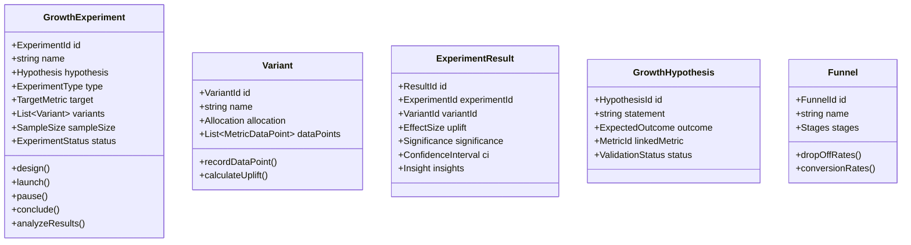

---

# **16.3 Aggregate Roots**

---

# **16.3.1 GrowthExperiment Aggregate Root**

### Experiment Types

* A/B Test
* Multivariate Test
* Feature Flag / Controlled Rollout
* Funnel Step Experiment
* Activation Experiment
* Pricing Experiment
* Retention Experiment
* Messaging Experiment
* Product Surface Experiment

### Attributes

```
ExperimentId
Name
Hypothesis
ExperimentType
TargetMetric
SecondaryMetrics
Variants
SampleSize
ExperimentStatus (Draft, Running, Paused, Completed, Invalid)
StartDate
EndDate
MinimumRunDuration
MinimumSampleThreshold
RandomizationStrategy
SegmentFilters
LinkedProductAreas
LinkedUserSegments
RiskLevel
ExpectedEffectSize
ObservedEffectSize
Decision
```

### Behaviors

* DesignExperiment()
* LaunchExperiment()
* PauseExperiment()
* ResumeExperiment()
* RecordMetricData()
* CalculateUplift()
* PerformStatisticalTests()
* DetectSampleBias()
* GenerateExperimentInsights()
* ConcludeExperiment()
* TriggerDownstreamActions()

### Invariants

* Must have at least one control variant
* Must meet sample size requirements before conclusion
* Cannot run conflicting experiments on same segment

---

# **16.3.2 Variant Aggregate Root**

### Attributes

```
VariantId
Name
AllocationPercentage
FeatureConfiguration
TrafficAllocationStrategy
DataPoints[]
ObservedValue
ConversionRate
Uplift
ConfidenceInterval
IsControl
```

### Behaviors

* RecordDataPoint()
* RecalculateMetrics()
* ComputeUplift()
* CompareAgainstControl()

---

# **16.3.3 ExperimentResult Aggregate Root**

### Attributes

```
ResultId
ExperimentId
VariantId
EffectSize
SignificanceLevel
PValue
ConfidenceInterval
Decision (Ship, Rollback, Re-Test, Ignore)
Insights
LinkedMetrics
LinkedHypotheses
```

### Behaviors

* ComputeStatisticalSignificance()
* GenerateInsights()
* RecommendDecision()

---

# **16.3.4 GrowthHypothesis Aggregate Root**

### Attributes

```
HypothesisId
Statement
ExpectedOutcome
LinkedMetricId
LinkedFunnelId
Status (Draft, Testing, Validated, Invalidated)
Evidence
ConfidenceScore
```

### Behaviors

* ValidateHypothesis()
* RejectHypothesis()
* ConvertToObjective()
* GenerateExperimentIdeas()

---

# **16.3.5 Funnel Aggregate Root**

### Attributes

```
FunnelId
Name
Stages[]
ConversionRates
DropOffRates
LinkedExperiments
SegmentFilters
```

### Behaviors

* RecalculateConversionRates()
* AddFunnelStage()
* RemoveStage()
* RunFunnelDiagnostics()
* DetectBottleneck()

---

# **16.4 Value Objects**

### **ExperimentStatus**

* Draft
* Running
* Paused
* Completed
* Invalid

### **StatisticalSignificance**

* p-value
* power
* minimum detectable effect

### **Assignment Strategy**

* 50/50
* Weighted
* Bayesian bandit
* Segment-based

### **Effect Size**

Cohen’s d, Absolute uplift, Relative uplift.

---

# **16.5 Advanced Intelligence**

---

# **16.5.1 Uplift Modeling Engine**

Calculates:

* relative uplift
* absolute uplift
* effect size
* p-value
* statistical power
* confidence intervals
* bias detection
* variance analysis

Outputs:

* winning variant
* business impact estimate
* rollout recommendation

---

# **16.5.2 Bayesian Experimentation Engine**

Bayesian approach includes:

* posterior distributions
* credible intervals
* probability that variant > control
* sequential decision-making
* early stopping rules

---

# **16.5.3 Experiment Portfolio Management**

Portfolio ensures:

* no conflicting experiments
* bandwidth allocation
* ROI scoring
* strategic alignment

Portfolio KPIs:

* Experiment Velocity
* Experiment Win Rate
* Average Uplift
* Time-to-Learn
* Coverage Across Funnel

---

# **16.5.4 Growth Decision Engine**

Automatically recommends:

* Ship variant
* Rollback
* Iterate
* Re-test with larger sample
* Multi-variant test
* Pricing experimentation

Decision logic uses:

* significance
* business impact
* user satisfaction
* alignment with strategy
* predicted long-term effects

---

# **16.6 Domain Events**

### ExperimentLaunched

### ExperimentPaused

### ExperimentResumed

### ExperimentCompleted

### ExperimentInvalidated

### VariantDataRecorded

### VariantSignificanceReached

### WinningVariantDetected

### ExperimentDecisionRecommended

### FunnelBottleneckDetected

### GrowthHypothesisValidated

---

# **16.7 Integration With Other Domains**

---

## **Product Discovery & Validation**

* Failed experiments may invalidate product hypotheses
* Winning variants become validated product insights

---

## **Performance & Financial Modeling**

* Experiments update KPIs
* Pricing experiments update revenue model
* Conversion experiments update LTV/CAC

---

## **Strategic Management & OKRs**

* KRs are directly influenced by experiment outcomes
* Objectives reprioritized based on evidence

---

## **Market Intelligence**

* Competitor pricing changes drive pricing experiments
* Trend signals reveal new opportunity hypotheses

---

## **Fundraising Domain**

* Experiment results strengthen growth narrative
* Improve investor confidence

---

## **Knowledge Graph Integration**

Nodes:

* Experiment
* Variant
* DataPoint
* Funnel
* Metric
* Hypothesis

Edges:

```
Experiment → tests → Hypothesis  
Experiment → influences → Metric  
Variant → impacts → ConversionRates  
Funnel → contains → Experiments  
Experiment → generates → Insight  
Metric → drives → StrategicObjective  
```

Enables:

* automated prioritization
* insight propagation
* causal impact analysis

---

# **16.8 Example End-to-End Experiment Flow**

### Step 1 — Hypothesis Created

"Improving onboarding tutorial will increase activation."

### Step 2 — Experiment Designed

2 variants + control.

### Step 3 — Experiment Launched

Traffic split 33/33/33.

### Step 4 — Data Collected

Activation + retention + time-to-value.

### Step 5 — Significance Achieved

Variant B shows +18% uplift.

### Step 6 — Experiment Decision

Ship Variant B → rollout plan initiated.

### Step 7 — Strategy Updated

KR progress auto-updated.

### Step 8 — Financial Model Updated

Higher activation → higher LTV → better CAC payback.

---

# **17. Knowledge Graph Domain (Regenerated & Greatly Enhanced)**

The **Knowledge Graph Domain** is the *central intelligence backbone* of the entire platform.

It unifies everything the startup knows—across product, customers, market, experiments, performance, strategy, and finance—into a **semantic, interconnected, reasoning-capable graph**.

This is the system’s “brain.”

---

# **17.1 Purpose of the Knowledge Graph Domain**

The knowledge graph enables:

### ✔ Unified contextual understanding across all domains

### ✔ Automatic propagation of insights

### ✔ Causal reasoning between events

### ✔ Evidence-backed decisions

### ✔ Strategic alignment across the entire organization

### ✔ Machine learning–powered inference

### ✔ Semantic search and Q&A over the entire company knowledge fabric

### ✔ Impact prediction (if X changes, what else changes?)

This transforms the startup’s operations from **data-driven** to **intelligence-driven**.

---

# **17.2 Conceptual Overview**

The Knowledge Graph fuses:

* Market Intelligence
* Experiments
* Product Discovery
* Performance Metrics
* Financial Models
* Strategy & Objectives
* Fundraising
* Investor Relations
* Compliance
* Product Analytics
* User Behavior
* Competitors
* Pricing Data
* Customer Research

Into a **single knowledge layer**.

Every entity becomes a node.
Every relationship becomes an edge.
Every event becomes a time-stamped fact.

---

# **17.3 Core Domain Model**

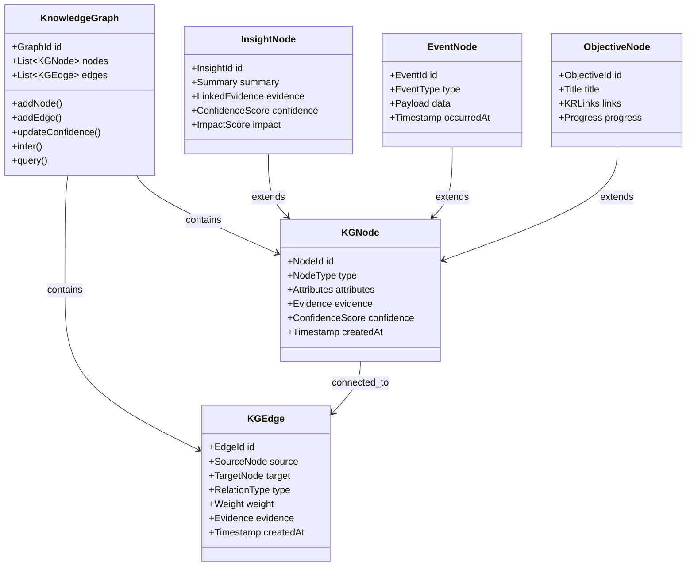

---

# **17.4 Node Types**

### **Entities transformed into nodes**

* Product: Feature, Bug, Release, Prototype
* Customer: Segment, Persona, Interview
* Market: Competitor, Trend, Insight
* Growth: Experiment, Variant, Result
* Finance: Metric, RevenueModel, Forecast
* Strategy: Objective, Key Result, Risk
* Fundraising: Investor, Round, TermSheet
* Operations: Task, Workflow, Action

### **Event nodes**

* HypothesisValidated
* ExperimentConcluded
* TrendSignalDetected
* PricingChangeDetected
* MetricThresholdBreached
* ObjectiveUpdated
* RunwayAlert
* TermSheetAccepted
  … all become nodes linked by causal relationships.

### **Insight nodes**

Represent evolved learnings:

* “Activation increased by 18% due to onboarding improvement”
* “Competitor lowered pricing—impacting trial conversions”
* “User retention correlates with tutorial completion”

### **Decision nodes**

Represent strategic choices:

* Ship Variant B
* Increase marketing spend
* Pause low-impact experiments
* Prioritize self-serve onboarding

---

# **17.5 Edge Types**

Edges represent relationships such as:

### **Causal Edges**

* *ExperimentResult → affects → Metric*
* *Metric → impacts → Objective*
* *MarketTrend → influences → Strategy*

### **Evidential Edges**

* *Interview → supports → Insight*
* *DataPoint → validates → Hypothesis*

### **Belonging Edges**

* *Customer → belongs_to → Segment*

### **Temporal Edges**

* *Event → precedes → Event*

### **Hierarchical Edges**

* *Objective → has_kr → Key Result*

### **Dependency Edges**

* *Experiment → requires → Segment*
* *FinancialModel → depends_on → Metric*

### **Risk Edges**

* *Insight → raises_risk_for → Objective*

All edges hold:

* weight
* evidence
* timestamp
* confidence

---

# **17.6 Aggregate Roots**

---

# **17.6.1 KnowledgeGraph Aggregate Root**

### Attributes

```
GraphId
Nodes[]
Edges[]
GraphSchema
Version
ChangeLog
InferenceModels[]
```

### Behaviors

* AddNode()
* AddEdge()
* UpdateNodeConfidence()
* UpdateEdgeWeight()
* QueryGraph()
* RunInference()
* DetectPatterns()
* GenerateSuggestions()
* FindCausalPaths()

---

# **17.6.2 KGNode Aggregate Root**

### Attributes

```
NodeId
NodeType
Attributes (JSON-LD style)
Evidence[]
ConfidenceScore
EmbeddingVector (optional)
TimeCreated
TimeUpdated
```

### Behaviors

* AttachEvidence()
* UpdateConfidence()
* MergeWithNode()
* ConvertToInsightNode()
* ConvertToObjectiveNode()

---

# **17.6.3 KGEdge Aggregate Root**

### Attributes

```
EdgeId
SourceNodeId
TargetNodeId
RelationType
Weight
TemporalRelevance
Confidence
Evidence[]
```

### Behaviors

* StrengthenEdge()
* WeakenEdge()
* TimeDecay()
* ConvertToCausalEdge()

---

# **17.7 Inference Engine**

The inference engine performs:

### **17.7.1 Causal Reasoning**

Identify root causes:

* "Metric dropped because new onboarding variant was launched."

### **17.7.2 Predictive Inference**

* “This objective is unlikely to be achieved based on current trends.”

### **17.7.3 Insight Synthesis**

* Combine multiple weak signals into a strong insight.

### **17.7.4 Recommendation Generation**

* Which experiment to run next
* Which segment to prioritize
* Which feature to improve
* Which pricing model to test

### **17.7.5 Risk Propagation**

* A competitor lowering price → risk to activation → risk to revenue forecast

---

# **17.8 Integration with All Domains**

---

## **17.8.1 With Product Discovery**

* Interviews → insights
* Hypotheses → evidence linkage
* Prototypes → user sentiment

---

## **17.8.2 With Growth Experiments**

* Experiment → metric impact edges
* Automated learning propagation

---

## **17.8.3 With Market Intelligence**

* Trends → competitor moves → pricing changes
* Industry shifts influence strategy

---

## **17.8.4 With Performance & Financial Modeling**

* Metric movement → financial forecast adjustments
* KPIs produce knowledge graph facts

---

## **17.8.5 With Strategy & OKRs**

* Objectives → dependencies → risks
* KR progress mapped to evidence

---

## **17.8.6 With Fundraising**

* Narrative creation backed by graph evidence

---

# **17.9 Graph Queries (Domain-Specific GraphQL-like Syntax)**

### Find root cause of a metric drop:

```
FIND CAUSAL_PATH
FROM Metric('ActivationRate')
TO AllEvents
WITH threshold > 0.4
ORDER BY influence DESC
```

### Identify most impactful insights:

```
FIND Insight
WHERE impact > 0.7 AND confidence > 0.8
ORDER BY recency DESC
```

### Suggest next experiments:

```
RECOMMEND Experiment
WHERE linked_metric.behind_target = true
LIMIT 5
```

### Detect strategic blockers:

```
MATCH Objective o
WHERE o.progress < o.expected AND EXISTS(risk_edge)
RETURN o, risk_edge.source
```

---

# **17.10 Example Graph-Based Lifecycle**

### 1. A competitor lowers pricing

→ TrendSignal → PricingInsight → MarketInsight

### 2. Knowledge Graph links:

* Competitor → PricingChange
* PricingChange → affects → TrialConversion

### 3. Strategy Action:

* Suggest pricing experiment
* Update OKR risk
* Notify Growth Team

### 4. Financial Model Update:

→ lower CAC efficiency → runway impact

### 5. CEO Dashboard insight:

“Pricing pressure emerging from Competitor X; recommended to test new Freemium variant.”

---

# **17.11 Domain Events**

### KnowledgeNodeCreated

### KnowledgeEdgeCreated

### InsightValidated

### CausalPathDetected

### StrategicRiskPropagated

### RecommendationGenerated

---

# **17.12 Why This Domain Is Critical**

This is the only domain that:

* integrates **all other domains**
* learns continuously
* generates insights proactively
* acts as the company’s **memory, reasoning, and intelligence layer**

It enables a startup to behave like a world-class data-driven organization from day one.

---

# **18. Strategic Objectives & OKR Domain (Complete Regeneration & Expansion)**

This domain manages **strategic alignment**, **annual planning**, **OKRs**, **initiatives**, and **execution mapping** across the entire startup lifecycle.

It is the **central decision-making layer** that connects:

* Vision & Mission
* Strategic Themes
* Annual/Quarterly Objectives
* Key Results
* Initiatives
* Experiments
* Metrics
* Insights
* Risks
* Resource Allocation
* Roadmaps
* Financial Plans

This domain integrates deeply with the **Knowledge Graph**, **Financial Modeling**, **Growth Experiments**, and **Product Discovery** domains to enable an evidence-driven strategic operating system.

---

# **18.1 Purpose of the Strategic Objectives Domain**

The domain ensures:

### ✔ The entire startup moves in the same direction

### ✔ Goals are measurable, evidence-based, and adaptive

### ✔ Strategy shifts when insights change

### ✔ OKRs are connected to metrics and experiments

### ✔ Leadership can track risk, progress, and ROI in real-time

### ✔ Roadmaps and initiatives align with strategic intent

This domain defines the **operating rhythm** for the organization.

---

# **18.2 High-Level Domain Model**

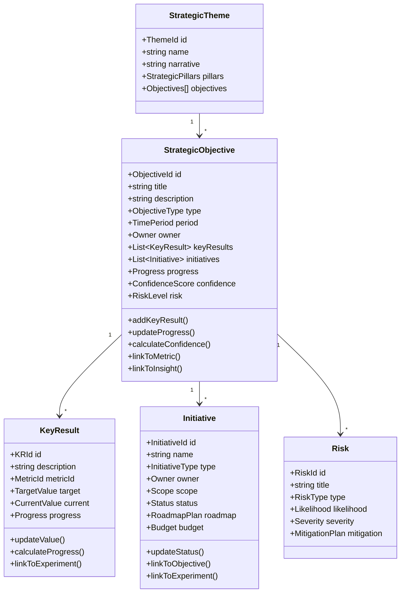

---

# **18.3 Strategic Planning Structure**

The startup’s planning architecture is modeled across three layers:

---

## **18.3.1 Long-Term Direction (3–5 years)**

Entities:

* **Vision**
* **Mission**
* **Strategic Themes**
* **Strategic Pillars**

Themes examples:

* Product Excellence
* Growth Efficiency
* Customer-Centricity
* Operational Scalability
* Market Leadership

---

## **18.3.2 Annual Planning (1 year)**

Entities:

* Annual Objectives
* Annual Metrics
* Strategic Bets
* Budget Allocations

---

## **18.3.3 Quarterly Planning (90 days)**

Entities:

* Quarterly OKRs
* Initiatives
* Experiments
* Forecast Updates
* Resource Allocation Updates

Each quarter begins with:

* backward review
* insight loading
* alignment meeting
* confidence scoring

---

# **18.4 Aggregate Roots**

---

# **18.4.1 StrategicObjective Aggregate Root**

### Types

* Company Objective
* Team Objective
* Cross-Functional Objective
* Personal Objective (optional)

### Attributes

```
ObjectiveId
Title
Description
Owner
TimePeriod (Q1, Q2, Annual)
ObjectiveType (Company, Team, Personal)
LinkedThemes
LinkedHypotheses
LinkedInsights
LinkedMetrics
KeyResults[]
Initiatives[]
Risks[]
Progress
ConfidenceScore
RiskScore
ExpectedImpact
AlignmentScore
Dependencies[]
BlockedBy[]
```

### Behaviors

* AddKeyResult()
* AddInitiative()
* AddRisk()
* UpdateProgress()
* RecalculateConfidence()
* LinkToMetric()
* LinkToInsight()
* DetectRisk()
* AutoAdjustConfidenceBasedOnTrends()

### Invariants

* Must have at least one key result
* Objective must map to at least one strategic theme
* Progress must reflect metric values

---

# **18.4.2 KeyResult Aggregate Root**

### Types

* Outcome KR
* Output KR
* Behavioral KR
* Compound KR

### Attributes

```
KRId
Description
MetricId
TargetValue
BaselineValue
CurrentValue
Progress
LinkedExperiments
LinkedInsights
LinkedFunnelStages
UpdateFrequency
```

### Behaviors

* UpdateCurrentValue()
* CalculateProgress()
* LinkExperiment()
* DetectLagRisk()
* ForecastCompletionLikelihood()

### Invariants

* KR must map to a metric
* KR progress = f(metric values)

---

# **18.4.3 Initiative Aggregate Root**

### Types

* Product Initiative
* Growth Initiative
* Engineering Initiative
* Marketing Initiative
* Sales Initiative
* RevOps Initiative
* Strategic Bet

### Attributes

```
InitiativeId
Name
Type
Owner
Scope
Status (Planned, In Progress, Completed, Blocked)
Budget
Timeline
Dependencies
AssignedTeams
LinkedExperiments
LinkedObjectives[]
ImpactScore
RiskLevel
ResourceEstimate
```

### Behaviors

* UpdateStatus()
* AllocateBudget()
* LinkToObjective()
* LinkToExperiment()
* RecalculateImpactScore()

### Invariants

* Initiative must map to at least one objective
* Budget must be approved before execution

---

# **18.4.4 StrategicTheme Aggregate Root**

Attributes:

```
ThemeId
Name
Narrative
StrategicPillars
Owner
Objectives[]
```

Themes act as **top-down direction** for OKRs.

---

# **18.4.5 Risk Aggregate Root**

A full risk model includes:

```
RiskId
Title
Description
RiskType (Strategic, Execution, Market, Product, People)
Likelihood
Severity
Exposure = Likelihood * Severity
MitigationPlan
Owner
DetectedAt
LinkedInsights
LinkedObjectives
```

Behaviors:

* ScoreRiskExposure()
* LinkToInsight()
* TriggerMitigation()

---

# **18.5 Integration With Other Domains**

---

# **18.5.1 With Metrics & Financial Modeling**

* KR progress = real metric values
* Objectives link to financial forecasts
* Strategic resource planning aligns with cash runway

Examples:

* KR: Increase MRR → tied to revenue model
* KR: Reduce churn → tied to retention forecasts

---

# **18.5.2 With Growth Experiments**

* Each KR links to experiments
* Experiments drive KR progress
* Failed experiments → risk updates

Examples:

* Objective: Improve activation
* KR: Activation rate from 40% → 55%
* Experiments linked: onboarding flow, email activation, tutorial redesign

---

# **18.5.3 With Product Discovery**

Insights validate or invalidate strategic priorities.

Example:

* Customer interviews show onboarding confusion
* Objective priority increases

---

# **18.5.4 With Market Intelligence**

Market changes shift priorities.

Example:

* Competitor releases AI feature → new OKR added
* Pricing disruption → KR re-scoped

---

# **18.5.5 With Knowledge Graph**

Every node influences OKRs:

* Insights → update KR confidence
* Risks → propagate to objectives
* Causal impacts → detect blockers
* Experiments → connect to outcomes

This enables:

* automated objective prioritization
* insight-based strategy updates
* root-cause detection

---

# **18.6 Strategic Alignment Engine**

A reasoning layer supports:

### ✔ Objective Scoring

Based on:

* impact
* urgency
* alignment
* feasibility
* ROI

### ✔ Prioritization Frameworks

* RICE
* ICE
* Weighted scoring
* Strategic fit scoring
* Bottleneck analysis

### ✔ Auto-generated OKR suggestions

From:

* insights
* metric problems
* experiments
* market shifts

---

# **18.7 Domain Events**

### ObjectiveCreated

### ObjectiveUpdated

### ObjectiveConfidenceAdjusted

### KeyResultProgressUpdated

### InitiativeCreated

### InitiativeStatusChanged

### RiskDetected

### KRBehindForecast

### ObjectiveAtRisk

### ObjectiveBlocked

### ObjectiveAchieved

### OKRPlanPublished

Events drive strategy adaptation across the platform.

---

# **18.8 Realistic Example: Quarterly OKR Flow**

---

## **1. Insights loaded**

* Market signals
* Experiment results
* Metric trends
* Product feedback

## **2. Objectives aligned**

Example:
**Objective:** Improve activation beyond industry benchmark.
**KR:** Activation from 42% → 58%.

## **3. Initiatives defined**

* Revamp onboarding
* Tutorial UX improvements
* Activation journey fixes

## **4. Experiments started**

* A/B onboarding
* Activation flow branching

## **5. KR linked to metrics**

* ActivationRate
* TimeToValue

## **6. Mid-quarter check-in**

* Confidence updated
* Risk logged (low-performing experiment)

## **7. Quarter-end**

* Results evaluated
* Strategic adjustments made

---

# **18.9 Strategic Dashboards Outputs**

* Objective tree
* KR progression maps
* Risk propagation graph
* Initiative execution heatmaps
* Forecasted OKR achievement likelihood
* Strategic alignment score
* Confidence timeline
* Bottleneck detection

---

# **18.10 Why This Domain Is Crucial**

This domain:

* Directs **every team** and **every initiative**
* Ensures **strategy = execution**
* Integrates **all intelligence domains**
* Enables **adaptive strategic planning**
* Creates the **north star alignment** that startups desperately need

---

# **19. CapTable & Securities Domain (Complete Regeneration & Major Expansion)**

The **CapTable & Securities Domain** manages the company’s ownership, equity lifecycle, securities transactions, investor equity rights, legal compliance, dilution modeling, scenario modeling, and investor distribution schedules.

It is a **core system of record** for:

* Founder equity
* Employee equity & vesting
* Investor equity
* Convertible instruments
* SAFEs
* Preferred shares
* Warrants
* Dilution events
* Funding rounds
* Option pools
* Equity transactions
* Board rights
* Liquidation preferences
* Exit distributions

This domain integrates with:

* Fundraising
* Legal & Compliance
* Financial Modeling
* Investor Relations
* Strategy & OKRs
* Knowledge Graph

This is one of the most **legally sensitive** and **mission-critical** domains in the system.

---

# **19.1 Purpose of the CapTable & Securities Domain**

This domain ensures:

### ✔ Accurate, real-time ownership tracking

### ✔ Legally compliant equity lifecycle management

### ✔ Fully auditable transaction history

### ✔ Dilution modeling for funding scenarios

### ✔ Exit waterfall and payout simulations

### ✔ Investor rights enforcement

### ✔ Full traceability for regulatory filings

### ✔ Integration with financial forecasting & fundraising

---

# **19.2 Domain Model Overview**

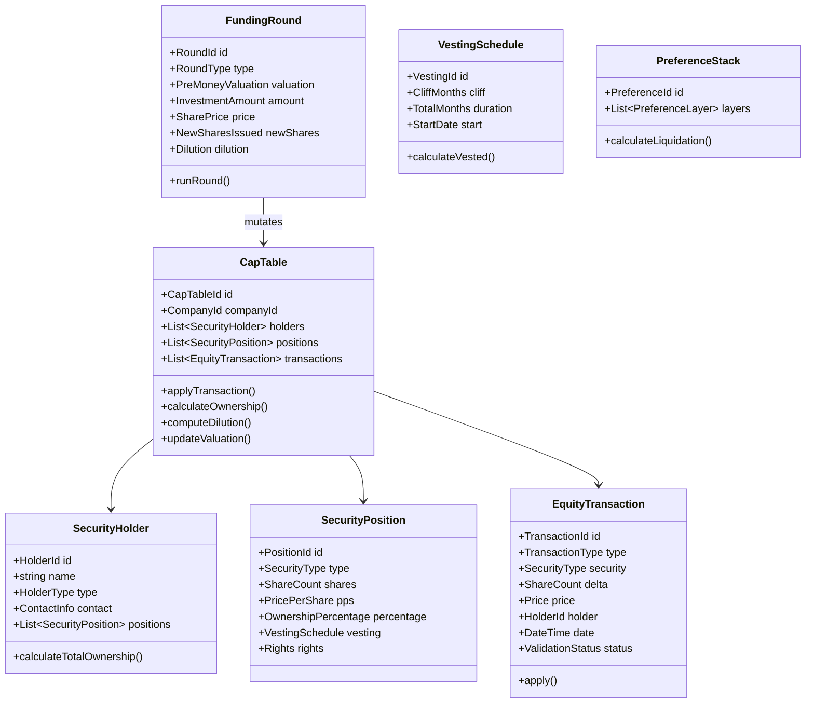

---

# **19.3 Key Entities & Definitions**

---

# **19.3.1 SecurityHolder**

Represents:

* Founders
* Employees
* Investors
* Advisors
* Entities
* Trusts
* Holdings companies

Attributes:

```
HolderId
Name
HolderType (Founder, Investor, Employee, Advisor)
ContactInformation
AccreditationStatus
Positions[]
Rights
```

Behaviors:

* CalculateTotalOwnership()
* AddPosition()
* TransferPosition()

---

# **19.3.2 SecurityType (Value Object)**

Types include:

### **Equity Securities**

* Common stock
* Preferred stock
* Restricted stock
* RSUs

### **Convertible Instruments**

* SAFEs
* Convertible notes
* KISS agreements

### **Derivatives**

* Options
* Warrants

---

# **19.3.3 SecurityPosition**

Represents a single block of ownership.

Attributes:

```
PositionId
SecurityType
ShareCount
PricePerShare
OwnershipPercentage
VestingSchedule
Rights
LiquidationPreference
ParticipationRights
AntiDilutionRights
ConversionRatio
```

---

# **19.3.4 EquityTransaction Aggregate**

Tracks all equity operations:

### Transaction Types

* Share issuance
* Share cancellation
* Transfer
* Conversion (SAFE → shares)
* Exercise (options → shares)
* Vesting events
* Buybacks
* Stock splits
* Mergers / reorganizations

Attributes:

```
TransactionId
TransactionType
SecurityType
HolderId
ShareCountDelta
ConsiderationPaid
Timestamp
DocumentReferences
ComplianceResults
```

Behaviors:

* ValidateTransaction()
* ApplyToCapTable()
* Reverse()

---

# **19.3.5 FundingRound Aggregate Root**

Represents fundraising events.

### Round Types

* Pre-Seed
* Seed
* Series A/B/C…
* Bridge round
* SAFE round
* Convertible round

Attributes:

```
RoundId
RoundType
PreMoneyValuation
PostMoneyValuation
SharePrice
InvestmentAmount
NewSharesIssued
ProRataRights
BoardRights
LiquidationPreferences
InvestorParticipants[]
ClosingDocuments
```

Behaviors:

* CalculateDilution()
* IssueNewShares()
* UpdateCapTable()
* GenerateRoundSummary()

---

# **19.3.6 VestingSchedule Aggregate**

Supports:

* standard 4-year vesting
* cliffs
* accelerated vesting
* milestone vesting
* double-trigger acceleration

Attributes:

```
VestingId
StartDate
CliffMonths
TotalMonths
AccelerationType
Milestones
```

Behaviors:

* CalculateVestedShares()
* CalculateUnvestedShares()
* TriggerAcceleration()

---

# **19.3.7 PreferenceStack Aggregate**

Manages liquidation preference waterfall.

### Preference Layers

* 1x non-participating
* 1x participating
* 2x participating capped
* Pari passu groups

Attributes:

```
PreferenceId
Layers[]
DistributionPlan
```

Behaviors:

* CalculatePayoutForExitAmount()
* ComputeReturnForHolder()
* RunWaterfallSimulation()

---

# **19.4 Domain Invariants**

### ✔ Ownership must total 100% (or exactly equal to total company shares)

### ✔ No negative share counts

### ✔ Preferred must respect liquidation preference order

### ✔ SAFE conversion rules must be respected

### ✔ Option pool creation must dilute everyone

### ✔ Funding rounds must maintain valuation logic

### ✔ Vesting cannot exceed share counts

---

# **19.5 Dilution Modeling**

Dilution is computed from:

```
NewOwnership = ExistingShares / (ExistingShares + NewSharesIssued)
```

Includes:

* Pre-money → post-money conversion
* Option pool refresh
* SAFE conversion cap/discount
* Pro-rata contribution tracking
* Anti-dilution provisions

Supports scenario modeling:

* What if we raise at 30M pre-money?
* What if a SAFE converts early?
* What if we increase the option pool by 5%?

---

# **19.6 Exit Waterfall Modeling**

Models distribution based on:

* liquidation preference
* participation rights
* conversion decisions
* debt seniority
* share class hierarchy

Simulation input:

* exit value
* cap table state
* preference stack

Outputs:

* payout per holder
* ROI per investor
* post-liquidation ownership

---

# **19.7 Integration With Other Domains**

---

## **Fundraising Domain**

* TermSheetAccepted event triggers:

  * new shares
  * updated ownership
  * investor onboarding

---

## **Financial Modeling**

* Cap table influences valuation
* Waterfalls drive exit scenarios
* Option pools affect burn rate

---

## **Investor Relations**

* Investor updates pull from cap table
* Capital account statements
* Reporting distributions

---

## **Legal & Compliance**

* Securities compliance checks
* Rule 506 validations
* Blue sky filings
* Option grants compliant with 409A

---

## **Knowledge Graph Integration**

Nodes:

* Security
* Holder
* Transaction
* FundingRound
* VestingEvent
* LiquidationPreference
* ExitScenario

Edges:

```
Holder → owns → SecurityPosition  
Transaction → changes → SecurityPosition  
FundingRound → creates → NewShares  
SecurityPosition → governed_by → VestingSchedule  
PreferenceStack → determines → Waterfall
```

Enables:

* dilution prediction
* ownership risk detection
* investor influence modeling

---

# **19.8 Domain Events**

### FundingRoundCompleted

### EquityTransactionApplied

### OptionGranted

### OptionExercised

### VestingEventOccurred

### CapTableUpdated

### SAFEConverted

### LiquidationPreferenceUpdated

### ExitScenarioSimulated

---

# **19.9 Example End-to-End Scenario**

### **1. SAFE Investment Received**

* Transaction logged
* SAFE recorded
* No shares issued yet

### **2. Series A Funding**

* SAFE converts
* NewPreferred shares created
* Option pool refresh dilutes holders
* CapTable updated

### **3. Updated Ownership**

* Founders diluted
* Investors allocated preferred shares
* Post-money valuation applied

### **4. Liquidation Preference Stack Recalculated**

* Investor seniority set
* Exit waterfall recalculated

### **5. Investor Reporting Updated**

* Ownership statements
* Post-money cap table

---

# **19.10 Business Rules**

### Anti-Dilution

* Weighted average
* Full ratchet
* Custom formula

### Pro-Rata Rights

* Investor can maintain % ownership

### Information Rights

* Automate reporting

### Board Rights

* Board seat assignments
* Voting rights

---

# **19.11 Why This Domain Matters**

This domain is essential because:

* Ownership = value
* Mistakes create legal liabilities
* Accurate cap table is required for fundraising
* Needed for exits, mergers, and audits
* Foundation for equity-based compensation
* Supports scenario planning
* Critical for financial modeling

A startup cannot operate without a robust cap table engine.

---

# **20. Legal & Compliance Domain (Complete Regeneration & Deep Expansion)**

The **Legal & Compliance Domain** ensures that all activities across the startup lifecycle adhere to legal frameworks, regulatory requirements, corporate governance rules, and industry-specific compliance standards.

It integrates tightly with:

* CapTable & Securities
* Fundraising
* Financial Modeling
* Investor Relations
* HR/People Ops
* Data & Privacy
* Contracts
* Document Management
* Knowledge Graph

This is the domain that ensures the startup stays **safe, compliant, and audit-ready** as it grows.

---

# **20.1 Purpose of the Legal & Compliance Domain**

This domain ensures:

### ✔ Legal correctness of all equity, employment, and contractual processes

### ✔ Regulatory compliance in fundraising and investor onboarding

### ✔ Corporate governance transparency

### ✔ Document traceability (NDAs, contracts, stock agreements, etc.)

### ✔ Compliance with global privacy and data protection laws

### ✔ Audit readiness for due diligence

### ✔ Automated compliance alerts and checks

The domain acts as the **legal nervous system** for the entire startup.

---

# **20.2 High-Level Domain Model**

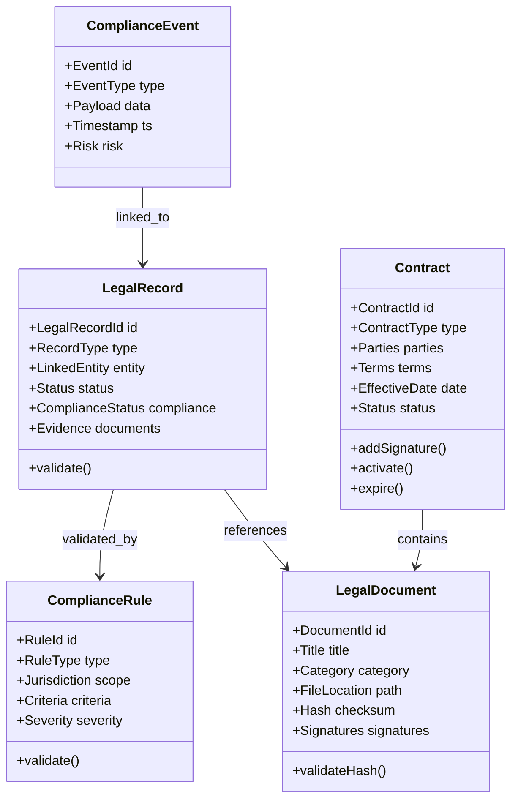

---

# **20.3 Key Legal Subdomains**

---

## **1. Corporate Governance**

* Board management
* Voting rights
* Meeting minutes
* Resolutions
* Governance audits

---

## **2. Securities Compliance**

* Rule D (Reg D)
* Rule 701 (equity compensation)
* Blue sky laws
* Accredited investor checks
* 83(b) handling
* 409A valuation tracking

---

## **3. Contract Lifecycle Management (CLM)**

Contracts include:

* NDAs
* Employment agreements
* Investor agreements
* Advisory agreements
* Vendor contracts
* Sales contracts
* Data Processing Agreements (DPAs)

CLM supports:

* drafting
* negotiation
* versioning
* redlines
* signatures
* fulfillment tracking

---

## **4. Data Privacy & Security Compliance**

Standards include:

* GDPR
* CCPA
* SOC 2
* ISO 27001
* HIPAA (where applicable)

This subdomain manages:

* consent logs
* data retention
* access controls
* breach logs
* data subject requests (DSR)

---

## **5. Employment & HR Compliance**

* offer letters
* IP assignment
* employee classification
* immigration/visa tracking
* background checks
* termination documentation

---

## **6. Fundraising Compliance**

Ensures:

* investor accreditation
* proper documentation
* securities filings
* term sheet compliance
* anti-money-laundering (AML) checks

---

## **7. Document Management**

Store & manage:

* cap table documents
* stock certificates
* contracts
* compliance reports
* encrypted sensitive documents

---

## **8. Regulatory Event Monitoring**

Detects and tracks:

* breaches
* expirations
* pending filings
* compliance violations
* escalations

---

# **20.4 Aggregate Roots**

---

# **20.4.1 LegalRecord Aggregate Root**

Represents any legal entity or compliance-relevant record.

### Types:

* ContractRecord
* SecuritiesRecord
* CorporateGovernanceRecord
* ComplianceFinding
* PrivacyEventRecord
* RegulatoryFilingRecord

### Attributes

```
LegalRecordId
RecordType
LinkedEntityId
ComplianceStatus
Jurisdiction
EvidenceDocuments[]
Notes
Severity
Status
CreatedBy
Timestamp
```

### Behaviors

* ValidateAgainstComplianceRules()
* AttachLegalDocument()
* ChangeStatus()
* GenerateAuditTrail()

---

# **20.4.2 Contract Aggregate Root**

### Attributes

```
ContractId
ContractType
Parties
Terms
EffectiveDate
ExpirationDate
RenewalTerms
Status (Draft, Reviewing, Executed, Expired)
Signatures
DocumentReferences
```

### Behaviors

* AddSignature()
* Activate()
* Renew()
* Terminate()
* GenerateContractSummary()

### Invariants

* Cannot activate without signatures
* Expired contracts cannot be modified

---

# **20.4.3 ComplianceRule Aggregate Root**

Defines a compliance requirement.

### Attributes

```
RuleId
RuleName
RuleType
Jurisdiction
Criteria
RiskSeverity
RequiredEvidence
AutomatedCheckFunction
```

### Behaviors

* ValidateEntity()
* TriggerAlertOnViolation()
* GenerateComplianceReport()

---

# **20.4.4 LegalDocument Aggregate Root**

### Attributes

```
DocumentId
Title
DocumentCategory
FilePath
Checksum
Signatures[]
IsEncrypted
ValidityPeriod
```

### Behaviors

* ValidateIntegrity()
* AttachSignature()
* EncryptDocument()
* DecryptDocument()

---

# **20.4.5 ComplianceEvent Aggregate Root**

### Attributes

```
EventId
EventType
LinkedLegalRecordId
Payload
Timestamp
Severity
DetectedBy
```

### Behaviors

* Escalate()
* Resolve()
* RecordMitigation()

---

# **20.5 Compliance Engines**

---

# **20.5.1 Securities Compliance Engine**

Runs checks on:

### ✔ Investor accreditation

### ✔ Rule 506 exemptions

### ✔ Non-accredited investor limits

### ✔ Stock option grant compliance (Rule 701)

### ✔ SAFE/convertible note conversion rules

### ✔ Anti-dilution legal alignment

### ✔ Board approval requirements

Produces:

* complianceFlags
* requiredActions
* audit evidence

---

# **20.5.2 Contract Compliance Engine**

Detects:

* missing signatures
* expired contracts
* renewal windows
* breached terms
* missing DPA/DPIA
* non-compliant clauses

---

# **20.5.3 Privacy Compliance Engine**

Handles:

* user data exports
* data deletion requests
* consent logging
* breach reports
* data minimization checks

---

# **20.5.4 Policy Compliance Engine**

Checks:

* internal policies adherence
* SOC2/ISO controls
* HR policies
* financial controls

---

# **20.6 Domain Events**

### LegalRecordCreated

### ContractExecuted

### ContractExpired

### ComplianceViolationDetected

### RegulatoryFilingRequired

### DocumentIntegrityCompromised

### DataBreachLogged

### PrivacyRequestReceived

### SecuritiesComplianceFailed

### SecuritiesCompliancePassed

Each produces:

* risk score
* mitigation steps
* knowledge graph edges

---

# **20.7 Integration with Other Domains**

---

# **20.7.1 With Fundraising**

* Validate term sheets
* Verify investor accreditation
* Automate filings
* Connect to cap table

---

# **20.7.2 With CapTable & Securities**

* Rule 701 limits
* SAFE conversion compliance
* Equity grant compliance

---

# **20.7.3 With Investor Relations**

* Distribute legal documents securely

---

# **20.7.4 With Financial Modeling**

* Contracted revenue informs forecasts
* Regulatory fines → expense modeling

---

# **20.7.5 With Knowledge Graph**

Nodes:

* LegalRecord
* Contract
* ComplianceEvent
* Rule
* Filing
* Breach
* Obligation

Edges:

```
Contract → governs → Relationship  
ComplianceEvent → impacts → Risk  
LegalDocument → validates → Transaction  
ComplianceRule → applies_to → Entity  
```

Enables:

* automated compliance risk scoring
* predicted violations
* dependency mapping

---

# **20.8 Example End-to-End Flow**

### 1. SAFE investment arrives

→ LegalRecord created
→ Investor accreditation check runs
→ Compliance engine validates Rule 506
→ SAFE contract executed
→ CapTable updated

### 2. Option grant to employee

→ Rule 701 limits checked
→ Vesting schedule attached
→ Contract executed

### 3. GDPR deletion request

→ Privacy engine runs
→ Data archived/deleted
→ LegalRecord created
→ ComplianceEvent logged

---

# **20.9 Why This Domain Is Essential**

Because:

* Legal mistakes can shut down a startup
* Equity errors can invalidate fundraising
* Contract issues lead to litigation
* Compliance failures create huge liabilities

This domain protects the company’s **legal survival**, **investor trust**, and **corporate integrity**.

---

# **21. Human Capital & People Operations Domain (Complete Regeneration & Deep Expansion)**

The **Human Capital & People Ops Domain** governs the entire workforce lifecycle of the startup—from hiring, onboarding, role management, performance management, skill development, organizational structure, cultural reinforcement, and workforce analytics.

This domain ensures the startup maintains:

* The **right people**
* With the **right skills**
* In the **right roles**
* At the **right time**
* Working toward the **right objectives**

It integrates with:

* Strategic Objectives (OKRs)
* Legal & Compliance
* Compensation & CapTable
* Financial Forecasting
* Knowledge Graph
* Growth & Experimentation (for people analytics)
* Product & Engineering Roadmaps

This domain is essential to build a **high-performance, scalable, compliant organization**.

---

# **21.1 Purpose of the Human Capital Domain**

To manage and optimize:

### ✔ Hiring, recruiting, and staffing

### ✔ Role & competency models

### ✔ Onboarding lifecycle

### ✔ Performance reviews & feedback

### ✔ Skill matrices & capability gaps

### ✔ Employee engagement & retention

### ✔ Culture & values enforcement

### ✔ Compensation, equity, & benefits alignment

### ✔ Workforce planning & forecasting

This domain becomes the startup’s **People OS**.

---

# **21.2 High-Level Domain Model**

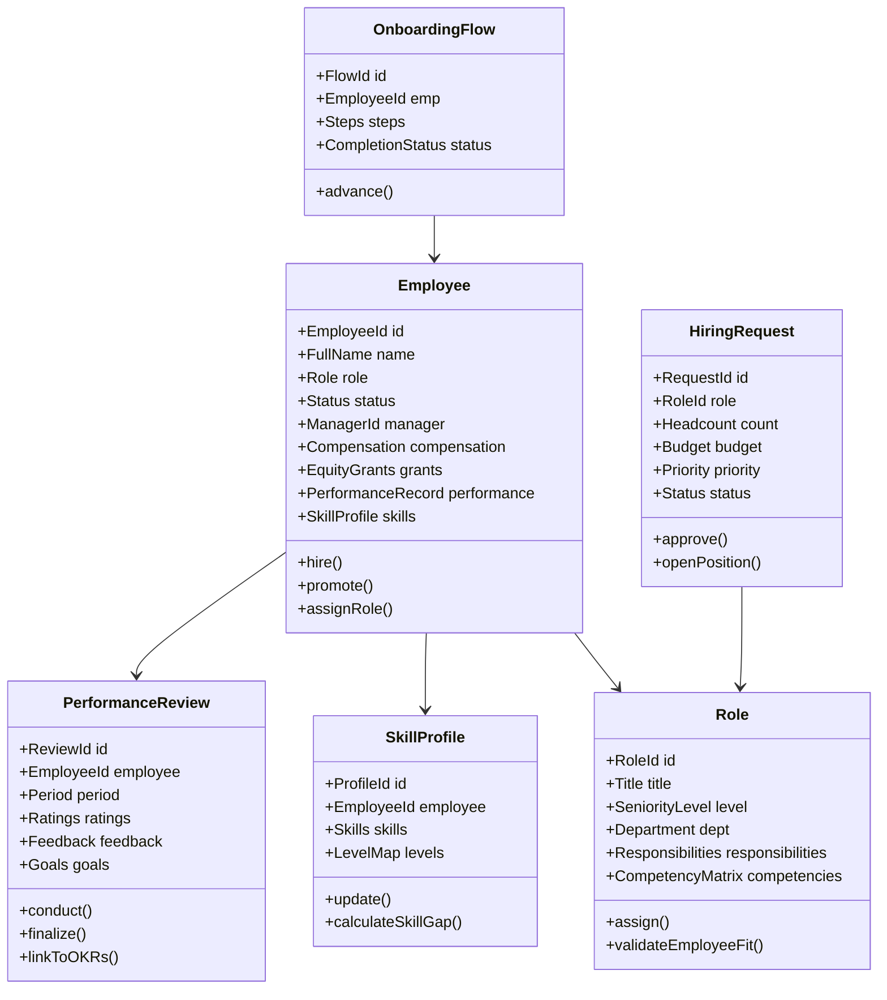

---

# **21.3 Major Subdomains**

---

## **1. Recruiting & Talent Acquisition**

* Job requisition
* Candidate pipeline
* Screening
* Interviews
* Assessments
* Offer management
* Hiring metrics (time-to-hire, pipeline quality)

---

## **2. Workforce Planning**

* Headcount planning
* Budget forecasting
* Skill gap analysis
* Attrition modeling
* Team capacity modeling

---

## **3. Role & Competency Management**

* Role definitions
* Competency matrices
* Seniority frameworks
* Promotion paths
* Capability benchmarks

---

## **4. Employee Lifecycle Management**

Covers entire employee lifecycle:

* onboarding
* probation
* performance reviews
* promotions
* internal mobility
* termination

---

## **5. Performance & Outcomes**

* Each employee links to OKRs
* Individual goals
* 360 feedback
* Contribution scoring
* Performance cycle management

---

## **6. Compensation & Equity**

Integrates with:

* CapTable
* Equity grants
* Vesting schedules
* Salary bands
* Bonus structures

---

## **7. Engagement & Culture**

* Surveys
* Pulse checks
* Culture KPIs
* Sentiment analysis
* Retention drivers

---

## **8. Compliance & HR Legal**

* employment agreements
* work authorization
* background checks
* classification compliance (employee vs contractor)

---

# **21.4 Aggregate Roots**

---

# **21.4.1 Employee Aggregate Root**

### Attributes

```
EmployeeId
FullName
Email
StartDate
EmploymentStatus (Active, Probation, Terminated)
RoleId
ManagerId
Compensation
EquityGrants[]
PerformanceReviews[]
SkillProfile
Objectives[]
EngagementScore
AttritionRiskScore
```

### Behaviors

* Hire()
* Terminate()
* Promote()
* AssignRole()
* AddPerformanceReview()
* LinkToOKRs()
* UpdateCompensation()
* UpdateSkillProfile()

### Invariants

* Cannot activate employee without signed contract
* Compensation must match salary bands
* Equity must comply with vesting rules

---

# **21.4.2 Role Aggregate Root**

### Attributes

```
RoleId
Title
SeniorityLevel
Department
Responsibilities[]
CompetencyMatrix
SalaryBand
ReportingStructure
```

### Behaviors

* AssignEmployee()
* UpdateCompetencies()
* ValidateFit(employee)
* CalculateLevelAlignment()

---

# **21.4.3 PerformanceReview Aggregate Root**

### Attributes

```
ReviewId
EmployeeId
Cycle (Quarterly, Annual)
Ratings (skills, culture, impact)
ManagerFeedback
PeerFeedback
SelfReflection
GoalsNextCycle[]
OKRContributionScore
OverallRating
CalibrationScore
```

### Behaviors

* ConductReview()
* Finalize()
* LinkToOKRs()
* CalculateOverallRating()

### Invariants

* Must include manager
* Peer reviewers cannot be direct reports

---

# **21.4.4 SkillProfile Aggregate Root**

### Attributes

```
SkillProfileId
EmployeeId
Skills[]
SkillLevels[]
TargetLevels[]
SkillGapAnalysis
```

### Behaviors

* UpdateSkills()
* CalculateSkillGaps()
* SuggestLearningPaths()

---

# **21.4.5 HiringRequest Aggregate Root**

### Attributes

```
RequestId
RequestedBy
RoleId
Headcount
Budget
Priority
Status (Draft, Submitted, Approved, Open, Filled)
Justification
LinkedObjectives[]
```

### Behaviors

* SubmitForApproval()
* Approve()
* OpenPosition()
* ClosePosition()

---

# **21.4.6 OnboardingFlow Aggregate Root**

### Steps include:

* document signing
* workspace setup
* access provisioning
* intro meetings
* training modules
* role-specific onboarding

### Attributes

```
FlowId
EmployeeId
Steps[]
CompletionPercent
BlockedSteps
AssignedMentor
StartDate
EndDate
```

### Behaviors

* AdvanceStep()
* AssignMentor()
* CalculateProgress()

---

# **21.5 People Analytics Engine**

The analytics engine computes:

### Engagement Metrics

* eNPS
* pulse score
* team sentiment
* culture alignment

### Productivity Metrics

* output vs expectation
* contribution to OKRs
* cycle time
* throughput

### Attrition Prediction

Using:

* performance trends
* engagement
* role fit
* compensation competitiveness

### Skills Analytics

* heatmaps
* gaps by team
* hiring priority recommendations

### Organizational Health

* team balance
* span of control
* management load
* capacity forecasting

---

# **21.6 Domain Events**

### EmployeeHired

### EmployeePromoted

### EmployeeTerminated

### PerformanceReviewCompleted

### SkillProfileUpdated

### HiringRequestApproved

### RoleAssigned

### OnboardingCompleted

### EngagementScoreDropped

### AttritionRiskDetected

---

# **21.7 Integration with Other Domains**

---

## **Strategic OKRs**

* Each employee has OKR contributions
* Performance ties to KR progress

---

## **CapTable & Securities**

* equity grants
* vesting
* 83(b) deadlines

---

## **Legal & Compliance**

* employment contracts
* visas
* terminations
* compliance training

---

## **Financial Modeling**

* headcount planning
* compensation forecasting

---

## **Knowledge Graph**

Nodes:

* Employee
* Skill
* Role
* PerformanceReview
* EngagementEvent

Edges:

```
Employee → contributes_to → Objective  
Role → requires → Skill  
Skill → improved_by → Training  
PerformanceReview → impacts → PromotionDecision  
AttritionRisk → threatens → Objective
```

---

# **21.8 Example End-to-End Scenario**

### 1. Strategic OKR set

Objective: “Accelerate product delivery.”

### 2. Hiring request created

Role: Senior Backend Engineer
Priority: High

### 3. Candidate hired

Employee onboarding flow begins.
CapTable grant assigned.

### 4. Skill profile created

Gaps identified → training plan assigned.

### 5. Quarterly performance review

Contributions linked to OKRs.
Promotion path updated.

### 6. Attrition risk detected

Engagement drop + manager feedback
→ Alert sent to HR & leadership

---

# **21.9 Why This Domain Matters**

This domain is essential because:

* People are the #1 driver of execution
* Hiring mistakes are costly
* Culture must scale sustainably
* Compensation and equity must be fair
* Performance must align with objectives
* Retention is cheaper than recruitment
* Predictive people analytics prevents team failures

It turns people operations into a **strategic advantage** instead of a back-office function.

---

# **22. Integration Architecture — Complete Regeneration**

This part fully defines the **cross-domain integration architecture**, describing how all bounded contexts communicate, synchronize, and maintain consistency using:

* **Domain Events**
* **Event Bus**
* **Integration Events**
* **Sagas / Process Managers**
* **Anti-Corruption Layers (ACL)**
* **Data Access Layers**
* **API Gateways**
* **Event Sourcing & CQRS**
* **Knowledge Graph Synchronization**
* **Compliance-Aware Event Pipelines**

---

# **22.1 Integration Principles**

The system follows **DDD + EDA (Event-Driven Architecture)** with **eventual consistency**.

## Principles:

### ✔ Each bounded context is autonomous

### ✔ Shared understanding maintained through events

### ✔ Avoid direct data coupling

### ✔ Integrate through behavior, not data

### ✔ Saga-like processes orchestrate long-running, multi-step workflows

### ✔ External systems accessed through Anti-Corruption Layers

---

# **22.2 High-Level Integration Architecture Diagram**

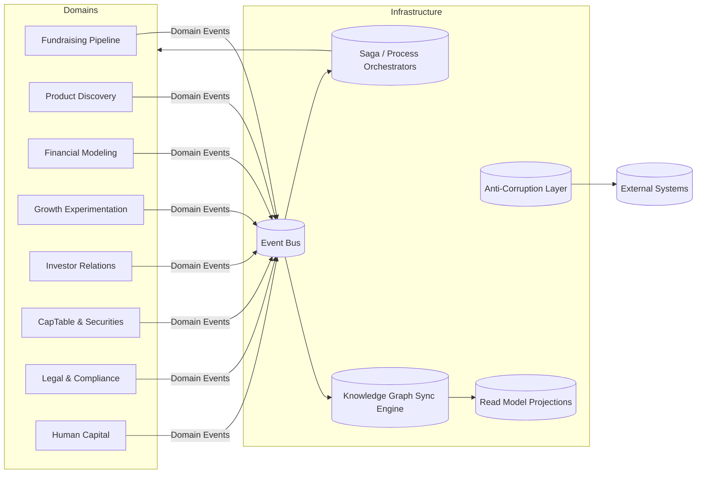

---

# **22.3 Event Types**

## **1. Domain Events**

Generated *inside* a bounded context.

Examples:

* ProspectStageAdvanced
* ProblemHypothesisValidated
* MetricThresholdBreached
* ExperimentConcluded
* ContractExecuted
* EmployeeHired

These events represent *truth* within the domain.

---

## **2. Integration Events**

Represent domain events *for other systems*.

Examples:

* InvestmentAccepted → triggers CapTable updates
* HypothesisValidated → triggers Business Model and Growth Experimentation updates
* OptionGrantApproved → triggers Legal Compliance checks

Integration events are stable, versioned, and external-facing.

---

## **3. Knowledge Graph Events**

Represent semantic relationships.

Examples:

* InsightExtracted
* ObjectiveLinked
* RiskDetected

These directly update the system’s knowledge graph.

---

# **22.4 Event Bus Specification**

The system uses an **event mesh** capable of:

* fan-out
* replay
* durable subscriptions
* at-least-once delivery
* filtering by domain

Platforms supported:

* Azure Service Bus
* RabbitMQ
* Kafka (for high scale)

---

# **22.5 CQRS Integration**

Each domain provides:

### **Write Models**

* aggregates
* commands
* invariants
* transactional boundaries

### **Read Models**

Stored in specialized projections:

* Graph-based projections
* ElasticSearch for querying
* SQL denormalized views
* Time series stores for metrics
* Investor dashboards
* HR performance dashboards

Each projection subscribed to events from the Event Bus.

---

# **22.6 Sagas (Process Managers)**

Sagas orchestrate **cross-domain processes**.

## Characteristics:

* Event-driven
* Long-running
* Compensating actions
* Idempotent

## Core Sagas:

1. **Fundraising Completion Saga**
2. **Employee Onboarding Saga**
3. **Equity Grant Compliance Saga**
4. **Prototype Validation Saga**
5. **Experiment Lifecycle Saga**
6. **Financial Model Update Saga**
7. **Legal Document Execution Saga**
8. **Board Approval & Governance Saga**

---

# **22.6.1 Example Saga — Fundraising Completion Saga**

Triggered by:

```
TermSheetAccepted
```

## Steps:

1. Update CapTable
2. Generate legal records
3. Create investor profile
4. Update financial model
5. Add investor to IR updates
6. Notify compliance team
7. Refresh funding runway calculation
8. Generate onboarding tasks for investor relations

---

**Saga Execution Example (C# pseudocode)**

```csharp
public class FundraisingCompletionSaga : ISaga<TermSheetAccepted>
{
    public async Task Handle(TermSheetAccepted evt)
    {
        await _capTable.RecordFundingRound(...);
        await _legal.GenerateInvestmentDocuments(...);
        await _irm.CreateInvestorProfile(...);
        await _financial.UpdateCashPosition(...);
        await _compliance.RunInvestmentChecks(...);
        await _analytics.UpdateFundingMetrics(...);
    }
}
```

---

# **22.6.2 Example Saga — Employee Onboarding Saga**

Triggered by:

```
EmployeeHired
ContractSigned
EquipmentAssigned
ManagerAssigned
OnboardingCompleted
```

Ensures:

* Legal forms signed
* HR compliance
* Access provisioning
* Team introductions
* Role assignment
* Performance expectations

---

# **22.6.3 Example Saga — Product Validation Saga**

Triggered by:

```
CustomerInterviewCompleted
ProblemHypothesisValidated
PrototypeFeedbackCollected
```

Orchestrates:

* Hypothesis tracking
* Updating validation status
* Triggering prototype creation
* Updating product decisions

---

# **22.7 Anti-Corruption Layer (ACL)**

Used to interface with external systems:

* External market data
* Payment providers
* Legal document e-sign providers (e.g., DocuSign)
* HR employment verification systems
* Finance/Accounting systems
* CRM/Marketing systems

ACL responsibilities:

* validation
* transformation
* schema compliance
* mapping external semantics to domain semantics

Example:

```csharp
public MarketBenchmark MapFromExternal(ExternalMarketResponse r)
{
    return new MarketBenchmark(
        r.industryCode,
        ConvertToMetricType(r.metricName),
        r.value,
        MapPercentiles(r.dist)
    );
}
```

---

# **22.8 Knowledge Graph Integration Layer**

Every domain event that represents *knowledge* is mirrored into a graph model.

Examples:

* HypothesisValidated → creates “supports” or “invalidates” edges
* ExperimentConcluded → creates “proved” / “disproved” edges
* ObjectiveProgressed → updates contribution edges
* SkillProfileUpdated → maps skills to roles

Graph model allows:

* reasoning
* dependency mapping
* predictions
* insights aggregation

Processing Pipeline:

1. Domain Event
2. Semantic Mapper
3. Graph Edge Builder
4. Graph Mutation Processor

---

# **22.9 Compliance-Aware Event Processing**

The system includes compliance hooks such as:

* Event-level classification (Public, Internal, Sensitive, Confidential)
* Role-based protection
* Audit trails
* Event redaction rules
* Jurisdiction-specific filtering

Example:

* EU user data events filtered for GDPR compliance
* Investor financial data restricted to authorized personnel

---

# **22.10 Example End-to-End Cross-Domain Integration Scenarios**

---

## **Scenario A — SAFE Investment Completed**

**Domains Involved:**
Fundraising → CapTable → Legal → IR → Financial → Knowledge Graph

**Flow:**

1. TermSheetAccepted event emitted
2. CapTable updated
3. Legal documents generated
4. Financial model updated
5. Investor profile created
6. IR onboarding triggered
7. Knowledge graph adds new “Investor → InvestedIn → Company” edge

---

## **Scenario B — Employee Hired**

**Domains Involved:**
HR → Legal → Compliance → Finance → Knowledge Graph

**Flow:**

1. EmployeeHired event emitted
2. Employment contract verified by Legal
3. ACL checks background verification
4. Compensation feeds into financial forecasting
5. Knowledge Graph creates:

   * Employee → reports_to → Manager
   * Employee → assigned_role → Role
   * Employee → skill_profile → Skills

---

## **Scenario C — Hypothesis Validation → Experiment Creation**

**Domains Involved:**
Product Discovery → Growth Experimentation → Knowledge Graph → Strategic Objectives

**Flow:**

1. ProblemHypothesisValidated event emitted
2. Growth system creates experiment
3. Experiment results feed back to validation levels
4. Objective impact calculated
5. Knowledge graph enriched with causal links

---

# **22.11 Advantages of This Integration Architecture**

### ✔ Strong domain boundaries

### ✔ Loose coupling

### ✔ High scalability

### ✔ Compliance-aware pipeline

### ✔ Predictive analytics enabled via graph

### ✔ Event replay for debugging and audit

### ✔ Suitable for microservices or modular monolith

---

# **23. Anti-Corruption Layer Patterns & External Integrations**

This section describes **how the platform connects safely and consistently with external systems**, ensuring that foreign models, semantics, and APIs **do not corrupt internal domains**.

ACLs are essential because each domain:

* protects its **ubiquitous language**
* preserves **domain invariants**
* avoids **leaking external schemas**
* keeps external dependencies isolated

---

# **23.1 Purpose of ACLs in this Architecture**

ACLs provide:

### ✔ Protection against external schema/semantic mismatch

### ✔ Transformation between external → domain concepts

### ✔ Validation & sanitization of data

### ✔ Enforcement of domain invariants

### ✔ Mapping between multiple external systems

### ✔ Encapsulation of non-domain logic

### ✔ Security, compliance, and data classification filtering

ACLs ensure that integrating with external systems cannot “pollute” domain logic.

---

# **23.2 External Systems Requiring ACLs**

### 🔹 Market & Benchmark Data Providers

* Crunchbase
* Pitchbook
* CB Insights
* Industry benchmark APIs

### 🔹 Legal & Compliance Providers

* DocuSign
* HelloSign
* LegalZoom APIs
* State / SEC filings

### 🔹 Finance & Accounting Systems

* QuickBooks / Xero
* Stripe
* Revenue platforms
* Banking APIs

### 🔹 HR Systems

* LinkedIn Talent Insights
* Background check APIs
* Payroll systems
* ATS (Greenhouse, Lever)

### 🔹 Product / Analytics Systems

* Mixpanel
* Amplitude
* Google Analytics
* Segment

### 🔹 Cloud & Infrastructure Providers

* Azure, AWS, GCP
* RBAC provisioning
* Authentication systems

### 🔹 Communication Systems

* Slack
* Email providers
* CRM systems

Each integration crosses domain boundaries and therefore must be shielded through ACLs.

---

# **23.3 ACL Architecture Pattern**

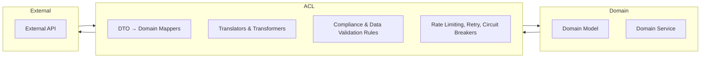

---

# **23.4 ACL Layers & Responsibilities**

---

## **1. DTO & Schema Mapping Layer**

Handles:

* external fields → canonical domain model
* type conversions
* structure normalization
* nullable vs required field handling

Example:

```csharp
public CompanyBenchmark MapToDomain(ExternalBenchmarkDTO dto)
{
    return new CompanyBenchmark(
        MetricType.FromExternal(dto.metric),
        new BenchmarkValue(dto.value),
        Percentile.FromExternal(dto.percentile)
    );
}
```

---

## **2. Semantic Translation Layer**

Translates meaning, not just schema.

Example:
External “Revenue Growth YoY” may map to domain metric **GrowthRate**.

---

## **3. Validation & Compliance Layer**

Ensures:

* classification (internal, confidential, regulatory)
* PII/GDPR filtering
* securities compliance checks
* constraints required by domain invariants

Example:
Reject investor data if accreditation not verified.

---

## **4. Policy Enforcement Layer**

Implements:

* rate limiting
* retries with exponential backoff
* circuit breakers
* monitoring

---

## **5. Domain Anti-Pollution Shield**

Ensures external errors do not enter domain:

* no leaking external error types
* no leaking external enums
* no leaking external field names
* no leaking external business rules

---

# **23.5 Domain-Specific ACLs**

---

# **23.5.1 ACL for Market Intelligence Providers**

### External fields:

* industryCode
* metricCode
* percentileDistribution

### Domain fields:

* Industry
* StartupMetric
* BenchmarkDistribution

Mapping logic:

```csharp
Industry MapIndustry(string code) => industryLookup[code];
MetricType MapMetric(string metricCode) => MetricType.FromExternalCode(metricCode);
```

Compliance:

* anonymize PII in external datasets
* ensure data licensing rules permit storage
* perform jurisdiction checks

---

# **23.5.2 ACL for E-Sign Providers (DocuSign, HelloSign)**

Handles:

* signed contract ingestion
* signature validation
* document hashing
* secure download

Domain mapping:

* Contract → LegalDocument
* Signatures → DomainSignature

Compliance:

* Hash and verify signature
* Store encrypted copies only
* Ensure signature timestamp is UTC

---

# **23.5.3 ACL for Financial Providers**

### Inputs:

* transaction data
* revenue signals
* invoices
* expense categories

Mapped to:

* RevenueStream
* CashFlowEvent
* BurnRate inputs

Compliance:

* AML & fraud detection
* Financial reporting standards
* SEC event log compatibility

---

# **23.5.4 ACL for HR & Recruiting Systems**

Handles inbound:

* candidate profiles
* resume parsing
* skill extraction

Outbound:

* job posting updates
* candidate feedback

Privacy/Compliance:

* GDPR consent
* Hiring discrimination compliance
* Data minimization

---

# **23.5.5 ACL for Product Analytics Systems**

Amplitudes / Mixpanel events → Domain Metrics:

* UserActivated → EngagementEvent
* PageViewed → FunnelStepCompleted
* FeatureUsed → ProductUsageMetric

Filters:

* PII removal
* IP anonymization
* Device data hashing

---

# **23.6 Example Full ACL Implementation**

### Incoming (External → Domain)

```csharp
public FinancialTransaction MapToDomain(StripeEvent evt)
{
    var cleaned = PiiCleaner.RemoveSensitiveData(evt);
    SecurityValidator.EnsureCompliance(cleaned);

    return new FinancialTransaction(
        id: new TransactionId(evt.Id),
        amount: MonetaryAmount.From(evt.Amount),
        type: MapTransactionType(evt.Type),
        timestamp: evt.Timestamp.ToUtc()
    );
}
```

---

### Outgoing (Domain → External)

```csharp
public ExternalContractRequest MapFromDomain(Contract contract)
{
    return new ExternalContractRequest
    {
        Document = Encryptor.Encrypt(contract.RawPdf),
        Parties = contract.Parties.Select(p => p.Email).ToList(),
        Title = contract.Title,
        Metadata = new { ContractId = contract.Id }
    };
}
```

---

# **23.7 Anti-Corruption for Knowledge Graph Sync**

All knowledge graph edges from events go through semantic mapping.

Example:

* Domain: ProblemHypothesisValidated
* Graph: Hypothesis → validated_by → Evidence

ACL ensures:

* correct ontology
* consistent node types
* canonical domain naming
* eliminates duplication

---

# **23.8 When Not to Use ACL**

ACL **is not needed** when:

* both domains are internal
* both share the same ubiquitous language
* internal events fully align with domain semantics

But ACL **is mandatory** for:

* external vendors
* external APIs
* government filings
* legacy internal systems
* partner integrations

---

# **23.9 Why ACLs Matter for Startups**

Because they avoid:

* accidental domain corruption
* unintentional legal risk
* external API schema breakages
* data leaks (PII, financial, legal documents)
* compliance violations
* polluted knowledge graph data

ACLs protect the domain core from chaos.

---

# **24. Event Sourcing Patterns & Auditability Architecture**

This section defines the **system-wide event sourcing strategy**, focusing on:

* capturing immutable domain events
* generating complete audit trails
* enabling regulatory compliance
* powering the knowledge graph
* supporting financial, legal, and HR traceability
* enabling time-travel debugging
* enabling reconstruction of past states

Unlike traditional CRUD systems, this platform uses **event streams as the primary source of truth** for critical domains.

---

# **24.1 Why Event Sourcing?**

Because startups require:

### ✔ **High auditability**

Fundraising, equity, contracts, option grants, and financial projections must be fully traceable.

### ✔ **Regulatory compliance**

Especially for:

* securities laws
* financial reporting
* employment record retention
* GDPR/CCPA (with event redaction)

### ✔ **Data lineage & provenance**

Critical for market intelligence and financial modeling.

### ✔ **Machine learning & knowledge graph needs**

Event streams allow inference, correlation, and reasoning.

### ✔ **Event replay**

Allows:

* reconstructing state
* fixing bugs
* reconstructing financial models
* regenerating dashboards

---

# **24.2 What Gets Event-Sourced?**

### **Event Sourcing is applied to high-importance domains:**

## ✔ Fundraising Pipeline

* interactions
* stage transitions
* offers
* negotiations
* commitments

## ✔ CapTable & Securities

* equity issuance
* transfers
* option grants
* vesting events
* SAFE/notes conversion

## ✔ Legal & Compliance

* contract signatures
* filings
* violations
* disclosures

## ✔ HR & People Operations

* performance events
* promotions
* compensation changes
* onboarding flows
* policy acceptance

## ✔ Product Discovery

* interview insights
* validation attempts
* prototype feedback

## ✔ Performance & Financial Modeling

* metric changes
* KPI updates
* cash flow calculations
* model refinements

---

# **24.3 Event Sourcing Architecture Overview**

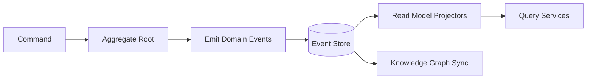

### Event Store is the **single authoritative source**.

Projections are **derived models**.

---

# **24.4 Event Structure Standard**

Every event follows a strict schema:

```
{
    EventId: GUID,
    AggregateId: GUID,
    AggregateType: string,
    EventType: string,
    Timestamp: UTC,
    Version: int,
    Data: {...},
    Metadata: {
        UserId,
        CorrelationId,
        CausationId,
        ComplianceClass,
        DomainContext
    }
}
```

### Metadata is critical for:

* compliance
* backtracking
* audit integrity
* privacy filtering
* sagas

---

# **24.5 Event Versioning Strategy**

Events evolve over time.
We use **event upcasters** so older events remain readable.

### Versioning Rules:

* Events never removed
* New fields added only as optional
* Breaking changes → new event type
* Upcasters transform old → new schema

Example:

```csharp
public class TermSheetAcceptedV2Upcaster : IEventUpcaster
{
    public DomainEvent Upcast(DomainEvent oldEvent)
    {
        var data = oldEvent.Data;
        data["InvestorType"] ??= "Unknown";
        return oldEvent with { Data = data, Version = 2 };
    }
}
```

---

# **24.6 Event Store Design**

The event store must support:

### ✔ Append-only log

### ✔ Immutable events

### ✔ Global ordering

### ✔ Streams per aggregate

### ✔ Stream snapshots

### ✔ Efficient projections

### ✔ Point-in-time recovery

Implementations supported:

* EventStoreDB
* Kafka w/ compaction
* Azure Event Hubs
* PostgreSQL Streams

---

# **24.7 Audit Trail Architecture**

Audit trail uses event data + metadata for:

* user actions
* system actions
* approvals
* compliance checks
* state transitions

## Audit Views:

1. **Entity Audit Timeline**
2. **User Activity Log**
3. **Compliance Incident Log**
4. **Legal Document Audit**
5. **Equity & Securities Ledger**
6. **Financial Calculation Audit**

Each is a **read-only projection** from event streams.

---

# **24.8 Snapshots & State Rehydration**

Aggregates rehydrate state from events.

To optimize performance:

### Snapshots taken when:

* stream > N events (e.g., 500)
* aggregate is “hot”
* sagas reference the aggregate frequently

### Snapshot contains:

* last known state
* last event version
* computed derived attributes

Restoring state:

```csharp
var snapshot = snapshotStore.Get(aggregateId);
var events = eventStore.ReadEventsAfter(snapshot.Version);
aggregate.Rehydrate(snapshot.State, events);
```

---

# **24.9 Event Replay Modes**

Three types of replay:

---

## **1. Full Replay**

Reprocess *all events*.

Uses:

* rebuild all projections
* recover corrupted read-models
* refresh knowledge graph

---

## **2. Partial Replay**

Replay only specific streams.

Uses:

* rebuild a single aggregate
* fix an out-of-date dashboard
* regenerate KPIs

---

## **3. Temporal Replay**

Rebuild system as of a specific historical time.

Uses:

* reconstruct past financial reports
* reproduce prior cap table
* analyze investor stages historically
* trace cause of compliance failures

---

# **24.10 Redaction & Privacy Management**

Critical for GDPR/CCPA compliance.

### Event Redaction Rules:

* Certain events are *redactable* (e.g., personally identifiable data)
* Full redaction must NOT break event stream
* Must maintain event integrity

### Redaction is done via:

* event masking
* field nulling
* anonymization
* pseudonymization
* tombstone events

Example:

Before:

```
Email: "john@example.com"
```

After:

```
Email: "redacted@privacy.local"
```

---

# **24.11 Multi-Tenancy Event Partitioning**

Tenants (founders / companies) must be isolated.

Partitioning options:

* stream by tenant
* database by tenant
* global stream w/ tenant metadata

The safest is:
**Stream-per-tenant** for critical domains:

* cap table
* legal
* HR
* finances

---

# **24.12 Observability of Event Flows**

Metrics:

* event throughput
* lag per subscription
* projection delays
* event processing failures
* snapshot frequency
* knowledge graph update times

Logs:

* projection logs
* saga logs
* ACL ingress/egress logs

Tracing:

* correlation IDs
* causation chain analysis

---

# **24.13 Event Sourcing in Compliance-Critical Domains**

---

## ✔ Securities

Allows:

* full audit of equity history
* regulatory filings reconstruction

## ✔ Financial Modeling

Allows:

* model evolution tracking
* recalculation validation

## ✔ Legal & Contracts

Allows:

* immutable signature records
* historical contract versions

## ✔ HR & People Ops

Allows:

* historical compensation records
* performance cycle audit trails

---

# **24.14 Event Sourcing Anti-Patterns Avoided**

The architecture avoids:

### ❌ Storing events as CRUD logs

### ❌ Overloading events with state snapshots

### ❌ Using events as RPC

### ❌ Polluting events with external schemas

### ❌ Publishing internal events directly to external consumers

Instead we use **Integration Events** + ACL layers.

---

# **24.15 Benefits for the Startup**

### ✔ Ability to produce legally defensible audit trails

### ✔ Cap table always accurate and replayable

### ✔ No hidden state

### ✔ Perfect transparency for investors

### ✔ Advanced analytics via event streams

### ✔ Time-travel debugging

### ✔ Superior data consistency across domains

This architecture future-proofs the platform.

---

# **25. C4 Architecture Model**

This section provides the **full C4 architecture representation** of the platform, including:

1. **Level 1 — System Context**
2. **Level 2 — Container Architecture**
3. **Level 3 — Component Architecture**
4. **Level 4 — Code-Level Structures (for selected critical domains)**

All diagrams are represented using **Mermaid C4-style notation**, and every bounded context is visualized through a **domain-oriented architecture lens**.

---

# **25.1 C4 Level 1 — System Context Diagram**

Represents the platform as a single black-box system and its external dependencies.

```mermaid
graph TD

    subgraph Users
        Founder[Founder / Startup Team]
        Investor[Investor]
        Employee[Employee / Team Member]
        Advisor[Advisor / Mentor]
        ExternalLegal[External Legal Counsel]
    end

    subgraph System
        Platform[Startup Lifecycle & Growth Platform]
    end

    subgraph ExternalSystems
        MarketData[Market Intelligence Providers]
        ESIGN[E-Signing Provider]
        FinApps[Banking & Payment Providers]
        HRSystems[HR / ATS Systems]
        Analytics[Product Analytics]
        GovAPI[Government / Regulatory API]
        Cloud[Cloud Providers / Auth]
    end

    Founder --> Platform
    Employee --> Platform
    Investor --> Platform
    Advisor --> Platform
    ExternalLegal --> Platform

    Platform --> MarketData
    Platform --> ESIGN
    Platform --> FinApps
    Platform --> HRSystems
    Platform --> Analytics
    Platform --> GovAPI
    Platform --> Cloud
```

---

# **25.2 C4 Level 2 — Container Architecture**

Shows major back-end services, front-end apps, and supporting infrastructure.

```mermaid
flowchart LR

    subgraph WebApps
        Portal[Web Portal (React)]
        Mobile[Mobile App]
        AdminPanel[Admin Console]
    end

    subgraph API
        Gateway[API Gateway]
        Auth[Auth Service]
        BFF[Backend For Frontend Layer]
    end

    subgraph CoreServices
        FundraisingSvc[Fundraising Pipeline Service]
        ProductDiscoverySvc[Product Discovery Service]
        FinancialSvc[Financial Modeling Service]
        GrowthSvc[Growth Experimentation Service]
        IRSvc[Investor Relations Service]
        CapTableSvc[Cap Table Service]
        LegalSvc[Legal & Compliance Service]
        HRSvc[HR & People Ops Service]
        ObjectiveSvc[Strategic Objectives Service]
        KnowledgeGraphSvc[Knowledge Graph Service]
    end

    subgraph Infrastructure
        EventBus[(Event Bus)]
        EventStore[(Event Store)]
        DBMain[(SQL/NoSQL Databases)]
        Cache[(Redis Cache)]
        Search[(Search Engine)]
        ObjectStorage[(Document Storage)]
        GraphDB[(Graph Database)]
        Monitoring[(Telemetry/Observability)]
    end

    Portal --> Gateway
    Mobile --> Gateway
    AdminPanel --> Gateway

    Gateway --> FundraisingSvc
    Gateway --> ProductDiscoverySvc
    Gateway --> FinancialSvc
    Gateway --> GrowthSvc
    Gateway --> IRSvc
    Gateway --> CapTableSvc
    Gateway --> LegalSvc
    Gateway --> HRSvc
    Gateway --> ObjectiveSvc
    Gateway --> KnowledgeGraphSvc

    FundraisingSvc --> EventBus
    ProductDiscoverySvc --> EventBus
    FinancialSvc --> EventBus
    GrowthSvc --> EventBus
    IRSvc --> EventBus
    CapTableSvc --> EventBus
    LegalSvc --> EventBus
    HRSvc --> EventBus

    EventBus --> EventStore
    EventBus --> GraphDB
```

---

# **25.3 C4 Level 3 — Component Diagrams**

Each bounded context gets broken into logical components.

---

# **25.3.1 Fundraising Pipeline — Component Diagram**

```mermaid
graph TD

    subgraph FundraisingPipeline
        Aggregates[Aggregates: FundraisingRound, Prospect, InteractionLog, TermSheetOffer]
        Commands[Command Handlers]
        Queries[Query Handlers]
        Policies[Domain Policies]
        EventHandlers[Event Handlers]
        Repository[Fundraising Repository]
        Projection[Pipeline Projections]
        ScoringEngine[Prospect Scoring Engine]
    end

    Commands --> Aggregates
    Aggregates --> EventHandlers
    EventHandlers --> Repository
    Aggregates --> ScoringEngine
    EventHandlers --> Projection
```

---

# **25.3.2 Product Discovery — Component Diagram**

```mermaid
graph TD

    subgraph ProductDiscovery
        InterviewAgg[CustomerInterview Aggregate]
        HypothesisAgg[ProblemHypothesis Aggregate]
        PrototypeAgg[SolutionPrototype Aggregate]
        InsightEngine[Insight Extraction Engine]
        ValidationEngine[Hypothesis Validation Engine]
        SurveyManager[Survey & Research Manager]
        Projections[Discovery Read Models]
    end

    InterviewAgg --> InsightEngine
    HypothesisAgg --> ValidationEngine
    ValidationEngine --> Projections
    InsightEngine --> Projections
```

---

# **25.3.3 Financial Modeling — Component Diagram**

```mermaid
graph TD

    subgraph FinancialModeling
        MetricAgg[TrackedMetric Aggregate]
        FinancialAgg[FinancialModel Aggregate]
        ProjectionAgg[CashFlowProjection Aggregate]
        MetricsCalc[Metrics Calculation Engine]
        ProjectionCalc[Projection Engine]
        VarianceEngine[Variance Analysis]
        AlertsEngine[Threshold Alerts]
        Reports[Financial Dashboard Projections]
    end

    MetricAgg --> MetricsCalc
    MetricsCalc --> AlertsEngine
    FinancialAgg --> ProjectionCalc
    ProjectionCalc --> ProjectionAgg
    ProjectionAgg --> Reports
```

---

# **25.3.4 Growth Experimentation — Component Diagram**

```mermaid
graph TD

    subgraph GrowthExperimentation
        ExperimentAgg[GrowthExperiment Aggregate]
        VariantManager[Variant Manager]
        MetricsTracker[Experiment Metrics Tracker]
        StatsEngine[Statistical Significance Engine]
        ROIEngine[ROI Calculation Engine]
        FunnelAnalyzer[Conversion Funnel Analyzer]
        Projections[Growth Insights Models]
    end

    ExperimentAgg --> VariantManager
    VariantManager --> MetricsTracker
    MetricsTracker --> StatsEngine
    StatsEngine --> ROIEngine
    ROIEngine --> Projections
    FunnelAnalyzer --> Projections
```

---

# **25.3.5 CapTable & Securities — Component Diagram**

```mermaid
graph TD

    subgraph CapTable
        SecurityAgg[SecurityTransaction Aggregate]
        HolderAgg[SecurityHolder Aggregate]
        OptionGrantAgg[EquityGrant Aggregate]
        VestingEngine[Vesting & Vesting Trigger Engine]
        DilutionEngine[Dilution Modeling Engine]
        FilingEngine[Regulatory Filing Generator]
        LedgerProjections[Equity Ledger Views]
    end

    OptionGrantAgg --> VestingEngine
    SecurityAgg --> DilutionEngine
    HolderAgg --> LedgerProjections
    FilingEngine --> LedgerProjections
```

---

# **25.3.6 Legal & Compliance — Component Diagram**

```mermaid
graph TD

    subgraph LegalCompliance
        LegalRecordAgg[LegalRecord Aggregate]
        ContractAgg[Contract Aggregate]
        ComplianceRuleAgg[ComplianceRule Aggregate]
        DocumentManager[Legal Document Manager]
        ComplianceEngine[Compliance Checking Engine]
        ESIGNAdapter[E-Sign ACL Adapter]
        AuditProjections[Audit Trail Views]
    end

    ContractAgg --> DocumentManager
    LegalRecordAgg --> ComplianceEngine
    ComplianceEngine --> AuditProjections
    DocumentManager --> ESIGNAdapter
```

---

# **25.3.7 HR & People Ops — Component Diagram**

```mermaid
graph TD

    subgraph HRPeopleOps
        EmployeeAgg[Employee Aggregate]
        RoleAgg[Role Aggregate]
        PerformanceAgg[PerformanceReview Aggregate]
        SkillProfileAgg[SkillProfile Aggregate]
        HiringRequestAgg[HiringRequest Aggregate]
        OnboardingFlowAgg[OnboardingFlow Aggregate]
        PerformanceEngine[Performance Scoring Engine]
        AttritionEngine[Attrition Prediction Engine]
        HRProjections[People Analytics Projections]
    end

    EmployeeAgg --> PerformanceAgg
    EmployeeAgg --> SkillProfileAgg
    PerformanceAgg --> PerformanceEngine
    SkillProfileAgg --> AttritionEngine
    AttritionEngine --> HRProjections
```

---

# **25.4 C4 Level 4 — Code-Level Structures**

This section shows code-level C4 diagrams for **core aggregates and services**.

---

# **25.4.1 Example — FundraisingRound Aggregate (Code-Level C4)**

```mermaid
classDiagram
    class FundraisingRound {
        - RoundId id
        - List~Prospect~ prospects
        - MonetaryAmount target
        - RoundStatus status
        + AddProspect()
        + ReceiveOffer()
        + CloseRound()
    }

    class Prospect {
        - ProspectId id
        - PipelineStage stage
        + AdvanceStage()
        + LogInteraction()
    }

    class TermSheetOffer {
        - OfferId id
        - Valuation valuation
        - MonetaryAmount amount
        + Accept()
        + Reject()
    }

    FundraisingRound --> Prospect
    Prospect --> TermSheetOffer
```

---

# **25.4.2 Example — PerformanceReview Aggregate (Code-Level C4)**

```mermaid
classDiagram
    class PerformanceReview {
        +ReviewId id
        +EmployeeId employee
        +Ratings ratings
        +Feedback feedback
        +Complete()
        +LinkToObjectives()
    }

    class Ratings {
        +SkillRating score
        +ImpactRating score
        +CultureRating score
    }

    class Feedback {
        +ManagerNotes
        +PeerComments
        +SelfReflection
    }

    PerformanceReview --> Ratings
    PerformanceReview --> Feedback
```

---

# **25.4.3 Example — ComplianceRule Aggregate (Code-Level)**

```mermaid
classDiagram
    class ComplianceRule {
        +RuleId id
        +Jurisdiction scope
        +Criteria criteria
        +Severity severity
        +Validate()
        +GenerateComplianceEvent()
    }

    class Criteria {
        +Expression
        +Check()
    }

    ComplianceRule --> Criteria
```

---

# **25.5 C4 Model Benefits**

### ✔ Clear boundaries between domains

### ✔ Code-level structures traceable to domain models

### ✔ Technical architecture aligned with strategic domain decomposition

### ✔ Supports distributed or modular monolith architectures

### ✔ Enables micro-frontends and BFF patterns

### ✔ Connects domain events to actual component flows

---

# **26. Appendices**

This final section provides **supporting reference materials**, canonical definitions, cross-domain classification tables, glossary, and reusable architectural patterns.

It ensures the document is **self-contained**, **auditable**, and **implementation-ready**.

---

# **26.1 Canonical Definitions — Startup Lifecycles**

These definitions align all domains with consistent language.

---

## **26.1.1 Startup Lifecycle Phases**

1. **Ideation**

   * Problem definition
   * Customer discovery

2. **Validation**

   * Hypotheses
   * Prototypes
   * Early users

3. **Product-Market Fit**

   * Rapid experiments
   * Usage metrics

4. **Growth**

   * Channel scaling
   * Conversion optimization

5. **Fundraising Cycles**

   * Pre-seed
   * Seed
   * Series A+

6. **Operational Maturity**

   * Financial controls
   * Governance
   * Compliance

---

## **26.1.2 Capital Stages & Instruments**

| Instrument       | Description                                  |
| ---------------- | -------------------------------------------- |
| SAFE             | Simple Agreement for Future Equity           |
| Convertible Note | Loan that converts under specific conditions |
| Preferred Shares | Standard VC investment                       |
| Common Shares    | Founder & employee equity                    |
| Options (ESOP)   | Employee compensation                        |
| Warrants         | External right to purchase shares            |

---

## **26.1.3 Customer Discovery Levels**

1. Exploratory
2. Validation
3. Usability
4. Problem/Solution Fit
5. Market Fit

---

# **26.2 Canonical Value Objects (Global)**

These **canonical value objects** are reused across all bounded contexts to enforce **semantic consistency**.

---

## **26.2.1 Identifiers**

```
UserId
EmployeeId
ProspectId
InvestorId
RoundId
SecurityId
HypothesisId
ObjectiveId
MetricId
ScenarioId
FunnelId
```

---

## **26.2.2 Monetary & Finance VOs**

```
MonetaryAmount
ExchangeRate
Valuation
InvestmentAmount
BurnRate
RunwayLength
CashPosition
RevenueProjection
ExpenseProjection
```

---

## **26.2.3 Time & Scheduling VOs**

```
Duration
Deadline
Period
TimeWindow
Quarter
FiscalYear
ProjectionPeriod
```

---

## **26.2.4 Compliance & Legal VOs**

```
Jurisdiction
ComplianceSeverity
DocumentHash
Signature
FilingReference
AccessPermission
```

---

## **26.2.5 HR & Skill VOs**

```
SkillLevel
SeniorityLevel
CompensationBand
EngagementScore
AttritionRiskScore
```

---

## **26.2.6 Growth & Product VOs**

```
HypothesisStatement
EffectivenessScore
StatisticalSignificance
ConversionRate
DropOffRate
FunnelVelocity
```

---

# **26.3 Cross-Domain Policy Matrix**

Defines which policies apply across the entire platform.

---

## **26.3.1 Global Business Policies**

| Policy                        | Description                         | Applies To                  |
| ----------------------------- | ----------------------------------- | --------------------------- |
| Minimum Data Completeness     | Entities must have required fields  | All Domains                 |
| Investor Accreditation Policy | Must verify before committing funds | Fundraising, IR, Compliance |
| Equity Grant Compliance       | Must follow Rule 701                | HR, CapTable, Legal         |
| Data Retention                | GDPR-compliant retention            | All data stores             |
| Version Integrity Policy      | No destructive updates to events    | Event Store                 |
| Compensation Fairness         | Enforce salary bands                | HR, Finance                 |

---

# **26.4 Domain Taxonomy Tables**

---

## **26.4.1 Domains & Subdomains**

| Domain                 | Subdomain                             | Core/Supporting |
| ---------------------- | ------------------------------------- | --------------- |
| Fundraising Pipeline   | Prospecting, Negotiation, Deal Flow   | Core            |
| Product Discovery      | Interviews, Hypotheses, Prototypes    | Core            |
| Growth Experimentation | A/B Testing, Funnels, Channels        | Core            |
| Financial Modeling     | KPIs, Forecasting, Valuations         | Core            |
| IRM                    | Communication, Engagement, Data Rooms | Supporting      |
| Cap Table              | Equity, Grants, Vesting               | Generic         |
| Legal & Compliance     | Contracts, Filings, Violations        | Supporting      |
| HR & People Ops        | Performance, Hiring, Skills           | Supporting      |
| Strategic Objectives   | OKRs, KPIs, Alignment                 | Core            |
| Knowledge Graph        | Ontology, Relationships, Semantics    | Generic         |

---

# **26.5 Knowledge Graph Ontology Reference**

The platform uses an internal **semantic ontology** to unify domain events across bounded contexts.

---

## **26.5.1 Node Types**

* Person
* Employee
* Investor
* Prospect
* Objective
* Key Result
* Hypothesis
* Experiment
* Metric
* Scenario
* EquityGrant
* Contract
* ComplianceEvent
* Skill
* Role

---

## **26.5.2 Edge Types**

* **related_to**
* **contributes_to**
* **supports**
* **invalidates**
* **invested_in**
* **granted_to**
* **reports_to**
* **owns**
* **participates_in**
* **performed_by**
* **requires**

---

# **26.6 Data Classification Schema**

Defines **sensitivity levels**:

| Classification | Description        | Examples          |
| -------------- | ------------------ | ----------------- |
| Public         | Non-sensitive      | Blog data         |
| Internal       | Company operations | OKRs              |
| Sensitive      | PII, HR data       | Employee salaries |
| Confidential   | Legal, financial   | Term sheets       |
| Restricted     | Ultra-sensitive    | Equity ledgers    |

---

# **26.7 Security Model (RBAC)**

Roles include:

* Founder
* Executive
* Team Lead
* Individual Contributor
* HR Manager
* Investor
* Compliance Officer
* Legal Counsel
* Auditor

Permissions map to domains and subdomains.

---

# **26.8 Reusable Patterns Library**

---

## **26.8.1 Aggregates Pattern**

Rules:

* enforce invariants
* own entity lifecycle
* restrict cross-domain mutations

---

## **26.8.2 Sagas Pattern**

Used for:

* multi-step workflows
* long-running processes
* cross-domain consistency

---

## **26.8.3 Event Sourcing Pattern**

Used for:

* financial
* legal
* HR
* cap table domains

---

## **26.8.4 ACL Pattern**

Used for:

* external APIs
* legal e-sign providers
* analytics systems

---

## **26.8.5 CQRS Pattern**

Query side:

* optimized for reporting
* cross-domain analytics
* low latency

Command side:

* enforces domain rules
* event-sourced state transitions

---

# **26.9 Glossary**

| Term                | Meaning                              |
| ------------------- | ------------------------------------ |
| Aggregate           | Entity cluster with invariants       |
| Bounded Context     | Autonomously defined domain boundary |
| Event Sourcing      | State stored as event history        |
| Projection          | Read model derived from events       |
| ACL                 | Anti-Corruption Layer                |
| Ubiquitous Language | Shared domain terminology            |
| OKR                 | Objectives & Key Results             |
| KPIs                | Key Performance Indicators           |
| Runway              | Months until cash depletion          |
| Vesting             | Gradual equity ownership             |

---
