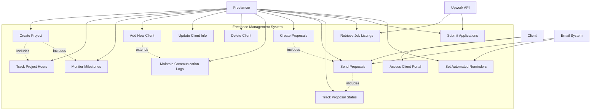
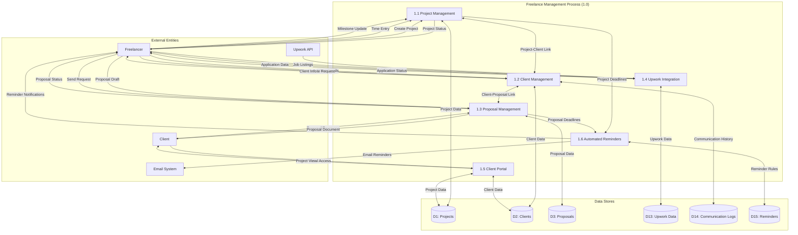

# Software Requirements Specification (SRS)
## NouAssist Business Operations Platform

### Document Information
- **Document Version:** 1.0
- **Date:** June 14, 2025
- **Prepared for:** NouAssist Development Team

---

## 1. Introduction

### 1.1 Purpose
This Software Requirements Specification (SRS) document describes the functional and non-functional requirements for the NouAssist Business Operations Platform. The system is designed to provide comprehensive business management capabilities across freelance operations, lead management, contract portfolio management, and resource inventory management.

### 1.2 Scope
The NouAssist platform encompasses four primary business operation modules:
- **Freelance Management:** Complete freelancer workflow management including project tracking, client relations, and proposal management
- **Lead Contact Management:** Comprehensive lead generation, qualification, and contact management system
- **Contract Portfolio Management:** Contract lifecycle management with portfolio oversight capabilities
- **Resource Inventory Management:** Resource allocation, tracking, and inventory management system

### 1.3 Definitions and Acronyms
- **API:** Application Programming Interface
- **CRM:** Customer Relationship Management
- **ROI:** Return on Investment
- **SRS:** Software Requirements Specification

---

## 2. Overall Description

### 2.1 Product Perspective
NouAssist is a comprehensive business operations platform designed to streamline and automate various business processes. The system integrates multiple operational domains into a unified platform with cross-functional capabilities and shared resource management.

### 2.2 User Classes
- **Freelancers:** Independent contractors managing projects and client relationships
- **Business Managers:** Personnel overseeing lead generation and conversion processes
- **Contract Managers:** Users responsible for contract lifecycle management
- **Resource Managers:** Personnel managing inventory and resource allocation
- **Executives/Stakeholders:** Users requiring high-level portfolio and performance insights

---

## 3. System Features and Requirements

### 3.1 Freelance Management Module

#### 3.1.1 Project Management (NouAssist.BusinessOperations.FreelanceManagement.ProjectManagement)
**Description:** Comprehensive project management capabilities specifically designed for freelance operations.

**Functional Requirements:**
- Create freelance-specific projects with customizable templates
- Track project hours for accurate billing calculations
- Monitor project milestones and deliverable completion
- Generate project progress reports

#### 3.1.2 Client Management (NouAssist.BusinessOperations.FreelanceManagement.ClientManagement)
**Description:** Complete client relationship management system for freelancers.

**Functional Requirements:**
- **FP-2.1 Add New Client:** System shall allow freelancers to add new clients with comprehensive details including client name, contact information, and project history
- **FP-2.2 Update Client Information:** System shall enable freelancers to update existing client details, including contact information and associated projects
- **FP-2.3 Delete Client:** System shall permit freelancers to delete client records with proper confirmation and permission controls, automatically removing associations with projects and billing information
- Store detailed client information and contact details
- Maintain comprehensive communication logs with timestamps and interaction types

#### 3.1.3 Proposal Management (NouAssist.BusinessOperations.FreelanceManagement.ProposalManagement)
**Description:** Streamlined proposal creation, delivery, and tracking system.

**Functional Requirements:**
- **FP-4.1 Create Proposals:** System shall enable freelancers to create detailed project proposals including scope, timeline, deliverables, and pricing
- **FP-4.2 Send Proposals:** System shall allow direct proposal delivery to clients via email or in-app notifications with status tracking capabilities
- **FP-4.3 Track Proposal Status:** System shall monitor proposal status (sent, viewed, accepted, rejected) and provide notifications for client interactions
- Draft proposals using customizable templates
- Maintain proposal version control and acceptance tracking

#### 3.1.4 Upwork Integration (NouAssist.BusinessOperations.FreelanceManagement.UpworkIntegration)
**Description:** Seamless integration with Upwork platform for job management.

**Functional Requirements:**
- Retrieve job listings via Upwork API with filtering capabilities
- Submit proposals and track application status
- Handle contract data synchronization from Upwork platform

#### 3.1.5 Client Portal (NouAssist.BusinessOperations.FreelanceManagement.ClientPortal)
**Description:** Dedicated client interface for project collaboration.

**Functional Requirements:**
- **TK-02-FR028:** Create comprehensive client portal for project viewing and communication

#### 3.1.6 Automated Reminders (NouAssist.BusinessOperations.FreelanceManagement.AutomatedReminders)
**Description:** Intelligent reminder system for project-related activities.

**Functional Requirements:**
- **TK-02-FR029:** Implement automated reminder system for project deadlines, client follow-ups, and billing cycles

### 3.2 Lead Contact Management Module

#### 3.2.1 Lead Management (NouAssist.BusinessOperations.LeadContact.LeadManagement)
**Description:** Comprehensive lead capture and management system.

**Functional Requirements:**
- **LC-LC-001 Create New Lead:** System shall enable capture of new leads from various sources with customizable fields
- **LC-LC-002 Import Leads:** System shall support bulk import of leads from external sources with data validation
- **LC-LC-003 Lead Validation:** System shall validate and deduplicate lead information automatically
- Capture leads from web forms with real-time processing
- Perform comprehensive deduplication checks using multiple criteria

#### 3.2.2 Track Lead Interactions (NouAssist.BusinessOperations.LeadContact.TrackLeadInteractions)
**Description:** Detailed interaction tracking and follow-up management.

**Functional Requirements:**
- **LC-LT-001 Track Interactions:** System shall record all interactions with leads including type, duration, and outcome
- **LC-LT-002 Monitor Activities:** System shall track lead engagement patterns and response metrics
- **LC-LT-003 Set Reminders:** System shall create automated follow-up reminders for lead interactions
- Log all communication types (calls, emails, meetings) with detailed timestamps
- Provide intelligent next follow-up date recommendations

#### 3.2.3 Contact Management (NouAssist.BusinessOperations.LeadContact.ContactManagement)
**Description:** Centralized contact information and organization management.

**Functional Requirements:**
- Store comprehensive contact information and organizational details
- Manage contact groups with hierarchical organization
- Provide contact analytics and engagement metrics

#### 3.2.4 Lead Qualification (NouAssist.BusinessOperations.LeadContact.LeadQualification)
**Description:** Automated lead scoring and qualification system.

**Functional Requirements:**
- **LC-LQ-001 Score Leads:** System shall implement configurable lead scoring based on multiple criteria
- **LC-LQ-002 Qualify Leads:** System shall enable multi-stage qualification process with custom workflows
- **LC-LQ-003 Update Lead Status:** System shall track and maintain lead qualification status changes with audit trail

#### 3.2.5 Contact Organization (NouAssist.BusinessOperations.LeadContact.ContactOrganization)
**Description:** Advanced contact categorization and relationship management.

**Functional Requirements:**
- **LC-CO-001 Create Groups:** System shall enable organization of contacts into customizable groups
- **LC-CO-002 Tag Contacts:** System shall support flexible tagging system for contact categorization
- **LC-CO-003 Manage Hierarchies:** System shall handle complex relationship hierarchies between contacts and organizations

#### 3.2.6 Communication (NouAssist.BusinessOperations.LeadContact.Communication)
**Description:** Integrated communication management system.

**Functional Requirements:**
- **LC-CM-001 Send Messages:** System shall enable direct communication with contacts through multiple channels
- **LC-CM-002 Track Communications:** System shall record comprehensive communication history with searchable archive
- **LC-CM-003 Template Management:** System shall manage reusable communication templates with personalization capabilities

#### 3.2.7 Integration (NouAssist.BusinessOperations.LeadContact.Integration)
**Description:** External system integration capabilities.

**Functional Requirements:**
- **LC-IN-001 CRM Integration:** System shall connect with external CRM systems for data synchronization
- **LC-IN-002 Email Integration:** System shall sync with email platforms for seamless communication tracking

#### 3.2.8 Analytics (NouAssist.BusinessOperations.LeadContact.Analytics)
**Description:** Comprehensive analytics and reporting system.

**Functional Requirements:**
- **LC-AN-001 Lead Analytics:** System shall generate detailed lead performance analytics with customizable metrics
- **LC-AN-002 Contact Analytics:** System shall analyze contact engagement patterns and interaction effectiveness
- **LC-AN-003 ROI Tracking:** System shall measure and report return on lead generation investments

#### 3.2.9 Automation (NouAssist.BusinessOperations.LeadContact.Automation)
**Description:** Intelligent process automation capabilities.

**Functional Requirements:**
- **LC-AU-001 Automate Follow-ups:** System shall set up configurable automated follow-up sequences
- **LC-AU-002 Task Generation:** System shall create automated tasks based on lead activity and predefined triggers
- **LC-AU-003 Notification System:** System shall manage comprehensive automated notification system

#### 3.2.10 Data Management (NouAssist.BusinessOperations.LeadContact.DataManagement)
**Description:** Data quality and integrity management system.

**Functional Requirements:**
- **LC-DM-001 Data Cleanup:** System shall maintain data quality through automated cleanup processes
- **LC-DM-002 Duplicate Management:** System shall identify and merge duplicate records with user approval
- **LC-DM-003 Data Enrichment:** System shall enrich contact data from external sources automatically

#### 3.2.11 Lead Source Tracking (NouAssist.BusinessOperations.LeadContact.LeadSourceTracking)
**Description:** Comprehensive lead source attribution system.

**Functional Requirements:**
- **TK-02-FR030:** Implement detailed lead source tracking with attribution modeling

#### 3.2.12 Marketing Automation Integration (NouAssist.BusinessOperations.LeadContact.MarketingAutomationIntegration)
**Description:** Integration with marketing automation platforms.

**Functional Requirements:**
- **TK-02-FR031:** Integrate with major marketing automation platforms for seamless workflow management

### 3.3 Contract Portfolio Management Module

#### 3.3.1 Contract Management (NouAssist.BusinessOperations.ContractPortfolio.ContractManagement)
**Description:** Complete contract lifecycle management system.

**Functional Requirements:**
- **CP-CC-001 Create Contract:** System shall enable creation of new contracts using customizable templates
- **CP-CC-002 Set Contract Terms:** System shall define comprehensive contract terms, conditions, and legal clauses
- **CP-CC-003 Add Contract Parties:** System shall manage all parties involved in contracts with role definitions
- **CP-CM-001 Track Contract Status:** System shall monitor complete contract lifecycle and status transitions
- **CP-CM-002 Manage Amendments:** System shall handle contract modifications and amendments with version control
- **CP-CM-003 Set Contract Alerts:** System shall create intelligent alerts for key contract dates and critical milestones
- Upload and maintain contract versions with secure storage
- Track contract status progression (draft, active, closed) with audit trail

#### 3.3.2 Portfolio Management (NouAssist.BusinessOperations.ContractPortfolio.PortfolioManagement)
**Description:** Comprehensive portfolio oversight and management capabilities.

**Functional Requirements:**
- **CP-PC-001 Create Portfolio:** System shall enable creation of project and work portfolios with customizable structures
- **CP-PC-002 Add Portfolio Items:** System shall manage addition and organization of items within portfolios
- **CP-PC-003 Set Portfolio Categories:** System shall organize portfolios using hierarchical categorization
- **CP-PM-001 Track Performance:** System shall monitor comprehensive portfolio performance metrics
- **CP-PM-002 Update Portfolio:** System shall manage dynamic updates to portfolio content and structure
- **CP-PM-003 Generate Reports:** System shall create detailed portfolio performance reports with customizable metrics
- Manage multiple projects within unified portfolio structure
- Provide comprehensive portfolio-level reporting and analytics

#### 3.3.3 Portfolio Sharing (NouAssist.BusinessOperations.ContractPortfolio.PortfolioSharing)
**Description:** Secure portfolio sharing and collaboration system.

**Functional Requirements:**
- **CP-PS-001 Share Portfolio:** System shall enable secure sharing of portfolios with internal and external stakeholders
- **CP-PS-002 Set Access Rights:** System shall manage granular access permissions for shared portfolios
- **CP-PS-003 Track Portfolio Views:** System shall monitor portfolio access patterns and usage analytics

#### 3.3.4 Document Management (NouAssist.BusinessOperations.ContractPortfolio.DocumentManagement)
**Description:** Centralized document storage and organization system.

**Functional Requirements:**
- **CP-DM-001 Store Documents:** System shall manage secure storage of contract and portfolio documents
- **CP-DM-002 Organize Files:** System shall maintain organized file structure with metadata management
- **CP-DM-003 Search Documents:** System shall enable advanced document search and retrieval capabilities

#### 3.3.5 Risk Management (NouAssist.BusinessOperations.ContractPortfolio.RiskManagement)
**Description:** Comprehensive risk assessment and monitoring system.

**Functional Requirements:**
- **CP-RM-001 Assess Risks:** System shall evaluate contract and portfolio risks using configurable criteria
- **CP-RM-002 Monitor Risk Factors:** System shall track identified risk factors with automated monitoring
- **CP-RM-003 Generate Risk Reports:** System shall create detailed risk assessment reports with mitigation recommendations

#### 3.3.6 Compliance (NouAssist.BusinessOperations.ContractPortfolio.Compliance)
**Description:** Regulatory compliance monitoring and reporting system.

**Functional Requirements:**
- **CP-CO-001 Track Compliance:** System shall monitor compliance with contract terms and regulatory requirements
- **CP-CO-002 Generate Alerts:** System shall create proactive compliance-related alerts and notifications
- **CP-CO-003 Audit Trail:** System shall maintain comprehensive compliance audit trail with tamper-proof logging

#### 3.3.7 Analytics (NouAssist.BusinessOperations.ContractPortfolio.Analytics)
**Description:** Advanced analytics and business intelligence capabilities.

**Functional Requirements:**
- **CP-AN-001 Performance Analytics:** System shall generate comprehensive portfolio performance analytics
- **CP-AN-002 Contract Analytics:** System shall analyze contract performance trends and patterns
- **CP-AN-003 Export Reports:** System shall enable export of analytics reports in multiple formats

#### 3.3.8 Contract Version Control (NouAssist.BusinessOperations.ContractPortfolio.ContractVersionControl)
**Description:** Advanced version control system for contract management.

**Functional Requirements:**
- **CP-VC-001 Track Versions:** System shall maintain detailed version history of all contract changes
- **CP-VC-002 Compare Versions:** System shall enable side-by-side comparison between contract versions
- **CP-VC-003 Archive Contracts:** System shall manage systematic contract archival with retention policies

#### 3.3.9 Roadmapping (NouAssist.BusinessOperations.ContractPortfolio.Roadmapping)
**Description:** Strategic planning and timeline visualization system.

**Functional Requirements:**
- **PM-CP-002 Project/Portfolio Roadmaps:** System shall create timeline-based roadmaps with milestone tracking and dependency visualization across multiple projects

#### 3.3.10 Resource Pooling (NouAssist.BusinessOperations.ContractPortfolio.ResourcePooling)
**Description:** Cross-project resource allocation and management system.

**Functional Requirements:**
- **PM-CP-003 Shared Resource Pools & Allocation:** System shall allocate resources across multiple projects, track resource conflicts, and forecast future resource needs

#### 3.3.11 Cross-Project View (NouAssist.BusinessOperations.ContractPortfolio.Cross-ProjectView)
**Description:** Executive-level portfolio overview and monitoring system.

**Functional Requirements:**
- **PM-CP-001 High-Level Project Portfolio:** System shall provide comprehensive overview of active projects including progress metrics, budget tracking, and resource utilization for executives and stakeholders

### 3.4 Resource Inventory Management Module

#### 3.4.1 Resource Definition (NouAssist.BusinessOperations.ResourceInventory.ResourceDefinition)
**Description:** Comprehensive resource type definition and categorization system.

**Functional Requirements:**
- **RI-RD-001 Create Resource Type:** System shall enable creation of resource types with customizable attributes, categories, and properties
- **RI-RD-002 Update Resource Types:** System shall allow modification of existing resource type definitions with version control
- **RI-RD-003 Archive Resource Types:** System shall support archiving of unused resource types while maintaining historical data integrity
- Define flexible resource types with custom attributes
- Manage hierarchical category structures with inheritance

#### 3.4.2 Resource Allocation and Tracking (NouAssist.BusinessOperations.ResourceInventory.ResourceAllocationAndTracking)
**Description:** Dynamic resource allocation and utilization tracking system.

**Functional Requirements:**
- **RI-RA-001 Allocate Resources:** System shall enable intelligent assignment of resources to tasks or projects with conflict detection
- **RI-RA-002 Track Resource Usage:** System shall monitor real-time utilization of allocated resources with performance metrics
- **RI-RA-003 Release Resources:** System shall manage systematic release of resources back to available pool with proper workflows
- Allocate resources to tasks and projects with optimization algorithms
- Track usage patterns and identify allocation conflicts

#### 3.4.3 Resource Optimization (NouAssist.BusinessOperations.ResourceInventory.ResourceOptimization)
**Description:** Intelligent resource optimization and recommendation system.

**Functional Requirements:**
- **RI-RO-001 Analyze Resource Usage:** System shall provide comprehensive analysis of resource utilization patterns and efficiency metrics
- **RI-RO-002 Identify Bottlenecks:** System shall detect resource constraints and bottlenecks with predictive capabilities
- **RI-RO-003 Suggest Alternatives:** System shall recommend optimal alternative resource allocation strategies
- Identify system bottlenecks using advanced analytics
- Suggest intelligent alternative allocation strategies

#### 3.4.4 Inventory Tracking (NouAssist.BusinessOperations.ResourceInventory.InventoryTracking)
**Description:** Real-time inventory monitoring and management system.

**Functional Requirements:**
- **RI-IT-001 Track Stock Levels:** System shall monitor current inventory levels across multiple locations with real-time updates
- **RI-IT-002 Record Transactions:** System shall log all inventory movements and changes with detailed transaction history
- **RI-IT-003 Generate Alerts:** System shall create intelligent alerts for low stock conditions and other inventory thresholds
- Track physical items with precise stock level monitoring
- Manage multi-location inventory with centralized visibility

#### 3.4.5 Inventory Audit (NouAssist.BusinessOperations.ResourceInventory.InventoryAudit)
**Description:** Comprehensive inventory audit and reconciliation system.

**Functional Requirements:**
- **RI-IA-001 Conduct Audits:** System shall support systematic physical inventory count and reconciliation processes
- **RI-IA-002 Record Discrepancies:** System shall track and analyze differences between expected and actual inventory levels
- **RI-IA-003 Generate Audit Reports:** System shall create detailed reports of audit findings with corrective action recommendations
- Conduct systematic inventory audits with mobile support
- Generate comprehensive audit reports with variance analysis

#### 3.4.6 Resource Sharing (NouAssist.BusinessOperations.ResourceInventory.ResourceSharing)
**Description:** Cross-functional resource sharing and collaboration system.

**Functional Requirements:**
- **RI-RS-001 Share Resources:** System shall enable flexible sharing of resources between teams or projects with approval workflows
- **RI-RS-002 Manage Access Rights:** System shall control granular access permissions for shared resources with role-based security
- **RI-RS-003 Track Shared Usage:** System shall monitor usage patterns of shared resources across teams with utilization analytics
- Share resources among users and teams with intelligent allocation
- Manage sophisticated permission levels with approval hierarchies

#### 3.4.7 Inventory Forecasting (NouAssist.BusinessOperations.ResourceInventory.InventoryForecasting)
**Description:** Predictive inventory management and demand forecasting system.

**Functional Requirements:**
- **RI-IF-001 Generate Forecasts:** System shall create accurate demand forecasts based on historical data and trend analysis
- **RI-IF-002 Adjust Predictions:** System shall allow manual adjustment of automated forecasts with expert input integration
- **RI-IF-003 Track Forecast Accuracy:** System shall monitor and improve accuracy of inventory predictions with machine learning

#### 3.4.8 Resource Analytics (NouAssist.BusinessOperations.ResourceInventory.ResourceAnalytics)
**Description:** Advanced analytics and reporting system for resource management.

**Functional Requirements:**
- **RI-AN-001 Generate Usage Reports:** System shall create comprehensive resource usage analytics with customizable dashboards
- **RI-AN-002 Analyze Efficiency:** System shall evaluate resource allocation efficiency with performance benchmarking
- **RI-AN-003 Export Analytics Data:** System shall enable export of analytics in multiple formats for external analysis

#### 3.4.9 Barcode Integration (NouAssist.BusinessOperations.ResourceInventory.BarcodeIntegration)
**Description:** Comprehensive barcode management and scanning system.

**Functional Requirements:**
- **RI-BI-001 Generate Barcodes:** System shall create standardized barcodes for inventory items with multiple format support
- **RI-BI-002 Scan Items:** System shall support barcode scanning for inventory operations with mobile device integration
- **RI-BI-003 Manage Barcode System:** System shall maintain barcode system configuration and settings with quality control

#### 3.4.10 Category Management (NouAssist.BusinessOperations.ResourceInventory.CategoryManagement)
**Description:** Hierarchical category management system for resource organization.

**Functional Requirements:**
- **RI-CM-001 Create Categories:** System shall enable creation of hierarchical resource categories with flexible structures
- **RI-CM-002 Manage Category Hierarchy:** System shall support complex management of category relationships and inheritance
- **RI-CM-003 Merge Categories:** System shall allow systematic combining of similar or duplicate categories with data migration

#### 3.4.11 Location Management (NouAssist.BusinessOperations.ResourceInventory.LocationManagement)
**Description:** Multi-location inventory management and tracking system.

**Functional Requirements:**
- **RI-LM-001 Create Locations:** System shall enable definition of storage locations and zones with detailed specifications
- **RI-LM-002 Manage Location Hierarchy:** System shall support organization of locations in hierarchical structure with inheritance
- **RI-LM-003 Track Location Usage:** System shall monitor capacity and utilization of locations with optimization recommendations

#### 3.4.12 Resource Booking Reservation (NouAssist.BusinessOperations.ResourceInventory.ResourceBookingReservation)
**Description:** Advanced resource booking and reservation management system.

**Functional Requirements:**
- **TK-02-FR032:** Implement comprehensive resource booking and reservation system with calendar integration and conflict resolution

#### 3.4.13 Inventory Level Alerts (NouAssist.BusinessOperations.ResourceInventory.InventoryLevelAlerts)
**Description:** Intelligent alert system for inventory management.

**Functional Requirements:**
- **TK-02-FR033:** Implement highly customizable inventory level alerts with multiple notification channels and escalation procedures

---

## 4. External Interface Requirements

### 4.1 User Interfaces
- Web-based responsive interface supporting desktop and mobile devices
- Intuitive dashboard with role-based customization
- Mobile applications for field operations and inventory management

### 4.2 Hardware Interfaces
- Barcode scanner integration for inventory operations
- Mobile device camera integration for document capture
- Multi-touch support for tablet-based operations

### 4.3 Software Interfaces
- **Upwork API Integration:** For job listings and contract management
- **CRM System Integration:** Bidirectional data synchronization
- **Email Platform Integration:** For communication tracking
- **Marketing Automation Platform Integration:** For lead nurturing workflows

### 4.4 Communication Interfaces
- RESTful API for third-party integrations
- Webhook support for real-time notifications
- Email and SMS notification systems
- In-app messaging and notification center

---

## 5. Non-Functional Requirements

### 5.1 Performance Requirements
- System response time under 2 seconds for standard operations
- Support for concurrent users up to 10,000
- 99.9% system uptime availability
- Real-time data synchronization across modules

### 5.2 Security Requirements
- Role-based access control with granular permissions
- Data encryption in transit and at rest
- Audit trail for all system operations
- Compliance with data protection regulations

### 5.3 Reliability Requirements
- Automated backup and disaster recovery procedures
- Failover capabilities for critical system components
- Data integrity validation and error recovery mechanisms

### 5.4 Scalability Requirements
- Horizontal scaling capability for increased user load
- Modular architecture supporting feature expansion
- Cloud-native deployment with auto-scaling capabilities

---

## 6. Other Requirements

### 6.1 Regulatory Requirements
- Compliance with data protection regulations (GDPR, CCPA)
- Financial data handling compliance where applicable
- Industry-specific compliance requirements for contract management

### 6.2 Operational Requirements
- 24/7 system monitoring and alerting
- Regular system maintenance windows
- User training and documentation requirements

### 6.3 Environmental Requirements
- Cross-platform compatibility (Windows, macOS, Linux)
- Browser compatibility (Chrome, Firefox, Safari, Edge)
- Mobile platform support (iOS, Android)

---

## 7. Acceptance Criteria

Each feature must meet the following general acceptance criteria:
- All functional requirements implemented and tested
- Performance benchmarks achieved
- Security requirements validated
- User acceptance testing completed
- Documentation and training materials provided

---

# Use Case and Data Flow Diagrams
## NouAssist Business Operations Platform

---

## 1. Use Case Diagrams

### 1.1 High-Level System Use Case Diagram

```
                    NouAssist Business Operations Platform
    ┌─────────────────────────────────────────────────────────────────────┐
    │                                                                     │
    │  ┌─────────────────┐    ┌─────────────────┐    ┌─────────────────┐ │
    │  │   Freelance     │    │  Lead Contact   │    │   Contract      │ │
    │  │  Management     │    │   Management    │    │   Portfolio     │ │
    │  │                 │    │                 │    │   Management    │ │
    │  └─────────────────┘    └─────────────────┘    └─────────────────┘ │
    │                                                                     │
    │  ┌─────────────────┐                                               │
    │  │   Resource      │                                               │
    │  │   Inventory     │                                               │
    │  │   Management    │                                               │
    │  └─────────────────┘                                               │
    └─────────────────────────────────────────────────────────────────────┘

    Freelancer ──────────┐
                         │
    Business Manager ────┼─── System Boundary
                         │
    Contract Manager ────┤
                         │
    Resource Manager ────┤
                         │
    Executive ───────────┘

    Client ──────────────── (External)
    
    Upwork API ─────────── (External)
    
    CRM Systems ───────── (External)
    
    Email Platforms ──── (External)
```

### 1.2 Freelance Management Use Case Diagram



### 1.3 Lead Contact Management Use Case Diagram

```mermaid
graph TD
    BM[Business Manager]
    L[Lead/Contact]
    CRM[CRM Systems]
    EP[Email Platforms]
    MA[Marketing Automation]
    
    subgraph "Lead Contact Management System"
        UC15[Create New Lead]
        UC16[Import Leads]
        UC17[Validate Leads]
        UC18[Track Interactions]
        UC19[Monitor Activities]
        UC20[Set Follow-up Reminders]
        UC21[Score Leads]
        UC22[Qualify Leads]
        UC23[Update Lead Status]
        UC24[Organize Contacts]
        UC25[Tag Contacts]
        UC26[Send Messages]
        UC27[Track Communications]
        UC28[Generate Analytics]
        UC29[Automate Follow-ups]
        UC30[Manage Data Quality]
        UC31[Track Lead Sources]
    end
    
    BM --> UC15
    BM --> UC16
    BM --> UC17
    BM --> UC18
    BM --> UC19
    BM --> UC20
    BM --> UC21
    BM --> UC22
    BM --> UC23
    BM --> UC24
    BM --> UC25
    BM --> UC26
    BM --> UC27
    BM --> UC28
    BM --> UC29
    BM --> UC30
    BM --> UC31
    
    L --> UC18
    L --> UC26
    
    CRM --> UC16
    CRM --> UC27
    
    EP --> UC26
    EP --> UC27
    
    MA --> UC29
    MA --> UC31
    
    UC15 -.includes.-> UC17
    UC16 -.includes.-> UC17
    UC18 -.includes.-> UC20
    UC21 -.includes.-> UC22
    UC26 -.includes.-> UC27
```



### 1.4 Contract Portfolio Management Use Case Diagram

```mermaid
graph TD
    CM[Contract Manager]
    EX[Executive]
    ST[Stakeholder]
    
    subgraph "Contract Portfolio Management System"
        UC32[Create Contract]
        UC33[Set Contract Terms]
        UC34[Add Contract Parties]
        UC35[Track Contract Status]
        UC36[Manage Amendments]
        UC37[Set Contract Alerts]
        UC38[Create Portfolio]
        UC39[Add Portfolio Items]
        UC40[Track Performance]
        UC41[Generate Reports]
        UC42[Share Portfolio]
        UC43[Manage Documents]
        UC44[Assess Risks]
        UC45[Monitor Compliance]
        UC46[Generate Analytics]
        UC47[Manage Versions]
        UC48[Create Roadmaps]
        UC49[Allocate Resources]
        UC50[View Project Overview]
    end
    
    CM --> UC32
    CM --> UC33
    CM --> UC34
    CM --> UC35
    CM --> UC36
    CM --> UC37
    CM --> UC38
    CM --> UC39
    CM --> UC40
    CM --> UC41
    CM --> UC42
    CM --> UC43
    CM --> UC44
    CM --> UC45
    CM --> UC46
    CM --> UC47
    CM --> UC48
    CM --> UC49
    
    EX --> UC50
    EX --> UC41
    EX --> UC48
    
    ST --> UC42
    ST --> UC50
    
    UC32 -.includes.-> UC33
    UC32 -.includes.-> UC34
    UC35 -.includes.-> UC37
    UC38 -.includes.-> UC39
    UC40 -.includes.-> UC41
    UC42 -.includes.-> UC43
```



### 1.5 Resource Inventory Management Use Case Diagram

```mermaid
graph TD
    RM[Resource Manager]
    TM[Team Member]
    BS[Barcode Scanner]
    
    subgraph "Resource Inventory Management System"
        UC51[Create Resource Type]
        UC52[Update Resource Types]
        UC53[Allocate Resources]
        UC54[Track Resource Usage]
        UC55[Release Resources]
        UC56[Analyze Usage Patterns]
        UC57[Identify Bottlenecks]
        UC58[Track Stock Levels]
        UC59[Record Transactions]
        UC60[Generate Alerts]
        UC61[Conduct Audits]
        UC62[Share Resources]
        UC63[Generate Forecasts]
        UC64[Generate Barcodes]
        UC65[Scan Items]
        UC66[Manage Categories]
        UC67[Manage Locations]
        UC68[Book Resources]
        UC69[Set Inventory Alerts]
    end
    
    RM --> UC51
    RM --> UC52
    RM --> UC53
    RM --> UC54
    RM --> UC55
    RM --> UC56
    RM --> UC57
    RM --> UC58
    RM --> UC59
    RM --> UC60
    RM --> UC61
    RM --> UC62
    RM --> UC63
    RM --> UC64
    RM --> UC65
    RM --> UC66
    RM --> UC67
    RM --> UC68
    RM --> UC69
    
    TM --> UC53
    TM --> UC54
    TM --> UC55
    TM --> UC62
    TM --> UC65
    TM --> UC68
    
    BS --> UC65
    
    UC51 -.includes.-> UC66
    UC53 -.includes.-> UC54
    UC58 -.includes.-> UC60
    UC61 -.includes.-> UC59
    UC64 -.includes.-> UC65
```



---

## 2. Data Flow Diagrams

### 2.1 Context Level Data Flow Diagram (Level 0)

```
                           ┌─────────────────┐
                           │                 │
        Client Data ──────▶│                 │──────▶ Project Updates
                           │                 │
      Job Listings ──────▶│   NouAssist     │──────▶ Proposals
                           │   Business      │
    Lead Information ────▶│   Operations    │──────▶ Reports & Analytics
                           │   Platform      │
     Contract Data ──────▶│                 │──────▶ Notifications
                           │                 │
    Resource Requests ───▶│                 │──────▶ Resource Allocations
                           │                 │
                           └─────────────────┘
                                     │
                                     ▼
                               Database Storage

External Entities:
- Freelancer
- Client  
- Business Manager
- Contract Manager
- Resource Manager
- Executive
- Upwork API
- CRM Systems
- Email Platforms
- Marketing Automation
```

### 2.2 System Level Data Flow Diagram (Level 1)

```mermaid
graph TB
    subgraph "External Entities"
        F[Freelancer]
        C[Client]
        BM[Business Manager]
        CM[Contract Manager]
        RM[Resource Manager]
        EX[Executive]
        UA[Upwork API]
        CRM[CRM Systems]
        EP[Email Platforms]
        MA[Marketing Automation]
    end
    
    subgraph "NouAssist Platform Processes"
        P1[1.0 Freelance Management]
        P2[2.0 Lead Contact Management]
        P3[3.0 Contract Portfolio Management]
        P4[4.0 Resource Inventory Management]
        P5[5.0 Analytics & Reporting]
        P6[6.0 Integration Management]
    end
    
    subgraph "Data Stores"
        D1[(D1: Projects)]
        D2[(D2: Clients)]
        D3[(D3: Proposals)]
        D4[(D4: Leads)]
        D5[(D5: Contacts)]
        D6[(D6: Communications)]
        D7[(D7: Contracts)]
        D8[(D8: Portfolios)]
        D9[(D9: Resources)]
        D10[(D10: Inventory)]
        D11[(D11: Analytics)]
        D12[(D12: System Config)]
    end
    
    %% Freelance Management Flows
    F -->|Project Data| P1
    F -->|Client Info| P1
    F -->|Proposal Data| P1
    C -->|Feedback| P1
    P1 -->|Project Updates| F
    P1 -->|Proposals| C
    P1 <-->|Project Data| D1
    P1 <-->|Client Data| D2
    P1 <-->|Proposal Data| D3
    
    %% Lead Contact Management Flows
    BM -->|Lead Data| P2
    BM -->|Contact Info| P2
    P2 -->|Lead Reports| BM
    P2 <-->|Lead Data| D4
    P2 <-->|Contact Data| D5
    P2 <-->|Communication Data| D6
    
    %% Contract Portfolio Management Flows
    CM -->|Contract Data| P3
    EX -->|Portfolio Requests| P3
    P3 -->|Contract Status| CM
    P3 -->|Portfolio Reports| EX
    P3 <-->|Contract Data| D7
    P3 <-->|Portfolio Data| D8
    
    %% Resource Inventory Management Flows
    RM -->|Resource Data| P4
    RM -->|Inventory Data| P4
    P4 -->|Resource Reports| RM
    P4 <-->|Resource Data| D9
    P4 <-->|Inventory Data| D10
    
    %% Analytics & Reporting Flows
    P5 <-->|Analytics Data| D11
    P5 -->|Reports| EX
    P5 -->|Analytics| BM
    P5 -->|Metrics| CM
    P5 -->|Usage Reports| RM
    
    %% Integration Management Flows
    UA -->|Job Listings| P6
    CRM <-->|Contact Sync| P6
    EP <-->|Email Data| P6
    MA <-->|Campaign Data| P6
    P6 <-->|Integration Config| D12
    
    %% Cross-Process Data Flows
    P1 <-->|Resource Requests| P4
    P2 <-->|Lead to Client| P1
    P3 <-->|Contract Resources| P4
    P1 -->|Project Metrics| P5
    P2 -->|Lead Metrics| P5
    P3 -->|Portfolio Metrics| P5
    P4 -->|Resource Metrics| P5
```



### 2.3 Detailed Data Flow Diagram - Freelance Management (Level 2)



### 2.4 Detailed Data Flow Diagram - Lead Contact Management (Level 2)

```mermaid
graph TB
    subgraph "Lead Contact Management Process (2.0)"
        P21[2.1 Lead Management]
        P22[2.2 Interaction Tracking]
        P23[2.3 Contact Organization]
        P24[2.4 Lead Qualification]
        P25[2.5 Communication]
        P26[2.6 Analytics]
        P27[2.7 Automation]
        P28[2.8 Data Management]
    end
    
    subgraph "Data Stores"
        D4[(D4: Leads)]
        D5[(D5: Contacts)]
        D6[(D6: Communications)]
        D16[(D16: Interactions)]
        D17[(D17: Qualification Scores)]
        D18[(D18: Contact Groups)]
        D19[(D19: Templates)]
        D20[(D20: Automation Rules)]
    end
    
    subgraph "External Entities"
        BM[Business Manager]
        L[Lead/Contact]
        CRM[CRM Systems]
        EP[Email Platforms]
        MA[Marketing Automation]
        WF[Web Forms]
    end
    
    %% Lead Management Flows
    WF -->|Form Submissions| P21
    BM -->|Manual Lead Entry| P21
    CRM -->|Lead Import| P21
    P21 -->|Lead Validation| BM
    P21 <-->|Lead Data| D4
    
    %% Interaction Tracking Flows
    BM -->|Interaction Log| P22
    L -->|Response Data| P22
    P22 -->|Interaction History| BM
    P22 <-->|Interaction Data| D16
    P22 <-->|Communication Records| D6
    
    %% Contact Organization Flows
    BM -->|Organization Rules| P23
    P23 -->|Contact Groups| BM
    P23 <-->|Contact Data| D5
    P23 <-->|Group Data| D18
    
    %% Lead Qualification Flows
    P24 -->|Qualification Score| BM
    P24 <-->|Score Data| D17
    P24 <-->|Lead Data| D4
    
    %% Communication Flows
    BM -->|Send Message| P25
    L -->|Message Response| P25
    EP <-->|Email Sync| P25
    P25 -->|Communication Status| BM
    P25 <-->|Communication Data| D6
    P25 <-->|Template Data| D19
    
    %% Analytics Flows
    P26 -->|Lead Analytics| BM
    P26 -->|ROI Reports| BM
    P26 <-->|All Lead Data| D4
    P26 <-->|Communication Data| D6
    
    %% Automation Flows
    MA <-->|Campaign Sync| P27
    P27 -->|Automated Tasks| BM
    P27 -->|Follow-up Triggers| P25
    P27 <-->|Automation Rules| D20
    
    %% Data Management Flows
    P28 -->|Data Quality Reports| BM
    P28 <-->|Contact Data| D5
    P28 <-->|Lead Data| D4
    
    %% Inter-process Flows
    P21 -->|New Leads| P24
    P22 -->|Interaction Data| P24
    P24 -->|Qualified Leads| P23
    P23 -->|Contact Updates| P25
    P25 -->|Communication Data| P22
    P22 -->|Activity Triggers| P27
```



### 2.5 Data Flow Summary Table

| Process | Input Data | Output Data | Data Stores Used |
|---------|------------|-------------|------------------|
| 1.1 Project Management | Project details, time entries, milestones | Project status, progress reports | D1: Projects |
| 1.2 Client Management | Client information, contact details | Client profiles, communication history | D2: Clients, D14: Communication Logs |
| 1.3 Proposal Management | Proposal content, client responses | Proposal status, documents | D3: Proposals |
| 2.1 Lead Management | Lead data, form submissions | Validated leads, deduplication results | D4: Leads |
| 2.2 Interaction Tracking | Interaction logs, responses | Interaction history, analytics | D6: Communications, D16: Interactions |
| 2.4 Lead Qualification | Lead attributes, scoring criteria | Qualification scores, lead status | D4: Leads, D17: Qualification Scores |
| 3.1 Contract Management | Contract terms, parties, amendments | Contract status, alerts | D7: Contracts |
| 3.2 Portfolio Management | Portfolio items, performance metrics | Portfolio reports, analytics | D8: Portfolios |
| 4.1 Resource Definition | Resource types, attributes, categories | Resource catalog, hierarchies | D9: Resources |
| 4.2 Resource Allocation | Allocation requests, usage data | Resource assignments, conflicts | D9: Resources, D10: Inventory |
| 4.4 Inventory Tracking | Stock movements, transactions | Stock levels, alerts | D10: Inventory |

---

## 3. Use Case Specifications

### 3.1 High-Priority Use Case: Create and Send Proposal

**Use Case ID:** UC-FP-001  
**Use Case Name:** Create and Send Proposal  
**Actor:** Freelancer  
**Description:** Freelancer creates a detailed proposal and sends it to a potential client

**Preconditions:**
- Freelancer is logged into the system
- Client information exists or can be created
- Proposal templates are available

**Main Flow:**
1. Freelancer selects "Create Proposal" option
2. System displays proposal creation form with available templates
3. Freelancer selects template and enters project details (scope, timeline, deliverables, pricing)
4. System validates proposal information
5. Freelancer reviews and finalizes proposal
6. Freelancer selects client and delivery method (email/portal)
7. System sends proposal to client
8. System updates proposal status to "Sent"
9. System creates tracking record for proposal

**Alternative Flows:**
- **A1:** Client doesn't exist - System allows freelancer to create new client record
- **A2:** Proposal validation fails - System displays error messages and allows correction
- **A3:** Email delivery fails - System retries and notifies freelancer

**Postconditions:**
- Proposal is created and stored in system
- Proposal is delivered to client
- Tracking mechanism is activated
- Freelancer receives confirmation

### 3.2 High-Priority Use Case: Track Resource Allocation

**Use Case ID:** UC-RI-001  
**Use Case Name:** Track Resource Allocation  
**Actor:** Resource Manager  
**Description:** Resource manager allocates resources to projects and tracks their usage

**Preconditions:**
- Resource manager is authenticated
- Resources are defined in the system
- Projects exist and require resources

**Main Flow:**
1. Resource manager accesses resource allocation interface
2. System displays available resources and current allocations
3. Resource manager selects project requiring resources
4. System shows resource requirements and conflicts
5. Resource manager allocates available resources
6. System validates allocation and checks for conflicts
7. System confirms allocation and updates resource status
8. System begins tracking resource usage
9. System sends allocation notifications to relevant parties

**Alternative Flows:**
- **A1:** Resource conflict detected - System suggests alternatives
- **A2:** Insufficient resources - System recommends reallocation or procurement
- **A3:** Allocation exceeds capacity - System prevents allocation and suggests alternatives

**Postconditions:**
- Resources are allocated to specified project
- Usage tracking is activated
- Stakeholders are notified
- Resource availability is updated

---

