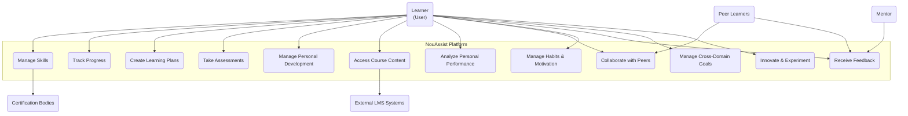
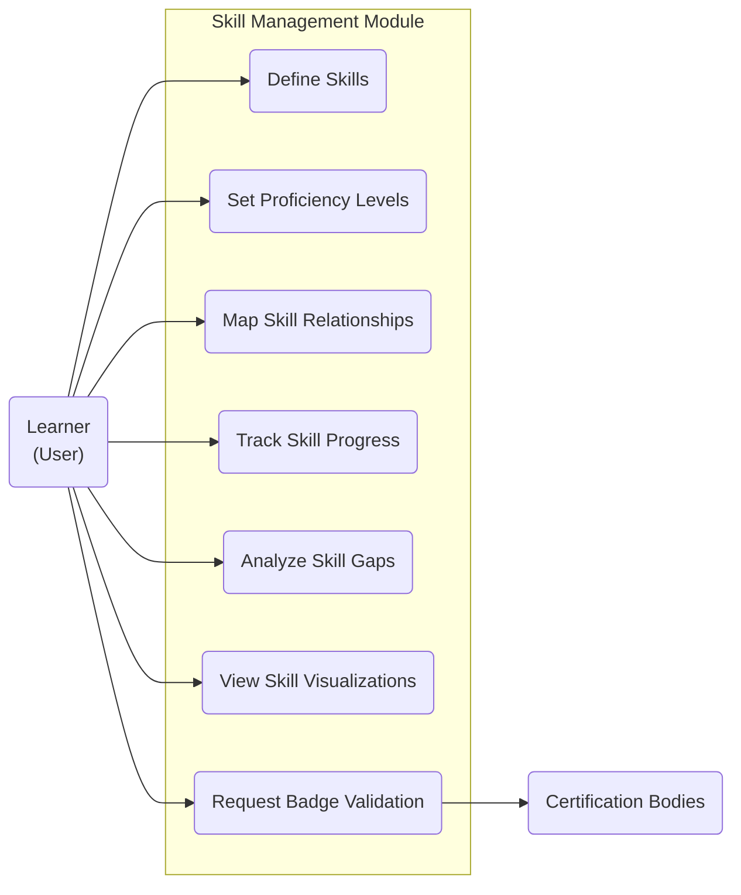
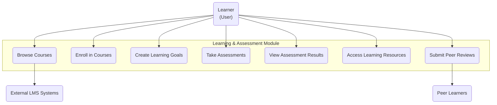
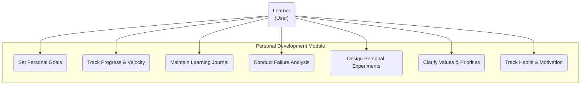
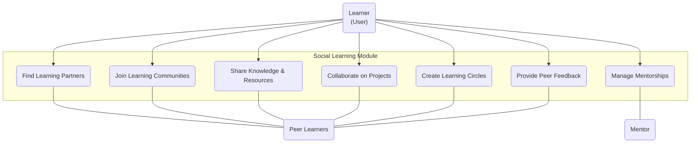
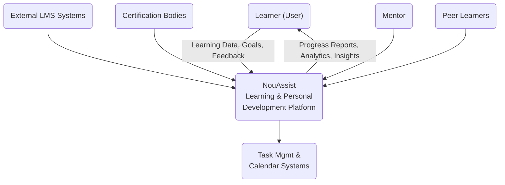
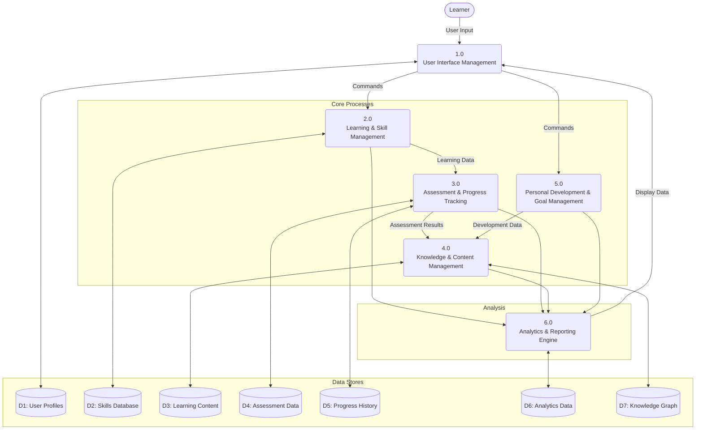
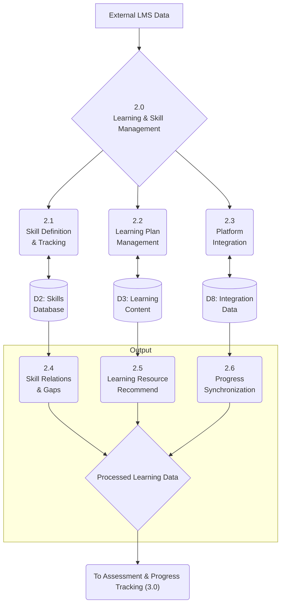
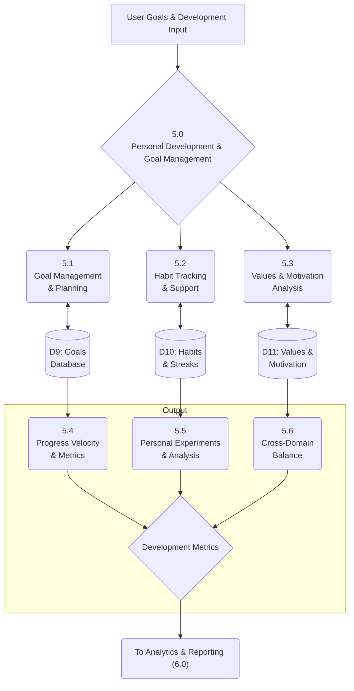
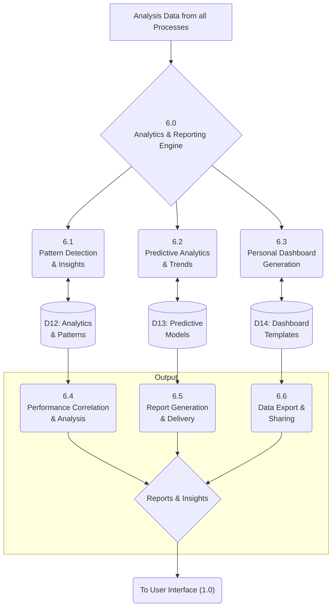

# Software Requirements Specification (SRS)

## NouAssist Learning & Personal Development Platform

**Document Version:** 1.0  
**Date:** June 14, 2025  
**Prepared by:** Development Team

-----

## 1. Introduction

### 1.1 Purpose

This Software Requirements Specification (SRS) defines the functional and non-functional requirements for the NouAssist Learning & Personal Development Platform, a comprehensive system designed to support skill development, learning management, personal growth, and productivity optimization across multiple life domains.

### 1.2 Scope

The NouAssist platform encompasses 18 integrated modules that provide users with tools for skill tracking, learning management, personal development, productivity enhancement, and cross-domain life optimization. The system supports both individual learning and social collaboration while maintaining robust analytics and automation capabilities.

### 1.3 Definitions and Acronyms

  - **API**: Application Programming Interface
  - **LMS**: Learning Management System
  - **SMART Goals**: Specific, Measurable, Achievable, Relevant, Time-bound goals
  - **SOP**: Standard Operating Procedure
  - **GTD**: Getting Things Done methodology
  - **SWOT**: Strengths, Weaknesses, Opportunities, Threats analysis

-----

## 2\. System Overview

### 2.1 System Description

NouAssist is a holistic learning and personal development platform that integrates skill management, course learning, assessment tools, productivity tracking, and personal analytics into a unified ecosystem. The platform supports continuous improvement methodologies and provides cross-domain insights for comprehensive life optimization.

### 2.2 System Architecture

The system is organized into 18 primary modules under the `NouAssist.LearningPersonalDevelopment` namespace, each providing specialized functionality while maintaining integration capabilities with other modules and external systems.

-----

## 3\. Functional Requirements

### 3.1 Skill Tracking Module (FR-01)

**Namespace:** `NouAssist.LearningPersonalDevelopment.SkillTracking`

**Requirements:**

  - **FR-01.1:** System shall manage skill definitions with customizable proficiency levels and assessment criteria
  - **FR-01.2:** System shall define skill relationships including prerequisites, complementary, and related skills
  - **FR-01.3:** System shall track skill progress through assessments and historical data visualization
  - **FR-01.4:** System shall create learning plans with schedules, goals, timelines, and milestones
  - **FR-01.5:** System shall perform skill gap analysis and provide targeted improvement recommendations
  - **FR-01.6:** System shall provide interactive dashboards for skill visualization and learning analytics
  - **FR-01.7:** System shall integrate with external certification bodies and support Open Badge issuance

### 3.2 Learning Platform Integration Module (FR-02)

**Namespace:** `NouAssist.LearningPersonalDevelopment.CourseLearningPlatformIntegration`

**Requirements:**

  - **FR-02.1:** System shall integrate with external LMS platforms (Moodle, Coursera, Udemy, LinkedIn Learning, edX, FutureLearn)
  - **FR-02.2:** System shall import, categorize, and organize courses into structured modules
  - **FR-02.3:** System shall define and track SMART goals across multiple platforms
  - **FR-02.4:** System shall provide course analytics including progress metrics and completion statistics
  - **FR-02.5:** System shall support configurable synchronization frequencies (real-time, hourly, daily)
  - **FR-02.6:** System shall implement conflict resolution strategies for data synchronization

### 3.3 Skill Assessments Module (FR-03)

**Namespace:** `NouAssist.LearningPersonalDevelopment.SkillAssessments`

**Requirements:**

  - **FR-03.1:** System shall create comprehensive skill-based tests and quizzes
  - **FR-03.2:** System shall support multiple assessment types (multiple-choice, short answer, essay, practical, project-based, peer reviews)
  - **FR-03.3:** System shall provide detailed feedback with grading, comments, and actionable insights
  - **FR-03.4:** System shall suggest personalized learning resources based on skill gaps
  - **FR-03.5:** System shall maintain assessment content libraries
  - **FR-03.6:** System shall implement adaptive testing algorithms
  - **FR-03.7:** System shall include anti-cheating measures (randomization, time limits, proctoring options)

### 3.4 Personal Development Module (FR-04)

**Namespace:** `NouAssist.LearningPersonalDevelopment.PersonalDevelopment`

**Requirements:**

  - **FR-04.1:** System shall create and track SMART personal development goals
  - **FR-04.2:** System shall maintain progress timelines with analytics and improvement velocity tracking
  - **FR-04.3:** System shall provide learning journal functionality for reflections and achievements
  - **FR-04.4:** System shall document failure analysis using root cause analysis methodologies
  - **FR-04.5:** System shall support structured personal experimentation frameworks
  - **FR-04.6:** System shall provide values clarification exercises and prioritization tools

### 3.5 Learning Intelligence Core Module (FR-05)

**Namespace:** `NouAssist.LearningPersonalDevelopment.LearningIntelligenceCore`

**Requirements:**

  - **FR-05.1:** System shall log and analyze task initiation patterns and productivity metrics
  - **FR-05.2:** System shall provide planning templates for different learning scenarios
  - **FR-05.3:** System shall track cognitive performance metrics including focus, concentration, and environmental factors
  - **FR-05.4:** System shall identify productivity patterns and contributing factors
  - **FR-05.5:** System shall record and analyze transformative learning inflection points
  - **FR-05.6:** System shall manage interruption tracking with distraction minimization tools
  - **FR-05.7:** System shall capture contextual data through calendar and location service integrations

### 3.6 Strategy Development Core Module (FR-06)

**Namespace:** `NouAssist.LearningPersonalDevelopment.StrategyDevelopmentCore`

**Requirements:**

  - **FR-06.1:** System shall integrate spaced repetition techniques with Anki integration and custom algorithms
  - **FR-06.2:** System shall display goal-based progress charts and improvement metrics
  - **FR-06.3:** System shall manage learning objectives with measurable outcomes
  - **FR-06.4:** System shall provide creativity technique library (Brainstorming, Mind Mapping, SCAMPER, TRIZ)
  - **FR-06.5:** System shall track innovation metrics and learning approach development

### 3.7 Whole-Life Learning Module (FR-07)

**Namespace:** `NouAssist.LearningPersonalDevelopment.WholeLifeLearning`

**Requirements:**

  - **FR-07.1:** System shall connect and integrate knowledge across multiple life domains
  - **FR-07.2:** System shall provide integrated knowledge services across life areas
  - **FR-07.3:** System shall offer unified life dashboards and learning interfaces
  - **FR-07.4:** System shall support customizable life domain configuration (Work, Family, Health, Finances, Social, Spiritual, Personal Growth)
  - **FR-07.5:** System shall track balance and harmony metrics across life domains
  - **FR-07.6:** System shall manage boundaries with time blocking, account separation, and notification settings

### 3.8 Productivity Gamification Module (FR-08)

**Namespace:** `NouAssist.LearningPersonalDevelopment.ProductivityGamification`

**Requirements:**

  - **FR-08.1:** System shall implement achievement systems with clear unlocking criteria
  - **FR-08.2:** System shall create point-based incentives and recognition systems
  - **FR-08.3:** System shall generate personalized productivity challenges and competitions
  - **FR-08.4:** System shall enable optional social engagement with privacy controls
  - **FR-08.5:** System shall provide achievement notifications and celebration mechanisms
  - **FR-08.6:** System shall offer customizable gamification settings
  - **FR-08.7:** System shall focus on intrinsic motivation and positive reinforcement

### 3.9 Personal Operating System Module (FR-09)

**Namespace:** `NouAssist.LearningPersonalDevelopment.PersonalOperatingSystem`

**Requirements:**

  - **FR-09.1:** System shall provide universal inbox for capturing inputs from multiple sources
  - **FR-09.2:** System shall create and maintain SOPs with version control
  - **FR-09.3:** System shall identify and track workflow bottlenecks through friction analysis
  - **FR-09.4:** System shall integrate with knowledge management and task management systems
  - **FR-09.5:** System shall optimize workflows based on performance data
  - **FR-09.6:** System shall provide efficient quick entry interfaces
  - **FR-09.7:** System shall support automation through rules and scripts

### 3.10 Continuous Improvement Framework Module (FR-10)

**Namespace:** `NouAssist.LearningPersonalDevelopment.ContinuousImprovement`

**Requirements:**

  - **FR-10.1:** System shall monitor personal improvement projects and activities
  - **FR-10.2:** System shall measure improvement velocity and implementation success
  - **FR-10.3:** System shall identify and eliminate workflow friction
  - **FR-10.4:** System shall manage structured improvement experiments
  - **FR-10.5:** System shall provide improvement analytics and progress visualization
  - **FR-10.6:** System shall support Kaizen and other continuous improvement methodologies
  - **FR-10.7:** System shall provide root cause analysis tools (5 Whys, Fishbone diagrams)

### 3.11 Feedback Enhancement System Module (FR-11)

**Namespace:** `NouAssist.LearningPersonalDevelopment.FeedbackEnhancement`

**Requirements:**

  - **FR-11.1:** System shall aggregate feedback from multiple sources
  - **FR-11.2:** System shall recognize patterns across different feedback inputs
  - **FR-11.3:** System shall identify blind spots for improvement
  - **FR-11.4:** System shall create development plans based on feedback analysis
  - **FR-11.5:** System shall visualize growth and improvement tracking
  - **FR-11.6:** System shall generate actionable development strategies from feedback
  - **FR-11.7:** System shall provide customizable feedback forms and 360-degree feedback mechanisms
  - **FR-11.8:** System shall perform automated sentiment analysis on feedback

### 3.12 Knowledge Management System Module (FR-12)

**Namespace:** `NouAssist.LearningPersonalDevelopment.KnowledgeManagement`

**Requirements:**

  - **FR-12.1:** System shall categorize and tag knowledge items with metadata
  - **FR-12.2:** System shall visualize knowledge connections through knowledge graphs
  - **FR-12.3:** System shall capture and structure mentor insights and expertise
  - **FR-12.4:** System shall document proven approaches in versioned playbooks
  - **FR-12.5:** System shall identify knowledge gaps and learning opportunities
  - **FR-12.6:** System shall define measurable learning objectives
  - **FR-12.7:** System shall maintain organized reference libraries
  - **FR-12.8:** System shall provide robust search functionality with advanced query options
  - **FR-12.9:** System shall support knowledge curation and synthesis tools

### 3.13 Cross-Domain Priority Management Module (FR-13)

**Namespace:** `NouAssist.LearningPersonalDevelopment.CrossDomainPriorities`

**Requirements:**

  - **FR-13.1:** System shall identify and resolve priority conflicts between life areas
  - **FR-13.2:** System shall track dependencies between activities across domains
  - **FR-13.3:** System shall monitor time and resource allocation across domains
  - **FR-13.4:** System shall measure goal alignment between different life areas
  - **FR-13.5:** System shall optimize priorities to maintain life harmony
  - **FR-13.6:** System shall visualize relationships through various chart types (Gantt, dependency graphs, heatmaps, network diagrams)
  - **FR-13.7:** System shall allocate learning resources effectively across domains

### 3.14 Personal Analytics Module (FR-14)

**Namespace:** `NouAssist.LearningPersonalDevelopment.PersonalAnalytics`

**Requirements:**

  - **FR-14.1:** System shall identify productivity patterns and contributing factors
  - **FR-14.2:** System shall measure thinking quality and insight density
  - **FR-14.3:** System shall analyze environmental conditions affecting performance
  - **FR-14.4:** System shall display productivity trends and pattern detection
  - **FR-14.5:** System shall discover correlations between behaviors and outcomes
  - **FR-14.6:** System shall provide predictive analytics with confidence intervals
  - **FR-14.7:** System shall export analytics data in standard formats (CSV, JSON)
  - **FR-14.8:** System shall offer customizable user-defined dashboards
  - **FR-14.9:** System shall provide clear data privacy controls and statements

### 3.15 Innovation Management Module (FR-15)

**Namespace:** `NouAssist.LearningPersonalDevelopment.InnovationManagement`

**Requirements:**

  - **FR-15.1:** System shall capture and develop cross-domain ideas
  - **FR-15.2:** System shall support structured incubation processes for concept development
  - **FR-15.3:** System shall apply creativity protocols for innovative solution generation
  - **FR-15.4:** System shall evaluate ideas using comprehensive frameworks (SWOT, feasibility studies)
  - **FR-15.5:** System shall facilitate cross-pollination and idea connections between domains
  - **FR-15.6:** System shall provide dedicated innovation workspaces
  - **FR-15.7:** System shall manage creativity method and technique libraries
  - **FR-15.8:** System shall enable collaboration features for idea sharing and co-creation
  - **FR-15.9:** System shall filter and prioritize ideas based on user-defined criteria

### 3.16 Life Infrastructure Module (FR-16)

**Namespace:** `NouAssist.LearningPersonalDevelopment.LifeInfrastructure`

**Requirements:**

  - **FR-16.1:** System shall maintain secure storage with end-to-end encryption across all domains
  - **FR-16.2:** System shall automatically categorize inputs using rules and machine learning
  - **FR-16.3:** System shall support seamless context switching between different roles
  - **FR-16.4:** System shall implement cross-domain calculation engine for metrics and analytics
  - **FR-16.5:** System shall detect patterns and trends across different life areas
  - **FR-16.6:** System shall integrate with external knowledge systems
  - **FR-16.7:** System shall provide consistent user experience across all components
  - **FR-16.8:** System shall support data portability with standard import/export formats
  - **FR-16.9:** System shall provide automated and manual backup and recovery options
  - **FR-16.10:** System shall implement comprehensive security measures (multi-factor authentication, access controls)

### 3.17 Motivation and Habit Development Module (FR-17)

**Namespace:** `NouAssist.LearningPersonalDevelopment.MotivationHabits`

**Requirements:**

  - **FR-17.1:** System shall monitor habit formation and maintenance for learning activities
  - **FR-17.2:** System shall analyze personal motivators and engagement factors
  - **FR-17.3:** System shall track and visualize behavioral consistency chains
  - **FR-17.4:** System shall identify triggers that prompt learning behaviors
  - **FR-17.5:** System shall plan for obstacles and barriers to consistent practice
  - **FR-17.6:** System shall design appropriate reinforcement schedules for learning activities
  - **FR-17.7:** System shall connect learning activities to core identity values
  - **FR-17.8:** System shall support habit stacking with existing routines
  - **FR-17.9:** System shall integrate behavioral science principles (BJ Fogg's Behavior Model)

### 3.18 Social Learning Integration Module (FR-18)

**Namespace:** `NouAssist.LearningPersonalDevelopment.SocialLearning`

**Requirements:**

  - **FR-18.1:** System shall connect users with similar learning paths using matching algorithms
  - **FR-18.2:** System shall establish structured accountability partnerships with goal setting and progress tracking
  - **FR-18.3:** System shall enable participation in learning communities with threaded discussions and groups
  - **FR-18.4:** System shall facilitate knowledge sharing and access to shared learning resources
  - **FR-18.5:** System shall manage collaborative learning projects and activities
  - **FR-18.6:** System shall track mentoring relationships with scheduling and feedback capabilities
  - **FR-18.7:** System shall create and maintain specialized learning circles
  - **FR-18.8:** System shall provide granular privacy controls for information sharing
  - **FR-18.9:** System shall include moderation tools for managing community discussions

-----

## 4\. Non-Functional Requirements

### 4.1 Performance Requirements (NFR-01)

  - **NFR-01.1:** System shall support real-time synchronization with external platforms
  - **NFR-01.2:** System shall handle concurrent users without performance degradation
  - **NFR-01.3:** Analytics processing shall complete within acceptable time limits
  - **NFR-01.4:** Search functionality shall return results within 2 seconds for standard queries

### 4.2 Security Requirements (NFR-02)

  - **NFR-02.1:** System shall implement end-to-end encryption for all stored data
  - **NFR-02.2:** System shall support multi-factor authentication
  - **NFR-02.3:** System shall provide role-based access controls
  - **NFR-02.4:** System shall maintain audit trails for all user actions
  - **NFR-02.5:** System shall comply with data privacy regulations (GDPR, CCPA)

### 4.3 Usability Requirements (NFR-03)

  - **NFR-03.1:** System shall provide consistent user interface across all modules
  - **NFR-03.2:** System shall support customizable dashboards and interfaces
  - **NFR-03.3:** System shall provide efficient quick entry mechanisms
  - **NFR-03.4:** System shall offer comprehensive help documentation and tutorials

### 4.4 Reliability Requirements (NFR-04)

  - **NFR-04.1:** System shall maintain 99.9% uptime availability
  - **NFR-04.2:** System shall provide automated backup and recovery mechanisms
  - **NFR-04.3:** System shall handle data synchronization conflicts gracefully
  - **NFR-04.4:** System shall maintain data integrity across all operations

### 4.5 Scalability Requirements (NFR-05)

  - **NFR-05.1:** System shall support horizontal scaling for increased user load
  - **NFR-05.2:** System shall handle growing data volumes without performance impact
  - **NFR-05.3:** System shall support addition of new integration modules

-----

## 5\. Interface Requirements

### 5.1 User Interface Requirements (IR-01)

  - **IR-01.1:** Web-based responsive interface supporting desktop and mobile devices
  - **IR-01.2:** Native mobile applications for iOS and Android platforms
  - **IR-01.3:** Customizable dashboard interfaces for different user roles
  - **IR-01.4:** Accessibility compliance with WCAG 2.1 standards

### 5.2 API Requirements (IR-02)

  - **IR-02.1:** RESTful API for third-party integrations
  - **IR-02.2:** Webhook support for real-time event notifications
  - **IR-02.3:** Standard data export formats (JSON, CSV, XML)
  - **IR-02.4:** OAuth 2.0 authentication for API access

### 5.3 External System Integration Requirements (IR-03)

  - **IR-03.1:** LMS platform integrations (Moodle, Coursera, Udemy, LinkedIn Learning, edX, FutureLearn)
  - **IR-03.2:** Task management system integrations (Todoist, Asana, GTD tools)
  - **IR-03.3:** Calendar service integrations (Google Calendar, Outlook, Apple Calendar)
  - **IR-03.4:** Spaced repetition tool integration (Anki)
  - **IR-03.5:** Certification body integrations for Open Badge issuance

-----

## 6\. Data Requirements

### 6.1 Data Storage Requirements (DR-01)

  - **DR-01.1:** Secure, encrypted data storage for all user information
  - **DR-01.2:** Scalable database architecture supporting growth
  - **DR-01.3:** Data versioning and historical tracking capabilities
  - **DR-01.4:** Cross-domain data relationship management

### 6.2 Data Privacy Requirements (DR-02)

  - **DR-02.1:** User consent management for data collection and processing
  - **DR-02.2:** Data anonymization capabilities for analytics
  - **DR-02.3:** Right to data deletion and portability
  - **DR-02.4:** Granular privacy controls for social features

-----

## 7\. Constraints and Assumptions

### 7.1 Technical Constraints (TC-01)

  - **TC-01.1:** System must be compatible with modern web browsers
  - **TC-01.2:** Mobile applications must support iOS 14+ and Android 8+
  - **TC-01.3:** Integration APIs must be reliable and maintain backward compatibility

### 7.2 Business Constraints (BC-01)

  - **BC-01.1:** System must comply with educational data privacy regulations
  - **BC-01.2:** Integration partnerships must be maintained with external platforms
  - **BC-01.3:** User subscription models must support freemium and premium tiers

### 7.3 Assumptions (AS-01)

  - **AS-01.1:** Users have reliable internet connectivity for cloud-based features
  - **AS-01.2:** External platforms will maintain stable API access
  - **AS-01.3:** Users will engage with gamification features positively
  - **AS-01.4:** Machine learning algorithms will improve over time with user data

-----

## 8\. Acceptance Criteria

### 8.1 System Acceptance (SA-01)

  - All functional requirements must be implemented and tested
  - Performance benchmarks must be met under expected load conditions
  - Security requirements must pass independent security audit
  - User acceptance testing must achieve 90% satisfaction rating

### 8.2 Integration Acceptance (IA-01)

  - All specified external system integrations must be functional
  - Data synchronization must maintain consistency across platforms
  - API endpoints must meet response time and reliability requirements

-----

# Use Case Diagrams and Data Flow Diagrams

## NouAssist Learning & Personal Development Platform

-----

## 1\. Use Case Diagrams

### 1.1 Overall System Use Case Diagram

### 1.2 Skill Management Use Case Diagram

### 1.3 Learning & Assessment Use Case Diagram

### 1.4 Personal Development Use Case Diagram

### 1.5 Social Learning Use Case Diagram

-----

## 2. Data Flow Diagrams

### 2.1 Context Diagram (Level 0)

### 2.2 Level 0 Data Flow Diagram

### 2.3 Level 1 DFD - Learning & Skill Management (Process 2.0)

### 2.4 Level 1 DFD - Personal Development & Goal Management (Process 5.0)

### 2.5 Level 1 DFD - Analytics & Reporting Engine (Process 6.0)

-----

## 3\. Data Store Descriptions

### 3.1 Primary Data Stores

| **Store ID** | **Name** | **Description** | **Data Elements** |
|--------------|----------|-----------------|-------------------|
| D1 | User Profiles | Complete user information and preferences | UserID, Name, Email, Preferences, Settings, Security |
| D2 | Skills Database | Comprehensive skill definitions and metadata | SkillID, Name, Description, Categories, Proficiency Levels |
| D3 | Learning Content | Course materials and educational resources | ContentID, Title, Type, Source, Metadata, Links |
| D4 | Assessment Data | Test results and evaluation records | AssessmentID, UserID, SkillID, Scores, Feedback, Timestamp |
| D5 | Progress History | Historical learning and development tracking | ProgressID, UserID, Activity, Metrics, Date, Context |
| D6 | Analytics Data | Processed metrics and performance indicators | AnalyticsID, UserID, MetricType, Value, Period, Trends |
| D7 | Knowledge Graph | Interconnected knowledge and skill relationships | NodeID, Type, Relationships, Strength, Context |
| D8 | Integration Data | External system synchronization information | IntegrationID, Platform, SyncStatus, LastUpdate, Conflicts |
| D9 | Goals Database | Personal and learning objectives | GoalID, UserID, Type, Target, Deadline, Status, Progress |
| D10 | Habits & Streaks | Behavior tracking and consistency metrics | HabitID, UserID, Activity, Frequency, Streaks, Triggers |
| D11 | Values & Motivation | Personal values and motivational factors | ValueID, UserID, Core Values, Motivators, Priorities |
| D12 | Analytics & Patterns | Detected patterns and behavioral insights | PatternID, UserID, Type, Description, Confidence, Impact |
| D13 | Predictive Models | Machine learning models and predictions | ModelID, Type, Parameters, Accuracy, Predictions |
| D14 | Dashboard Templates | Customizable interface configurations | TemplateID, UserID, Layout, Widgets, Preferences |

-----

## 4\. External Entity Descriptions

### 4.1 External Entities

| **Entity** | **Description** | **Data Flows** |
|------------|-----------------|----------------|
| **Learner (User)** | Primary system user engaging in learning activities | Input: Learning goals, assessment responses, feedback\<br\>Output: Progress reports, recommendations, analytics |
| **Mentor** | Expert providing guidance and feedback | Input: Expertise, feedback, guidance\<br\>Output: Mentee progress, structured insights |
| **Peer Learners** | Other users collaborating in learning activities | Input: Shared knowledge, peer reviews, collaboration\<br\>Output: Group progress, shared resources |
| **External LMS Systems** | Third-party learning management platforms | Input: Course catalogs, enrollment data, progress\<br\>Output: Synchronized learning records |
| **Certification Bodies** | Organizations providing credentials and validation | Input: Certification standards, validation requests\<br\>Output: Digital badges, certifications |
| **Task Management Systems** | External productivity and task tracking tools | Input: Task completion, scheduling data\<br\>Output: Integrated productivity metrics |
| **Calendar Services** | External calendar and scheduling platforms | Input: Schedule data, availability\<br\>Output: Time-based learning recommendations |

-----