# Software Requirements Specification (SRS)

## Productivity Management System

**Version:** 1.0  
**Date:** June 14, 2025  
**Document Classification:** Internal

---

## Table of Contents

1. [Introduction](#1-introduction)
2. [Overall Description](#2-overall-description)
3. [System Features](#3-system-features)
4. [External Interface Requirements](#4-external-interface-requirements)
5. [Non-Functional Requirements](#5-non-functional-requirements)
6. [Other Requirements](#6-other-requirements)

---

## 1. Introduction

### 1.1 Purpose

This Software Requirements Specification (SRS) defines the functional and non-functional requirements for a comprehensive Productivity Management System. The system integrates task management, project management, time management, and executive function support using Getting Things Done (GTD) methodology and advanced analytics.

### 1.2 Scope

The Productivity Management System will provide:

- **Task Management:** Complete lifecycle management of tasks with dependencies, delegation, and communication
- **Project Management:** Project planning, tracking, and analytics with support for multiple methodologies
- **Work Management:** GTD-based workflow including inbox processing, contexts, and review systems
- **Time Management:** Scheduling, time tracking, focus management, and optimization tools
- **Area Management:** Organizational structure management with resource allocation
- **Executive Function Support:** Advanced tools for cognitive load management, timeboxing, and adaptive learning

### 1.3 Definitions, Acronyms, and Abbreviations

| Term | Definition |
|------|------------|
| GTD | Getting Things Done - productivity methodology by David Allen |
| WIP | Work In Progress |
| RBAC | Role-Based Access Control |
| KPI | Key Performance Indicator |
| API | Application Programming Interface |
| SRS | Software Requirements Specification |
| AI | Artificial Intelligence |
| XAI | Explainable Artificial Intelligence |

### 1.4 References

- IEEE Std 830-1998: IEEE Recommended Practice for Software Requirements Specifications
- Getting Things Done® methodology by David Allen
- Agile/Scrum methodology guidelines
- Kanban methodology principles

### 1.5 Overview

This SRS is organized into six major sections covering system introduction, overall description, detailed functional requirements, interface specifications, non-functional requirements, and additional constraints.

---

## 2. Overall Description

### 2.1 Product Perspective

The Productivity Management System is a comprehensive, web-based platform designed to integrate multiple productivity methodologies into a unified system. It serves as a central hub for personal and team productivity management.

#### 2.1.1 System Context

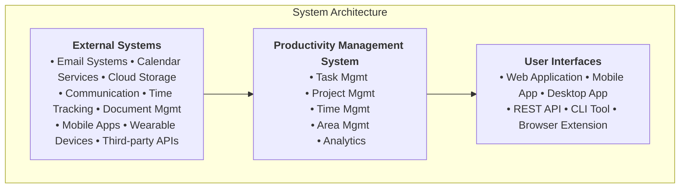

### 2.2 Product Functions

#### 2.2.1 Core Functions

1. **Task Lifecycle Management**
   - Create, update, delete tasks with rich metadata
   - Support for hierarchical task structures and dependencies
   - Task delegation and collaboration features

2. **Project Management**
   - Multi-methodology support (Agile, Waterfall, Kanban)
   - Resource allocation and milestone tracking
   - Risk management and issue tracking

3. **GTD Workflow Implementation**
   - Inbox processing and quick capture
   - Context-based task organization
   - Review system automation

4. **Time Management Suite**
   - Scheduling and calendar integration
   - Time tracking and estimation accuracy
   - Focus session management

5. **Analytics and Learning**
   - Performance metrics and reporting
   - AI-powered optimization suggestions
   - Pattern recognition and adaptation

### 2.3 User Classes and Characteristics

| User Class | Description | Technical Expertise | Usage Frequency |
|------------|-------------|-------------------|-----------------|
| **Individual Users** | Personal productivity management | Basic to Intermediate | Daily |
| **Team Members** | Collaborative task and project work | Basic to Advanced | Daily |
| **Project Managers** | Project oversight and resource management | Intermediate to Advanced | Daily |
| **Administrators** | System configuration and user management | Advanced | Weekly |
| **API Consumers** | External system integrations | Advanced | Continuous |

### 2.4 Operating Environment

#### 2.4.1 Hardware Platform

- **Server:** Cloud-based infrastructure (AWS, Azure, GCP)
- **Client:** Modern web browsers, mobile devices, desktop applications

#### 2.4.2 Software Platform

- **Backend:** RESTful API architecture
- **Frontend:** Responsive web application
- **Database:** Relational database with document storage capabilities
- **Integration:** Standard APIs for external service integration

### 2.5 Design and Implementation Constraints

1. **Security:** RBAC implementation with data encryption
2. **Performance:** Sub-second response times for core operations
3. **Scalability:** Support for 10,000+ concurrent users
4. **Compliance:** Data privacy regulations (GDPR, CCPA)
5. **Accessibility:** WCAG 2.1 AA compliance
6. **Browser Support:** Modern browsers (Chrome, Firefox, Safari, Edge)

### 2.6 Assumptions and Dependencies

#### 2.6.1 Assumptions

- Users have reliable internet connectivity
- Modern browser capabilities are available
- Third-party services maintain API compatibility

#### 2.6.2 Dependencies

- Cloud infrastructure providers
- External calendar and email services
- Third-party authentication services
- Mobile platform app stores

---

## 3. System Features

### 3.1 Task Management Module

#### 3.1.1 Task Creation and Management

**Priority:** High  
**Description:** Core task lifecycle management functionality

##### Functional Requirements

**REQ-TM-001: Task Creation**

- **ID:** REQ-TM-001
- **Description:** The system shall allow users to create tasks with comprehensive attributes
- **Input:** Task title, description, due date, priority, tags, custom fields
- **Processing:** Validate input, assign unique ID, store in database
- **Output:** Confirmation of task creation with assigned ID

**REQ-TM-002: Task Properties**

- **ID:** REQ-TM-002  
- **Description:** The system shall support configurable task properties
- **Details:**
  - Complexity estimation (Fibonacci, T-shirt sizing, numeric scale)
  - Cognitive load indicators (Low/Medium/High scale)
  - Time estimates (best-case, worst-case, most-likely)
  - Estimated start date

**REQ-TM-003: Task Templates**

- **ID:** REQ-TM-003
- **Description:** The system shall provide task template functionality
- **Details:**
  - Template creation from existing tasks
  - Predefined workflows and field sets
  - Template versioning and management

**REQ-TM-004: Task Status Management**

- **ID:** REQ-TM-004
- **Description:** The system shall manage task status transitions
- **Details:**
  - Standard statuses: Not Started, In Progress, Blocked, Waiting for Review, Completed, Deferred, Cancelled
  - Custom status definition capability
  - Status history with timestamps and comments

#### 3.1.2 Task Dependencies

**REQ-TM-005: Dependency Management**

- **ID:** REQ-TM-005
- **Description:** The system shall support task dependencies
- **Details:**
  - Dependency types: Finish-to-Start (FS), Start-to-Start (SS), Finish-to-Finish (FF), Start-to-Finish (SF)
  - Lag/lead time management
  - Circular dependency prevention
  - Visual dependency representation (Gantt charts or network diagrams)

**REQ-TM-006: Critical Path Analysis**

- **ID:** REQ-TM-006
- **Description:** The system shall identify and visualize critical paths
- **Details:**
  - Automatic critical path calculation
  - Impact analysis of dependency changes
  - Critical path visualization

#### 3.1.3 Task Delegation and Communication

**REQ-TM-007: Task Assignment**

- **ID:** REQ-TM-007
- **Description:** The system shall support task delegation
- **Details:**
  - Single and multiple assignee support
  - Workload balancing suggestions
  - Skills-based assignment recommendations
  - Assignment history tracking

**REQ-TM-008: Task Communication**

- **ID:** REQ-TM-008
- **Description:** The system shall provide task-based communication
- **Details:**
  - Comment system with rich text formatting
  - Threaded comment replies
  - User mentions (@username) with notifications
  - Attachment support for comments

### 3.2 Project Management Module

#### 3.2.1 Project Creation and Structure

**REQ-PM-001: Project Definition**

- **ID:** REQ-PM-001
- **Description:** The system shall support comprehensive project creation
- **Details:**
  - Project goals, timelines, and scope definition
  - Team assignment and role management
  - Resource allocation and budget management
  - Project templates with inheritance

**REQ-PM-002: Project Hierarchy**

- **ID:** REQ-PM-002
- **Description:** The system shall support project structure management
- **Details:**
  - Work Breakdown Structure (WBS) creation
  - Milestone definition and tracking
  - Sub-project and portfolio management

#### 3.2.2 Progress Tracking and Visualization

**REQ-PM-003: Progress Visualization**

- **ID:** REQ-PM-003
- **Description:** The system shall provide multiple project views
- **Details:**
  - Interactive Gantt charts with drag-and-drop editing
  - Kanban boards for agile workflows
  - Calendar view integration
  - Dashboard customization

**REQ-PM-004: Milestone Management**

- **ID:** REQ-PM-004
- **Description:** The system shall support milestone tracking
- **Details:**
  - Milestone types (Start, Completion, Key Deliverable, Review)
  - Hierarchical milestone structure
  - Progress calculation based on task completion
  - Milestone-based reporting

### 3.3 GTD Work Management Module

#### 3.3.1 Inbox Management

**REQ-GTD-001: Quick Capture**

- **ID:** REQ-GTD-001
- **Description:** The system shall provide rapid input capture
- **Details:**
  - Multiple input methods (text, voice, email, mobile, web clipping)
  - Quick entry interface with minimal friction
  - Batch processing capabilities

**REQ-GTD-002: Inbox Processing**

- **ID:** REQ-GTD-002
- **Description:** The system shall support systematic inbox processing
- **Details:**
  - Two-minute rule implementation
  - Action determination workflow
  - Conversion to tasks, projects, or reference materials
  - Context assignment during processing

#### 3.3.2 Context Management

**REQ-GTD-003: Context System**

- **ID:** REQ-GTD-003
- **Description:** The system shall implement GTD context management
- **Details:**
  - Hierarchical context structure
  - Location-based, time-based, and energy-level contexts
  - Context switching tracking and optimization
  - Default context sets with customization

#### 3.3.3 Next Actions and Waiting For

**REQ-GTD-004: Next Actions**

- **ID:** REQ-GTD-004
- **Description:** The system shall manage next action identification
- **Details:**
  - Multiple next actions per project
  - Priority and sequence management
  - Context-filtered next action lists
  - Progress tracking and completion

**REQ-GTD-005: Waiting For System**

- **ID:** REQ-GTD-005
- **Description:** The system shall track delegated and dependent items
- **Details:**
  - Contact association and communication history
  - Follow-up scheduling and reminder system
  - Status monitoring and escalation rules
  - Resolution tracking

#### 3.3.4 Review System

**REQ-GTD-006: Review Management**

- **ID:** REQ-GTD-006
- **Description:** The system shall automate GTD review processes
- **Details:**
  - Multiple review levels (daily, weekly, monthly, quarterly, annual)
  - Review templates and checklists
  - Progress tracking and outcome logging
  - Performance analysis and insights

### 3.4 Time Management Module

#### 3.4.1 Scheduling and Calendar Integration

**REQ-TM-001: Schedule Management**

- **ID:** REQ-TM-001
- **Description:** The system shall provide comprehensive scheduling
- **Details:**
  - Multiple time zone support
  - Conflict detection and resolution
  - Recurring event management
  - External calendar synchronization

**REQ-TM-002: Availability Management**

- **ID:** REQ-TM-002
- **Description:** The system shall manage user availability
- **Details:**
  - Working hours and break period definition
  - Booking rules and constraints
  - Availability sharing and team coordination
  - Schedule exception handling

#### 3.4.2 Time Tracking and Analysis

**REQ-TM-003: Time Tracking**

- **ID:** REQ-TM-003
- **Description:** The system shall track time spent on activities
- **Details:**
  - Multiple tracking methods (manual, automatic, duration entry)
  - Activity categorization and project allocation
  - Billable time tracking and reporting
  - Idle time detection and break tracking

**REQ-TM-004: Time Estimation**

- **ID:** REQ-TM-004
- **Description:** The system shall support time estimation and accuracy tracking
- **Details:**
  - Multiple estimation methods (bottom-up, analogous, parametric, three-point)
  - Confidence level tracking
  - Variance calculation and pattern analysis
  - Learning-based estimation improvement

#### 3.4.3 Focus and Break Management

**REQ-TM-005: Focus Sessions**

- **ID:** REQ-TM-005
- **Description:** The system shall support focus session management
- **Details:**
  - Pomodoro technique implementation
  - Multiple focus modes and environment controls
  - Interruption tracking and analysis
  - Session history and performance metrics

**REQ-TM-006: Break Management**

- **ID:** REQ-TM-006
- **Description:** The system shall optimize break scheduling
- **Details:**
  - Multiple break types and duration control
  - Activity suggestions and health metrics
  - Compliance monitoring and pattern analysis
  - Integration with focus session management

### 3.5 Area Management Module

#### 3.5.1 Area Structure and Organization

**REQ-AM-001: Area Management**

- **ID:** REQ-AM-001
- **Description:** The system shall provide organizational area management
- **Details:**
  - Hierarchical area structure
  - Area templates with custom properties
  - Access control and permission management
  - Version control and change tracking

**REQ-AM-002: Resource Allocation**

- **ID:** REQ-AM-002
- **Description:** The system shall manage resource allocation within areas
- **Details:**
  - Resource type definition and capacity planning
  - Cost management and budget tracking
  - Utilization metrics and conflict detection
  - Performance monitoring and optimization

### 3.6 Executive Function Support Module

#### 3.6.1 Timeboxing Management

**REQ-EF-001: Timeboxing System**

- **ID:** REQ-EF-001
- **Description:** The system shall provide advanced timeboxing capabilities
- **Details:**
  - Multiple block types with duration control
  - Focus level management and break scheduling
  - Status tracking and pattern analysis
  - Performance monitoring and optimization tools

#### 3.6.2 Task Organization and Visual Management

**REQ-EF-002: Task Organization**

- **ID:** REQ-EF-002
- **Description:** The system shall support executive function task organization
- **Details:**
  - Multiple breakdown methods (top-down, bottom-up, mind mapping)
  - Complexity assessment and energy tracking
  - Cognitive load balancing and priority management
  - Pattern recognition and adaptation learning

**REQ-EF-003: Visual Task Boards**

- **ID:** REQ-EF-003
- **Description:** The system shall provide customizable visual task boards
- **Details:**
  - Multiple board types (Kanban, Scrum, custom)
  - Swimlanes and custom column configuration
  - Priority visualization and filter management
  - Performance monitoring and cycle time tracking

### 3.7 Analytics and Learning Module

#### 3.7.1 Analytics Platform

**REQ-AN-001: Performance Analytics**

- **ID:** REQ-AN-001
- **Description:** The system shall provide comprehensive analytics
- **Details:**
  - KPI tracking and performance metrics
  - Custom dashboards and data visualization
  - Trend analysis and pattern recognition
  - Report generation and export capabilities

**REQ-AN-002: Key Performance Indicators**

- **ID:** REQ-AN-002
- **Description:** The system shall track essential productivity metrics
- **Details:**
  - Task completion rate and time estimation accuracy
  - Focus consistency and time block adherence
  - Cognitive load balance and energy level tracking
  - Agile metrics (cycle time, lead time, throughput, WIP)

#### 3.7.2 Learning System

**REQ-LS-001: Adaptive Learning**

- **ID:** REQ-LS-001
- **Description:** The system shall implement machine learning for personalization
- **Details:**
  - Pattern recognition in user behavior and performance
  - Model training for prediction and recommendation
  - Feedback integration and adaptive algorithms
  - A/B testing for algorithm optimization

**REQ-LS-002: Learning Areas**

- **ID:** REQ-LS-002
- **Description:** The system shall learn and optimize multiple areas
- **Details:**
  - Time estimation and cognitive load assessment
  - Scheduling optimization and focus prediction
  - Task breakdown recommendations and priority inference
  - Contextual awareness and performance correlation

### 3.8 Notification and Communication System

**REQ-NT-001: Notification Management**

- **ID:** REQ-NT-001
- **Description:** The system shall provide comprehensive notification management
- **Details:**
  - Multiple channels (email, in-app, SMS, push, webhooks)
  - Custom triggers and frequency control
  - Priority levels and delivery rules
  - Status tracking and audit trail

**REQ-NT-002: Communication Integration**

- **ID:** REQ-NT-002
- **Description:** The system shall integrate with communication tools
- **Details:**
  - External tool integration (Slack, Teams)
  - Real-time collaboration features
  - Activity feeds and communication hubs
  - Mention system with auto-completion

---

## 4. External Interface Requirements

### 4.1 User Interfaces

#### 4.1.1 Web Application Interface

**REQ-UI-001: Responsive Web Design**

- **Description:** The system shall provide a responsive web interface
- **Details:**
  - Mobile-first design approach
  - Adaptive layouts for various screen sizes
  - Touch-friendly interactions
  - Accessibility compliance (WCAG 2.1 AA)

**REQ-UI-002: User Experience Design**

- **Description:** The interface shall prioritize usability and efficiency
- **Details:**
  - Intuitive navigation and information architecture
  - Drag-and-drop functionality for task management
  - Keyboard shortcuts for power users
  - Customizable themes and layout preferences

#### 4.1.2 Mobile Application Interface

**REQ-UI-003: Mobile App Features**

- **Description:** The system shall provide native mobile applications
- **Details:**
  - Quick capture functionality with voice input
  - Offline capability with synchronization
  - Push notifications and location-based contexts
  - Biometric authentication support

### 4.2 Hardware Interfaces

**REQ-HW-001: Device Integration**

- **Description:** The system shall support integration with external devices
- **Details:**
  - Wearable device integration for activity tracking
  - Smart speaker integration for voice commands
  - Calendar and productivity hardware compatibility

### 4.3 Software Interfaces

#### 4.3.1 Calendar Integration

**REQ-SI-001: Calendar Synchronization**

- **Description:** The system shall integrate with external calendar services
- **Details:**
  - Bidirectional synchronization with Google Calendar, Outlook, Apple Calendar
  - CalDAV and Exchange protocol support
  - Conflict detection and resolution
  - Privacy and sharing controls

#### 4.3.2 Email Integration

**REQ-SI-002: Email Processing**

- **Description:** The system shall process email for task creation
- **Details:**
  - Email-to-task conversion with parsing
  - Attachment handling and reference linking
  - Email client plugin support
  - Automated inbox processing rules

#### 4.3.3 Cloud Storage Integration

**REQ-SI-003: File Management**

- **Description:** The system shall integrate with cloud storage services
- **Details:**
  - Google Drive, Dropbox, OneDrive integration
  - File linking and version control
  - Document preview and editing capabilities
  - Access control inheritance

#### 4.3.4 Communication Tool Integration

**REQ-SI-004: Team Communication**

- **Description:** The system shall integrate with communication platforms
- **Details:**
  - Slack and Microsoft Teams integration
  - Webhook support for custom integrations
  - Status synchronization and notifications
  - Collaborative workspace linking

### 4.4 Communication Interfaces

#### 4.4.1 REST API

**REQ-CI-001: RESTful API**

- **Description:** The system shall provide a comprehensive REST API
- **Details:**
  - Full CRUD operations for all entities
  - Authentication and authorization (OAuth 2.0, JWT)
  - Rate limiting and request validation
  - API versioning and backward compatibility

**REQ-CI-002: API Documentation**

- **Description:** The API shall include comprehensive documentation
- **Details:**
  - OpenAPI/Swagger specification
  - Interactive API explorer
  - SDK and example code
  - Webhook documentation

#### 4.4.2 Real-time Communication

**REQ-CI-003: Real-time Updates**

- **Description:** The system shall support real-time data synchronization
- **Details:**
  - WebSocket connections for live updates
  - Server-sent events for notifications
  - Collaborative editing capabilities
  - Conflict resolution mechanisms

---

## 5. Non-Functional Requirements

### 5.1 Performance Requirements

**REQ-NFR-001: Response Time**

- **Description:** The system shall meet specific response time requirements
- **Details:**
  - Page load time: < 2 seconds for initial page load
  - API response time: < 500ms for 95% of requests
  - Search results: < 1 second for complex queries
  - Real-time updates: < 100ms latency

**REQ-NFR-002: Throughput**

- **Description:** The system shall handle specified concurrent load
- **Details:**
  - Support 10,000 concurrent users
  - Process 100,000 API requests per minute
  - Handle 1 million tasks and 100,000 projects
  - Scale horizontally with cloud infrastructure

**REQ-NFR-003: Resource Utilization**

- **Description:** The system shall optimize resource usage
- **Details:**
  - Memory usage: < 512MB per user session
  - Database query optimization
  - Efficient caching strategies
  - Content delivery network (CDN) utilization

### 5.2 Security Requirements

**REQ-NFR-004: Authentication and Authorization**

- **Description:** The system shall implement robust security measures
- **Details:**
  - Multi-factor authentication (MFA) support
  - Role-based access control (RBAC)
  - Single sign-on (SSO) integration
  - Session management and timeout

**REQ-NFR-005: Data Protection**

- **Description:** The system shall protect user data
- **Details:**
  - Encryption at rest (AES-256)
  - Encryption in transit (TLS 1.3)
  - Regular security audits and penetration testing
  - GDPR and CCPA compliance

**REQ-NFR-006: Privacy Controls**

- **Description:** The system shall provide privacy management
- **Details:**
  - Data export and deletion capabilities
  - Granular privacy settings
  - Audit logging for data access
  - Consent management

### 5.3 Reliability Requirements

**REQ-NFR-007: Availability**

- **Description:** The system shall maintain high availability
- **Details:**
  - 99.9% uptime SLA
  - Redundant infrastructure deployment
  - Automatic failover mechanisms
  - Disaster recovery procedures

**REQ-NFR-008: Data Integrity**

- **Description:** The system shall ensure data consistency
- **Details:**
  - Regular automated backups
  - Transaction integrity and ACID compliance
  - Data validation and sanitization
  - Corruption detection and recovery

**REQ-NFR-009: Error Handling**

- **Description:** The system shall handle errors gracefully
- **Details:**
  - Comprehensive error logging
  - User-friendly error messages
  - Automatic retry mechanisms
  - Graceful degradation of features

### 5.4 Usability Requirements

**REQ-NFR-010: User Experience**

- **Description:** The system shall provide excellent user experience
- **Details:**
  - Intuitive interface design
  - Comprehensive onboarding process
  - Context-sensitive help system
  - Keyboard accessibility

**REQ-NFR-011: Accessibility**

- **Description:** The system shall be accessible to users with disabilities
- **Details:**
  - WCAG 2.1 AA compliance
  - Screen reader compatibility
  - Keyboard navigation support
  - High contrast and zoom support

**REQ-NFR-012: Internationalization**

- **Description:** The system shall support multiple languages and locales
- **Details:**
  - Unicode support (UTF-8)
  - Right-to-left language support
  - Localized date, time, and number formats
  - Time zone handling

### 5.5 Maintainability Requirements

**REQ-NFR-013: Code Quality**

- **Description:** The system shall maintain high code quality standards
- **Details:**
  - Modular architecture design
  - Comprehensive unit and integration testing
  - Code documentation and commenting
  - Automated code quality checks

**REQ-NFR-014: Deployment and Updates**

- **Description:** The system shall support efficient deployment
- **Details:**
  - Continuous integration/continuous deployment (CI/CD)
  - Blue-green deployment strategy
  - Database migration management
  - Rollback capabilities

### 5.6 Portability Requirements

**REQ-NFR-015: Platform Independence**

- **Description:** The system shall operate across multiple platforms
- **Details:**
  - Cross-browser compatibility
  - Cloud provider agnostic design
  - Mobile platform support (iOS, Android)
  - API-first architecture

---

## 6. Other Requirements

### 6.1 Legal and Regulatory Requirements

**REQ-LR-001: Data Privacy Compliance**

- **Description:** The system shall comply with data protection regulations
- **Details:**
  - GDPR compliance for European users
  - CCPA compliance for California residents
  - PIPEDA compliance for Canadian users
  - Data processing agreements and consent management

**REQ-LR-002: Accessibility Compliance**

- **Description:** The system shall meet accessibility standards
- **Details:**
  - Section 508 compliance (US federal agencies)
  - ADA compliance requirements
  - AODA compliance (Ontario, Canada)
  - EN 301 549 compliance (European Union)

### 6.2 Business Requirements

**REQ-BR-001: Licensing and Subscription**

- **Description:** The system shall support flexible licensing models
- **Details:**
  - Freemium tier with basic features
  - Professional subscription with advanced features
  - Enterprise licensing with custom deployments
  - API usage-based pricing tiers

**REQ-BR-002: Integration Marketplace**

- **Description:** The system shall support third-party integrations
- **Details:**
  - Plugin architecture for extensions
  - Third-party developer API access
  - Integration certification program
  - Revenue sharing for marketplace partners

### 6.3 Environmental Requirements

**REQ-ER-001: Sustainability**

- **Description:** The system shall minimize environmental impact
- **Details:**
  - Green hosting and renewable energy usage
  - Efficient code optimization for reduced power consumption
  - Carbon footprint tracking and reporting
  - Sustainable development practices

### 6.4 Cultural and Social Requirements

**REQ-CSR-001: Cultural Sensitivity**

- **Description:** The system shall respect cultural differences
- **Details:**
  - Culturally appropriate default settings
  - Flexible working hours and calendar systems
  - Religious holiday recognition
  - Local business practice accommodation

---

## Appendices

### Appendix A: Requirement Traceability Matrix

| Requirement ID | Priority | Source | Verification Method |
|----------------|----------|--------|-------------------|
| REQ-TM-001 | High | User Stories | Unit Testing, Integration Testing |
| REQ-TM-002 | High | User Stories | Unit Testing, User Acceptance Testing |
| REQ-PM-001 | High | Business Requirements | Integration Testing, User Acceptance Testing |
| REQ-GTD-001 | Medium | Methodology Requirements | Unit Testing, User Acceptance Testing |
| REQ-AN-001 | Medium | Business Intelligence | Integration Testing, Performance Testing |

### Appendix B: Glossary

**Area:** A logical grouping of projects, tasks, and resources representing organizational structure

**Context:** GTD concept representing the circumstances or tools required to complete a task

**Cognitive Load:** The amount of mental effort and working memory required to complete a task

**Timeboxing:** Time management technique involving fixed time periods allocated to specific activities

**Next Action:** GTD concept representing the immediate next physical action required to move a project forward

### Appendix C: Use Case Diagrams

*[Use case diagrams would be included here showing major system interactions]*

### Appendix D: Data Flow Diagrams

*[Data flow diagrams would be included here showing information flow through the system]*

---

# Use Case Diagrams and Data Flow Diagrams

## Productivity Management System

---

## Appendix C: Use Case Diagrams

### C.1 System Context Use Case Diagram

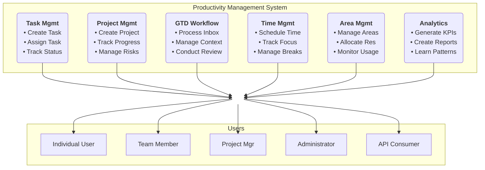

### C.2 Task Management Use Case Diagram

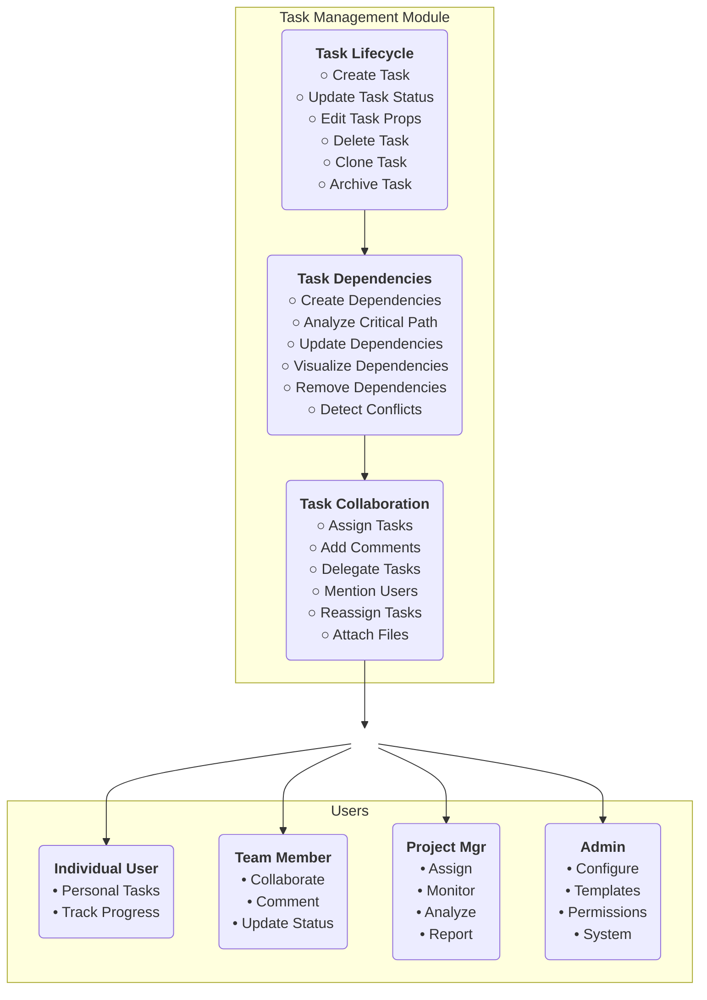
### C.3 Project Management Use Case Diagram

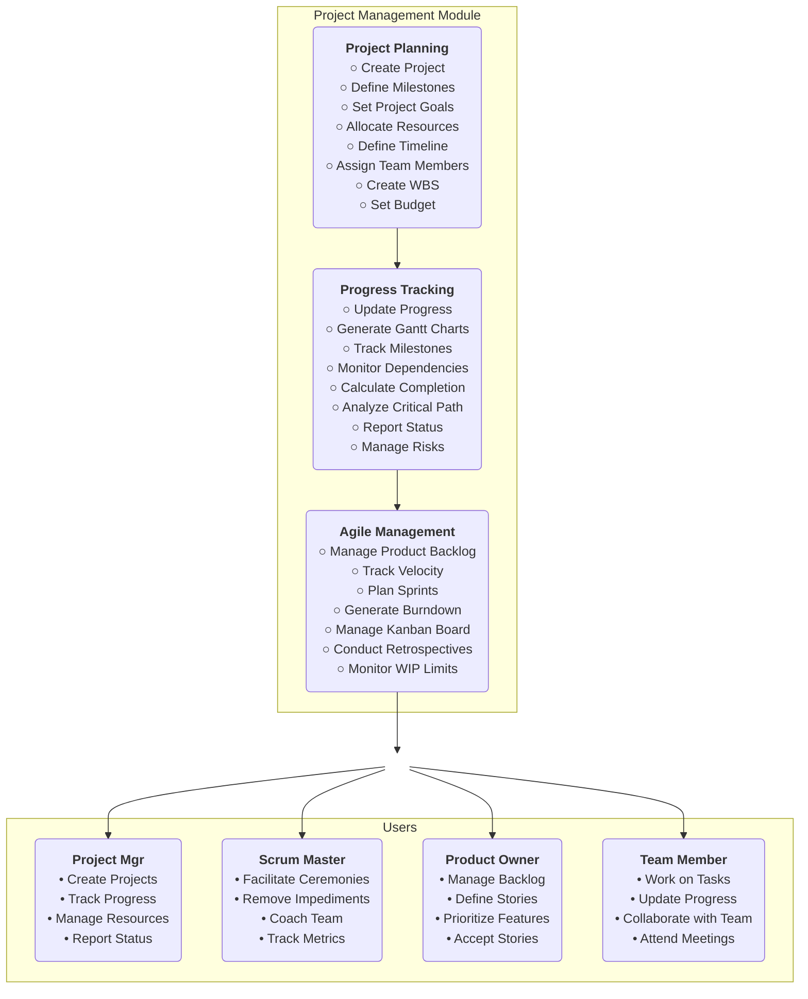
### C.4 GTD Workflow Use Case Diagram

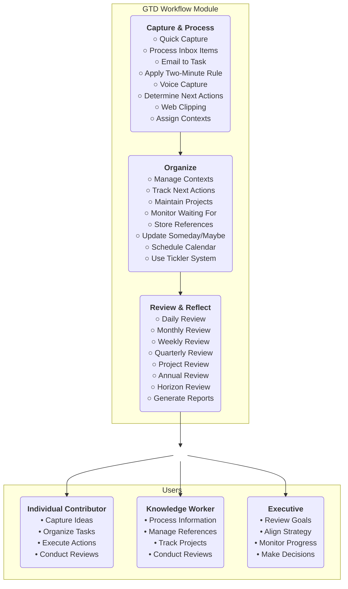

### C.5 Time Management Use Case Diagram

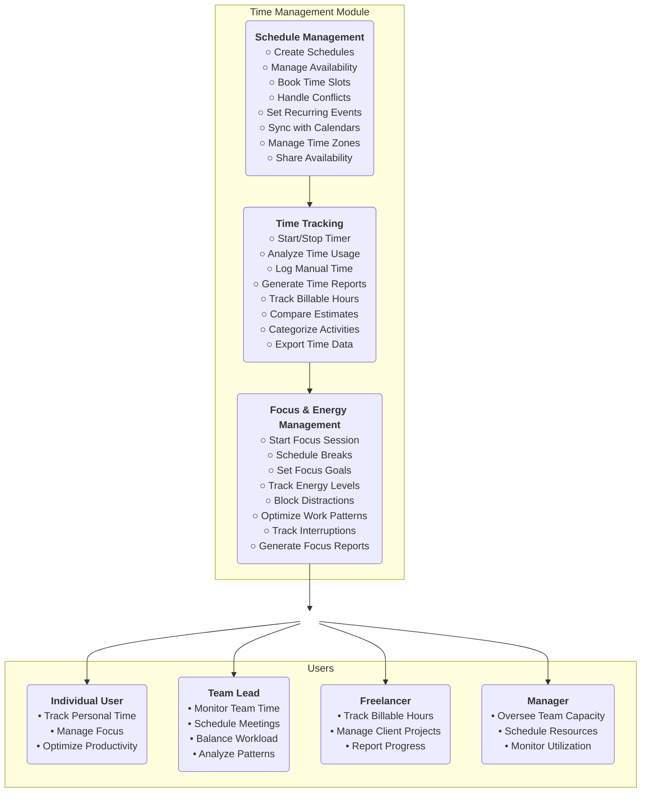

---

## Appendix D: Data Flow Diagrams

### D.1 Context Diagram (Level 0)

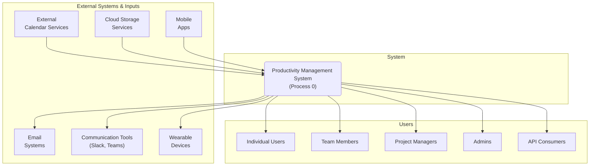

### D.2 Level 1 Data Flow Diagram

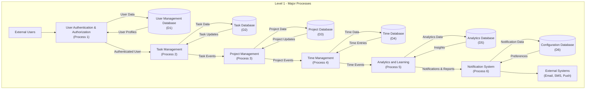

### D.3 Level 2 Data Flow Diagram - Task Management Process

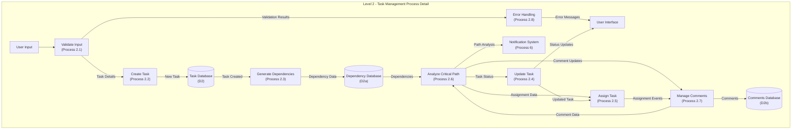

### D.4 Level 2 Data Flow Diagram - Analytics Process

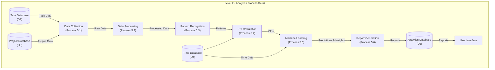

### D.5 Level 2 Data Flow Diagram - GTD Workflow Process

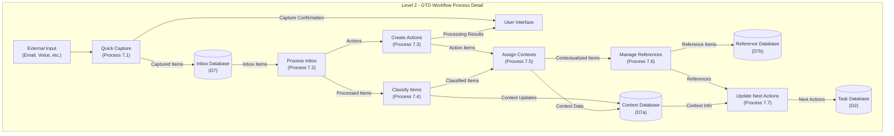

### D.6 Data Store Descriptions

| Data Store | Description | Contents |
|------------|-------------|----------|
| **D1 - User Database** | User profiles and authentication | User credentials, preferences, roles, permissions |
| **D2 - Task Database** | Task information and metadata | Tasks, subtasks, properties, status, assignments |
| **D2a - Dependency Database** | Task dependency relationships | Dependencies, constraints, critical paths |
| **D2b - Comments Database** | Task-related communications | Comments, mentions, attachments, history |
| **D3 - Project Database** | Project information and structure | Projects, milestones, resources, timelines |
| **D4 - Time Database** | Time tracking and scheduling | Time entries, schedules, availability, focus sessions |
| **D5 - Analytics Database** | Performance metrics and insights | KPIs, reports, patterns, predictions |
| **D6 - Configuration Database** | System settings and preferences | Notifications, templates, rules, customizations |
| **D7 - Inbox Database** | GTD inbox items | Captured items, processing status, classification |
| **D7a - Context Database** | GTD contexts and organization | Contexts, hierarchies, assignments, usage patterns |
| **D7b - Reference Database** | GTD reference materials | Documents, links, notes, tags, metadata |

### D.7 Data Flow Descriptions

| Data Flow | Source | Destination | Description |
|-----------|--------|-------------|-------------|
| **User Input** | External Users | System Processes | Task creation, updates, queries |
| **Authentication Data** | User Auth Process | User Database | Login credentials, session data |
| **Task Data** | Task Management | Task Database | New tasks, updates, status changes |
| **Notification Events** | Various Processes | Notification System | Trigger data for alerts and messages |
| **Analytics Data** | All Databases | Analytics Process | Raw data for analysis and reporting |
| **Insights** | Analytics Process | User Interface | Reports, recommendations, predictions |
| **Time Entries** | Time Management | Time Database | Time tracking data, schedules |
| **Project Updates** | Project Management | Project Database | Progress, milestones, resource changes |

---

**Document Control:**

- **Created:** June 14, 2025
- **Diagrams Version:** 1.0
- **Review Status:** Draft
- **Next Update:** July 14, 2025
