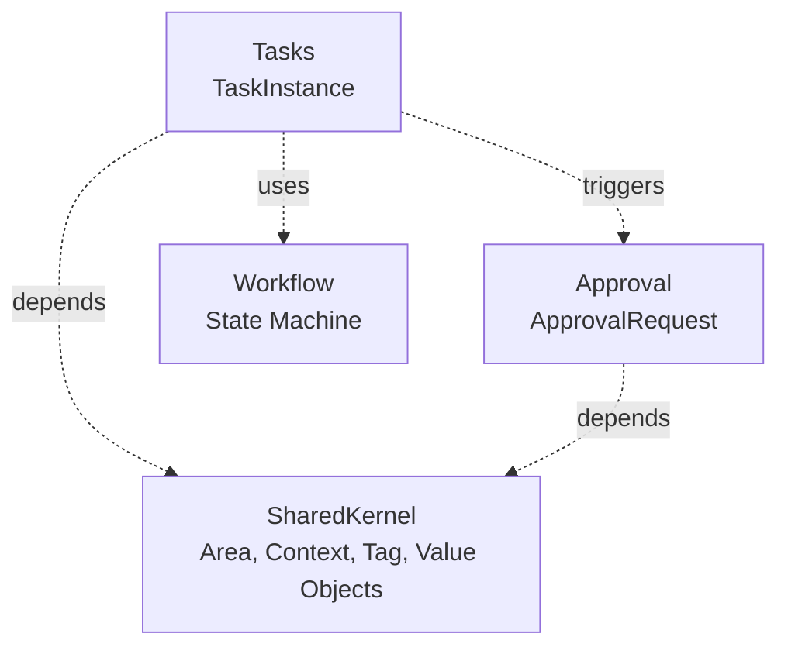

# Bounded Context Analysis for NouAssist

## Executive Summary

The NouAssist codebase implements **18 distinct bounded contexts** organized as ABP Framework modules, following Domain-Driven Design principles. The architecture is modular monolithic with event-driven integration, providing excellent separation of concerns while maintaining system cohesion.

---

## 1. Identified Bounded Contexts

### A. Core Productivity Domain (5 Contexts)

#### 1. Task Management Context (`/modules/Tasks`)
- **Aggregate Root**: `TaskInstance` (788 lines - rich domain model)
- **Key Concepts**:
  - Task execution lifecycle (Create → Start → Progress → Complete/Cancel)
  - Delegation workflow (Delegate → Accept/Decline)
  - Blocking management (Block → Unblock)
  - Dependencies (FinishToStart, StartToStart, etc.)
  - Time tracking, step completions, acceptance criteria
- **Value Objects**:
  - `TaskProgress`, `TaskSchedule`, `TimeTrackingInfo`, `ResolutionInfo`
  - `ImportanceUrgencyMatrix` (Eisenhower Matrix - quadrant-based prioritization)
  - `TaskHierarchy`, `TaskDiscussion`, `DelegationInfo`, `BlockingInfo`, `FlagInfo`
- **Dependencies**: `SharedKernel.Domain`
- **Domain Events**: `TaskInstanceCreatedEto`, `TaskStartedEto`, `TaskCompletedEto`, `TaskAssignedEto`, `TaskDelegatedEto`, `TaskBlockedEto`
- **Business Rules**:
  - Cannot delegate to self
  - Cannot complete without meeting policy requirements
  - Cannot cancel completed tasks
  - Cannot depend on self
- **Scope**: Runtime execution of tasks with rich state management

#### 2. Project Management Context (`/modules/Projects`)
- **Aggregate Root**: `Project`
- **Key Entities**: `ProjectRequirement`, `ProjectDependency`, `ProjectSuccessCriterion`, `ProjectEvent`
- **Value Objects**: `DateRange`, `SprintMetrics`, `SuccessCriterion`
- **Domain Services**:
  - `SprintPlanningService` - Sprint planning and capacity management
  - `ProjectHealthCalculationService` - Project health metrics
  - `ProjectDependencyManagementService` - Inter-project dependencies
- **Scope**: Project lifecycle, sprint management, requirements tracking

#### 3. Goals & Achievements Context (`/modules/Goals`)
- **Aggregate Roots**: `Goal`, `Achievement`, `GoalAggregate`
- **Key Entities**: `GoalMilestone`
- **Domain Services**:
  - `GoalProgressCalculationService` - Calculate progress toward goals
  - `AchievementUnlockService` - Gamification and achievement tracking
- **Scope**: Long-term goal setting, milestone tracking, productivity gamification

#### 4. Habits & Routines Context (`/modules/Habits`)
- **Aggregate Roots**:
  - `Habit` (with Cue → Response → Reward loop)
  - `Routine`, `RoutineCompletion`
  - `DailyIntention`, `DailyReflection`, `DailyQuote`
- **Tracking Aggregates**: `EnergyTrackingEntry`, `MoodTrackingEntry`, `HealthTrackingEntry`, `FocusSession`
- **Value Objects**: Habit loop components, habit strategies
- **Scope**: Habit formation, daily routines, personal wellness tracking
- **Dependencies**: References SharedKernel (Area and Context)

#### 5. Calendar & Time Management Context (`/modules/Calendar`)
- **Aggregate Roots**: `Calendar`, `CalendarEvent`, `Timeblock`, `TimeEntry`, `UserAvailability`
- **Support Entities**: `TimeblockTemplate`, `SchedulingRequest`
- **Scope**: Time blocking, event scheduling, availability management, time entry logging

### B. Workflow & Process Orchestration Domain (3 Contexts)

#### 6. Workflow Engine Context (`/modules/Workflow`)
- **Aggregate Roots**: `Workflow`, `WorkflowScheme`, `TransitionPermissionPolicy`
- **Key Entities**:
  - `WorkflowStatus` - States in the workflow
  - `WorkflowTransition` - Valid state transitions
  - `WorkflowAction` - Actions to execute on transition
  - `WorkflowCustomField` - Dynamic fields per workflow
  - `WorkflowSchemeMapping` - Map workflows to entity types
- **Value Objects**: `WorkflowCondition`
- **Domain Services**:
  - `WorkflowTransitionService` - Execute state transitions
  - `WorkflowValidationService` - Validate transition rules
  - `WorkflowActionExecutorService` - Execute post-transition actions
- **Condition Evaluators**: `FieldValueConditionEvaluator`, `RoleBasedConditionEvaluator`
- **Action Executors**: `UpdateFieldActionExecutor`, `DelegateTaskActionExecutor`
- **Scope**: Generic state machine infrastructure for any entity
- **Pattern**: Infrastructure/Framework Context - provides services to other contexts

#### 7. Approval Management Context (`/modules/Approval`)
- **Aggregate Roots**:
  - `ApprovalRequest` (425 lines - rich approval lifecycle)
  - `ApprovalWorkflow`
- **Key Entities**:
  - `ApprovalStep` - Steps in approval workflow
  - `ApprovalDecision` - Individual approval/rejection decisions
- **Key Enums**:
  - `ApprovalStatus` (Pending, InProgress, Approved, Rejected, Cancelled)
  - `ApprovalWorkflowType`, `ApprovalStrategy`, `ApprovalRequirement`, `ApprovalAction`
- **Value Objects**: Uses `CustomFieldValues` and `Metadata` from SharedKernel
- **Domain Events**: `ApprovalRequestCreatedEto`, `ApprovalRequestProcessedEto`, `ApprovalStepCompletedEto`
- **Business Rules**:
  - Cannot modify completed requests
  - Priority must be 0-10
  - Due date must be in future
  - Track overdue requests
- **Scope**: Multi-step approval workflows, routing requests, recording decisions
- **Dependencies**: `SharedKernel.Domain`
- **Pattern**: Supporting Context for other domains (Tasks, Projects can require approvals)

#### 8. GTD (Getting Things Done) Context (`/modules/GTD`)
- **Aggregate Roots**:
  - `GtdHorizon` - 6 horizons of focus (Purpose → Vision → Goals → Areas → Projects → Actions)
  - `SomedayMaybeItem` - Ideas for later
  - `TicklerItem` - Bring-up-later reminders
  - `WaitingFor` - Delegated items tracking
  - `Followup` - Follow-up actions
- **Support**: `GtdHorizonAlignment` - Align tasks to horizons
- **Scope**: David Allen's GTD methodology implementation

### C. Knowledge & Collaboration Domain (6 Contexts)

#### 9. Contacts & Relationships Context (`/modules/Contacts`)
- **Aggregate Roots**: `Contact`, `Client`
- **Scope**: Contact management, client relationships, CRM-lite

#### 10. Resources & Knowledge Base Context (`/modules/Resources`)
- **Aggregate Roots**:
  - `Resource` - Generic resource management
  - `Book`, `BookCollection` - Personal library
  - `InventoryItem` - Physical item tracking
  - `StorageBackend` - File storage backend configuration
- **Scope**: Resource inventory, book library, document storage

#### 11. Comments & Discussion Context (`/modules/Comments`)
- **Aggregate Root**: `Comment`
- **Scope**: Generic commenting system for entities (Tasks, Projects, etc.)
- **Pattern**: Generic Subdomain - reusable across entities

#### 12. Team & Collaboration Context (`/modules/Team`)
- **Aggregate Roots**: `Team`, `Role`
- **Scope**: Team management, role-based access, collaboration groups

#### 13. Users & Preferences Context (`/modules/Users`)
- **Aggregate Roots**: `User`, `UserSettings`, `UserEisenhowerPreference`
- **Scope**: User profiles, personal preferences, Eisenhower matrix customization
- **Pattern**: Identity & Access Management subdomain

#### 14. Meetings Context (`/modules/Meetings`)
- **Aggregate Root**: `Meeting` (inferred, not read but directory exists)
- **Scope**: Meeting management, agenda, attendees, notes
- **Dependencies**: Likely depends on Calendar and Team

### D. Support & Infrastructure Domain (4 Contexts)

#### 15. Reviews & Reflection Context (`/modules/Reviews`)
- **Aggregate Roots**: `Review`, `ReviewProgress`, `ReviewTemplate`
- **Scope**: Periodic reviews (daily, weekly, monthly, quarterly, annual), retrospectives
- **Pattern**: Reflection and continuous improvement

#### 16. Search Context (`/modules/Search`)
- **Aggregate Roots**: `SavedSearch`, `PopularSearch`, `SearchHistory`, `SearchAnalytics`
- **Scope**: Full-text search, search analytics, saved searches
- **Pattern**: Generic Subdomain - cross-cutting
- **Dependencies**: Indexes all other domains

#### 17. Notifications Context (`/modules/Notifications`)
- **Aggregate Roots**: `Notification`, `NotificationPreference`
- **Scope**: User notifications, delivery channels, preferences
- **Pattern**: Generic Subdomain - event-driven integration
- **Dependencies**: Subscribes to domain events from all contexts

#### 18. Reminders Context (`/modules/Reminders`)
- **Aggregate Root**: `Reminder`
- **Scope**: Scheduled reminders, notification integration
- **Dependencies**: Integrates with Notifications and Calendar

### E. Shared Kernel (`/modules/SharedKernel`)

**Purpose**: Provides foundational building blocks used across multiple bounded contexts.

**Foundational Aggregates**:
- `Area` (99 lines) - Life/work areas with:
  - Standards to maintain
  - Key Result Areas (KRAs)
  - Parent-child hierarchy
  - Archive/review lifecycle
  - Multi-tenancy support
- `Context` - GTD-style execution contexts (location, tools, energy level)
- `InboxItem` - Capture phase of GTD (inbox processing)
- `Tag`/`TagCategory` - Flexible tagging and organization
- `LogActivity` - Activity logging infrastructure
- `UserProductivityAggregate` - Cross-domain productivity metrics aggregation

**Shared Value Objects**:
- `Email` - Email validation and normalization
- `CustomFieldValues` - Dynamic extensible fields (used by Approval, Tasks)
- `EventLocation` - Location information
- `ImportanceScore` - Importance scoring
- `RecurrenceRule` - Recurring pattern definition (RRULE-like)
- `Metadata` - Extensible metadata storage (used by Approval)
- `ValidationResult` - Validation feedback

**Domain Services**:
- `EisenhowerMatrixService` - Quadrant-based prioritization (Urgent/Important)

**Confirmed Consumers**:
- `Approval.Domain` → uses `CustomFieldValues`, `Metadata`
- `Tasks.Domain` → uses value objects and likely `Area`, `Context`
- Likely: Habits, Calendar, Reminders, GTD

**Pattern**: Shared Kernel in DDD - owned by multiple teams, changes require consensus

---

## 2. Cross-Cutting Integration Patterns

### A. Event-Driven Integration (Loose Coupling)

**Published Events (Examples)**:
```csharp
// Tasks Context
TaskInstanceCreatedEto
TaskStartedEto  
TaskCompletedEto
TaskAssignedEto
TaskDelegatedEto

// Approval Context
ApprovalRequestCreatedEto
ApprovalRequestProcessedEto
```

**Event Subscribers (Inferred)**:
- Notifications Context → Listens to Task/Approval events → Sends notifications
- Activity Context → Listens to all events → Creates audit log
- Search Context → Listens to all events → Updates search index

### B. Direct Dependencies (Tight Coupling)

**Confirmed**:
- `Tasks.Domain` → `SharedKernel.Domain`
- `Approval.Domain` → `SharedKernel.Domain`
- `Habits` → `SharedKernel` (Area, Context)

**Inferred**:
- `Calendar` → `SharedKernel` (RecurrenceRule, EventLocation)
- `Reminders` → `SharedKernel` (RecurrenceRule)
- `GTD` → `SharedKernel` (Area, Context, InboxItem)

### C. Service Integration Patterns

**Workflow-as-Service**:
- Tasks use Workflow for status transitions
- Approval uses Workflow for step progression
- Projects likely use Workflow for project lifecycle

**Comments-as-Service**:
- Tasks reference comments (`CommentsCount`)
- Projects likely have comments
- Goals may have comments

---

## 3. Current Organization Assessment

### ✓ STRENGTHS
- **Clear Bounded Context Boundaries**: Each module has well-defined domain responsibility
- **Rich Domain Models**: TaskInstance (788 lines), ApprovalRequest (425 lines) show strong DDD
- **Proper Value Object Usage**: Immutable, validated value objects encapsulate business rules
- **Event-Driven Architecture**: Loose coupling via distributed events (Eto suffix)
- **Shared Kernel**: Well-designed foundation for cross-cutting concerns
- **Multi-Tenancy**: First-class support across all aggregates
- **ABP Framework Best Practices**: Proper layering (Domain → Application → Infrastructure)

### ⚠ AREAS FOR IMPROVEMENT

#### 1. Flat Module Structure Obscures Relationships
**Current Structure**:
```
/modules
├── Activity
├── Approval
├── Calendar
├── Comments
├── Contacts
├── CustomFields
├── GTD
├── Goals
├── Habits
├── Meetings
├── Notifications
├── Projects
├── Reminders
├── Resources
├── Reviews
├── Search
├── SharedKernel
├── Tasks
├── Team
├── Users
└── Workflow
```

**Issue**: No indication of domain groupings or dependencies.

---

## 4. Recommended Organization Strategies

### Option 1: Hierarchical Domain Grouping (Recommended)
```
/modules
│
├── _Core/                     # Core productivity domain
│   ├── Tasks/                 # [Rich aggregate, 788 lines]
│   ├── Projects/              # [With domain services]
│   ├── Goals/
│   ├── Habits/
│   └── Calendar/
│
├── _Workflow/                 # Process orchestration
│   ├── Workflow/              # [Infrastructure - State machine]
│   ├── Approval/              # [Rich aggregate, 425 lines]
│   └── GTD/                   # [Methodology-specific]
│
├── _Knowledge/                # Collaboration & information
│   ├── Contacts/
│   ├── Resources/
│   ├── Team/
│   ├── Users/
│   ├── Meetings/
│   └── Comments/              # [Generic subdomain]
│
├── _Reviews/                  # Reflection & improvement
│   ├── Reviews/
│   └── Activity/              # [Audit logging]
│
├── _Infrastructure/           # Cross-cutting concerns
│   ├── Notifications/         # [Event subscriber]
│   ├── Search/                # [Event subscriber]
│   ├── Reminders/
│   ├── CustomFields/
│   └── SharedKernel/          # [Foundation - keep here]
│
└── README.md                  # Bounded context map diagram
```

**Benefits**:
- ✓ Clear domain groupings at a glance
- ✓ Easier to understand system architecture
- ✓ Natural organization for new developers
- ✓ Groups related contexts together

**Drawbacks**:
- ⚠ Folder renaming required
- ⚠ Build scripts may need updates
- ⚠ Migration effort for existing team

### Option 2: Bounded Context Map Documentation (Minimal Change)

Keep flat structure, but add:

**A. `/docs/BoundedContextMap.md`**:
```markdown
# Bounded Context Map

## Core Productivity Domain
- **Tasks** [Aggregate: TaskInstance] - Task execution lifecycle
  - Dependencies: SharedKernel
  - Events: TaskStarted, TaskCompleted, TaskAssigned
  - Integration: Approval (for task approval), Workflow (for status)
  
- **Projects** - Sprint planning, requirements
  - Dependencies: None
  - Integration: Tasks (tasks belong to projects)
```

**B. Architecture Decision Record (ADR)**:
```markdown
# ADR-001: Module Dependencies

## Decision
- Only SharedKernel can be referenced by other modules
- Cross-module communication via distributed events
- No circular dependencies allowed

## Dependency Graph
SharedKernel ← Tasks
SharedKernel ← Approval
SharedKernel ← Habits
```

### Option 3: Namespace-Based Grouping (Code-Only)

Keep folder structure flat, but use namespaces:
```csharp
// Current
namespace NouAssist.Tasks.Aggregates { ... }

// Proposed
namespace NouAssist.Core.Tasks.Aggregates { ... }
namespace NouAssist.Workflow.Approval.Aggregates { ... }
namespace NouAssist.Infrastructure.Notifications { ... }
```

**Benefits**:
- ✓ No folder moves required
- ✓ Namespace indicates domain grouping
- ✓ Easy to implement

**Drawbacks**:
- ⚠ Inconsistent with folder structure
- ⚠ May confuse developers

---

## 5. Specific Recommendations

### Priority 1: Document Context Map ⭐⭐⭐
**Effort**: Low | **Impact**: High

Create `/docs/BoundedContextMap.md` with:
- Visual diagram of all 18 contexts
- Dependencies between contexts
- Integration patterns (sync vs async)
- Owner/responsibility for each context

**Tool Suggestion**: Use Mermaid diagrams:


### Priority 2: Create Anti-Corruption Layer ⭐⭐
**Effort**: Medium | **Impact**: Medium

**Problem**: Direct dependencies on SharedKernel couples contexts.

**Solution**: Create Contracts layer for each module:
```
Module/
├── src/
│   ├── Domain/
│   ├── Domain.Shared/
│   ├── Domain.Contracts/       # NEW
│   │   ├── IDomainService.cs
│   │   └── Events/
│   ├── Application.Contracts/
│   └── ...
```

**Example**:
```csharp
// In SharedKernel.Domain.Contracts
public interface IAreaService
{
    Task<AreaDto> GetAreaAsync(Guid areaId);
}

// In Tasks.Domain - consume interface, not concrete
private readonly IAreaService _areaService;
```

### Priority 3: Consolidate Duplicate Value Objects ⭐⭐⭐
**Effort**: Low | **Impact**: High

**Found Duplicates**:
- `RecurrenceRule` appears in Tasks and SharedKernel
- `ImportanceUrgencyMatrix` in Tasks, but could be in SharedKernel (used by Users for preferences)

**Action**:
- Move all recurrence logic to `SharedKernel.ValueObjects.RecurrenceRule`
- Remove duplication from Tasks
- Consider moving `ImportanceUrgencyMatrix` to SharedKernel if used by multiple contexts

### Priority 4: Define Module Interaction Rules ⭐⭐
**Effort**: Low | **Impact**: High

Create `/docs/ArchitectureRules.md`:
```markdown
## Module Dependency Rules

### Allowed
✓ Any module → SharedKernel (value objects, Area, Context)
✓ Any module → Publish domain events
✓ Any module → Subscribe to other modules' events

### Forbidden
✗ Direct module-to-module references (except SharedKernel)
✗ Circular dependencies
✗ Application layer references from Domain layer

### Special Cases
- Workflow: Infrastructure module, can be used by Tasks, Approval
- Comments: Generic subdomain, used by Tasks, Projects, Goals
```

### Priority 5: Establish Context Integration Catalog ⭐
**Effort**: Medium | **Impact**: Medium

Document all integration points:
```markdown
## Task → Approval Integration

**Trigger**: User marks task as requiring approval
**Flow**:
1. Task.Approval.RequireApproval(workflowId) called
2. Task publishes TaskApprovalRequiredEto event
3. Approval context listens, creates ApprovalRequest
4. When approved, Approval publishes ApprovalRequestProcessedEto
5. Task listens, marks task as approved

**Coupling**: Loose (event-driven)
**Alternative**: Tight (Task directly calls ApprovalService) - not recommended
```

---

## 6. Bounded Context Interaction Matrix

| Context | Depends On | Publishes Events | Subscribes To Events | Provides Services |
|---------|-----------|------------------|---------------------|-------------------|
| Tasks | SharedKernel | TaskCreated, TaskCompleted | ApprovalProcessed | ITaskService |
| Approval | SharedKernel | ApprovalRequested, ApprovalProcessed | None | IApprovalService |
| Workflow | None | WorkflowTransitioned | None | IWorkflowEngine |
| SharedKernel | None | None | None | IAreaService, EisenhowerMatrixService |
| Notifications | None | None | ALL events | INotificationService |
| Search | None | None | ALL entity events | ISearchIndexer |
| Comments | None | CommentAdded | None | ICommentService |
| Calendar | SharedKernel | EventScheduled | TaskCreated, MeetingCreated | ICalendarService |

---

## 7. Anti-Patterns to Avoid

❌ **DON'T**: Create "God Context"
- **Bad**: Merging Tasks, Projects, Goals into single "Productivity" module
- **Reason**: Violates Single Responsibility, high coupling

❌ **DON'T**: Allow Circular Dependencies
- **Bad**: Tasks depends on Projects, Projects depends on Tasks
- **Solution**: Use domain events or shared abstractions

❌ **DON'T**: Bypass Aggregate Boundaries
- **Bad**: Directly modifying Task.StepCompletions from outside
- **Good**: Call `task.CompleteStep(stepId, userId)` method

❌ **DON'T**: Share Concrete Domain Entities
- **Bad**: Approval references TaskInstance directly
- **Good**: Approval stores EntityType + EntityId ✓

❌ **DON'T**: Use Anemic Domain Models
- **Good Example**: `TaskInstance.Start()` enforces policy checks ✓
- **Bad Example**: Would be `taskInstance.Status = "InProgress"` without business rules

---

## 8. Patterns Observed (Excellent)

✓ **Rich Aggregate Roots**
  - TaskInstance: 788 lines with 30+ domain methods
  - ApprovalRequest: 425 lines with comprehensive state machine
  - Business logic in domain, not in services ✓

✓ **Value Objects Enforce Invariants**
  - ImportanceUrgencyMatrix validates importance/urgency
  - Email validates email format (SharedKernel)
  - Immutable by design ✓

✓ **Domain Events for Integration**
  - AddDistributedEvent() calls throughout aggregates
  - Loose coupling between contexts ✓

✓ **Policy Pattern**
  - ITaskStartPolicy, ITaskCompletionPolicy
  - Allows flexible business rules ✓

✓ **Specification Pattern**
  - Repositories use specifications for querying
  - Encapsulates query logic ✓

---

## 9. Final Recommendations Summary

| Action | Priority | Effort | Impact | Notes |
|--------|----------|--------|--------|-------|
| Document Bounded Context Map | ⭐⭐⭐ | Low | High | Immediately valuable, no code changes |
| Create Architecture Decision Records | ⭐⭐⭐ | Low | High | Prevent future violations |
| Consolidate Value Objects | ⭐⭐⭐ | Low | High | Remove duplication (RecurrenceRule) |
| Add Domain.Contracts Layer | ⭐⭐ | Med | Med | Decouple SharedKernel dependencies |
| Hierarchical Folder Structure | ⭐ | High | Med | Organizational clarity, but disruptive |
| Integration Catalog | ⭐⭐ | Med | Med | Document all event flows |
| Automated Dependency Checks | ⭐ | Med | Low | Use ArchUnit or similar for CI |

---

## 10. Conclusion

Your NouAssist codebase demonstrates **excellent DDD practices** with:

✓ **Clear bounded contexts** (18 well-defined modules)
✓ **Rich domain models** (TaskInstance, ApprovalRequest)
✓ **Event-driven integration** (loose coupling)
✓ **Shared Kernel** for common concepts (Area, Context, value objects)
✓ **Policy pattern** for extensibility
✓ **Multi-tenancy support** throughout

### Recommended Next Steps:
- **Week 1**: Create bounded context map documentation
- **Week 2**: Consolidate duplicate value objects to SharedKernel
- **Week 3**: Document architecture rules and anti-corruption layers
- **Month 2**: Consider hierarchical folder organization (if team agrees)

**The current organization is very good** and requires only documentation improvements rather than major refactoring. Focus on making implicit relationships explicit through documentation before making structural changes.
